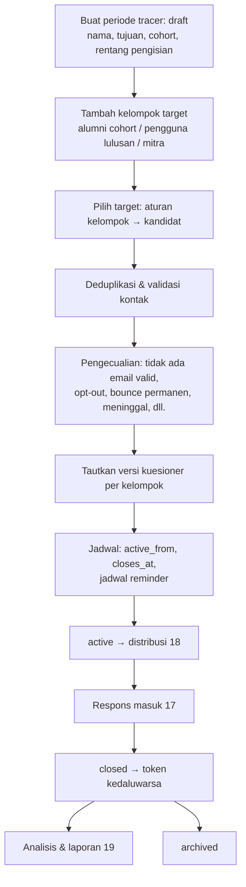
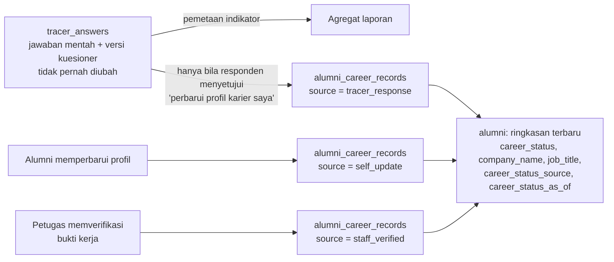
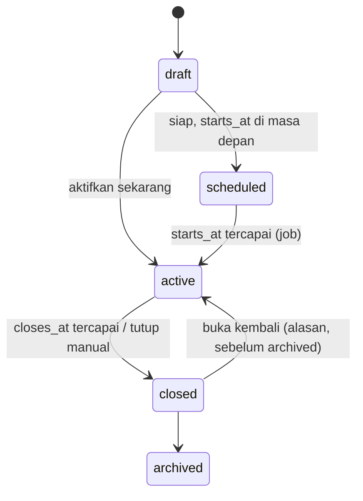

# 16 — Rancangan Tracer Study

> **Status:** rancangan · Disusun 2026-10-13 (commit `47043ca`) · Kembali ke [README](README.md)
> Skema acuan: [25 §6](25-rancangan-database-dan-erd.md#6-kelompok-tracer-study) · Aturan: `TRACER-BR-005`, `TRACER-BR-012`, `TRACER-BR-013`, `TRACER-BR-016` · Kuesioner: [17](17-rancangan-kuesioner-dan-survei.md) · Distribusi & kuota: [18](18-rancangan-distribusi-dan-reminder-tracer.md) · Dashboard: [19](19-rancangan-dashboard-dan-laporan-tracer.md)

Tracer study mengumpulkan informasi dari **alumni** dan **pengguna lulusan** untuk evaluasi pendidikan, pengembangan institusi, pelaporan indikator kinerja, dan akreditasi. Dokumen ini mengatur **periode tracer, target responden, pengguna lulusan, status karier alumni**, serta pemisahan antara **jawaban survei** dan **profil alumni**. Kuesioner, distribusi/kuota, dan dashboard dirinci di dokumen 17–19.

## Daftar Isi

1. [Tujuan](#1-tujuan)
2. [Ruang Lingkup](#2-ruang-lingkup)
3. [Aktor dan Hak Akses](#3-aktor-dan-hak-akses)
4. [Prasyarat](#4-prasyarat)
5. [Alur Bisnis Utama](#5-alur-bisnis-utama)
6. [Alur Alternatif dan Kegagalan](#6-alur-alternatif-dan-kegagalan)
7. [Status dan Transisi Status](#7-status-dan-transisi-status)
8. [Data Input dan Output](#8-data-input-dan-output)
9. [Aturan Bisnis](#9-aturan-bisnis)
10. [Validasi](#10-validasi)
11. [Rancangan Database](#11-rancangan-database)
12. [Relasi Antarmodul](#12-relasi-antarmodul)
13. [Kontrak API Konseptual](#13-kontrak-api-konseptual)
14. [Rancangan Halaman UI/UX](#14-rancangan-halaman-uiux)
15. [Notifikasi](#15-notifikasi)
16. [Laporan](#16-laporan)
17. [Keamanan dan Audit](#17-keamanan-dan-audit)
18. [Acceptance Criteria](#18-acceptance-criteria)
19. [Test Case](#19-test-case)
20. [Asumsi dan Keputusan Terbuka](#20-asumsi-dan-keputusan-terbuka)

---

## Kondisi saat ini (terverifikasi)

| Komponen | Kondisi |
|---|---|
| `alumni` (modul `Alumni`, Ada) | `student_id` (unik, FK cascade), `graduation_year`, `employment_status` (MySQL enum `bekerja`, `wirausaha`, `melanjutkan_studi`, `mencari_kerja`, `belum_bekerja`, **wajib**), `company_name`, `job_title`, `waiting_period_months`, `is_verified` |
| Endpoint | `GET /alumni`, `GET /alumni/{id}` (`alumni.read`). Tanpa endpoint tulis |
| Permission | `alumni.read` dimiliki `university_owner`, `university_administrator`, `rector`, `vice_rector`, `dean`, `head_of_study_program`, `academic_administrator`, `auditor` (tanpa scope fakultas/prodi), sehingga mereka dapat melihat nama perusahaan dan jabatan seluruh alumni |
| Tracer study | **Belum ada**: tidak ada periode, kuesioner, undangan, atau jawaban |
| Frontend | `pages/alumni/AlumniPage`, `AlumniDetailPage` memanggil `alumniService` (read-only) |

Masalah: status karier saat ini wajib diisi tanpa sumber dan tanpa riwayat, sehingga tidak dapat dibedakan antara "alumni menyatakan belum bekerja" dan "belum diketahui".

## 1. Tujuan

Mengumpulkan data outcome lulusan yang valid, terhubung ke versi instrumen, dengan denominator yang jelas, dan melindungi privasi responden.

## 2. Ruang Lingkup

**Termasuk:** periode tracer per cohort, kelompok target (alumni, pengguna lulusan, perusahaan mitra, kelompok lain), pemilihan target, deduplikasi, validasi kontak, pengecualian, kontak pengguna lulusan, status karier alumni beserta sumbernya, dan pembaruan profil alumni yang sah.

**Tidak termasuk:** builder kuesioner ([17](17-rancangan-kuesioner-dan-survei.md)), pengiriman dan kuota ([18](18-rancangan-distribusi-dan-reminder-tracer.md)), serta indikator dan pelaporan ([19](19-rancangan-dashboard-dan-laporan-tracer.md)).

## 3. Aktor dan Hak Akses

| Aktor | Aksi | Permission | Scope |
|---|---|---|---|
| Petugas tracer study (`tracer_officer`; mis. pusat karier/LPM) | Kelola periode, target, kontak, distribusi | `tracer_periods.*`, `tracer_targets.*`, `tracer_invitations.create` | `u` |
| Admin prodi | Melihat progres & hasil agregat prodi, mengusulkan kontak pengguna lulusan | `tracer_reports.read`, `tracer_targets.create` (kontak employer) | `p` |
| Analis/LPM | Mengakses jawaban tanpa identitas, menyusun laporan | `tracer_responses.read`, `tracer_reports.read/export` | `u` |
| Pemegang akses identitas | Melihat identitas responden (mis. untuk tindak lanjut) | `tracer_respondent_identity.read` (terpisah) | `u` |
| Alumni | Mengisi survei (token atau login), memperbarui profil karier | Token / `alumni_self_service.*` | Sendiri |
| Pengguna lulusan | Mengisi survei pengguna lulusan (token) | Token | Sendiri |
| Pimpinan | Dashboard agregat | `tracer_reports.read` | `u` |

## 4. Prasyarat

1. Entitlement `tracer.core`. Kuota undangan `tracer.invitations.quota` ([18](18-rancangan-distribusi-dan-reminder-tracer.md)).
2. Data lulusan: keputusan yudisium final ([12](12-rancangan-peserta-dan-penetapan-kelulusan.md)) untuk lulusan baru. Untuk lulusan sebelum sistem berjalan: `students.status = graduated` + `graduated_at` (Ada) atau impor alumni.
3. Kuesioner versi `published` ([17](17-rancangan-kuesioner-dan-survei.md)).

## 5. Alur Bisnis Utama

### 5.1 Periode dan cohort

Atribut periode: `code`, `name`, `purpose` (`institutional`, `accreditation`, `performance_indicator`, `other`), `reference_year`, `starts_at`, `closes_at`, `timezone` (tenant), `quota_window_key` ([18](18-rancangan-distribusi-dan-reminder-tracer.md)), `status`.

Kelompok target (`tracer_target_groups`):

| `respondent_type` | Aturan pemilihan (`selection_rules` json) | Contoh |
|---|---|---|
| `alumni` | `graduation_date_from/to` atau `graduation_years[]`, `study_program_ids[]`, `degree_levels[]` | Lulusan 1 Agustus 2025 – 31 Juli 2026, S1 semua prodi |
| `employer` | Kontak pengguna lulusan terdaftar (`tracer_employer_contacts`) dengan relasi ke alumni cohort tertentu, atau daftar impor | Atasan langsung alumni cohort 2024 |
| `partner_company` | Perusahaan mitra aktif di Career Center ([22](22-rancangan-mitra-perusahaan-dan-crm.md)) dengan PIC yang setuju dihubungi | Mitra rekrutmen aktif |
| `custom` | Impor daftar (email, nama, atribut) | Peserta program khusus |

Cohort mana yang wajib disurvei untuk keperluan pelaporan tertentu ditentukan kebijakan kampus dan instrumen resmi yang dipakai, bukan oleh sistem ([KK-Q-17](33-glossary-dan-keputusan-bisnis.md#3-pertanyaan-terbuka-kk-q)).

### 5.2 Pemilihan, deduplikasi, validasi kontak

1. **Kandidat**: diambil dari sumber sesuai `selection_rules`.
2. **Identitas target**: alumni = `student_id`. Pengguna lulusan = `tracer_employer_contacts.id` + `alumni_id` yang dinilai (satu kontak dapat menilai beberapa alumni, dan dapat diatur satu undangan per kontak dengan beberapa alumni yang dinilai di dalam satu survei, atau satu undangan per pasangan, sesuai `employer_survey_mode`).
3. **Deduplikasi** ([TRACER-BR-005](29-business-rules-dan-validasi.md#tracer-br-005)): satu target per (`tracer_period_id`, `respondent_type`, `subject_key`). `subject_key` = `student_id` untuk alumni, dan `employer_contact_id` (mode per kontak) atau `employer_contact_id:alumni_id` (mode per pasangan) untuk pengguna lulusan. Email yang sama pada dua alumni berbeda ditandai `shared_email` untuk ditinjau (mis. email keluarga).
4. **Validasi kontak**: sintaks RFC 5322, domain memiliki MX (pemeriksaan DNS, hasil di-cache), tidak ada di daftar supresi tenant (`tracer_suppressions`: hard bounce, permintaan berhenti, keluhan spam), dan bukan domain sekali pakai (daftar dapat dikonfigurasi).
5. **Prioritas email alumni**: `alumni.contact_email` (diverifikasi alumni) > email profil karier > `students.email` (sering email kampus yang dapat sudah nonaktif). Sumber email yang dipakai dicatat pada target.
6. **Pengecualian** (`exclusion_reason`): `no_valid_email`, `suppressed`, `opted_out`, `deceased`, `duplicate`, `manual_exclusion` (alasan wajib), `graduation_annulled`.

Target yang dikecualikan **tetap tercatat** agar denominator laporan dapat dijelaskan ([19](19-rancangan-dashboard-dan-laporan-tracer.md)).

### 5.3 Kontak pengguna lulusan

`tracer_employer_contacts`: nama, jabatan, instansi, email, telepon (opsional), `career_company_id` (bila perusahaan terdaftar di Career Center), sumber (`alumni_provided` — alumni mengisi data atasan di survei alumni dengan persetujuan; `company_registry`; `staff_input`; `import`), `consent_basis`, dan relasi ke alumni (`tracer_employer_contact_alumni`).

Kontak yang berasal dari jawaban alumni hanya dipakai untuk survei pengguna lulusan bila pertanyaan pengambilannya menyatakan tujuan tersebut dan alumni menyetujuinya ([TRACER-BR-013](29-business-rules-dan-validasi.md#tracer-br-013)).

### 5.4 Status karier alumni

Klasifikasi status karier **dapat dikonfigurasi** per tenant (`alumni_career_status_types`) dengan nilai bawaan yang kompatibel dengan enum Ada:

| Kode | Label | Kompatibel enum Ada |
|---|---|---|
| `employed` | Bekerja | `bekerja` |
| `self_employed` | Wirausaha | `wirausaha` |
| `further_study` | Studi lanjut | `melanjutkan_studi` |
| `job_seeking` | Sedang mencari pekerjaan | `mencari_kerja` |
| `not_working` | Belum bekerja (tidak mencari) | `belum_bekerja` |
| *(tenant)* | Kondisi lain sesuai instrumen | — |

Nilai status pada **jawaban tracer** berasal dari opsi pertanyaan instrumen yang dipetakan ke kode ini melalui indikator ([17](17-rancangan-kuesioner-dan-survei.md), [19](19-rancangan-dashboard-dan-laporan-tracer.md)).

### 5.5 Pemisahan jawaban survei dan profil alumni

- `alumni_career_records` adalah riwayat append-only: status, perusahaan, jabatan, sektor, tanggal mulai, pendapatan (opsional & terenkripsi, [TRACER-BR-016](29-business-rules-dan-validasi.md#tracer-br-016)), sumber, `source_reference_id`, `recorded_at`, dan `verified_by`.
- Kolom ringkasan pada `alumni` (`employment_status` Ada, ditambah `career_status_source`, `career_status_as_of`) diperbarui dari catatan terbaru menurut prioritas sumber `staff_verified` > `self_update` > `tracer_response`, dan pada sumber setara memakai `recorded_at` terbaru.
- `employment_status` diubah menjadi **nullable**. Alumni tanpa catatan bernilai `null` ("belum diketahui"), bukan `belum_bekerja` ([TRACER-BR-012](29-business-rules-dan-validasi.md#tracer-br-012), [TRACER-BR-013](29-business-rules-dan-validasi.md#tracer-br-013)).
- `waiting_period_months` (Ada) tidak lagi diisi manual. Nilainya diturunkan dari catatan pekerjaan pertama (`first_job_started_at` − `graduation_date`) bila tersedia, dengan sumber tercatat.

## 6. Alur Alternatif dan Kegagalan

| Kode | Kondisi | Penanganan |
|---|---|---|
| AF-TRC-01 | Alumni lama tanpa keputusan yudisium di sistem | Dipilih dari `students.status = graduated` + `graduated_at`, atau impor alumni. Target diberi atribut `graduation_source = legacy` |
| AF-TRC-02 | Alumni tidak memiliki email valid | `excluded` `no_valid_email`. Tetap masuk denominator "target terdefinisi", tetapi tidak di denominator "target terhubungi" ([19](19-rancangan-dashboard-dan-laporan-tracer.md)) |
| AF-TRC-03 | Keputusan kelulusan dibatalkan saat periode berjalan | Target `excluded` `graduation_annulled`, token dicabut, jawaban yang sudah ada ditandai `invalidated` |
| AF-TRC-04 | Alumni meminta datanya tidak dipakai | Supresi + `opted_out`. Jawaban yang sudah ada diperlakukan sesuai kebijakan penghapusan ([28 §8](28-keamanan-privasi-dan-audit.md#8-hak-subjek-data)) |
| AF-TRC-05 | Periode diperpanjang | `closes_at` diubah dengan alasan. Token aktif diperpanjang, dan tidak ada pemakaian kuota baru |
| AF-TRC-06 | Target ditambah setelah periode aktif | Diizinkan. Undangan baru memakai kuota ([18](18-rancangan-distribusi-dan-reminder-tracer.md)) |

## 7. Status dan Transisi Status

`tracer_periods.status`: `draft`, `scheduled`, `active`, `closed`, `archived`.

`tracer_targets.status`: `eligible`, `excluded`. Status pengiriman dan pengisian dicatat terpisah ([18](18-rancangan-distribusi-dan-reminder-tracer.md), [TRACER-BR-002](29-business-rules-dan-validasi.md#tracer-br-002)).

## 8. Data Input dan Output

Impor target/kontak (XLSX/CSV, openspout Ada): `respondent_type, nim (alumni), name, email, company, position, related_nim (employer)`. Laporan hasil impor per baris.

Output daftar target: NIM/nama (sesuai izin identitas), prodi, cohort, sumber email, status pengecualian, status pengiriman terakhir, dan status pengisian.

## 9. Aturan Bisnis

| ID | Aturan |
|---|---|
| [TRACER-BR-005](29-business-rules-dan-validasi.md#tracer-br-005) | Target unik per periode, jenis responden, dan subjek. Target yang dikecualikan tetap tercatat dengan alasan |
| [TRACER-BR-012](29-business-rules-dan-validasi.md#tracer-br-012) | Responden yang belum menjawab tidak boleh dihitung sebagai alumni yang belum bekerja. Status karier tanpa sumber bernilai "belum diketahui" |
| [TRACER-BR-013](29-business-rules-dan-validasi.md#tracer-br-013) | Jawaban responden disimpan terpisah dari profil alumni. Profil hanya diperbarui dari jawaban atas persetujuan responden dan dicatat sebagai catatan bersumber |
| [TRACER-BR-016](29-business-rules-dan-validasi.md#tracer-br-016) | Pendapatan hanya dikumpulkan bila pertanyaannya diaktifkan dengan dasar dan tujuan yang dinyatakan, bersifat opsional bagi responden, disimpan terenkripsi, dan dilaporkan agregat |

## 10. Validasi

V-TRC-01 `starts_at < closes_at`. V-TRC-02 Minimal satu kelompok target dengan versi kuesioner `published` sebelum `active`. V-TRC-03 Kode periode unik per tenant. V-TRC-04 Email divalidasi (§5.2). V-TRC-05 Impor maks. `tracer.import.max_rows` (default 20.000).

## 11. Rancangan Database

`tracer_periods`, `tracer_target_groups`, `tracer_targets`, `tracer_employer_contacts`, `tracer_employer_contact_alumni`, `tracer_suppressions`, `alumni_career_status_types`, `alumni_career_records`, `alumni` (**Ubah**: `employment_status` nullable & string, + `contact_email`, `contact_email_verified_at`, `contact_phone` terenkripsi, `career_status_source`, `career_status_as_of`, `first_job_started_at`, `is_deceased`, `is_active`; FK `student_id` diubah ke `restrict`). Lihat [25 §6](25-rancangan-database-dan-erd.md#6-kelompok-tracer-study).

## 12. Relasi Antarmodul

| Modul | Hubungan |
|---|---|
| Yudisium | Cohort dari `graduation_decisions` (final). Event `GraduationDecisionAnnulled` |
| Akademik | `students` (nama, NIM, prodi, email, `graduated_at` untuk data lama) |
| Alumni (Ada) | Ringkasan karier & kontak |
| Career Center | Perusahaan mitra sebagai target. Kontak PIC. Publikasi agregat ([20](20-rancangan-career-center-karirlink.md)) |
| Notification | Email undangan/reminder ([18](18-rancangan-distribusi-dan-reminder-tracer.md), [27](27-rancangan-notifikasi-dan-email.md)) |

## 13. Kontrak API Konseptual

| Method | URL | Permission |
|---|---|---|
| GET/POST/PUT | `/tracer/periods` | `tracer_periods.*` |
| POST | `/tracer/periods/{period}/activate`, `/close`, `/reopen`, `/archive` | `tracer_periods.publish/finalize` |
| GET/POST | `/tracer/periods/{period}/target-groups` | `tracer_targets.read/create` |
| POST | `/tracer/target-groups/{group}/build` (bangun kandidat; pratinjau sebelum commit) | `tracer_targets.create` |
| GET | `/tracer/periods/{period}/targets` (filter status, prodi, cohort, alasan pengecualian) | `tracer_targets.read` |
| POST | `/tracer/targets/{target}/exclude`, `/include` | `tracer_targets.update` |
| POST | `/tracer/periods/{period}/targets/import` | `tracer_targets.import` |
| GET/POST/PUT | `/tracer/employer-contacts` | `tracer_targets.read/create/update` |
| GET/POST | `/alumni/{alumni}/career-records` | `alumni.read` / `alumni_career_records.create` |
| GET/PUT | `/me/alumni/profile` | `alumni_self_service.read/update` |

## 14. Rancangan Halaman UI/UX

| Halaman | Rute |
|---|---|
| Dashboard Tracer | `/tracer` (ringkasan periode aktif; lihat [19](19-rancangan-dashboard-dan-laporan-tracer.md)) |
| Periode Tracer | `/tracer/periode` |
| Target Responden | `/tracer/periode/:id/target` — kartu per kelompok (kandidat, eligible, dikecualikan per alasan), tombol "Bangun ulang target" dengan pratinjau selisih |
| Kontak Pengguna Lulusan | `/tracer/pengguna-lulusan` |
| Alumni (Ada, diperluas) | `/alumni` — kolom status karier menampilkan sumber & tanggal, nilai `null` = "Belum diketahui" |

## 15. Notifikasi

`tracer.period.activated` (petugas), `tracer.period.closing_soon` (petugas), dan undangan/pengingat responden ([18](18-rancangan-distribusi-dan-reminder-tracer.md)).

## 16. Laporan

Lihat [19](19-rancangan-dashboard-dan-laporan-tracer.md). Laporan khusus dokumen ini: TRACER-RPT-01 Rekap target per kelompok & alasan pengecualian.

## 17. Keamanan dan Audit

- `alumni.read` (Ada) dipersempit: nama perusahaan/jabatan tetap tampil bagi pemegang `alumni.read`, tetapi pendapatan, kontak pribadi, dan jawaban tracer **tidak** termasuk. Ketiganya memerlukan permission terpisah.
- Penambahan/pengecualian target dan perubahan catatan karier dicatat `audit_logs`.
- Scope prodi berlaku untuk admin prodi.

## 18. Acceptance Criteria

| ID | Kriteria |
|---|---|
| TRACER-AC-01 | Membangun target dua kali untuk kelompok sama tidak membuat target duplikat |
| TRACER-AC-02 | Alumni tanpa catatan karier ditampilkan "Belum diketahui", dan tidak terhitung pada kategori "Belum bekerja" di laporan mana pun |
| TRACER-AC-03 | Jawaban tracer tidak mengubah `alumni` tanpa persetujuan responden |
| TRACER-AC-04 | Target dikecualikan tercatat dengan alasan dan muncul di rekap pengecualian |

## 19. Test Case

| ID | Judul | Prioritas |
|---|---|---|
| TRACER-TC-001 | Bangun target cohort alumni & deduplikasi | P1 |
| TRACER-TC-002 | Email tidak valid → excluded | P2 |
| TRACER-TC-003 | Email bersama dua alumni → flag | P3 |
| TRACER-TC-004 | Pembatalan kelulusan → target excluded, jawaban invalidated | P2 |
| TRACER-TC-005 | Jawaban dengan persetujuan memperbarui profil sebagai catatan bersumber | P1 |
| TRACER-TC-006 | Alumni tanpa jawaban tidak terhitung belum bekerja | P1 |

## 20. Asumsi dan Keputusan Terbuka

| ID | Hal |
|---|---|
| [KK-KD-21](33-glossary-dan-keputusan-bisnis.md#2-keputusan-desain-kk-kd) | Jawaban terpisah dari profil |
| [KK-Q-17](33-glossary-dan-keputusan-bisnis.md#3-pertanyaan-terbuka-kk-q) | Cohort wajib & instrumen resmi |
| [KK-Q-19](33-glossary-dan-keputusan-bisnis.md#3-pertanyaan-terbuka-kk-q) | Pengumpulan pendapatan |
| [KK-Q-25](33-glossary-dan-keputusan-bisnis.md#3-pertanyaan-terbuka-kk-q) | Akun & email alumni |
