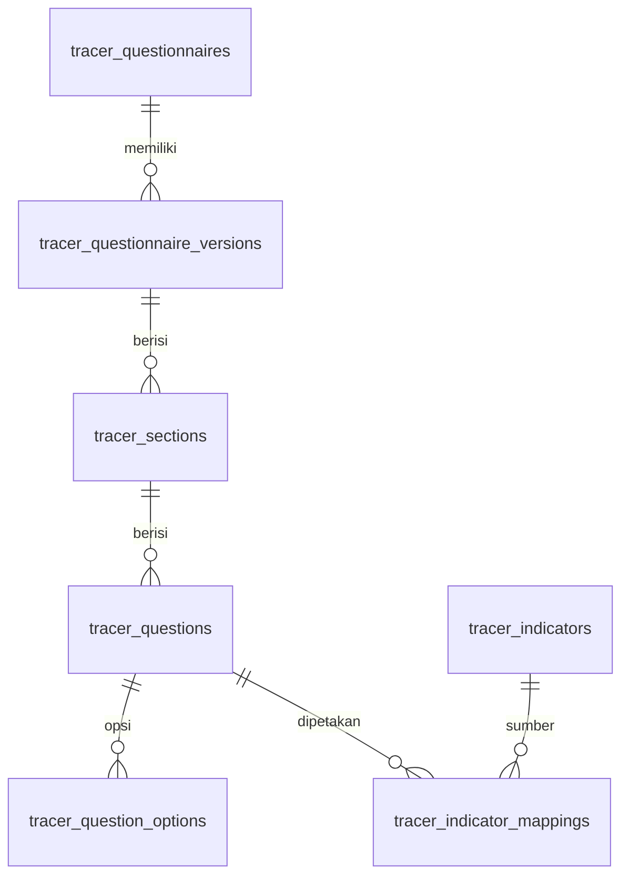
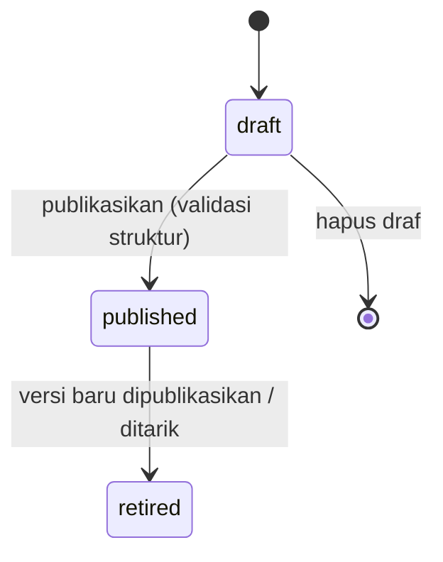
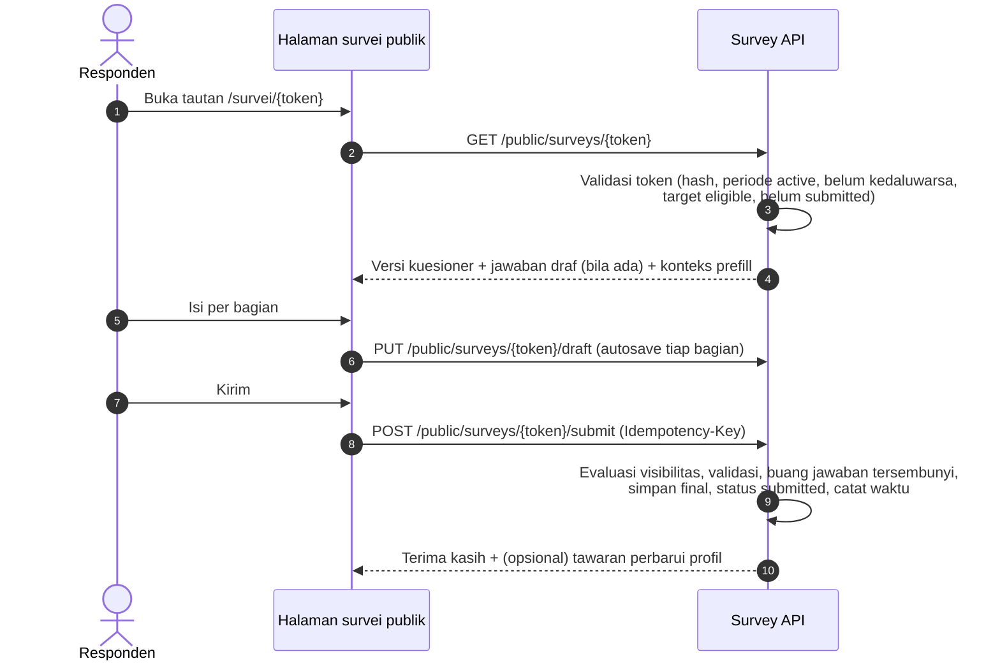
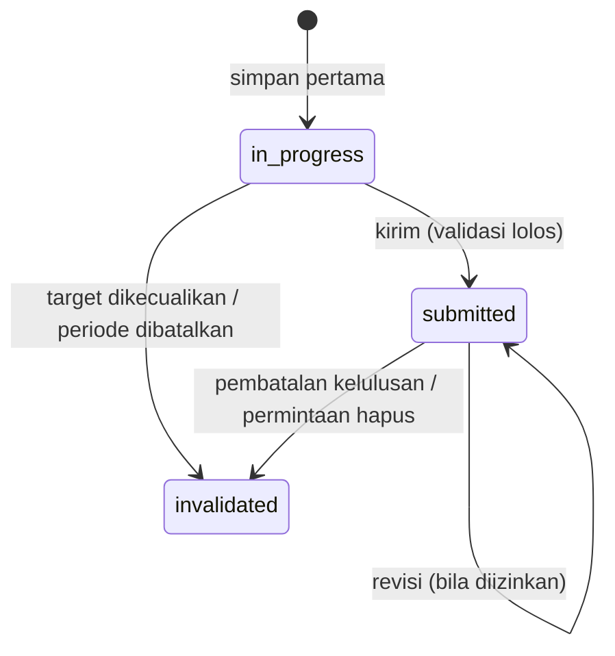

# 17 — Rancangan Kuesioner dan Survei

> **Status:** rancangan · Disusun 2026-10-13 (commit `47043ca`) · Kembali ke [README](README.md)
> Skema acuan: [25 §6](25-rancangan-database-dan-erd.md#6-kelompok-tracer-study) · Aturan: `TRACER-BR-001`, `TRACER-BR-004`, `TRACER-BR-007`, `TRACER-BR-017`, `TRACER-BR-019` · Keputusan: [KK-KD-18](33-glossary-dan-keputusan-bisnis.md#2-keputusan-desain-kk-kd)

Dokumen ini mengatur **pembuatan kuesioner** (bagian, pertanyaan, opsi, validasi, logika bersyarat, pratinjau), **versi kuesioner**, **template standar terverifikasi**, **pemetaan pertanyaan ke indikator**, dan **pengisian survei** oleh responden. Mesin kuesioner ini generik dan dapat dipakai ulang untuk survei lain (mis. kepuasan layanan), tetapi rancangan ini fokus pada tracer study.

## Daftar Isi

1. [Tujuan](#1-tujuan)
2. [Ruang Lingkup](#2-ruang-lingkup)
3. [Aktor dan Hak Akses](#3-aktor-dan-hak-akses)
4. [Prasyarat](#4-prasyarat)
5. [Alur Bisnis Utama](#5-alur-bisnis-utama)
6. [Alur Alternatif dan Kegagalan](#6-alur-alternatif-dan-kegagalan)
7. [Status dan Transisi Status](#7-status-dan-transisi-status)
8. [Data Input dan Output](#8-data-input-dan-output)
9. [Aturan Bisnis](#9-aturan-bisnis)
10. [Validasi](#10-validasi)
11. [Rancangan Database](#11-rancangan-database)
12. [Relasi Antarmodul](#12-relasi-antarmodul)
13. [Kontrak API Konseptual](#13-kontrak-api-konseptual)
14. [Rancangan Halaman UI/UX](#14-rancangan-halaman-uiux)
15. [Notifikasi](#15-notifikasi)
16. [Laporan](#16-laporan)
17. [Keamanan dan Audit](#17-keamanan-dan-audit)
18. [Acceptance Criteria](#18-acceptance-criteria)
19. [Test Case](#19-test-case)
20. [Asumsi dan Keputusan Terbuka](#20-asumsi-dan-keputusan-terbuka)

---

## 1. Tujuan

Memungkinkan kampus menyusun instrumen survei sendiri dan memakai template standar, dengan jaminan bahwa setiap jawaban dapat ditafsirkan terhadap teks pertanyaan dan opsi yang benar-benar dilihat responden, walaupun instrumen kemudian diperbarui.

## 2. Ruang Lingkup

**Termasuk:** builder kuesioner, tipe pertanyaan, validasi jawaban, logika tampil bersyarat, pratinjau, draf/publikasi, versi immutable, periode berlaku versi, template standar (platform) yang ditandai sumber dan versi resmi, salin template ke tenant, pemetaan indikator, dan pengisian (simpan sementara, lanjutkan, kirim).

**Tidak termasuk:** pengiriman undangan ([18](18-rancangan-distribusi-dan-reminder-tracer.md)) dan analisis ([19](19-rancangan-dashboard-dan-laporan-tracer.md)).

## 3. Aktor dan Hak Akses

| Aktor | Aksi | Permission |
|---|---|---|
| Petugas tracer | Membuat & mempublikasikan kuesioner tenant, memetakan indikator | `tracer_questionnaires.read/create/update/publish` |
| Super Admin / kurator platform | Mengelola template standar global beserta metadata sumber resmi | `platform_survey_templates.*` (permission platform, Baru) |
| Responden (alumni/pengguna lulusan) | Mengisi melalui token atau sesi login | Token survei / `alumni_self_service` |

## 4. Prasyarat

Entitlement `tracer.core`. Template standar memerlukan `tracer.standard_template` (tersedia di semua paket menurut kebutuhan saat ini, [34](34-matriks-paket-dan-entitlement.md)).

## 5. Alur Bisnis Utama

### 5.1 Struktur kuesioner



Setiap pertanyaan memiliki:

| Atribut | Keterangan |
|---|---|
| `code` | Kode stabil, unik per versi (mis. `F8`, `Q_STATUS`). Kode yang sama antarversi menyatakan "pertanyaan yang sama" untuk analisis tren, dan perubahannya dicatat (§5.3) |
| `label_id`, `label_en` | Teks pertanyaan (Bahasa Inggris opsional) |
| `help_text` | Penjelasan |
| `question_type` | §5.2 |
| `data_type` | `string`, `text`, `integer`, `decimal`, `date`, `option`, `option_set`, `scale` |
| `is_required` | Wajib bila tampil |
| `validation_rules` | json: `min`, `max`, `min_length`, `max_length`, `pattern`, `min_selections`, `max_selections`, `date_min`, `date_max` (boleh relatif, mis. `graduation_date`) |
| `visibility_rule` | json logika tampil (§5.4) |
| `options` | Untuk pilihan: `code`, `label`, `sort`, `is_other` (memicu isian "lainnya"), `exclusive` (mis. "tidak ada" pada pilihan jamak) |
| `sensitivity` | `normal`, `personal`, `sensitive` (mis. pendapatan) → mempengaruhi enkripsi dan akses ([TRACER-BR-016](29-business-rules-dan-validasi.md#tracer-br-016)) |
| `prefill_source` | Opsional: `student.name`, `student.study_program`, `graduation.date` — ditampilkan sebagai konteks, **tidak** disimpan ulang sebagai jawaban kecuali responden mengonfirmasi |
| `profile_update_target` | Opsional: pertanyaan yang jawabannya dapat memperbarui profil karier **bila** responden memberi persetujuan ([16 §5.5](16-rancangan-tracer-study.md#5-alur-bisnis-utama)) |

### 5.2 Tipe pertanyaan

| `question_type` | `data_type` | Contoh |
|---|---|---|
| `single_choice` | `option` | Status saat ini |
| `multiple_choice` | `option_set` | Sumber informasi lowongan |
| `short_text` | `string` (≤ 255) | Nama perusahaan |
| `long_text` | `text` (≤ 5.000) | Saran untuk prodi |
| `date` | `date` | Tanggal mulai bekerja |
| `number` | `integer`/`decimal` | Jumlah lamaran dikirim |
| `rating_scale` | `scale` | 1–5 kepuasan (label ujung dapat dikonfigurasi) |
| `matrix_scale` | `scale` per baris | Penilaian kompetensi (baris = kompetensi, kolom = skala) |
| `dropdown` | `option` | Provinsi tempat kerja (opsi dari referensi wilayah bila tersedia) |
| `consent` | `option` (ya/tidak) | Persetujuan pembaruan profil / dihubungi |
| `section_note` | — | Teks informasi tanpa jawaban |

### 5.3 Versi dan publikasi



- Versi `published` **immutable** ([TRACER-BR-004](29-business-rules-dan-validasi.md#tracer-br-004)). Membuat perubahan = "Buat versi baru" (salinan draf).
- Versi memiliki `valid_from`/`valid_until`. Kelompok target periode ditautkan ke **versi tertentu** saat periode diaktifkan.
- Setiap jawaban menyimpan `tracer_questionnaire_version_id` dan `tracer_question_id` versi itu ([TRACER-BR-001](29-business-rules-dan-validasi.md#tracer-br-001)).
- Perbedaan antarversi dicatat otomatis (`change_log`): pertanyaan ditambah/dihapus, perubahan label, perubahan opsi (opsi dengan `code` sama tetapi label berubah ditandai `semantic_change_review_required` agar analis memutuskan apakah tren dapat disambung).
- Versi yang sudah memiliki jawaban tidak dapat dihapus, hanya `retired`.

### 5.4 Logika bersyarat

`visibility_rule` memakai ekspresi terbatas (tanpa eval kode):

```json
{ "all": [
    { "question": "F8", "op": "in", "value": ["employed", "self_employed"] },
    { "question": "F5_START", "op": "not_empty" }
] }
```

Operator: `eq`, `neq`, `in`, `not_in`, `gt`, `gte`, `lt`, `lte`, `empty`, `not_empty`, dan kombinasi `all`/`any`. Referensi hanya ke pertanyaan **sebelumnya** dalam urutan (mencegah siklus, divalidasi saat publikasi).

Aturan pemrosesan ([TRACER-BR-019](29-business-rules-dan-validasi.md#tracer-br-019)):

- Validasi wajib hanya untuk pertanyaan yang **tampil** menurut jawaban saat kirim.
- Jawaban untuk pertanyaan yang menjadi tersembunyi (mis. responden mengubah status) **dibuang** saat kirim, dan tidak disimpan sebagai jawaban final. Server mengevaluasi ulang logika dan tidak memercayai klien.
- Laporan membedakan "tidak ditanyakan (tidak relevan)" dari "tidak dijawab" ([19](19-rancangan-dashboard-dan-laporan-tracer.md)).

### 5.5 Template standar

Template standar adalah kuesioner **platform** (`tracer_questionnaires.university_id = null`, `is_standard_template = true`) dengan metadata wajib ([TRACER-BR-017](29-business-rules-dan-validasi.md#tracer-br-017)):

| Metadata | Contoh isi |
|---|---|
| `template_source` | Nama penerbit instrumen resmi (diisi kurator dari dokumen resmi) |
| `source_document_reference` | Judul/nomor dokumen sumber dan tautan |
| `source_version` | Versi/tahun instrumen |
| `verified_by`, `verified_at` | Kurator platform yang mencocokkan isi dengan dokumen sumber |
| `intended_respondent_type` | `alumni` / `employer` |
| `indicator_mappings` | Pemetaan pertanyaan → indikator standar |

Rancangan ini **tidak** menyalin daftar pertanyaan instrumen nasional apa pun ke dokumen, karena isi dan versinya harus diambil dari dokumen resmi yang berlaku saat implementasi ([KK-Q-17](33-glossary-dan-keputusan-bisnis.md#3-pertanyaan-terbuka-kk-q)). Tenant dapat **menyalin** template ke kuesioner tenant (salinan tetap menyimpan `derived_from_template_version_id`). Bila tenant mengubah pertanyaan inti yang dipetakan ke indikator standar, pemetaan ditandai `modified_from_standard` dan laporan standar memberi peringatan bahwa butir itu tidak lagi identik dengan instrumen.

### 5.6 Pemetaan indikator

`tracer_indicators` (lihat definisi formula di [19](19-rancangan-dashboard-dan-laporan-tracer.md)) mengambil nilai dari pertanyaan melalui `tracer_indicator_mappings`: `question_id`, `role` (`numerator_condition`, `value_source`, `category_source`), dan `option_map` (opsi → kategori indikator, mis. opsi "Bekerja (full time/part time)" → `employed`).

### 5.7 Pengisian survei



- Respons dibuat saat responden pertama kali menyimpan (`in_progress`). Status pengisian disimpan di `tracer_responses.status`.
- Satu respons `submitted` per target per periode ([TRACER-BR-007](29-business-rules-dan-validasi.md#tracer-br-007)). Kirim ulang dengan Idempotency-Key yang sama mengembalikan hasil yang sama. Kirim kedua dengan kunci berbeda → 409 `ALREADY_SUBMITTED`.
- Pengubahan setelah kirim: hanya bila `tracer.responses.allow_edit_after_submit = true` (default `false`) dan periode masih `active`. Setiap pengubahan menyimpan revisi (`tracer_response_revisions`), dan laporan memakai revisi terakhir.
- Pengisian oleh alumni yang login: portal alumni menampilkan survei aktif tanpa token (identitas dari sesi), dengan aturan yang sama.

## 6. Alur Alternatif dan Kegagalan

| Kode | Kondisi | Penanganan |
|---|---|---|
| AF-QST-01 | Token kedaluwarsa/periode ditutup | Halaman informatif "Survei telah ditutup" + kontak petugas. Tidak mengungkap identitas |
| AF-QST-02 | Token tidak dikenal | Pesan generik yang sama dengan token kedaluwarsa (mencegah enumerasi), dan rate limit |
| AF-QST-03 | Sesi terputus saat mengisi | Autosave per bagian. Draf disimpan server |
| AF-QST-04 | Versi kuesioner retired saat responden sedang mengisi | Responden tetap memakai versi yang tertaut di target (bukan versi terbaru) |
| AF-QST-05 | Validasi gagal saat kirim | 422 dengan daftar `question_code` dan pesan, tanpa kehilangan draf |
| AF-QST-06 | Logika tampil membentuk siklus | Publikasi ditolak |

## 7. Status dan Transisi Status

`tracer_questionnaire_versions.status`: `draft`, `published`, `retired`. `tracer_responses.status`: `in_progress`, `submitted`, `invalidated`.



Status "belum mulai" bukan baris respons. Ia adalah kondisi target tanpa respons ([18](18-rancangan-distribusi-dan-reminder-tracer.md)).

## 8. Data Input dan Output

Penyimpanan jawaban `tracer_answers`: `tracer_response_id`, `tracer_question_id`, `value_text`, `value_number`, `value_date`, `value_option_codes` (json), `value_other_text`, `is_sensitive`. Kolom nilai sensitif dienkripsi (`encrypted`). Satu baris per pertanyaan per respons (untuk matriks: satu baris per pertanyaan dengan json `{row_code: scale}`).

## 9. Aturan Bisnis

| ID | Aturan |
|---|---|
| [TRACER-BR-001](29-business-rules-dan-validasi.md#tracer-br-001) | Jawaban responden harus terhubung dengan versi kuesioner yang digunakan |
| [TRACER-BR-004](29-business-rules-dan-validasi.md#tracer-br-004) | Versi kuesioner terpublikasi tidak dapat diubah. Versi dengan jawaban tidak dapat dihapus |
| [TRACER-BR-007](29-business-rules-dan-validasi.md#tracer-br-007) | Satu respons terkirim per target per periode. Kirim ulang bersifat idempoten. Pengubahan setelah kirim hanya bila diizinkan dan tercatat sebagai revisi |
| [TRACER-BR-017](29-business-rules-dan-validasi.md#tracer-br-017) | Template standar wajib memiliki metadata sumber, versi, dan verifikasi kurator. Turunan yang mengubah butir inti ditandai |
| [TRACER-BR-019](29-business-rules-dan-validasi.md#tracer-br-019) | Validasi wajib hanya untuk pertanyaan yang tampil. Jawaban atas pertanyaan tersembunyi dibuang. Logika dievaluasi di server |

## 10. Validasi

V-QST-01 `code` unik per versi, `^[A-Za-z0-9_]{1,30}$`. V-QST-02 Pertanyaan pilihan minimal 2 opsi, `code` opsi unik. V-QST-03 `visibility_rule` hanya merujuk pertanyaan sebelumnya. V-QST-04 Skala: `min < max`, langkah 1. V-QST-05 Jumlah pertanyaan per versi ≤ 300. V-QST-06 `long_text` ≤ 5.000 karakter, dan konten disanitasi saat ditampilkan (tanpa HTML).

## 11. Rancangan Database

`tracer_questionnaires`, `tracer_questionnaire_versions`, `tracer_sections`, `tracer_questions`, `tracer_question_options`, `tracer_indicators`, `tracer_indicator_mappings`, `tracer_responses`, `tracer_response_revisions`, `tracer_answers`. Lihat [25 §6](25-rancangan-database-dan-erd.md#6-kelompok-tracer-study).

`tracer_responses` unik (`tracer_target_id`) — satu respons per target. `tracer_answers` unik (`tracer_response_id`, `tracer_question_id`).

## 12. Relasi Antarmodul

Profil karier alumni ([16](16-rancangan-tracer-study.md)) untuk pembaruan atas persetujuan. Kontak pengguna lulusan dari jawaban alumni ([16 §5.3](16-rancangan-tracer-study.md#5-alur-bisnis-utama)). Dashboard ([19](19-rancangan-dashboard-dan-laporan-tracer.md)).

## 13. Kontrak API Konseptual

| Method | URL | Permission |
|---|---|---|
| GET/POST | `/tracer/questionnaires` | `tracer_questionnaires.read/create` |
| GET | `/tracer/standard-templates` | `tracer_questionnaires.read` + entitlement `tracer.standard_template` |
| POST | `/tracer/standard-templates/{version}/copy` | `tracer_questionnaires.create` |
| POST | `/tracer/questionnaires/{questionnaire}/versions` | `tracer_questionnaires.update` |
| PUT | `/tracer/questionnaire-versions/{version}` (struktur lengkap, draf saja) | `tracer_questionnaires.update` |
| POST | `/tracer/questionnaire-versions/{version}/publish` | `tracer_questionnaires.publish` |
| GET | `/tracer/questionnaire-versions/{version}/preview` | `tracer_questionnaires.read` |
| GET | `/tracer/questionnaire-versions/{a}/diff/{b}` | `tracer_questionnaires.read` |
| GET/PUT/POST | `/public/surveys/{token}`, `/draft`, `/submit` | Token, `throttle:30,1` |
| GET | `/me/alumni/surveys`, `/me/alumni/surveys/{response}` | `alumni_self_service.read/update` |

## 14. Rancangan Halaman UI/UX

| Halaman | Rute | Inti |
|---|---|---|
| Kuesioner | `/tracer/kuesioner` | Daftar kuesioner & versi |
| Builder | `/tracer/kuesioner/:id/versi/:v` | Panel kiri bagian/pertanyaan (seret urut), panel tengah editor pertanyaan, panel kanan logika & validasi & indikator. Banner kuning "Versi terpublikasi bersifat baca-saja. Buat versi baru untuk mengubah" |
| Template Kuesioner | `/tracer/template` | Template standar dengan metadata sumber & tanggal verifikasi |
| Pratinjau | Modal | Simulasi responden termasuk logika bersyarat |
| Survei publik | `/survei/:token` | Satu bagian per layar di ponsel, indikator kemajuan, autosave, aksesibel (label, kontras, navigasi papan ketik), tanpa menu internal. Branding tenant (logo, warna) |

## 15. Notifikasi

Konfirmasi terima kasih setelah kirim (`tracer.response.submitted`, opsional, ke email responden).

## 16. Laporan

TRACER-RPT-02 Kelengkapan per pertanyaan (tampil, dijawab, tidak dijawab). Laporan hasil di [19](19-rancangan-dashboard-dan-laporan-tracer.md).

## 17. Keamanan dan Audit

- Halaman survei publik memakai `PublicSurveyResource` terpisah yang hanya memuat data yang perlu ditampilkan (pola `PublicExamResource`, Ada).
- Publikasi versi dan penyalinan template dicatat `audit_logs`.
- Jawaban `sensitive` dienkripsi dan hanya dapat dibaca melalui ekspor berizin ([19](19-rancangan-dashboard-dan-laporan-tracer.md)).

## 18. Acceptance Criteria

| ID | Kriteria |
|---|---|
| TRACER-AC-05 | Upaya mengubah versi `published` ditolak 409 |
| TRACER-AC-06 | Setelah versi 2 dipublikasikan, jawaban versi 1 tetap ditampilkan dengan teks pertanyaan versi 1 |
| TRACER-AC-07 | Mengirim dua kali dengan Idempotency-Key berbeda → 409 `ALREADY_SUBMITTED`, dan hanya satu respons tersimpan |
| TRACER-AC-08 | Pertanyaan tersembunyi yang diisi klien tidak tersimpan pada jawaban final |

## 19. Test Case

| ID | Judul | Prioritas |
|---|---|---|
| TRACER-TC-010 | Perubahan versi kuesioner menjaga jawaban historis | P1 |
| TRACER-TC-011 | Pertanyaan bersyarat: wajib hanya bila tampil | P1 |
| TRACER-TC-012 | Jawaban pertanyaan tersembunyi dibuang | P1 |
| TRACER-TC-013 | Responden mengisi dua kali | P1 |
| TRACER-TC-014 | Token tidak dikenal vs kedaluwarsa: pesan sama | P2 |
| TRACER-TC-015 | Template standar tanpa metadata sumber ditolak | P2 |
| TRACER-TC-016 | Siklus logika ditolak saat publikasi | P3 |

## 20. Asumsi dan Keputusan Terbuka

| ID | Hal |
|---|---|
| [KK-KD-18](33-glossary-dan-keputusan-bisnis.md#2-keputusan-desain-kk-kd) | Versi immutable |
| [KK-Q-17](33-glossary-dan-keputusan-bisnis.md#3-pertanyaan-terbuka-kk-q) | Instrumen standar & versi resmi yang dipakai |
