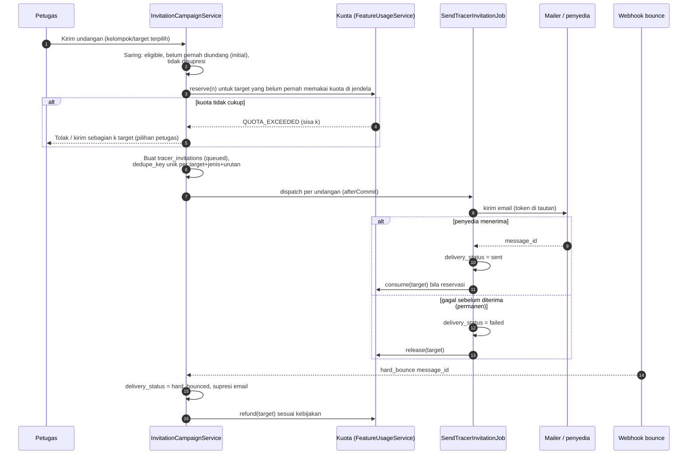
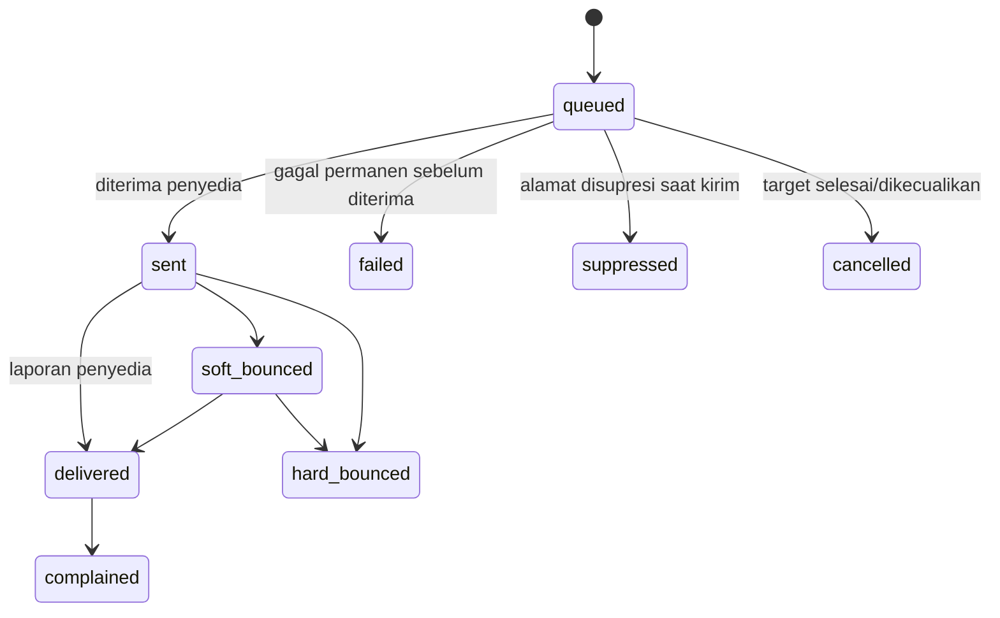

# 18 — Rancangan Distribusi, Reminder, dan Kuota Tracer

> **Status:** rancangan · Disusun 2026-10-13 (commit `47043ca`) · Kembali ke [README](README.md)
> Skema acuan: [25 §6](25-rancangan-database-dan-erd.md#6-kelompok-tracer-study), [25 §8](25-rancangan-database-dan-erd.md#8-kelompok-lintas-modul) · Aturan: `TRACER-BR-002`, `TRACER-BR-003`, `TRACER-BR-006`, `TRACER-BR-008`–`TRACER-BR-010`, `TRACER-BR-018`, `TRACER-BR-020` · Paket: [34](34-matriks-paket-dan-entitlement.md) · Keputusan: [KK-KD-19](33-glossary-dan-keputusan-bisnis.md#2-keputusan-desain-kk-kd), [KK-KD-20](33-glossary-dan-keputusan-bisnis.md#2-keputusan-desain-kk-kd), [KK-KD-25](33-glossary-dan-keputusan-bisnis.md#2-keputusan-desain-kk-kd)

Dokumen ini mengatur **undangan email, tautan unik dan token, kedaluwarsa, pengingat otomatis, pengiriman ulang, penanganan bounce, status pengiriman vs status pengisian, pencegahan pengisian ganda dan akses tidak sah**, serta **mekanisme kuota "jumlah kuesioner terkirim" per paket**.

## Daftar Isi

1. [Tujuan](#1-tujuan)
2. [Ruang Lingkup](#2-ruang-lingkup)
3. [Aktor dan Hak Akses](#3-aktor-dan-hak-akses)
4. [Prasyarat](#4-prasyarat)
5. [Alur Bisnis Utama](#5-alur-bisnis-utama)
6. [Alur Alternatif dan Kegagalan](#6-alur-alternatif-dan-kegagalan)
7. [Status dan Transisi Status](#7-status-dan-transisi-status)
8. [Data Input dan Output](#8-data-input-dan-output)
9. [Aturan Bisnis](#9-aturan-bisnis)
10. [Validasi](#10-validasi)
11. [Rancangan Database](#11-rancangan-database)
12. [Relasi Antarmodul](#12-relasi-antarmodul)
13. [Kontrak API Konseptual](#13-kontrak-api-konseptual)
14. [Rancangan Halaman UI/UX](#14-rancangan-halaman-uiux)
15. [Notifikasi](#15-notifikasi)
16. [Laporan](#16-laporan)
17. [Keamanan dan Audit](#17-keamanan-dan-audit)
18. [Acceptance Criteria](#18-acceptance-criteria)
19. [Test Case](#19-test-case)
20. [Asumsi dan Keputusan Terbuka](#20-asumsi-dan-keputusan-terbuka)

---

## 1. Tujuan

Mengirim undangan survei secara andal tanpa duplikasi, mengingatkan responden secukupnya, melacak setiap upaya pengiriman, memisahkan fakta "email terkirim" dari fakta "survei diisi", dan menegakkan kuota paket secara adil dan dapat diaudit.

## 2. Ruang Lingkup

**Termasuk:** token akses, kampanye pengiriman (undangan awal, pengingat, kirim ulang manual), antrean pengiriman, status kanal, penanganan bounce/keluhan, supresi, pelacakan buka (opsional), jadwal pengingat, kuota (reservasi, pemakaian, pengembalian, penyesuaian), pemantauan dan peringatan kuota.

**Tidak termasuk:** konfigurasi server email (`config/mail.php`, di luar rancangan) dan kanal selain email (WhatsApp/SMS terdaftar di enum `NotificationChannel` tetapi tidak terimplementasi, [KK-A-04](33-glossary-dan-keputusan-bisnis.md#4-asumsi-kk-a)).

## 3. Aktor dan Hak Akses

| Aktor | Aksi | Permission |
|---|---|---|
| Petugas tracer | Menjalankan undangan, mengatur jadwal pengingat, kirim ulang, melihat status | `tracer_invitations.create/read` |
| Admin universitas | Melihat pemakaian kuota | `tracer_quota.read` |
| Super Admin | Mengatur kuota paket/override tenant, penyesuaian kuota | Permission platform `platform_billing.*` (Ada) |
| Sistem (job) | Pengiriman, pengingat, pemrosesan bounce | — |

## 4. Prasyarat

1. Periode `active`, target `eligible`, versi kuesioner tertaut ([16](16-rancangan-tracer-study.md), [17](17-rancangan-kuesioner-dan-survei.md)).
2. Template email `tracer.invitation`, `tracer.reminder` per tenant (+ bahasa) di modul Notification ([27](27-rancangan-notifikasi-dan-email.md)).
3. Kuota tersedia ([§5.6](#5-alur-bisnis-utama)).
4. Penyedia email yang mendukung webhook bounce/keluhan, atau pemrosesan DSN. Bila tidak ada, status berhenti di `sent` ([KK-Q-20](33-glossary-dan-keputusan-bisnis.md#3-pertanyaan-terbuka-kk-q)).

## 5. Alur Bisnis Utama

### 5.1 Token akses

- Satu token per target per periode (`tracer_access_tokens`), dibuat saat undangan pertama. Pengingat dan kirim ulang memakai token yang **sama**, sehingga tautan lama tetap berlaku ([TRACER-BR-006](29-business-rules-dan-validasi.md#tracer-br-006)).
- Nilai acak 256-bit (`Str::random(43)` base62 ≈ 256 bit). Hanya `sha256` yang disimpan (pola `session_token_hash` ujian, Ada). Token mentah hanya ada di email.
- `expires_at` = `tracer_periods.closes_at` (+ perpanjangan). Token dicabut (`revoked_at`) saat target dikecualikan, periode dibatalkan, atau atas permintaan petugas (mis. email salah alamat). Token baru kemudian diterbitkan ke alamat yang benar.
- Token hanya memberi akses ke **satu** survei. Token tidak memberi sesi login atau akses data lain.

### 5.2 Kampanye dan pengiriman

Jenis undangan (`invitation_type`): `initial`, `reminder`, `manual_resend`. `dedupe_key` = `{target_id}:{invitation_type}:{sequence_no}` unik, sehingga retry job atau klik ganda tidak mengirim dua kali ([TRACER-BR-010](29-business-rules-dan-validasi.md#tracer-br-010)). Job memeriksa ulang status target dan undangan sebelum mengirim (target sudah `submitted`/dikecualikan → batal).

Throttle pengiriman: `tracer.mail.rate_per_minute` (default 120) per tenant untuk melindungi reputasi domain pengirim.

### 5.3 Pengingat

- Jadwal per kelompok (`tracer_reminder_schedules`): `offset_days` dari undangan awal (mis. 7, 14, 21), jam kirim (zona tenant), dan `max_reminders` (default 3).
- Job harian memilih target yang ([TRACER-BR-008](29-business-rules-dan-validasi.md#tracer-br-008)): punya undangan `initial` `sent`/`delivered`, tidak memiliki respons `submitted`, tidak disupresi/`hard_bounced`/opt-out, belum mencapai `max_reminders`, dan undangan terakhirnya lebih lama dari `min_interval_days` (default 5).
- Isi pengingat dapat berbeda untuk `in_progress` ("Lanjutkan survei Anda") dan belum mulai.
- Pengingat **tidak** memakai kuota.

### 5.4 Kirim ulang manual

Petugas dapat mengirim ulang ke target tertentu (mis. responden meminta). Kirim ulang ke **alamat yang sama** tidak memakai kuota. Bila alamat diganti, token lama dicabut, token baru diterbitkan, dan **tidak** memakai kuota tambahan selama target sama dalam jendela kuota ([TRACER-BR-003](29-business-rules-dan-validasi.md#tracer-br-003)). Kirim ulang dibatasi `tracer.resend.max_per_target` (default 3) untuk mencegah spam.

### 5.5 Status pengiriman vs status pengisian

Dua dimensi terpisah ([TRACER-BR-002](29-business-rules-dan-validasi.md#tracer-br-002)):

| Dimensi | Sumber | Nilai |
|---|---|---|
| Status pengiriman (per undangan) | `tracer_invitations.delivery_status` + `tracer_email_events` | `queued`, `sent` (diterima penyedia), `delivered` (bila penyedia melaporkan), `soft_bounced`, `hard_bounced`, `failed`, `suppressed`, `complained` |
| Keterlibatan | `tracer_access_tokens` | `first_opened_at` (klik tautan / buka halaman survei), `opened_email_at` (piksel, **hanya bila diaktifkan**) |
| Status pengisian (per target) | `tracer_responses` | belum mulai (tanpa respons), `in_progress`, `submitted`, `invalidated` |

Status gabungan per target untuk tampilan: *Belum diundang* → *Terkirim* → *Dibuka* → *Sedang mengisi* → *Selesai*, dengan cabang *Gagal kirim* / *Bounce* / *Dikecualikan*. Status "terkirim" **tidak** pernah ditampilkan sebagai "sudah mengisi".

Pelacakan buka email (piksel) **nonaktif secara default**. Bila diaktifkan kampus, teks undangan wajib menyebutkannya ([KK-Q-20](33-glossary-dan-keputusan-bisnis.md#3-pertanyaan-terbuka-kk-q)). Klik tautan survei dicatat karena memang merupakan akses ke layanan.

### 5.6 Kuota "jumlah kuesioner terkirim"

**Kapasitas per paket** (dari kebutuhan bisnis, angka referensi): Growth 50, Business 50, Professional 200, Premium 300, Enterprise 400. Angka disimpan sebagai `plan_feature_entitlements.limit_value` untuk feature key `tracer.invitations.quota`, **bukan** di kode ([UMUM-BR-003](29-business-rules-dan-validasi.md#umum-br-003), [34](34-matriks-paket-dan-entitlement.md)).

#### 5.6.1 Definisi satuan (usulan rancangan, perlu konfirmasi [KK-Q-02](33-glossary-dan-keputusan-bisnis.md#3-pertanyaan-terbuka-kk-q))

> **1 unit kuota = 1 target unik (alumni atau pengguna lulusan) yang undangan awalnya berhasil diterima penyedia email, dalam satu jendela kuota.**

| Kasus | Memakai kuota? | Alasan |
|---|---|---|
| Undangan awal diterima penyedia (`sent`) | **Ya, 1 unit** | Definisi dasar |
| Undangan awal gagal sebelum diterima penyedia (`failed`: alamat ditolak SMTP, galat konfigurasi) | **Tidak** (reservasi dikembalikan) | Kuesioner tidak terkirim |
| Hard bounce setelah `sent` | **Dikembalikan** bila `tracer.quota.refund_hard_bounce = true` (default usulan `true`), dalam `refund_window_days` (default 7) | Tidak sampai ke responden. Kebijakan platform, perlu konfirmasi |
| Soft bounce | Tetap terpakai (penyedia mencoba ulang) | Belum pasti gagal |
| Pengingat | Tidak | Target yang sama |
| Kirim ulang manual ke target sama (alamat sama atau diganti) | Tidak | Target yang sama |
| Target yang sama diundang di **periode lain** dalam jendela kuota yang sama | Ya, 1 unit lagi | Kuesioner baru (periode berbeda) |
| Alumni dan pengguna lulusan | Masing-masing target 1 unit | Kedua jenis adalah kuesioner terkirim |
| Satu kontak pengguna lulusan menilai 3 alumni dalam satu survei (mode per kontak) | 1 unit | Satu undangan |
| Mode per pasangan (kontak × alumni) | 1 unit per pasangan | Satu undangan per pasangan |
| Alumni mengisi lewat portal tanpa undangan email | Tidak | Tidak ada pengiriman |
| Uji kirim ke petugas (`test_send`) | Tidak, dibatasi 10/hari | Bukan responden |

#### 5.6.2 Jendela kuota

Usulan default: **per tenant, per tahun langganan** (`quota_window_key` = `SUB:{university_subscription_id}:{tahun ke-n}` dihitung dari `current_period_starts_at` langganan, Ada). Alternatif yang didukung struktur data tanpa perubahan skema: per tahun kalender (`CAL:2026`), per tahun akademik (`AY:2026/2027`), atau per periode tracer (`TP:{period_id}`). Pilihan disimpan di `plan_feature_entitlements.metadata.window` dan dapat di-override per tenant oleh platform ([KK-Q-02](33-glossary-dan-keputusan-bisnis.md#3-pertanyaan-terbuka-kk-q)).

#### 5.6.3 Mekanisme ledger

`feature_usage_ledgers` (tabel lintas modul, [25 §8](25-rancangan-database-dan-erd.md#8-kelompok-lintas-modul)) mencatat setiap mutasi:

| `entry_type` | Kapan | `quantity` |
|---|---|---|
| `reserve` | Saat kampanye dibuat, per target yang belum pernah memakai kuota di jendela | +1 (terpesan) |
| `consume` | Undangan awal `sent` | Konversi reservasi → terpakai |
| `release` | Gagal sebelum diterima / undangan dibatalkan sebelum terkirim / reservasi kedaluwarsa 24 jam | −1 terpesan |
| `refund` | Hard bounce sesuai kebijakan | −1 terpakai |
| `adjustment` | Koreksi manual Super Admin (alasan wajib) | ± |

- Unik idempotensi: (`university_id`, `feature_key`, `quota_window_key`, `subject_key`, `entry_type`, `reference_id`), dengan `subject_key` = `tracer_target:{id}`. Retry job tidak mencatat ganda.
- **Pemakaian** = Σ consume − Σ refund ± adjustment. **Terpesan** = Σ reserve − Σ consume − Σ release. **Sisa** = batas − pemakaian − terpesan.
- Pemeriksaan kecukupan dan `reserve` berjalan dalam transaksi dengan kunci baris ringkasan `feature_usage_counters` (`university_id`, `feature_key`, `quota_window_key`) `FOR UPDATE`, sehingga dua kampanye bersamaan tidak melewati batas ([TRACER-BR-003](29-business-rules-dan-validasi.md#tracer-br-003)).

#### 5.6.4 Pemantauan, peringatan, dan perilaku saat habis

- Indikator kuota di halaman Distribusi dan Dashboard: batas, terpakai, terpesan, sisa, dan jendela berakhir.
- Peringatan ke admin universitas & petugas tracer pada 80% dan 95% (sekali per ambang per jendela, idempoten).
- Saat sisa < jumlah target yang akan diundang: petugas memilih **kirim sebagian** (urutan prioritas: prodi/cohort yang dipilih, lalu NIM) atau **batalkan**. Tidak ada pengiriman melebihi batas.
- Saat kuota habis ([TRACER-BR-018](29-business-rules-dan-validasi.md#tracer-br-018)): undangan **awal** baru diblokir (409 `QUOTA_EXCEEDED` dengan pesan upgrade, [34](34-matriks-paket-dan-entitlement.md)). Pengingat, kirim ulang, pengisian survei, dan laporan **tetap berjalan**.
- Perubahan paket di tengah jendela: batas baru berlaku segera. Pemakaian yang ada tidak direset.

#### 5.6.5 Audit kuota

Setiap baris ledger menyimpan aktor/sistem, referensi undangan, dan alasan. Laporan pemakaian per jendela dapat direkonsiliasi dengan `tracer_invitations` (`initial` + `sent` − refund). `adjustment` menulis `audit_logs` platform.

### 5.7 Pencegahan pengisian ganda dan akses tidak sah

| Ancaman | Pengendalian |
|---|---|
| Pengisian ganda | Satu respons per target (unik `tracer_target_id`), Idempotency-Key submit ([17](17-rancangan-kuesioner-dan-survei.md)) |
| Token diteruskan ke orang lain | Risiko diterima (model survei tautan unik). Halaman pertama menampilkan nama yang dituju sebagian (mis. "A*** S***") agar penerima salah dapat melapor. Konfirmasi identitas tambahan (tanggal lahir/NIM) dapat diaktifkan `tracer.survey.require_identity_check` |
| Penebakan token | 256-bit, hash, rate limit `throttle:30,1` per IP, pesan generik |
| Kebocoran token via log/Referer | Token tidak ditulis ke log aplikasi (redaksi middleware), `Referrer-Policy: no-referrer` di halaman survei |
| Kiriman berulang otomatis (bot) | Rate limit, ukuran payload dibatasi, CSRF tidak relevan (API token), honeypot field |

## 6. Alur Alternatif dan Kegagalan

| Kode | Kondisi | Penanganan |
|---|---|---|
| AF-DST-01 | Antrean mati di tengah kampanye | Undangan tetap `queued`. Worker melanjutkan setelah pulih. Reservasi > 24 jam dilepas, lalu dipesan ulang saat dikirim |
| AF-DST-02 | Penyedia email menolak sementara (rate limit) | Retry backoff eksponensial (1, 5, 15 menit), maks. 5, lalu `failed` + release |
| AF-DST-03 | Webhook bounce datang dua kali | `tracer_email_events` unik (`provider`, `provider_event_id`) |
| AF-DST-04 | Webhook tanpa tanda tangan valid | Ditolak 401, tercatat |
| AF-DST-05 | Target sudah mengisi saat pengingat akan dikirim | Job membatalkan pengiriman (`cancelled_already_submitted`) |
| AF-DST-06 | Kuota habis saat kampanye berjalan sebagian | Sisa undangan ditolak saat reservasi (bukan saat kirim), sehingga tidak ada undangan yang terkirim tanpa kuota |
| AF-DST-07 | Keluhan spam | Supresi email, hentikan pengingat, notifikasi petugas |

## 7. Status dan Transisi Status

`tracer_invitations.delivery_status`:

`tracer_access_tokens`: aktif (turunan: `revoked_at` null ∧ `expires_at` > now), `revoked`, `expired`.

## 8. Data Input dan Output

Input kampanye: `tracer_period_id`, `target_group_ids[]` atau `target_ids[]`, `invitation_type`, `scheduled_at` (opsional), dan `partial_send_policy` (`reject`/`send_within_quota`). Output: ringkasan (dipilih, dilewati per alasan, dipesan, ditolak kuota), `campaign_id`, dan progres.

## 9. Aturan Bisnis

| ID | Aturan |
|---|---|
| [TRACER-BR-002](29-business-rules-dan-validasi.md#tracer-br-002) | Status email terkirim tidak berarti responden sudah mengisi survei |
| [TRACER-BR-003](29-business-rules-dan-validasi.md#tracer-br-003) | Pemakaian kuota harus mengikuti definisi perhitungan paket (§5.6.1) dan diperiksa secara atomik |
| [TRACER-BR-006](29-business-rules-dan-validasi.md#tracer-br-006) | Token acak ≥ 256-bit disimpan sebagai hash, satu per target per periode, kedaluwarsa saat periode ditutup, dapat dicabut |
| [TRACER-BR-008](29-business-rules-dan-validasi.md#tracer-br-008) | Pengingat hanya untuk target yang belum mengirim, terkirim tanpa bounce permanen, tidak disupresi, dalam batas jumlah & jeda |
| [TRACER-BR-009](29-business-rules-dan-validasi.md#tracer-br-009) | Hard bounce dan keluhan menyupresi alamat di tenant dan menghentikan pengiriman berikutnya |
| [TRACER-BR-010](29-business-rules-dan-validasi.md#tracer-br-010) | Pengiriman idempoten per target, jenis, dan urutan. Retry job tidak mengirim ganda |
| [TRACER-BR-018](29-business-rules-dan-validasi.md#tracer-br-018) | Saat kuota habis, undangan awal baru diblokir, sedangkan pengingat, kirim ulang, dan pengisian tetap berjalan |
| [TRACER-BR-020](29-business-rules-dan-validasi.md#tracer-br-020) | Penutupan periode membuat seluruh token periode kedaluwarsa dan menghentikan pengingat |

## 10. Validasi

V-DST-01 periode `active`. V-DST-02 versi kuesioner tertaut. V-DST-03 template email tersedia untuk bahasa responden. V-DST-04 `scheduled_at` ≥ sekarang dan < `closes_at`. V-DST-05 `offset_days` naik ketat dan `max_reminders` ≤ 5.

## 11. Rancangan Database

`tracer_access_tokens`, `tracer_invitation_campaigns`, `tracer_invitations`, `tracer_email_events`, `tracer_reminder_schedules`, `tracer_suppressions`; lintas: `feature_usage_ledgers`, `feature_usage_counters`. Lihat [25 §6](25-rancangan-database-dan-erd.md#6-kelompok-tracer-study) dan [25 §8](25-rancangan-database-dan-erd.md#8-kelompok-lintas-modul).

## 12. Relasi Antarmodul

| Modul | Hubungan |
|---|---|
| Notification (Ada) | Rendering template (`TemplateRenderer`, Ada). Pengiriman ke alamat tanpa akun memakai notifiable on-demand (`Notification::route('mail', …)`) karena `NotificationDispatcher::dispatch()` (Ada) hanya menerima `User`, sehingga perlu perluasan ([27](27-rancangan-notifikasi-dan-email.md)) |
| Tenancy/Entitlement | `FeatureEntitlementService` (rancangan `academic-learning`) + `FeatureUsageService` (Baru) |
| Platform billing | Pengaturan batas & penyesuaian |

## 13. Kontrak API Konseptual

| Method | URL | Permission |
|---|---|---|
| POST | `/tracer/periods/{period}/campaigns` (Idempotency-Key) | `tracer_invitations.create` |
| GET | `/tracer/campaigns/{campaign}` | `tracer_invitations.read` |
| GET | `/tracer/periods/{period}/invitations` (filter `delivery_status`, `invitation_type`) | `tracer_invitations.read` |
| GET | `/tracer/periods/{period}/respondent-status` (status gabungan per target) | `tracer_invitations.read` |
| POST | `/tracer/targets/{target}/resend` (`email` opsional) | `tracer_invitations.create` |
| POST | `/tracer/targets/{target}/revoke-token` | `tracer_invitations.create` |
| GET/PUT | `/tracer/target-groups/{group}/reminder-schedule` | `tracer_invitations.create` |
| GET | `/tracer/quota` (batas, terpakai, terpesan, sisa, jendela) | `tracer_quota.read` |
| GET | `/tracer/quota/ledger` | `tracer_quota.read` |
| POST | `/webhooks/mail/{provider}` | Tanda tangan penyedia |
| GET | `/platform/universities/{university}/usage/tracer` ; POST `/platform/universities/{university}/usage/adjustments` | `platform_billing.read/update` |

## 14. Rancangan Halaman UI/UX

| Halaman | Rute | Inti |
|---|---|---|
| Distribusi | `/tracer/distribusi` | Pilih periode & kelompok → pratinjau jumlah (eligible, sudah diundang, disupresi) → kartu kuota (sisa setelah kirim) → kirim/jadwalkan. Peringatan kuning ≥ 80%, merah bila tidak cukup dengan opsi kirim sebagian |
| Status Pengiriman | `/tracer/pengiriman` | Tabel undangan + event, filter status |
| Reminder | `/tracer/reminder` | Jadwal per kelompok, pratinjau target yang akan diingatkan besok |
| Status Responden | `/tracer/responden` | Corong: target → terkirim → dibuka → mulai → selesai. Tabel per target (identitas tampil hanya dengan `tracer_respondent_identity.read`, selain itu ID samaran) |
| Pengaturan Kuota | `/tracer/kuota` | Baca: paket, batas, jendela, ledger. Ubah hanya di konsol platform |

## 15. Notifikasi

Undangan & pengingat ke responden. `tracer.quota.threshold_reached` (80%/95%), `tracer.quota.exhausted`, `tracer.mail.bounce_rate_high` (bounce > 10% kampanye), dan `tracer.campaign.completed` ke petugas.

## 16. Laporan

TRACER-RPT-03 Kinerja distribusi per kampanye (terkirim, bounce, buka, mulai, selesai). TRACER-RPT-04 Pemakaian kuota per jendela (rekonsiliasi ledger ↔ undangan).

## 17. Keamanan dan Audit

Token tidak pernah ditampilkan ulang di UI staf (hanya status). Webhook diverifikasi tanda tangan. Ekspor status responden beridentitas memerlukan izin identitas dan dicatat. Penyesuaian kuota hanya platform, dengan alasan.

## 18. Acceptance Criteria

| ID | Kriteria |
|---|---|
| TRACER-AC-09 | Tenant dengan batas 50: dua kampanye paralel masing-masing 40 target menghasilkan total ≤ 50 reservasi, dan sisanya ditolak |
| TRACER-AC-10 | 3 pengingat + 2 kirim ulang ke target yang sama tidak menambah pemakaian kuota |
| TRACER-AC-11 | Undangan `failed` sebelum diterima penyedia tidak mengurangi sisa kuota |
| TRACER-AC-12 | Retry job pengiriman 3× untuk undangan yang sama menghasilkan 1 email dan 1 entri `consume` |
| TRACER-AC-13 | Status responden "Terkirim" dan "Selesai" dihitung terpisah, dan target terkirim tanpa respons tidak pernah tampil "Selesai" |

## 19. Test Case

| ID | Judul | Prioritas |
|---|---|---|
| TRACER-TC-020 | Distribusi email undangan awal | P1 |
| TRACER-TC-021 | Email gagal sebelum diterima → release kuota | P1 |
| TRACER-TC-022 | Hard bounce → supresi & refund sesuai kebijakan | P1 |
| TRACER-TC-023 | Reminder berulang dibatasi jumlah & jeda | P1 |
| TRACER-TC-024 | Reminder tidak dikirim ke yang sudah mengisi | P1 |
| TRACER-TC-025 | Tautan kedaluwarsa setelah periode ditutup | P1 |
| TRACER-TC-026 | Batas kuota paket: kampanye melebihi sisa | P1 |
| TRACER-TC-027 | Konkurensi reservasi kuota | P1 |
| TRACER-TC-028 | Retry job idempoten | P1 |
| TRACER-TC-029 | Webhook bounce duplikat | P2 |
| TRACER-TC-030 | Kuota habis: reminder tetap berjalan | P2 |

## 20. Asumsi dan Keputusan Terbuka

| ID | Hal |
|---|---|
| [KK-KD-19](33-glossary-dan-keputusan-bisnis.md#2-keputusan-desain-kk-kd) | Definisi satuan kuota |
| [KK-KD-20](33-glossary-dan-keputusan-bisnis.md#2-keputusan-desain-kk-kd) | Status pengiriman ≠ pengisian |
| [KK-Q-02](33-glossary-dan-keputusan-bisnis.md#3-pertanyaan-terbuka-kk-q) | Jendela kuota & kebijakan refund bounce |
| [KK-Q-20](33-glossary-dan-keputusan-bisnis.md#3-pertanyaan-terbuka-kk-q) | Pelacakan buka email & penyedia email |
| [KK-Q-01](33-glossary-dan-keputusan-bisnis.md#3-pertanyaan-terbuka-kk-q) | Pemetaan paket SEVIMA ke kode paket repo |
