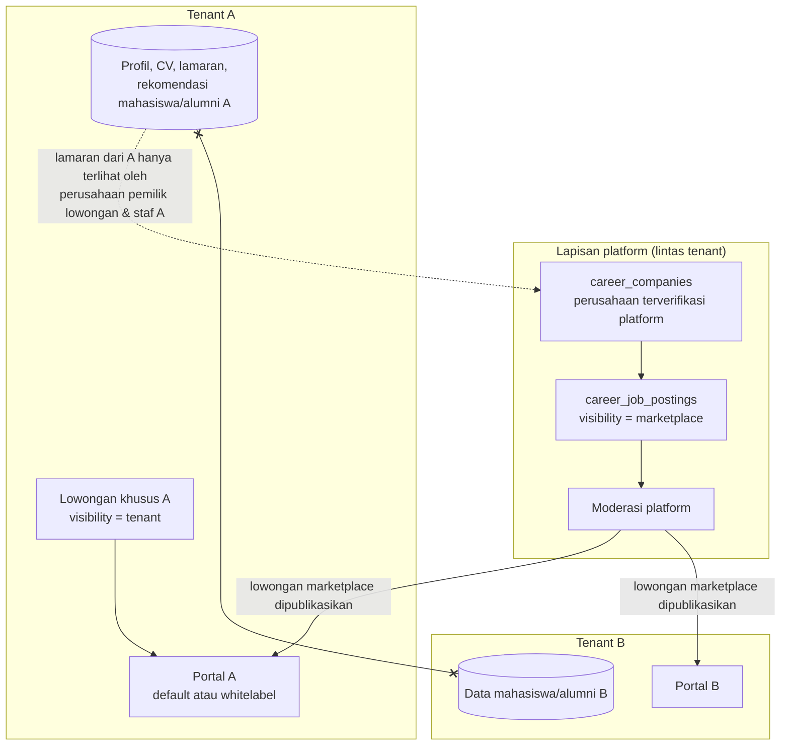

# 20 — Rancangan Career Center (Karirlink)

> **Status:** rancangan · Disusun 2026-10-13 (commit `47043ca`) · Kembali ke [README](README.md)
> Skema acuan: [25 §7](25-rancangan-database-dan-erd.md#7-kelompok-career-center) · Aturan: `KARIR-BR-008`, `KARIR-BR-011`, `KARIR-BR-015`–`KARIR-BR-017`, `KARIR-BR-020` · Lowongan: [21](21-rancangan-lowongan-dan-lamaran-kerja.md) · Mitra: [22](22-rancangan-mitra-perusahaan-dan-crm.md) · Rekomendasi: [23](23-rancangan-rekomendasi-lulusan.md) · Paket: [34](34-matriks-paket-dan-entitlement.md) · Keputusan: [KK-KD-22](33-glossary-dan-keputusan-bisnis.md#2-keputusan-desain-kk-kd), [KK-KD-23](33-glossary-dan-keputusan-bisnis.md#2-keputusan-desain-kk-kd), [KK-KD-24](33-glossary-dan-keputusan-bisnis.md#2-keputusan-desain-kk-kd)

Karirlink menghubungkan mahasiswa, alumni, pusat karier kampus, dan perusahaan. Dokumen ini mengatur **model marketplace bersama vs portal whitelabel, branding tenant, profil karier dan CV, artikel/tips karier, publikasi hasil tracer, dashboard pusat karier**, dan **isolasi data antaruniversitas**. Lowongan & lamaran, perusahaan & CRM, serta rekomendasi lulusan dirinci di dokumen 21–23.

## Daftar Isi

1. [Tujuan](#1-tujuan)
2. [Ruang Lingkup](#2-ruang-lingkup)
3. [Aktor dan Hak Akses](#3-aktor-dan-hak-akses)
4. [Prasyarat](#4-prasyarat)
5. [Alur Bisnis Utama](#5-alur-bisnis-utama)
6. [Alur Alternatif dan Kegagalan](#6-alur-alternatif-dan-kegagalan)
7. [Status dan Transisi Status](#7-status-dan-transisi-status)
8. [Data Input dan Output](#8-data-input-dan-output)
9. [Aturan Bisnis](#9-aturan-bisnis)
10. [Validasi](#10-validasi)
11. [Rancangan Database](#11-rancangan-database)
12. [Relasi Antarmodul](#12-relasi-antarmodul)
13. [Kontrak API Konseptual](#13-kontrak-api-konseptual)
14. [Rancangan Halaman UI/UX](#14-rancangan-halaman-uiux)
15. [Notifikasi](#15-notifikasi)
16. [Laporan](#16-laporan)
17. [Keamanan dan Audit](#17-keamanan-dan-audit)
18. [Acceptance Criteria](#18-acceptance-criteria)
19. [Test Case](#19-test-case)
20. [Asumsi dan Keputusan Terbuka](#20-asumsi-dan-keputusan-terbuka)

---

## Kondisi saat ini (terverifikasi)

- Tidak ada modul Career di backend.
- Aplikasi Civitas One (`frontend/src/one`) memiliki menu `career` (`/one/career`) dan halaman `LibraryCareer.tsx` yang memakai **data tiruan** (`useMockData`, `data/services`: `jobs`, `companyPartners`).
- `universities` (Ada) sudah memiliki `logo_file_id`, `primary_color`, `secondary_color`. `university_domains` (Ada) menyimpan domain per tenant dengan `verified_at`.
- `users.email` unik global (Ada). Identitas pengguna global dan keanggotaan tenant di `user_universities` (Ada). Belum ada konsep akun perusahaan.

## 1. Tujuan

Menyediakan portal karier yang aman bagi data mahasiswa/alumni, menarik bagi perusahaan, dan dapat tampil sebagai layanan kampus (whitelabel) pada paket yang berhak.

## 2. Ruang Lingkup

**Termasuk:** dua model portal, konfigurasi branding per tenant & fallback, profil karier (data dasar, pendidikan, pengalaman, keahlian, sertifikasi, portofolio, bahasa, preferensi, status pencarian kerja), CV (unggah & susun, versi, retensi), persetujuan penggunaan data, artikel & tips karier, publikasi hasil tracer yang disetujui, dan dashboard pusat karier.

**Tidak termasuk:** proses detail lowongan/lamaran ([21](21-rancangan-lowongan-dan-lamaran-kerja.md)), perusahaan/CRM ([22](22-rancangan-mitra-perusahaan-dan-crm.md)), rekomendasi ([23](23-rancangan-rekomendasi-lulusan.md)), job fair/event karier, dan integrasi job board eksternal.

## 3. Aktor dan Hak Akses

| Aktor | Konteks | Aksi utama | Otorisasi |
|---|---|---|---|
| Mahasiswa aktif | Tenant | Profil karier, CV, melamar (magang/kerja), artikel | `career_self_service.*` (Baru, diberikan ke role `student` dan `alumni`) |
| Alumni | Tenant | idem | idem |
| Admin pusat karier (`career_center_administrator`) | Tenant | Pengaturan portal, moderasi, mitra, artikel, publikasi tracer, dashboard | `career_portal_settings.*`, `career_articles.*`, `career_tracer_publications.*`, `career_dashboard.read` |
| Petugas pusat karier (`career_center_officer`) | Tenant | Operasional harian | Subset ([03](03-aktor-role-dan-hak-akses.md)) |
| Perusahaan / perekrut | **Konteks perusahaan** (bukan anggota tenant) | Profil perusahaan, lowongan, lamaran ke lowongannya | Peran keanggotaan perusahaan ([22](22-rancangan-mitra-perusahaan-dan-crm.md)) |
| Moderator platform (`career_platform_moderator`, platform) | Platform | Verifikasi perusahaan & moderasi lowongan marketplace | Permission platform |
| Publik | — | Melihat lowongan publik dan artikel publik | — |

## 4. Prasyarat

1. Entitlement: `career.marketplace` (semua paket), `career.portal` (Growth+), `career.whitelabel`, `career.articles` (Professional+). Lihat [34](34-matriks-paket-dan-entitlement.md).
2. Role `alumni` diberikan saat finalisasi kelulusan ([12](12-rancangan-peserta-dan-penetapan-kelulusan.md)). Akun yang sama tetap dipakai karena status `graduated` tidak termasuk `StudentStatus::loginBlocked()` (Ada) ([KK-A-05](33-glossary-dan-keputusan-bisnis.md#4-asumsi-kk-a)).
3. Keputusan model marketplace ([KK-Q-03](33-glossary-dan-keputusan-bisnis.md#3-pertanyaan-terbuka-kk-q)).

## 5. Alur Bisnis Utama

### 5.1 Dua model portal

| Aspek | Marketplace bersama | Portal whitelabel |
|---|---|---|
| Ketersediaan | Semua paket (`career.marketplace`) | Professional, Premium, Enterprise (`career.whitelabel`) |
| Tampilan | Identitas platform Karirlink default + nama kampus pengguna di header | Nama portal, logo, warna kampus, domain/subdomain kampus (bila dikonfigurasi & diverifikasi) |
| Sumber lowongan | Lowongan `visibility = marketplace` (moderasi platform) + lowongan khusus tenant | Sama, ditambah pengaturan visibilitas konten tenant (sembunyikan kategori/perusahaan tertentu) |
| Data pengguna | Profil, CV, dan lamaran **selalu milik tenant** pengguna (`university_id`) | Sama |
| Halaman informasi pusat karier | Ringkas (nama, kontak) | Lengkap (tentang, layanan, kontak, artikel, statistik karier) |

**Isolasi** ([KARIR-BR-011](29-business-rules-dan-validasi.md#karir-br-011)): seluruh data pengguna karier (profil, CV, lamaran, consent, rekomendasi) bertabel tenant (`TenantScoped`). Perusahaan dan lowongan marketplace adalah data platform. Staf tenant A tidak pernah dapat melihat pelamar dari tenant B, termasuk untuk lowongan marketplace yang sama. Perusahaan melihat pelamar lintas tenant **hanya** untuk lowongan miliknya, melalui lamaran yang dikirim pelamar.

### 5.2 Branding dan fallback

`career_portal_settings` (per tenant): `portal_name`, `tagline`, `logo_file_id` (default `universities.logo_file_id`), `primary_color`/`secondary_color` (default `universities.*`), `custom_domain_id` (FK `university_domains`, harus `verified_at` terisi), `about_html` (disanitasi), `contact_email`, `contact_phone`, `social_links`, `content_visibility` (json: kategori lowongan yang disembunyikan, apakah lowongan marketplace ditampilkan, apakah statistik tracer ditampilkan), dan `is_enabled`.

Resolusi tampilan ([KARIR-BR-016](29-business-rules-dan-validasi.md#karir-br-016)):

1. Bila `career.whitelabel` tidak termasuk entitlement → **tema default Karirlink** (pengaturan branding diabaikan, tetapi tetap tersimpan agar aktif kembali saat upgrade).
2. Bila berhak: pakai nilai `career_portal_settings`. Nilai kosong → `universities.*` → tema default.
3. Warna divalidasi kontras (rasio teks ≥ 4,5:1 terhadap latar). Bila gagal, warna teks otomatis disesuaikan.
4. Domain kustom hanya aktif bila domain terverifikasi dan sertifikat TLS tersedia (dikelola platform). Bila tidak, gunakan subdomain platform (mis. `{slug}.karir.<domain-platform>`) ([KK-Q-30](33-glossary-dan-keputusan-bisnis.md#3-pertanyaan-terbuka-kk-q)).

### 5.3 Profil karier

`career_profiles` (satu per pengguna per tenant; `student_id` mengikat mahasiswa/alumni):

| Bagian | Isi | Sumber awal |
|---|---|---|
| Data dasar | Nama tampilan, headline, ringkasan, kota domisili, foto (opsional) | Nama dari `students` (tidak dapat diubah di sini) |
| Pendidikan | Riwayat pendidikan; entri kampus ini otomatis (prodi, tahun masuk/lulus, IPK opsional — mahasiswa memilih menampilkan) | `students`, keputusan kelulusan |
| Pengalaman | Kerja, magang, organisasi | Dapat diimpor dari aktivitas `approved` ([06](06-rancangan-aktivitas-dan-prestasi.md)) & `internships` atas pilihan pengguna |
| Keahlian | Daftar keahlian (taksonomi tenant + bebas) dengan tingkat | — |
| Sertifikasi | Nama, penerbit, tanggal, tautan/berkas | Dapat diimpor dari capaian SKPI terverifikasi |
| Portofolio | Tautan/berkas proyek | — |
| Bahasa | Bahasa & tingkat | — |
| Preferensi | Jenis pekerjaan, lokasi, rentang gaji harapan (opsional, privat), bidang | — |
| Status pencarian kerja | `actively_looking`, `open_to_offers`, `not_looking` | — |
| SKPI | Tautan verifikasi SKPI terbit (opsional) | [15](15-rancangan-skpi.md) |

Item yang berasal dari sumber terverifikasi diberi lencana "Terverifikasi kampus". Item isian sendiri tidak berlencana.

**Visibilitas profil** ([KARIR-BR-008](29-business-rules-dan-validasi.md#karir-br-008)):

| `visibility` | Siapa yang melihat |
|---|---|
| `private` (**default**) | Pemilik dan staf pusat karier tenant (untuk layanan). Perusahaan hanya melalui lamaran/rekomendasi yang disetujui |
| `campus_partners` | + perusahaan mitra **aktif terverifikasi** dari tenant ini dapat menemukan profil ringkas (tanpa kontak & CV) di pencarian kandidat. Akses CV tetap melalui permintaan dan persetujuan |
| `marketplace` | + perusahaan terverifikasi platform dapat menemukan profil ringkas |

Perubahan dari `private` memerlukan persetujuan eksplisit yang dicatat (`data_sharing_consents`, `purpose = profile_discovery`). Mahasiswa di bawah umur tidak relevan di pendidikan tinggi, tetapi kebijakan usia minimum dapat dikonfigurasi.

### 5.4 CV dan dokumen karier

- `career_documents`: `document_type` (`cv`, `portfolio`, `cover_letter_template`, `certificate`), `file_upload_id` (PDF, ≤ 5 MB), `is_default`, `version_no`, `generated_from_profile` (bila CV dibangun dari profil dengan template platform), `created_at`, dan `retention_until`.
- **Susun CV**: dari profil → template (ATS-friendly, dua pilihan bahasa) → PDF disimpan sebagai versi baru.
- **Hapus**: pengguna dapat menghapus CV. Berkas yang **sudah dikirim dalam lamaran** disalin sebagai snapshot lamaran ([21](21-rancangan-lowongan-dan-lamaran-kerja.md)) dan tunduk pada retensi lamaran, bukan pada penghapusan profil ([KARIR-BR-020](29-business-rules-dan-validasi.md#karir-br-020)).
- **Retensi**: CV tanpa aktivitas > `career.cv.retention_months_inactive` (default 24) → pengguna diberi tahu, lalu berkas dihapus setelah 30 hari bila tidak diperbarui. Snapshot lamaran dihapus/dianonimkan `career.applications.retention_months` (default 24) setelah lamaran berstatus final ([KK-Q-22](33-glossary-dan-keputusan-bisnis.md#3-pertanyaan-terbuka-kk-q)).
- **Unduh CV oleh perusahaan**: hanya dengan dasar akses ([KARIR-BR-007](29-business-rules-dan-validasi.md#karir-br-007), [21](21-rancangan-lowongan-dan-lamaran-kerja.md)), dan setiap unduhan dicatat `career_document_access_logs`.

### 5.5 Artikel dan tips karier

Tersedia mulai Professional (`career.articles`) ([KARIR-BR-015](29-business-rules-dan-validasi.md#karir-br-015)). `career_articles`: judul, ringkasan, isi (Markdown disanitasi), kategori, gambar sampul, penulis, `visibility` (`public`, `authenticated`), status (`draft`, `in_review`, `published`, `archived`), `published_at`. Tenant tanpa entitlement melihat menu terkunci (admin) dan tidak melihat menu (pengguna).

Artikel platform (dikurasi Karirlink) dapat ditampilkan ke semua tenant sebagai konten default. Tenant berhak dapat menyembunyikannya.

### 5.6 Publikasi hasil tracer

- Pusat karier memilih indikator agregat dari tracer ([19](19-rancangan-dashboard-dan-laporan-tracer.md)) → membuat `career_tracer_publications` (snapshot nilai, periode, cohort, prodi opsional, catatan metodologi, n) → persetujuan pejabat → `published` ([KARIR-BR-017](29-business-rules-dan-validasi.md#karir-br-017)).
- Snapshot dibekukan. Perubahan data tracer tidak mengubah publikasi, dan publikasi baru menggantikan publikasi lama.
- Sel dengan n < `min_cell_size` tidak dapat dipublikasikan. Jawaban individual dan jawaban terbuka **tidak pernah** dipublikasikan.
- Ketersediaan: tabel kebutuhan menyebut publikasi tracer tersedia sejak Growth. Ini dicatat sebagai **aturan paket terkonfirmasi dari kebutuhan**, dengan catatan inkonsistensi sumber referensi ([34](34-matriks-paket-dan-entitlement.md), [KK-Q-04](33-glossary-dan-keputusan-bisnis.md#3-pertanyaan-terbuka-kk-q)).

### 5.7 Pemanfaatan data tracer lainnya

| Pemanfaatan | Rancangan | Batasan |
|---|---|---|
| Ringkasan status karier alumni | `alumni` diperbarui dari `alumni_career_records` (sumber sah, [16 §5.5](16-rancangan-tracer-study.md#5-alur-bisnis-utama)) | Jawaban tracer hanya atas persetujuan responden |
| Statistik karier di portal | Melalui publikasi §5.6 | Agregat |
| Menghubungkan kebutuhan perusahaan dengan kompetensi alumni | Rekomendasi ([23](23-rancangan-rekomendasi-lulusan.md)) memakai profil karier dan kompetensi SKPI, **bukan** jawaban tracer individual | — |
| Insight agregat untuk pusat karier | Dashboard karier menampilkan indikator tracer agregat prodi (sel minimum) | — |

### 5.8 Dashboard pusat karier

Kartu: pengguna dengan profil karier (aktif 90 hari), profil `actively_looking`, lowongan aktif (tenant + marketplace yang tampil), lamaran per status (30 hari), perusahaan mitra aktif, rekomendasi berjalan, artikel terpopuler, dan ringkasan outcome tracer terpublikasi. Grafik tren lamaran dan penempatan (lamaran `accepted`).

## 6. Alur Alternatif dan Kegagalan

| Kode | Kondisi | Penanganan |
|---|---|---|
| AF-CAR-01 | Paket turun dari Professional ke Business | Branding kembali ke default, artikel tenant diarsipkan otomatis (tidak dihapus), dan rekomendasi yang berjalan diselesaikan tetapi tidak dapat dibuat baru ([34](34-matriks-paket-dan-entitlement.md)) |
| AF-CAR-02 | Domain kustom kedaluwarsa/gagal verifikasi | Fallback subdomain platform, notifikasi admin |
| AF-CAR-03 | Pengguna mencabut consent `profile_discovery` | Profil kembali `private` segera. Akses yang sudah diberikan sebelumnya (unduhan) tetap tercatat dan tidak dapat ditarik kembali secara teknis |
| AF-CAR-04 | Kelulusan dibatalkan | Role `alumni` dicabut. Profil karier tetap ada, tetapi entri pendidikan "lulus" disesuaikan |
| AF-CAR-05 | Pengguna memiliki keanggotaan di dua tenant (mis. S1 di A, S2 di B) | Profil karier terpisah per tenant (data tenant). Pengguna dapat menyalin dari satu profil ke profil lain atas inisiatifnya |

## 7. Status dan Transisi Status

`career_articles.status`: `draft` → `in_review` → `published` → `archived` (dan `in_review` → `draft`). `career_tracer_publications.status`: `draft`, `pending_approval`, `published`, `superseded`, `withdrawn`. `career_profiles.visibility` (bukan status). `data_sharing_consents.status`: `granted`, `revoked`, `expired`.

## 8. Data Input dan Output

Profil publik ringkas (untuk perusahaan yang berhak): headline, keahlian, pendidikan (prodi, tahun lulus), status pencarian, kota. **Tanpa** email, telepon, tanggal lahir, alamat, atau CV.

## 9. Aturan Bisnis

| ID | Aturan |
|---|---|
| [KARIR-BR-008](29-business-rules-dan-validasi.md#karir-br-008) | Profil karier default `private`. Membuka profil untuk ditemukan memerlukan persetujuan eksplisit |
| [KARIR-BR-011](29-business-rules-dan-validasi.md#karir-br-011) | Data pengguna karier terisolasi per tenant. Perusahaan hanya melihat pelamar untuk lowongan miliknya |
| [KARIR-BR-015](29-business-rules-dan-validasi.md#karir-br-015) | Artikel/tips karier tenant dan rekomendasi lulusan memerlukan entitlement Professional ke atas |
| [KARIR-BR-016](29-business-rules-dan-validasi.md#karir-br-016) | Branding whitelabel hanya diterapkan dengan entitlement, dengan fallback berurutan ke data universitas dan tema default |
| [KARIR-BR-017](29-business-rules-dan-validasi.md#karir-br-017) | Publikasi hasil tracer hanya agregat yang disetujui, berupa snapshot, dengan ukuran sel minimum |
| [KARIR-BR-020](29-business-rules-dan-validasi.md#karir-br-020) | CV dan snapshot lamaran tunduk pada kebijakan retensi. Penghapusan CV profil tidak menghapus jejak lamaran yang sudah dikirim, tetapi snapshot dihapus/dianonimkan sesuai retensi |

## 10. Validasi

V-CAR-01 berkas CV PDF ≤ 5 MB, `clean`. V-CAR-02 URL portofolio `https`. V-CAR-03 `about_html`/artikel disanitasi (allowlist tag). V-CAR-04 warna `#RRGGBB`. V-CAR-05 domain kustom terverifikasi.

## 11. Rancangan Database

`career_portal_settings`, `career_profiles`, `career_profile_items`, `career_documents`, `career_document_access_logs`, `data_sharing_consents`, `career_articles`, `career_tracer_publications`, `career_skills` (taksonomi). Lihat [25 §7](25-rancangan-database-dan-erd.md#7-kelompok-career-center).

## 12. Relasi Antarmodul

Akademik (identitas, pendidikan), Kemahasiswaan (aktivitas sebagai pengalaman), Internship (magang), SKPI (sertifikasi & tautan verifikasi), Yudisium (status lulus, role `alumni`), Tracer (publikasi agregat, catatan karier), Tenancy (branding, domain), FileManagement (berkas), dan Entitlement.

## 13. Kontrak API Konseptual

| Method | URL | Otorisasi |
|---|---|---|
| GET/PUT | `/me/career/profile` | `career_self_service.read/update` |
| POST/PUT/DELETE | `/me/career/profile/items[/{item}]` | `career_self_service.*` |
| POST | `/me/career/profile/import` (`sources: [activities, internships, skpi]`) | `career_self_service.update` |
| PUT | `/me/career/profile/visibility` (dengan consent) | `career_self_service.update` |
| GET/POST/DELETE | `/me/career/documents` ; POST `/me/career/documents/generate-cv` | `career_self_service.*` |
| GET | `/me/career/access-log` (siapa mengakses profil/CV saya) | `career_self_service.read` |
| GET/PUT | `/career-center/portal-settings` | `career_portal_settings.read/update` |
| GET/POST/PUT | `/career-center/articles` ; POST `/{article}/publish` | `career_articles.*` + `feature:career.articles` |
| GET/POST | `/career-center/tracer-publications` ; POST `/{publication}/submit` | `career_tracer_publications.*` |
| GET | `/career-center/dashboard` | `career_dashboard.read` |
| GET | `/public/career/{tenant_slug}/portal` (branding, publikasi, artikel publik) | Publik |

## 14. Rancangan Halaman UI/UX

| Halaman | Rute | Konteks |
|---|---|---|
| Dashboard Karier | `/karir` | Staf |
| Profil Karier (daftar, staf) | `/karir/profil` | Staf (hanya pengguna yang mengizinkan layanan pusat karier, atau untuk pendampingan atas permintaan) |
| Artikel dan Tips Karier | `/karir/artikel` | Staf (terkunci < Professional) |
| Publikasi Outcome Tracer | `/karir/publikasi-tracer` | Staf |
| Pengaturan Portal | `/karir/pengaturan` | Staf; pratinjau langsung tema |
| Portal karier pengguna | `/one/career` (Civitas One, mengganti data tiruan) dan `/portal/karir` | Mahasiswa/alumni |
| Portal karier publik | `{portal}/` , `{portal}/lowongan`, `{portal}/artikel` | Publik |

## 15. Notifikasi

`career.profile.viewed_by_company` (ringkasan mingguan, opsional), `career.cv.downloaded` (setiap unduhan oleh perusahaan), `career.cv.retention_warning`, `career.article.published` (opsional), `career.tracer_publication.approval_requested`.

## 16. Laporan

KARIR-RPT-01 Pengguna & profil karier per prodi/cohort (aktif, visibilitas). KARIR-RPT-02 Akses CV oleh perusahaan (jumlah, per perusahaan). Laporan lowongan/lamaran di [21](21-rancangan-lowongan-dan-lamaran-kerja.md).

## 17. Keamanan dan Audit

Lihat [28](28-keamanan-privasi-dan-audit.md). Ringkas: profil privat default, consent tercatat, log akses CV yang terlihat oleh pemilik, branding/HTML disanitasi, dan publikasi tracer hanya agregat.

## 18. Acceptance Criteria

| ID | Kriteria |
|---|---|
| KARIR-AC-01 | Tenant Business: pengaturan branding tersimpan tetapi portal tampil tema default. Setelah upgrade ke Professional, branding tampil tanpa input ulang |
| KARIR-AC-02 | Profil baru berstatus `private`, dan pencarian kandidat perusahaan tidak menemukannya |
| KARIR-AC-03 | Staf tenant A memanggil API lamaran untuk lowongan marketplace yang dilamar pelamar tenant B → hasil tidak memuat pelamar B |
| KARIR-AC-04 | Pemilik melihat setiap unduhan CV-nya oleh perusahaan (waktu, perusahaan, dasar akses) |
| KARIR-AC-05 | Publikasi tracer dengan sel n < 5 tidak dapat diajukan |

## 19. Test Case

| ID | Judul | Prioritas |
|---|---|---|
| KARIR-TC-001 | Portal whitelabel dengan entitlement | P1 |
| KARIR-TC-002 | Fallback branding tanpa entitlement | P1 |
| KARIR-TC-003 | Fitur artikel tidak termasuk paket (403 `not_in_plan`) | P1 |
| KARIR-TC-004 | Profil default private | P1 |
| KARIR-TC-005 | Isolasi data antaruniversitas | P1 |
| KARIR-TC-006 | Retensi CV | P3 |
| KARIR-TC-007 | Publikasi tracer agregat saja | P2 |

## 20. Asumsi dan Keputusan Terbuka

| ID | Hal |
|---|---|
| [KK-KD-22](33-glossary-dan-keputusan-bisnis.md#2-keputusan-desain-kk-kd) | Perusahaan & lowongan marketplace sebagai data platform; data pengguna tenant |
| [KK-Q-03](33-glossary-dan-keputusan-bisnis.md#3-pertanyaan-terbuka-kk-q) | Marketplace dibangun internal atau integrasi karirlink.id eksternal |
| [KK-Q-04](33-glossary-dan-keputusan-bisnis.md#3-pertanyaan-terbuka-kk-q) | Inkonsistensi matriks paket Karirlink pada sumber referensi |
| [KK-Q-22](33-glossary-dan-keputusan-bisnis.md#3-pertanyaan-terbuka-kk-q) | Retensi CV & lamaran |
| [KK-Q-30](33-glossary-dan-keputusan-bisnis.md#3-pertanyaan-terbuka-kk-q) | Domain kustom whitelabel |
