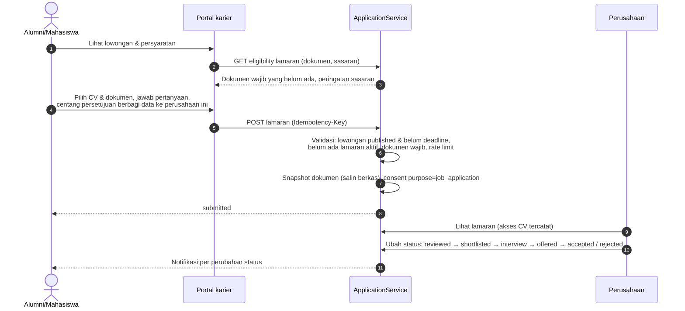
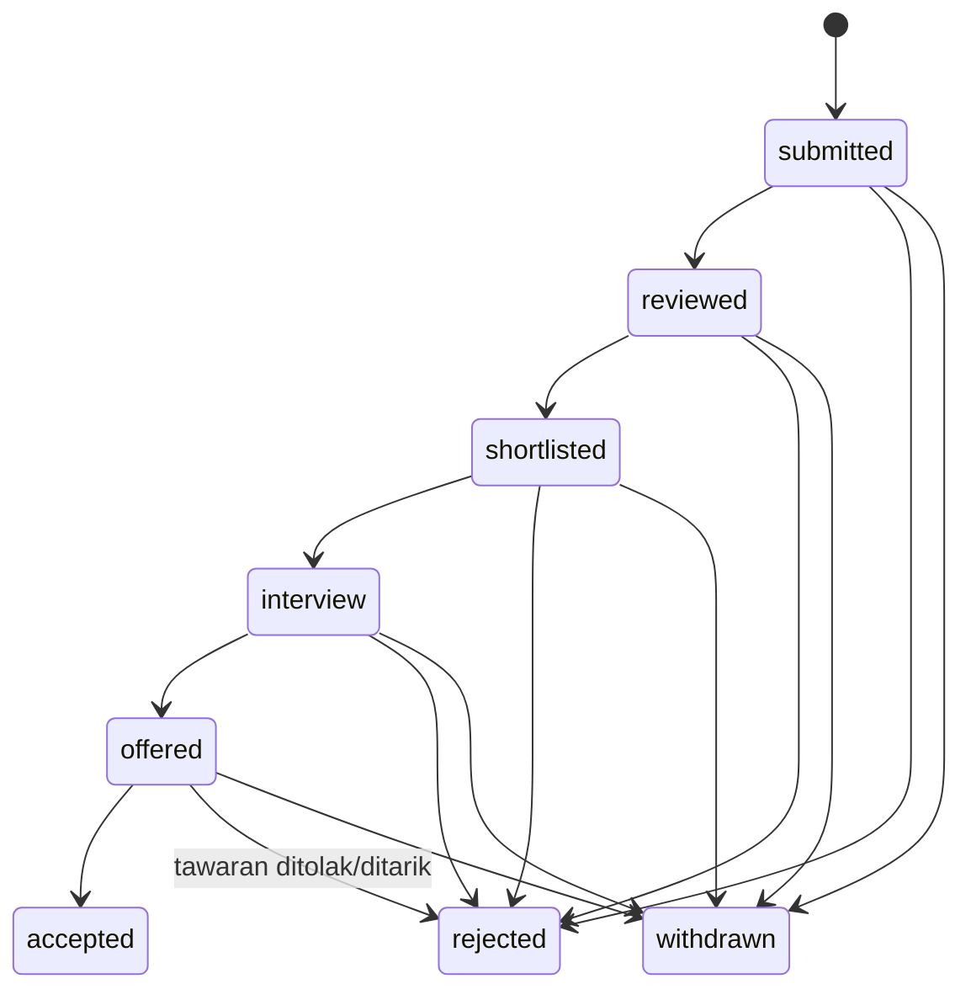

# 21 — Rancangan Lowongan dan Lamaran Kerja

> **Status:** rancangan · Disusun 2026-10-13 (commit `47043ca`) · Kembali ke [README](README.md)
> Skema acuan: [25 §7](25-rancangan-database-dan-erd.md#7-kelompok-career-center) · Aturan: `KARIR-BR-002`, `KARIR-BR-005`–`KARIR-BR-007`, `KARIR-BR-012`–`KARIR-BR-014` · Perusahaan: [22](22-rancangan-mitra-perusahaan-dan-crm.md)

Dokumen ini mengatur **posting lowongan, moderasi, publikasi, penutupan, lamaran, tahapan rekrutmen, status lamaran, notifikasi pelamar, monitoring rekrutmen**, serta pencegahan **spam, lowongan palsu, lamaran ganda, dan akses CV tanpa izin**.

## Daftar Isi

1. [Tujuan](#1-tujuan)
2. [Ruang Lingkup](#2-ruang-lingkup)
3. [Aktor dan Hak Akses](#3-aktor-dan-hak-akses)
4. [Prasyarat](#4-prasyarat)
5. [Alur Bisnis Utama](#5-alur-bisnis-utama)
6. [Alur Alternatif dan Kegagalan](#6-alur-alternatif-dan-kegagalan)
7. [Status dan Transisi Status](#7-status-dan-transisi-status)
8. [Data Input dan Output](#8-data-input-dan-output)
9. [Aturan Bisnis](#9-aturan-bisnis)
10. [Validasi](#10-validasi)
11. [Rancangan Database](#11-rancangan-database)
12. [Relasi Antarmodul](#12-relasi-antarmodul)
13. [Kontrak API Konseptual](#13-kontrak-api-konseptual)
14. [Rancangan Halaman UI/UX](#14-rancangan-halaman-uiux)
15. [Notifikasi](#15-notifikasi)
16. [Laporan](#16-laporan)
17. [Keamanan dan Audit](#17-keamanan-dan-audit)
18. [Acceptance Criteria](#18-acceptance-criteria)
19. [Test Case](#19-test-case)
20. [Asumsi dan Keputusan Terbuka](#20-asumsi-dan-keputusan-terbuka)

---

## 1. Tujuan

Menyediakan lowongan yang terpercaya dan proses melamar yang jelas statusnya, sambil menjaga CV pelamar hanya dapat diakses pihak yang berhak.

## 2. Ruang Lingkup

**Termasuk:** pembuatan lowongan oleh perekrut atau staf pusat karier (atas nama perusahaan), moderasi (platform untuk marketplace, tenant untuk lowongan khusus tenant), publikasi, penutupan otomatis/manual, lamaran (dengan snapshot dokumen), tahapan rekrutmen, perubahan status oleh perusahaan atau staf, penarikan lamaran, monitoring, dan anti-penyalahgunaan.

**Tidak termasuk:** penjadwalan wawancara terintegrasi kalender, asesmen online, dan penggajian.

## 3. Aktor dan Hak Akses

| Aktor | Aksi | Otorisasi |
|---|---|---|
| Perekrut (`company_recruiter`) | Buat/ubah draf lowongan, ajukan moderasi, tutup lowongan, proses lamaran ke lowongan perusahaannya | Keanggotaan perusahaan `active` + perusahaan `verified` |
| Pemilik akun perusahaan (`company_owner`) | idem + kelola perekrut | idem |
| Staf pusat karier | Buat lowongan atas nama mitra (dengan persetujuan mitra tercatat), moderasi lowongan tenant, sembunyikan lowongan marketplace dari portal tenant, memantau rekrutmen, memproses lamaran untuk lowongan yang dikelola kampus | `career_job_postings.*`, `career_applications.read/update` |
| Moderator platform | Moderasi lowongan marketplace | Permission platform |
| Pelamar (mahasiswa/alumni) | Melihat lowongan, melamar, menarik lamaran, melihat status | `career_self_service.*` + `feature:career.applications` |

## 4. Prasyarat

Perusahaan `verified` ([22](22-rancangan-mitra-perusahaan-dan-crm.md)). Entitlement tenant pelamar: `career.marketplace` (melihat/melamar lowongan marketplace), `career.applications` (melamar via aplikasi), `career.job_posting` (lowongan khusus tenant & monitoring). Lihat [34](34-matriks-paket-dan-entitlement.md).

## 5. Alur Bisnis Utama

### 5.1 Lowongan

Atribut (`career_job_postings`):

| Field | Wajib | Keterangan |
|---|---|---|
| `career_company_id` | Ya | |
| `title`, `description`, `qualifications`, `responsibilities` | Ya | Markdown disanitasi |
| `job_type` | Ya | `full_time`, `part_time`, `internship`, `freelance`, `contract` |
| `contract_type` | Tidak | `permanent`, `fixed_term`, `project` |
| `work_mode` | Ya | `onsite`, `remote`, `hybrid` |
| `locations` | Ya (kecuali remote) | Kota/provinsi |
| `salary_min`, `salary_max`, `salary_currency`, `salary_period`, `show_salary` | Tidak | Gaji hanya ditampilkan bila `show_salary` |
| `application_deadline` | Ya | ≤ `career.posting.max_open_days` (default 90) dari publikasi |
| `target_study_programs`, `target_degree_levels`, `target_skills`, `min_graduation_year`, `max_graduation_year` | Tidak | Sasaran (mencocokkan & memfilter, bukan diskriminasi pada atribut terlindungi) |
| `required_documents` | Ya | Minimal `cv`. Opsional `cover_letter`, `transcript`, `portfolio`, `certificate` |
| `screening_questions` | Tidak | Maks. 5 pertanyaan singkat |
| `visibility` | Ya | `marketplace` (semua tenant) atau `tenant` (`target_university_ids` — hanya tenant mitra) |
| `external_apply_url` | Tidak | Bila diisi, lamaran di luar platform (tanpa pelacakan status). Hanya untuk perusahaan `verified`, dan domain URL harus cocok dengan domain perusahaan terverifikasi |
| `openings` | Tidak | Jumlah posisi |

### 5.2 Moderasi dan publikasi

```mermaid
flowchart TD
    D[draft] --> S[Ajukan: pending_review]
    S --> AUTO{Pemeriksaan otomatis}
    AUTO -->|kata terlarang, URL mencurigakan,<br/>gaji tidak wajar, duplikat,<br/>meminta biaya dari pelamar| FLAG[flag untuk moderator]
    AUTO --> M{Moderator}
    FLAG --> M
    M -->|setuju| P[published<br/>tampil sesuai visibility]
    M -->|minta revisi| R[revision_requested] --> S
    M -->|tolak + alasan| X[rejected]
    P -->|deadline lewat (job)| C[closed]
    P -->|ditutup perusahaan/kuota terisi| C
    P -->|laporan penyalahgunaan terbukti| T[taken_down]
    C --> A[archived]
```

- **Siapa memoderasi** ([KARIR-BR-002](29-business-rules-dan-validasi.md#karir-br-002), [KARIR-BR-012](29-business-rules-dan-validasi.md#karir-br-012)): lowongan `visibility = marketplace` dimoderasi platform. Lowongan `visibility = tenant` dimoderasi pusat karier tenant sasaran, dan setiap tenant sasaran memutuskan sendiri (`career_job_posting_targets.status` per tenant). Tenant juga dapat **menyembunyikan** lowongan marketplace dari portalnya (`hidden`) tanpa memengaruhi tenant lain ([KK-Q-21](33-glossary-dan-keputusan-bisnis.md#3-pertanyaan-terbuka-kk-q)).
- **Pemeriksaan otomatis**: lowongan yang meminta pembayaran dari pelamar, memuat pola penipuan umum, nomor kontak pribadi di deskripsi, atau domain email/URL yang tidak cocok dengan perusahaan terverifikasi diberi flag. Flag tidak otomatis menolak. Moderator memutuskan.
- **Perubahan setelah publikasi**: perubahan field material (judul, gaji, kualifikasi, lokasi, deadline diperpanjang > 30 hari) mengembalikan lowongan ke `pending_review`, sementara versi publik lama tetap tayang sampai disetujui (`career_job_posting_revisions`). Koreksi minor (salah ketik) langsung berlaku dan tercatat.
- **Kedaluwarsa** ([KARIR-BR-013](29-business-rules-dan-validasi.md#karir-br-013)): job harian menutup lowongan yang melewati `application_deadline` (akhir hari, zona waktu tenant sasaran; untuk marketplace memakai zona waktu perusahaan).

### 5.3 Lamaran



- **Sasaran** (`target_study_programs` dll.) memberi peringatan, bukan pemblokiran, kecuali perusahaan menandai `strict_targeting = true` untuk sasaran yang sah (mis. jurusan tertentu untuk magang), dan staf/moderator menyetujuinya.
- **Snapshot**: berkas yang dikirim disalin (`career_application_documents`) sehingga perubahan/penghapusan CV di profil tidak mengubah lamaran yang sudah dikirim, dan perusahaan tidak mendapat akses ke versi CV lain.
- **Satu lamaran aktif per pelamar per lowongan** ([KARIR-BR-005](29-business-rules-dan-validasi.md#karir-br-005)). Setelah `withdrawn`, pelamar dapat melamar ulang bila lowongan masih buka dan `allow_reapply = true`.
- **Riwayat**: pelamar dapat melihat riwayat lamarannya selama retensi berlaku ([20 §5.4](20-rancangan-career-center-karirlink.md#5-alur-bisnis-utama)).

### 5.4 Status lamaran

| Status | Arti | Diubah oleh |
|---|---|---|
| `submitted` | Lamaran terkirim | Sistem |
| `reviewed` | Telah ditinjau perusahaan | Perusahaan/staf |
| `shortlisted` | Masuk daftar pendek | Perusahaan/staf |
| `interview` | Dijadwalkan/tahap wawancara (detail tahap bebas di `stage_note`) | Perusahaan/staf |
| `offered` | Ditawari posisi | Perusahaan/staf |
| `accepted` | Diterima (pelamar menerima tawaran atau perusahaan mencatat penerimaan) | Perusahaan/staf; pelamar dapat mengonfirmasi |
| `rejected` | Tidak dilanjutkan | Perusahaan/staf (alasan kategori opsional, tidak ditampilkan rinci kepada pelamar kecuali dipilih) |
| `withdrawn` | Ditarik pelamar | Pelamar |

`accepted`, `rejected`, `withdrawn` adalah status final ([KARIR-BR-006](29-business-rules-dan-validasi.md#karir-br-006)). Lamaran yang tidak diproses saat lowongan `closed` + `career.applications.auto_close_after_days` (default 60) → `rejected` dengan alasan sistem `posting_closed_no_decision`, dan pelamar diberi tahu.

### 5.5 Monitoring rekrutmen

Untuk pusat karier: per lowongan (pelamar per status, waktu respons perusahaan pertama, lamaran yang belum ditinjau > 14 hari), per perusahaan (responsivitas, penerimaan), dan per prodi (lamaran, shortlisted, accepted). Data pelamar terbatas pada tenant sendiri.

### 5.6 Anti-penyalahgunaan

| Ancaman | Pengendalian |
|---|---|
| Lowongan palsu | Hanya perusahaan `verified`, moderasi, flag otomatis, laporan pengguna (`career_abuse_reports`), dan `taken_down` + penangguhan perusahaan ([22](22-rancangan-mitra-perusahaan-dan-crm.md)) |
| Spam lowongan | Rate limit posting per perusahaan (`career.posting.max_per_day`, default 20), deteksi duplikat (judul ternormalisasi + lokasi + perusahaan dalam 30 hari) ([KARIR-BR-014](29-business-rules-dan-validasi.md#karir-br-014)) |
| Spam lamaran | Rate limit lamaran per pengguna (`career.applications.max_per_day`, default 20) |
| Lamaran ganda | Unique aktif (§5.3) |
| Akses CV tanpa izin | CV diakses hanya melalui lamaran ke lowongan perusahaan tersebut atau rekomendasi yang disetujui ([KARIR-BR-007](29-business-rules-dan-validasi.md#karir-br-007)). URL berkas tidak langsung (stream berpolicy), dan setiap unduhan dicatat & terlihat oleh pemilik |
| Scraping data pelamar | Daftar pelamar dipaginasi dengan rate limit API perusahaan. Ekspor pelamar oleh perusahaan dibatasi kolom dan dicatat |
| Penipuan meminta biaya | Kata kunci + laporan. Pelamar diberi peringatan baku "Kampus tidak pernah memungut biaya rekrutmen" |

## 6. Alur Alternatif dan Kegagalan

| Kode | Kondisi | Penanganan |
|---|---|---|
| AF-JOB-01 | Perusahaan disuspensi | Seluruh lowongan `published` → `taken_down` (alasan sistem). Lamaran berjalan dibekukan, dan pelamar diberi tahu ([KARIR-BR-004](29-business-rules-dan-validasi.md#karir-br-004)) |
| AF-JOB-02 | Perekrut disuspensi tetapi perusahaan aktif | Perekrut tidak dapat bertindak. Lowongan tetap tayang, dan pemilik perusahaan dapat mengalihkan |
| AF-JOB-03 | Lowongan dihapus perusahaan saat ada lamaran | Tidak dapat dihapus, hanya `closed` |
| AF-JOB-04 | Pelamar kehilangan akses (kelulusan dibatalkan) | Lamaran tetap milik pelamar. Akses portal mengikuti status akun |
| AF-JOB-05 | Dokumen wajib tidak ada | 422 dengan daftar dokumen |
| AF-JOB-06 | Lowongan ditutup saat pelamar mengisi | 409 `POSTING_CLOSED` saat kirim, dan draf lamaran tidak disimpan |

## 7. Status dan Transisi Status

`career_job_postings.status`: `draft`, `pending_review`, `revision_requested`, `published`, `rejected`, `closed`, `taken_down`, `archived`. `career_job_posting_targets.status` (per tenant): `pending_review`, `approved`, `rejected`, `hidden`.

`career_applications.status`:



Setiap transisi dicatat di `career_application_stage_histories` (aktor, konteks: perusahaan/staf/pelamar/sistem, catatan internal vs catatan untuk pelamar).

## 8. Data Input dan Output

Tampilan lamaran untuk perusahaan: nama pelamar, headline, pendidikan (prodi, kampus, tahun lulus), dokumen snapshot, jawaban pertanyaan, dan email/telepon **hanya** bila pelamar menyetujui berbagi kontak pada lamaran (default ya untuk lamaran, karena dibutuhkan proses rekrutmen; pelamar dapat menyembunyikan telepon).

## 9. Aturan Bisnis

| ID | Aturan |
|---|---|
| [KARIR-BR-002](29-business-rules-dan-validasi.md#karir-br-002) | Lowongan harus melewati pemeriksaan yang ditentukan sebelum dipublikasikan |
| [KARIR-BR-005](29-business-rules-dan-validasi.md#karir-br-005) | Satu lamaran aktif per pelamar per lowongan |
| [KARIR-BR-006](29-business-rules-dan-validasi.md#karir-br-006) | Status lamaran mengikuti state machine. Status final tidak dapat diubah kecuali koreksi staf beralasan |
| [KARIR-BR-007](29-business-rules-dan-validasi.md#karir-br-007) | CV dapat diakses perusahaan hanya melalui lamaran ke lowongannya atau rekomendasi yang disetujui. Setiap akses dicatat |
| [KARIR-BR-012](29-business-rules-dan-validasi.md#karir-br-012) | Lowongan marketplace dimoderasi platform. Lowongan khusus tenant dimoderasi tenant sasaran. Tenant dapat menyembunyikan lowongan marketplace dari portalnya |
| [KARIR-BR-013](29-business-rules-dan-validasi.md#karir-br-013) | Lowongan otomatis ditutup setelah batas lamaran |
| [KARIR-BR-014](29-business-rules-dan-validasi.md#karir-br-014) | Posting dan lamaran dibatasi laju, dan lowongan duplikat dideteksi |

## 10. Validasi

V-JOB-01 `salary_min ≤ salary_max`. V-JOB-02 `application_deadline` > hari ini dan ≤ batas. V-JOB-03 URL eksternal `https` + domain cocok. V-JOB-04 Pertanyaan screening ≤ 5, masing-masing ≤ 300 karakter. V-JOB-05 Dokumen lamaran sesuai `required_documents`, PDF ≤ 5 MB.

## 11. Rancangan Database

`career_job_postings` (platform/hybrid: `owner_university_id` null untuk marketplace, terisi bila dibuat staf tenant), `career_job_posting_targets`, `career_job_posting_revisions`, `career_applications` (tenant), `career_application_documents`, `career_application_stage_histories`, `career_abuse_reports`. Lihat [25 §7](25-rancangan-database-dan-erd.md#7-kelompok-career-center).

## 12. Relasi Antarmodul

Profil & CV ([20](20-rancangan-career-center-karirlink.md)), Perusahaan ([22](22-rancangan-mitra-perusahaan-dan-crm.md)), Rekomendasi ([23](23-rancangan-rekomendasi-lulusan.md); kandidat yang direkomendasikan dapat diundang melamar), dan Tracer (lamaran `accepted` **tidak** otomatis menjadi data tracer, tetapi dapat ditawarkan ke pelamar untuk memperbarui catatan karier `self_update`).

## 13. Kontrak API Konseptual

| Method | URL | Otorisasi |
|---|---|---|
| GET | `/career/jobs` (lowongan yang tampil di portal tenant pengguna; filter jenis, lokasi, prodi, keahlian) | `career_self_service.read` |
| GET | `/career/jobs/{posting}` ; `/career/jobs/{posting}/application-eligibility` | idem |
| POST | `/career/jobs/{posting}/applications` (Idempotency-Key) | `career_self_service.create` + `feature:career.applications` |
| GET | `/me/career/applications` ; POST `/me/career/applications/{application}/withdraw` | `career_self_service.*` |
| GET/POST/PUT | `/company/job-postings` ; POST `/{posting}/submit`, `/close` | Konteks perusahaan |
| GET | `/company/job-postings/{posting}/applications` | Konteks perusahaan |
| GET | `/company/applications/{application}/documents/{doc}` (unduh tercatat) | Konteks perusahaan |
| POST | `/company/applications/{application}/status` | Konteks perusahaan |
| GET/POST | `/career-center/job-postings` (atas nama mitra) | `career_job_postings.create` + `feature:career.job_posting` |
| GET | `/career-center/moderation/postings` ; POST `/{target}/decide` | `career_job_postings.approve/reject` |
| POST | `/career-center/job-postings/{posting}/hide` | `career_job_postings.update` |
| GET | `/career-center/recruitment-monitoring` | `career_applications.read` |
| GET/POST | `/platform/career/moderation/postings` | Platform |
| GET | `/public/career/{tenant_slug}/jobs`, `/jobs/{posting}` | Publik (tanpa tombol lamar bila tidak login) |
| POST | `/career/abuse-reports` | Pengguna login |

## 14. Rancangan Halaman UI/UX

| Halaman | Rute | Konteks |
|---|---|---|
| Lowongan | `/karir/lowongan` | Staf |
| Moderasi Lowongan | `/karir/moderasi` | Staf (antrean dengan flag) |
| Lamaran | `/karir/lamaran` | Staf |
| Monitoring Rekrutmen | `/karir/monitoring` | Staf |
| Portal: Lowongan & Lamaran Saya | `/one/career/jobs`, `/one/career/applications` | Mahasiswa/alumni |
| Portal Perusahaan: Lowongan, Pelamar (papan kanban per status) | `/perusahaan/lowongan`, `/perusahaan/lowongan/:id/pelamar` | Perusahaan |

## 15. Notifikasi

`career.job.new_matching` (lowongan baru sesuai preferensi; ringkasan harian, dapat dimatikan), `career.application.submitted`, `career.application.status_changed`, `career.application.auto_closed`, `career.posting.review_decided` (perusahaan), `career.posting.expiring` (perusahaan, H-3), `career.posting.taken_down`.

## 16. Laporan

KARIR-RPT-03 Lowongan per jenis/sektor/lokasi/status. KARIR-RPT-04 Lamaran & penempatan per prodi/cohort. KARIR-RPT-05 Responsivitas perusahaan. KARIR-RPT-06 Moderasi (waktu, keputusan, flag).

## 17. Keamanan dan Audit

Unduhan dokumen lamaran → `career_document_access_logs` + terlihat pemilik. Moderasi, take-down, dan koreksi status final → `audit_logs`. API perusahaan dibatasi laju per akun.

## 18. Acceptance Criteria

| ID | Kriteria |
|---|---|
| KARIR-AC-06 | Lowongan tidak tampil di portal mana pun sebelum disetujui moderator yang berwenang |
| KARIR-AC-07 | Lamaran kedua ke lowongan yang sama → 409 `DUPLICATE_APPLICATION` |
| KARIR-AC-08 | Perusahaan X tidak dapat mengunduh CV pelamar lowongan perusahaan Y (403), dan percobaan tercatat |
| KARIR-AC-09 | Perubahan status lamaran memicu notifikasi ke pelamar ≤ 1 menit |
| KARIR-AC-10 | Lowongan melewati deadline berstatus `closed` pada eksekusi job berikutnya |

## 19. Test Case

| ID | Judul | Prioritas |
|---|---|---|
| KARIR-TC-010 | Publikasi lowongan melalui moderasi | P1 |
| KARIR-TC-011 | Lowongan ditolak dengan alasan | P2 |
| KARIR-TC-012 | Lamaran ganda | P1 |
| KARIR-TC-013 | Perubahan status lamaran & notifikasi | P1 |
| KARIR-TC-014 | Transisi status tidak sah ditolak | P2 |
| KARIR-TC-015 | Akses CV tanpa izin | P1 |
| KARIR-TC-016 | Snapshot dokumen tidak berubah saat CV profil dihapus | P2 |
| KARIR-TC-017 | Perusahaan disuspensi → lowongan take down | P2 |
| KARIR-TC-018 | Rate limit posting & lamaran | P3 |
| KARIR-TC-019 | Tenant menyembunyikan lowongan marketplace | P3 |

## 20. Asumsi dan Keputusan Terbuka

| ID | Hal |
|---|---|
| [KK-KD-24](33-glossary-dan-keputusan-bisnis.md#2-keputusan-desain-kk-kd) | Dasar akses CV |
| [KK-Q-21](33-glossary-dan-keputusan-bisnis.md#3-pertanyaan-terbuka-kk-q) | Moderasi marketplace oleh platform |
| [KK-Q-22](33-glossary-dan-keputusan-bisnis.md#3-pertanyaan-terbuka-kk-q) | Retensi lamaran |
