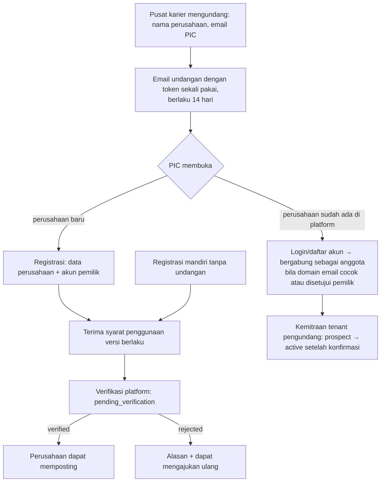
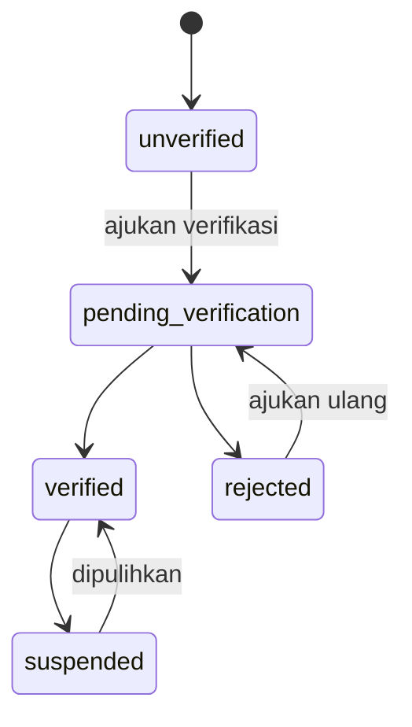

# 22 — Rancangan Mitra Perusahaan dan CRM

> **Status:** rancangan · Disusun 2026-10-13 (commit `47043ca`) · Kembali ke [README](README.md)
> Skema acuan: [25 §7](25-rancangan-database-dan-erd.md#7-kelompok-career-center) · Aturan: `KARIR-BR-003`, `KARIR-BR-004`, `KARIR-BR-018`, `KARIR-BR-019` · Keputusan: [KK-KD-22](33-glossary-dan-keputusan-bisnis.md#2-keputusan-desain-kk-kd), [KK-KD-23](33-glossary-dan-keputusan-bisnis.md#2-keputusan-desain-kk-kd)

Dokumen ini mengatur **undangan perusahaan, registrasi, verifikasi identitas perusahaan, profil, PIC/perekrut, status kemitraan per kampus, persetujuan syarat penggunaan, riwayat interaksi dan catatan CRM, status kerja sama, riwayat lowongan, serta evaluasi**. Status **perusahaan** dipisahkan dari status **akun pengguna** yang bekerja di perusahaan itu, dan dari status **kemitraan** dengan setiap kampus.

## Daftar Isi

1. [Tujuan](#1-tujuan)
2. [Ruang Lingkup](#2-ruang-lingkup)
3. [Aktor dan Hak Akses](#3-aktor-dan-hak-akses)
4. [Prasyarat](#4-prasyarat)
5. [Alur Bisnis Utama](#5-alur-bisnis-utama)
6. [Alur Alternatif dan Kegagalan](#6-alur-alternatif-dan-kegagalan)
7. [Status dan Transisi Status](#7-status-dan-transisi-status)
8. [Data Input dan Output](#8-data-input-dan-output)
9. [Aturan Bisnis](#9-aturan-bisnis)
10. [Validasi](#10-validasi)
11. [Rancangan Database](#11-rancangan-database)
12. [Relasi Antarmodul](#12-relasi-antarmodul)
13. [Kontrak API Konseptual](#13-kontrak-api-konseptual)
14. [Rancangan Halaman UI/UX](#14-rancangan-halaman-uiux)
15. [Notifikasi](#15-notifikasi)
16. [Laporan](#16-laporan)
17. [Keamanan dan Audit](#17-keamanan-dan-audit)
18. [Acceptance Criteria](#18-acceptance-criteria)
19. [Test Case](#19-test-case)
20. [Asumsi dan Keputusan Terbuka](#20-asumsi-dan-keputusan-terbuka)

---

## 1. Tujuan

Membangun basis perusahaan mitra yang terverifikasi dan relasi yang terdokumentasi, sehingga pusat karier dapat mengelola kerja sama secara berkelanjutan dan mahasiswa/alumni terlindung dari perusahaan fiktif.

## 2. Ruang Lingkup

**Termasuk:** tiga lapis status (perusahaan, akun anggota, kemitraan per tenant), undangan oleh kampus, registrasi mandiri, verifikasi, profil, anggota & peran, syarat penggunaan & versi, kemitraan, kontak PIC, aktivitas CRM (panggilan, rapat, email, kunjungan, MoU), tindak lanjut, evaluasi, dan riwayat lowongan.

**Tidak termasuk:** manajemen dokumen MoU penuh (hanya lampiran & tanggal) dan penagihan ke perusahaan.

## 3. Aktor dan Hak Akses

| Aktor | Aksi | Otorisasi |
|---|---|---|
| Admin/petugas pusat karier | Undang perusahaan, kelola kemitraan, CRM, evaluasi | `career_company_invitations.create` + `feature:career.company_invitations`, `career_partnerships.*`, `career_crm.*` + `feature:career.crm` |
| Moderator platform | Verifikasi perusahaan, suspensi perusahaan | Permission platform |
| Pemilik akun perusahaan (`company_owner`) | Profil perusahaan, undang/nonaktifkan perekrut, menerima syarat | Keanggotaan `company_owner` |
| Perekrut (`company_recruiter`) | Lowongan & lamaran | Keanggotaan `company_recruiter` |

Peran keanggotaan perusahaan **bukan** role tenant (`user_roles`). Peran disimpan di `career_company_members.role` dan diperiksa `CompanyContext` + policy ([KK-KD-23](33-glossary-dan-keputusan-bisnis.md#2-keputusan-desain-kk-kd)).

## 4. Prasyarat

Akun pengguna global (`users`, Ada). Perekrut login memakai guard yang sama (Sanctum). Konteks perusahaan dipilih melalui header `X-Company-ID` (analog `X-University-ID`, Ada) dan divalidasi terhadap keanggotaan aktif.

## 5. Alur Bisnis Utama

### 5.1 Undangan dan registrasi

- Token undangan: acak, disimpan hash, sekali pakai, kedaluwarsa ([KARIR-BR-019](29-business-rules-dan-validasi.md#karir-br-019)). Undangan ulang membatalkan token lama.
- Undangan ke perusahaan yang sudah terverifikasi langsung membuat kemitraan `prospect` tanpa verifikasi ulang.

### 5.2 Verifikasi perusahaan

| Bukti | Keterangan |
|---|---|
| Identitas badan usaha | Nama resmi, nomor induk berusaha atau nomor registrasi lain sesuai jenis entitas, NPWP badan (opsional, terenkripsi) |
| Domain | Email pemilik pada domain situs resmi, atau verifikasi DNS TXT domain |
| Dokumen | Akta/izin usaha (berkas), surat kuasa PIC (bila bukan pengurus) |
| Pemeriksaan moderator | Kecocokan nama/alamat/situs, pencarian keberadaan publik |

Hasil: `verification_status` + `verification_method` + `verified_by` + catatan. Perusahaan yang belum `verified` dapat melengkapi profil, tetapi **tidak** dapat memposting lowongan publik atau mengakses kandidat ([KARIR-BR-003](29-business-rules-dan-validasi.md#karir-br-003)).

### 5.3 Tiga lapis status

| Lapis | Tabel | Nilai | Efek |
|---|---|---|---|
| Perusahaan (platform) | `career_companies.verification_status` | `unverified`, `pending_verification`, `verified`, `rejected`, `suspended` | `suspended` → semua lowongan `taken_down`, anggota tidak dapat bertindak |
| Akun anggota | `career_company_members.status` | `invited`, `active`, `suspended`, `removed` | Perekrut `suspended` tidak dapat bertindak walaupun perusahaan `verified` |
| Kemitraan (per tenant) | `career_partnerships.status` | `prospect`, `active`, `inactive`, `ended` | `active` diperlukan untuk lowongan `visibility = tenant`, rekomendasi, dan pencarian profil `campus_partners` |

([KARIR-BR-004](29-business-rules-dan-validasi.md#karir-br-004))

Akun pengguna (`users.is_active`, Ada) tetap lapis keempat: akun nonaktif tidak dapat login sama sekali.

### 5.4 Kemitraan dan kerja sama

`career_partnerships`: `university_id`, `career_company_id`, `status`, `partnership_types` (json: `recruitment`, `internship`, `guest_lecture`, `research`, `scholarship`, `csr`), `agreement_number`, `agreement_start`, `agreement_end`, `agreement_file_id`, `owner_staff_id` (account manager), `tier` (opsional), dan `notes`. Kontak PIC per tenant (`career_partnership_contacts`): nama, jabatan, email, telepon, peran (rekrutmen, HR, manajemen), dan persetujuan dihubungi untuk survei pengguna lulusan ([16](16-rancangan-tracer-study.md)).

Kerja sama yang `agreement_end` lewat → pengingat 30 hari sebelumnya. Status tidak otomatis `ended` tanpa keputusan staf (hanya ditandai `agreement_expired`).

### 5.5 CRM

`career_crm_activities`: `activity_type` (`call`, `meeting`, `email`, `visit`, `event`, `mou_signing`, `note`), `occurred_at`, `subject`, `summary`, `participants`, `outcome`, `next_action`, `next_action_due_at`, `assigned_to`, dan lampiran. Catatan CRM bersifat **internal tenant** dan tidak pernah terlihat oleh perusahaan maupun tenant lain ([KARIR-BR-018](29-business-rules-dan-validasi.md#karir-br-018)).

Evaluasi mitra (`career_partner_evaluations`, per periode): responsivitas lamaran (dihitung dari [21](21-rancangan-lowongan-dan-lamaran-kerja.md)), jumlah penempatan, kepatuhan, skor penilaian staf, dan catatan.

Riwayat lowongan: tampilan gabungan seluruh lowongan perusahaan yang tampil di tenant, beserta lamaran & penempatan dari pelamar tenant tersebut.

### 5.6 Syarat penggunaan

`career_terms_versions` (platform): versi, isi, `effective_from`. `career_terms_acceptances`: perusahaan, user, versi, waktu, IP. Versi baru yang material mengharuskan pemilik menerima ulang sebelum memposting lagi.

## 6. Alur Alternatif dan Kegagalan

| Kode | Kondisi | Penanganan |
|---|---|---|
| AF-CMP-01 | Dua registrasi untuk perusahaan yang sama | Deteksi nomor registrasi/domain sama → gabung ke perusahaan yang ada (permintaan bergabung ke pemilik) |
| AF-CMP-02 | Pemilik meninggalkan perusahaan | Pemilik lain atau moderator platform menetapkan pemilik baru. Perusahaan wajib memiliki ≥ 1 pemilik aktif |
| AF-CMP-03 | Email undangan memantul | Undangan `failed`, dan staf diberi tahu |
| AF-CMP-04 | Perusahaan meminta penghapusan akun | Perusahaan `suspended`/dianonimkan. Lamaran yang diterima dari pelamar tetap tunduk retensi lamaran |
| AF-CMP-05 | Laporan penipuan terhadap perusahaan | Moderator dapat `suspended` segera dengan alasan, dan tenant mitra diberi tahu |

## 7. Status dan Transisi Status

`career_company_invitations.status`: `pending`, `accepted`, `expired`, `revoked`, `failed`. Kemitraan: `prospect` → `active` → `inactive` ↔ `active`, → `ended`.

## 8. Data Input dan Output

Profil perusahaan publik: nama, logo, sektor, ukuran, lokasi, situs, deskripsi, lencana "Terverifikasi", dan lowongan aktif. Data sensitif (NPWP, dokumen legal, kontak pribadi PIC) tidak publik.

## 9. Aturan Bisnis

| ID | Aturan |
|---|---|
| [KARIR-BR-003](29-business-rules-dan-validasi.md#karir-br-003) | Perusahaan harus `verified` untuk memposting lowongan publik dan mengakses kandidat |
| [KARIR-BR-004](29-business-rules-dan-validasi.md#karir-br-004) | Status perusahaan, status akun anggota, dan status kemitraan dievaluasi terpisah. Setiap tindakan memerlukan ketiganya memenuhi syarat aksi |
| [KARIR-BR-018](29-business-rules-dan-validasi.md#karir-br-018) | Catatan CRM bersifat internal tenant |
| [KARIR-BR-019](29-business-rules-dan-validasi.md#karir-br-019) | Token undangan perusahaan sekali pakai, disimpan hash, dan kedaluwarsa |

## 10. Validasi

V-CMP-01 nama perusahaan ≤ 200, situs `https`. V-CMP-02 domain email pemilik cocok situs (atau verifikasi DNS). V-CMP-03 `agreement_start ≤ agreement_end`. V-CMP-04 email undangan valid & tidak disupresi.

## 11. Rancangan Database

`career_companies` (platform), `career_company_members` (platform), `career_company_verifications`, `career_terms_versions`, `career_terms_acceptances`, `career_company_invitations` (tenant), `career_partnerships` (tenant), `career_partnership_contacts` (tenant), `career_crm_activities` (tenant), `career_partner_evaluations` (tenant). Lihat [25 §7](25-rancangan-database-dan-erd.md#7-kelompok-career-center).

## 12. Relasi Antarmodul

Lowongan ([21](21-rancangan-lowongan-dan-lamaran-kerja.md)), Rekomendasi ([23](23-rancangan-rekomendasi-lulusan.md)), Tracer (kontak PIC sebagai pengguna lulusan, [16](16-rancangan-tracer-study.md)), dan Notification (undangan ke alamat tanpa akun → notifiable on-demand).

## 13. Kontrak API Konseptual

| Method | URL | Otorisasi |
|---|---|---|
| POST | `/career-center/company-invitations` | `career_company_invitations.create` |
| GET | `/career-center/companies` (perusahaan yang bermitra/terlihat oleh tenant) | `career_partnerships.read` |
| GET/POST/PUT | `/career-center/partnerships` | `career_partnerships.*` |
| GET/POST/PUT | `/career-center/partnerships/{partnership}/contacts` | `career_partnerships.update` |
| GET/POST/PUT | `/career-center/partnerships/{partnership}/crm-activities` | `career_crm.*` |
| GET/POST | `/career-center/partnerships/{partnership}/evaluations` | `career_crm.*` |
| GET/POST | `/public/company-invitations/{token}` ; `/accept` | Token |
| POST | `/company/register` | Publik (rate limit, captcha) |
| GET/PUT | `/company/profile` ; POST `/company/verification-requests` | Konteks perusahaan |
| GET/POST/DELETE | `/company/members` | `company_owner` |
| POST | `/company/terms/accept` | `company_owner` |
| GET/POST | `/platform/career/companies` ; POST `/{company}/verify`, `/suspend` | Platform |

## 14. Rancangan Halaman UI/UX

| Halaman | Rute |
|---|---|
| Perusahaan Mitra | `/karir/mitra` (tabel: nama, status verifikasi, status kemitraan, jenis kerja sama, akhir perjanjian, lowongan aktif, account manager) |
| Detail Mitra | `/karir/mitra/:id` (tab Profil · Kontak · CRM timeline · Lowongan · Evaluasi) |
| Undangan Perusahaan | `/karir/undangan` |
| CRM Perusahaan | `/karir/crm` (daftar tindak lanjut jatuh tempo) |
| Portal perusahaan | `/perusahaan` (registrasi, profil, anggota, verifikasi) |

## 15. Notifikasi

`career.company.invited`, `career.company.invitation_accepted` (staf), `career.company.verification_decided`, `career.company.suspended` (anggota & tenant mitra), `career.partnership.agreement_expiring`, `career.crm.followup_due`.

## 16. Laporan

KARIR-RPT-07 Mitra per status, sektor, jenis kerja sama. KARIR-RPT-08 Aktivitas CRM per staf/periode. KARIR-RPT-09 Evaluasi mitra.

## 17. Keamanan dan Audit

Dokumen legal perusahaan hanya untuk moderator platform. Verifikasi/suspensi → audit platform. Perubahan kemitraan & CRM → `audit_logs` tenant. API perusahaan memvalidasi `X-Company-ID` terhadap keanggotaan aktif.

## 18. Acceptance Criteria

| ID | Kriteria |
|---|---|
| KARIR-AC-11 | Perusahaan `pending_verification` tidak dapat memposting lowongan publik (403) |
| KARIR-AC-12 | Perekrut `suspended` di perusahaan `verified` tidak dapat mengubah status lamaran |
| KARIR-AC-13 | Token undangan yang sudah dipakai atau kedaluwarsa ditolak |
| KARIR-AC-14 | Catatan CRM tenant A tidak terlihat oleh tenant B dan perusahaan |

## 19. Test Case

| ID | Judul | Prioritas |
|---|---|---|
| KARIR-TC-020 | Registrasi perusahaan | P1 |
| KARIR-TC-021 | Verifikasi perusahaan disetujui/ditolak | P1 |
| KARIR-TC-022 | Undangan perusahaan sekali pakai | P2 |
| KARIR-TC-023 | Status perusahaan vs status perekrut | P1 |
| KARIR-TC-024 | Isolasi CRM | P1 |
| KARIR-TC-025 | Registrasi duplikat digabung | P3 |

## 20. Asumsi dan Keputusan Terbuka

| ID | Hal |
|---|---|
| [KK-KD-22](33-glossary-dan-keputusan-bisnis.md#2-keputusan-desain-kk-kd), [KK-KD-23](33-glossary-dan-keputusan-bisnis.md#2-keputusan-desain-kk-kd) | Perusahaan platform & akun perekrut |
| [KK-Q-03](33-glossary-dan-keputusan-bisnis.md#3-pertanyaan-terbuka-kk-q) | Marketplace internal vs eksternal |
| [KK-Q-21](33-glossary-dan-keputusan-bisnis.md#3-pertanyaan-terbuka-kk-q) | Siapa memverifikasi perusahaan (platform/tenant) |
