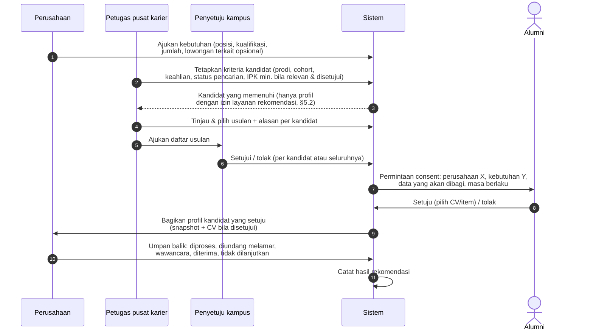
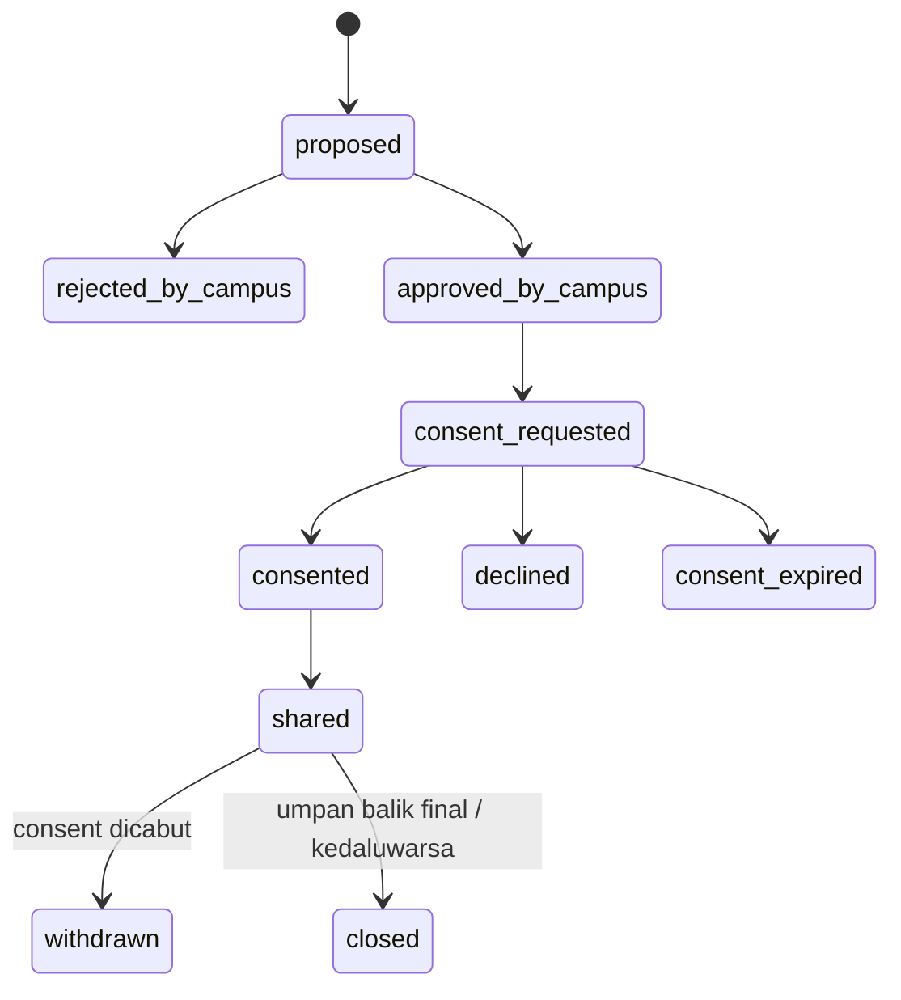

# 23 — Rancangan Rekomendasi Lulusan

> **Status:** rancangan · Disusun 2026-10-13 (commit `47043ca`) · Kembali ke [README](README.md)
> Skema acuan: [25 §7](25-rancangan-database-dan-erd.md#7-kelompok-career-center) · Aturan: `KARIR-BR-001`, `KARIR-BR-009`, `KARIR-BR-010` · Paket: Professional ke atas (`career.graduate_recommendation`, [34](34-matriks-paket-dan-entitlement.md))

Kampus merekomendasikan lulusan (dan, bila kebijakan mengizinkan, mahasiswa tingkat akhir untuk magang) kepada perusahaan mitra. Data alumni **tidak** dibagikan sebelum ada persetujuan kampus **dan** persetujuan alumni yang spesifik tujuan. Setiap rekomendasi dapat ditelusuri: siapa merekomendasikan, kapan, untuk kebutuhan apa, atas kriteria apa, dan dasar persetujuannya.

## Daftar Isi

1. [Tujuan](#1-tujuan)
2. [Ruang Lingkup](#2-ruang-lingkup)
3. [Aktor dan Hak Akses](#3-aktor-dan-hak-akses)
4. [Prasyarat](#4-prasyarat)
5. [Alur Bisnis Utama](#5-alur-bisnis-utama)
6. [Alur Alternatif dan Kegagalan](#6-alur-alternatif-dan-kegagalan)
7. [Status dan Transisi Status](#7-status-dan-transisi-status)
8. [Data Input dan Output](#8-data-input-dan-output)
9. [Aturan Bisnis](#9-aturan-bisnis)
10. [Validasi](#10-validasi)
11. [Rancangan Database](#11-rancangan-database)
12. [Relasi Antarmodul](#12-relasi-antarmodul)
13. [Kontrak API Konseptual](#13-kontrak-api-konseptual)
14. [Rancangan Halaman UI/UX](#14-rancangan-halaman-uiux)
15. [Notifikasi](#15-notifikasi)
16. [Laporan](#16-laporan)
17. [Keamanan dan Audit](#17-keamanan-dan-audit)
18. [Acceptance Criteria](#18-acceptance-criteria)
19. [Test Case](#19-test-case)
20. [Asumsi dan Keputusan Terbuka](#20-asumsi-dan-keputusan-terbuka)

---

## 1. Tujuan

Mempercepat penempatan lulusan melalui kurasi kampus, tanpa mengorbankan kendali alumni atas datanya.

## 2. Ruang Lingkup

**Termasuk:** permintaan kandidat dari perusahaan (atau inisiatif kampus), kriteria, pencarian kandidat, tinjauan petugas, persetujuan kampus, permintaan & pencatatan consent alumni, berbagi profil (dan CV bila disetujui), hasil rekomendasi, dan pencabutan consent.

**Tidak termasuk:** penilaian psikometri dan pencocokan berbasis AI tanpa tinjauan manusia. Pemeringkatan otomatis hanya sebagai bantuan urutan dan selalu ditinjau petugas.

## 3. Aktor dan Hak Akses

| Aktor | Aksi | Otorisasi |
|---|---|---|
| Perusahaan mitra aktif terverifikasi | Mengajukan kebutuhan kandidat, melihat kandidat yang dibagikan, memberi umpan balik | Konteks perusahaan + kemitraan `active` dengan tenant |
| Petugas pusat karier | Menetapkan kriteria, mencari, meninjau, mengusulkan | `career_recommendations.create/update` |
| Penyetuju kampus (mis. kepala pusat karier) | Menyetujui daftar usulan sebelum consent diminta | `career_recommendations.approve/reject` |
| Alumni | Menerima/menolak berbagi data, memilih item yang dibagikan, mencabut | `career_self_service.update` |

Seluruh endpoint dilindungi `feature:career.graduate_recommendation` ([KARIR-BR-009](29-business-rules-dan-validasi.md#karir-br-009)).

## 4. Prasyarat

Profil karier ([20](20-rancangan-career-center-karirlink.md)), kemitraan `active` ([22](22-rancangan-mitra-perusahaan-dan-crm.md)), dan entitlement Professional+.

## 5. Alur Bisnis Utama

### 5.1 Kriteria dan pencarian

- Kriteria disimpan terstruktur (`criteria` json) agar dapat diaudit: `study_program_ids`, `graduation_year_range`, `skills_all`, `skills_any`, `job_seeking_statuses`, `locations`, `min_gpa` (hanya bila disetujui penyetuju karena relevan dengan pekerjaan), dan `include_final_year_students` (kebijakan tenant, [KK-Q-26](33-glossary-dan-keputusan-bisnis.md#3-pertanyaan-terbuka-kk-q)).
- Kriteria **dilarang** memakai atribut terlindungi (jenis kelamin, agama, suku, usia, status perkawinan, disabilitas) sebagai penyaring. Validasi menolak field tersebut.
- Pencarian hanya atas pengguna dengan profil karier dan izin dasar **"bersedia dipertimbangkan untuk rekomendasi kampus"** (`recommendation_opt_in`, default **tidak**). Pengguna tanpa opt-in tidak muncul ([KARIR-BR-001](29-business-rules-dan-validasi.md#karir-br-001)).

### 5.2 Dua lapis persetujuan

| Lapis | Kapan | Isi | Disimpan di |
|---|---|---|---|
| Opt-in umum | Kapan saja di profil | "Saya bersedia dipertimbangkan pusat karier untuk rekomendasi ke mitra" (tidak membagikan data ke siapa pun) | `data_sharing_consents` `purpose = recommendation_pool` |
| Consent spesifik | Per rekomendasi | Perusahaan, kebutuhan/lowongan, daftar data (`profile_summary`, `contact_email`, `contact_phone`, `cv:{document_id}`, `transcript_summary`), masa berlaku (default 90 hari) | `data_sharing_consents` `purpose = recommendation`, `recipient_company_id`, `scope_fields`, `expires_at` |

Data **tidak** dibagikan sebelum consent spesifik `granted` ([KARIR-BR-010](29-business-rules-dan-validasi.md#karir-br-010)). Persetujuan kampus tanpa consent alumni tidak cukup, dan consent alumni tanpa persetujuan kampus tidak pernah diminta.

### 5.3 Berbagi data

- Perusahaan menerima **snapshot** profil kandidat sesuai `scope_fields`, dibuat saat consent diberikan. Pembaruan profil tidak otomatis terkirim.
- CV hanya bila `cv:{id}` ada dalam scope. Unduhan tercatat ([21 §5.6](21-rancangan-lowongan-dan-lamaran-kerja.md#5-alur-bisnis-utama)).
- Setelah `expires_at` atau consent dicabut: perusahaan tidak lagi dapat membuka snapshot di platform. Data yang sudah diunduh sebelumnya tidak dapat ditarik secara teknis, dan hal itu disampaikan dalam teks consent.

### 5.4 Keterlacakan

Setiap kandidat rekomendasi menyimpan: `recommended_by`, `recommended_at`, `approved_by`, `approved_at`, `criteria_snapshot`, `match_reasons` (kriteria yang terpenuhi), `staff_note`, `consent_id`, `shared_at`, `company_feedback`, dan `outcome`.

## 6. Alur Alternatif dan Kegagalan

| Kode | Kondisi | Penanganan |
|---|---|---|
| AF-REC-01 | Tidak ada kandidat memenuhi kriteria | Petugas melonggarkan kriteria (tercatat) atau menutup permintaan dengan alasan |
| AF-REC-02 | Alumni tidak merespons consent | Pengingat 1×. Setelah `consent_request_expiry_days` (default 7) → `consent_expired` |
| AF-REC-03 | Kemitraan berakhir saat rekomendasi berjalan | Permintaan ditutup. Snapshot tidak dapat diakses lagi |
| AF-REC-04 | Paket turun di bawah Professional | Rekomendasi berjalan dapat diselesaikan sampai consent kedaluwarsa. Permintaan baru 403 `not_in_plan` |
| AF-REC-05 | Alumni mencabut consent | Status kandidat `withdrawn`, perusahaan diberi tahu tanpa alasan |

## 7. Status dan Transisi Status

`career_recommendation_requests.status`: `submitted`, `in_review`, `candidates_proposed`, `approved`, `sharing`, `closed`, `rejected`.

`career_recommendation_candidates.status`:

`outcome` (dari umpan balik perusahaan): `pending`, `invited_to_apply`, `interviewing`, `hired`, `not_selected`.

## 8. Data Input dan Output

Permintaan perusahaan: posisi, deskripsi singkat, kualifikasi, jumlah kandidat, lokasi, tenggat, dan `career_job_posting_id` opsional. Keluaran ke perusahaan: daftar kandidat yang `shared` dengan snapshot sesuai scope.

## 9. Aturan Bisnis

| ID | Aturan |
|---|---|
| [KARIR-BR-001](29-business-rules-dan-validasi.md#karir-br-001) | Data alumni hanya dapat dibagikan sesuai izin dan hak akses |
| [KARIR-BR-009](29-business-rules-dan-validasi.md#karir-br-009) | Rekomendasi lulusan memerlukan entitlement Professional+, kemitraan aktif, persetujuan kampus, dan consent alumni sebelum data dibagikan |
| [KARIR-BR-010](29-business-rules-dan-validasi.md#karir-br-010) | Consent bersifat spesifik penerima, tujuan, data, dan masa berlaku, dapat dicabut, dan pencabutannya tidak berlaku surut atas data yang sudah diunduh |

## 10. Validasi

V-REC-01 kriteria tidak memuat atribut terlindungi. V-REC-02 jumlah kandidat usulan ≤ `requested_count × 3` (mencegah pengiriman massal). V-REC-03 scope consent ⊆ data yang ada di profil. V-REC-04 `expires_at` ≤ 180 hari.

## 11. Rancangan Database

`career_recommendation_requests`, `career_recommendation_candidates`, `career_recommendation_snapshots`, `data_sharing_consents`. Lihat [25 §7](25-rancangan-database-dan-erd.md#7-kelompok-career-center).

## 12. Relasi Antarmodul

ApprovalWorkflow (`career_recommendation_batch`), profil karier, perusahaan & kemitraan, lowongan (undang melamar), dan SKPI (kompetensi terverifikasi sebagai kriteria keahlian bila profil menautkannya).

## 13. Kontrak API Konseptual

| Method | URL | Otorisasi |
|---|---|---|
| POST | `/company/recommendation-requests` | Konteks perusahaan + tenant target + `feature` tenant |
| GET | `/company/recommendation-requests/{request}/candidates` | Konteks perusahaan (hanya `shared`) |
| POST | `/company/recommendation-candidates/{candidate}/feedback` | Konteks perusahaan |
| GET/POST | `/career-center/recommendation-requests` | `career_recommendations.read/create` |
| POST | `/career-center/recommendation-requests/{request}/search` | `career_recommendations.create` |
| POST | `/career-center/recommendation-requests/{request}/candidates` (usulan + alasan) | `career_recommendations.update` |
| POST | `/career-center/recommendation-requests/{request}/submit-approval` | `career_recommendations.update` |
| GET | `/me/career/recommendation-consents` ; POST `/{consent}/grant`, `/decline`, `/revoke` | `career_self_service.update` |
| PUT | `/me/career/profile/recommendation-opt-in` | `career_self_service.update` |

## 14. Rancangan Halaman UI/UX

| Halaman | Rute |
|---|---|
| Rekomendasi Lulusan | `/karir/rekomendasi` (terkunci < Professional): permintaan, kriteria, hasil pencarian (profil ringkas tanpa kontak), usulan, status consent per kandidat, umpan balik |
| Portal: Permintaan Berbagi Data | `/one/career/consents` — kartu per permintaan: perusahaan, tujuan, daftar data dengan centang, masa berlaku, tombol Setuju/Tolak; riwayat & cabut |
| Portal Perusahaan: Kandidat Rekomendasi | `/perusahaan/rekomendasi` |

## 15. Notifikasi

`career.recommendation.request_received` (staf), `career.recommendation.approval_requested` (penyetuju), `career.recommendation.consent_requested` (alumni, email + database), `career.recommendation.consent_reminder`, `career.recommendation.shared` (perusahaan), `career.recommendation.consent_revoked` (perusahaan).

## 16. Laporan

KARIR-RPT-10 Rekomendasi per perusahaan/prodi: diusulkan, disetujui, consent, dibagikan, hasil (diundang, diterima).

## 17. Keamanan dan Audit

Setiap tahap tercatat. Akses snapshot oleh perusahaan → `career_document_access_logs`. Riwayat consent terlihat oleh alumni dan auditor.

## 18. Acceptance Criteria

| ID | Kriteria |
|---|---|
| KARIR-AC-15 | Tidak ada endpoint perusahaan yang mengembalikan data kandidat dengan consent selain `granted` dan belum kedaluwarsa |
| KARIR-AC-16 | Pengguna tanpa `recommendation_opt_in` tidak muncul di hasil pencarian kandidat |
| KARIR-AC-17 | Setiap kandidat `shared` memiliki `recommended_by`, `approved_by`, `criteria_snapshot`, dan `consent_id` |
| KARIR-AC-18 | Tenant Business mendapat 403 `not_in_plan` pada endpoint rekomendasi |

## 19. Test Case

| ID | Judul | Prioritas |
|---|---|---|
| KARIR-TC-030 | Rekomendasi lengkap sampai dibagikan | P1 |
| KARIR-TC-031 | Rekomendasi lulusan tanpa persetujuan alumni tidak membagikan data | P1 |
| KARIR-TC-032 | Kriteria dengan atribut terlindungi ditolak | P2 |
| KARIR-TC-033 | Pencabutan consent menghentikan akses | P1 |
| KARIR-TC-034 | Fitur tidak termasuk paket | P1 |

## 20. Asumsi dan Keputusan Terbuka

| ID | Hal |
|---|---|
| [KK-Q-26](33-glossary-dan-keputusan-bisnis.md#3-pertanyaan-terbuka-kk-q) | Mahasiswa tingkat akhir boleh direkomendasikan (magang)? |
| [KK-Q-27](33-glossary-dan-keputusan-bisnis.md#3-pertanyaan-terbuka-kk-q) | Kepatuhan perlindungan data pribadi, peran pengendali/prosesor data antara kampus, platform, dan perusahaan |
