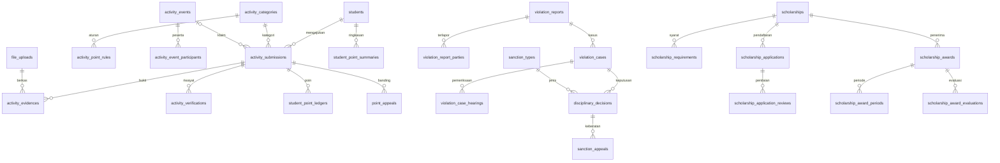
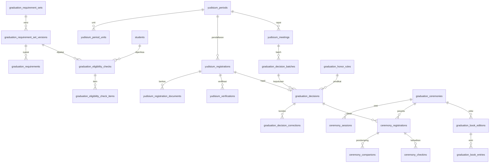
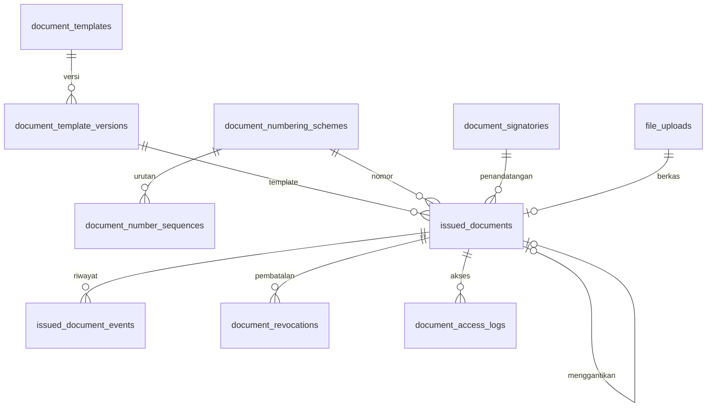
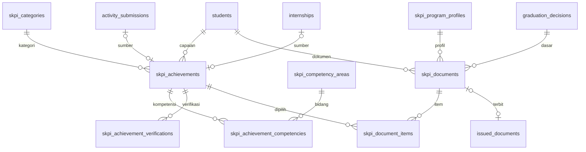
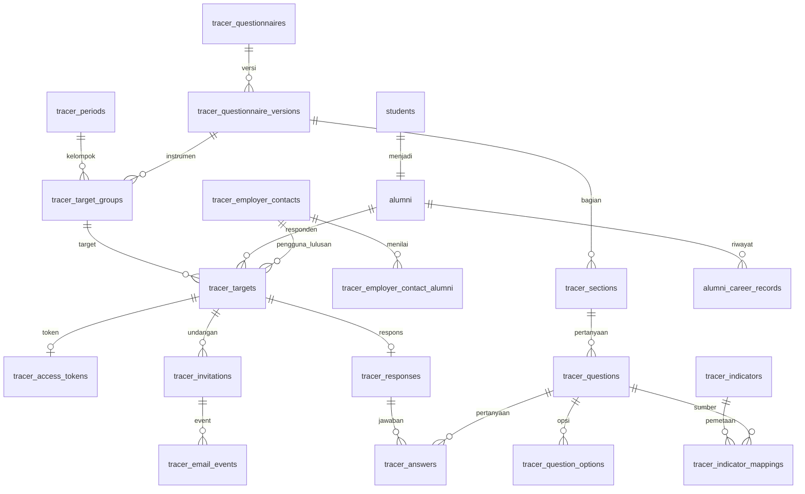
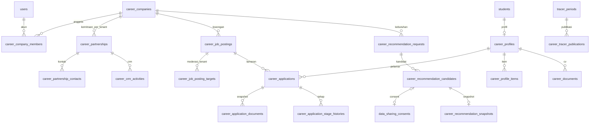
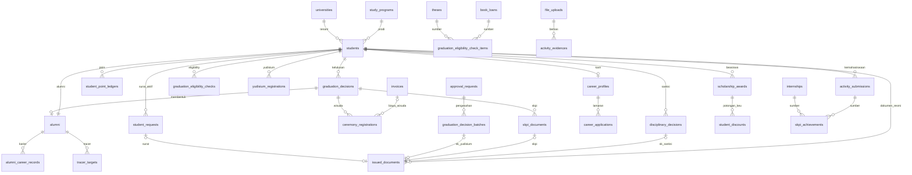

# 25 — Rancangan Database dan ERD

> **Status:** rancangan · Disusun 2026-10-13 (commit `47043ca`) · Kembali ke [README](README.md)
> **Dokumen acuan skema.** Bila nama tabel/kolom berbeda dengan dokumen lain, dokumen ini yang berlaku ([README §5](README.md#5-kanon)). Nama tabel adalah usulan konseptual yang mengikuti konvensi repository dan disesuaikan saat implementasi.

## Daftar Isi

1. [Konvensi](#1-konvensi)
2. [Kelompok Kemahasiswaan](#2-kelompok-kemahasiswaan)
3. [Kelompok Yudisium dan Wisuda](#3-kelompok-yudisium-dan-wisuda)
4. [Kelompok Dokumen Resmi](#4-kelompok-dokumen-resmi)
5. [Kelompok SKPI](#5-kelompok-skpi)
6. [Kelompok Tracer Study](#6-kelompok-tracer-study)
7. [Kelompok Career Center](#7-kelompok-career-center)
8. [Kelompok Lintas Modul](#8-kelompok-lintas-modul)
9. [ERD Integrasi Utama](#9-erd-integrasi-utama)
10. [Perubahan Tabel yang Sudah Ada dan Strategi Migrasi](#10-perubahan-tabel-yang-sudah-ada-dan-strategi-migrasi)
11. [Pemeriksaan Konsistensi](#11-pemeriksaan-konsistensi)

---

## 1. Konvensi

Konvensi diturunkan dari kode yang ada (migration `Academic`, `Finance`, `ApprovalWorkflow`, `Tenancy`) dan disamakan dengan rancangan [keuangan/19](../keuangan/19-rancangan-database-dan-relasi.md).

| Aspek | Ketentuan |
|---|---|
| **Kolom standar tabel tenant** | `id` ULID PK (`HasUlids`), `university_id` ULID FK → `universities` cascade (diisi trait `TenantScoped`), `created_at`, `updated_at` (`timestampsTz`). Pada tabel di bawah, kolom standar **tidak ditulis ulang** kecuali menyimpang |
| Tabel platform (tanpa `university_id`) | Ditandai **[platform]**. Model tidak memakai `TenantScoped` (kelompok GLOBAL `MULTI-TENANT-ARCHITECTURE.md §2`) |
| Tabel hybrid | **[hybrid]**: `university_id` nullable (`null` = milik platform) |
| Status | `string(20–40)` + PHP backed enum (preseden `widen_status_on_krs_items_table`, `extend_approval_engine…`). Tidak memakai `$table->enum()` |
| Waktu | `timestamptz` UTC. Batas hari dihitung zona waktu tenant (`universities.timezone`, Ada) |
| Uang | Tidak ada nominal uang di modul ini, kecuali gaji lowongan (`decimal(14,2)`) dan pendapatan tracer (terenkripsi) |
| FK ke `students` | **`restrict`** untuk data keputusan, riwayat, dan dokumen ([KK-KD-12](33-glossary-dan-keputusan-bisnis.md#2-keputusan-desain-kk-kd)). Berbeda dari pola `cascadeOnDelete` di tabel lama. Penghapusan mahasiswa yang memiliki riwayat diblokir |
| FK ke `users` | `nullOnDelete` untuk kolom aktor (`created_by`, `decided_by`); data tetap ada |
| Unique parsial | Generated column `*_key` = `IF(kondisi, nilai, NULL)` + unique index (pola `academic-learning/07 §1.8`) |
| Optimistic locking | `lock_version` unsignedInteger default 0 pada entitas yang diproses bersamaan |
| Immutable | Tabel bertanda **[append-only]** tidak memiliki `updated_at` dan tidak diubah/dihapus melalui aplikasi |
| Enkripsi kolom | Cast Laravel `encrypted` / `encrypted:array` untuk kolom bertanda **[enc]**. Kolom terenkripsi tidak diindeks. Bila perlu pencarian, simpan `*_hash` (HMAC) terpisah |
| Riwayat status | `<modul>_status_histories` polimorfik ringan (`subject_type`, `subject_id`, `from_status`, `to_status`, `actor_id`, `reason`, `payload`, `created_at`) per modul, ditulis service dalam transaksi yang sama dengan transisi |
| Audit | `audit_logs` (Ada) melalui trait `Auditable` (Ada) pada master & keputusan + `AuditLogService::recordAction()` untuk aksi non-CRUD |
| Indeks | Indeks komposit diawali `university_id` |

Notasi tabel kolom: **Kolom · Tipe · Null · Default · Keterangan**. "FK→x r/c/n" = restrict / cascade / nullOnDelete.

---

## 2. Kelompok Kemahasiswaan

Modul: `app/Modules/StudentAffairs` (Baru), kecuali beasiswa (`app/Modules/Scholarship`, Ada).

### 2.1 Aktivitas dan poin

#### `activity_categories`

| Kolom | Tipe | Null | Default | Keterangan |
|---|---|---|---|---|
| `code` | string(20) | tidak | | Unik (`university_id`, `code`) |
| `name` | string(150) | tidak | | |
| `description` | text | ya | | |
| `activity_type` | string(30) | tidak | | Enum `ActivityType` ([05 §8.1](05-rancangan-poin-kemahasiswaan.md#8-data-input-dan-output)) |
| `allowed_participant_roles` | json | tidak | | |
| `allowed_levels` | json | tidak | | |
| `required_evidence_types` | json | tidak | | |
| `requires_organizer_verification` | boolean | tidak | false | |
| `counts_for_graduation` | boolean | tidak | true | |
| `exclude_converted_internships` | boolean | tidak | true | |
| `skpi_category_id` | ulid | ya | | FK→`skpi_categories` n |
| `submission_window_days` | smallint | ya | | |
| `verification_level` | string(20) | tidak | `study_program` | |
| `valid_from`, `valid_until` | date | `valid_until` ya | | |
| `status` | string(20) | tidak | `draft` | `draft`, `active`, `inactive` |

#### `activity_point_rules`

| Kolom | Tipe | Null | Default | Keterangan |
|---|---|---|---|---|
| `activity_category_id` | ulid | tidak | | FK r |
| `participant_role` | string(30) | ya | | |
| `activity_level` | string(20) | ya | | |
| `default_points` | decimal(6,2) | tidak | | |
| `min_points`, `max_points` | decimal(6,2) | ya | | |
| `period_cap_points` | decimal(8,2) | ya | | |
| `cap_period` | string(20) | ya | | `academic_term`, `academic_year`, `study_period` |
| `effective_from` | date | tidak | | |
| `effective_until` | date | ya | | |
| `status` | string(20) | tidak | `draft` | |

Indeks `(university_id, activity_category_id, participant_role, activity_level, effective_from)`. Tumpang tindih dicegah di service ([05 V-PNT-02](05-rancangan-poin-kemahasiswaan.md#10-validasi)).

#### `activity_organizers`

`name` string(200), `organizer_type` string(20), `website` string(255) null, `contact` string(200) null, `verification_status` string(20) (`unverified`, `verified`, `rejected`), `verification_note` text null, `verified_by` FK users n, `verified_at` tz null.

#### `activity_events`

| Kolom | Tipe | Null | Keterangan |
|---|---|---|---|
| `activity_category_id` | ulid | tidak | FK r |
| `activity_organizer_id` | ulid | ya | FK n |
| `name` | string(200) | tidak | |
| `organizer_name`, `organizer_type` | string | tidak | |
| `organizer_unit_type`, `organizer_unit_id` | string(20), ulid | ya | Unit internal |
| `activity_level` | string(20) | tidak | |
| `start_date`, `end_date` | date | tidak | |
| `award_mode` | string(20) | tidak | `claim` / `auto_award` |
| `status` | string(20) | tidak | `draft`, `pending_verification`, `verified`, `rejected`, `cancelled` |
| `created_by`, `verified_by` | ulid | ya | FK users n |
| `verified_at` | timestamptz | ya | |
| `lock_version` | uint | tidak | |

#### `activity_event_participants`

`activity_event_id` FK c, `student_id` FK r, `participant_role` string(30), `source` string(20) (`import`, `manual`), `import_batch_ref` string(40) null. Unik (`activity_event_id`, `student_id`, `participant_role`).

#### `activity_submissions`

| Kolom | Tipe | Null | Default | Keterangan |
|---|---|---|---|---|
| `student_id` | ulid | tidak | | FK r |
| `activity_category_id` | ulid | tidak | | FK r |
| `activity_event_id` | ulid | ya | | FK r |
| `activity_name` | string(200) | tidak | | |
| `organizer_name` | string(200) | tidak | | |
| `organizer_type` | string(20) | tidak | | |
| `start_date`, `end_date` | date | tidak | | |
| `participant_role` | string(30) | tidak | | |
| `activity_level` | string(20) | tidak | | |
| `location` | string(200) | ya | | |
| `description` | text | tidak | | |
| `public_url` | string(500) | ya | | |
| `dedupe_key` | char(64) | tidak | | sha256 ([06 §5.2](06-rancangan-aktivitas-dan-prestasi.md#5-alur-bisnis-utama)) |
| `active_dedupe_key` | char(64) gen | ya | | Unik (`university_id`, `active_dedupe_key`) |
| `active_event_key` | varchar(120) gen | ya | | Unik |
| `flags` | json | tidak | `[]` | |
| `suggested_points` | decimal(6,2) | ya | | |
| `activity_point_rule_id` | ulid | ya | | FK n |
| `revision_count` | tinyint | tidak | 0 | |
| `status` | string(20) | tidak | `draft` | [06 §7](06-rancangan-aktivitas-dan-prestasi.md#7-status-dan-transisi-status) |
| `submitted_at`, `decided_at` | timestamptz | ya | | |
| `decided_by` | ulid | ya | | FK users n |
| `decision_note` | text | ya | | |
| `lock_version` | uint | tidak | 0 | |

Indeks `(university_id, status, activity_category_id)`, `(university_id, student_id, status)`.

#### `activity_evidences`

`activity_submission_id` FK c, `file_upload_id` FK→`file_uploads` r, `evidence_type` string(20), `checksum` char(64) (salinan `file_uploads.checksum`). Indeks `(university_id, checksum)`. Unik (`activity_submission_id`, `file_upload_id`).

#### `activity_verifications` [append-only]

`activity_submission_id` FK c, `action` string(30) (`submitted`, `review_started`, `approved`, `rejected`, `revision_requested`, `resubmitted`, `withdrawn`, `reopened`, `revoked`), `from_status`, `to_status`, `actor_id` FK users n, `note` text null, `suggested_points`/`awarded_points` decimal(6,2) null, `created_at`.

#### `student_point_ledgers` [append-only]

Didefinisikan di [05 §11](05-rancangan-poin-kemahasiswaan.md#11-rancangan-database). Tambahan: `is_manual` boolean, `is_override` boolean, `idempotency_token` char(26), unik (`activity_submission_id`, `entry_type`, `idempotency_token`).

#### `student_point_summaries`

`student_id` FK r, `activity_category_id` FK r, `cap_period_key` string(30), `awarded_points` decimal(8,2), `counted_points` decimal(8,2), `graduation_counted_points` decimal(8,2), `last_ledger_id` ulid. Unik (`student_id`, `activity_category_id`, `cap_period_key`). Turunan, dapat dibangun ulang.

#### `point_appeals`

`activity_submission_id` FK r, `student_id` FK r, `reason` text, `requested_points` decimal(6,2) null, `attachment_file_id` FK file_uploads n, `status` string(20), `decided_by` FK n, `decided_at`, `decision_note`, `resulting_ledger_id` ulid null. Generated `active_key` = submission bila status ∈ {`submitted`,`under_review`} — unik.

### 2.2 Pelanggaran dan sanksi

| Tabel | Kolom inti |
|---|---|
| `violation_types` | `code` (unik tenant), `name`, `description`, `severity_level` string(20), `default_violation_points` decimal(6,2) null, `recommended_sanction_type_ids` json, `legal_basis` text, `is_active` |
| `sanction_types` | `code`, `name`, `requires_duration` bool, `max_duration_days` int null, `allowed_restricted_services` json, `allowed_student_status_effects` json, `is_active` |
| `violation_reports` | `incident_at` tz, `location` string(200) null, `description` text, `suspected_violation_type_id` FK n, `reporter_id` FK users n, `reporter_confidential` bool, `source_type`/`source_id` (mis. `activity_submission`) null, `status` string(20), `screened_by` FK n, `screened_at`, `screening_note` |
| `violation_report_parties` | `violation_report_id` FK c, `student_id` FK r null, `unidentified_description` string(255) null |
| `violation_cases` | `violation_report_id` FK r, `student_id` FK r, `assigned_officer_id` FK n, `committee_member_ids` json, `status`, `findings` json null (`proven_violation_type_id`, `severity_level`, `basis`, `recommended_sanction_type_id`), `student_notified_at`, `student_statement` text null, `lock_version` |
| `violation_case_hearings` | `violation_case_id` FK c, `scheduled_at`, `location`, `attendance` string(30) (`attended`, `absent_after_notice`, `rescheduled`), `minutes_file_id` FK n, `notes` |
| `disciplinary_decisions` | `violation_case_id` FK r, `student_id` FK r, `sanction_type_id` FK r, `violation_points` decimal(6,2) null, `effective_from` date, `effective_until` date null, `restricted_services` json, `student_status_effect` string(20) null, `legal_basis` text, `decision_text` text, `issued_document_id` FK→`issued_documents` n, `approval_request_id` FK n, `status`, `supersedes_id` FK self n, `superseded_by_id` FK self n, `correction_of_id` FK self n, `finalized_at`, `block_sync_status` string(20) null (`pending`, `synced`, `failed`) |
| `sanction_appeals` | `disciplinary_decision_id` FK r, `student_id` FK r, `grounds` text, `attachment_file_id`, `submitted_at`, `suspension_requested` bool, `suspension_granted` bool, `status`, `decided_by`, `decided_at`, `decision_note`, `resulting_decision_id` FK n. Generated `active_key` unik per keputusan |

### 2.3 Riwayat status modul

`student_affairs_status_histories` [append-only] — struktur kanon §1.

### 2.4 Beasiswa

Modul `Scholarship` (Ada, diperluas).

#### `scholarships` — **Ubah**

Kolom Ada: `name`, `provider`, `quota` int, `amount` decimal(14,2), `academic_year` string, `registration_start`/`registration_end` date, `is_active` bool. Tambahan:

| Kolom | Tipe | Null | Default | Keterangan |
|---|---|---|---|---|
| `code` | string(30) | ya→tidak setelah backfill | | Unik tenant |
| `status` | string(20) | tidak | backfill | `draft`, `open`, `closed`, `archived` |
| `description` | text | ya | | |
| `funding_source_type` | string(20) | tidak | `other` | |
| `benefit_type` | string(20) | tidak | `tuition_discount` | |
| `award_duration_terms` | tinyint | ya | | |
| `max_renewals` | tinyint | tidak | 0 | |
| `stacking_policy` | string(20) | tidak | `any` | |
| `stackable_scholarship_ids` | json | ya | | |
| `eligibility` | json | ya | | Prodi, angkatan, jenjang |
| `selection_stages` | json | ya | | |
| `continuation_rules` | json | ya | | |
| `requires_acceptance` | bool | tidak | false | |
| `acceptance_days` | tinyint | ya | | |
| `application_form_schema` | json | ya | | Field formulir tambahan |

#### Tabel baru beasiswa

| Tabel | Kolom inti |
|---|---|
| `scholarship_requirements` | `scholarship_id` FK c, `requirement_type` string(30), `label`, `parameters` json, `is_soft` bool, `sort_order` |
| `scholarship_application_documents` | `scholarship_application_id` FK c, `scholarship_requirement_id` FK r, `file_upload_id` FK r, `status` (`submitted`, `verified`, `rejected`), `note` |
| `scholarship_application_reviews` | `scholarship_application_id` FK c, `stage_code` string(30), `reviewer_id` FK users n, `score` decimal(6,2) null, `note` text, `created_at` |
| `scholarship_award_batches` | `scholarship_id` FK r, `academic_term_id` FK r, `approval_request_id` FK n, `status` (`draft`, `pending_approval`, `approved`, `rejected`), `submitted_by`, `decided_at` |
| `scholarship_awards` | `scholarship_id` FK r, `scholarship_application_id` FK r null, `scholarship_award_batch_id` FK n, `student_id` FK r, `status`, `offered_at`, `acceptance_deadline`, `accepted_at`, `activated_at`, `ended_at`, `end_reason` text, `lock_version`. Generated `active_key` = (`scholarship_id`,`student_id`) bila status ∈ {`pending_approval`,`offered`,`active`,`suspended`} unik |
| `scholarship_award_periods` | `scholarship_award_id` FK c, `from_term_id` FK r, `until_term_id` FK r, `sequence` tinyint (0 = awal), `approval_request_id` |
| `scholarship_award_evaluations` | `scholarship_award_id` FK c, `academic_term_id` FK r, `result` (`passed`, `failed`, `manual_review`), `details` json, `evaluated_at`, `follow_up_action` string(20) null |

Perubahan `scholarship_applications` (**Ubah**): `status` → string(20) (nilai lama dipertahankan); + `academic_term_id` FK n, `application_form_data` text **[enc]**, `final_score` decimal(6,2), `rank` int, `ranking_override_reason` text, `lock_version`. FK `student_id` cascade → restrict (§10).

---

## 3. Kelompok Yudisium dan Wisuda

Modul: `app/Modules/Graduation` (Baru).

### 3.1 Periode dan aturan

| Tabel | Kolom inti |
|---|---|
| `yudisium_periods` | `code` (unik tenant), `name`, `academic_term_id` FK r, `registration_opens_at`, `registration_closes_at`, `document_deadline_at`, `verification_deadline_at`, `meeting_scheduled_at` (tz, null), `graduation_date_policy` string(20), `max_participants` int null, `status`, `notes`, `lock_version` |
| `yudisium_period_units` | `yudisium_period_id` FK c, `unit_type` (`faculty`, `study_program`), `unit_id` ulid. Unik (`yudisium_period_id`, `unit_type`, `unit_id`) |
| `yudisium_period_schedule_changes` [append-only] | `yudisium_period_id`, `field`, `old_value`, `new_value`, `reason`, `actor_id`, `created_at` |
| `graduation_checker_definitions` [platform] | `key` (unik), `name`, `description`, `source_module`, `parameter_schema` json, `supports_verification_modes` json, `status` (`active`, `deprecated`) |
| `graduation_requirement_sets` | `name`, `degree_level` string(10) null, `faculty_id` FK n, `study_program_id` FK n, `curriculum_id` FK n, `admission_year_from`/`to` smallint null, `yudisium_period_id` FK n, `extends_set_id` FK self n, `specificity_score` tinyint (disimpan), `status` |
| `graduation_requirement_set_versions` | `graduation_requirement_set_id` FK r, `version_no` smallint (unik per set), `effective_from` tz, `effective_until` tz null, `status`, `resolved_requirements` json (snapshot gabungan saat publish), `published_by`, `published_at`, `change_note` |
| `graduation_requirements` | `graduation_requirement_set_version_id` FK c, `code` string(30) (unik per versi), `label`, `checker_key` string(60), `parameters` json, `severity` (`mandatory`, `advisory`), `verification_mode`, `waivable` bool, `responsible_unit_label`, `sort_order` |

### 3.2 Eligibility

| Tabel | Kolom inti |
|---|---|
| `graduation_eligibility_checks` [append-only kecuali kolom siklus hidup] | `student_id` FK r, `yudisium_period_id` FK r, `graduation_requirement_set_version_id` FK r null (null = tidak ada set → manual_review), `trigger` string(20) (`manual`, `batch`, `event`, `registration`, `pre_decision`, `scheduled`, `self`), `result` string(30), `checked_at`, `valid_until`, `is_current` bool, `current_key` gen (unik), `stale_at`, `stale_reason` string(60), `superseded_by_id` FK self n, `checked_by` FK users n, `batch_id` FK n, `summary` json |
| `graduation_eligibility_check_items` [append-only] | `graduation_eligibility_check_id` FK c, `requirement_code`, `label`, `checker_key`, `severity`, `result` string(30), `expected` json, `actual` json, `message` string(500), `source_module`, `source_ref` string(120) null, `source_as_of` tz, `exemption_id` FK n, `resolved_by` FK n, `resolved_at`, `resolution_note` |
| `graduation_requirement_exemptions` | `student_id` FK r, `requirement_code`, `yudisium_period_id` FK n, `valid_until` date null, `reason` text, `basis_reference` string(200), `evidence_file_id` FK n, `approval_request_id` FK n, `status`, `decided_by`, `decided_at` |
| `graduation_eligibility_batches` | `yudisium_period_id` FK r, `requested_by`, `filters` json, `total`, `processed`, `counts` json, `status` (`queued`, `running`, `completed`, `failed`), `started_at`, `finished_at` |

### 3.3 Pendaftaran, verifikasi, rapat, keputusan

| Tabel | Kolom inti |
|---|---|
| `yudisium_registrations` | `yudisium_period_id` FK r, `student_id` FK r, `registered_by` FK users n, `mode` string(20), `status`, `confirmed_identity` json **[enc]** (nama, TTL, NIK), `thesis_title_id`/`thesis_title_en` string(500), `latest_eligibility_check_id` FK n, `approval_request_id` FK n, `submitted_at`, `carried_over_from_id` FK self n, `lock_version`. Generated `active_student_key` = `student_id` bila status non-terminal — unik tenant |
| `yudisium_registration_documents` | `yudisium_registration_id` FK c, `document_type` string(30), `file_upload_id` FK r, `status`, `verified_by`, `verified_at`, `note` |
| `yudisium_verifications` [append-only] | `yudisium_registration_id` FK c, `stage_code` string(30), `approval_request_step_id` ulid null, `decision` (`approved`, `returned`, `rejected`), `issues` json, `note`, `eligibility_check_id` FK r, `actor_id`, `created_at` |
| `graduation_workflow_stage_maps` | `approval_workflow_id` FK r, `sequence` smallint, `stage_code` string(30) |
| `yudisium_meetings` | `yudisium_period_id` FK r, `unit_type`/`unit_id` null, `held_at` tz, `location`, `chair_name`, `minutes_file_id` FK n, `status`, `finalized_at` |
| `graduation_decision_batches` | `yudisium_meeting_id` FK r, `approval_request_id` FK n, `status` (`draft`, `pending_approval`, `approved`, `rejected`, `finalized`), `submitted_by`, `finalized_by`, `finalized_at`, `decree_document_id` FK→`issued_documents` n |
| `graduation_decisions` | Lihat tabel di bawah |
| `graduation_honor_rules` | `degree_level`, `name`, `version_no`, `tiers` json, `effective_from` date, `effective_until` date null, `status` (`draft`, `published`, `retired`), `published_by`, `published_at` |
| `graduation_decision_corrections` | `graduation_decision_id` FK r, `correction_type` (`correction`, `annulment`), `requested_changes` json, `reason` text, `evidence_file_id`, `approval_request_id`, `status`, `resulting_decision_id` FK n, `applied_at` |
| `graduation_status_histories` [append-only] | Struktur kanon §1 |

#### `graduation_decisions`

| Kolom | Tipe | Null | Keterangan |
|---|---|---|---|
| `yudisium_registration_id` | ulid | tidak | FK r |
| `graduation_decision_batch_id` | ulid | tidak | FK r |
| `student_id` | ulid | tidak | FK r |
| `outcome` | string(20) | tidak | `graduated`, `postponed`, `not_graduated` |
| `outcome_reason` | text | ya | Wajib selain `graduated` |
| `graduation_date` | date | ya | Wajib untuk `graduated` |
| `honor_code`, `honor_label_id`, `honor_label_en` | string | ya | |
| `graduation_honor_rule_id` | ulid | ya | FK r |
| `honor_evaluation` | json | ya | |
| `honor_override_reason` | text | ya | |
| `academic_snapshot` | json **[enc untuk subkunci identitas]** | tidak | Isi: [12 §5.4](12-rancangan-peserta-dan-penetapan-kelulusan.md#5-alur-bisnis-utama) |
| `eligibility_check_id` | ulid | ya | FK r |
| `requirement_set_version_id` | ulid | ya | FK r |
| `status` | string(30) | tidak | [12 §7](12-rancangan-peserta-dan-penetapan-kelulusan.md#7-status-dan-transisi-status) |
| `finalized_at`, `finalized_by` | | ya | |
| `finalization_error` | text | ya | |
| `supersedes_id`, `superseded_by_id` | ulid | ya | FK self n |
| `active_graduated_key` | gen | ya | `IF(status='final' AND outcome='graduated', student_id, NULL)` unik tenant ([KEL-BR-051](29-business-rules-dan-validasi.md#kel-br-051)) |

### 3.4 Wisuda

| Tabel | Kolom inti |
|---|---|
| `graduation_ceremonies` | `code`, `name`, `venue`, `ceremony_dates` json, `registration_opens_at`, `registration_closes_at`, `confirmation_deadline_at`, `eligible_graduation_date_from`/`to` date null, `eligible_yudisium_period_ids` json, `registration_basis` string(30), `fee_required` bool, `fee_component_code` string(30) null, `max_companions_per_graduate` tinyint, `requires_attendance_confirmation` bool, `allow_session_choice` bool, `attire_options` json, `book_settings` json (`show_nim`, `show_gpa`, `show_birth_info`, `show_thesis_title`, `allow_public_publication`), `status`, `lock_version` |
| `ceremony_sessions` | `graduation_ceremony_id` FK c, `name`, `starts_at`, `ends_at`, `graduate_capacity` int, `companion_capacity` int, `sort_order`, `assigned_count` int (turunan, dikunci saat penempatan) |
| `ceremony_session_units` | `ceremony_session_id` FK c, `unit_type`, `unit_id` |
| `ceremony_registrations` | `graduation_ceremony_id` FK r, `student_id` FK r, `graduation_decision_id` FK r null, `status`, `attendance_status` string(20), `ceremony_session_id` FK n, `seat_number` string(20) null, `attire_size` string(10), `special_needs` text **[enc]**, `photo_file_id` FK n, `photo_publication_consent` bool, `book_publication_consent` bool, `message` text null, `invoice_id` FK→`invoices` n, `checkin_token_hash` char(64) null (unik), `submitted_at`, `verified_by`, `verified_at`, `rejection_reason`, `lock_version`. Generated `active_graduate_key` unik tenant |
| `ceremony_companions` | `ceremony_registration_id` FK c, `name`, `relationship`, `identity_number` **[enc]** null, `accessibility_needs` string(255) null |
| `ceremony_checkins` [append-only] | `ceremony_registration_id` FK r, `ceremony_session_id` FK r, `result` (`checked_in`, `duplicate_scan`, `wrong_session`, `not_confirmed`, `invalid_token`), `scanned_at`, `officer_id` FK n, `device_id` string(60), `synced_from_offline` bool. Generated `checked_in_key` = `IF(result='checked_in', ceremony_registration_id, NULL)` unik |
| `ceremony_schedule_changes` [append-only] | `graduation_ceremony_id`, `ceremony_session_id` null, `field`, `old_value`, `new_value`, `reason`, `actor_id`, `notified_at` |
| `graduation_book_editions` | `graduation_ceremony_id` FK r, `edition_no` smallint, `status`, `correction_closes_at`, `built_at`, `locked_at`, `published_at`, `published_by`, `approval_request_id`, `pdf_file_id` FK n, `diff_from_previous` json |
| `graduation_book_entries` | `graduation_book_edition_id` FK c, `ceremony_registration_id` FK r, `student_id` FK r, `entry_status` (`included`, `held`, `excluded`), `held_reason`, `display_data` json (nilai tercetak + `source` per kolom), `sort_key` string(60) |
| `graduation_book_corrections` | `graduation_book_entry_id` FK c, `requested_by`, `field`, `requested_value`, `status` (`submitted`, `applied`, `rejected`, `redirected_to_master_data`), `note` |

---

## 4. Kelompok Dokumen Resmi

Modul: `app/Modules/OfficialDocument` (Baru).

| Tabel | Kolom inti |
|---|---|
| `document_templates` [hybrid] | `document_type` string(40), `name`, `language` (`id`, `en`, `bilingual`), `issuing_unit_type`/`issuing_unit_id` null, `is_active` |
| `document_template_versions` [hybrid] | `document_template_id` FK r, `version_no`, `content` longtext, `required_fields` json, `paper_size`, `orientation`, `status`, `published_by`, `published_at` |
| `document_numbering_schemes` | `document_type`, `issuing_unit_type`/`issuing_unit_id` null, `doc_code` string(20), `format` string(200), `reset_period` string(20), `sequence_start` int, `continue_from_scheme_id` FK self n, `reissue_number_policy` string(30), `effective_from`, `effective_until`, `status` |
| `document_number_sequences` | `document_numbering_scheme_id` FK r, `scope_key` string(60), `next_value` int. Unik (`document_numbering_scheme_id`, `scope_key`) |
| `document_signatories` | `name`, `title_id`, `title_en`, `identity_number` string(40) null (NIP/NIDN), `employee_id` FK→`employees` n, `position_id` ulid null, `signature_image_file_id` FK n, `allowed_document_types` json, `unit_type`/`unit_id` null, `valid_from`, `valid_until`, `is_active` |
| `document_issuer_assignments` | `role_id` FK→`roles` c, `document_type`. Unik |
| `issued_documents` | Lihat di bawah |
| `issued_document_events` [append-only] | `issued_document_id` FK c, `event` (`created`, `number_allocated`, `rendered`, `signature_requested`, `signed`, `issued`, `revocation_requested`, `revoked`, `superseded`, `render_failed`), `actor_id`, `payload` json, `created_at` |
| `document_revocations` | `issued_document_id` FK r, `reason` text, `requested_by`, `approval_request_id`, `status`, `decided_by`, `decided_at` |
| `document_access_logs` [append-only] | `issued_document_id` FK c, `user_id` FK n, `channel` (`owner_portal`, `staff`, `public_verification`, `public_compare`), `ip_address`, `user_agent`, `created_at` |

#### `issued_documents`

| Kolom | Tipe | Null | Keterangan |
|---|---|---|---|
| `document_type` | string(40) | tidak | |
| `language` | string(10) | tidak | |
| `subject_type`, `subject_id` | string(40), ulid | tidak | Mis. `student` |
| `student_id` | ulid | ya | FK r (indeks pencarian) |
| `source_type`, `source_id` | string(40), ulid | tidak | Mis. `graduation_decision`, `student_request`, `skpi_document` |
| `idempotency_key` | string(120) | tidak | Unik tenant |
| `document_template_version_id` | ulid | tidak | FK r |
| `document_numbering_scheme_id` | ulid | ya | FK r |
| `official_number` | string(120) | ya | |
| `official_number_normalized` | string(120) | ya | Huruf besar, spasi dihapus. Unik (`university_id`, `document_type`, `official_number_normalized`) |
| `revision_no` | tinyint | tidak | 0 |
| `external_number`, `external_number_source`, `external_number_assigned_at` | | ya | Unik (`university_id`, `document_type`, `external_number`) |
| `issued_at` | timestamptz | ya | |
| `issuing_unit_type`, `issuing_unit_id` | | ya | |
| `signatory_id` | ulid | ya | FK r |
| `signature_mode` | string(30) | tidak | |
| `snapshot` | json | tidak | Data tercetak (kolom identitas sensitif **[enc]** di subkunci) |
| `file_upload_id` | ulid | ya | FK r. PDF final |
| `file_sha256` | char(64) | ya | |
| `verification_code_hash` | char(64) | ya | Unik |
| `status` | string(20) | tidak | |
| `supersedes_document_id`, `superseded_by_document_id` | ulid | ya | FK self n |
| `revoked_at`, `revocation_reason` | | ya | |
| `active_source_key` | gen | ya | `IF(status IN ('draft','pending_signature','issued'), CONCAT(source_type,':',source_id,':',document_type,':',language), NULL)` unik |
| `lock_version` | uint | tidak | |

---

## 5. Kelompok SKPI

Modul: `app/Modules/Skpi` (Baru).

| Tabel | Kolom inti |
|---|---|
| `skpi_categories` | `code`, `name_id`, `name_en`, `sort_order`, `max_items_displayed` tinyint, `min_activity_level` string(20) null, `requires_skpi_verification` bool, `eligibility_rules` json, `is_active` |
| `skpi_competency_areas` | `code`, `name_id`, `name_en`, `is_active` |
| `skpi_achievements` | `student_id` FK r, `skpi_category_id` FK r, `source_type` (`activity_submission`, `internship`, `manual`), `source_id` ulid null, `title_id`, `title_en`, `description_id`, `description_en`, `role_id`, `role_en`, `organizer`, `activity_level`, `start_date`, `end_date`, `no_translate_fields` json, `verification_status`, `skpi_eligibility`, `ineligibility_reason`, `translation_status`, `translation_reviewed_by`, `translation_reviewed_at`, `is_selected` bool, `lock_version`. Generated `source_key` = `IF(source_type<>'manual', CONCAT(student_id,':',source_type,':',source_id), NULL)` unik |
| `skpi_achievement_competencies` | `skpi_achievement_id` FK c, `skpi_competency_area_id` FK r, `level` string(20). Unik pasangan |
| `skpi_achievement_verifications` [append-only] | `skpi_achievement_id` FK c, `action`, `actor_id`, `note`, `created_at` |
| `skpi_program_profiles` | `study_program_id` FK r, `version_no`, `content` json (bagian ID/EN), `status` (`draft`, `published`, `retired`), `published_by`, `published_at` |
| `skpi_glossary_terms` [hybrid] | `term_id`, `term_en`, `context` string(40), `status` (`draft`, `approved`). Unik (`university_id`, `term_id`, `context`) |
| `skpi_translation_memories` | `source_text_hash` char(64), `source_text`, `target_text`, `reviewed_by`, `use_count` |
| `skpi_documents` | `student_id` FK r, `graduation_decision_id` FK r null, `skpi_program_profile_id` FK r null, `status`, `student_acknowledged_at`, `approval_request_id`, `issued_document_id` FK n, `previous_skpi_document_id` FK self n, `source_changed_at`, `lock_version`. Generated `active_key` = `student_id` bila status ∈ {`draft`,`in_review`,`revision_requested`,`approved`} unik |
| `skpi_document_items` | `skpi_document_id` FK c, `skpi_achievement_id` FK r, `skpi_category_id`, `sort_order`, `snapshot` json (teks ID/EN, tanggal) |

---

## 6. Kelompok Tracer Study

Modul: `app/Modules/TracerStudy` (Baru) + `app/Modules/Alumni` (Ada, diperluas).

| Tabel | Kolom inti |
|---|---|
| `tracer_periods` | `code`, `name`, `purpose`, `reference_year` smallint, `starts_at`, `closes_at`, `quota_window_key` string(60), `status`, `lock_version` |
| `tracer_target_groups` | `tracer_period_id` FK c, `name`, `respondent_type`, `selection_rules` json, `tracer_questionnaire_version_id` FK r, `employer_survey_mode` string(20) null, `last_built_at` |
| `tracer_targets` | `tracer_period_id` FK r, `tracer_target_group_id` FK r, `respondent_type`, `subject_key` string(60), `student_id` FK r null, `alumni_id` FK r null, `tracer_employer_contact_id` FK r null, `evaluated_alumni_id` FK r null, `email` string(255) **[enc]** + `email_hash` char(64), `email_source` string(30), `display_name` string(200), `status` (`eligible`, `excluded`), `exclusion_reason` string(30), `flags` json, `graduation_source` string(20). Unik (`tracer_period_id`, `respondent_type`, `subject_key`) |
| `tracer_employer_contacts` | `name`, `position`, `organization`, `email` **[enc]** + `email_hash`, `phone` **[enc]** null, `career_company_id` ulid null (platform), `source`, `consent_basis` string(60), `is_active` |
| `tracer_employer_contact_alumni` | `tracer_employer_contact_id` FK c, `alumni_id` FK r, `relationship` string(40). Unik |
| `tracer_suppressions` | `email_hash` char(64), `reason` (`hard_bounce`, `complaint`, `opt_out`, `manual`), `source_ref`, `created_at`. Unik (`university_id`, `email_hash`) |
| `tracer_questionnaires` [hybrid] | `name`, `respondent_type`, `is_standard_template` bool, `template_source`, `source_document_reference`, `source_version`, `verified_by`, `verified_at`, `derived_from_template_version_id` FK n |
| `tracer_questionnaire_versions` [hybrid] | `tracer_questionnaire_id` FK r, `version_no`, `status`, `valid_from`, `valid_until`, `change_log` json, `published_by`, `published_at` |
| `tracer_sections` | `tracer_questionnaire_version_id` FK c, `code`, `title_id`, `title_en`, `sort_order`, `visibility_rule` json |
| `tracer_questions` | `tracer_section_id` FK c, `tracer_questionnaire_version_id` FK c (denormalisasi), `code`, `label_id`, `label_en`, `help_text`, `question_type`, `data_type`, `is_required`, `validation_rules` json, `visibility_rule` json, `sensitivity`, `prefill_source`, `profile_update_target`, `semantic_change_review_required` bool, `sort_order`. Unik (`tracer_questionnaire_version_id`, `code`) |
| `tracer_question_options` | `tracer_question_id` FK c, `code`, `label_id`, `label_en`, `sort_order`, `is_other`, `exclusive`. Unik (`tracer_question_id`, `code`) |
| `tracer_indicators` [hybrid] | `code`, `name`, `definition` json, `parameters` json, `version_no`, `is_active` |
| `tracer_indicator_mappings` | `tracer_indicator_id` FK r, `tracer_question_id` FK r, `role`, `option_map` json, `modified_from_standard` bool |
| `tracer_access_tokens` | `tracer_target_id` FK c (unik), `token_hash` char(64) unik, `expires_at`, `revoked_at`, `revoked_reason`, `first_opened_at`, `last_opened_at`, `open_count` |
| `tracer_invitation_campaigns` | `tracer_period_id` FK r, `invitation_type`, `requested_by`, `selection` json, `partial_send_policy`, `summary` json, `status`, `scheduled_at` |
| `tracer_invitations` | `tracer_target_id` FK r, `tracer_invitation_campaign_id` FK n, `invitation_type`, `sequence_no` tinyint, `dedupe_key` string(80) unik tenant, `email_hash`, `delivery_status`, `provider`, `provider_message_id` string(200) (indeks), `queued_at`, `sent_at`, `delivered_at`, `failed_at`, `failure_reason`, `quota_ledger_ref` ulid null |
| `tracer_email_events` [append-only] | `tracer_invitation_id` FK c, `provider`, `provider_event_id` (unik dengan provider), `event_type`, `payload` json, `occurred_at` |
| `tracer_reminder_schedules` | `tracer_target_group_id` FK c, `offset_days` json, `send_time` time, `max_reminders`, `min_interval_days`, `is_active` |
| `tracer_responses` | `tracer_target_id` FK r unik, `tracer_questionnaire_version_id` FK r, `status`, `started_at`, `submitted_at`, `last_saved_at`, `profile_update_consent` bool, `invalidated_at`, `invalidated_reason`, `channel` (`token`, `portal`) |
| `tracer_response_revisions` [append-only] | `tracer_response_id` FK c, `revision_no`, `answers_snapshot` json **[enc]**, `created_at` |
| `tracer_answers` | `tracer_response_id` FK c, `tracer_question_id` FK r, `value_text` text null, `value_number` decimal(18,4) null, `value_date` date null, `value_option_codes` json null, `value_other_text` string(500) null, `value_encrypted` text **[enc]** null (untuk `sensitive`). Unik (`tracer_response_id`, `tracer_question_id`) |
| `tracer_result_aggregates` | `tracer_period_id` FK c, `tracer_indicator_id` FK r, `dimension_key` string(120), `numerator`, `denominator`, `value`, `suppressed`, `computed_at`, `computation_version` |
| `tracer_reporting_profiles` [hybrid] | `profile_code`, `instrument_name`, `instrument_version`, `effective_from`, `tables` json, `status`, `verified_by`, `verified_at` |
| `alumni_career_status_types` [hybrid] | `code`, `label_id`, `label_en`, `legacy_enum_value` string(30) null, `sort_order`, `is_active` |
| `alumni_career_records` [append-only] | `alumni_id` FK r, `career_status_code` string(30), `organization_name`, `job_title`, `sector` string(60), `workplace_scope` string(30), `started_at` date null, `ended_at` date null, `income_encrypted` text **[enc]** null, `source` (`tracer_response`, `self_update`, `staff_verified`, `import`), `source_reference_id` ulid null, `verified_by` FK n, `recorded_at` |

### 6.1 `alumni` — **Ubah**

Kolom Ada: `student_id` (unik), `graduation_year`, `employment_status` (enum wajib), `company_name`, `job_title`, `waiting_period_months`, `is_verified`.

| Perubahan | Keterangan |
|---|---|
| `employment_status` → string(30) **nullable** | `null` = belum diketahui. Nilai lama dipertahankan |
| + `career_status_source` string(20), `career_status_as_of` tz | Sumber ringkasan |
| + `graduation_decision_id` FK n, `graduation_date` date | Dari keputusan final |
| + `contact_email` **[enc]** + `contact_email_hash`, `contact_email_verified_at`, `contact_phone` **[enc]** | Kontak alumni |
| + `first_job_started_at` date | Dasar waktu tunggu |
| + `is_deceased` bool, `is_active` bool | |
| FK `student_id` cascade → restrict | |

---

## 7. Kelompok Career Center

Modul: `app/Modules/Career` (Baru).

| Tabel | Kelas | Kolom inti |
|---|---|---|
| `career_portal_settings` | tenant | `portal_name`, `tagline`, `logo_file_id`, `primary_color`, `secondary_color`, `custom_domain_id` FK→`university_domains` n, `about_html`, `contact_email`, `contact_phone`, `social_links` json, `content_visibility` json, `is_enabled`. Unik `university_id` |
| `career_skills` | hybrid | `name`, `slug`, `category`. Unik (`university_id`, `slug`) |
| `career_profiles` | tenant | `user_id` FK r, `student_id` FK r, `headline`, `summary`, `city`, `photo_file_id`, `job_seeking_status`, `visibility`, `recommendation_opt_in` bool, `preferences` json (gaji harapan **[enc]**), `last_active_at`. Unik (`university_id`, `student_id`) |
| `career_profile_items` | tenant | `career_profile_id` FK c, `item_type` (`education`, `experience`, `skill`, `certification`, `portfolio`, `language`), `data` json, `source_type`, `source_id`, `is_verified_by_campus` bool, `sort_order` |
| `career_documents` | tenant | `career_profile_id` FK c, `document_type`, `file_upload_id` FK r, `version_no`, `is_default`, `generated_from_profile` bool, `retention_until` date, `deleted_at` (soft) |
| `career_companies` | **platform** | `name`, `legal_name`, `slug` unik, `registration_number` string(60) null (unik bila ada), `tax_id` **[enc]** null, `sector`, `size_range`, `website`, `email_domain`, `logo_file_id`, `description`, `address`, `verification_status`, `verification_method`, `verified_by`, `verified_at`, `suspended_at`, `suspension_reason` |
| `career_company_members` | **platform** | `career_company_id` FK c, `user_id` FK r, `role` (`company_owner`, `company_recruiter`), `status`, `invited_by`, `joined_at`. Unik (`career_company_id`, `user_id`) |
| `career_company_verifications` | **platform** | `career_company_id`, `submitted_by`, `documents` json (file id), `status`, `reviewed_by`, `reviewed_at`, `note` |
| `career_terms_versions` | **platform** | `version`, `content`, `effective_from`, `is_material` |
| `career_terms_acceptances` | **platform** [append-only] | `career_company_id`, `user_id`, `career_terms_version_id`, `accepted_at`, `ip_address` |
| `career_company_invitations` | tenant | `company_name`, `email` **[enc]** + `email_hash`, `career_company_id` null, `token_hash` unik, `expires_at`, `status`, `invited_by`, `accepted_by_user_id`, `accepted_at` |
| `career_partnerships` | tenant | `career_company_id` (ulid, ref platform, FK r), `status`, `partnership_types` json, `agreement_number`, `agreement_start`, `agreement_end`, `agreement_file_id`, `owner_staff_id`, `tier`, `notes`. Unik (`university_id`, `career_company_id`) |
| `career_partnership_contacts` | tenant | `career_partnership_id` FK c, `name`, `position`, `email` **[enc]**, `phone` **[enc]**, `contact_role`, `consent_to_contact` bool, `consent_to_tracer_survey` bool |
| `career_crm_activities` | tenant | `career_partnership_id` FK c, `activity_type`, `occurred_at`, `subject`, `summary`, `participants` json, `outcome`, `next_action`, `next_action_due_at`, `assigned_to`, `attachment_file_id` |
| `career_partner_evaluations` | tenant | `career_partnership_id` FK c, `period_label`, `metrics` json, `staff_score` tinyint, `note`, `evaluated_by` |
| `career_job_postings` | **hybrid** (`owner_university_id` null = marketplace) | `career_company_id` FK r, `created_by_user_id`, `title`, `description`, `qualifications`, `responsibilities`, `job_type`, `contract_type`, `work_mode`, `locations` json, `salary_min`/`salary_max` decimal(14,2), `salary_currency`, `salary_period`, `show_salary`, `application_deadline` date, `targeting` json, `strict_targeting` bool, `required_documents` json, `screening_questions` json, `visibility`, `external_apply_url`, `openings`, `allow_reapply`, `status`, `moderation_flags` json, `published_at`, `closed_at`, `title_normalized_hash` (deteksi duplikat), `lock_version` |
| `career_job_posting_targets` | tenant | `career_job_posting_id` FK c, `status` (`pending_review`, `approved`, `rejected`, `hidden`), `decided_by`, `decided_at`, `note`. Unik (`university_id`, `career_job_posting_id`) |
| `career_job_posting_revisions` | hybrid [append-only] | `career_job_posting_id`, `changes` json, `requires_review` bool, `status`, `created_by` |
| `career_applications` | tenant | `career_job_posting_id` FK r, `career_profile_id` FK r, `student_id` FK r, `status`, `screening_answers` json, `share_phone` bool, `submitted_at`, `final_at`, `active_key` gen (`IF(status NOT IN ('withdrawn','rejected','accepted'), CONCAT(career_job_posting_id,':',student_id), NULL)` unik), `retention_until`, `anonymized_at`, `lock_version` |
| `career_application_documents` | tenant | `career_application_id` FK c, `document_type`, `file_upload_id` FK r (salinan snapshot), `source_career_document_id` FK n |
| `career_application_stage_histories` | tenant [append-only] | `career_application_id` FK c, `from_status`, `to_status`, `actor_type` (`company`, `staff`, `applicant`, `system`), `actor_id`, `internal_note`, `applicant_note`, `created_at` |
| `career_abuse_reports` | hybrid | `target_type` (`posting`, `company`), `target_id`, `reporter_user_id`, `reason`, `details`, `status`, `handled_by` |
| `career_recommendation_requests` | tenant | `career_company_id` FK r, `career_job_posting_id` FK n, `requested_by_user_id`, `origin` (`company`, `campus`), `position_title`, `description`, `qualifications`, `requested_count`, `locations` json, `deadline`, `criteria` json, `approval_request_id`, `status` |
| `career_recommendation_candidates` | tenant | `career_recommendation_request_id` FK c, `student_id` FK r, `career_profile_id` FK r, `status`, `match_reasons` json, `staff_note`, `recommended_by`, `recommended_at`, `approved_by`, `approved_at`, `criteria_snapshot` json, `data_sharing_consent_id` FK n, `shared_at`, `company_feedback`, `outcome`. Unik (`career_recommendation_request_id`, `student_id`) |
| `career_recommendation_snapshots` | tenant | `career_recommendation_candidate_id` FK c, `data` json **[enc]**, `created_at`, `expires_at` |
| `data_sharing_consents` | tenant | `user_id` FK r, `student_id` FK r, `purpose` (`profile_discovery`, `recommendation_pool`, `recommendation`, `job_application`, `tracer_profile_update`), `recipient_type`/`recipient_id` null, `scope_fields` json, `consent_text_version` string(20), `status`, `granted_at`, `revoked_at`, `expires_at`, `source_ref` |
| `career_document_access_logs` | tenant [append-only] | `subject_student_id`, `document_type`, `document_ref`, `accessor_type` (`company_member`, `staff`), `accessor_user_id`, `career_company_id` null, `access_basis` (`application`, `recommendation`, `staff_service`), `basis_ref`, `ip_address`, `created_at` |
| `career_articles` | hybrid | `title`, `slug`, `summary`, `body_markdown`, `category`, `cover_file_id`, `author_id`, `visibility`, `status`, `published_at` |
| `career_tracer_publications` | tenant | `tracer_period_id` FK r, `title`, `snapshot` json, `methodology_note`, `approval_request_id`, `status`, `published_at`, `superseded_by_id` |

**Isolasi.** Tabel tenant memakai `TenantScoped`. Akses perusahaan ke `career_applications` (tenant) dilakukan oleh service khusus `CompanyApplicationQuery` yang **melepas** global scope tenant secara eksplisit tetapi menyaring `career_job_postings.career_company_id = companyContext`. Service ini dilindungi uji isolasi ([30](30-skenario-pengujian.md)).

---

## 8. Kelompok Lintas Modul

| Tabel | Status | Kolom inti |
|---|---|---|
| `plan_feature_entitlements` [platform] | Baru — **didesain** di [academic-learning/11 §2.2](../academic-learning/11-roles-permissions.md) | `subscription_plan_id`, `feature_key`, `is_included`, `enabled_by_default`, `limit_value` decimal(12,2). Rancangan ini menambah `metadata` json (mis. `{"window": "subscription_year", "refund_hard_bounce": true}`) |
| `feature_usage_counters` | Baru | `feature_key`, `quota_window_key`, `limit_snapshot` decimal(12,2), `consumed`, `reserved` int, `last_threshold_notified` tinyint. Unik (`university_id`, `feature_key`, `quota_window_key`) |
| `feature_usage_ledgers` [append-only] | Baru | `feature_key`, `quota_window_key`, `entry_type` (`reserve`, `consume`, `release`, `refund`, `adjustment`), `quantity` int (bertanda), `subject_key` string(80), `reference_type`/`reference_id`, `actor_id` null, `reason` null, `created_at`. Unik idempotensi (`university_id`, `feature_key`, `quota_window_key`, `subject_key`, `entry_type`, `reference_id`) |
| `idempotency_keys` | Baru — **didesain** di [keuangan/19](../keuangan/19-rancangan-database-dan-relasi.md) | Dipakai bersama. `user_id`, `key`, `route`, `request_hash`, `response_code`, `response_body`, `status`, `expires_at` |
| `data_exports` | Baru | `requested_by`, `export_type`, `filters` json, `columns` json, `include_identity` bool, `purpose` text, `status`, `file_upload_id`, `row_count`, `expires_at`, `downloaded_at` |
| `audit_logs`, `file_uploads`, `approval_*`, `notification_*`, `university_settings`, `university_feature_flags` | **Ada** | Dipakai apa adanya. Perluasan notifikasi di [27](27-rancangan-notifikasi-dan-email.md) (`locale`, `dedupe_key`) |

---

## 9. ERD Integrasi Utama

Relasi `student_discounts` (KEU, Baru di rancangan KEU) dan `invoices` (Ada) dibaca melalui kontrak, dan FK lintas modul hanya ditambahkan bila kedua modul aktif. `theses`/`book_loans` → item eligibility adalah referensi logis (`source_ref`), bukan FK.

## 10. Perubahan Tabel yang Sudah Ada dan Strategi Migrasi

| Tabel (Ada) | Perubahan | Migrasi data | Risiko |
|---|---|---|---|
| `alumni` | `employment_status` enum wajib → string nullable; kolom baru; FK restrict | Nilai lama dipertahankan, `career_status_source = 'legacy'`, `career_status_as_of = updated_at` | Laporan lama yang menghitung `belum_bekerja` tidak berubah, tetapi data baru dapat `null`. `ReportService`/dashboard disesuaikan |
| `scholarships` | Kolom baru, `status` | Backfill status dari `is_active` + tanggal; `code` = `SCH-` + 6 char ULID | — |
| `scholarship_applications` | `status` enum → string; kolom baru; FK restrict | Nilai sama | Ganti FK memerlukan drop/recreate constraint (MySQL) |
| `student_requests` | + `issued_document_id` | Surat lama tetap tanpa dokumen terbit (`legacy`) | — |
| `students` | Tidak ada kolom baru. Perubahan status hanya via `StudentStatusTransitionContract` | — | Akses langsung lama (seeder, admin) tetap ada dan perlu ditinjau ([31](31-acceptance-criteria.md) KEL-AC-10) |
| `notification_templates` | + `locale` string(10) default `id`; unique menjadi (`university_id`, `event_key`, `channel`, `locale`) | Baris lama `locale = id` | Unique lama perlu diganti |
| `notification_logs` | + `dedupe_key` string(150) null, unik parsial | — | — |

Urutan migrasi per fase dirinci di [32](32-roadmap-implementasi.md). Setiap migrasi memiliki `down()` dan diuji `migrate:rollback` di CI (praktik `academic-learning/15`).

## 11. Pemeriksaan Konsistensi

| Pemeriksaan | Hasil |
|---|---|
| Setiap FK menunjuk tabel yang didefinisikan di dokumen ini atau berstatus Ada | Ya. Referensi KEU (`student_discounts`) dan SIAKAD (`academic_blocks`) ditandai sebagai kontrak, bukan FK |
| Penomoran tanpa duplikasi | `document_number_sequences` (kunci baris) + unique `official_number_normalized` |
| Konsistensi jawaban terhadap versi | `tracer_responses.tracer_questionnaire_version_id`, `tracer_answers.tracer_question_id` → pertanyaan versi itu, dan versi `published` immutable |
| Dokumen terbit tidak berubah diam-diam | `issued_documents.snapshot` + `file_sha256` + status `issued` immutable di service |
| Riwayat keputusan | `*_status_histories`, `yudisium_verifications`, `graduation_decision_corrections`, `issued_document_events`, `activity_verifications` |
| Isolasi tenant | Semua tabel data pengguna ber-`university_id`. Tabel platform hanya berisi data perusahaan/lowongan marketplace/template/katalog |
| Nama entitas = nama resource API | Resource API memakai nama tabel jamak ber-tanda hubung ([26 §1](26-rancangan-api-dan-integrasi.md#1-konvensi)) |
