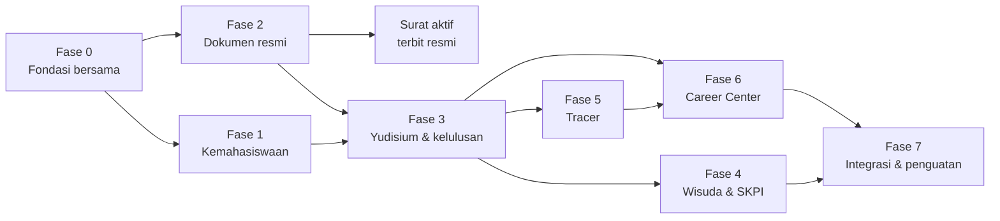

# 32 — Roadmap Implementasi

> **Status:** rancangan · Disusun 2026-10-13 (commit `47043ca`) · Kembali ke [README](README.md)

Roadmap disusun berdasarkan **dependensi teknis yang ditemukan di repository** dan dependensi pada rancangan lain yang belum diimplementasikan (`academic-learning`, `keuangan`). Durasi tidak ditetapkan karena kapasitas tim belum diketahui. Urutan dan kriteria keluar setiap fase menjadi acuan.

## 1. Dependensi Eksternal terhadap Kelompok Modul Ini

| Dependensi | Pemilik | Status | Dipakai oleh | Jalur sementara bila belum siap |
|---|---|---|---|---|
| `tenant.access` di semua grup rute | Platform | Middleware Ada, belum dipasang luas | Semua | Dipasang di grup modul ini sejak awal |
| `plan_feature_entitlements`, `EnsureFeatureEntitled`, `FeatureEntitlementService` | Platform (`academic-learning` 15 Tahap 0.2) | Dirancang | Semua | `university_settings` `entitlement.*` hanya-platform ([34 §2](34-matriks-paket-dan-entitlement.md#2-arsitektur-entitlement-terpusat)) |
| `AcademicScope`, role `faculty_administrator`/`study_program_administrator` | Akademik (`academic-learning`) | Dirancang | Verifikasi prodi/fakultas | Role scope tidak diberikan di produksi; verifikasi dilakukan petugas `u` |
| `idempotency_keys` | Platform (desain KEU 19) | Dirancang | Endpoint [I] | Dibangun di Fase 0 sebagai komponen bersama |
| `FinanceClearanceService`, `FinanceObligationReader` | KEU | Dirancang (KEU Fase 4C) / diusulkan | Eligibility, Wisuda | Checker `finance.clearance` mode `manual` (petugas keuangan mengisi item); wisuda divalidasi manual oleh panitia dengan bukti |
| `student_discounts` & listener award | KEU | Dirancang | Beasiswa | Event tetap dipancarkan; rekonsiliasi melaporkan selisih |
| `academic_blocks`, `AcademicBlockService` | SIAKAD (`academic-learning`) | Dirancang | Disiplin, Eligibility | Checker `student_affairs.discipline` langsung via `DisciplinaryRecordReader` |
| Event Akademik `GradesPublished`, `StudentStatusChanged` | Akademik | Belum ada | Stale eligibility, beasiswa | `StudentObserver` (Ada) untuk status; job terjadwal + `max_age_hours` untuk nilai |
| `StudentStatusTransitionContract` | Akademik | Baru | Yudisium, Disiplin | Dibangun di Fase 3 bersama tim Akademik |
| Perluasan Notification (`locale`, `dedupe_key`, alamat tanpa akun) | Platform | Baru | Semua | Fase 0 |
| Pemindai virus nyata | Platform | `NullVirusScanner` | Bukti, CV | Batasi MIME & ukuran; aktifkan sebelum portal perusahaan publik |

## 2. Fase

### Fase 0 — Fondasi bersama

| Aspek | Isi |
|---|---|
| Pekerjaan | Pasang `tenant.access` pada grup modul baru. Entitlement interim + `FeatureEntitlementService` (atau ikut Tahap 0.2 `academic-learning`). `feature_usage_counters/ledgers`, `FeatureUsageService`. `idempotency_keys` + middleware. `SegregationOfDutiesGuard`. Perluasan Notification (`locale`, `dedupe_key`, `dispatchToAddress`). `data_exports`. Seeder role & permission ([03](03-aktor-role-dan-hak-akses.md)). Kunci modul platform ([34 §3](34-matriks-paket-dan-entitlement.md#3-kunci-modul-platform)). Kerangka modul `StudentAffairs`, `Graduation`, `OfficialDocument`, `Skpi`, `TracerStudy`, `Career` |
| Kriteria keluar | UMUM-TC-001 (kerangka), UMUM-TC-010, 020–024, 031 lulus |
| Risiko | Pemasangan `tenant.access` membuka masalah pada klien yang belum mengirim konteks → hanya pada grup baru |

### Fase 1 — Kemahasiswaan

| Aspek | Isi |
|---|---|
| Pekerjaan | Kategori & aturan poin, pengajuan, bukti, verifikasi, kegiatan terdaftar, ledger, banding ([05](05-rancangan-poin-kemahasiswaan.md), [06](06-rancangan-aktivitas-dan-prestasi.md)). Pelanggaran & sanksi ([07](07-rancangan-pelanggaran-dan-sanksi.md)). Perluasan Scholarship: program, seleksi, award, evaluasi, event ke KEU ([08](08-rancangan-beasiswa-mahasiswa.md)). Portal Civitas One untuk aktivitas, poin, beasiswa |
| Migrasi data | `scholarships`/`scholarship_applications` (status → string, FK restrict, backfill) |
| Kriteria keluar | KEM-TC-001…060 lulus; KEM-AC-01…18 |
| Catatan | Surat aktif menunggu Fase 2 untuk penerbitan resmi; perilaku lama tetap berjalan |

### Fase 2 — Dokumen resmi (bersama)

| Aspek | Isi |
|---|---|
| Pekerjaan | Template berversi, skema penomoran, sequence terkunci, penandatangan, `issued_documents`, events, pembatalan, terbit ulang, verifikasi publik, log akses ([13](13-rancangan-penomoran-dokumen-kelulusan.md)). Integrasi surat aktif ([09](09-rancangan-surat-keterangan-aktif.md)): `student_requests.issued_document_id`, listener, perubahan `StudentDocumentService::letterPdf` |
| Kriteria keluar | KEL-TC-060…070, KEM-TC-070…077 lulus; uji konkurensi penomoran di MySQL |

### Fase 3 — Yudisium & kelulusan

| Aspek | Isi |
|---|---|
| Pekerjaan | Periode, katalog checker & kontrak baca (Akademik, Thesis, Library, KEU/manual, Poin, Disiplin), set aturan berversi, simulasi ([10](10-rancangan-periode-dan-syarat-yudisium.md)). Eligibility engine, stale, recheck, batch, discovery ([11](11-rancangan-eligibilitas-yudisium.md)). Pendaftaran, verifikasi berjenjang, rapat, keputusan, predikat, finalisasi via `StudentStatusTransitionContract`, alumni, koreksi/pembatalan, SK & dokumen kelulusan ([12](12-rancangan-peserta-dan-penetapan-kelulusan.md)) |
| Migrasi data | `alumni` (employment_status nullable, kolom baru, FK restrict) |
| Kriteria keluar | KEL-TC-001…056 lulus; KEL-AC-01…14; UAT-02 satu prodi percontohan |
| Risiko | Data nilai historis tidak lengkap → hasil `pending_verification` massal; mitigasi: laporan kualitas data sebelum periode dibuka |

### Fase 4 — Wisuda & SKPI

| Aspek | Isi |
|---|---|
| Pekerjaan | Wisuda: periode, sesi, pendaftaran, biaya via KEU, konfirmasi, alokasi, kartu, check-in (+ luring), buku wisuda ([14](14-rancangan-wisuda-dan-buku-wisuda.md)). SKPI: kategori, impor capaian, verifikasi, glosarium, memori terjemahan, profil prodi, draf, persetujuan, terbit ([15](15-rancangan-skpi.md)) |
| Kriteria keluar | WIS-TC-*, SKPI-TC-* lulus; UAT-03, UAT-04 |

### Fase 5 — Tracer Study

| Aspek | Isi |
|---|---|
| Pekerjaan | Periode, target, kontak pengguna lulusan, supresi ([16](16-rancangan-tracer-study.md)). Mesin kuesioner, versi, template standar terverifikasi, survei publik ([17](17-rancangan-kuesioner-dan-survei.md)). Token, kampanye, pengingat, webhook bounce, kuota ([18](18-rancangan-distribusi-dan-reminder-tracer.md)). Indikator, agregat, dashboard, profil pelaporan, ekspor ([19](19-rancangan-dashboard-dan-laporan-tracer.md)). Catatan karier alumni |
| Prasyarat bisnis | KK-Q-02 (satuan kuota), KK-Q-17 (instrumen standar), KK-Q-18 (instrumen akreditasi) diputuskan |
| Kriteria keluar | TRACER-TC-* lulus; UAT-05 |

### Fase 6 — Career Center

| Aspek | Isi |
|---|---|
| Pekerjaan | Portal & branding, profil karier & CV, consent, log akses ([20](20-rancangan-career-center-karirlink.md)). Perusahaan platform, keanggotaan, `company.context`, verifikasi, kemitraan, CRM ([22](22-rancangan-mitra-perusahaan-dan-crm.md)). Lowongan, moderasi, lamaran, monitoring ([21](21-rancangan-lowongan-dan-lamaran-kerja.md)). Rekomendasi ([23](23-rancangan-rekomendasi-lulusan.md)). Artikel, publikasi tracer. Ganti data tiruan `/one/career` |
| Prasyarat bisnis | KK-Q-03 (marketplace internal/eksternal), KK-Q-04 (paket Karirlink), KK-Q-21 (moderasi), KK-Q-22 (retensi), KK-Q-27 (perlindungan data) |
| Kriteria keluar | KARIR-TC-* lulus; UAT-06; pemindai virus aktif |

### Fase 7 — Integrasi & penguatan

| Aspek | Isi |
|---|---|
| Pekerjaan | Ganti jalur sementara dengan kontrak final (KEU clearance, `academic_blocks`, event Akademik). Rekonsiliasi terjadwal ([26 §11.2](26-rancangan-api-dan-integrasi.md#11-kontrak-in-process-dan-event)). Retensi data ([28 §9](28-keamanan-privasi-dan-audit.md#9-retensi-data)). Uji beban (eligibility massal, penomoran, check-in, kampanye tracer). Validasi pemetaan paket final. Penyempitan permission lama (`alumni.read`, `scholarships.read`) setelah masa transisi. Tanda tangan elektronik tersertifikasi bila diputuskan |
| Kriteria keluar | KEL-AC-09, KEM-AC-10, TRACER-AC-09, WIS-AC-02 di staging acuan; audit keamanan internal |

## 3. Urutan Migrasi (ringkas)

| Fase | Migration (urutan) |
|---|---|
| 0 | `idempotency_keys`, `feature_usage_counters`, `feature_usage_ledgers`, `data_exports`, alter `notification_templates` (+locale), alter `notification_logs` (+dedupe_key), (`plan_feature_entitlements` bila belum) |
| 1 | `activity_categories`, `activity_point_rules`, `activity_organizers`, `activity_events`, `activity_event_participants`, `activity_submissions`, `activity_evidences`, `activity_verifications`, `student_point_ledgers`, `student_point_summaries`, `point_appeals`, `student_affairs_status_histories`, `violation_types`, `sanction_types`, `violation_reports`, `violation_report_parties`, `violation_cases`, `violation_case_hearings`, `disciplinary_decisions`*, `sanction_appeals`, alter `scholarships`, alter `scholarship_applications`, `scholarship_*` baru |
| 2 | `document_templates`, `document_template_versions`, `document_numbering_schemes`, `document_number_sequences`, `document_signatories`, `document_issuer_assignments`, `issued_documents`, `issued_document_events`, `document_revocations`, `document_access_logs`, alter `student_requests`; tambah FK `disciplinary_decisions.issued_document_id` |
| 3 | `graduation_checker_definitions`, `yudisium_periods`, `yudisium_period_units`, `yudisium_period_schedule_changes`, `graduation_requirement_*`, `graduation_eligibility_*`, `graduation_requirement_exemptions`, `yudisium_registrations`, `yudisium_registration_documents`, `yudisium_verifications`, `graduation_workflow_stage_maps`, `yudisium_meetings`, `graduation_decision_batches`, `graduation_honor_rules`, `graduation_decisions`, `graduation_decision_corrections`, `graduation_status_histories`, alter `alumni` |
| 4 | `graduation_ceremonies` … `graduation_book_corrections`; `skpi_*` |
| 5 | `tracer_*`, `alumni_career_status_types`, `alumni_career_records` |
| 6 | `career_*`, `data_sharing_consents` |

\* `disciplinary_decisions.issued_document_id` dibuat tanpa FK di Fase 1 dan FK ditambahkan di Fase 2.

## 4. Risiko Utama

| Risiko | Dampak | Mitigasi |
|---|---|---|
| Pemetaan paket tidak diputuskan | Fitur Karirlink tidak dapat dikunci benar | Entitlement data-driven, default aman (Professional+ tertutup) |
| Aturan yudisium kampus tidak terdokumentasi | Rule engine tidak dapat dikonfigurasi | Lokakarya per fakultas, mulai satu prodi percontohan, simulasi |
| Data akademik historis tidak bersih | Eligibility massal manual | Laporan kualitas data dan item `pending_verification` yang jelas |
| Ketergantungan KEU & SIAKAD | Checker keuangan/cekal manual | Jalur sementara terdokumentasi |
| Instrumen tracer/akreditasi berubah | Laporan tidak sesuai | Profil pelaporan berversi & terverifikasi |
| Data pribadi karier bocor ke perusahaan | Risiko hukum & reputasi | Default privat, consent, log akses, uji keamanan sebelum go-live |
| Penomoran dokumen bentrok di produksi | Dokumen resmi cacat | Uji konkurensi MySQL, unique constraint, pemantauan insiden |

## 5. Prioritas Rekomendasi

1. **Fase 0 + Fase 2** lebih dulu: dipakai bersama dan langsung memperbaiki masalah nyata (nomor surat aktif tidak terdaftar).
2. **Fase 1 dan Fase 3** berikutnya: nilai bisnis tertinggi (yudisium) dan Fase 1 menyediakan sumber poin/disiplin.
3. **Fase 4–6** setelah keputusan bisnis terkait diambil. Tracer sebelum Career karena publikasi outcome dan kontak pengguna lulusan dipakai Career.
