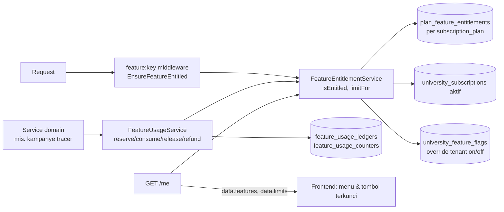

# 34 — Matriks Paket dan Entitlement

> **Status:** rancangan · Disusun 2026-10-13 (commit `47043ca`) · Kembali ke [README](README.md)
> **Dokumen pendukung** (ditambahkan di luar daftar 01–33 karena aturan paket dirujuk oleh hampir semua dokumen). Aturan: [UMUM-BR-002](29-business-rules-dan-validasi.md#umum-br-002), [UMUM-BR-003](29-business-rules-dan-validasi.md#umum-br-003) · Keputusan: [KK-KD-25](33-glossary-dan-keputusan-bisnis.md#2-keputusan-desain-kk-kd)

Dokumen ini mendokumentasikan **aturan paket produk (entitlement)** untuk kelompok modul E, terpisah dari **hak akses internal pengguna** ([03](03-aktor-role-dan-hak-akses.md)). Paket menentukan apakah universitas **boleh memakai** fitur. Permission menentukan **siapa di universitas itu** yang boleh memakainya.

## 1. Kondisi Repository

| Komponen | Kondisi (terverifikasi) |
|---|---|
| `subscription_plans` | Kode **`trial`, `starter`, `professional`, `enterprise`** (`TenancySeeder`); `limits` hanya `max_users`, `max_storage_gb` |
| `university_subscriptions` | Ada (status `trial`, `active`, `past_due`, `suspended`, `cancelled`, `expired`) |
| `modules` / `university_modules` | Ada. Kunci modul terkait: `alumni`, `graduation`, `document`. **Tidak ada** kunci untuk poin kemahasiswaan, SKPI, tracer, dan karier. `university_modules.usage_limit` ada tetapi tidak dipakai |
| `feature_flags` / `university_feature_flags` + `FeatureFlagService` | Ada (flag on/off global + override tenant) |
| Penegakan paket | **Belum ada.** `plan_feature_entitlements`, `EnsureFeatureEntitled`, dan `FeatureEntitlementService` baru **dirancang** di [academic-learning/11 §2](../academic-learning/11-roles-permissions.md) |
| Pemakaian kuota | **Belum ada** |

**Inkonsistensi nama paket.** Kebutuhan bisnis memakai Growth/Business/Professional/Premium/Enterprise (referensi SEVIMA), sedangkan repo memakai trial/starter/professional/enterprise. Pemetaan adalah keputusan bisnis [KK-Q-01](33-glossary-dan-keputusan-bisnis.md#3-pertanyaan-terbuka-kk-q) (sama dengan KEU-Q-01 dan OD-01 di `academic-learning`). Rancangan ini **tidak** memilih pemetaan. Seluruh aturan disimpan sebagai data `plan_feature_entitlements`, sehingga pemetaan apa pun dapat diterapkan tanpa perubahan kode.

## 2. Arsitektur Entitlement Terpusat

- **Tidak ada angka paket di kode modul.** Kode hanya menyebut feature key (konstanta di kelas `*Feature`, pola `AcademicFeature`, Ada). Batas dibaca `FeatureEntitlementService::limitFor($key)` ([UMUM-BR-003](29-business-rules-dan-validasi.md#umum-br-003)).
- **Interim** (sebelum `plan_feature_entitlements` dibangun): nilai dibaca dari `university_settings` kunci `entitlement.{feature_key}` yang hanya dapat ditulis endpoint platform (preseden KEU 08). Kunci yang tidak ada = fitur tersedia tanpa batas **hanya** untuk fitur yang "tersedia di semua paket", dan tertutup untuk fitur Professional+ (aman secara default).
- **Lapis on/off tenant**: admin tenant dapat mematikan fitur yang berhak (`university_feature_flags`), tetapi tidak dapat menyalakan fitur di luar paket.
- **Perubahan paket** berlaku segera melalui flush cache entitlement berversi (pola `PermissionRegistry::flushAll`, Ada).

## 3. Kunci Modul Platform

Usulan penambahan ke `TenancySeeder::MODULES` (modul kasar, L2):

| Kunci | Nama | Status |
|---|---|---|
| `student_affairs` | Poin Kemahasiswaan | Baru |
| `graduation` | Kelulusan dan Wisuda | **Ada** |
| `document` | Surat dan Dokumen | **Ada** (OfficialDocument) |
| `skpi` | SKPI | Baru |
| `tracer` | Tracer Study | Baru (terpisah dari `alumni`) |
| `career` | Karirlink | Baru |
| `alumni` | Alumni | **Ada** |

## 4. Matriks Fitur

**Status kepastian:** **E** = disebut eksplisit dalam kebutuhan · **T** = berasal dari tabel referensi tetapi ada pernyataan lain yang bertentangan atau tidak tegas, sehingga belum terkonfirmasi · **R** = usulan rancangan (tidak disebut kebutuhan).

### 4.1 Poin Kemahasiswaan, Yudisium & Wisuda, SKPI, Tracer

| Fitur | Feature key | Paket minimum | Batas | Status | Bila tidak tersedia | Hak akses internal |
|---|---|---|---|---|---|---|
| Poin Kemahasiswaan (aktivitas, pelanggaran, beasiswa, surat aktif) | `student_affairs.core` | Semua paket | — | E | 403 `FEATURE_NOT_IN_PLAN` (hanya terjadi bila paket tidak memetakan) | [03](03-aktor-role-dan-hak-akses.md) §KEM |
| Yudisium & Wisuda | `graduation.core` | Semua paket | — | E | idem | §KEL/WIS |
| Dokumen resmi (penomoran, PDF, verifikasi) | `document.core` | Semua paket | — | R (dibutuhkan fitur di atas) | idem | §DOC |
| Tanda tangan elektronik tersertifikasi | `document.certified_signature` | Belum ditentukan | Per penandatanganan? | R | Mode `wet_signature`/`image_signature` tetap tersedia | — |
| SKPI | `skpi.core` | Semua paket | — | E | idem | §SKPI |
| Tracer Study (kuesioner, unduh Excel, email, reminder, status responden, status karier, dashboard outcome) | `tracer.core` | Semua paket | — | E | idem | §TRACER |
| Template kuesioner standar | `tracer.standard_template` | Semua paket | — | E | Template disembunyikan | `tracer_questionnaires.read` |
| **Jumlah kuesioner terkirim** | `tracer.invitations.quota` | Semua paket | Growth **50**, Business **50**, Professional **200**, Premium **300**, Enterprise **400** | E (angka). Satuan/jendela **belum terkonfirmasi** ([KK-Q-02](33-glossary-dan-keputusan-bisnis.md#3-pertanyaan-terbuka-kk-q)) | 409 `QUOTA_EXCEEDED` hanya untuk undangan awal ([18 §5.6](18-rancangan-distribusi-dan-reminder-tracer.md#5-alur-bisnis-utama)) | `tracer_invitations.create` |
| Rekap APT/APS | `tracer.accreditation_profiles` | Semua paket (bagian dashboard outcome) | — | E (fitur), profil instrumen perlu verifikasi | — | `tracer_reports.read` |

### 4.2 Karirlink

Sumber referensi menyatakan sekaligus "modul lengkap mulai Professional; fitur dasar melalui marketplace karirlink.id di semua paket" **dan** tabel yang mencantumkan sebagian besar fitur pada Growth. Rancangan mengikuti instruksi kebutuhan: tabel dicatat apa adanya dan perbedaan ditandai ([KK-Q-04](33-glossary-dan-keputusan-bisnis.md#3-pertanyaan-terbuka-kk-q)).

| Fitur | Feature key | Paket minimum | Batas | Status | Bila tidak tersedia | Pesan upgrade | Hak akses internal |
|---|---|---|---|---|---|---|---|
| Marketplace bersama (melihat lowongan marketplace) | `career.marketplace` | Semua paket | — | E | — | — | `career_self_service.read` |
| Portal karier dasar (web & mobile, tampilan default) | `career.portal` | Growth | — | E | Menu karier staf tersembunyi; pengguna hanya marketplace | "Portal karier kampus tersedia mulai paket Growth." | `career_dashboard.read` dll. |
| Portal whitelabel (nama, logo, warna, domain) | `career.whitelabel` | Professional | — | E | Tema default Karirlink (pengaturan tersimpan) | "Tampilan portal dengan identitas kampus tersedia mulai paket Professional." | `career_portal_settings.update` |
| Tips & artikel karier (konten tenant) | `career.articles` | Professional | — | E | Menu terkunci (admin), tidak tampil (pengguna). Artikel platform default tetap tampil | "Artikel dan tips karier tersedia mulai paket Professional." | `career_articles.*` |
| Rekomendasi lulusan ke mitra | `career.graduate_recommendation` | Professional | — | E | 403 + menu terkunci | "Rekomendasi lulusan tersedia mulai paket Professional." | `career_recommendations.*` |
| Melamar via aplikasi | `career.applications` | Growth | — | T | Tombol "Lamar" diganti tautan eksternal bila lowongan punya `external_apply_url`, selain itu dinonaktifkan dengan info | "Melamar langsung dari portal tersedia mulai paket Growth." | `career_self_service.create` |
| Unduh CV lulusan (oleh perusahaan/kampus, dengan otorisasi) | `career.cv_download` | Growth | — | T | Perusahaan melihat ringkasan lamaran tanpa unduh CV untuk pelamar tenant tsb | — | Dasar akses ([21](21-rancangan-lowongan-dan-lamaran-kerja.md)) |
| Undang mitra perusahaan | `career.company_invitations` | Growth | Usulan R: 100 undangan aktif/bulan (anti-spam, bukan batas komersial) | T | Menu undangan terkunci | — | `career_company_invitations.create` |
| Posting & monitoring lowongan (khusus tenant) | `career.job_posting` | Growth | — | T | Hanya lowongan marketplace | — | `career_job_postings.*` |
| Manajemen relasi (CRM) | `career.crm` | Growth | — | T | Menu CRM terkunci | — | `career_crm.*` |
| Publikasi hasil tracer di portal karier | `career.tracer_publication` | Growth | — | T | Menu terkunci | — | `career_tracer_publications.*` |
| Dashboard pusat karier | `career.portal` | Growth | — | R | — | — | `career_dashboard.read` |

Feature key bertingkat: `career.whitelabel`, `career.articles`, `career.graduate_recommendation`, `career.applications`, `career.cv_download`, `career.company_invitations`, `career.job_posting`, `career.crm`, dan `career.tracer_publication` mensyaratkan `career.portal` (induk), kecuali `career.applications` yang juga bermakna pada marketplace.

### 4.3 Usulan baris `plan_feature_entitlements` (format, bukan keputusan pemetaan)

| `feature_key` | growth | business | professional | premium | enterprise |
|---|---|---|---|---|---|
| `student_affairs.core`, `graduation.core`, `document.core`, `skpi.core`, `tracer.core`, `tracer.standard_template`, `career.marketplace` | ✓ | ✓ | ✓ | ✓ | ✓ |
| `tracer.invitations.quota` (`limit_value`) | 50 | 50 | 200 | 300 | 400 |
| `career.portal` dan fitur bertanda T | ✓ | ✓ | ✓ | ✓ | ✓ |
| `career.whitelabel`, `career.articles`, `career.graduate_recommendation` | — | — | ✓ | ✓ | ✓ |

Kolom paket mengikuti nama kebutuhan. Baris untuk `trial`/`starter` dan pemetaan nama ke `subscription_plans.code` menunggu [KK-Q-01](33-glossary-dan-keputusan-bisnis.md#3-pertanyaan-terbuka-kk-q).

## 5. Perilaku Saat Tidak Tersedia (UX)

| Pengguna | Perilaku |
|---|---|
| `university_owner`/`university_administrator` | Menu tampil terkunci (ikon gembok + badge "Paket"), klik membuka `LockedFeatureCard` (nama fitur, paket minimum, tombol "Hubungi pengelola langganan") — pola `academic-learning/09` |
| Staf lain | Menu tidak tampil |
| Mahasiswa/alumni | Fitur tidak tampil. Bila tautan langsung dibuka: halaman "Layanan ini belum tersedia di kampus Anda" tanpa menyebut paket |
| Perusahaan | Untuk aksi yang menyangkut tenant tanpa entitlement (mis. rekomendasi): "Layanan ini tidak tersedia untuk kampus tersebut" |
| API | 403 `FEATURE_NOT_IN_PLAN`, `errors.minimum_plan` hanya untuk pengguna dengan `tenant_profile.read` |

**Turun paket:** data tidak dihapus. Fitur yang hilang menjadi baca-saja (artikel diarsipkan, rekomendasi berjalan diselesaikan sampai consent kedaluwarsa, branding kembali default). Kuota mengikuti batas baru, dan pemakaian tidak direset.

## 6. Cara Pengujian Pembatasan Paket

| ID | Skenario | Hasil |
|---|---|---|
| UMUM-TC-020 | Tenant tanpa `career.articles`: `POST /career-center/articles` | 403 `FEATURE_NOT_IN_PLAN`. Menu terkunci di `/me` `features` |
| UMUM-TC-021 | Ubah `limit_value` `tracer.invitations.quota` dari 50 ke 200 tanpa deploy | Kampanye berikutnya memakai batas baru (cache di-flush) |
| UMUM-TC-022 | Tenant mematikan `tracer.core` lewat flag padahal berhak | 403 `FEATURE_DISABLED` |
| UMUM-TC-023 | Tenant mencoba menyalakan `career.whitelabel` lewat flag tanpa entitlement | Ditolak. Hanya override `off` yang diizinkan untuk fitur di luar paket |
| UMUM-TC-024 | Uji statis: tidak ada literal `50`, `200`, `300`, `400` terkait kuota di `app/Modules/TracerStudy` | Lulus |
| UMUM-TC-025 | Turun paket Professional → Business | Branding default, artikel diarsipkan, rekomendasi baru 403, data tetap ada |

Uji dijalankan dengan factory `SubscriptionPlanFactory` + seed `plan_feature_entitlements` per paket (Ada: `SubscriptionPlanFactory`, `UniversitySubscriptionFactory`).
