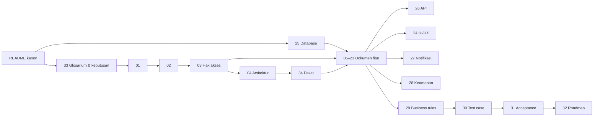
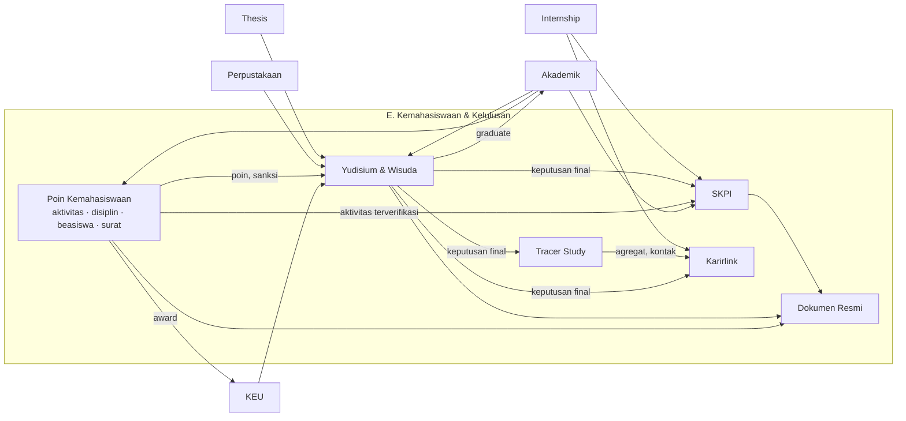

# Rancangan E. Kemahasiswaan & Kelulusan — Civitas One

> **Status dokumen:** rancangan sistem, bukan dokumentasi fitur yang sudah jadi. Selama penyusunan, **tidak ada** kode aplikasi, migration, maupun endpoint yang diubah.
> **Disusun:** 2026-10-13, berdasarkan kondisi repository pada commit `47043ca` (branch `main`).
> **Referensi fungsional:** [SEVIMA_Penjelasan_Modul.md §13–17](../SEVIMA_Penjelasan_Modul.md), [RANCANGAN-APLIKASI.md §4.25, §4.30–4.31, §4.34–4.35](../RANCANGAN-APLIKASI.md).
> **Rancangan terkait yang sudah ada:** [academic-learning/](../academic-learning/README.md) (SIAKAD, cekal, entitlement, scope), [keuangan/](../keuangan/README.md) (KEU: cekal keuangan, potongan beasiswa, tagihan wisuda), [MULTI-TENANT-ARCHITECTURE.md](../MULTI-TENANT-ARCHITECTURE.md).

Kumpulan dokumen ini merancang lima modul kelompok **E**: **Poin Kemahasiswaan**, **Yudisium & Wisuda**, **SKPI**, **TRACER (Tracer Study)**, dan **Karirlink (Career Center)**, ditambah satu layanan bersama **Dokumen Resmi** (penomoran, PDF, verifikasi). Rancangan **memperluas** modul yang ada (`Scholarship`, `Alumni`, alur `student_requests`) dan memakai infrastruktur yang ada (ApprovalWorkflow, FileManagement, Notification, AuditLog, Tenancy).

## Daftar Isi

1. [Tujuan dan Ruang Lingkup](#1-tujuan-dan-ruang-lingkup)
2. [Peta Dokumen](#2-peta-dokumen)
3. [Temuan Repository](#3-temuan-repository)
4. [Peta Hubungan Antarmodul dan Dependensi](#4-peta-hubungan-antarmodul-dan-dependensi)
5. [Kanon](#5-kanon)
6. [Asumsi dan Keputusan yang Belum Dikonfirmasi](#6-asumsi-dan-keputusan-yang-belum-dikonfirmasi)
7. [Status Kelengkapan Dokumen](#7-status-kelengkapan-dokumen)

---

## 1. Tujuan dan Ruang Lingkup

| Modul | Tujuan singkat | Dokumen inti |
|---|---|---|
| Poin Kemahasiswaan | Aktivitas & prestasi terverifikasi, poin, pelanggaran & sanksi, beasiswa, surat aktif | [05](05-rancangan-poin-kemahasiswaan.md)–[09](09-rancangan-surat-keterangan-aktif.md) |
| Yudisium & Wisuda | Persyaratan berversi, eligibility, keputusan berwenang, dokumen bernomor, wisuda | [10](10-rancangan-periode-dan-syarat-yudisium.md)–[14](14-rancangan-wisuda-dan-buku-wisuda.md) |
| SKPI | Dokumen pendamping ijazah dua bahasa | [15](15-rancangan-skpi.md) |
| Tracer Study | Outcome lulusan & pengguna lulusan, kuota paket, laporan akreditasi | [16](16-rancangan-tracer-study.md)–[19](19-rancangan-dashboard-dan-laporan-tracer.md) |
| Karirlink | Portal karier, lowongan, lamaran, mitra, rekomendasi | [20](20-rancangan-career-center-karirlink.md)–[23](23-rancangan-rekomendasi-lulusan.md) |

Batas ruang lingkup dan hal yang **tidak** termasuk: [01 §3](01-overview-dan-ruang-lingkup.md#3-ruang-lingkup).

## 2. Peta Dokumen

### 2.1 Daftar dokumen

| No | Dokumen | Isi | Pembaca utama |
|---|---|---|---|
| — | **README.md** | Indeks, temuan repository, kanon, dependensi, status | Semua |
| 01 | [Overview dan Ruang Lingkup](01-overview-dan-ruang-lingkup.md) | Latar, tujuan, ruang lingkup, batas modul, prinsip | PO, SA |
| 02 | [Analisis Kebutuhan Bisnis](02-analisis-kebutuhan-bisnis.md) | Proses bisnis, kebutuhan fungsional & non-fungsional, kesenjangan, risiko | PO, SA |
| 03 | [Aktor, Role, dan Hak Akses](03-aktor-role-dan-hak-akses.md) | **Acuan** role, permission, scope, matriks akses | SA, BE, Security |
| 04 | [Arsitektur dan Integrasi Antarmodul](04-arsitektur-dan-integrasi-antarmodul.md) | Arsitektur target, kepemilikan data, pola integrasi, rekonsiliasi | Tech lead, BE |
| 05 | [Poin Kemahasiswaan](05-rancangan-poin-kemahasiswaan.md) | Kategori, aturan poin, ledger, koreksi, banding | SA, BE |
| 06 | [Aktivitas dan Prestasi](06-rancangan-aktivitas-dan-prestasi.md) | Pengajuan, bukti, verifikasi, kegiatan kolektif, anti-manipulasi | SA, BE, FE |
| 07 | [Pelanggaran dan Sanksi](07-rancangan-pelanggaran-dan-sanksi.md) | Laporan, kasus, keputusan, keberatan | SA, BE, Hukum |
| 08 | [Beasiswa Mahasiswa](08-rancangan-beasiswa-mahasiswa.md) | Program, seleksi, penerima, evaluasi, sinkron KEU | SA, BE, KEU |
| 09 | [Surat Keterangan Aktif](09-rancangan-surat-keterangan-aktif.md) | Perluasan alur yang ada: nomor resmi, snapshot, verifikasi | BE, FE |
| 10 | [Periode dan Syarat Yudisium](10-rancangan-periode-dan-syarat-yudisium.md) | Periode, rule engine, checker, resolusi, simulasi | SA, BE |
| 11 | [Eligibilitas Yudisium](11-rancangan-eligibilitas-yudisium.md) | Eligibility engine, stale, recheck, pengecualian | BE |
| 12 | [Peserta dan Penetapan Kelulusan](12-rancangan-peserta-dan-penetapan-kelulusan.md) | Pendaftaran, verifikasi, rapat, keputusan, predikat, koreksi | SA, BE |
| 13 | [Penomoran Dokumen Kelulusan](13-rancangan-penomoran-dokumen-kelulusan.md) | Layanan dokumen resmi bersama | BE, DBE |
| 14 | [Wisuda dan Buku Wisuda](14-rancangan-wisuda-dan-buku-wisuda.md) | Wisuda, sesi, check-in, buku | SA, BE, FE |
| 15 | [SKPI](15-rancangan-skpi.md) | Capaian, dua bahasa, penerbitan, verifikasi | SA, BE |
| 16 | [Tracer Study](16-rancangan-tracer-study.md) | Periode, target, pengguna lulusan, status karier | SA, BE |
| 17 | [Kuesioner dan Survei](17-rancangan-kuesioner-dan-survei.md) | Builder, versi, template standar, pengisian | BE, FE |
| 18 | [Distribusi dan Reminder Tracer](18-rancangan-distribusi-dan-reminder-tracer.md) | Token, undangan, pengingat, bounce, **kuota** | BE |
| 19 | [Dashboard dan Laporan Tracer](19-rancangan-dashboard-dan-laporan-tracer.md) | Indikator & formula, APT/APS, ekspor | SA, BE, LPM |
| 20 | [Career Center (Karirlink)](20-rancangan-career-center-karirlink.md) | Marketplace vs whitelabel, profil & CV, artikel, publikasi tracer | SA, BE, FE |
| 21 | [Lowongan dan Lamaran Kerja](21-rancangan-lowongan-dan-lamaran-kerja.md) | Lowongan, moderasi, lamaran, anti-penyalahgunaan | BE |
| 22 | [Mitra Perusahaan dan CRM](22-rancangan-mitra-perusahaan-dan-crm.md) | Perusahaan, verifikasi, kemitraan, CRM | SA, BE |
| 23 | [Rekomendasi Lulusan](23-rancangan-rekomendasi-lulusan.md) | Rekomendasi dengan persetujuan berlapis | SA, BE, Hukum |
| 24 | [UI/UX dan Struktur Menu](24-rancangan-ui-ux-dan-struktur-menu.md) | Menu, permukaan, pola halaman, spesifikasi halaman | FE, UI/UX |
| 25 | [Database dan ERD](25-rancangan-database-dan-erd.md) | **Acuan** skema, data dictionary, ERD per kelompok & integrasi | BE, DBE |
| 26 | [API dan Integrasi](26-rancangan-api-dan-integrasi.md) | **Acuan** endpoint, kontrak, event, kode error | BE, FE, Mobile |
| 27 | [Notifikasi dan Email](27-rancangan-notifikasi-dan-email.md) | Katalog notifikasi, template, idempotensi | BE |
| 28 | [Keamanan, Privasi, dan Audit](28-keamanan-privasi-dan-audit.md) | Lapis otorisasi, klasifikasi data, SoD, audit, retensi | Security, Auditor |
| 29 | [Business Rules dan Validasi](29-business-rules-dan-validasi.md) | **Acuan** 165 aturan bisnis | SA, BE, QA |
| 30 | [Skenario Pengujian](30-skenario-pengujian.md) | **Acuan** test case unit/integrasi/E2E/keamanan/UAT | QA |
| 31 | [Acceptance Criteria](31-acceptance-criteria.md) | AC terukur + keterlacakan fitur → AC | PO, QA |
| 32 | [Roadmap Implementasi](32-roadmap-implementasi.md) | Fase, dependensi, migrasi, risiko | PM, Tech lead |
| 33 | [Glosarium dan Keputusan Bisnis](33-glossary-dan-keputusan-bisnis.md) | Istilah, keputusan `KK-KD`, pertanyaan `KK-Q`, asumsi `KK-A` | Semua |
| 34 | [Matriks Paket dan Entitlement](34-matriks-paket-dan-entitlement.md) | **Dokumen pendukung tambahan.** Aturan paket, feature key, kuota, cara uji | PO, BE |

### 2.2 Urutan membaca

1. README → [33](33-glossary-dan-keputusan-bisnis.md) (istilah & keputusan).
2. [01](01-overview-dan-ruang-lingkup.md) → [02](02-analisis-kebutuhan-bisnis.md) → [03](03-aktor-role-dan-hak-akses.md) → [04](04-arsitektur-dan-integrasi-antarmodul.md) → [34](34-matriks-paket-dan-entitlement.md).
3. [25](25-rancangan-database-dan-erd.md) (skema acuan), lalu dokumen fitur [05](05-rancangan-poin-kemahasiswaan.md)–[23](23-rancangan-rekomendasi-lulusan.md) sesuai modul yang dikerjakan. [13](13-rancangan-penomoran-dokumen-kelulusan.md) wajib bagi semua penerbit dokumen.
4. [26](26-rancangan-api-dan-integrasi.md), [24](24-rancangan-ui-ux-dan-struktur-menu.md), [27](27-rancangan-notifikasi-dan-email.md), [28](28-keamanan-privasi-dan-audit.md).
5. [29](29-business-rules-dan-validasi.md) → [30](30-skenario-pengujian.md) → [31](31-acceptance-criteria.md) → [32](32-roadmap-implementasi.md).

**Prioritas bila dua dokumen berbeda:**

| Hal | Dokumen yang berlaku |
|---|---|
| Tabel, kolom, constraint | [25](25-rancangan-database-dan-erd.md) |
| Role, permission, scope | [03](03-aktor-role-dan-hak-akses.md) |
| Endpoint, kode error, kontrak, event | [26](26-rancangan-api-dan-integrasi.md) |
| Teks & ID aturan bisnis | [29](29-business-rules-dan-validasi.md) |
| Status & transisi | §5.3 README ini, dirinci di dokumen fitur |
| Paket & feature key | [34](34-matriks-paket-dan-entitlement.md) |
| Istilah | [33](33-glossary-dan-keputusan-bisnis.md) |

## 3. Temuan Repository

Hasil pemeriksaan 2026-10-13. Setiap klaim diverifikasi ke kode. Bila menyebut rancangan lain, ditulis "dirancang".

### 3.1 Teknologi dan pola

| Aspek | Kondisi | Sumber |
|---|---|---|
| Backend | Laravel 13, PHP 8.3, `app/Modules/*` (namespace `Modules\`), Pest 4, Larastan, Pint, Scramble | `composer.json` |
| Data | ULID PK, `timestampsTz`, `university_id` + `TenantScoped`/`BelongsToInstitutionScope` | migration modul |
| Routing | `/api/v1` + `tenant.resolve`; rute modul dimuat otomatis | `routes/api.php` |
| Respons | `ApiResponse` (`success/message/data/meta`), `ListQuery` (`search`, `filter[col]=a,b`, `sort`, `per_page ≤ 100`), `ConflictException` | `app/Support/Http` |
| RBAC | Kustom: `roles`, `permissions`, `role_permissions`, `user_roles` (`scope_type`, `scope_id`, `expires_at`, `university_id`), `PermissionRegistry`, `permission:` (OR), bypass `super_admin`; `PermissionAction` 10 nilai | `Modules\UserManagement` |
| Role tenant | `university_owner`, `university_administrator`, `rector`, `vice_rector`, `dean`, `head_of_study_program`, `academic_administrator`, `lecturer`, `academic_advisor`, `student`, `employee`, `finance_administrator`, `hr_administrator`, `library_administrator`, `auditor` | `OrganizationalRoleSeeder` |
| Persetujuan | ApprovalWorkflow dengan langkah berurutan, return/resubmit, approver kontekstual; event `ApprovalRequestApproved/Rejected/Returned…`; pengecualian pemohon hanya untuk approver kontekstual | `Modules\ApprovalWorkflow` |
| Berkas | `file_uploads` (privat, sha256, `fileable`), `RestrictsFileAccess`, `VirusScanner` (Null) di belakang flag, MIME `pdf,jpg,jpeg,png,doc,docx,xls,xlsx`, maks `file.max_upload_size_mb` (default 10) | `Modules\FileManagement` |
| Notifikasi | `NotificationDispatcher::dispatch(User …)`, `TemplatedNotification` (`ShouldQueue`, `toDatabase`, `toMail`), template per (`event_key`, `channel`) + override tenant, tanpa locale & dedupe | `Modules\Notification` |
| Audit | `audit_logs` + `Auditable` + `AuditAction` (termasuk `approved`, `rejected`, `verified`, `exported`, `downloaded`, `viewed_sensitive`, `forced_override`), `$auditMasked` | `Modules\AuditLog` |
| Flag & paket | `feature_flags` + `university_feature_flags` (`FeatureFlagService`); `subscription_plans` = trial/starter/professional/enterprise; `modules` memuat `alumni`, `graduation`, `document`; entitlement & kuota belum ditegakkan | `Modules\SystemSetting`, `TenancySeeder` |
| PDF/Excel | dompdf, openspout | `composer.json` |
| Frontend | Admin `frontend/src/pages` (+ `constants/nav.ts`), Civitas One `frontend/src/one` (menu `career`, `scholarships`) | `frontend/src` |

### 3.2 Modul terkait yang ada

| Modul / komponen | Kondisi | Dipakai rancangan sebagai |
|---|---|---|
| `students` | `status` string (`active`, `leave`, `graduated`, `inactive`, `dropped_out`, `resigned`), `graduated_at`, `user_id`, `academic_advisor_id`; `StudentObserver` → `student_status_histories` | Identitas & status; `graduated` tidak diblokir login |
| Transkrip & IPK | `StudentGradeService::transcript`, `AcademicRecordService` (nilai terbaik untuk MK ulang), `LetterGrade` bobot 4,00 | Sumber checker SKS/IPK |
| `student_requests` (surat) | Tipe `letter`, `LETTER_TYPES` (`active_student`, `good_conduct`, `recommendation`, `other`), ApprovalWorkflow, `SyncStudentRequestDecision`; PDF via `StudentDocumentService::letterPdf` | Diperluas untuk surat aktif ([09](09-rancangan-surat-keterangan-aktif.md)) |
| `alumni` | `employment_status` enum wajib, `company_name`, `job_title`, `waiting_period_months`, `is_verified`; hanya `GET` | Diperluas ([16](16-rancangan-tracer-study.md)) |
| `scholarships`, `scholarship_applications` | Program & pendaftaran; hanya `GET` | Diperluas ([08](08-rancangan-beasiswa-mahasiswa.md)) |
| `theses` | Satu per mahasiswa, status sampai `selesai`, `completed_at`, pembimbing | Checker tugas akhir, scope pembimbing |
| `internships` | `magang`/`kkn`/`mbkm`, status `selesai`, `sks_converted` | Sumber SKPI |
| `book_loans` | Status `dipinjam`/`dikembalikan`/`terlambat`, `fine_amount` | Checker bebas perpustakaan |
| `universities`, `university_domains` | `logo_file_id`, `primary_color`, `secondary_color`, `timezone`, `locale`; domain terverifikasi | Branding & zona waktu |
| `employees`, `positions` (SDM) | Ada | Tautan penandatangan |

### 3.3 Kesenjangan dan Inkonsistensi

| ID | Temuan | Penanganan |
|---|---|---|
| GAP-01 | Tidak ada modul poin, disiplin, yudisium, wisuda, SKPI, tracer, karier di kode | Modul baru ([04](04-arsitektur-dan-integrasi-antarmodul.md)) |
| GAP-02 | Nomor surat aktif diturunkan dari ULID saat unduh, tidak tercatat/unik; PDF dirender ulang dari data hidup | OfficialDocument ([09](09-rancangan-surat-keterangan-aktif.md), [13](13-rancangan-penomoran-dokumen-kelulusan.md)) |
| GAP-03 | `alumni.employment_status` wajib tanpa sumber, sehingga "tidak diketahui" tidak dapat dibedakan dari "belum bekerja" | Nullable + catatan bersumber ([16](16-rancangan-tracer-study.md)) |
| GAP-04 | `alumni.read` diberikan ke 8 role tanpa scope | Pemisahan data sensitif ([28](28-keamanan-privasi-dan-audit.md)) |
| GAP-05 | Kode paket repo ≠ nama paket kebutuhan; tidak ada entitlement/kuota | [34](34-matriks-paket-dan-entitlement.md), [KK-Q-01](33-glossary-dan-keputusan-bisnis.md#3-pertanyaan-terbuka-kk-q) |
| GAP-06 | Scope fakultas/prodi belum ditegakkan | Bergantung `AcademicScope` (dirancang `academic-learning`) |
| GAP-07 | ApprovalWorkflow tidak mencegah self-approval pada approver `role`/`user` | `SegregationOfDutiesGuard` ([28 §6](28-keamanan-privasi-dan-audit.md#6-pemisahan-tugas)) |
| GAP-08 | `tenant.access` hanya dipasang di `/tenant` dan `/hr` | Wajib pada grup baru |
| GAP-09 | Notifikasi tanpa locale, dedupe, dan penerima non-user | Perluasan ([27](27-rancangan-notifikasi-dan-email.md)) |
| GAP-10 | Tidak ada idempotensi HTTP; scheduler hanya HR | `idempotency_keys` (desain KEU), job terjadwal |
| GAP-11 | FK lama `cascadeOnDelete` ke `students` (alumni, scholarship_applications, theses, …) dapat menghapus arsip | FK `restrict` untuk tabel baru & tabel yang diubah ([KK-KD-12](33-glossary-dan-keputusan-bisnis.md#2-keputusan-desain-kk-kd)) |
| GAP-12 | Halaman `PortalGraduationPage`, `PortalScholarshipPage`, `PortalLetterRequestPage` tidak memanggil API; `/one/career` memakai data tiruan | Diganti ([24](24-rancangan-ui-ux-dan-struktur-menu.md)) |
| GAP-13 | Pemindai virus hanya `NullVirusScanner` | Aktifkan sebelum portal perusahaan ([32](32-roadmap-implementasi.md)) |
| GAP-14 | Tidak ada entitas ujian sidang terpisah; tidak ada status pelunasan denda perpustakaan | Checker manual ([KK-Q-33](33-glossary-dan-keputusan-bisnis.md#3-pertanyaan-terbuka-kk-q), [KK-Q-28](33-glossary-dan-keputusan-bisnis.md#3-pertanyaan-terbuka-kk-q)) |
| INK-01 | `academic-learning` merujuk `16-open-decisions.md` (mis. OD-22) yang **tidak ada** di folder tersebut | Dicatat. Tidak diubah oleh rancangan ini |
| INK-02 | Kunci layanan cekal: `academic-learning/07` (`grade_view`, 6 layanan) vs `/01` (`view_grades`, 12 layanan); `block_type` `finance` vs `financial` | Modul ini memakai `yudisium`, `graduation`, `block_type = student_affairs` (konsisten di kedua dokumen) |
| INK-03 | `RANCANGAN-APLIKASI.md` menempatkan poin di "Organisasi & Kegiatan" dan pelanggaran di modul terpisah; SEVIMA mengelompokkannya di "Poin Kemahasiswaan" | Mengikuti pengelompokan kebutuhan (SEVIMA) |
| INK-04 | [keuangan/11 §4](../keuangan/11-rancangan-beasiswa-dan-potongan.md#4-integrasi-dengan-modul-scholarship) memicu potongan dari `scholarship_applications.approved`; rancangan ini memperkenalkan `scholarship_awards` | Usulan ke KEU: tambah `student_discounts.scholarship_award_id` ([08 §5.6](08-rancangan-beasiswa-mahasiswa.md#5-alur-bisnis-utama)) |
| INK-05 | SEVIMA: Karirlink "modul lengkap mulai Professional" vs tabel fitur Growth | [KK-Q-04](33-glossary-dan-keputusan-bisnis.md#3-pertanyaan-terbuka-kk-q) |

## 4. Peta Hubungan Antarmodul dan Dependensi

**Dependensi implementasi** (rinci di [32 §1](32-roadmap-implementasi.md#1-dependensi-eksternal-terhadap-kelompok-modul-ini)):

| Bergantung pada | Status | Jalur sementara |
|---|---|---|
| Entitlement (`plan_feature_entitlements`) | Dirancang `academic-learning` | `university_settings` `entitlement.*` hanya-platform |
| `AcademicScope` & role fakultas/prodi | Dirancang `academic-learning` | Verifikasi oleh petugas universitas |
| `FinanceClearanceService`, `FinanceObligationReader`, `student_discounts` | Dirancang KEU | Checker/validasi manual; event tetap dipancarkan |
| `academic_blocks` | Dirancang `academic-learning` | Checker disiplin langsung |
| `idempotency_keys` | Dirancang KEU | Dibangun di Fase 0 |
| Event Akademik (`GradesPublished`) | Belum ada | `StudentObserver` + `max_age_hours` |

Urutan fase: Fondasi → Kemahasiswaan & Dokumen → Yudisium → Wisuda & SKPI → Tracer → Karier → Penguatan ([32 §2](32-roadmap-implementasi.md#2-fase)).

## 5. Kanon

### 5.1 Modul kode

| Modul | Status | Isi |
|---|---|---|
| `StudentAffairs` | Baru | Aktivitas, poin, disiplin |
| `Scholarship` | Ada, diperluas | Program, seleksi, penerima |
| `OfficialDocument` | Baru | Template, nomor, PDF, tanda tangan, verifikasi |
| `Graduation` | Baru | Yudisium, eligibility, keputusan, wisuda, buku wisuda |
| `Skpi` | Baru | SKPI |
| `TracerStudy` | Baru | Tracer |
| `Alumni` | Ada, diperluas | Ringkasan & riwayat karier alumni |
| `Career` | Baru | Karirlink |

### 5.2 Prefiks ID

| Jenis | Format | Didefinisikan di |
|---|---|---|
| Aturan bisnis | `KEM-BR-NNN`, `KEL-BR-NNN`, `WIS-BR-NNN`, `SKPI-BR-NNN`, `TRACER-BR-NNN`, `KARIR-BR-NNN`, `UMUM-BR-NNN` | [29](29-business-rules-dan-validasi.md) |
| Test case | `<PREFIKS>-TC-NNN` | [30](30-skenario-pengujian.md) |
| Acceptance criteria | `<PREFIKS>-AC-NN` | [31](31-acceptance-criteria.md) |
| Laporan | `KEM-RPT-NN`, `KEL-RPT-NN`, `WIS-RPT-NN`, `SKPI-RPT-NN`, `TRACER-RPT-NN`, `KARIR-RPT-NN` | Dokumen fitur §16 |
| Keputusan / pertanyaan / asumsi | `KK-KD-NN` / `KK-Q-NN` / `KK-A-NN` | [33](33-glossary-dan-keputusan-bisnis.md) |
| Kebutuhan | `KK-FR-<AREA>-NN`, `KK-NFR-NN` | [02](02-analisis-kebutuhan-bisnis.md) |
| Alur alternatif | `AF-<AREA>-NN` | Dokumen fitur §6 |

### 5.3 Status kanon

| Entitas | Nilai |
|---|---|
| `activity_categories`, `activity_point_rules` | `draft`, `active`, `inactive` |
| `activity_submissions` | `draft`, `submitted`, `under_review`, `revision_requested`, `approved`, `rejected`, `withdrawn`, `revoked` |
| `activity_events` | `draft`, `pending_verification`, `verified`, `rejected`, `cancelled` |
| `point_appeals` | `submitted`, `under_review`, `accepted`, `rejected`, `withdrawn` |
| `violation_reports` | `submitted`, `screening`, `dismissed`, `escalated` |
| `violation_cases` | `open`, `investigating`, `findings_recorded`, `closed_no_violation`, `decided`, `cancelled` |
| `disciplinary_decisions` | `draft`, `pending_approval`, `final`, `superseded`, `annulled` |
| `sanction_appeals` | `submitted`, `under_review`, `upheld`, `modified`, `annulled`, `rejected`, `withdrawn` |
| `scholarships` | `draft`, `open`, `closed`, `archived` |
| `scholarship_applications` | `draft`, `submitted`, `revision_requested`, `under_review`, `shortlisted`, `waitlisted`, `approved`, `rejected`, `withdrawn` |
| `scholarship_awards` | `pending_approval`, `offered`, `active`, `suspended`, `terminated`, `completed`, `declined`, `rejected` |
| `student_requests` (Ada) | `draft`, `submitted`, `approved`, `rejected`, `cancelled` |
| `issued_documents` | `draft`, `pending_signature`, `issued`, `revoked`, `superseded` |
| `document_revocations` | `pending_approval`, `approved`, `rejected` |
| `yudisium_periods` | `draft`, `open`, `closed`, `finalized`, `cancelled` |
| `graduation_requirement_set_versions` | `draft`, `published`, `retired` |
| `graduation_eligibility_checks.result` | `eligible`, `not_eligible`, `pending_verification`, `manual_review`, `exempted` |
| `graduation_eligibility_check_items.result` | `passed`, `failed`, `pending_verification`, `manual_review`, `source_unavailable`, `exempted` |
| `yudisium_registrations` | `draft`, `submitted`, `returned`, `prodi_verified`, `faculty_verified`, `ready_for_decision`, `decided`, `rejected`, `withdrawn`, `carried_over` |
| `yudisium_meetings` | `scheduled`, `held`, `finalized`, `cancelled` |
| `graduation_decisions` | `draft`, `pending_approval`, `approved_pending_finalization`, `final`, `superseded`, `annulled`; `outcome`: `graduated`, `postponed`, `not_graduated` |
| `graduation_ceremonies` | `draft`, `registration_open`, `registration_closed`, `finalized`, `completed`, `cancelled` |
| `ceremony_registrations` | `draft`, `payment_pending`, `submitted`, `verified`, `confirmed`, `absent_declared`, `unconfirmed`, `rejected`, `cancelled`, `withdrawn`; `attendance_status`: `not_checked_in`, `checked_in`, `no_show` |
| `graduation_book_editions` | `draft`, `in_review`, `locked`, `published`, `superseded` |
| `skpi_achievements.verification_status` | `submitted`, `verified`, `rejected`, `revision_requested`, `source_revoked` |
| `skpi_documents` | `draft`, `in_review`, `revision_requested`, `approved`, `issued`, `revoked`, `superseded` |
| `tracer_periods` | `draft`, `scheduled`, `active`, `closed`, `archived` |
| `tracer_questionnaire_versions` | `draft`, `published`, `retired` |
| `tracer_targets` | `eligible`, `excluded` |
| `tracer_invitations.delivery_status` | `queued`, `sent`, `delivered`, `soft_bounced`, `hard_bounced`, `failed`, `suppressed`, `complained`, `cancelled` |
| `tracer_responses` | `in_progress`, `submitted`, `invalidated` |
| `career_companies.verification_status` | `unverified`, `pending_verification`, `verified`, `rejected`, `suspended` |
| `career_company_members` | `invited`, `active`, `suspended`, `removed` |
| `career_partnerships` | `prospect`, `active`, `inactive`, `ended` |
| `career_job_postings` | `draft`, `pending_review`, `revision_requested`, `published`, `rejected`, `closed`, `taken_down`, `archived` |
| `career_applications` | `submitted`, `reviewed`, `shortlisted`, `interview`, `offered`, `accepted`, `rejected`, `withdrawn` |
| `career_recommendation_candidates` | `proposed`, `rejected_by_campus`, `approved_by_campus`, `consent_requested`, `consented`, `declined`, `consent_expired`, `shared`, `withdrawn`, `closed` |
| `data_sharing_consents` | `granted`, `revoked`, `expired` |

### 5.4 Feature key

`student_affairs.core`, `graduation.core`, `document.core`, `document.certified_signature`, `skpi.core`, `tracer.core`, `tracer.standard_template`, `tracer.invitations.quota`, `tracer.accreditation_profiles`, `career.marketplace`, `career.portal`, `career.whitelabel`, `career.articles`, `career.graduate_recommendation`, `career.applications`, `career.cv_download`, `career.company_invitations`, `career.job_posting`, `career.crm`, `career.tracer_publication` ([34](34-matriks-paket-dan-entitlement.md)).

## 6. Asumsi dan Keputusan yang Belum Dikonfirmasi

Keputusan bisnis yang **harus** diambil sebelum fase terkait ([33 §3](33-glossary-dan-keputusan-bisnis.md#3-pertanyaan-terbuka-kk-q)):

| Prioritas | Pertanyaan |
|---|---|
| Sebelum Fase 0 | KK-Q-01 pemetaan paket; KK-Q-34 portal mahasiswa yang dipakai |
| Sebelum Fase 1 | KK-Q-05 poin wajib yudisium; KK-Q-08 prosedur disiplin; KK-Q-23 beasiswa; KK-Q-31 verifikator |
| Sebelum Fase 2 | KK-Q-09 tanda tangan; KK-Q-12 format nomor; KK-Q-24 surat aktif |
| Sebelum Fase 3 | KK-Q-10 alur verifikasi; KK-Q-11 predikat; KK-Q-13 PIN ijazah; KK-Q-28, KK-Q-33 sumber syarat |
| Sebelum Fase 4 | KK-Q-14, KK-Q-15 wisuda; KK-Q-16 SKPI |
| Sebelum Fase 5 | KK-Q-02 kuota; KK-Q-17 instrumen tracer; KK-Q-18 instrumen akreditasi; KK-Q-19 pendapatan; KK-Q-20 email |
| Sebelum Fase 6 | KK-Q-03 marketplace; KK-Q-04 paket Karirlink; KK-Q-21 moderasi; KK-Q-22 retensi; KK-Q-26 rekomendasi mahasiswa; KK-Q-27 perlindungan data; KK-Q-30 domain |

Asumsi kerja: [33 §4](33-glossary-dan-keputusan-bisnis.md#4-asumsi-kk-a) (KK-A-01…14).

## 7. Status Kelengkapan Dokumen

Status per 2026-10-13. "Lengkap" = seluruh bagian standar terisi substansial. Butir yang menunggu keputusan bisnis ditandai sebagai `KK-Q`, bukan diisi asumsi tersembunyi.

| Dokumen | Status | Catatan |
|---|---|---|
| README, 01–04 | Lengkap | |
| 05–23 (dokumen fitur) | Lengkap: 20 bagian standar | Nilai kebijakan kampus menunggu `KK-Q` terkait |
| 24 UI/UX | Lengkap | Desain visual detail (mockup) belum dibuat. Spesifikasi berbasis komponen yang ada |
| 25 Database | Lengkap | Tipe kolom final dapat berubah saat implementasi |
| 26 API | Lengkap | Contoh request/response untuk endpoint utama tiap kelompok, dan sisanya mengikuti konvensi §1 |
| 27 Notifikasi | Lengkap | Teks template final per kampus |
| 28 Keamanan | Lengkap | Kepatuhan hukum menunggu KK-Q-27 |
| 29 Business rules | Lengkap (165 aturan) | |
| 30 Test case | Lengkap (228 TC + 6 UAT) | Setiap aturan bisnis memiliki ≥ 1 TC |
| 31 Acceptance | Lengkap | Setiap fitur memiliki ≥ 1 AC |
| 32 Roadmap | Lengkap | Durasi belum ditetapkan (kapasitas tim belum diketahui) |
| 33 Glosarium | Lengkap | 26 keputusan, 34 pertanyaan, 14 asumsi |
| 34 Paket (pendukung) | Lengkap | Pemetaan nama paket menunggu KK-Q-01 |
