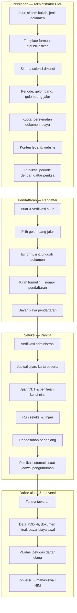

# 1. Pengenalan Modul PMB

[← Daftar isi](README.md) · [Berikutnya: Akses, Peran, dan Hak Akses →](02-akses-dan-peran.md)

## 1. Apa itu Modul PMB?

Modul Penerimaan Mahasiswa Baru (PMB) Civitas One mengelola seluruh siklus penerimaan: dari informasi pendaftaran di website kampus sampai calon mahasiswa resmi tercatat sebagai **mahasiswa** dengan **NIM** di modul Akademik. Semua langkah tercatat (audit), mengikuti aturan bisnis dari dokumen rancangan [`docs/pmb`](../../pmb/), dan dipisahkan per kampus (*multi-tenant*).

Cakupan fitur:

| Area | Isi | Bab |
|---|---|---|
| Website PMB | Beranda, prodi, jalur, biaya, jadwal, panduan, FAQ, berita, cek status, info daftar ulang, kontak, verifikasi surat penerimaan | [10](10-website-pmb.md) |
| Akun & portal pendaftar | Akun terpisah dari akun staf/mahasiswa, profil, formulir per jalur, dokumen, pembayaran, ujian, hasil, daftar ulang, pesan | [11](11-akun-pendaftar.md)–[16](16-pesan-notifikasi-akun.md) |
| Konfigurasi | Periode, gelombang, jalur, kuota, biaya, persyaratan dokumen, template formulir, skema seleksi, konten, pengaturan, format NIM, voucher | [20](20-periode-gelombang-kuota-biaya.md)–[25](25-pengaturan-pmb.md) |
| Operasional | Pendaftar, verifikasi, keuangan, ujian & CBT, penilaian, seleksi & pengesahan, pengumuman, daftar ulang & konversi, komunikasi | [30](30-dashboard-pmb.md)–[39](39-komunikasi.md) |
| Pengawasan | Dashboard, laporan & ekspor, audit, log akses data sensitif | [30](30-dashboard-pmb.md), [40](40-laporan.md), [41](41-audit.md) |

## 2. Tiga "wajah" aplikasi

| Wajah | Alamat | Pengguna | Cara masuk |
|---|---|---|---|
| **Website PMB** (publik) | `/pmb` dan turunannya | Siapa saja | Tanpa login |
| **Portal Pendaftar** | `/pmb/portal` | Calon mahasiswa | **Masuk** di `/pmb/masuk` dengan akun pendaftar |
| **Admin PMB** | `/admin/pmb` (di dalam aplikasi staf Civitas One) | Panitia, verifikator, keuangan, penguji, pengesah, pimpinan, auditor | Login staf di `/login`, tab **Dosen / Staf / Admin** |

> **Catatan** — Akun pendaftar **berbeda** dari akun staf maupun akun mahasiswa. Pendaftar baru mendapat akun mahasiswa (dan NIM) setelah daftar ulang disetujui dan proses konversi selesai.

## 3. Konsep kunci

| Istilah | Penjelasan | Contoh |
|---|---|---|
| **Periode** | Satu siklus PMB untuk satu tahun akademik masuk. Berisi gelombang, kuota, dan biaya. | *PMB Tahun Akademik 2027/2028* (`PMB2027`) |
| **Gelombang** | Rentang jadwal di dalam periode: pendaftaran dibuka–ditutup, batas bayar, batas perbaikan formulir, jendela ujian, pengumuman, daftar ulang. | *Gelombang 1*, *Gelombang 2* |
| **Gelombang ODS** | Gelombang dengan jadwal ujian fleksibel (*On Demand Schedule*): tanggal ujian tidak harus di dalam jendela ujian gelombang. | *Gelombang Khusus (ODS)* |
| **Jalur masuk** | Kategori penerimaan (Reguler, Prestasi, KIP/afirmasi, transfer, dll.). | *Reguler*, *Prestasi* |
| **Gelombang-jalur** | Jalur yang dibuka pada suatu gelombang, beserta biaya pendaftaran, waktu bayar, maksimal pilihan prodi, template formulir, skema seleksi, dan persyaratan dokumen. Pendaftar selalu mendaftar ke satu gelombang-jalur. | *Reguler — Gelombang 2*, Rp250.000 |
| **Sistem kuliah** | Kelas/sistem perkuliahan yang memengaruhi kuota dan biaya. | *Reguler (REG)*, *Kelas Karyawan (KRY)* |
| **Kuota** | Kapasitas per **periode × jalur × prodi × sistem kuliah**, plus kapasitas cadangan dan ambang skor (opsional). | TI–Reguler–REG: kapasitas 2, cadangan 2 |
| **Template formulir** | Aturan field inti (wajib/opsional/disembunyikan) dan field tambahan. Berversi; hanya versi **terpublikasi** yang dapat dipakai. | `FORM-S1 v1` |
| **Skema seleksi** | Komponen nilai (administrasi, rapor, ujian/CBT, wawancara, dll.), bobot, ambang, aturan seri. Berversi; hanya versi **terkunci** yang dapat dipakai. | `SKM-REG v1`: Rapor 40% + TPA 60% |
| **Run seleksi** | Satu kali perhitungan peringkat & alokasi kursi untuk satu gelombang-jalur. Run ditinjau, lalu diajukan untuk pengesahan. | *Gelombang 1 · Reguler* |
| **Pengesahan** | Persetujuan berjenjang hasil seleksi lewat menu **Persetujuan** (default: Ketua Panitia PMB → Pejabat Pengesah). | — |
| **Batch pengumuman** | Jadwal publikasi hasil yang dibuat otomatis setelah hasil disahkan; hasil terbit pada waktu pengumuman gelombang. | — |
| **Keputusan** | Hasil per pendaftar: **Diterima**, **Cadangan**, **Tidak diterima**. Berversi bila dikoreksi. | — |
| **LoA** | Surat penerimaan (*Letter of Acceptance*) PDF bernomor dengan kode QR verifikasi publik. | `LOA/PMB2027/00001` |
| **Daftar ulang** | Konfirmasi tawaran, data lanjutan (PDDikti), dokumen final, pembayaran biaya awal, dan validasi petugas. | — |
| **Konversi** | Pembuatan data mahasiswa, NIM, akun, tagihan di modul Keuangan, dan penerusan beasiswa setelah daftar ulang disetujui. | NIM `27TEK30001` (tergantung format) |

## 4. Alur besar PMB

Urutan kerja panitia per fase beserta tautan ke bab terkait ada di [Alur Kerja & Kalender Panitia](03-alur-kerja-panitia.md).

## 5. Tahap pendaftar (yang dilihat calon mahasiswa)

Portal menampilkan **tahap saat ini** untuk setiap pendaftaran beserta linimasa 7 langkah: *Isi formulir → Pembayaran → Verifikasi → Seleksi → Pengumuman → Daftar ulang → Mahasiswa*.

| Label tahap | Kapan muncul |
|---|---|
| Melengkapi formulir | Formulir masih draf dan biaya pendaftaran tidak diperlukan/sudah lunas |
| Menunggu pembayaran | Biaya pendaftaran belum lunas (juga tampil pada draf jalur berbayar, sesuai urutan [09 §3](../../pmb/09-workflow-dan-state-machine.md)) |
| Sedang diverifikasi | Formulir terkirim & lunas, atau sedang diperiksa verifikator |
| Perlu perbaikan | Verifikator meminta perbaikan data/dokumen |
| Tidak lolos administrasi | Verifikator menolak |
| Proses seleksi | Lolos verifikasi; mengikuti ujian/penilaian/peringkat |
| Hasil seleksi tersedia | Hasil sudah diumumkan |
| Daftar ulang | Diterima dan sedang daftar ulang |
| Daftar ulang tidak diselesaikan | Menolak tawaran / lewat batas / dibatalkan |
| Selamat, Anda resmi menjadi mahasiswa | Konversi selesai, NIM terbit |
| Ditarik | Pendaftar menarik pendaftaran yang sudah dikirim (sebelum hasil terbit) |
| Tidak dikirim | Draf dihapus pendaftar, atau draf belum dikirim saat pendaftaran gelombang ditutup (dibatalkan otomatis oleh proses harian) |

Daftar lengkap status formulir, verifikasi, pembayaran, seleksi, keputusan, dan daftar ulang ada di [Glosarium & Daftar Status](63-glosarium-status.md).

## 6. Hal penting yang berlaku di seluruh modul

- **Waktu** ditampilkan menurut zona waktu perangkat/peramban pengguna (data disimpan dalam UTC). Pastikan jam komputer panitia benar.
- **Perubahan setelah ada pendaftar** pada jadwal, kuota, biaya, atau persyaratan wajib disertai **alasan** dan tercatat di audit.
- **Data sensitif** (NIK, paspor, nama ibu kandung, nomor KIP, rekening refund, isian bertanda sensitif) disimpan terenkripsi dan tampil **tersamar**. Membuka nilai asli wajib menyebutkan tujuan dan tercatat.
- **Pengesahan dan pengembalian dana** memakai menu **Persetujuan** Civitas One. Pengaju tidak dapat menyetujui pengajuannya sendiri.
- **Notifikasi** (email; SMS/WA bila penyedia aktif; notifikasi dalam aplikasi) dikirim otomatis oleh sistem. Lihat [Komunikasi](39-komunikasi.md).
- Beberapa proses berjalan otomatis lewat **penjadwal** setiap menit/harian (membuka/menutup gelombang, publikasi hasil, kedaluwarsa transaksi, kirim notifikasi). Lihat [Administrasi Sistem](50-administrasi-sistem.md#4-penjadwal-scheduler).

---

[← Daftar isi](README.md) · [Berikutnya: Akses, Peran, dan Hak Akses →](02-akses-dan-peran.md)
