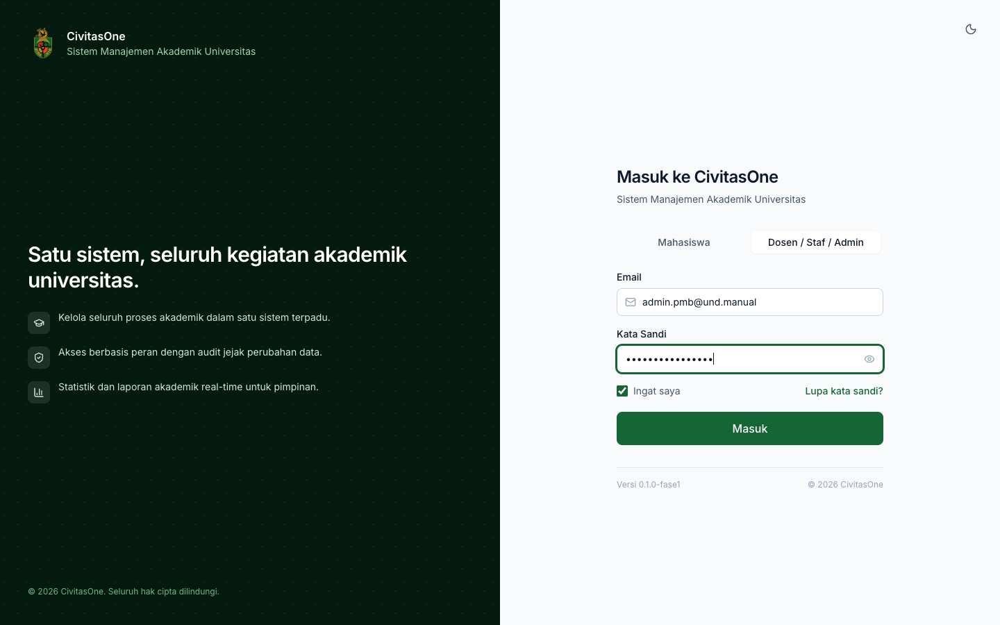

# 2. Akses, Peran, dan Hak Akses

[← Pengenalan](01-pengenalan.md) · [Daftar isi](README.md) · [Berikutnya: Alur Kerja & Kalender Panitia →](03-alur-kerja-panitia.md)

## 1. Alamat akses

| Pengguna | Alamat | Keterangan |
|---|---|---|
| Publik & pendaftar | `https://<domain-pmb-kampus>/pmb` | Kampus dikenali dari **domain** website. Bila website dibuka di alamat yang tidak dikenali, tambahkan `?kampus=KODE` (misalnya `?kampus=UND`). Tanpa itu muncul pesan *"Kampus tidak dapat ditentukan dari alamat ini…"*. |
| Pendaftar (portal) | `/pmb/masuk` → `/pmb/portal` | Sesi pendaftar terpisah dari sesi staf. Sesi berlaku 12 jam dan diperpanjang setiap kali dipakai. |
| Staf/panitia | `/login` → menu **PMB** & **Konfigurasi PMB** | Login staf Civitas One biasa. |

> **Catatan** — Pengaturan domain website PMB per kampus dilakukan oleh administrator sistem (lihat [Administrasi Sistem](50-administrasi-sistem.md#5-variabel-lingkungan-env)).

## 2. Login staf

1. Buka halaman `/login`.
2. Pilih tab **Dosen / Staf / Admin**.
3. Isi **Email** dan **Kata Sandi**, centang **Ingat saya** bila perlu, lalu klik **Masuk**.
4. Di sidebar, buka grup **PMB** (operasional) atau **Konfigurasi PMB** (pengaturan). Menu yang muncul menyesuaikan izin peran Anda.

*Gambar 2.1 — Login staf dengan tab "Dosen / Staf / Admin".*

*Gambar 2.2 — Grup menu **PMB** dan **Konfigurasi PMB** (contoh: Administrator PMB, yang melihat semua menu).*

## 3. Peran (role) PMB

Peran diberikan oleh administrator melalui **Pengaturan → Role Pengguna** (modul manajemen pengguna Civitas One). Peran khusus PMB dibuat oleh *seeder* peran (lihat [Administrasi Sistem](50-administrasi-sistem.md#2-data-awal-peran-dan-izin)).

| Peran (slug) | Nama di aplikasi | Tugas utama |
|---|---|---|
| `admission_administrator` | Administrator PMB | Konfigurasi periode/jalur/kuota/biaya/konten, pengelolaan pendaftar, ujian, pengumuman, daftar ulang (perpanjangan, konversi), komunikasi, audit. Langkah 1 pengesahan hasil (**Ketua Panitia PMB**). |
| `admission_verifier` | Petugas Verifikasi PMB | Memeriksa formulir & dokumen, minta perbaikan, menolak, memverifikasi; pendaftaran loket. |
| `admission_selection_committee` | Panitia Seleksi PMB | Skema seleksi, ujian, impor & kunci nilai, run seleksi, override, mengajukan pengesahan, koreksi hasil. |
| `admission_approver` | Pejabat Pengesah PMB | Mengesahkan hasil seleksi (langkah 2), koreksi hasil/nilai terkunci, perpanjangan massal, percepatan publikasi. |
| `admission_registrar` | Petugas Daftar Ulang PMB | Memeriksa & menyetujui daftar ulang, memantau konversi. |
| `finance_administrator` | (peran keuangan) | Tagihan, verifikasi bukti transfer, pembayaran loket, rekonsiliasi, pengajuan & persetujuan refund (**Kepala Keuangan**). |
| `lecturer` | Dosen | Sebagai penguji/pengawas: menilai peserta & mencatat kehadiran pada sesi yang ditugaskan. |
| `dean`, `head_of_study_program` | Dekan, Kaprodi | Melihat pendaftar, dokumen, daftar ulang, laporan **terbatas fakultas/prodinya**; mengubah profil prodi. |
| `rector`, `vice_rector` | Rektor, Wakil Rektor | Melihat dashboard & laporan. |
| `auditor` | Auditor | Membaca data, keuangan, hasil, daftar ulang, konversi, laporan, dan **audit**. |

> **Perlu konfirmasi** — Rancangan ([02 Q-ANN-01](../../pmb/02-asumsi-keputusan-pertanyaan.md)) menyarankan pengesah langkah 2 adalah WR I. Aplikasi memakai peran **Pejabat Pengesah PMB** (`admission_approver`); kampus menentukan siapa yang diberi peran ini.

## 4. Menu yang tampil per peran

Tanda ✓ = menu tampil. (B) = hanya membaca.

| Menu | Admin PMB | Verifikator | Panitia Seleksi | Pengesah | Petugas DU | Keuangan | Dosen | Dekan/Kaprodi | Rektor/WR | Auditor |
|---|---|---|---|---|---|---|---|---|---|---|
| PMB → Dashboard PMB | ✓ | ✓ | ✓ | ✓ | ✓ | ✓ | | ✓ | ✓ | ✓ |
| PMB → Pendaftar | ✓ | ✓ | ✓ | ✓ | ✓ | ✓ | | ✓ | | ✓ |
| PMB → Verifikasi | ✓ | ✓ | | | | | | | | |
| PMB → Keuangan PMB | ✓ (B) | ✓ (B) | | | ✓ (B) | ✓ | | | | ✓ (B) |
| PMB → Ujian | ✓ | | ✓ | | | | | | | |
| PMB → Penilaian Ujian | ✓ | | ✓ | | | | ✓ | | | |
| PMB → Seleksi | ✓ (B) | | ✓ | ✓ (B) | | | | | | ✓ (B) |
| PMB → Pengumuman | ✓ | ✓ (B) | ✓ | ✓ (B) | ✓ (B) | ✓ (B) | | ✓ (B) | | ✓ (B) |
| PMB → Daftar Ulang | ✓ | | | | ✓ | ✓ (B) | | ✓ (B) | | ✓ (B) |
| PMB → Komunikasi | ✓ | ✓ | | | ✓ | ✓ | | | | ✓ (log) |
| PMB → Laporan PMB | ✓ | ✓ | ✓ | ✓ | ✓ | ✓ | | ✓ | ✓ | ✓ |
| PMB → Audit PMB | ✓ | | | | | | | | | ✓ |
| Konfigurasi PMB (semua submenu) | ✓ | ✓ (B) | ✓ (B)¹ | ✓ (B) | ✓ (B) | ✓ (B) | | ✓ (B)² | ✓ (B) | ✓ (B) |
| Persetujuan | ✓ | | ✓ | ✓ | | ✓ | | | | |

¹ Panitia seleksi dapat membuat, mengubah, dan mengunci **Skema Seleksi**.
² Dekan/Kaprodi dapat mengubah **Profil Prodi** dalam cakupannya.

Menu yang tampil belum tentu berisi semua tombol: tombol aksi (misalnya **Publikasikan**, **Putuskan**, **Setujui**) hanya muncul bila Anda memiliki izin aksi tersebut. Pembatasan juga ditegakkan di server, sehingga menyembunyikan tombol bukan satu-satunya pengaman.

### Izin aksi penting

| Aksi | Izin | Dimiliki secara default oleh |
|---|---|---|
| Ubah konfigurasi / publikasi periode & template | `pmb_config.update` / `pmb_config.publish` | Admin PMB |
| Ubah komponen biaya | `pmb_fees.update` | Admin PMB |
| Buka data sensitif (NIK, dsb.) | `pmb_sensitive.read` | Admin PMB, Verifikator, Petugas DU, Auditor |
| Memutuskan verifikasi | `pmb_verification.approve` | Admin PMB, Verifikator |
| Menugaskan verifikator & verifikasi massal | `pmb_verification.update` | Admin PMB |
| Override verifikasi, duplikat, pemulihan akun | `pmb_verification.finalize` | Admin PMB |
| Verifikasi bukti transfer & pembayaran loket | `pmb_payments.approve` | Keuangan |
| Rekonsiliasi & resolusi pembayaran terlambat | `pmb_payments.finalize` | Keuangan |
| Mengajukan / menyetujui refund | `pmb_refunds.create` / `pmb_refunds.approve` | Keuangan |
| Menjalankan run & override | `pmb_selection.update` | Panitia Seleksi |
| Mengunci skema | `pmb_selection.finalize` | Admin PMB, Panitia Seleksi |
| Mengajukan pengesahan | `pmb_selection.publish` | Panitia Seleksi |
| Mengesahkan hasil | `pmb_results.approve` + peran langkah persetujuan | Pengesah (dan Admin PMB untuk langkah 1) |
| Promosi cadangan | `pmb_waitlist.update` | Admin PMB |
| Menyetujui daftar ulang | `pmb_reregistration.approve` | Petugas DU |
| Format NIM | `pmb_nim.update` | Admin PMB |
| Broadcast | `pmb_communication.publish` | Admin PMB |
| Ekspor laporan | `pmb_reports.export` | Admin PMB, Panitia Seleksi, Keuangan, Dekan/Kaprodi, Auditor |

## 5. Pemisahan tugas (separation of duties)

Aplikasi menolak tindakan berikut walaupun pengguna memiliki izinnya (pesan *"SELF_APPROVAL_FORBIDDEN"* atau penolakan sejenis):

| Aturan | Penerapan di aplikasi |
|---|---|
| Pengaju pengesahan hasil ≠ pengesah | Pengguna yang mengajukan run seleksi tidak dapat menyetujui langkah mana pun pada pengajuan tersebut. |
| Pengaju refund ≠ penyetuju refund; verifikator bukti bayar ≠ penyetuju refund transaksi yang sama | Diterapkan pada persetujuan refund. |
| Pengaju koreksi hasil/nilai, pembatalan penerimaan, perpanjangan massal, percepatan publikasi ≠ penyetuju | Diterapkan pada semua pengajuan perubahan. |
| Verifikator bukti bayar biaya awal ≠ penyetuju daftar ulang aplikasi yang sama | Tombol **Setujui** daftar ulang ditolak untuk petugas tersebut. |

Sumber: [08 §4](../../pmb/08-rbac.md).

## 6. Cakupan (scope) data

Peran yang diberikan dengan cakupan **fakultas** atau **program studi** (misalnya Dekan, Kaprodi) hanya melihat pendaftar, keputusan, daftar ulang, dan laporan yang berhubungan dengan prodi dalam cakupannya. Data di luar cakupan diperlakukan seperti tidak ada (halaman *tidak ditemukan*).

## 7. Data sensitif dan jejak akses

- NIK, nomor paspor, nama ibu kandung, catatan kebutuhan khusus, nomor KIP, nomor rekening refund, dan isian formulir bertanda sensitif ditampilkan **tersamar** (contoh `************0013`).
- Pengguna dengan izin `pmb_sensitive.read` dapat menekan ikon mata di samping nilai tersamar, mengisi **Tujuan akses**, lalu **Buka**. Setiap pembukaan tercatat (pengguna, waktu, tujuan, IP) dan dapat dilihat auditor di **Audit PMB → Akses data sensitif**.
- Unduhan dokumen pendaftar memakai tautan bertanda tangan yang berlaku singkat (±5 menit) dan dicatat.
- Ekspor laporan berisi data pribadi wajib disertai alasan dan tercatat.

---

[← Pengenalan](01-pengenalan.md) · [Daftar isi](README.md) · [Berikutnya: Alur Kerja & Kalender Panitia →](03-alur-kerja-panitia.md)
