# 10. Website PMB (Publik)

[← Alur Kerja Panitia](03-alur-kerja-panitia.md) · [Daftar isi](README.md) · [Berikutnya: Akun Pendaftar →](11-akun-pendaftar.md)

**Untuk:** calon mahasiswa, orang tua, masyarakat umum. **Tanpa login.**
**Alamat:** `/pmb` pada domain website PMB kampus.

Website PMB menampilkan informasi yang dikelola panitia: gelombang dan jadwal, jalur masuk, program studi, biaya, panduan, FAQ, berita, dan kontak. Semua isi berasal dari konfigurasi dan konten yang **sudah dipublikasikan** di Admin PMB.

## 1. Menu website

Menu di bagian atas: **Prodi · Jalur · Biaya · Jadwal · Panduan · FAQ · Berita · Cek Status · Kontak**, serta tombol **Masuk** dan **Daftar** (berubah menjadi **Portal Saya** bila Anda sudah masuk). Kaki halaman memuat alamat, telepon, email, jam layanan panitia, serta tautan **Kebijakan Privasi**, **Ketentuan Pendaftaran**, **Info Daftar Ulang**, dan **Cek Status Pendaftaran**.

## 2. Beranda

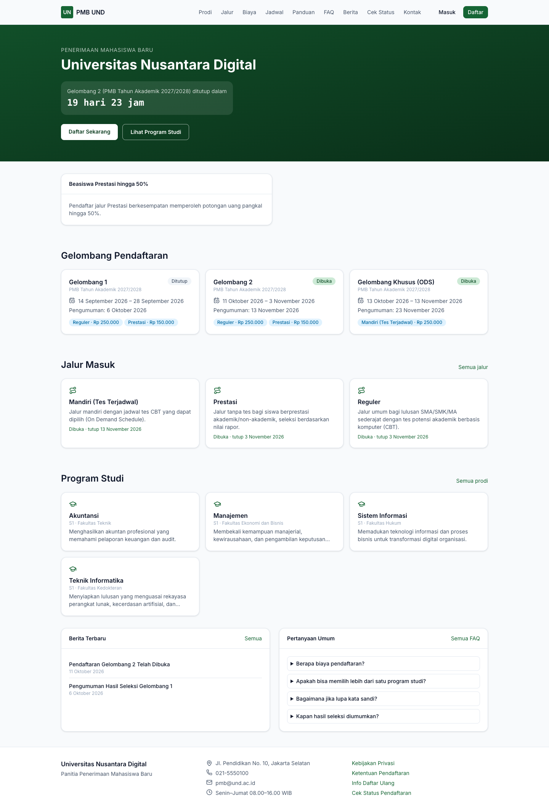
*Gambar 10.1 — Beranda: hitung mundur gelombang yang sedang dibuka, banner, kartu gelombang, jalur masuk, program studi, berita, dan FAQ ringkas.*

| Bagian | Isi |
|---|---|
| Hero | Nama kampus, hitung mundur penutupan gelombang yang **Dibuka**. Bila belum ada yang dibuka, tampil tanggal pembukaan gelombang berikutnya atau pesan *"Pendaftaran belum dibuka. Pantau jadwal pada halaman Jadwal."* |
| Tombol | **Daftar Sekarang** (ke pendaftaran akun) dan **Lihat Program Studi**. |
| Banner | Konten bertipe *Banner beranda* yang sedang tayang. |
| Gelombang Pendaftaran | Kartu per gelombang: status (**Dibuka**/**Segera**/**Ditutup**), rentang pendaftaran, tanggal pengumuman, dan jalur beserta biaya pendaftarannya. |
| Jalur Masuk / Program Studi | Ringkasan jalur dan (maksimal 6) prodi; klik untuk detail. |
| Berita Terbaru / Pertanyaan Umum | 4 berita terbaru dan 5 FAQ (klik pertanyaan untuk membuka jawaban). |

Tampilan ponsel menyesuaikan lebar layar; menu dibuka dengan ikon ☰.

| | |
|---|---|
| 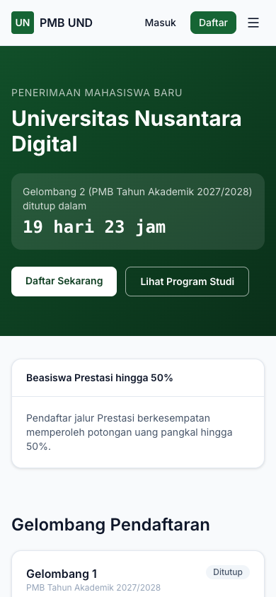 | 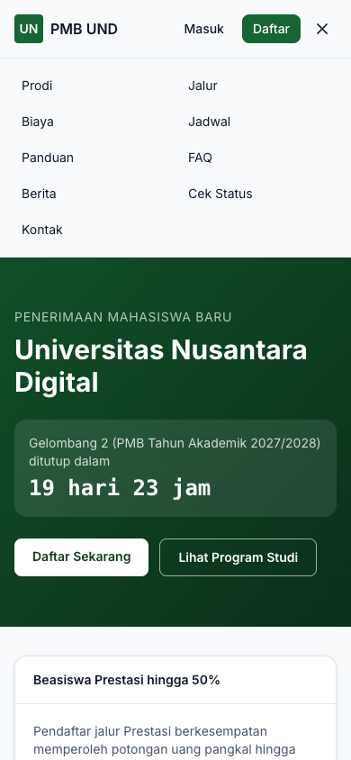 |

*Gambar 10.2 — Beranda dan menu pada layar ponsel.*

## 3. Program Studi

Menu **Prodi** menampilkan semua prodi yang profilnya dipublikasikan. Gunakan **Cari**, **Jenjang**, dan **Fakultas** untuk menyaring.

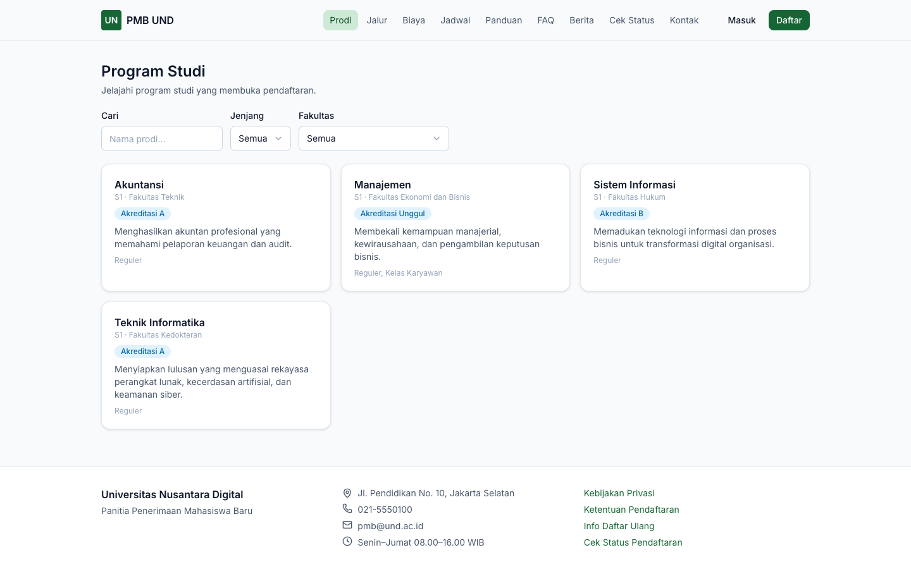
*Gambar 10.3 — Daftar program studi.*

Klik sebuah prodi untuk melihat ringkasan, deskripsi, prospek karier, rincian biaya per sistem kuliah, akreditasi, gelar, lama studi, brosur (bila ada), dan **jalur yang membuka** prodi tersebut. Bila kampus mengaktifkan pengaturan *tampilkan status kuota*, setiap jalur diberi label **Kuota tersedia**, **Kuota terbatas**, atau **Kuota penuh** (angka kuota tidak ditampilkan). Tombol **Daftar ke prodi ini** mengarah ke pendaftaran akun.

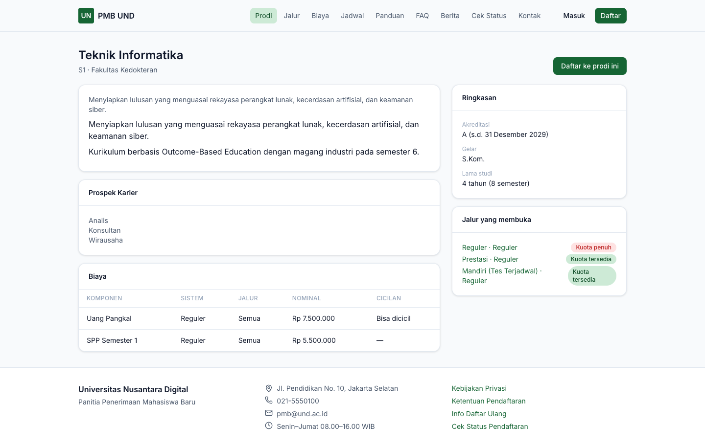
*Gambar 10.4 — Detail program studi.*

## 4. Jalur Masuk

Menu **Jalur** menampilkan jalur aktif beserta gelombang yang sedang dibuka (biaya dan tanggal tutup).

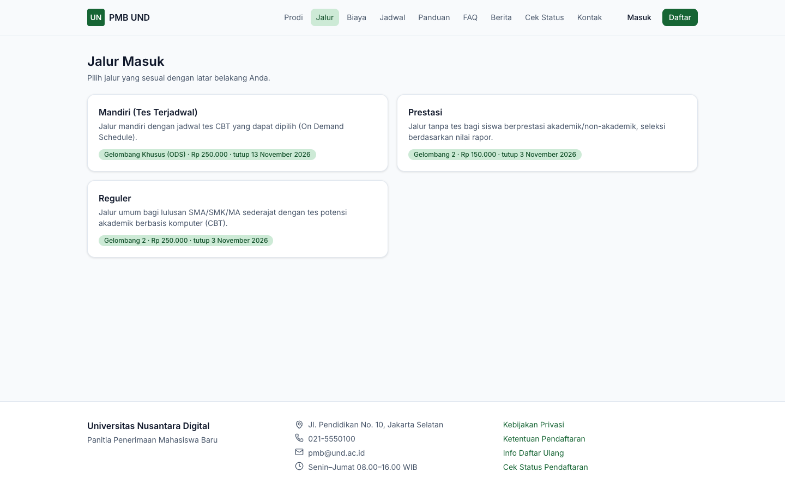
*Gambar 10.5 — Daftar jalur masuk.*

Halaman detail jalur menjelaskan apakah jalur mensyaratkan ujian, jenjang yang dibuka, dan untuk **setiap gelombang**: rentang pendaftaran, tanggal pengumuman, biaya pendaftaran, maksimal pilihan prodi, komponen seleksi, catatan panitia, serta **persyaratan dokumen** (wajib/opsional, tahap pendaftaran/daftar ulang, format, ukuran maksimal, instruksi).

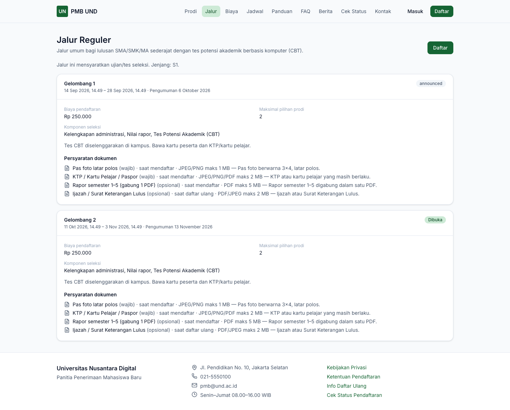
*Gambar 10.6 — Detail jalur Reguler dengan persyaratan dokumen per gelombang.*

## 5. Biaya

Pilih **Program studi** dan **Sistem kuliah** untuk melihat komponen biaya awal (misalnya Uang Pangkal dan SPP Semester 1), nominal, dan skema cicilan (misalnya `50% + 50%`). Bila keduanya dipilih, tampil **Total biaya awal**.

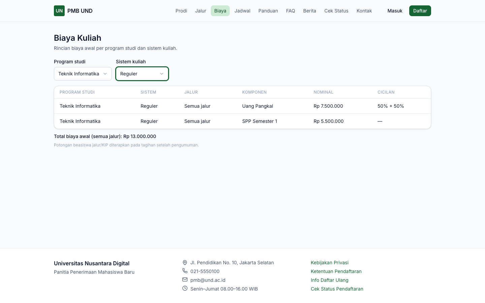
*Gambar 10.7 — Rincian biaya per prodi dan sistem kuliah.*

> **Catatan** — Potongan beasiswa jalur masuk/KIP diterapkan pada tagihan setelah pengumuman, tidak pada halaman ini.

## 6. Jadwal

Menampilkan linimasa setiap gelombang: **Pendaftaran**, **Batas pembayaran**, **Ujian** (atau *Tanpa ujian* / *Sesuai jadwal ODS*), **Pengumuman**, dan **Daftar ulang**. Tombol **Tambahkan ke kalender** mengunduh berkas `jadwal-pmb.ics` yang dapat diimpor ke Google Calendar/Outlook.

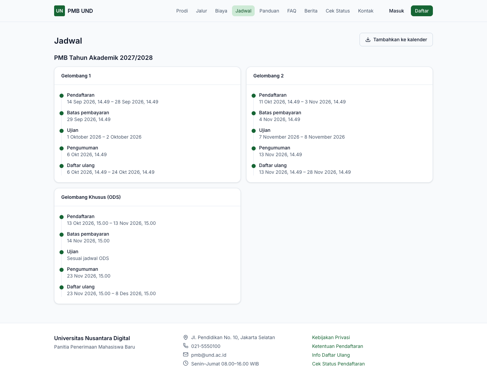
*Gambar 10.8 — Jadwal per gelombang.*

## 7. Panduan, FAQ, dan Berita

- **Panduan**: daftar artikel panduan; klik untuk membaca.
- **FAQ**: pertanyaan dikelompokkan per kategori; klik pertanyaan untuk membuka jawaban. Kotak **Cari…** (tekan Enter) menyaring isi.
- **Berita**: daftar berita terbaru; klik untuk membaca.

| | |
|---|---|
| 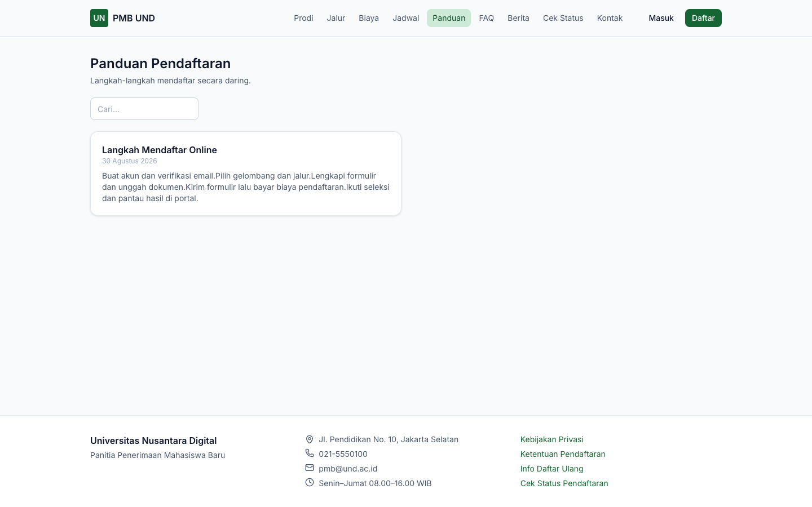 | 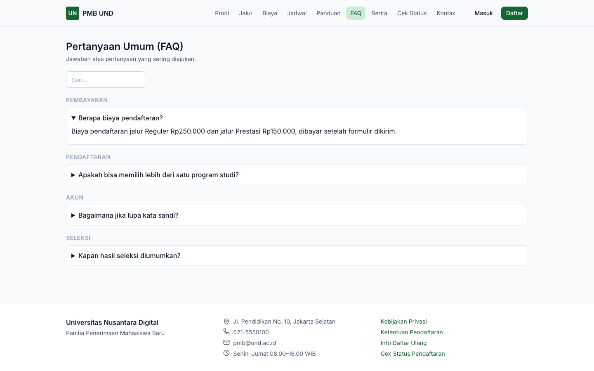 |

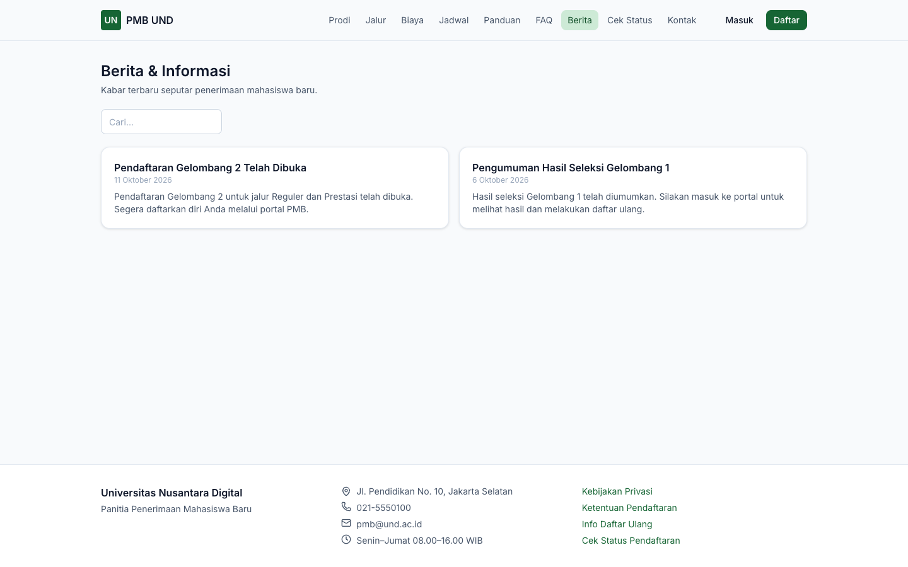
*Gambar 10.9 — Panduan, FAQ, dan Berita.*

## 8. Cek Status & Hasil Seleksi (tanpa login)

Untuk mengecek status pendaftaran tanpa masuk portal:

1. Buka **Cek Status**.
2. Isi **Nomor pendaftaran** (huruf otomatis kapital) dan **Tanggal lahir** sesuai data pendaftaran.
3. Selesaikan CAPTCHA bila ditampilkan, lalu klik **Cek**.
4. Hasil menampilkan **Tahap saat ini**, **Hasil seleksi** (atau *Belum diumumkan*), dan program studi bila diterima.

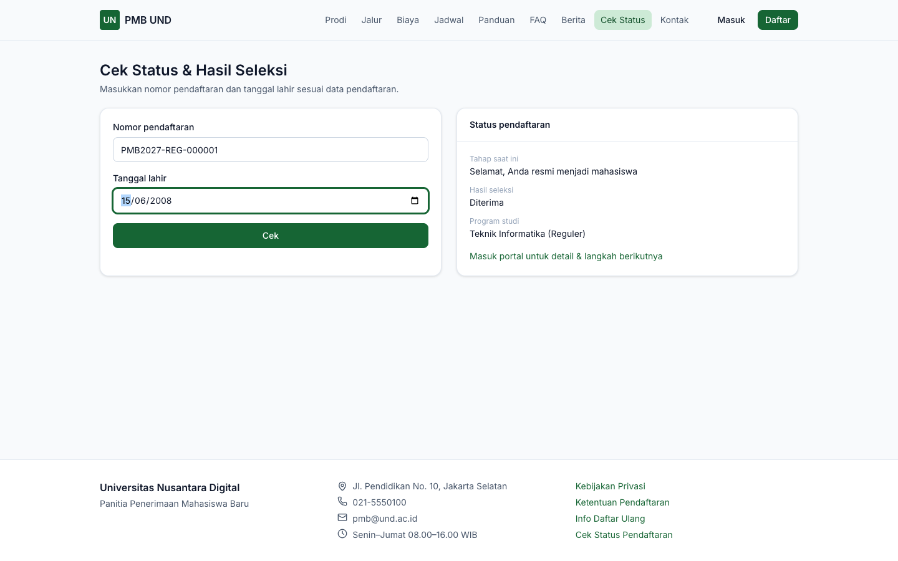
*Gambar 10.10 — Cek status dengan nomor pendaftaran dan tanggal lahir.*

> **Catatan** — Nomor pendaftaran berformat `<kode periode>-<kode jalur>-<urut>`, contoh `PMB2027-REG-000001` (tertera di portal setelah formulir dikirim). Contoh pada kotak isian (`PMB27-G1-REG-00001`) hanyalah contoh tampilan dan tidak sama dengan format sebenarnya.
>
> Pengecekan dibatasi 5 kali per menit dari satu alamat internet. Bila muncul *"Terlalu banyak percobaan"*, tunggu satu menit.

## 9. Info Daftar Ulang, Kontak, dan Dokumen Legal

- **Info Daftar Ulang** (`/pmb/daftar-ulang`): tata cara daftar ulang yang ditulis panitia, dengan tombol **Masuk portal**.
- **Kontak**: alamat, telepon, WhatsApp (membuka `wa.me`), email, jam layanan, dan peta (bila diatur). Pendaftar yang sudah punya akun disarankan bertanya lewat **Pesan** di portal.
- **Kebijakan Privasi** dan **Ketentuan Pendaftaran** (`/pmb/legal/privacy_policy`, `/pmb/legal/terms`): versi yang berlaku ditampilkan beserta nomor versinya.

| | |
|---|---|
| 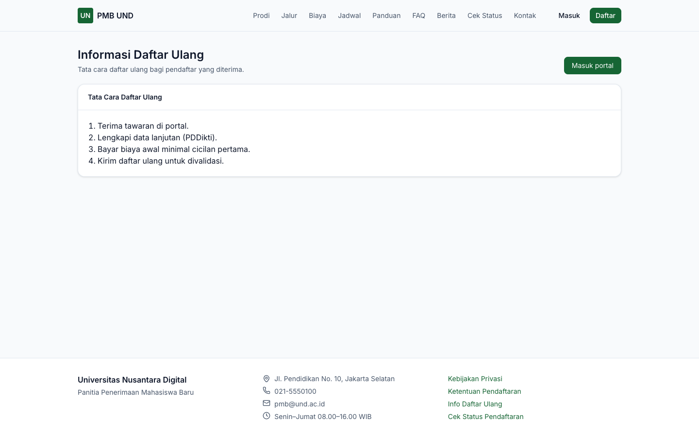 | 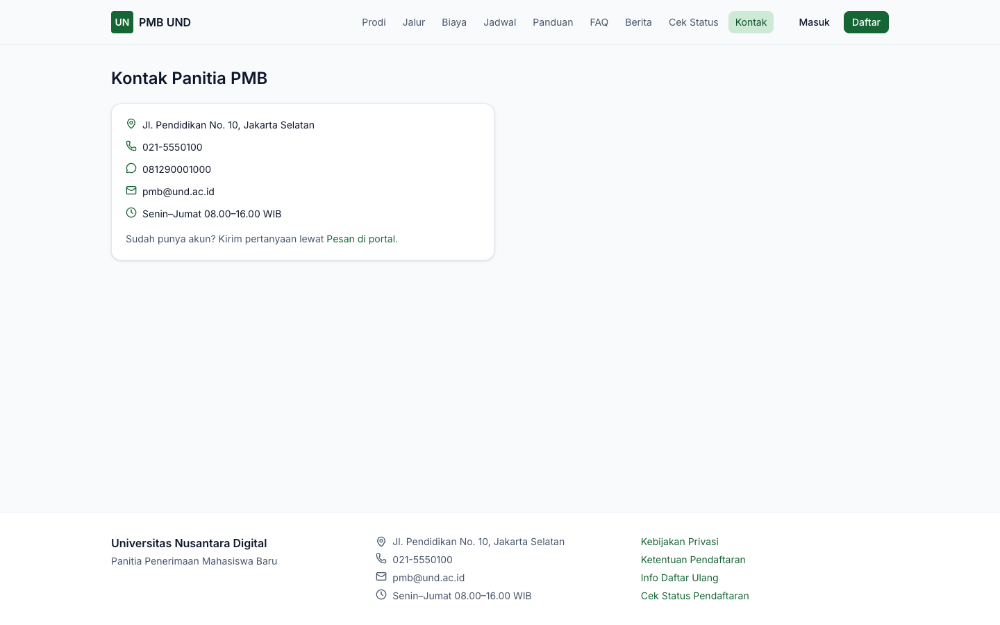 |

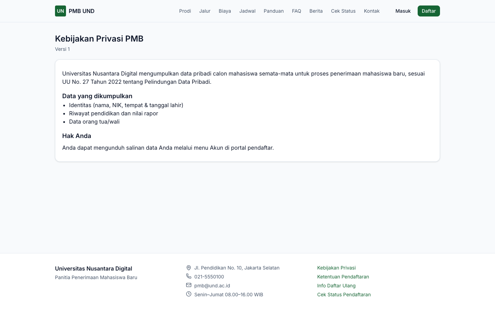
*Gambar 10.11 — Info daftar ulang, kontak panitia, dan kebijakan privasi.*

## 10. Verifikasi Surat Penerimaan (LoA)

Setiap surat penerimaan (LoA) memuat kode QR. Memindai QR membuka halaman `/pmb/verifikasi-loa/<kode>` yang menampilkan apakah surat **asli dan berlaku**, **telah DICABUT**, atau **tidak berlaku**, beserta nomor surat, nama (tersamar), prodi, sistem kuliah, dan tanggal terbit. Pihak ketiga (sekolah, instansi) dapat memakai halaman ini untuk memastikan keaslian surat.

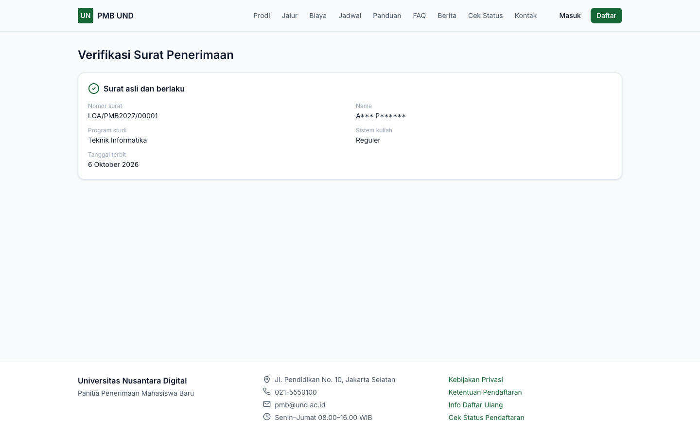
*Gambar 10.12 — Hasil verifikasi surat penerimaan yang asli.*

Bila kode tidak dikenal, tampil *"Kode verifikasi tidak dikenal. Surat ini tidak diterbitkan oleh sistem PMB kami."*

---

[← Alur Kerja Panitia](03-alur-kerja-panitia.md) · [Daftar isi](README.md) · [Berikutnya: Akun Pendaftar →](11-akun-pendaftar.md)
