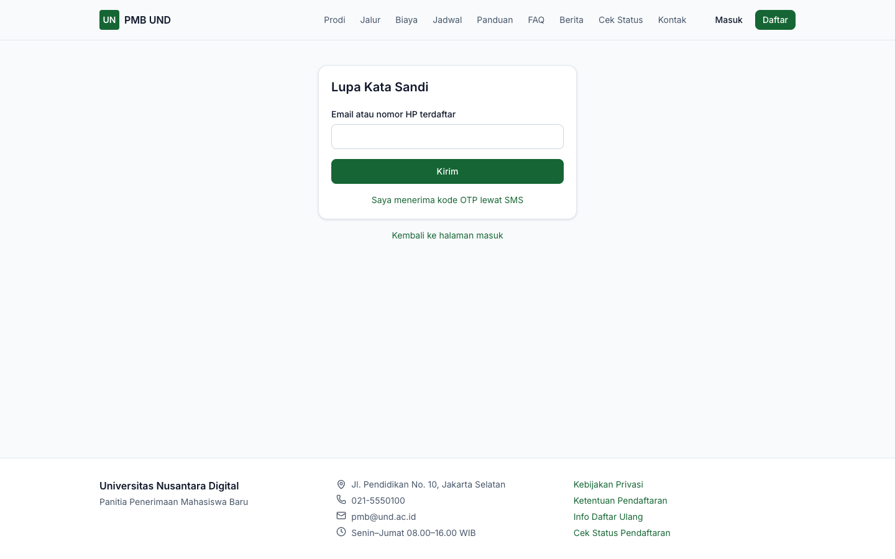
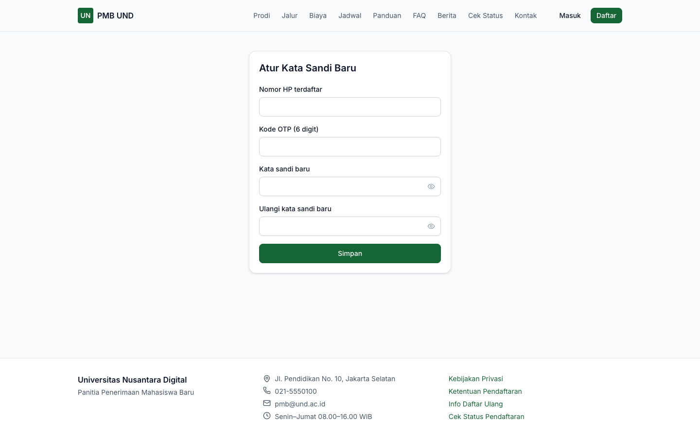
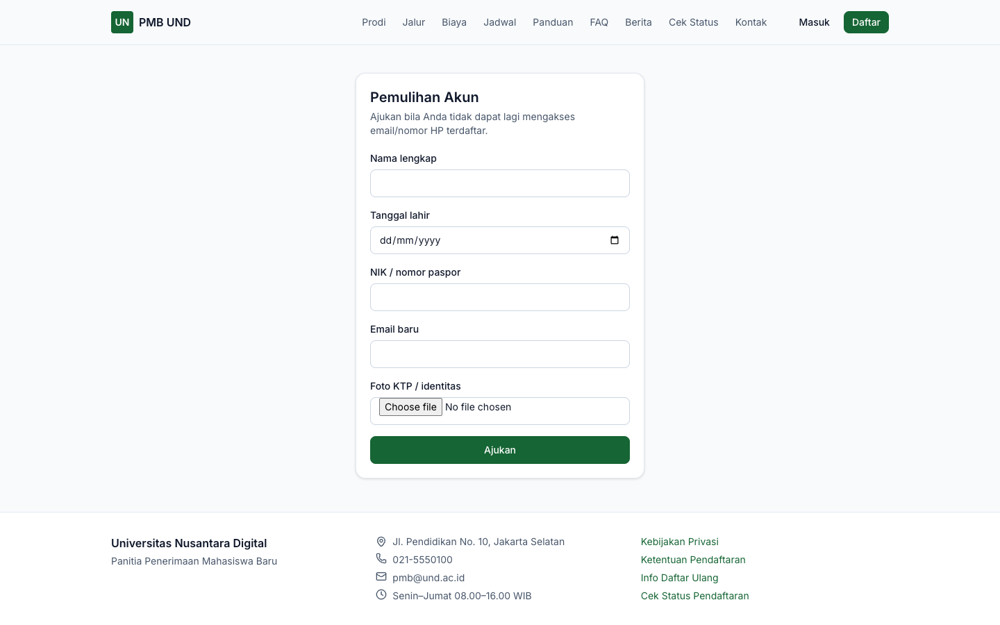

# 11. Akun Pendaftar

[← Website PMB](10-website-pmb.md) · [Daftar isi](README.md) · [Berikutnya: Portal & Formulir Pendaftaran →](12-formulir-pendaftaran.md)

**Untuk:** calon mahasiswa. Satu akun dipakai untuk semua pendaftaran Anda di kampus tersebut.

## 1. Membuat akun

1. Klik **Daftar** di website PMB (atau buka `/pmb/daftar`).
2. Isi formulir:

| Field | Keterangan |
|---|---|
| **Nama lengkap (sesuai ijazah)** | Wajib, minimal 3 karakter. Tulis persis seperti di ijazah/rapor. |
| **Email** | Wajib. Tautan verifikasi dikirim ke email ini; email juga dipakai untuk masuk. |
| **Nomor HP (WhatsApp)** | Opsional. Contoh `081234567890`. Dapat dipakai untuk masuk dan verifikasi lewat SMS bila kampus mengaktifkan SMS. |
| **Kata sandi** | Wajib, minimal 8 karakter berisi huruf dan angka. Indikator di bawahnya menunjukkan kekuatan sandi (*Sangat lemah* … *Sangat kuat*). |
| **Ulangi kata sandi** | Harus sama. |
| **Dari mana Anda mengetahui PMB kami?** | Opsional (website kampus, media sosial, kunjungan sekolah, pameran, teman/keluarga, alumni, portal MauKuliah, mesin pencari, lainnya). |
| **Saya menyetujui Kebijakan Privasi** / **Ketentuan Pendaftaran** | Wajib dicentang; tombol **Daftar** baru aktif setelah keduanya dicentang. Tautan *Baca…* membuka dokumennya. |
| **Saya bersedia menerima informasi promosi** | Opsional. Dapat diubah kapan saja di menu **Akun**. |

3. Selesaikan CAPTCHA bila ditampilkan, lalu klik **Daftar**.

*Gambar 11.1 — Formulir pembuatan akun pendaftar.*

4. Muncul halaman **Cek email Anda**. Buka email, klik tautan verifikasi (**berlaku 24 jam**).

*Gambar 11.2 — Konfirmasi setelah mendaftar.*

> **Catatan** — Demi keamanan, pesan yang sama ditampilkan walaupun email sudah pernah terdaftar. Bila Anda sudah punya akun, gunakan **Masuk** atau **Lupa kata sandi**. Pembuatan akun dibatasi 5 kali per jam dari satu alamat internet.

## 2. Verifikasi akun

- Klik tautan pada email verifikasi. Halaman **Verifikasi Akun** menampilkan *"Akun Anda aktif…"*, lalu klik **Masuk**.
- Bila tautan kedaluwarsa, masuk ke portal; di Beranda tampil peringatan **Akun belum terverifikasi** dengan tombol **Kirim ulang email verifikasi**.
- Bila Anda mengisi nomor HP dan kampus mengaktifkan SMS, tersedia **Verifikasi lewat SMS**: klik, isi **Kode OTP** 6 digit yang diterima, lalu **Verifikasi**.

*Gambar 11.3 — Peringatan akun belum terverifikasi di Beranda portal.*

> **Penting** — Akun yang belum terverifikasi **tidak dapat membuat pendaftaran** (tombol **Daftar jalur ini** nonaktif).

> **Perlu konfirmasi** — Pengiriman SMS/WhatsApp membutuhkan penyedia SMS yang dikonfigurasi kampus. Tanpa penyedia, kode OTP tidak terkirim ke ponsel (lihat [lampiran 61](61-hal-perlu-konfirmasi.md)).

## 3. Masuk (login)

1. Klik **Masuk** atau buka `/pmb/masuk`.
2. Isi **Email atau nomor HP** dan **Kata sandi**, lalu klik **Masuk**.
3. Anda diarahkan ke **Portal PMB** (atau ke halaman yang tadi ingin dibuka).

*Gambar 11.4 — Halaman Masuk Portal PMB.*

- Sesi berlaku **12 jam** sejak terakhir dipakai. Setelah itu Anda diminta masuk lagi.
- Percobaan masuk dibatasi (10 kali per menit dari satu alamat internet).
- Klik **Keluar** di pojok kanan atas portal untuk mengakhiri sesi. Sesi di perangkat lain dapat dicabut dari menu **Akun** (lihat [bab 16](16-pesan-notifikasi-akun.md#3-akun--keamanan)).

## 4. Lupa kata sandi

**Lewat email:**

1. Di halaman Masuk klik **Lupa kata sandi?**.
2. Isi **Email atau nomor HP terdaftar**, selesaikan CAPTCHA bila ada, klik **Kirim**.
3. Buka tautan dari email. Pada halaman **Atur Kata Sandi Baru**, isi **Kata sandi baru** dan **Ulangi kata sandi baru**, klik **Simpan**.

**Lewat kode OTP SMS** (bila kampus mengaktifkan SMS):

1. Pada halaman Lupa Kata Sandi klik **Saya menerima kode OTP lewat SMS**.
2. Isi **Nomor HP terdaftar**, **Kode OTP (6 digit)**, kata sandi baru dua kali, lalu **Simpan**.

| | |
|---|---|
|  |  |

*Gambar 11.5 — Lupa kata sandi dan atur kata sandi dengan kode OTP.*

> **Catatan** — Respons *"Jika akun terdaftar, tautan atau kode pengaturan ulang telah dikirim."* selalu sama, walaupun data tidak terdaftar.

## 5. Pemulihan akun (tidak bisa mengakses email/HP)

Gunakan bila Anda kehilangan akses ke email **dan** nomor HP terdaftar.

1. Di halaman Masuk klik **Tidak bisa akses email?**.
2. Isi **Nama lengkap**, **Tanggal lahir**, **NIK / nomor paspor**, **Email baru**, dan unggah **Foto KTP / identitas** (JPG, PNG, atau PDF).
3. Klik **Ajukan**.

*Gambar 11.6 — Formulir pemulihan akun.*

Panitia mencocokkan data dengan foto identitas (lihat [Verifikasi → Pemulihan akun](32-verifikasi-administrasi.md#7-indikasi-duplikat-dan-pemulihan-akun-admin-pmb)). Bila disetujui, email akun diganti dan tautan pengaturan kata sandi dikirim ke **email baru**. Target pemrosesan yang ditampilkan aplikasi: maksimal 2 hari kerja.

## 6. Akun dibuatkan panitia (pendaftaran loket)

Bila Anda mendaftar dengan bantuan panitia di kampus, panitia membuat akun atas nama Anda. Tautan aktivasi dan pengaturan kata sandi dikirim ke email Anda; setelah mengatur sandi, Anda dapat masuk dan melanjutkan sendiri seperti biasa.

---

[← Website PMB](10-website-pmb.md) · [Daftar isi](README.md) · [Berikutnya: Portal & Formulir Pendaftaran →](12-formulir-pendaftaran.md)
