# 12. Portal & Formulir Pendaftaran

[← Akun Pendaftar](11-akun-pendaftar.md) · [Daftar isi](README.md) · [Berikutnya: Dokumen & Pembayaran →](13-dokumen-dan-pembayaran.md)

**Untuk:** calon mahasiswa yang sudah memiliki akun terverifikasi.

## 1. Mengenal Portal PMB

Menu portal: **Beranda · Profil · Daftar Baru · Pesan · Notifikasi · Akun**, nama Anda, dan **Keluar**.

**Beranda** menampilkan kartu untuk setiap pendaftaran Anda:

- judul jalur & gelombang, periode, nomor pendaftaran (setelah dikirim), dan label **tahap saat ini**;
- linimasa *Isi formulir → Pembayaran → Verifikasi → Seleksi → Pengumuman → Daftar ulang → Mahasiswa* (langkah yang sudah lewat bertanda ✓);
- label status formulir, pembayaran (*Bayar: belum/lunas/tidak perlu*), verifikasi, dan pilihan prodi pertama;
- batas waktu (*Kirim formulir sebelum…* atau *Perbaiki data/dokumen sebelum…*);
- tombol menuju langkah berikutnya: **Lanjutkan formulir** / **Lihat formulir**, **Ujian & kartu peserta** (setelah terverifikasi), **Hasil seleksi** (setelah diumumkan), **Daftar ulang**.

| | |
|---|---|
| 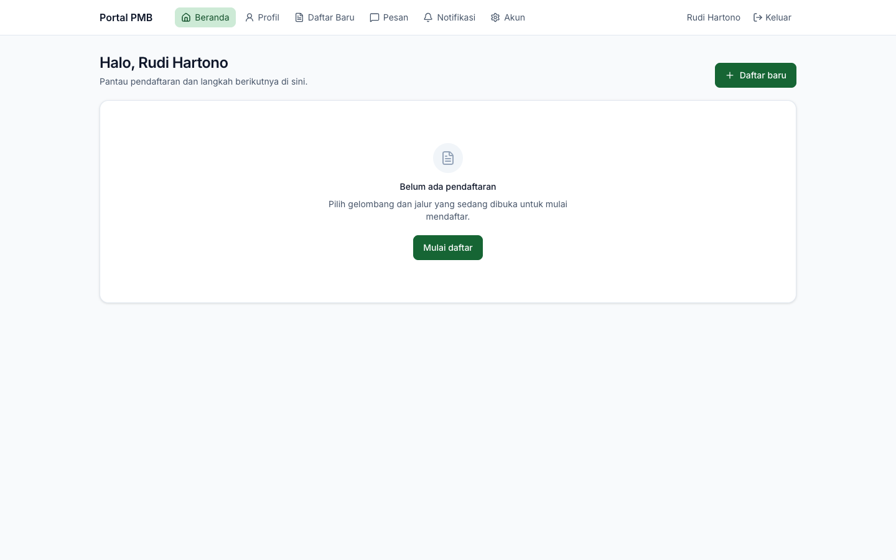 | 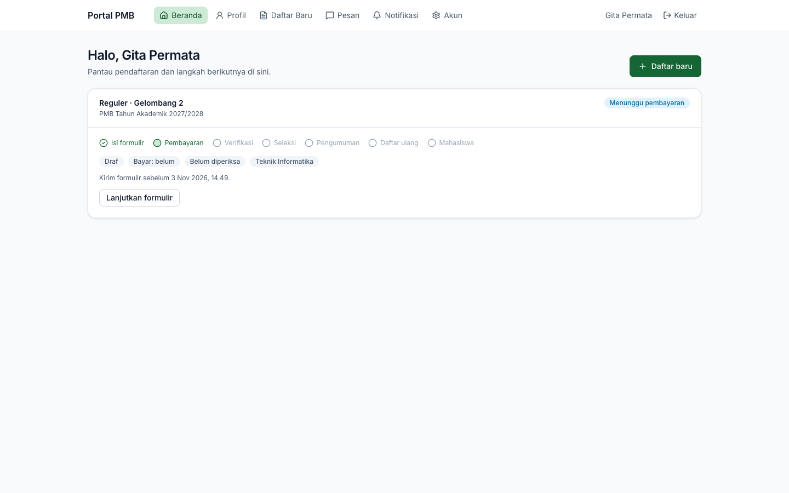 |

*Gambar 12.1 — Beranda portal: belum ada pendaftaran (kiri) dan dengan satu draf (kanan).*

## 2. Profil & data diri

Menu **Profil** berisi data yang **dipakai ulang oleh semua pendaftaran** Anda, dalam empat tab: **Identitas**, **Pendidikan**, **Orang tua / wali**, **Prestasi**. Data yang sama juga dapat diisi dari dalam formulir (lihat §4), sehingga Anda tidak perlu mengisinya dua kali.

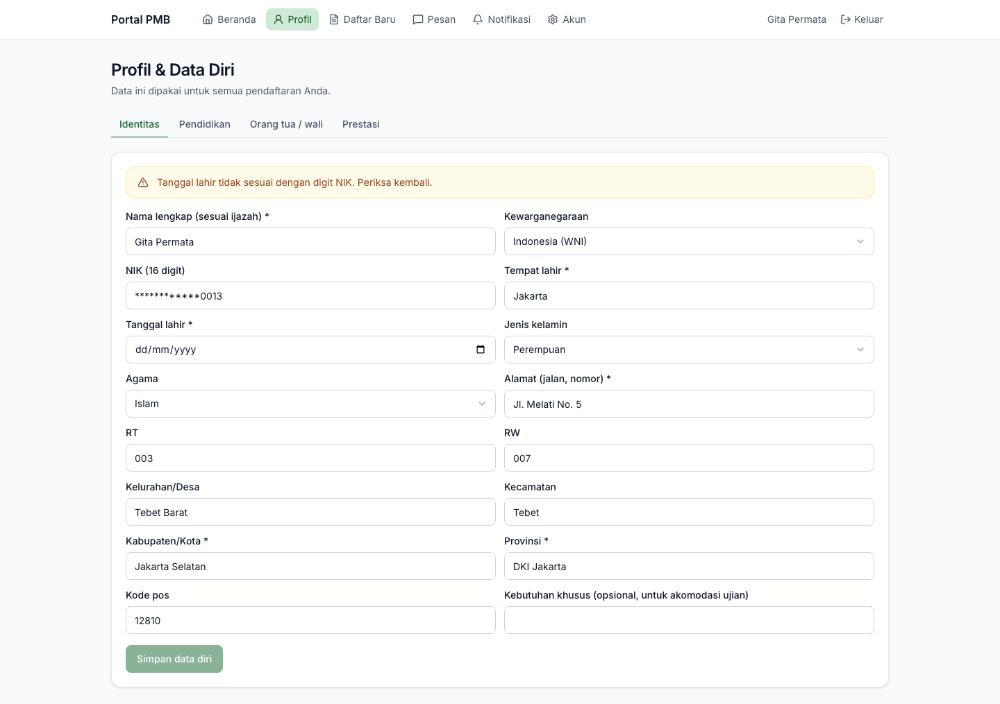
*Gambar 12.2 — Tab Identitas pada Profil.*

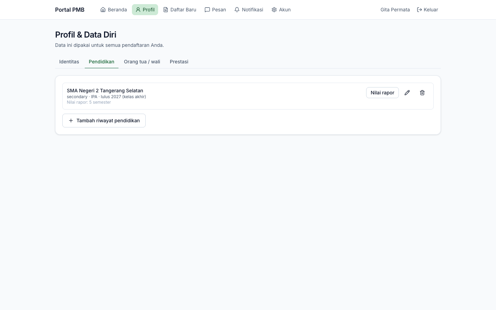
*Gambar 12.3 — Tab Pendidikan pada Profil.*

## 3. Memilih gelombang & jalur (membuat pendaftaran)

1. Klik **Daftar Baru** (atau **Daftar baru** di Beranda).
2. Halaman **Pilih Gelombang & Jalur** menampilkan **hanya jalur yang sedang dibuka**: deskripsi, biaya pendaftaran beserta waktu bayarnya (*sebelum*/*setelah* kirim formulir), maksimal pilihan prodi, tanggal tutup, dan catatan panitia.
3. Klik **Daftar jalur ini** pada jalur yang dipilih. Draf pendaftaran dibuat dan Anda langsung masuk ke formulir.

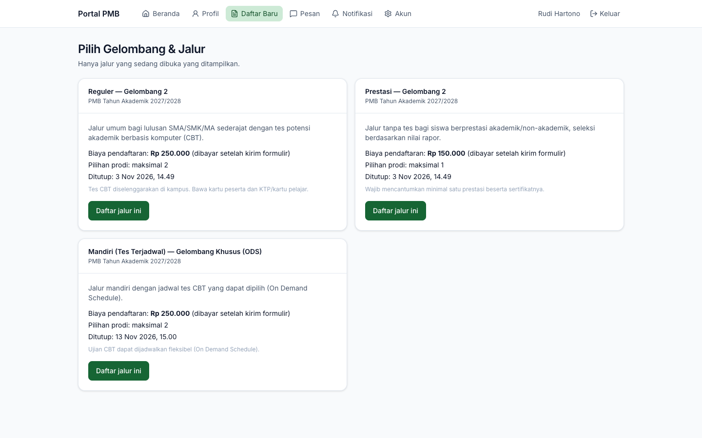
*Gambar 12.4 — Pilihan gelombang & jalur yang sedang dibuka.*

> **Penting** — Secara default, satu akun hanya boleh memiliki **1 pendaftaran aktif per periode** (dapat diubah panitia lewat pengaturan). Bila batas tercapai, kartu jalur menampilkan alasan dan tombol **Daftar jalur ini** nonaktif. Tombol juga nonaktif bila akun belum terverifikasi.

> **Perlu konfirmasi** — Rancangan ([02 Q-CFG-05](../../pmb/02-asumsi-keputusan-pertanyaan.md)) menyarankan maksimal 2 aplikasi aktif; implementasi memakai default 1 (keputusan F1 di [16 §2](../../pmb/16-catatan-implementasi.md)). Kampus menetapkan nilai akhirnya.

## 4. Mengisi formulir

Formulir terdiri dari tujuh langkah di sisi kiri. Ikon ✓ hijau berarti langkah sudah lengkap; ikon ⚠ kuning berarti masih ada yang kurang. Klik nama langkah untuk berpindah. Bila langkah belum lengkap, kotak **Belum lengkap** di atas isian menyebutkan apa yang kurang.

> **Penting** — Setiap langkah memiliki tombol simpan sendiri (**Simpan data diri**, **Simpan pilihan**, **Simpan data pendukung**, dst.). **Simpan setiap langkah sebelum berpindah**; perubahan yang belum disimpan hilang bila halaman ditutup.

> **Catatan** — Bila formulir yang sama dibuka di dua tab/perangkat dan salah satunya menyimpan lebih dulu, penyimpanan berikutnya ditolak dengan pesan *"Data telah diubah di tab/perangkat lain. Muat ulang."* Muat ulang halaman, lalu ulangi perubahan Anda.

### 4.1 Data diri

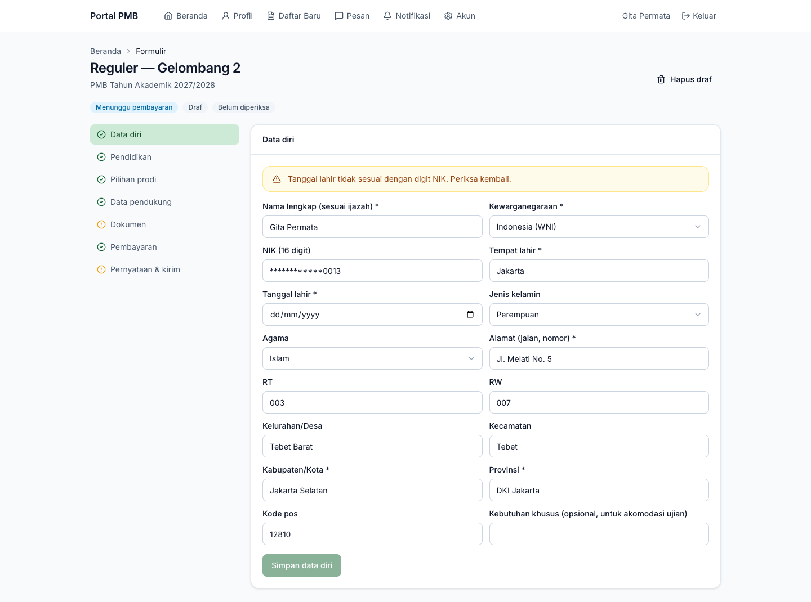
*Gambar 12.5 — Langkah Data diri.*

| Field | Keterangan |
|---|---|
| **Nama lengkap (sesuai ijazah)** | Wajib. |
| **Kewarganegaraan** | *Indonesia (WNI)* atau negara lain. Menentukan isian NIK atau paspor. |
| **NIK (16 digit)** | Untuk WNI. Ditampilkan tersamar (contoh `************0013`). Untuk mengganti, klik kolomnya (isi lama dikosongkan) lalu ketik NIK lengkap. |
| **Nomor paspor**, **Negara penerbit paspor** | Untuk WNA (kode negara 2 huruf). |
| **Tempat lahir**, **Tanggal lahir** | Wajib. |
| **Jenis kelamin**, **Agama** | Sesuai aturan template formulir jalur. |
| **Alamat (jalan, nomor)**, RT, RW, Kelurahan/Desa, Kecamatan, **Kabupaten/Kota**, **Provinsi**, Kode pos | Alamat tinggal. |
| **Kebutuhan khusus** | Opsional, untuk akomodasi saat ujian. Diperlakukan sebagai data sensitif. |

Tanda `*` menunjukkan field wajib; panitia dapat menjadikan field lain wajib, opsional, atau disembunyikan per jalur melalui template formulir. Klik **Simpan data diri** (aktif bila ada perubahan).

- Bila digit tanggal lahir pada NIK tidak cocok dengan **Tanggal lahir** (untuk perempuan, tanggal pada NIK ditambah 40), muncul peringatan kuning *"Tanggal lahir tidak sesuai dengan digit NIK. Periksa kembali."* Peringatan ini tidak menghalangi penyimpanan, tetapi akan diperiksa verifikator.
- Setelah formulir dikirim, identitas **terkunci** (*"Identitas terkunci setelah pendaftaran terkirim. Hubungi panitia untuk koreksi."*). Perubahan hanya dapat dilakukan bila panitia meminta perbaikan, atau dikoreksi panitia.

> **Kendala diketahui** — Pada versi ini kolom **Tanggal lahir** dapat tampak kosong (`dd/mm/yyyy`) walaupun tanggal lahir sudah tersimpan. Data tetap tersimpan selama kolom tersebut tidak diubah. Bila Anda mengisinya ulang, pastikan tanggalnya benar. Lihat [lampiran 61](61-hal-perlu-konfirmasi.md#2-kendala-yang-diketahui-pada-implementasi).

### 4.2 Pendidikan

1. Klik **Tambah riwayat pendidikan**, isi data sekolah/perguruan tinggi asal, lalu **Simpan**.

| Field | Keterangan |
|---|---|
| **Jenjang** | SMA/SMK/MA sederajat, Diploma, Sarjana, Magister. |
| **Nama sekolah/perguruan tinggi** | Wajib. |
| NPSN (8 digit), Jenis sekolah, Jurusan, Tahun lulus, Kota, Provinsi | Data sekolah. |
| **Masih kelas akhir (belum lulus)** | Centang bila belum lulus. |
| NISN (10 digit) | Untuk jenjang SMA sederajat. |
| NIM asal, IPK, SKS ditempuh | Untuk pendaftar pindahan/lanjutan (jenjang selain SMA). |

2. Untuk jenjang SMA sederajat, klik **Nilai rapor** dan isi nilai semester 1–5 (skala 0–100). Mata pelajaran awal: Matematika, Bahasa Indonesia, Bahasa Inggris; tambah mata pelajaran lain lewat **Tambah mata pelajaran → Tambah**. Klik **Simpan nilai**.
3. Pada riwayat yang dipakai untuk pendaftaran ini, klik **Pilih**. Riwayat terpilih diberi label **Dipakai untuk pendaftaran**.

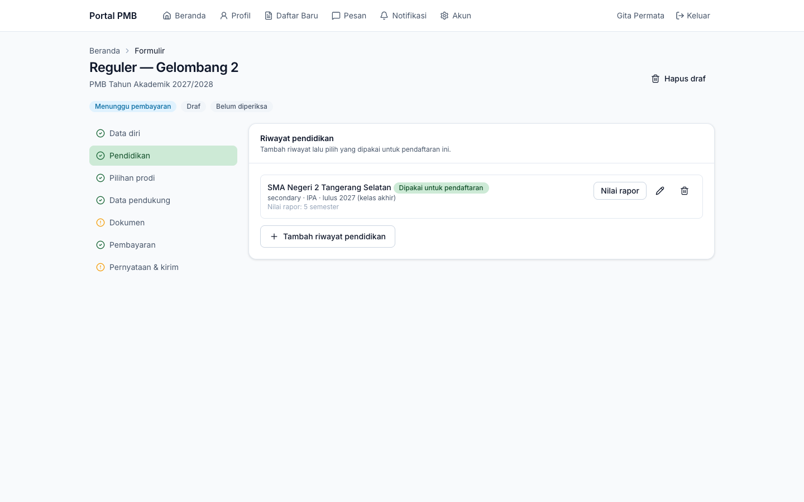
*Gambar 12.6 — Langkah Pendidikan.*

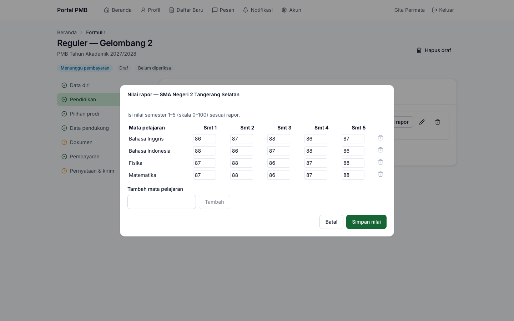
*Gambar 12.7 — Isian nilai rapor semester 1–5.*

> **Catatan** — Nilai rapor dipakai oleh komponen seleksi bersumber rapor (misalnya rata-rata semester 1–5). Isi selengkap mungkin.

### 4.3 Pilihan prodi

1. Pada **Pilihan 1**, pilih program studi dan sistem kuliah dari daftar yang ditawarkan jalur ini.
2. Bila jalur mengizinkan lebih dari satu pilihan, klik **Tambah pilihan** untuk Pilihan 2, dst. (sampai batas maksimal).
3. Atur urutan prioritas dengan tombol panah ↑ ↓; hapus dengan ikon tempat sampah.
4. Klik **Simpan pilihan**.

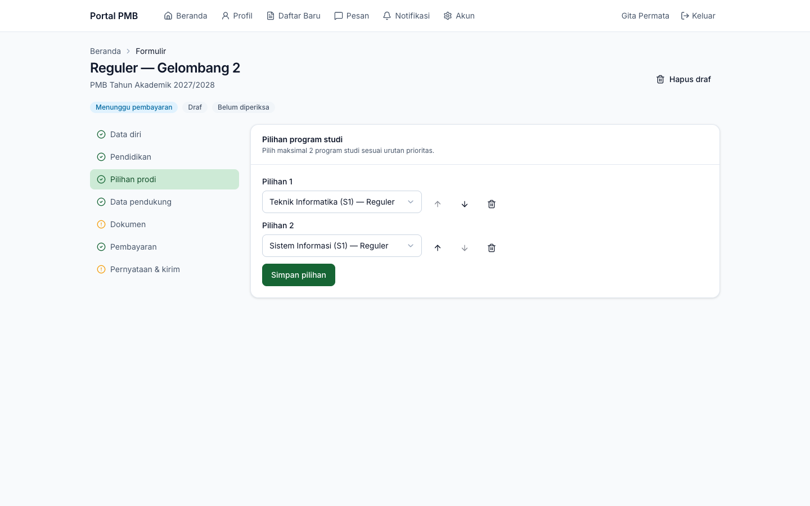
*Gambar 12.8 — Langkah Pilihan prodi.*

> **Catatan** — Urutan pilihan menentukan prioritas penempatan. Bila skor Anda memenuhi pilihan 1 dan kursi tersedia, Anda ditempatkan di pilihan 1; bila tidak, sistem mencoba pilihan berikutnya (lihat [Cara sistem menghitung](23-skema-seleksi.md#3-cara-sistem-menghitung)).

### 4.4 Data pendukung

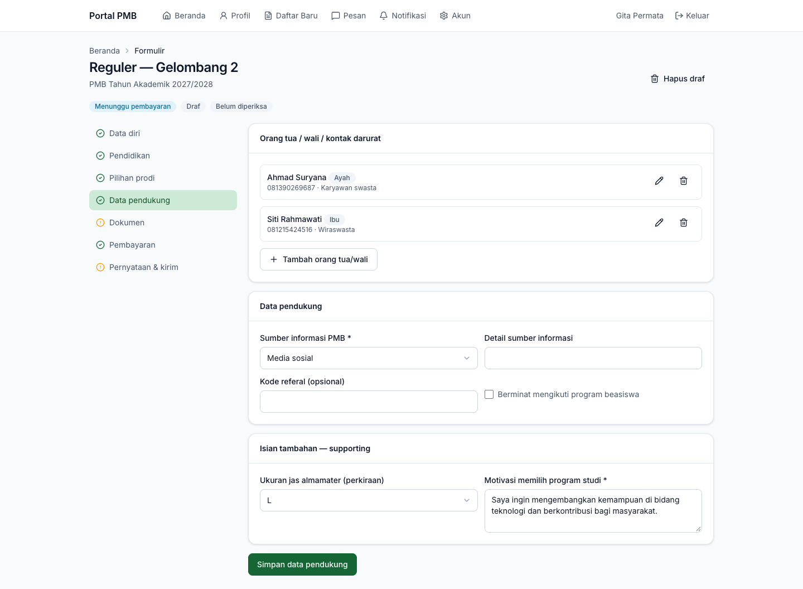
*Gambar 12.9 — Langkah Data pendukung.*

| Bagian | Isi |
|---|---|
| **Orang tua / wali / kontak darurat** | **Tambah orang tua/wali**: Hubungan (Ayah, Ibu, Wali, Kontak darurat), Nama lengkap (wajib), Nomor HP, Email, NIK (opsional), Tanggal lahir, Pendidikan terakhir, Pekerjaan, Penghasilan per bulan, Sudah meninggal. Ubah/hapus dengan ikon pensil/tempat sampah. |
| **Prestasi** | Hanya untuk jalur berkategori prestasi. **Tambah prestasi**: Nama prestasi/lomba, Kategori (akademik/non-akademik), Tingkat (sekolah s.d. internasional), Peringkat, Tahun, Penyelenggara. Unggah sertifikat setiap prestasi pada langkah **Dokumen**. |
| **Data pendukung** | **Sumber informasi PMB** (wajib), detail sumber informasi, **Kode referal** (opsional), **Berminat mengikuti program beasiswa**. Untuk jalur KIP/afirmasi tampil **Nomor KIP** (sensitif) dan **Nomor pendaftaran KIP Kuliah**. |
| **Isian tambahan — …** | Pertanyaan tambahan dari template formulir jalur (misalnya ukuran jas almamater, motivasi). Field bertanda `*` wajib. |

Klik **Simpan data pendukung** untuk menyimpan data pendukung dan isian tambahan sekaligus. Data orang tua/wali dan prestasi tersimpan langsung saat dialognya disimpan.

### 4.5 Dokumen dan Pembayaran

Dijelaskan di [Dokumen & Pembayaran](13-dokumen-dan-pembayaran.md).

### 4.6 Pernyataan & kirim

1. Baca setiap pernyataan, lalu centang **Saya menyatakan data yang saya isi benar dan menyetujui pernyataan di atas**.
2. Bila masih ada langkah yang belum lengkap, muncul *"Masih ada langkah yang belum lengkap (lihat tanda pada menu langkah)"* dan tombol **Kirim formulir** nonaktif.
3. Klik **Kirim formulir**. Muncul pesan *"Formulir terkirim. Nomor pendaftaran Anda: PMB2027-REG-000001"* (contoh).

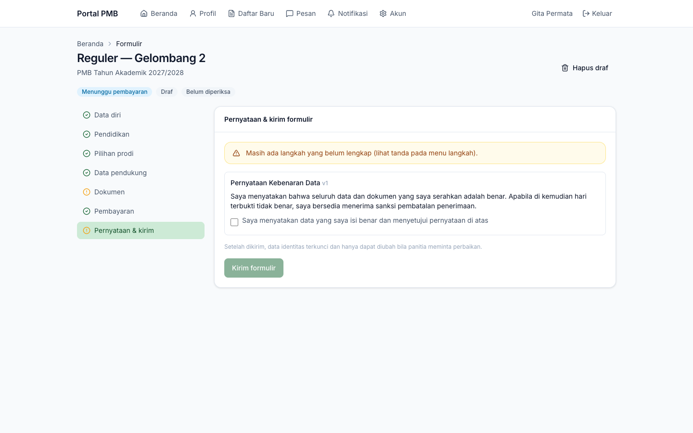
*Gambar 12.10 — Langkah Pernyataan & kirim (masih ada langkah yang belum lengkap).*

Setelah terkirim, langkah ini menampilkan waktu pengiriman dan nomor pendaftaran. Simpan nomor tersebut untuk **Cek Status** dan komunikasi dengan panitia.

> **Penting** — Formulir harus dikirim **sebelum pendaftaran gelombang ditutup**. Draf yang belum dikirim saat gelombang ditutup dibatalkan otomatis (status *Tidak dikirim*).

> **Beda rancangan** — Rancangan menyebut halaman sukses dengan tombol **unduh bukti pendaftaran** dan penyimpanan otomatis (*autosave*). Versi ini menampilkan nomor pendaftaran di layar & email tanpa berkas bukti pendaftaran, dan penyimpanan dilakukan per langkah dengan tombol. Lihat [lampiran 60](60-perbedaan-rancangan-implementasi.md).

## 5. Menghapus draf dan menarik pendaftaran

- **Hapus draf** (tombol di kanan atas formulir, hanya untuk draf): konfirmasi, lalu draf dibatalkan dan Anda kembali ke Beranda.
- **Tarik pendaftaran** (untuk formulir yang sudah dikirim, **sebelum hasil terbit**): isi alasan (opsional), lalu **Tarik pendaftaran**. Pendaftaran yang ditarik tidak dapat diaktifkan kembali, dan biaya pendaftaran tidak dikembalikan kecuali sesuai ketentuan kampus.

---

[← Akun Pendaftar](11-akun-pendaftar.md) · [Daftar isi](README.md) · [Berikutnya: Dokumen & Pembayaran →](13-dokumen-dan-pembayaran.md)
