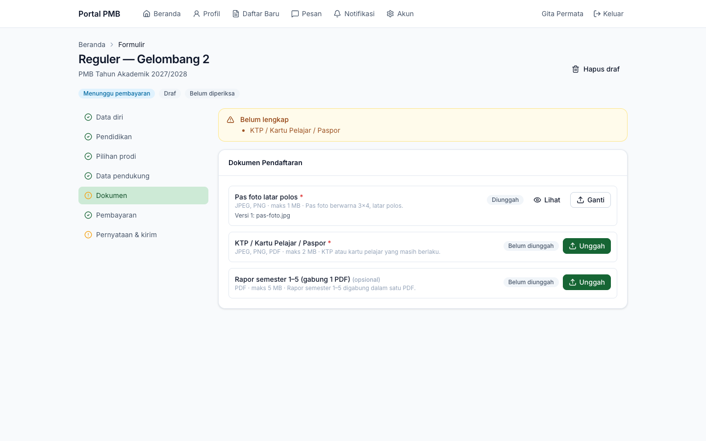
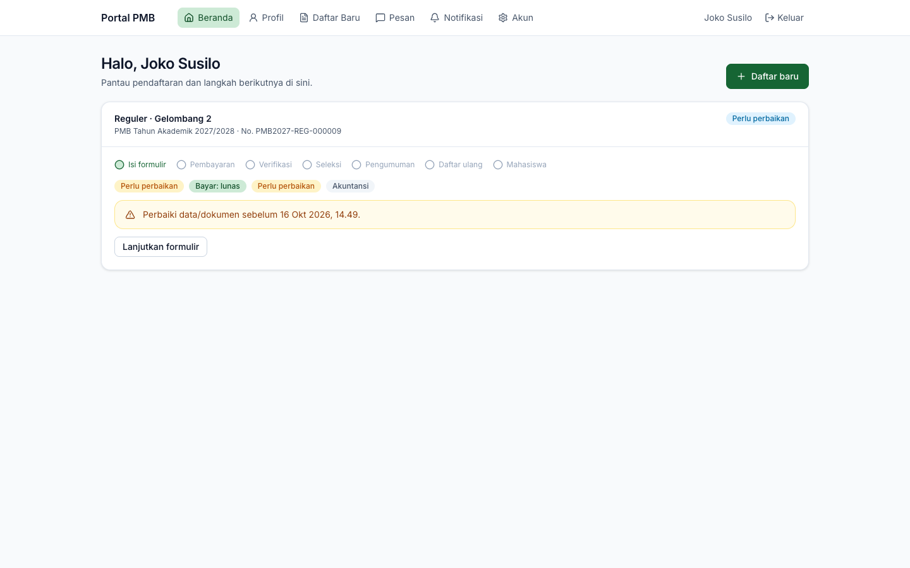
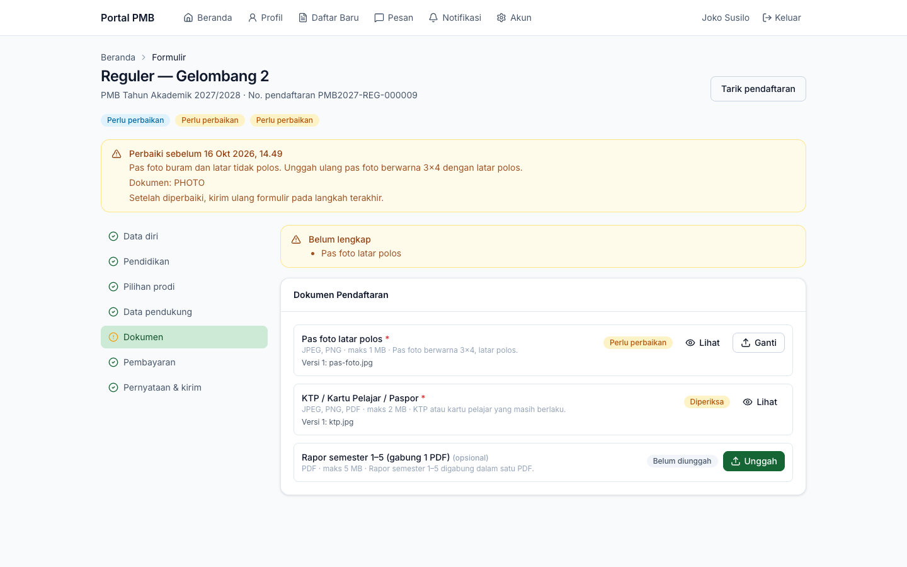
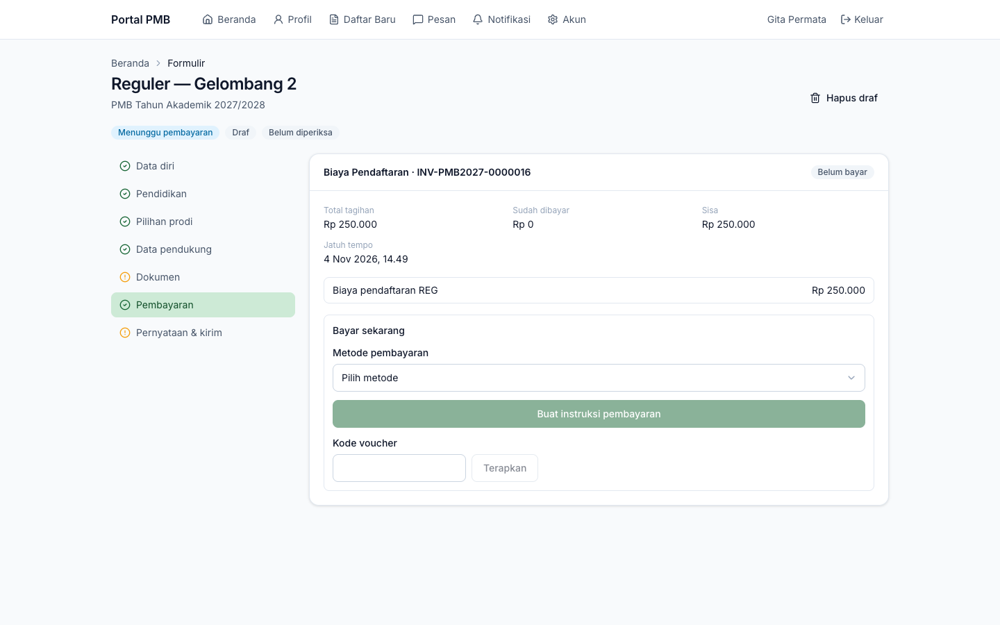
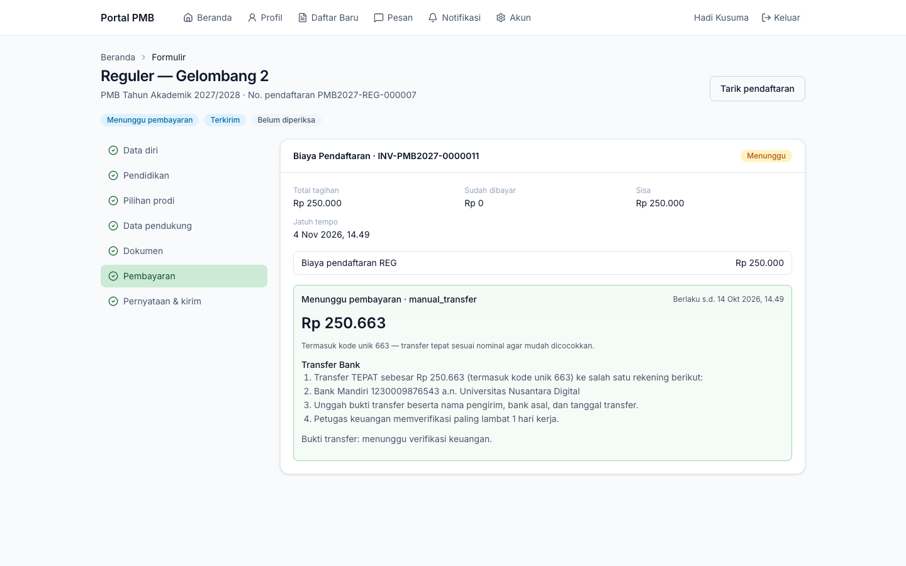
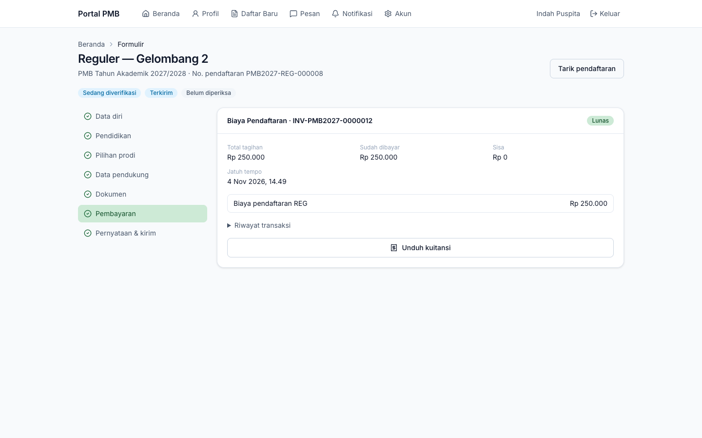

# 13. Dokumen & Pembayaran

[← Portal & Formulir Pendaftaran](12-formulir-pendaftaran.md) · [Daftar isi](README.md) · [Berikutnya: Ujian & CBT →](14-ujian-dan-cbt.md)

**Untuk:** calon mahasiswa. Kedua langkah ini ada di dalam formulir pendaftaran (langkah **Dokumen** dan **Pembayaran**).

## 1. Mengunggah dokumen

Langkah **Dokumen** menampilkan daftar dokumen yang diminta jalur & gelombang Anda.

*Gambar 13.1 — Daftar dokumen pendaftaran: satu sudah diunggah, satu wajib belum diunggah, satu opsional.*

Setiap baris memuat:

- nama dokumen, tanda `*` merah (wajib) atau *(opsional)*;
- format yang diterima, ukuran maksimal, dan instruksi panitia;
- versi berkas terakhir yang diunggah;
- status (lihat tabel di bawah), catatan panitia bila diminta perbaikan/ditolak;
- tombol **Lihat** (membuka berkas Anda di tab baru) dan **Unggah**/**Ganti**.

**Cara mengunggah:**

1. Klik **Unggah** (atau **Ganti** untuk mengganti berkas).
2. Pilih berkas dari perangkat. Berkas yang melebihi ukuran maksimal ditolak sebelum dikirim.
3. Tunggu pesan *"Berkas diunggah."*

| Ketentuan | Keterangan |
|---|---|
| Format | Sesuai jenis dokumen (umumnya PDF, JPEG, PNG). |
| Ukuran | Contoh default: pas foto 1 MB; KTP 2 MB; rapor 5 MB. |
| Pas foto | Minimal **400 × 600 piksel**, rasio **3 : 4** (potret), latar polos. Foto yang tidak memenuhi ditolak saat diunggah. |
| Dokumen boleh lebih dari satu | Untuk jenis tertentu (misalnya sertifikat prestasi) muncul tombol **Tambah berkas …** setelah berkas pertama diunggah. |
| Pemeriksaan keamanan | Setiap berkas diperiksa jenis aslinya; gambar diproses ulang. Bila kampus memasang antivirus, status pemindaian ditampilkan. |

| Status dokumen | Arti |
|---|---|
| Belum diunggah | Belum ada berkas. |
| Diunggah | Berkas sudah ada, belum diperiksa. |
| Diperiksa | Sedang diperiksa verifikator (tidak dapat diganti). |
| Disetujui | Diterima panitia (terkunci). |
| Perlu perbaikan | Unggah ulang sesuai catatan panitia. |
| Ditolak | Dokumen tidak dapat diterima; baca catatan, unggah dokumen yang benar bila masih dibuka. |

> **Catatan** — Dokumen tahap **daftar ulang** (misalnya ijazah/SKL) tidak muncul di sini, melainkan di halaman [Daftar Ulang](15-hasil-dan-daftar-ulang.md#5-daftar-ulang).

> **Beda rancangan** — Rancangan menyebut unggah *drag & drop*, kamera ponsel, dan kompresi gambar di perangkat. Versi ini memakai tombol pilih berkas standar (di ponsel, pemilih berkas bawaan biasanya juga menawarkan kamera).

## 2. Memperbaiki data/dokumen atas permintaan panitia

Bila verifikator meminta perbaikan, Beranda portal menampilkan peringatan *"Perbaiki data/dokumen sebelum …"* dan formulir menampilkan kotak **Perbaiki sebelum …** berisi catatan panitia serta dokumen/data yang harus diperbaiki.

*Gambar 13.2 — Beranda portal saat panitia meminta perbaikan.*

*Gambar 13.3 — Formulir dalam status perlu perbaikan: hanya dokumen yang diminta yang dapat diganti.*

1. Buka formulir (**Lanjutkan formulir**).
2. Perbaiki **hanya** data/dokumen yang disebutkan; isian lain terkunci.
3. Buka langkah **Pernyataan & kirim**, centang pernyataan, klik **Kirim formulir** lagi.

> **Penting** — Batas perbaikan default **72 jam** sejak diminta, dan tidak melewati batas perbaikan formulir gelombang. Lewat batas tersebut, panitia dapat menolak pendaftaran karena tidak lengkap.

> **Catatan** — Pada versi ini daftar dokumen di kotak peringatan ditampilkan dengan kode sistem (misalnya `PHOTO` untuk pas foto, `ID_CARD` untuk KTP).

## 3. Tagihan biaya pendaftaran

Langkah **Pembayaran** menampilkan tagihan **Biaya Pendaftaran** dengan nomor tagihan (`INV-…`), status, total, sudah dibayar, sisa, jatuh tempo, dan rincian item.

*Gambar 13.4 — Tagihan biaya pendaftaran beserta panel **Bayar sekarang**.*

- Bila jalur **tidak memungut biaya**, tampil *"Jalur ini tidak memungut biaya pendaftaran."*
- **Waktu bayar** ditentukan per jalur: *sebelum* kirim formulir (formulir baru bisa dikirim setelah lunas) atau *setelah* kirim formulir.
- Tagihan dibuat saat langkah **Pembayaran** dibuka. Jatuh tempo mengikuti **batas pembayaran** gelombang.

> **Perlu konfirmasi** — Pada jalur dengan waktu bayar *setelah kirim formulir*, tagihan tetap terbit saat langkah Pembayaran dibuka, sehingga pendaftar dapat membayar sebelum formulir dikirim. Pesan *"Tagihan … dibuat setelah formulir dikirim"* tidak muncul. Lihat [lampiran 61](61-hal-perlu-konfirmasi.md).

## 4. Membayar dengan transfer bank (unggah bukti)

1. Pada **Bayar sekarang**, pilih **Metode pembayaran** → **Transfer Bank (unggah bukti)**.
2. (Opsional) Masukkan **Kode voucher**, klik **Terapkan**. Potongan tampil pada tagihan.
3. Klik **Buat instruksi pembayaran**.
4. Kotak hijau **Menunggu pembayaran** menampilkan:
   - **nominal yang harus ditransfer, termasuk 3 digit kode unik** (contoh Rp250.663 untuk tagihan Rp250.000);
   - rekening tujuan kampus;
   - batas berlaku instruksi (default 24 jam).
5. Transfer **tepat** sesuai nominal.
6. Klik **Unggah bukti transfer**, isi **Foto/PDF bukti transfer**, **Bank pengirim**, **Nama pemilik rekening**, **Tanggal transfer**, **Nominal yang ditransfer**, lalu **Simpan**.
7. Status bukti menjadi *"menunggu verifikasi keuangan"*. Petugas keuangan memverifikasi (target ditampilkan: paling lambat 1 hari kerja).

*Gambar 13.5 — Instruksi transfer dengan kode unik dan bukti yang menunggu verifikasi keuangan.*

- Sebelum mengunggah bukti, Anda dapat klik **Ganti metode** untuk membatalkan instruksi dan memilih metode lain. Hanya **satu** instruksi pembayaran yang dapat aktif per tagihan.
- Bila bukti ditolak (misalnya tidak ditemukan di mutasi, nominal tidak sesuai, tidak terbaca), alasannya tampil di **Riwayat transaksi**. Buat instruksi baru dan unggah bukti yang benar.

## 5. Membayar di loket kampus (tunai)

Datang ke loket kampus dan sebutkan **nomor tagihan** (`INV-…`) atau nomor pendaftaran. Petugas keuangan mencatat pembayaran, dan tagihan Anda langsung berstatus **Lunas**. Anda tidak perlu membuat instruksi pembayaran di portal.

> **Catatan** — Metode *Loket Kampus (tunai)* sengaja tidak muncul di pilihan **Metode pembayaran** pendaftar; pembayarannya dicatat petugas. Pastikan tagihan sudah terbit (buka langkah **Pembayaran** minimal sekali) sebelum ke loket.

## 6. Pembayaran daring (VA/QRIS)

Bila kampus mengaktifkan gateway pembayaran, pilihan seperti *Virtual Account* atau *QRIS* muncul di **Metode pembayaran**. Setelah **Buat instruksi pembayaran**, tampil nomor VA (dengan tombol salin) atau tautan **Buka QR / halaman pembayaran**. Status diperbarui otomatis setelah pembayaran; tombol **Cek status** dapat dipakai untuk memeriksa ulang.

> **Perlu konfirmasi** — Integrasi gateway (Midtrans) sudah tersedia, tetapi membutuhkan kredensial dan uji coba dari kampus. Pada lingkungan tanpa gateway hanya tersedia transfer manual dan loket. Lihat [lampiran 61](61-hal-perlu-konfirmasi.md).

## 7. Setelah lunas

Tagihan berstatus **Lunas** dan tombol **Unduh kuitansi** tersedia. **Riwayat transaksi** mencatat semua transaksi (kanal, nominal, waktu, status bukti).

*Gambar 13.6 — Tagihan lunas dengan tombol Unduh kuitansi.*

Setelah formulir terkirim dan biaya lunas, pendaftaran masuk antrean **verifikasi administrasi** (tahap *Sedang diverifikasi*).

> **Catatan** — Bila pembayaran diterima **setelah** tagihan kedaluwarsa, tampil *"Pembayaran diterima setelah tagihan kedaluwarsa dan sedang ditinjau panitia."* Panitia keuangan akan menerima pembayaran dan membuka kembali pendaftaran, atau mengembalikan dana.

---

[← Portal & Formulir Pendaftaran](12-formulir-pendaftaran.md) · [Daftar isi](README.md) · [Berikutnya: Ujian & CBT →](14-ujian-dan-cbt.md)
