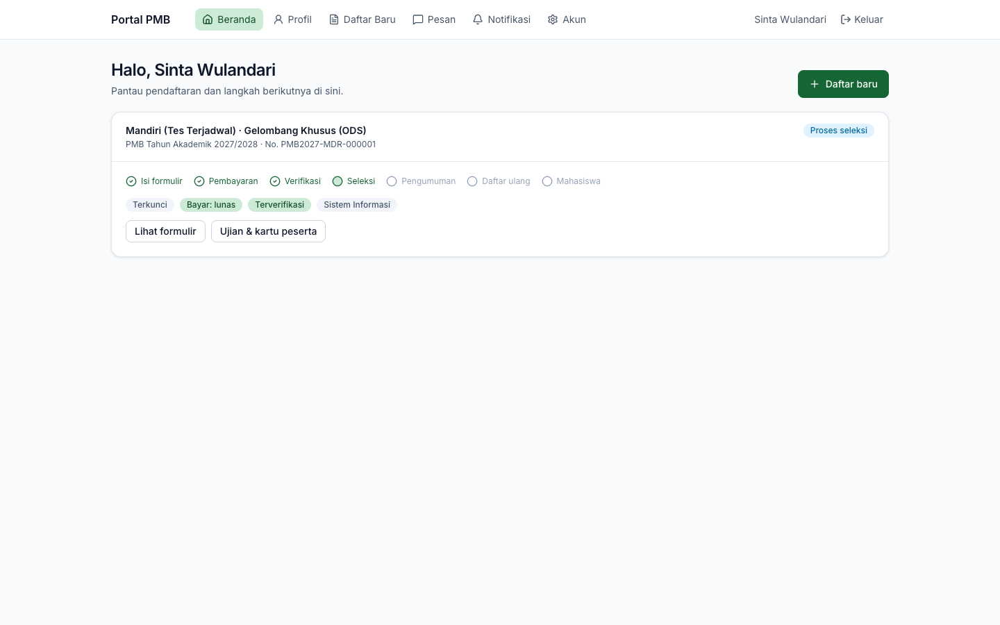

# 14. Ujian & CBT

[← Dokumen & Pembayaran](13-dokumen-dan-pembayaran.md) · [Daftar isi](README.md) · [Berikutnya: Hasil Seleksi & Daftar Ulang →](15-hasil-dan-daftar-ulang.md)

**Untuk:** calon mahasiswa pada jalur yang mensyaratkan ujian, setelah lolos verifikasi administrasi.

## 1. Membuka halaman ujian

Setelah pendaftaran **terverifikasi**, kartu pendaftaran di Beranda menampilkan tombol **Ujian & kartu peserta**.

*Gambar 14.1 — Pendaftaran terverifikasi, tahap Proses seleksi.*

Halaman **Ujian & Kartu Peserta** menampilkan setiap ujian yang Anda ikuti:

| Informasi | Keterangan |
|---|---|
| Judul & **No. peserta** | Nomor peserta diawali kode periode, contoh `PMB2027G1REG00001`. |
| Status kehadiran | **Terdaftar**, **Hadir**, **Tidak hadir**, **Izin**, **Didiskualifikasi**. |
| **Sesi** | Kode sesi dan waktu mulai–selesai. |
| **Mode** | Luring di lokasi, Computer Based Test, Wawancara, Daring terawasi. |
| **Lokasi** | Gedung & ruang beserta alamat, atau tautan ujian daring. |
| Instruksi | Petunjuk dari panitia. |

*Gambar 14.2 — Jadwal ujian CBT yang sudah dipublikasikan, dengan tombol Mulai ujian CBT.*

Kemungkinan tampilan lain:

- *"Jalur ini tidak memerlukan ujian tulis; seleksi berdasarkan berkas."* — jalur tanpa ujian (misalnya Prestasi).
- *"Jadwal ujian belum terbit"* — jadwal belum dipublikasikan panitia; ditampilkan perkiraan rentang tanggal ujian gelombang bila ada.

## 2. Kartu peserta

Klik **Unduh kartu peserta** untuk membuka kartu (PDF) di tab baru. Kartu memuat pas foto, nomor peserta, nama, nomor pendaftaran, nama ujian, sesi, lokasi, instruksi panitia, tata tertib, dan **kode QR check-in** yang dipindai pengawas. Jangan membagikan kartu ini. Bila tombol bertuliskan **Kartu sedang disiapkan**, tunggu beberapa saat lalu muat ulang halaman.

> **Penting** — Bawa kartu peserta (cetak atau di ponsel) dan identitas asli sesuai instruksi panitia.

## 3. Mengerjakan CBT

Tombol **Mulai ujian CBT** hanya berfungsi **selama waktu sesi**. Di luar waktu tersebut muncul pesan *"Ujian hanya dapat dikerjakan pada waktu sesi."*

1. Klik **Mulai ujian CBT**. Halaman ujian terbuka tanpa menu portal agar Anda fokus pada soal.
2. Bagian atas menampilkan nomor soal, jumlah soal terjawab, dan **sisa waktu** (dihitung dari jam server).
3. Klik salah satu pilihan jawaban (A, B, C, D, …). Setiap jawaban **tersimpan otomatis**; status di bawah soal berubah dari *Menyimpan…* menjadi *Tersimpan*.
4. Pindah soal dengan **Sebelumnya**/**Berikutnya**, atau klik nomor pada **Navigasi soal** (nomor yang sudah dijawab berwarna hijau).
5. Pada soal terakhir klik **Kirim jawaban**. Konfirmasi menyebutkan jumlah soal yang belum dijawab.

*Gambar 14.3 — Mengerjakan CBT: soal, pilihan jawaban, sisa waktu, dan navigasi soal.*

> **Penting**
> - **Jangan berpindah tab atau aplikasi** selama ujian. Setiap perpindahan tercatat sebagai pelanggaran dan dapat ditinjau panitia.
> - Bila waktu habis, jawaban **dikirim otomatis**.
> - Bila koneksi terputus, buka kembali halaman ujian dan klik **Lanjutkan ujian**; jawaban yang sudah tersimpan tidak hilang dan waktu tetap berjalan.
> - Memulai CBT otomatis mencatat Anda **Hadir** pada sesi tersebut.

Setelah dikirim, kartu ujian menampilkan label **Jawaban CBT terkirim**. Nilai CBT dihitung otomatis oleh sistem; hasil seleksi diumumkan sesuai jadwal pengumuman.

*Gambar 14.4 — Setelah ujian: status Hadir dan Jawaban CBT terkirim.*

## 4. Mengajukan jadwal ulang

Bila berhalangan karena alasan kuat (sakit, bentrok jadwal resmi):

1. Klik **Ajukan jadwal ulang** (hanya tersedia selama status masih **Terdaftar**).
2. Isi **Alasan** dan (opsional) unggah **Bukti** (JPG, PNG, PDF), lalu **Simpan**.
3. Panitia meninjau permintaan. Bila disetujui, Anda dipindahkan ke sesi lain dan jadwal baru tampil di halaman ini.

Secara default setiap peserta hanya dapat dijadwalkan ulang **satu kali** (pengaturan `pmb.max_reschedules`).

---

[← Dokumen & Pembayaran](13-dokumen-dan-pembayaran.md) · [Daftar isi](README.md) · [Berikutnya: Hasil Seleksi & Daftar Ulang →](15-hasil-dan-daftar-ulang.md)
