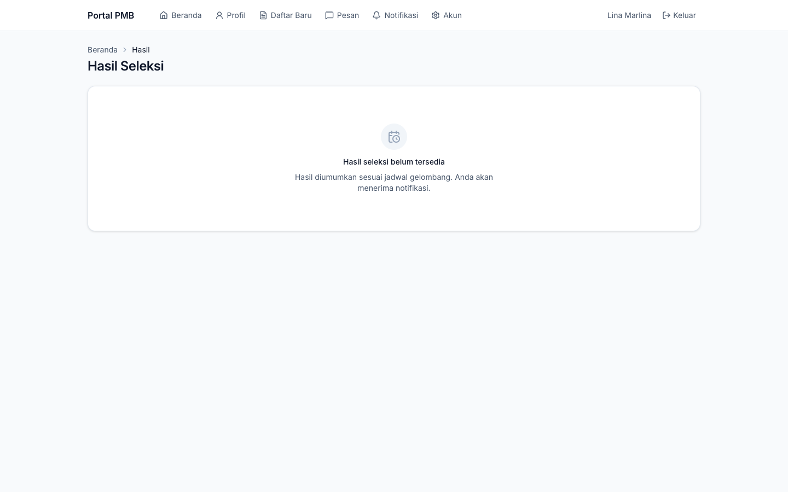
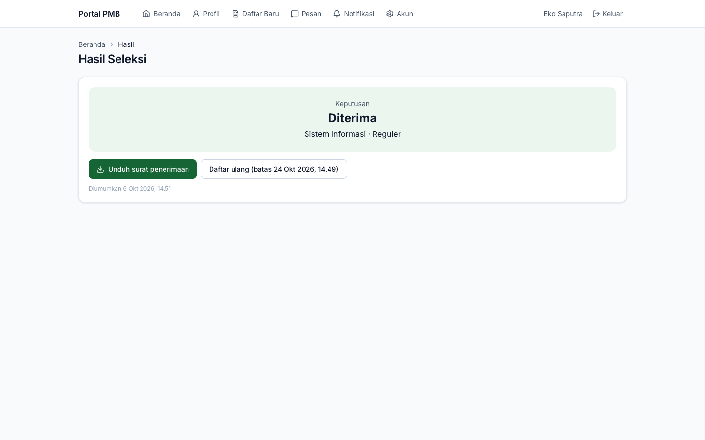
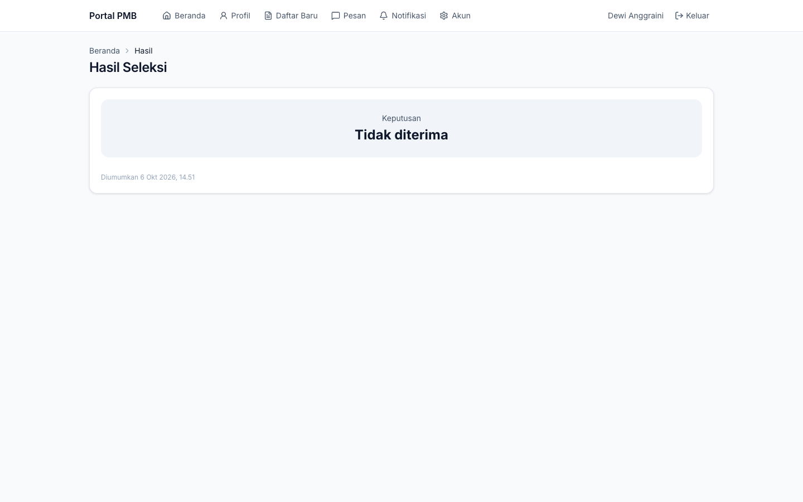

# 15. Hasil Seleksi & Daftar Ulang

[← Ujian & CBT](14-ujian-dan-cbt.md) · [Daftar isi](README.md) · [Berikutnya: Pesan, Notifikasi, dan Akun →](16-pesan-notifikasi-akun.md)

**Untuk:** calon mahasiswa setelah tanggal pengumuman gelombang.

## 1. Kapan hasil dapat dilihat?

Hasil seleksi **hanya** terbit setelah disahkan pejabat kampus dan **tepat pada waktu pengumuman** gelombang (lihat menu **Jadwal** di website). Sebelum itu, halaman hasil menampilkan *"Hasil seleksi belum tersedia — Hasil diumumkan sesuai jadwal gelombang."*

*Gambar 15.1 — Hasil belum diumumkan.*

Setelah terbit, Anda menerima notifikasi, dan kartu pendaftaran di Beranda menampilkan tombol **Hasil seleksi**. Hasil juga dapat dicek tanpa login melalui [Cek Status](10-website-pmb.md#8-cek-status--hasil-seleksi-tanpa-login).

## 2. Membaca hasil seleksi

| Keputusan | Arti | Langkah berikutnya |
|---|---|---|
| **Diterima** | Anda diterima pada prodi & sistem kuliah yang tertera (bisa pilihan 1 atau pilihan berikutnya). | Unduh surat penerimaan, lakukan **daftar ulang** sebelum batasnya. |
| **Cadangan** | Anda berada di daftar cadangan. | Tunggu. Bila kursi tersedia, panitia mempromosikan Anda menjadi *Diterima* dengan batas daftar ulang tersendiri (default 7 hari) dan Anda diberi tahu. |
| **Tidak diterima** | Tidak lolos seleksi pada jalur ini. | Anda dapat mendaftar pada gelombang/jalur lain yang masih dibuka. |

| | |
|---|---|
|  |  |

*Gambar 15.2 — Hasil **Diterima** (kiri: pilihan 1; kanan: diterima pada pilihan 2, Sistem Informasi).*

| | |
|---|---|
|  |  |

*Gambar 15.3 — Hasil **Cadangan** dan **Tidak diterima**.*

Informasi tambahan yang dapat muncul:

- **Beasiswa jalur masuk: potongan X%**: potongan diterapkan pada tagihan biaya awal kuliah.
- **Hasil telah dikoreksi**: panitia mengoreksi hasil setelah terbit (melalui persetujuan resmi); catatan koreksi ditampilkan.
- **Diumumkan …**: waktu publikasi hasil.

## 3. Surat penerimaan (LoA)

Bagi yang diterima, klik **Unduh surat penerimaan** untuk membuka surat (PDF). Surat bernomor (contoh `LOA/PMB2027/00001`) dan memuat kode QR yang dapat dipindai siapa pun untuk [memverifikasi keasliannya](10-website-pmb.md#10-verifikasi-surat-penerimaan-loa).

> **Perlu konfirmasi** — Surat penerimaan belum memakai tanda tangan elektronik tersertifikasi (TTE); keaslian dibuktikan lewat QR verifikasi. Lihat [lampiran 61](61-hal-perlu-konfirmasi.md).

## 4. Menerima atau menolak tawaran

Klik **Daftar ulang (batas …)** pada halaman hasil, atau **Daftar ulang** di Beranda.

*Gambar 15.4 — Konfirmasi tawaran (status Menunggu konfirmasi).*

**Menerima tawaran:**

1. Baca pernyataan (bila ada), centang **Saya menyetujui** pada setiap pernyataan.
2. Klik **Terima tawaran**.

> **Penting** — Menerima tawaran **menarik semua pendaftaran Anda yang lain pada periode yang sama**.

**Menolak tawaran:**

1. Klik **Tolak tawaran**, isi alasan (opsional), lalu **Tolak tawaran**.
2. Kursi Anda diberikan kepada pendaftar cadangan.

*Gambar 15.5 — Dialog tolak tawaran.*

> **Catatan** — Bila Anda salah menolak, segera hubungi panitia. Penolakan dapat dipulihkan panitia **maksimal 24 jam** setelahnya.

> **Beda rancangan** — Rancangan mensyaratkan konfirmasi dua langkah dengan mengetik "TOLAK". Versi ini memakai satu dialog konfirmasi.

## 5. Daftar ulang

Setelah tawaran diterima, halaman **Daftar Ulang** menampilkan status, **batas daftar ulang**, NIM (setelah terbit), dan bagian-bagian berikut.

*Gambar 15.6 — Daftar ulang berjalan: kelengkapan, tagihan biaya awal (transfer menunggu verifikasi), data PDDikti, orang tua/wali, dokumen, dan tombol kirim.*

### 5.1 Kelengkapan

Daftar pemeriksaan yang dievaluasi otomatis atau oleh petugas:

| Pemeriksaan | Terpenuhi bila |
|---|---|
| Tawaran diterima | Anda sudah menerima tawaran. |
| Data PDDikti lengkap | Seluruh isian *Data lanjutan (PDDikti)* lengkap. |
| Data orang tua lengkap | Data orang tua/wali tersedia. |
| Dokumen daftar ulang disetujui | Dokumen wajib tahap daftar ulang sudah disetujui petugas. |
| Surat sehat | Hanya bila diwajibkan prodi (*Tidak berlaku* bila tidak). |
| Pembayaran minimum | Pembayaran biaya awal mencapai minimum daftar ulang. |
| Pemeriksaan dokumen asli | Ditandai petugas saat Anda menunjukkan dokumen asli. |
| Tidak ada indikasi duplikat | Tidak ada indikasi akun ganda yang belum diselesaikan. |

Status setiap butir: **Lolos**, **Menunggu**, **Tidak lolos**, atau **Tidak berlaku**.

### 5.2 Biaya awal kuliah

Tagihan **Biaya Awal Kuliah** berisi komponen (misalnya Uang Pangkal dan SPP Semester 1), potongan beasiswa bila ada, jatuh tempo, dan **Minimum untuk daftar ulang**.

- Komponen yang **dapat dicicil** dipecah per cicilan. Minimum daftar ulang (default) = cicilan pertama komponen yang dapat dicicil + seluruh komponen yang tidak dapat dicicil.
- Saat membuat instruksi pembayaran, isi **Nominal (kosongkan untuk melunasi sisa)** untuk membayar sebagian (minimal sebesar minimum daftar ulang), atau kosongkan untuk melunasi.
- Cara bayar sama dengan biaya pendaftaran (transfer + unggah bukti, loket, atau gateway bila aktif). Lihat [Dokumen & Pembayaran](13-dokumen-dan-pembayaran.md#4-membayar-dengan-transfer-bank-unggah-bukti).

> **Catatan** — Pada versi ini nama item cicilan dapat tampil berulang, misalnya *"Uang Pangkal (cicilan 1) (cicilan 1)"*. Nominalnya tetap benar.

### 5.3 Data lanjutan (PDDikti)

Isi data yang diwajibkan pelaporan PDDikti, lalu klik **Simpan data**:

| Field | Keterangan |
|---|---|
| Agama | Pilihan baku PDDikti. |
| Nama ibu kandung | Disimpan terenkripsi (data sensitif). |
| Kewarganegaraan (kode 2 huruf) | Contoh `ID`. |
| Alamat, Kelurahan/Desa, Kecamatan, Kabupaten/Kota, Provinsi | Alamat domisili. |
| Kode wilayah (Kemendagri) | Kode kecamatan/kelurahan sesuai Kemendagri. |
| Jenis tinggal | Bersama orang tua, wali, kos, asrama, panti asuhan, lainnya. |
| Alat transportasi | Jalan kaki, sepeda, sepeda motor, mobil, angkutan umum, ojek, lainnya. |
| Ukuran jas almamater | S sampai XXXL. |
| Penerima KPS/KKS | Centang bila penerima. |

### 5.4 Orang tua/wali dan dokumen daftar ulang

- Lengkapi data orang tua/wali (sama seperti di formulir pendaftaran).
- Unggah dokumen tahap daftar ulang (misalnya ijazah/Surat Keterangan Lulus) pada kartu **Dokumen Daftar Ulang**.

### 5.5 Mengirim daftar ulang

Setelah semua kelengkapan otomatis terpenuhi, klik **Kirim daftar ulang**. Petugas daftar ulang memvalidasi (termasuk pemeriksaan dokumen asli). Bila ada yang perlu diperbaiki, status menjadi *Perlu perbaikan* dan hanya data/dokumen yang diminta dapat diubah; perbaiki lalu kirim kembali.

> **Penting** — Daftar ulang harus diselesaikan sebelum **batas daftar ulang**. Lewat batas, status menjadi *Kedaluwarsa* dan kursi dapat dialihkan ke cadangan. Bila ada kendala (misalnya gangguan pembayaran), hubungi panitia sebelum batas waktu; panitia dapat memperpanjang batas.

## 6. Resmi menjadi mahasiswa

Setelah daftar ulang disetujui dan proses konversi selesai, status menjadi **Resmi mahasiswa** dan tampil kartu **Selamat! Anda resmi menjadi mahasiswa** berisi:

- **NIM** Anda;
- informasi bahwa akun SIAKAD dikirim ke email;
- tombol **Unduh bukti registrasi** (PDF);
- informasi orientasi mahasiswa baru (bila diisi panitia).

*Gambar 15.7 — Daftar ulang selesai: NIM terbit, bukti registrasi, dan info orientasi.*

*Gambar 15.8 — Beranda portal setelah resmi menjadi mahasiswa (seluruh linimasa selesai).*

Bila daftar ulang **ditolak tawarannya**, **kedaluwarsa**, atau **dibatalkan**, halaman menampilkan peringatan dan saran menghubungi panitia bila terjadi kekeliruan.

---

[← Ujian & CBT](14-ujian-dan-cbt.md) · [Daftar isi](README.md) · [Berikutnya: Pesan, Notifikasi, dan Akun →](16-pesan-notifikasi-akun.md)
