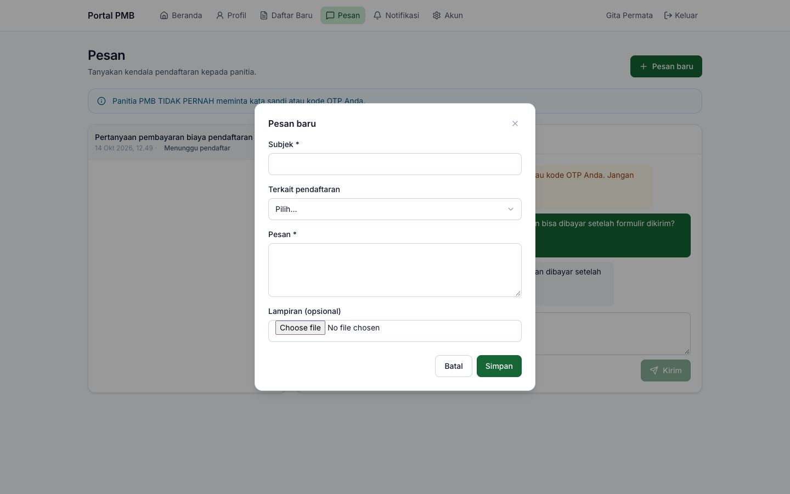
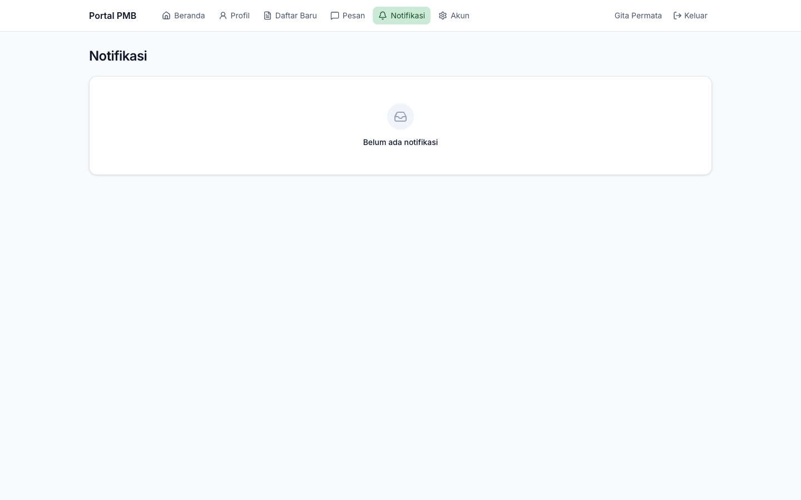

# 16. Pesan, Notifikasi, dan Akun

[← Hasil Seleksi & Daftar Ulang](15-hasil-dan-daftar-ulang.md) · [Daftar isi](README.md) · [Berikutnya: Periode, Gelombang, Kuota, dan Biaya →](20-periode-gelombang-kuota-biaya.md)

**Untuk:** calon mahasiswa (pendaftar) yang sudah masuk ke portal.

## 1. Pesan ke panitia

Menu **Pesan** dipakai untuk bertanya langsung kepada panitia PMB.

**Memulai percakapan:**

1. Klik **Pesan baru**.
2. Isi **Subjek**, pilih **Terkait pendaftaran** (opsional), tulis **Pesan**, dan lampirkan berkas bila perlu (**Lampiran (opsional)**: JPG, PNG, PDF).
3. Klik **Simpan**. Percakapan baru muncul di daftar sebelah kiri.

*Gambar 16.1 — Membuat pesan baru.*

**Membaca & membalas:**

1. Klik percakapan di daftar kiri. Angka merah menunjukkan pesan belum dibaca.
2. Pesan Anda tampil di kanan (hijau), balasan panitia di kiri (abu-abu), pesan sistem di tengah (kuning).
3. Tulis balasan di kotak **Tulis pesan…**, lampirkan berkas bila perlu, lalu klik **Kirim**.

*Gambar 16.2 — Percakapan dengan panitia.*

Status percakapan: **Dibuka**, **Menunggu pendaftar** (panitia menunggu jawaban Anda), **Ditutup** (*"Percakapan ditutup."*, tidak dapat dibalas; buat pesan baru bila perlu).

> **Penting** — Panitia PMB **tidak pernah** meminta kata sandi atau kode OTP Anda. Jangan kirimkan data tersebut lewat pesan.

## 2. Notifikasi

Menu **Notifikasi** menampilkan pemberitahuan dalam aplikasi (misalnya formulir diterima, pembayaran diverifikasi, perlu perbaikan, jadwal ujian, hasil seleksi). Notifikasi yang belum dibaca berlatar berwarna dan memiliki tombol **Tandai dibaca**; jumlahnya tampil sebagai angka merah pada menu.

Notifikasi penting juga dikirim lewat **email**, dan lewat SMS/WhatsApp bila kampus mengaktifkan penyedia SMS.

*Gambar 16.3 — Halaman notifikasi (pada lingkungan pengujian ini kosong, lihat catatan).*

> **Kendala diketahui** — Pada versi yang diuji, penyimpanan notifikasi dalam aplikasi untuk pendaftar gagal karena ketidaksesuaian format ID notifikasi, sehingga halaman **Notifikasi** tetap kosong walaupun email tetap terkirim. Ini dicatat sebagai temuan untuk perbaikan (lihat [lampiran 61](61-hal-perlu-konfirmasi.md#2-kendala-yang-diketahui-pada-implementasi)). Sementara itu, pantau status melalui **Beranda** portal dan email.

## 3. Akun & keamanan

Menu **Akun** berisi:

*Gambar 16.4 — Halaman Akun & Keamanan.*

| Kartu | Fungsi |
|---|---|
| **Data akun** | Ubah **Nama** dan **Nomor HP** lalu **Simpan**. Mengganti nomor HP memerlukan verifikasi ulang. Email ditampilkan (diganti lewat kartu *Ganti email*). Centang/hapus **Bersedia menerima informasi promosi** kapan saja. |
| **Ubah kata sandi** | Isi kata sandi saat ini, kata sandi baru dua kali, klik **Ubah kata sandi**. |
| **Ganti email** | Isi **Email baru** dan **Kata sandi**, klik **Kirim tautan konfirmasi**. Email baru aktif setelah tautan di email baru diklik. |
| **Sesi aktif** | Daftar perangkat yang sedang masuk dan waktu terakhir dipakai. **Cabut** sesi perangkat lain, atau **Keluar dari semua perangkat**. |
| **Data pribadi saya** | **Unduh data saya** mengunduh salinan seluruh data pribadi Anda dalam berkas JSON (`data-pmb-saya.json`), sesuai hak subjek data UU PDP. |
| **Nonaktifkan akun** | Isi kata sandi, klik **Nonaktifkan**, dan konfirmasi. Tidak dapat dilakukan selama masih ada pendaftaran yang berjalan. Setelah nonaktif, Anda tidak dapat masuk lagi. |

> **Beda rancangan** — Rancangan POR-12 menyebut *riwayat persetujuan (consent)* dan *ajukan hapus akun*. Versi ini menyediakan pengaturan persetujuan promosi dan **Nonaktifkan akun**; riwayat consent tidak ditampilkan kepada pendaftar.

---

[← Hasil Seleksi & Daftar Ulang](15-hasil-dan-daftar-ulang.md) · [Daftar isi](README.md) · [Berikutnya: Periode, Gelombang, Kuota, dan Biaya →](20-periode-gelombang-kuota-biaya.md)
