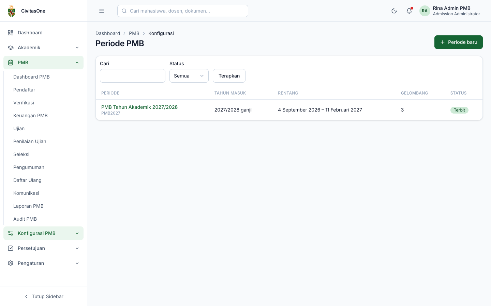
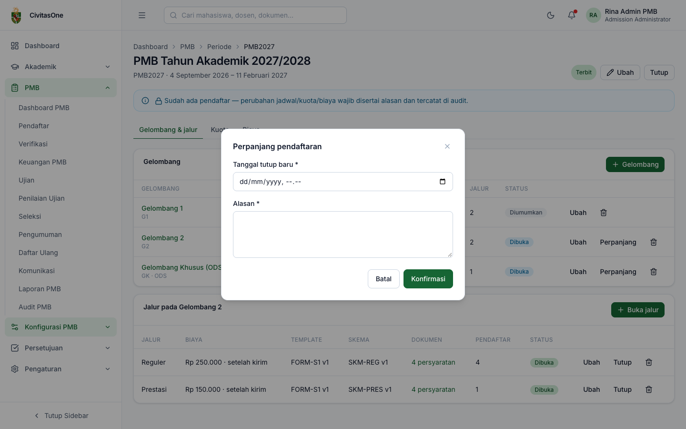
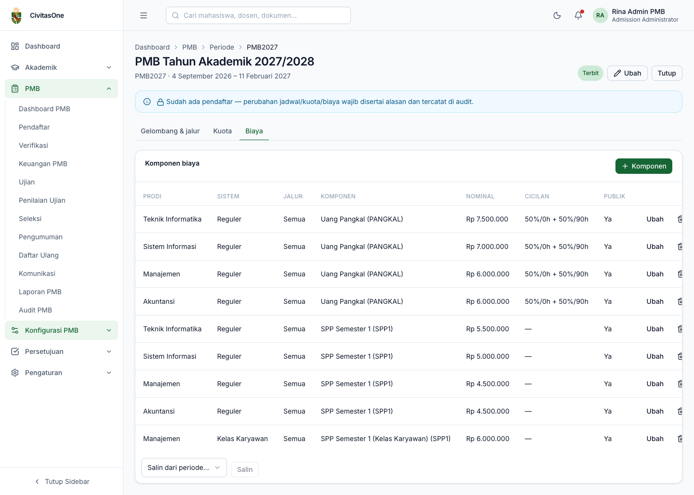

# 20. Periode, Gelombang, Kuota, dan Biaya

[← Pesan, Notifikasi, dan Akun](16-pesan-notifikasi-akun.md) · [Daftar isi](README.md) · [Berikutnya: Master Data →](21-master-data.md)

**Untuk:** Administrator PMB (izin `pmb_config.update`, `pmb_config.publish`, `pmb_fees.update`). Peran lain dengan `pmb_config.read` hanya dapat melihat.
**Menu:** **Konfigurasi PMB → Periode & Gelombang**.

> **Sebelum mulai** — Siapkan dulu jalur masuk, sistem kuliah, dan jenis dokumen ([bab 21](21-master-data.md)), template formulir yang **terpublikasi** ([bab 22](22-template-formulir.md)), dan skema seleksi yang **terkunci** ([bab 23](23-skema-seleksi.md)). Semester masuk (tahun akademik, semester **ganjil**) harus sudah dibuat di modul Akademik.

## 1. Daftar periode

*Gambar 20.1 — Daftar periode PMB.*

Kolom: nama & kode periode, tahun masuk, rentang tanggal, jumlah gelombang, dan status (**Draf**, **Terbit**, **Ditutup**, **Diarsipkan**). Saring dengan **Cari** dan **Status**, lalu **Terapkan**. Klik nama periode untuk membuka detailnya.

## 2. Membuat periode

1. Klik **Periode baru**.
2. Isi field berikut, lalu **Simpan**. Anda langsung dibawa ke halaman detail periode.

| Field | Keterangan |
|---|---|
| **Kode** | Unik, contoh `PMB2027`. Dipakai sebagai awalan nomor pendaftaran dan nomor peserta. |
| **Nama** | Contoh *PMB Tahun Akademik 2027/2028*. |
| **Tahun akademik masuk** | Semester masuk mahasiswa (harus semester ganjil). |
| **Mulai**, **Selesai** | Rentang periode; tanggal selesai harus setelah tanggal mulai. |
| Deskripsi | Opsional. |

## 3. Gelombang

Halaman detail periode memiliki tiga tab: **Gelombang & jalur**, **Kuota**, **Biaya**.

*Gambar 20.2 — Tab Gelombang & jalur. Klik nama gelombang untuk melihat jalur yang dibuka di dalamnya.*

**Menambah gelombang:** klik **+ Gelombang**, isi jadwal, **Simpan**.

*Gambar 20.3 — Form gelombang.*

| Field | Keterangan |
|---|---|
| **Kode**, **Nama**, **Urutan** | Contoh `G1`, *Gelombang 1*, `1`. |
| **Pendaftaran dibuka** / **ditutup** | Tanggal-jam pembukaan dan penutupan pendaftaran. |
| Batas pembayaran | Tidak boleh sebelum pendaftaran ditutup. Menjadi jatuh tempo tagihan biaya pendaftaran. |
| Batas perbaikan formulir | Tidak boleh sebelum batas pembayaran. Batas akhir perbaikan atas permintaan verifikator. |
| Ujian mulai / selesai | Jendela tanggal ujian. Untuk gelombang non-ODS, tidak boleh sebelum batas perbaikan formulir. |
| **Pengumuman** | Waktu hasil seleksi terbit; tidak boleh sebelum ujian selesai. |
| **Daftar ulang dibuka** / **ditutup** | Tidak boleh dibuka sebelum pengumuman. |
| Gelombang ODS (jadwal ujian fleksibel) | Centang bila tanggal ujian tidak terikat jendela ujian (On Demand Schedule). |

**Status gelombang** diperbarui otomatis oleh sistem sesuai jadwal: **Draf**/**Terjadwal** → **Dibuka** → **Ditutup** → **Diumumkan** → **Selesai**.

**Aksi per gelombang:** **Ubah**, **Perpanjang** (untuk gelombang dibuka/ditutup), dan hapus (ikon tempat sampah).

**Perpanjang pendaftaran:** klik **Perpanjang**, isi **Tanggal tutup baru** dan **Alasan**, lalu konfirmasi.

*Gambar 20.4 — Dialog perpanjang pendaftaran.*

> **Penting** — Setelah ada pendaftar, setiap perubahan jadwal wajib disertai **Alasan perubahan** dan tercatat di audit. Halaman detail menampilkan pengingat *"Sudah ada pendaftar — perubahan jadwal/kuota/biaya wajib disertai alasan dan tercatat di audit."*

## 4. Membuka jalur pada gelombang (gelombang-jalur)

1. Klik nama gelombang di tabel. Kartu **Jalur pada \<gelombang\>** muncul di bawahnya.
2. Klik **+ Buka jalur**, isi form, **Simpan**.

*Gambar 20.5 — Form membuka jalur pada gelombang.*

| Field | Keterangan |
|---|---|
| **Jalur** | Jalur masuk aktif. Jalur yang sama tidak boleh dibuka pada dua gelombang yang jadwal pendaftarannya **tumpang tindih** (BR-02). |
| **Biaya pendaftaran (Rp)** | `0` berarti tidak dipungut biaya. |
| **Waktu pembayaran** | *Setelah kirim formulir* atau *Sebelum kirim formulir* (formulir baru dapat dikirim setelah lunas). |
| **Maksimal pilihan prodi** | 1–5. |
| Boleh beda sistem kuliah antarpilihan | Bila dicentang, pendaftar boleh memilih sistem kuliah berbeda di tiap pilihan. |
| **Template formulir (terpublikasi)** | Hanya template berstatus *published*. |
| Skema seleksi (terkunci) | Hanya skema berstatus *locked*. Wajib sebelum run seleksi. |
| **Mode kuota** | *Kuota periode* (kuota dibagi dalam satu periode) atau *Batas per gelombang*. |
| Boleh verifikasi massal | Mengizinkan fitur **Verifikasi massal** untuk jalur ini. |
| Dibuka | Status buka jalur. |
| Catatan publik | Ditampilkan di website & portal (contoh: syarat tambahan). |

Tabel jalur menampilkan biaya & waktu bayar, versi template & skema (label **Belum ada** bila skema kosong), jumlah persyaratan dokumen, jumlah pendaftar, dan status. Aksi: **Ubah**, **Tutup**/**Buka** (saklar darurat, wajib alasan), hapus.

> **Perlu konfirmasi** — Mode *Batas per gelombang* memerlukan angka batas per gelombang (`wave_caps`), tetapi layar **Kuota** saat ini belum menyediakan isian tersebut. Gunakan mode *Kuota periode* sampai fitur ini dilengkapi.

## 5. Persyaratan dokumen

Pada tabel jalur, klik tautan **N persyaratan** di kolom **Dokumen**.

*Gambar 20.6 — Persyaratan dokumen untuk satu gelombang-jalur.*

1. Untuk setiap baris pilih **Jenis dokumen**, **Tahap** (*Pendaftaran* atau *Daftar ulang*), centang **Wajib** bila wajib, dan tulis **Instruksi** singkat untuk pendaftar.
2. **Tambah baris** untuk dokumen lain; ikon tempat sampah untuk menghapus.
3. Bila sudah ada pendaftar, isi **Alasan perubahan**.
4. Klik **Simpan**. Urutan baris menjadi urutan tampil di portal.

> **Catatan** — Format dan ukuran maksimal berkas mengikuti pengaturan **jenis dokumen** di [Master Data](21-master-data.md#4-jenis-dokumen).

## 6. Kuota

Tab **Kuota** berisi tabel kuota per **jalur × program studi × sistem kuliah**.

*Gambar 20.7 — Tabel kuota yang dapat diedit langsung.*

| Kolom | Keterangan |
|---|---|
| **Kapasitas** | Jumlah kursi diterima. Tidak boleh lebih kecil dari jumlah yang sudah diterima. |
| **Cadangan** | Jumlah maksimal pendaftar cadangan. **`0` berarti tanpa batas** (semua yang memenuhi ambang tetapi tidak mendapat kursi menjadi cadangan). |
| **Ambang skor** | Skor akhir minimum khusus kuota ini (opsional, 0–100). |
| **Diterima** | Jumlah diterima aktif (baca saja). |
| **Ditawarkan** | Hilangkan centang untuk tidak membuka kombinasi ini tanpa menghapusnya. Hanya kombinasi yang ditawarkan muncul di pilihan prodi pendaftar. |

Langkah: ubah angka langsung di tabel, **Tambah baris** untuk kombinasi baru (pilih jalur, prodi, sistem), isi alasan bila gelombang sudah dibuka, lalu **Simpan kuota**. Untuk memakai kuota periode sebelumnya, pilih periode di **Salin dari periode…**, lalu klik **Salin**.

> **Beda rancangan** — Rancangan ADM-13 berupa matriks (baris prodi, kolom jalur × sistem) dengan impor/ekspor XLSX. Versi ini berupa tabel baris yang dapat diedit, dengan fitur salin dari periode lain.

## 7. Komponen biaya

Tab **Biaya** berisi komponen biaya awal kuliah per **prodi × sistem kuliah** (opsional khusus jalur tertentu).

*Gambar 20.8 — Daftar komponen biaya.*

Klik **+ Komponen** (atau **Ubah** pada baris):

*Gambar 20.9 — Form komponen biaya.*

| Field | Keterangan |
|---|---|
| **Program studi**, **Sistem kuliah** | Kombinasi yang dikenai biaya. |
| Khusus jalur (kosong = semua) | Isi bila tarif berbeda untuk jalur tertentu. |
| **Kode komponen**, **Nama** | Contoh `PANGKAL` *Uang Pangkal*, `SPP1` *SPP Semester 1*. |
| **Nominal (Rp)** | Besar biaya. |
| Wajib untuk daftar ulang | Masuk tagihan biaya awal kuliah saat diterima. |
| Dapat dicicil | Bila dicentang, isi **Rencana cicilan** dalam format JSON, misalnya `[{"percent":50,"due_days":0},{"percent":50,"due_days":90}]`. Total persen harus 100. Cicilan pertama jatuh tempo pada tanggal jatuh tempo tagihan (batas daftar ulang); cicilan berikutnya jatuh tempo `due_days` hari setelah tanggal itu. |
| Tampilkan di website | Komponen ditampilkan di halaman **Biaya** website. |
| Urutan | Urutan tampil. |

Gunakan **Salin dari periode…** → **Salin** untuk menyalin komponen biaya periode lain. Setelah ada pendaftar, perubahan biaya wajib disertai alasan.

> **Beda rancangan** — Rencana cicilan diisi dalam format JSON. Rancangan tidak merinci bentuk isiannya; pastikan format sesuai contoh.

## 8. Publikasi, tutup, dan arsip periode

Tombol di kanan atas detail periode bergantung pada status:

| Status | Tombol | Keterangan |
|---|---|---|
| Draf | **Ubah**, **Hapus**, **Publikasikan** | Hapus hanya untuk periode draf. |
| Terbit | **Ubah**, **Tutup** | Menutup periode menghentikan pembuatan pendaftaran baru. |
| Ditutup | **Ubah**, **Arsipkan** | Arsip untuk periode yang sudah selesai. |

**Publikasikan** membuka **Daftar periksa publikasi**. Publikasi baru dapat dilakukan bila semua butir terpenuhi:

- minimal ada satu gelombang;
- ada gelombang-jalur dengan template formulir terpublikasi;
- ada kuota prodi yang ditawarkan;
- **Kebijakan Privasi** dan **Ketentuan Pendaftaran** sudah dipublikasikan ([bab 24](24-konten-website-profil-prodi.md));
- setiap gelombang-jalur sudah memiliki persyaratan dokumen.

Bila lengkap, tampil *"Konfigurasi lengkap. Publikasi membuka jadwal gelombang ke publik."*; klik **Publikasikan**. Bila belum, daftar kekurangan ditampilkan.

---

[← Pesan, Notifikasi, dan Akun](16-pesan-notifikasi-akun.md) · [Daftar isi](README.md) · [Berikutnya: Master Data →](21-master-data.md)
