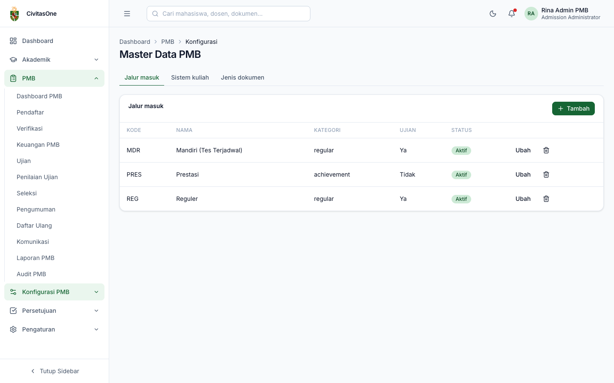
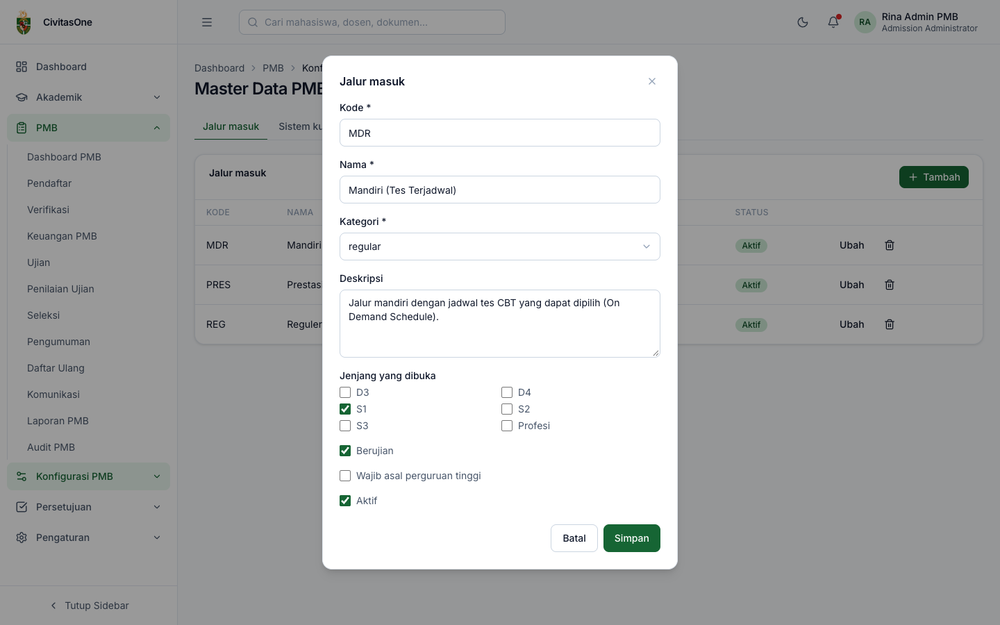
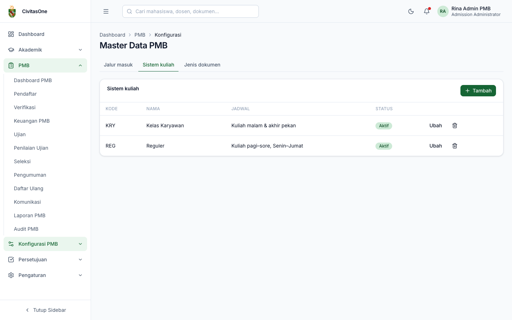
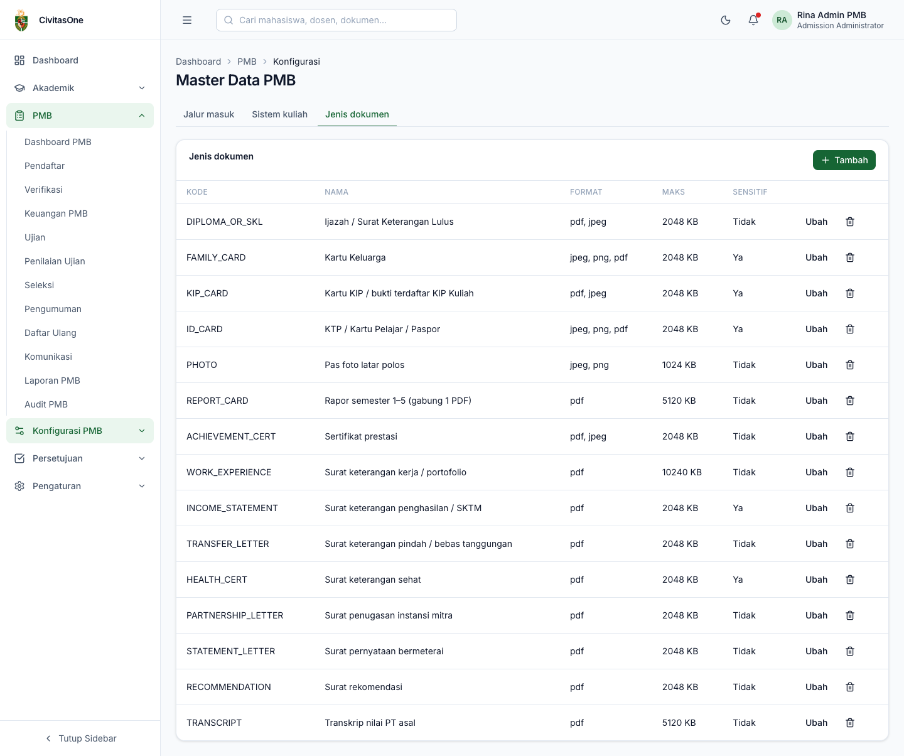

# 21. Master Data: Jalur Masuk, Sistem Kuliah, Jenis Dokumen

[← Periode, Gelombang, Kuota, dan Biaya](20-periode-gelombang-kuota-biaya.md) · [Daftar isi](README.md) · [Berikutnya: Template Formulir →](22-template-formulir.md)

**Untuk:** Administrator PMB (`pmb_config.update`).
**Menu:** **Konfigurasi PMB → Jalur & Dokumen** (halaman **Master Data PMB**), dengan tiga tab: **Jalur masuk**, **Sistem kuliah**, **Jenis dokumen**.

Master data dipakai bersama oleh semua periode. Setiap tab memiliki tombol **Tambah**, dan setiap baris memiliki **Ubah** serta ikon hapus.

> **Penting** — Data yang sudah dipakai (misalnya jalur yang pernah dibuka pada gelombang) sebaiknya **dinonaktifkan**, bukan dihapus. Aplikasi menampilkan pengingat *"Hapus data ini? Bila sudah dipakai, nonaktifkan saja."*

## 1. Data awal

Saat modul dipasang untuk kampus (`php artisan pmb:install`), sistem membuat data awal:

- **Sistem kuliah**: *Reguler* (`REG`) dan *Kelas Karyawan* (`KRY`);
- **15 jenis dokumen** default (lihat §4);
- alur persetujuan default PMB (lihat [bab 36](36-proses-seleksi-dan-pengesahan.md#7-pengesahan-oleh-pejabat-menu-persetujuan)).

Jalur masuk **tidak** dibuat otomatis; buat sesuai kebijakan kampus.

## 2. Jalur masuk

*Gambar 21.1 — Tab Jalur masuk.*

*Gambar 21.2 — Form jalur masuk.*

| Field | Keterangan |
|---|---|
| **Kode**, **Nama** | Contoh `REG` *Reguler*, `PRES` *Prestasi*. Kode jalur dipakai dalam nomor pendaftaran (`PMB2027-REG-000001`). |
| **Kategori** | `regular`, `achievement` (prestasi: memunculkan isian prestasi di formulir), `kip_affirmation` (memunculkan isian KIP), `transfer`, `postgraduate`, `rpl`, `scholarship`, `partnership`, `international`, `other`. |
| Deskripsi | Ditampilkan di website dan portal. |
| Jenjang yang dibuka | Pilih D3, D4, S1, S2, S3, Profesi. |
| Berujian | Menentukan apakah pendaftar mengikuti ujian (halaman ujian di portal). |
| Wajib asal perguruan tinggi | Untuk jalur transfer/lanjutan. |
| Aktif | Jalur nonaktif tidak dapat dibuka pada gelombang baru. |

## 3. Sistem kuliah

*Gambar 21.3 — Tab Sistem kuliah.*

Field: **Kode**, **Nama**, Keterangan jadwal (misalnya *Sabtu–Minggu*), Aktif. Sistem kuliah dipakai pada kuota, biaya, pilihan prodi, dan keputusan.

## 4. Jenis dokumen

*Gambar 21.4 — Tab Jenis dokumen.*

| Field | Keterangan |
|---|---|
| **Kode**, **Nama**, Deskripsi | Contoh `PHOTO` *Pas foto latar polos*. |
| **Format** | JPG, PNG, dan/atau PDF. |
| **Ukuran maks (KB)** | Contoh `2048` untuk 2 MB. |
| Boleh beberapa berkas | Pendaftar dapat menambah slot berkas (misalnya beberapa sertifikat). |
| Perlu cek dokumen asli saat daftar ulang | Ditandai *(cek asli)* pada pemeriksaan daftar ulang. |
| Dokumen sensitif (akses tercatat) | Setiap pembukaan dokumen dicatat di log akses sensitif. |
| Kelas retensi | Label kebijakan retensi (opsional). |

Katalog default:

| Kode | Nama | Format | Maks | Multi | Cek asli | Sensitif |
|---|---|---|---|---|---|---|
| `PHOTO` | Pas foto latar polos | JPG, PNG | 1 MB | | | |
| `ID_CARD` | KTP / Kartu Pelajar / Paspor | JPG, PNG, PDF | 2 MB | | ✓ | ✓ |
| `FAMILY_CARD` | Kartu Keluarga | JPG, PNG, PDF | 2 MB | | ✓ | ✓ |
| `REPORT_CARD` | Rapor semester 1–5 (gabung 1 PDF) | PDF | 5 MB | | ✓ | |
| `DIPLOMA_OR_SKL` | Ijazah / Surat Keterangan Lulus | PDF, JPG | 2 MB | | ✓ | |
| `TRANSCRIPT` | Transkrip nilai PT asal | PDF | 5 MB | | ✓ | |
| `TRANSFER_LETTER` | Surat keterangan pindah / bebas tanggungan | PDF | 2 MB | | ✓ | |
| `ACHIEVEMENT_CERT` | Sertifikat prestasi | PDF, JPG | 2 MB | ✓ | ✓ | |
| `KIP_CARD` | Kartu KIP / bukti terdaftar KIP Kuliah | PDF, JPG | 2 MB | | | ✓ |
| `INCOME_STATEMENT` | Surat keterangan penghasilan / SKTM | PDF | 2 MB | | | ✓ |
| `RECOMMENDATION` | Surat rekomendasi | PDF | 2 MB | | | |
| `WORK_EXPERIENCE` | Surat keterangan kerja / portofolio | PDF | 10 MB | ✓ | | |
| `PARTNERSHIP_LETTER` | Surat penugasan instansi mitra | PDF | 2 MB | | | |
| `HEALTH_CERT` | Surat keterangan sehat | PDF | 2 MB | | | ✓ |
| `STATEMENT_LETTER` | Surat pernyataan bermeterai | PDF | 2 MB | | ✓ | |

> **Catatan** — Jenis dokumen hanya mendefinisikan *katalog*. Dokumen yang diminta dari pendaftar diatur per gelombang-jalur di [Persyaratan dokumen](20-periode-gelombang-kuota-biaya.md#5-persyaratan-dokumen).

---

[← Periode, Gelombang, Kuota, dan Biaya](20-periode-gelombang-kuota-biaya.md) · [Daftar isi](README.md) · [Berikutnya: Template Formulir →](22-template-formulir.md)
