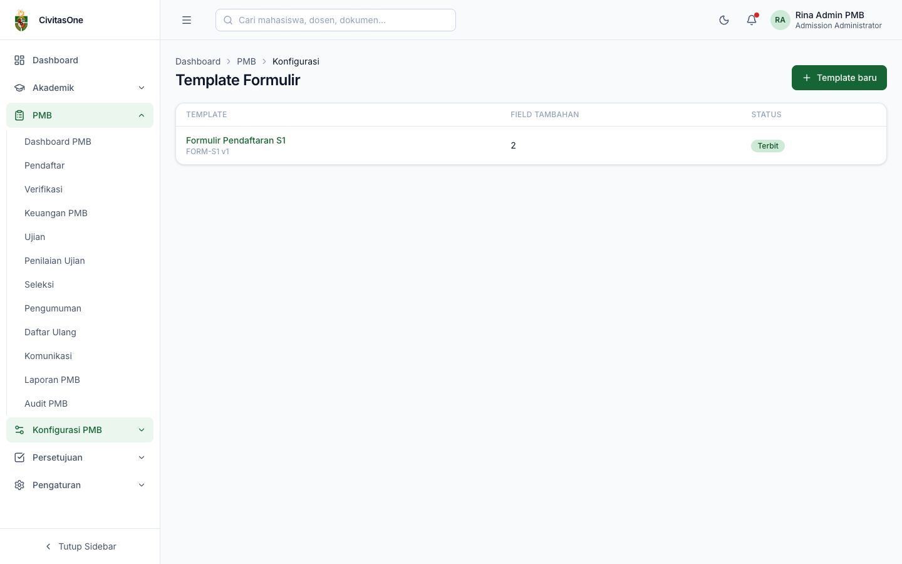
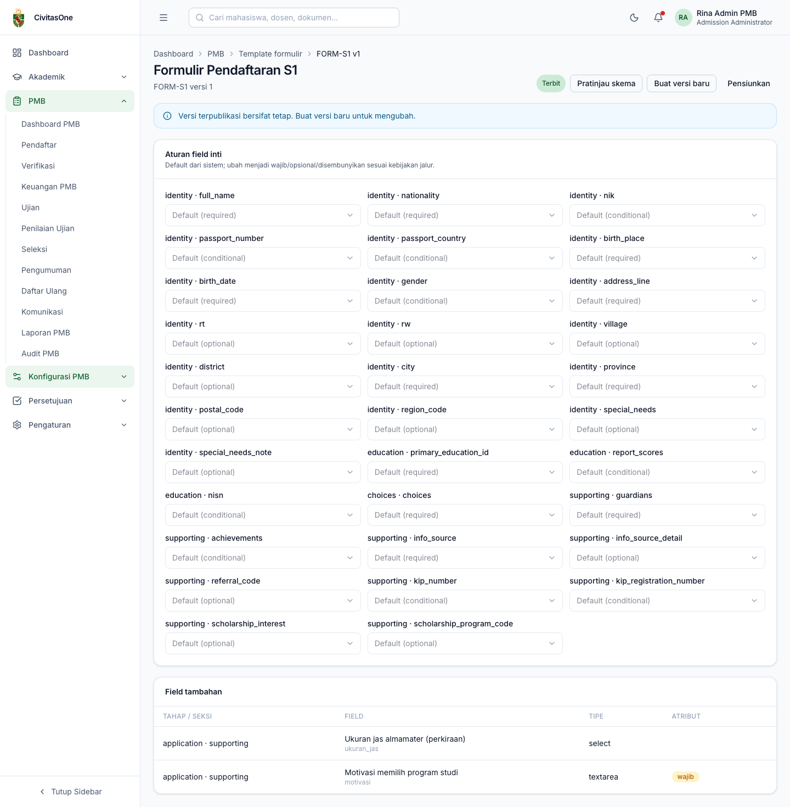
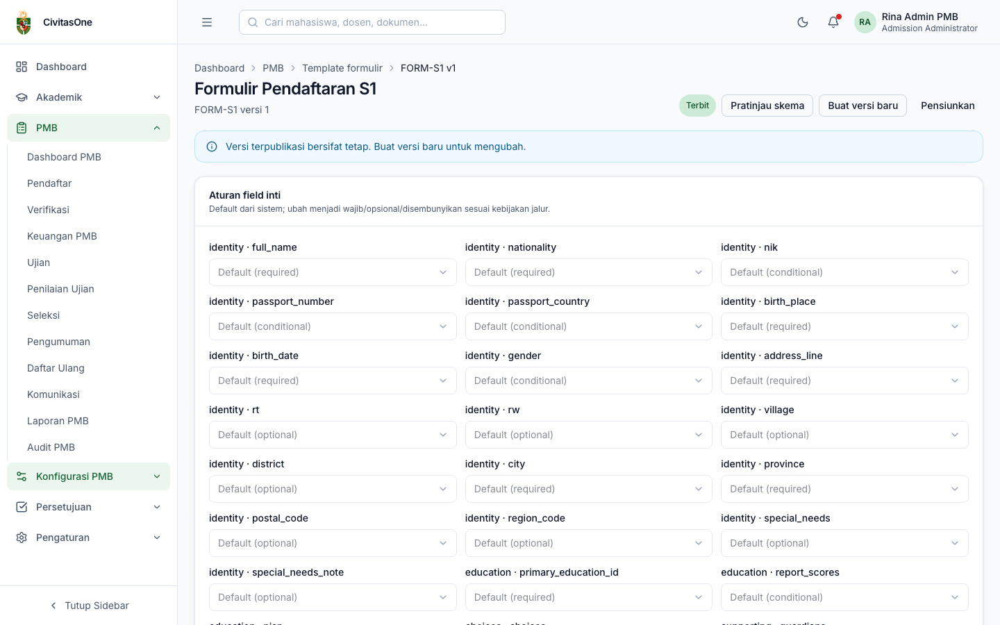

# 22. Template Formulir

[← Master Data](21-master-data.md) · [Daftar isi](README.md) · [Berikutnya: Skema Seleksi →](23-skema-seleksi.md)

**Untuk:** Administrator PMB (`pmb_config.update` untuk mengubah, `pmb_config.publish` untuk mempublikasikan).
**Menu:** **Konfigurasi PMB → Template Formulir**.

Template formulir menentukan **isian apa yang diminta** dari pendaftar pada jalur tertentu: aturan field inti (wajib/opsional/disembunyikan) dan field tambahan khusus kampus. Template **berversi**:

| Status | Arti |
|---|---|
| **Draf** | Masih dapat diubah. |
| **Terbit** (*published*) | Tetap, tidak dapat diubah; dapat dipilih pada gelombang-jalur. |
| **Pensiun** (*retired*) | Tidak dipakai untuk gelombang-jalur baru. |

Setiap pendaftaran menyimpan versi template yang dipakainya, sehingga perubahan template tidak memengaruhi pendaftaran yang sudah berjalan.

## 1. Daftar template

*Gambar 22.1 — Daftar template formulir.*

Klik **Template baru**, isi **Kode** dan **Nama**, lalu **Simpan**. Anda dibawa ke editor template (versi 1, status draf).

## 2. Editor template

*Gambar 22.2 — Editor template: aturan field inti dan field tambahan (contoh template yang sudah terbit).*

### 2.1 Aturan field inti

Field inti adalah isian standar sistem (identitas, pendidikan, pilihan prodi, data pendukung). Setiap field menampilkan **default sistem** (*required*, *optional*, atau *conditional*). Pilih **Wajib**, **Opsional**, atau **Disembunyikan** untuk mengubahnya pada template ini, lalu klik **Simpan aturan** (hanya pada template draf).

Contoh: menyembunyikan `identity · gender` bila kampus tidak mengumpulkan jenis kelamin, atau mewajibkan `education · nisn`.

### 2.2 Field tambahan

Pada template draf, klik **+ Field** untuk menambah isian khusus:

| Field | Keterangan |
|---|---|
| **Tahap** | *Pendaftaran* (tampil di formulir) atau *Daftar ulang*. |
| **Seksi** | `identity`, `education`, `choices`, `supporting`, atau `custom_<nama>`. Di portal, semua field tambahan tampil di langkah **Data pendukung** sebagai kartu **Isian tambahan — \<seksi\>**; seksi menentukan langkah mana yang ditandai *belum lengkap* bila field wajib belum diisi. Agar tidak membingungkan pendaftar, gunakan seksi `supporting` atau `custom_<nama>`. |
| **Kunci** | Huruf kecil dan garis bawah, unik dalam template (contoh `ukuran_jas`). |
| **Label** | Teks pertanyaan yang dilihat pendaftar. |
| **Tipe** | `text`, `textarea`, `number`, `date`, `select`, `multiselect`, `radio`, `checkbox`, `email`, `phone`, `url`, `file_ref`. |
| Opsi | Untuk `select`/`multiselect`/`radio`, dalam format JSON: `[{"value":"S","label":"S"},{"value":"M","label":"M"}]`. |
| Bantuan, Placeholder | Teks bantu di bawah/di dalam isian. |
| Wajib | Pendaftar tidak dapat mengirim formulir sebelum mengisinya. |
| Validasi | JSON, kunci yang didukung: `min`, `max`, `min_length`, `max_length`, `regex`, `before`, `after`. Contoh `{"max": 100}`. |
| Aturan tampil | JSON, contoh `{"field":"path_category","op":"eq","value":"kip_affirmation"}`. Field hanya dianggap berlaku bila aturan terpenuhi. |
| Data sensitif | Jawaban disimpan terenkripsi dan tampil tersamar bagi staf. |
| Muncul di laporan | Jawaban dapat dipakai pada laporan. |
| Urutan | Urutan tampil. |

Tabel **Field tambahan** menampilkan tahap/seksi, label & kunci, tipe, serta atribut (**wajib**, **sensitif**, **bersyarat**). Gunakan **Ubah** atau ikon hapus pada template draf.

> **Beda rancangan** — Rancangan ADM-16 menyebut pengurutan *drag*, pembuat kondisi visual, dan pratinjau langsung mobile/desktop. Versi ini memakai isian **Urutan** (angka) dan JSON untuk opsi/validasi/aturan tampil. Aturan tampil dievaluasi server untuk menentukan kewajiban isian, tetapi **portal tetap menampilkan semua field tambahan**. Field tambahan bertahap *Daftar ulang* belum ditampilkan di halaman daftar ulang portal. Lihat [lampiran 60](60-perbedaan-rancangan-implementasi.md).

### 2.3 Pratinjau skema

Klik **Pratinjau skema** untuk melihat struktur formulir (dalam format JSON) persis seperti yang diterima portal pendaftar. Gunakan ini untuk memeriksa aturan field inti dan field tambahan sebelum dipublikasikan.

*Gambar 22.3 — Pratinjau skema template.*

## 3. Publikasi, versi baru, dan pensiun

| Tombol | Fungsi |
|---|---|
| **Publikasikan** (draf) | Mengunci template. Konfirmasi: *"Publikasikan? Versi terpublikasi tidak dapat diubah lagi."* |
| **Buat versi baru** (terbit/pensiun) | Menyalin template menjadi versi berikutnya berstatus draf untuk diubah. |
| **Pensiunkan** (terbit) | Template tidak lagi dipilih untuk gelombang-jalur baru. |

Setelah versi baru dipublikasikan, ubah gelombang-jalur yang ingin memakainya ([bab 20 §4](20-periode-gelombang-kuota-biaya.md#4-membuka-jalur-pada-gelombang-gelombang-jalur)). Pendaftaran yang sudah dibuat tetap memakai versi lama.

---

[← Master Data](21-master-data.md) · [Daftar isi](README.md) · [Berikutnya: Skema Seleksi →](23-skema-seleksi.md)
