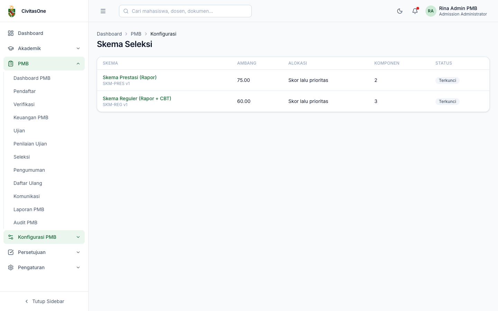
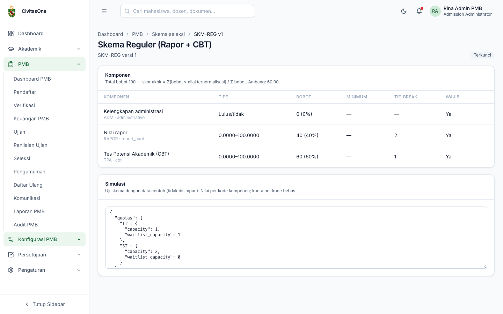
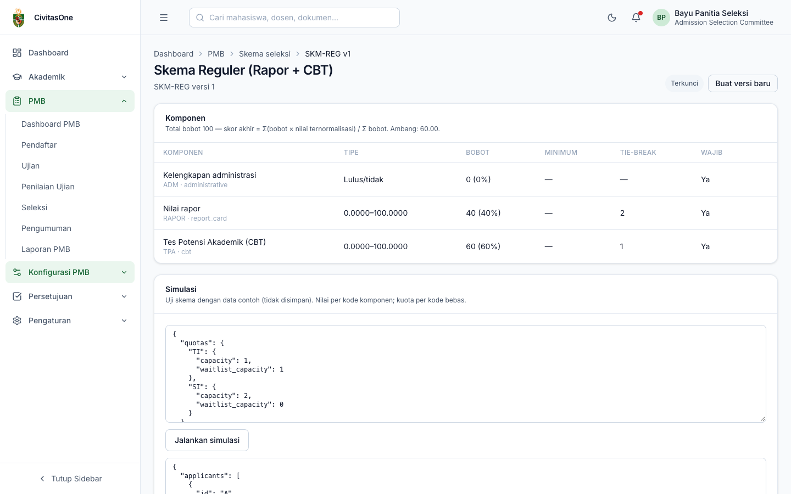

# 23. Skema Seleksi

[← Template Formulir](22-template-formulir.md) · [Daftar isi](README.md) · [Berikutnya: Konten Website & Profil Prodi →](24-konten-website-profil-prodi.md)

**Untuk:** Panitia Seleksi (`pmb_selection.update` untuk menyusun, `pmb_selection.finalize` untuk mengunci). Administrator PMB dapat melihat dan mengunci.
**Menu:** **Konfigurasi PMB → Skema Seleksi**.

Skema seleksi menentukan **bagaimana skor akhir dihitung** dan **bagaimana kursi dialokasikan** untuk jalur yang memakainya. Seperti template formulir, skema **berversi**: **Draf** (dapat diubah) → **Terkunci** (dipakai perhitungan, tidak dapat diubah).

## 1. Daftar skema

*Gambar 23.1 — Daftar skema: ambang, metode alokasi, jumlah komponen, status.*

Klik **Skema baru**, isi **Kode**, **Nama**, dan **Ambang skor akhir (0–100)** (opsional), lalu **Simpan**.

## 2. Komponen penilaian

*Gambar 23.2 — Detail skema: komponen, bobot, dan persentase bobot.*

Klik **+ Komponen** (skema draf):

| Field | Keterangan |
|---|---|
| **Kode**, **Nama** | Contoh `RAPOR` *Nilai rapor*, `TPA` *Tes Potensi Akademik (CBT)*. Kode dipakai di matriks nilai, impor, dan simulasi. |
| **Sumber nilai** | `administrative` (kelengkapan administrasi), `report_card` (dihitung dari nilai rapor), `achievement` (prestasi), `written_exam` (ujian tulis), `cbt` (dari CBT), `interview` (wawancara), `portfolio`, `special_test`, `scholarship_assessment`. |
| **Tipe nilai** | *Angka* atau *Lulus/tidak*. Komponen lulus/tidak wajib lulus agar pendaftar eligible dan tidak menambah skor. |
| Nilai mentah minimum/maksimum | Rentang nilai asli (contoh 0–100). Dipakai untuk normalisasi. |
| **Bobot** | Bobot relatif. Kolom **Bobot** menampilkan persentasenya terhadap total. |
| Nilai minimum ternormalisasi | Bila diisi, pendaftar dengan nilai ternormalisasi di bawahnya **gugur**. |
| Wajib dinilai | Pendaftar tanpa nilai komponen ini tidak eligible. |
| Prioritas tie-break | `1` = dipakai pertama untuk memecah skor seri. |
| Normalisasi | *Min-max (0–100)*, atau *Z-score antarsesi* (untuk ujian multi-sesi; memerlukan persetujuan panitia di konfigurasi komponen). |
| Rubrik | Untuk wawancara/portofolio, JSON: `{"criteria":[{"key":"komunikasi","label":"Komunikasi","weight":50,"max":100}]}`. Penguji mengisi nilai per kriteria. |
| Konfigurasi | JSON tambahan, misalnya `{"semesters":[1,2,3,4,5]}` untuk rapor. |
| Urutan | Urutan tampil. |

**Pengaturan** skema (tombol **Pengaturan** pada draf): **Nama**, **Ambang skor akhir**, **Metode alokasi**, **Desimal pembulatan**, **Aturan tie-break** (JSON, misalnya `{"use_verified_at":true}`).

## 3. Cara sistem menghitung

Rumus mengikuti [06 §H.4](../../pmb/06-spesifikasi-seleksi-ujian-pengumuman.md):

1. **Normalisasi** setiap komponen angka: `N = (nilai − min) / (max − min) × 100` (atau z-score antarsesi).
2. **Skor akhir** = Σ (bobot × N) / Σ bobot, dari komponen angka berbobot > 0 yang tersedia, dibulatkan sesuai pengaturan.
3. Pendaftar **eligible** bila sudah terverifikasi, semua komponen wajib tersedia, nilai minimum komponen terpenuhi, dan semua komponen lulus/tidak **lulus**.
4. **Alokasi** (metode *Skor lalu prioritas pilihan*): pendaftar eligible diurutkan menurut skor akhir (seri dipecah menurut komponen tie-break, lalu waktu verifikasi bila diaktifkan). Secara berurutan, setiap pendaftar ditempatkan pada **pilihan prioritas tertinggi** yang kursinya masih ada dan ambangnya terpenuhi (ambang kuota bila diisi; selain itu ambang skema). Metode *Pilihan pertama saja* hanya mempertimbangkan pilihan 1.
5. Yang tidak mendapat kursi tetapi memenuhi ambang menjadi **cadangan** (sampai kapasitas cadangan); selebihnya **tidak lulus**.

Contoh: skema `SKM-REG` = Kelengkapan administrasi (lulus/tidak) + Rapor (bobot 40) + TPA CBT (bobot 60), ambang 60. Rapor 90 dan TPA 100 menghasilkan skor (40×90 + 60×100)/100 = 96.

## 4. Simulasi

Kartu **Simulasi** menguji skema dengan data contoh **tanpa menyimpan apa pun**:

1. Edit JSON contoh: `quotas` (kode kuota bebas dengan `capacity` dan `waitlist_capacity`) dan `applicants` (nilai per **kode komponen** dan daftar pilihan kuota).
2. Klik **Jalankan simulasi**. Hasil perhitungan (skor, peringkat, rekomendasi, penempatan) tampil di bawahnya.

*Gambar 23.3 — Hasil simulasi skema.*

> **Beda rancangan** — Rancangan ADM-17 menyebut unggah contoh nilai dan pengaturan urutan tie-break dengan *drag*. Versi ini memakai isian JSON untuk simulasi dan aturan tie-break, serta angka prioritas pada komponen.

## 5. Mengunci skema dan versi baru

- Bila skema belum memenuhi syarat, kotak **Belum dapat dikunci** menyebutkan masalahnya, misalnya *"Skema belum memiliki komponen"*, *"Total bobot komponen harus lebih dari 0"*, *"nilai maksimum harus lebih besar dari minimum"*, rubrik tidak valid, ambang di luar 0–100, atau tie-break merujuk komponen yang tidak ada.
- Klik **Kunci skema** dan konfirmasi. Skema terkunci dapat dipilih pada gelombang-jalur dan dipakai run seleksi.
- Untuk mengubah skema terkunci, klik **Buat versi baru**, ubah versi draf tersebut, kunci, lalu pilih versi baru pada gelombang-jalur.

---

[← Template Formulir](22-template-formulir.md) · [Daftar isi](README.md) · [Berikutnya: Konten Website & Profil Prodi →](24-konten-website-profil-prodi.md)
