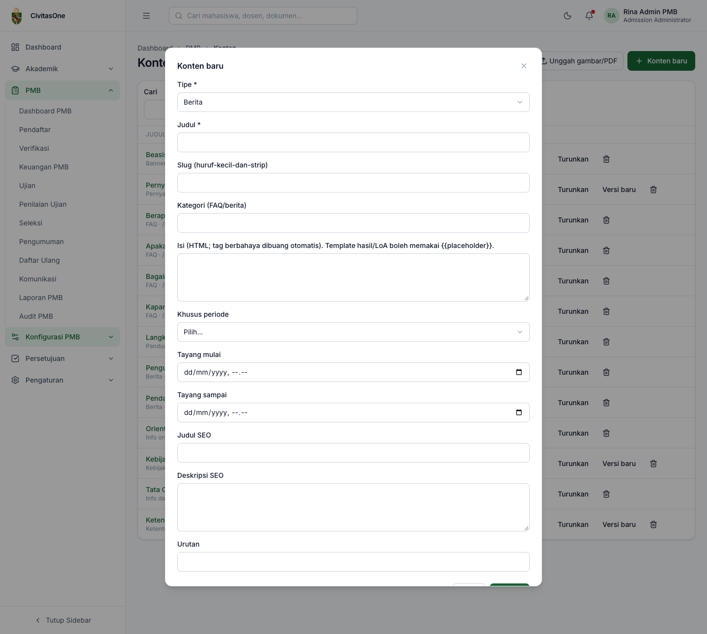
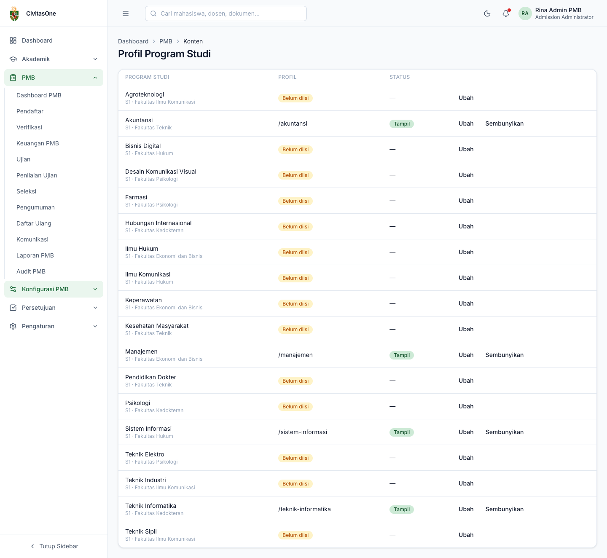
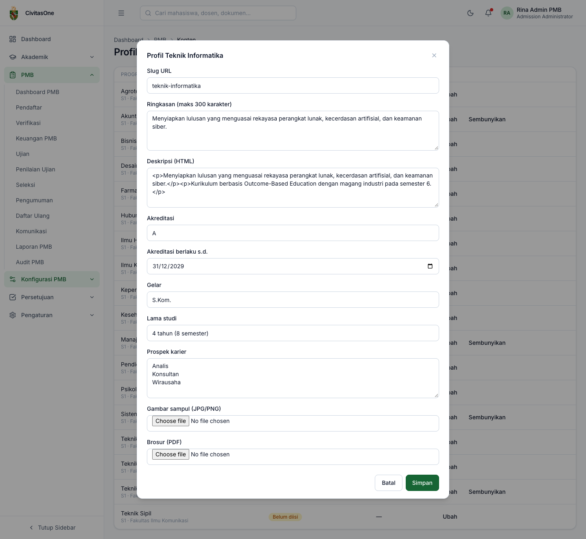

# 24. Konten Website & Profil Prodi

[← Skema Seleksi](23-skema-seleksi.md) · [Daftar isi](README.md) · [Berikutnya: Pengaturan PMB →](25-pengaturan-pmb.md)

**Untuk:** Administrator PMB (`pmb_content.update`); Dekan/Kaprodi untuk profil prodi dalam cakupannya (`pmb_program_profiles.update`).
**Menu:** **Konfigurasi PMB → Konten Website** dan **Konfigurasi PMB → Profil Prodi**.

## 1. Konten website

*Gambar 24.1 — Daftar konten website PMB.*

Daftar dapat disaring berdasarkan **Tipe** dan **Status** (**Draf**, **Terbit**, **Arsip**). Klik judul untuk mengubah. Aksi per baris: **Terbitkan**/**Turunkan**, **Versi baru** (untuk tipe berversi), dan hapus.

### 1.1 Tipe konten

| Tipe | Tampil di | Catatan |
|---|---|---|
| Halaman | `/pmb/halaman/<slug>` | Halaman bebas. |
| FAQ | Menu **FAQ**, Beranda | Isi **Kategori** untuk pengelompokan. |
| Berita | Menu **Berita**, Beranda | Urut berdasarkan tanggal tayang. |
| Panduan | Menu **Panduan** | — |
| Brosur | — | Belum ada halaman website yang menampilkan tipe ini. Untuk brosur per prodi, unggah PDF lewat **Profil Prodi** (§2) agar muncul tombol *Unduh brosur*. |
| Banner beranda | Beranda | Kartu pengumuman singkat. |
| Pernyataan pendaftar | Langkah **Pernyataan & kirim** di formulir dan konfirmasi tawaran | **Berversi**. Setiap pendaftar menyetujui versi yang berlaku saat itu. |
| Kebijakan privasi | Kaki halaman, formulir daftar akun | **Berversi**, **wajib terbit** sebelum publikasi periode. |
| Ketentuan pendaftaran | Kaki halaman, formulir daftar akun | **Berversi**, **wajib terbit** sebelum publikasi periode. |
| Template hasil | — | Berversi. Lihat catatan di bawah. |
| Template LoA | Isi surat penerimaan (PDF) | Berversi. Mendukung placeholder (lihat §1.3). |
| Info orientasi | Halaman daftar ulang setelah resmi mahasiswa | — |
| Info daftar ulang | Halaman **Info Daftar Ulang** | — |

> **Perlu konfirmasi** — Tipe *Template hasil* dapat dibuat, tetapi halaman hasil seleksi di portal belum memakai isinya (teks hasil bersifat baku).

### 1.2 Membuat/mengubah konten

1. Klik **Konten baru** (atau judul konten).
2. Isi form:

*Gambar 24.2 — Form konten.*

| Field | Keterangan |
|---|---|
| **Tipe** | Hanya saat membuat. |
| **Judul** | Wajib. |
| Slug | Bagian alamat halaman (huruf kecil dan tanda strip). Kosongkan agar dibuat otomatis. |
| Kategori | Untuk FAQ/berita. |
| Isi | HTML. Tag berbahaya (misalnya skrip) dibuang otomatis. |
| Khusus periode | Batasi konten ke satu periode (opsional). |
| Tayang mulai / Tayang sampai | Jadwal tayang otomatis. |
| Judul SEO / Deskripsi SEO | Untuk mesin pencari. |
| Urutan | Urutan tampil (misalnya urutan FAQ). |

3. Klik **Simpan** (tersimpan sebagai draf), lalu **Terbitkan** pada daftar.

**Gambar dan PDF dalam konten:** klik **Unggah gambar/PDF**, pilih berkas. Setelah diunggah, URL berkas otomatis **disalin ke clipboard**; tempelkan ke isi konten, misalnya `` atau `<a href="URL">Unduh brosur</a>`.

> **Penting** — Konten berversi yang sudah terbit **tidak dapat diubah** (*"Versi terpublikasi tidak dapat diubah; buat versi baru."*). Klik **Versi baru**, ubah draf versi baru, lalu **Terbitkan**. Versi lama tetap tercatat beserta persetujuan pendaftar terhadapnya.

### 1.3 Placeholder template LoA

| Placeholder | Diganti dengan |
|---|---|
| `{{applicant_name}}` | Nama pendaftar |
| `{{registration_number}}` | Nomor pendaftaran |
| `{{program_name}}`, `{{study_system}}` | Prodi & sistem kuliah diterima |
| `{{path_name}}`, `{{period_name}}` | Jalur & periode |
| `{{deadline}}` | Batas daftar ulang |
| `{{letter_number}}`, `{{issued_date}}` | Nomor & tanggal surat |
| `{{university_name}}` | Nama kampus |
| `{{verification_url}}` | Alamat verifikasi keaslian surat |

Bila tidak ada template LoA yang terbit, surat memakai format baku sistem. Kode QR verifikasi selalu dicantumkan.

## 2. Profil program studi

*Gambar 24.3 — Daftar prodi beserta status profilnya.*

Daftar menampilkan semua prodi dalam cakupan Anda, slug profil (atau **Belum diisi**), dan status **Tampil**/**Disembunyikan**. Hanya prodi dengan profil **Tampil** yang muncul di website.

1. Klik **Ubah** pada prodi.
2. Isi form, lalu **Simpan**:

*Gambar 24.4 — Form profil prodi.*

| Field | Keterangan |
|---|---|
| Slug URL | Alamat profil, contoh `teknik-informatika` → `/pmb/prodi/teknik-informatika`. |
| Ringkasan | Maksimal 300 karakter; tampil di kartu prodi. |
| Deskripsi | HTML. |
| Akreditasi, Akreditasi berlaku s.d. | Ditampilkan di ringkasan prodi. |
| Gelar, Lama studi | Contoh *S.Kom.*, *4 tahun (8 semester)*. |
| Prospek karier | Satu baris per prospek. |
| Gambar sampul (JPG/PNG), Brosur (PDF) | Diunggah dan ditautkan otomatis. |

3. Klik **Publikasikan** untuk menampilkan, atau **Sembunyikan** untuk menurunkan.

> **Catatan** — Nama prodi, fakultas, dan jenjang berasal dari modul Akademik, bukan dari profil ini.

---

[← Skema Seleksi](23-skema-seleksi.md) · [Daftar isi](README.md) · [Berikutnya: Pengaturan PMB →](25-pengaturan-pmb.md)
