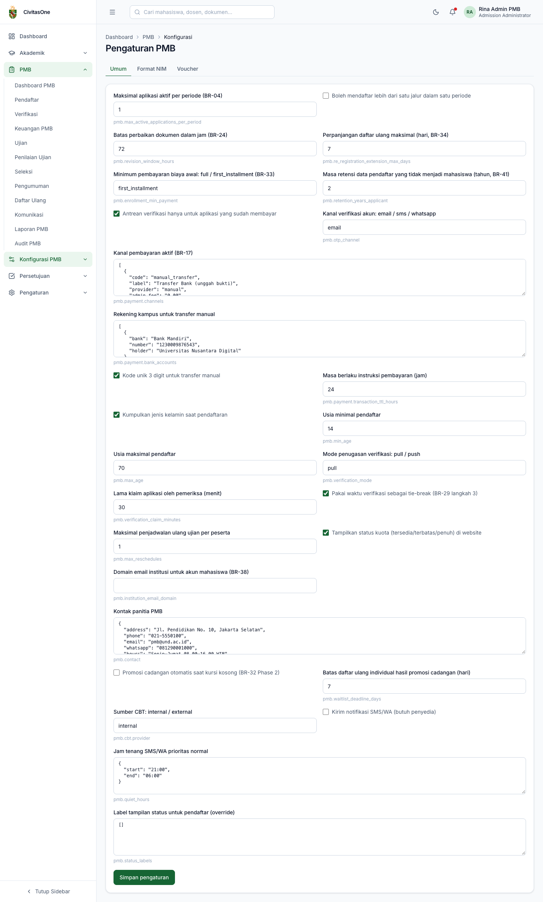
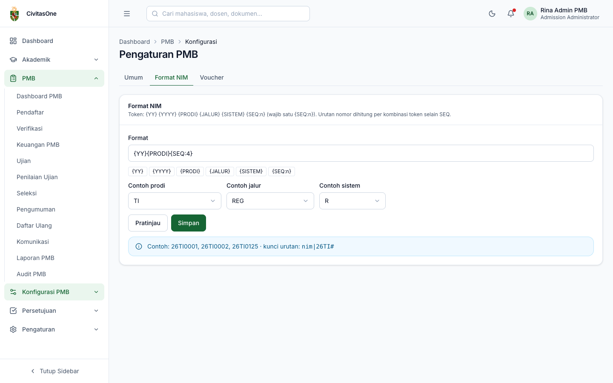
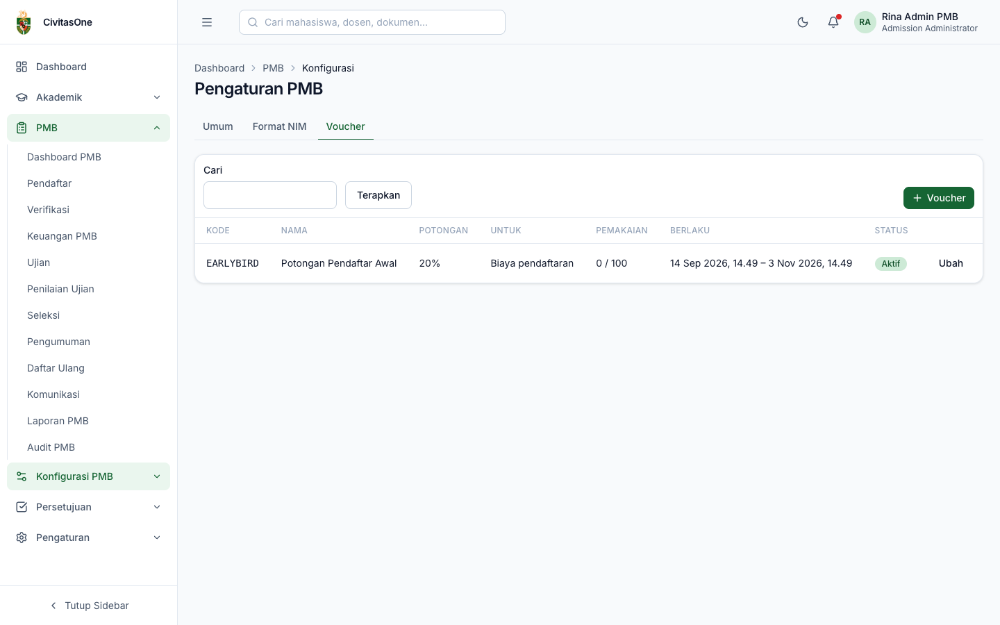

# 25. Pengaturan PMB, Format NIM, dan Voucher

[← Konten Website & Profil Prodi](24-konten-website-profil-prodi.md) · [Daftar isi](README.md) · [Berikutnya: Dashboard PMB →](30-dashboard-pmb.md)

**Untuk:** Administrator PMB (`pmb_config.update`; format NIM memerlukan `pmb_nim.update`).
**Menu:** **Konfigurasi PMB → Pengaturan PMB**, dengan tab **Umum**, **Format NIM**, **Voucher**.

## 1. Tab Umum

*Gambar 25.1 — Pengaturan umum PMB.*

Setiap pengaturan ditampilkan dengan keterangan dan kuncinya (huruf kecil di bawah isian). Jenis isian: centang (ya/tidak), angka/teks, atau JSON (kotak teks berhuruf monospasi). Ubah nilai lalu klik **Simpan pengaturan**. Perubahan pengaturan tercatat di audit.

| Kunci | Default | Keterangan |
|---|---|---|
| `pmb.max_active_applications_per_period` | 1 | Maksimal pendaftaran aktif per akun dalam satu periode (BR-04). |
| `pmb.allow_multi_path_per_period` | tidak | Boleh mendaftar lebih dari satu jalur dalam satu periode. |
| `pmb.revision_window_hours` | 72 | Batas waktu perbaikan setelah diminta verifikator (jam), maksimal sampai batas perbaikan formulir gelombang (BR-24). |
| `pmb.re_registration_extension_max_days` | 7 | Perpanjangan daftar ulang maksimal (hari, BR-34). |
| `pmb.enrollment_min_payment` | `first_installment` | Minimum pembayaran biaya awal agar dapat daftar ulang: `full` (lunas) atau `first_installment` (cicilan pertama) (BR-33). |
| `pmb.retention_years_applicant` | 2 | Masa retensi data pendaftar yang tidak menjadi mahasiswa (tahun, BR-41). |
| `pmb.nim_format` | `{YY}{PRODI}{SEQ:4}` | Diatur di tab **Format NIM**. |
| `pmb.verification_requires_payment` | ya | Antrean verifikasi hanya berisi pendaftaran yang sudah membayar. |
| `pmb.otp_channel` | `email` | Kanal verifikasi akun: `email`, `sms`, `whatsapp`. |
| `pmb.payment.channels` | transfer manual, loket | Daftar kanal pembayaran aktif (JSON): kode, label, penyedia, biaya admin, penanggung biaya, urutan, aktif (BR-17). |
| `pmb.payment.bank_accounts` | — | Rekening kampus untuk transfer manual (JSON), contoh `[{"bank":"Bank Mandiri","number":"1230009876543","holder":"Universitas …"}]`. Ditampilkan di instruksi transfer. |
| `pmb.payment.unique_code_enabled` | ya | Tambahkan kode unik 3 digit pada nominal transfer manual. |
| `pmb.payment.transaction_ttl_hours` | 24 | Masa berlaku instruksi pembayaran (jam). |
| `pmb.collect_gender` | ya | Kumpulkan jenis kelamin saat pendaftaran. |
| `pmb.min_age` / `pmb.max_age` | 14 / 70 | Rentang usia pendaftar. |
| `pmb.verification_mode` | `pull` | Penugasan verifikasi: `pull` (petugas mengambil sendiri) atau `push` (ditugaskan). |
| `pmb.verification_claim_minutes` | 30 | Lama klaim aplikasi oleh pemeriksa (menit) sebelum kembali ke antrean. |
| `pmb.tie_break_use_verified_at` | ya | Waktu verifikasi dipakai sebagai pemecah seri terakhir (BR-29). |
| `pmb.max_reschedules` | 1 | Maksimal penjadwalan ulang ujian per peserta. |
| `pmb.show_quota_status` | tidak | Tampilkan label *Kuota tersedia/terbatas/penuh* di website. |
| `pmb.institution_email_domain` | — | Domain email institusi untuk akun mahasiswa baru (BR-38). Kosong = memakai email pribadi. |
| `pmb.contact` | — | Kontak panitia (JSON): `address`, `phone`, `email`, `whatsapp`, `hours`, `map_url`. Ditampilkan di website. |
| `pmb.auto_promote_waitlist` | tidak | Promosi cadangan otomatis saat ada kursi kosong (BR-32). |
| `pmb.waitlist_deadline_days` | 7 | Batas daftar ulang individual bagi cadangan yang dipromosikan (hari). |
| `pmb.cbt.provider` | `internal` | Sumber CBT: `internal` atau `external`. |
| `pmb.sms.enabled` | tidak | Kirim notifikasi SMS/WA (membutuhkan penyedia). |
| `pmb.quiet_hours` | 21:00–06:00 | Jam tenang SMS/WA untuk notifikasi berprioritas normal (JSON). |
| `pmb.status_labels` | — | Mengganti label tahap yang dilihat pendaftar (JSON), contoh `{"awaiting_payment":"Silakan bayar biaya pendaftaran"}`. |

> **Penting** — Isian JSON harus valid. Bila format JSON salah, penyimpanan gagal; periksa tanda kutip ganda dan koma.

## 2. Tab Format NIM

*Gambar 25.2 — Format NIM dengan pratinjau.*

| Token | Arti |
|---|---|
| `{YY}` / `{YYYY}` | Tahun angkatan (2 / 4 digit). |
| `{PRODI}` | Kode program studi (dari modul Akademik). |
| `{JALUR}` | Kode jalur masuk. |
| `{SISTEM}` | Kode sistem kuliah. |
| `{SEQ:n}` | Nomor urut dengan *n* digit. **Wajib ada satu.** |

Langkah:

1. Ketik format pada **Format** atau klik tombol token untuk menambahkannya.
2. Pilih **Contoh prodi**, **Contoh jalur**, **Contoh sistem**, lalu klik **Pratinjau**. Tampil contoh NIM dan **kunci urutan**.
3. Klik **Simpan**.

Nomor urut dihitung **per kombinasi token selain `{SEQ}`**. Contoh: format `{YY}{PRODI}{SEQ:4}` menghasilkan urutan terpisah untuk setiap prodi per angkatan (`27TEK30001`, `27TEK30002`, … dan `27SIS40001`, …).

> **Catatan** — Pratinjau memakai tahun berjalan. NIM sebenarnya memakai tahun angkatan sesuai semester masuk periode (data demo: angkatan 2027 → `27…`). Kode prodi pada data demo (misalnya `TEK3`) berbeda dengan contoh pada pratinjau.

> **Perlu konfirmasi** — Format NIM resmi setiap kampus perlu ditetapkan sebelum daftar ulang pertama (rancangan Q-REG-01 menyarankan `{YY}{KODE_PRODI}{SEQ:4}`). Mengubah format setelah ada NIM terbit tidak mengubah NIM yang sudah ada.

## 3. Tab Voucher

*Gambar 25.3 — Daftar voucher.*

Klik **+ Voucher** (atau **Ubah**):

| Field | Keterangan |
|---|---|
| **Kode**, **Nama** | Kode yang diketik pendaftar (huruf kapital), contoh `EARLYBIRD`. |
| **Berlaku untuk** | *Biaya pendaftaran* atau *Biaya awal kuliah*. |
| **Jenis potongan**, **Nilai potongan** | *Persen* atau *Nominal tetap*. |
| Potongan maksimum (Rp) | Batas potongan untuk jenis persen. |
| Kuota pemakaian | Jumlah maksimal pemakaian. |
| Berlaku mulai / sampai | Masa berlaku. |
| Batasan | JSON, misalnya `{"wave_path_ids":["…"]}` untuk membatasi ke gelombang-jalur tertentu. |
| Aktif | Voucher nonaktif tidak dapat dipakai. |

Kolom **Pemakaian** menampilkan *terpakai / kuota*. Voucher yang sudah pernah dipakai tidak dapat dihapus; nonaktifkan saja.

---

[← Konten Website & Profil Prodi](24-konten-website-profil-prodi.md) · [Daftar isi](README.md) · [Berikutnya: Dashboard PMB →](30-dashboard-pmb.md)
