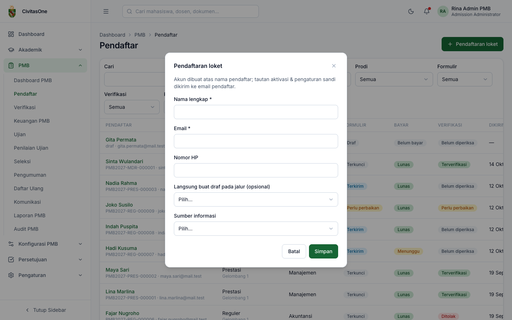
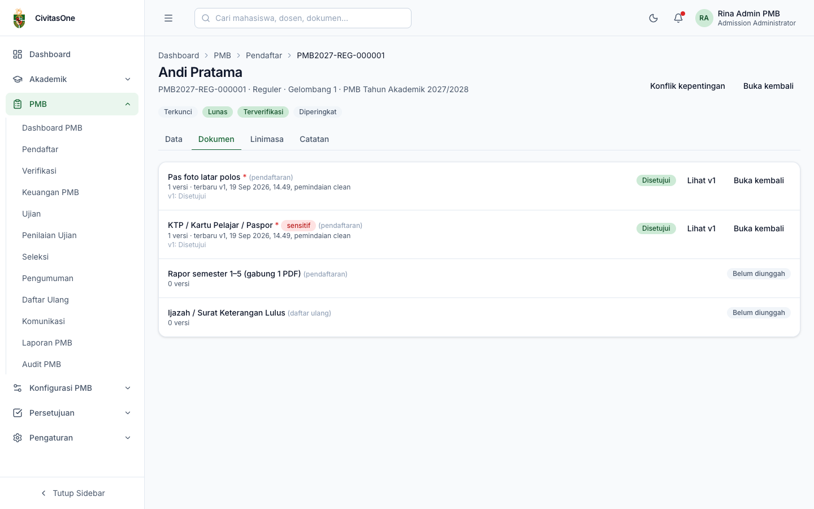
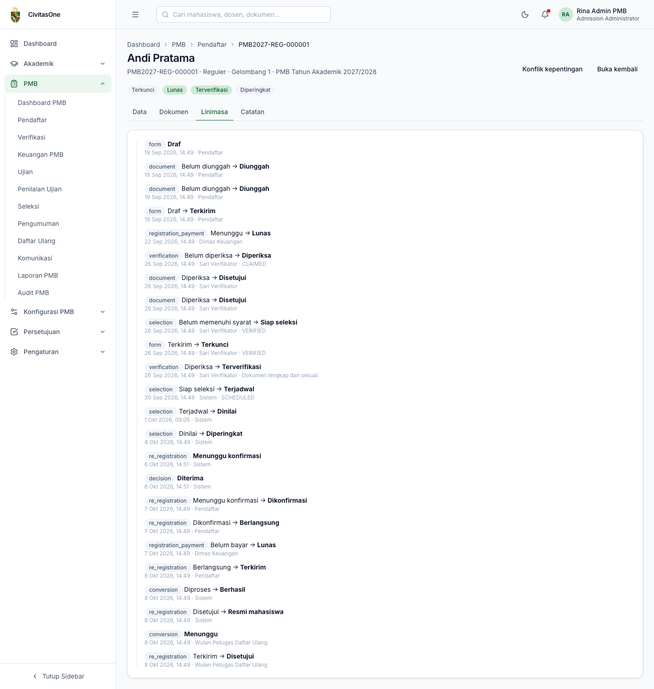
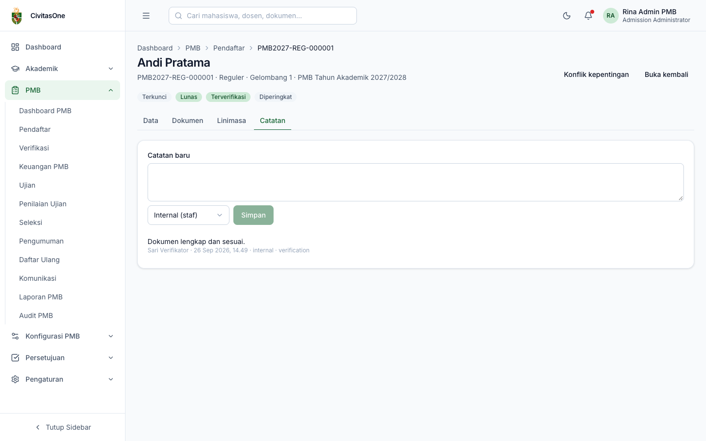

# 31. Data Pendaftar

[← Dashboard PMB](30-dashboard-pmb.md) · [Daftar isi](README.md) · [Berikutnya: Verifikasi Administrasi →](32-verifikasi-administrasi.md)

**Untuk:** peran dengan `pmb_applications.read` (Admin PMB, verifikator, panitia, keuangan, petugas daftar ulang, pengesah, dekan/kaprodi dalam cakupannya, auditor). Aksi koreksi memerlukan izin tambahan.
**Menu:** **PMB → Pendaftar**.

## 1. Daftar pendaftar

*Gambar 31.1 — Daftar pendaftar dengan filter.*

| Filter | Keterangan |
|---|---|
| **Cari** | Nama, nomor pendaftaran, atau email (tekan Enter atau **Terapkan**). |
| **Periode**, **Jalur**, **Prodi** | Menyaring berdasarkan konfigurasi. |
| **Formulir** | Draf, Terkirim, Perlu perbaikan, Terkunci, Ditarik, Batal. |
| **Verifikasi** | Belum diperiksa, Diperiksa, Perlu perbaikan, Terverifikasi, Ditolak. |
| **Pembayaran** | Belum bayar, Menunggu, Lunas, Tidak perlu, Kedaluwarsa. |

Kolom: pendaftar (nama, nomor pendaftaran/*draf*, email), jalur & gelombang, pilihan 1, status formulir, status bayar, status verifikasi & petugas pemeriksa, waktu kirim. Klik nama untuk membuka detail.

> **Beda rancangan** — Rancangan ADM-30 menyebut filter tersimpan, pilihan kolom, dan filter tambahan (gelombang, sistem kuliah, rentang tanggal, flag, sumber informasi). Versi ini menyediakan filter di atas; data lengkap dapat diambil melalui [Laporan](40-laporan.md).

## 2. Pendaftaran loket (dibantu panitia)

Untuk calon mahasiswa yang datang langsung ke kampus (izin `pmb_applications.create`, dimiliki Admin PMB dan verifikator):

1. Klik **Pendaftaran loket**.
2. Isi **Nama lengkap**, **Email**, Nomor HP, (opsional) **Langsung buat draf pada jalur** (hanya gelombang-jalur yang sedang dibuka), dan Sumber informasi.
3. Klik **Simpan**. Akun dibuat atas nama pendaftar; tautan aktivasi & pengaturan sandi dikirim ke email pendaftar. Bila draf dibuat, Anda diarahkan ke detail pendaftaran tersebut.

*Gambar 31.2 — Dialog pendaftaran loket.*

> **Catatan** — Pendaftar tetap melengkapi formulir dan mengirimnya sendiri setelah mengatur kata sandi; pada detail akun tercatat **Dibuat loket: Ya**.

## 3. Detail pendaftar

Bagian atas menampilkan nama, nomor pendaftaran, jalur, gelombang, periode, dan label status (formulir, pembayaran, verifikasi, seleksi), petugas yang sedang memeriksa, serta **Indikasi duplikat** bila ada. Detail terbagi dalam empat tab.

### 3.1 Tab Data

*Gambar 31.3 — Tab Data pada detail pendaftar.*

| Kartu | Isi & aksi |
|---|---|
| **Akun** | Email, HP, status akun, waktu verifikasi email, apakah dibuat loket. **Bekukan akun** / **Cabut pembekuan** (wajib alasan; izin `pmb_applications.update`). Akun yang dibekukan tidak dapat masuk portal. |
| **Identitas** | Nama, NIK (tersamar), paspor, tempat & tanggal lahir, jenis kelamin, agama, nama ibu (tersamar), alamat, kebutuhan khusus. **Koreksi**: lihat §4. |
| **Pilihan prodi** | Daftar pilihan berurutan. **Ubah**: lihat §4. |
| **Pendidikan** | Riwayat pendidikan; yang dipakai diberi label **utama**, beserta rata-rata nilai rapor. |
| **Orang tua / wali** | Nama, hubungan, nomor HP. |
| **Data pendukung & isian tambahan** | Sumber informasi, KIP (tersamar), minat beasiswa, jawaban field tambahan. |
| **Pembayaran** | Tagihan pendaftaran & biaya awal: dibayar/total dan status. |
| **Seleksi & hasil** | Nilai per komponen (dengan label **terkunci**), ujian (nomor peserta, sesi, kehadiran), keputusan & versinya, tautan daftar ulang, NIM & status konversi. |

**Membuka data sensitif:** klik ikon mata 👁 di samping nilai tersamar, isi **Tujuan akses**, lalu **Buka**. Nilai asli ditampilkan; klik ikon mata tercoret untuk menyembunyikan kembali. Setiap pembukaan tercatat di **Audit PMB → Akses data sensitif**.

*Gambar 31.4 — Dialog membuka data sensitif dengan tujuan akses.*

### 3.2 Tab Dokumen

*Gambar 31.5 — Tab Dokumen: daftar dokumen, versi, riwayat tinjauan.*

Setiap dokumen menampilkan tahap (pendaftaran/daftar ulang), jumlah versi, versi terbaru beserta waktu dan hasil pemindaian, riwayat tinjauan per versi (keputusan, kode alasan, catatan untuk pendaftar, catatan internal), dan status. Tombol **Lihat v1**, **Lihat v2**, … membuka berkas lewat tautan sementara (izin `pmb_documents.read`); akses tercatat dengan tujuan *verifikasi dokumen*. Tombol **Tinjau** dan **Buka kembali** dijelaskan di [Verifikasi Administrasi](32-verifikasi-administrasi.md#4-meninjau-dokumen).

> **Beda rancangan** — Rancangan menyebut penampil dokumen di dalam halaman (zoom, rotasi) berdampingan dengan data. Versi ini membuka berkas di tab baru peramban.

### 3.3 Tab Linimasa

Riwayat semua perubahan status pendaftaran: siklus (*form*, *document*, *registration_payment*, *verification*, *selection*, *decision*, *re_registration*, *conversion*), status asal → status baru, waktu, pelaku (pendaftar, petugas, atau *Sistem*), serta kode/catatan alasan.

*Gambar 31.6 — Tab Linimasa.*

### 3.4 Tab Catatan

Tulis **Catatan baru**, pilih visibilitas **Internal (staf)** atau **Terlihat pendaftar**, lalu **Simpan**. Daftar catatan menampilkan penulis, waktu, visibilitas, dan konteks (misalnya catatan verifikasi).

*Gambar 31.7 — Tab Catatan.*

## 4. Koreksi data oleh panitia

Untuk pengguna dengan izin koreksi (`pmb_applications.update`, umumnya Admin PMB):

- **Koreksi identitas** (tombol **Koreksi** pada kartu Identitas): isi hanya field yang dikoreksi (nama lengkap, NIK, tempat/tanggal lahir, jenis kelamin, nama ibu), tulis **Alasan**, lalu konfirmasi. Koreksi nama/NIK setelah terverifikasi membuka ulang pemeriksaan KTP.
- **Ubah pilihan prodi** (tombol **Ubah** pada kartu Pilihan prodi): pilih Pilihan 1 dan 2 (kombinasi prodi — sistem kuliah) dan alasan.

Semua koreksi tercatat di audit beserta nilai sebelum dan sesudahnya.

> **Catatan** — Dialog **Ubah pilihan prodi** menampilkan semua kombinasi prodi × sistem kuliah. Pastikan kombinasi yang dipilih memang ditawarkan pada jalur tersebut; sistem menolak kombinasi yang tidak ditawarkan.

---

[← Dashboard PMB](30-dashboard-pmb.md) · [Daftar isi](README.md) · [Berikutnya: Verifikasi Administrasi →](32-verifikasi-administrasi.md)
