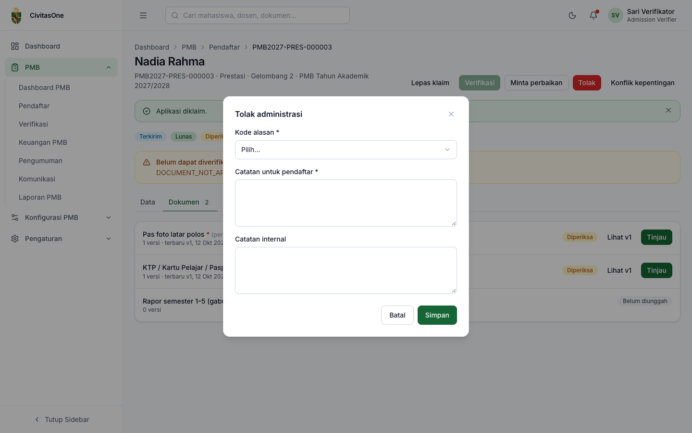
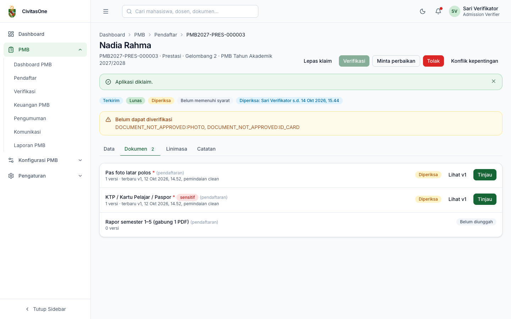
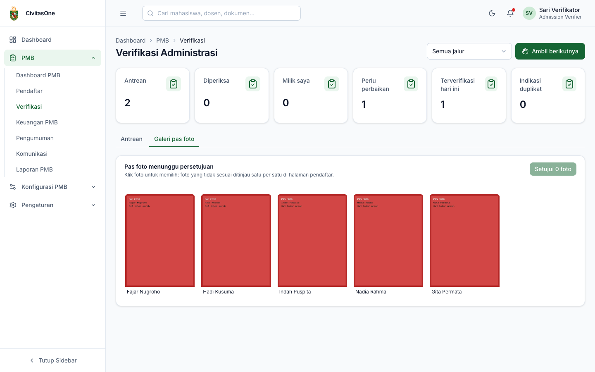

# 32. Verifikasi Administrasi

[← Data Pendaftar](31-data-pendaftar.md) · [Daftar isi](README.md) · [Berikutnya: Keuangan PMB →](33-keuangan-pmb.md)

**Untuk:** Petugas Verifikasi (`pmb_verification.approve`) dan Administrator PMB (juga `pmb_verification.update` untuk penugasan dan `pmb_verification.finalize` untuk override, duplikat, dan pemulihan akun).
**Menu:** **PMB → Verifikasi**.

Verifikasi administrasi memastikan formulir dan dokumen pendaftar benar dan lengkap sebelum pendaftar mengikuti seleksi. Hasilnya: **Terverifikasi**, **Perlu perbaikan**, atau **Ditolak**.

## 1. Halaman Verifikasi

*Gambar 32.1 — Halaman Verifikasi: statistik dan antrean.*

| Statistik | Arti |
|---|---|
| **Antrean** | Formulir terkirim (dan lunas, bila pengaturan mewajibkan) yang belum diperiksa siapa pun. |
| **Diperiksa** | Sedang diklaim petugas. |
| **Milik saya** | Klaim/tugas Anda. Daftarnya tampil di kartu **Klaim saya**. |
| **Perlu perbaikan** | Menunggu perbaikan pendaftar. |
| **Terverifikasi hari ini** | Selesai diverifikasi hari ini. |
| **Indikasi duplikat** | Indikasi akun ganda yang masih terbuka. |

Tab: **Antrean**, **Galeri pas foto**, serta (khusus Admin PMB) **Indikasi duplikat** dan **Pemulihan akun**.

> **Catatan** — Tabel **Antrean** menampilkan semua formulir terkirim yang belum diverifikasi, **termasuk yang biaya pendaftarannya belum lunas** (lihat kolom **Bayar**). Pendaftaran yang belum lunas tidak dapat diklaim (*"Biaya pendaftaran belum lunas."*) selama pengaturan `pmb.verification_requires_payment` aktif.

## 2. Mengambil pekerjaan (klaim)

**Cara cepat:** pilih jalur (opsional) di kanan atas, lalu klik **Ambil berikutnya**. Sistem mengklaim pendaftaran **terlama** yang siap diperiksa dan membuka detailnya. Bila tidak ada, tampil *"Antrean kosong."*

**Cara manual:** klik nama pendaftar di tabel, lalu **Klaim untuk diperiksa** pada halaman detail.

- Klaim berlaku **30 menit** (pengaturan `pmb.verification_claim_minutes`); setelah itu pendaftaran kembali ke antrean bila belum diputuskan. Label **Diperiksa: \<petugas\> s.d. \<jam\>** menunjukkan pemilik klaim.
- **Lepas klaim** mengembalikan pendaftaran ke antrean.
- Pendaftaran yang sudah Anda nyatakan **Konflik kepentingan** tidak akan diberikan kepada Anda.

## 3. Memeriksa pendaftaran

*Gambar 32.2 — Pendaftaran yang sedang diklaim, dengan tombol keputusan.*

1. Periksa tab **Data** (identitas, pendidikan, pilihan, data pendukung, pembayaran). Buka NIK/data sensitif bila perlu (wajib menyebut tujuan).
2. Buka tab **Dokumen** dan tinjau setiap dokumen (lihat §4).
3. Ambil keputusan:

| Tombol | Kapan | Isian |
|---|---|---|
| **Verifikasi** | Semua dokumen wajib **disetujui** dan pembayaran terpenuhi. | — |
| **Minta perbaikan** | Ada data/dokumen yang dapat diperbaiki pendaftar. | **Dokumen yang perlu diperbaiki**, **Data yang perlu diperbaiki** (misalnya `full_name`, `nik`, `birth_date`, `choices`), **Catatan untuk pendaftar** (wajib), **Batas perbaikan** (kosong = default 72 jam, tidak melewati batas perbaikan formulir gelombang). |
| **Tolak** | Pendaftar tidak memenuhi syarat. | **Kode alasan** (wajib), **Catatan untuk pendaftar** (wajib), Catatan internal. |

Bila tombol **Verifikasi** nonaktif, kotak **Belum dapat diverifikasi** menyebutkan penyebabnya dengan kode sistem:

| Kode | Arti |
|---|---|
| `DOCUMENT_NOT_APPROVED:<KODE>` | Dokumen wajib dengan kode tersebut belum disetujui (misalnya `PHOTO`, `ID_CARD`). |
| `PAYMENT_NOT_SATISFIED` | Biaya pendaftaran belum lunas. |

| | |
|---|---|
|  |  |

*Gambar 32.3 — Dialog Minta perbaikan dan Tolak administrasi.*

Kode alasan penolakan administrasi: `INELIGIBLE_EDUCATION` (pendidikan tidak memenuhi syarat), `INELIGIBLE_AGE` (usia tidak memenuhi), `FALSIFIED_DATA` (data dipalsukan), `DUPLICATE_APPLICATION` (pendaftaran ganda), `INCOMPLETE_AFTER_REVISION` (tidak lengkap setelah perbaikan), `OTHER`.

**Dampak keputusan:**

- **Terverifikasi**: formulir **terkunci**, status seleksi menjadi *Siap seleksi*, dan pendaftar dapat dijadwalkan ujian.
- **Perlu perbaikan**: pendaftar mendapat notifikasi; setelah memperbaiki dan mengirim ulang, pendaftaran kembali ke antrean.
- **Ditolak**: tahap pendaftar menjadi *Tidak lolos administrasi* dengan catatan Anda.

> **Beda rancangan** — Rancangan menyebut pintasan keyboard (`J`/`K`, `A`, `R`) dan panel data–dokumen berdampingan. Versi ini memakai tombol dan tab.

## 4. Meninjau dokumen

*Gambar 32.4 — Tab Dokumen saat pendaftaran diklaim.*

1. Klik **Lihat v\<n\>** untuk membuka berkas.
2. Klik **Tinjau**, pilih **Keputusan**:
   - **Setujui**;
   - **Minta perbaikan** atau **Tolak**: wajib memilih **Kode alasan** dan sebaiknya mengisi **Catatan untuk pendaftar**.
3. Isi **Catatan internal** bila perlu, lalu **Simpan**.

*Gambar 32.5 — Dialog tinjau dokumen.*

Kode alasan dokumen: `UNREADABLE` (tidak terbaca), `WRONG_DOCUMENT` (salah dokumen), `INCOMPLETE_PAGES` (halaman tidak lengkap), `EXPIRED` (kedaluwarsa), `NAME_MISMATCH` (nama tidak sesuai), `DATA_MISMATCH` (data tidak sesuai), `NOT_LEGALIZED` (belum dilegalisir), `SUSPECTED_FORGERY` (dugaan pemalsuan), `PHOTO_NOT_COMPLIANT` (pas foto tidak sesuai), `OTHER`.

> **Catatan** — Untuk alasan `SUSPECTED_FORGERY`, pendaftar hanya melihat pesan umum *"Dokumen tidak dapat diterima, hubungi panitia."*, dan panitia terkait diberi tahu.

Admin PMB dapat **Buka kembali** dokumen yang sudah disetujui (dengan kode alasan & catatan) agar dapat diunggah ulang.

## 5. Galeri pas foto (persetujuan massal)

Tab **Galeri pas foto** menampilkan pas foto berstatus *diunggah/diperiksa*. Klik foto yang sesuai (bingkai hijau = terpilih), lalu **Setujui N foto**. Foto yang tidak sesuai ditinjau satu per satu di halaman pendaftar.

*Gambar 32.6 — Galeri pas foto.*

> **Perlu konfirmasi** — Galeri juga menampilkan pas foto dari draf yang belum dikirim dan dari pendaftaran yang sudah ditolak (contoh pada gambar: Gita Permata — draf, Fajar Nugroho — ditolak). Pilih hanya foto pendaftar yang sedang diproses.

## 6. Penugasan & verifikasi massal (Admin PMB)

Pada tab **Antrean**, centang beberapa pendaftaran, lalu:

- **Tugaskan ke petugas**: pilih **Petugas verifikasi** (bisa lebih dari satu) dan **Strategi** (*Bergiliran* atau *Per jalur*). Penugasan tidak kedaluwarsa seperti klaim.
- **Verifikasi massal**: memverifikasi sekaligus pendaftaran yang memenuhi syarat dan berada pada gelombang-jalur yang mengizinkan *verifikasi massal*. Pesan menunjukkan jumlah yang berhasil; yang tidak memenuhi syarat dilewati.

## 7. Indikasi duplikat dan pemulihan akun (Admin PMB)

**Indikasi duplikat**: sistem menandai akun yang kemungkinan sama (misalnya NIK sama). Tabel menampilkan akun, akun terkait, jenis, skor kemiripan, pendaftaran, dan status. Klik **Putuskan**:

| Keputusan | Dampak |
|---|---|
| Bukan duplikat | Indikasi ditutup. |
| Konfirmasi duplikat | Akun sekunder dinonaktifkan dan pendaftaran aktifnya ditarik. Isi **ID akun sekunder**. |
| Gabungkan | Akun digabung. Isi **ID akun sekunder**. |

**Pemulihan akun**: daftar permintaan dari [formulir pemulihan akun](11-akun-pendaftar.md#5-pemulihan-akun-tidak-bisa-mengakses-emailhp).

1. Bandingkan data pemohon dengan **Akun cocok** (atau *Tidak ditemukan*).
2. Klik **Lihat identitas** untuk membuka foto identitas (tercatat di log akses sensitif).
3. Klik **Putuskan**, centang **Setujui** bila sesuai, isi **Catatan**, **Simpan**. Bila disetujui, email akun diganti dan tautan atur sandi dikirim ke email baru.

## 8. Konflik kepentingan dan buka kembali

- **Konflik kepentingan**: bila Anda mengenal pendaftar secara pribadi, klik tombol ini dan isi alasan. Anda tidak dapat memeriksa pendaftar tersebut.
- **Buka kembali** (Admin PMB, untuk pendaftaran *Terverifikasi*/*Ditolak*): membatalkan keputusan verifikasi dengan alasan, sehingga pendaftaran dapat diperiksa ulang. Tidak dapat dilakukan bila pendaftaran sudah dinilai/diperingkat dalam seleksi.

---

[← Data Pendaftar](31-data-pendaftar.md) · [Daftar isi](README.md) · [Berikutnya: Keuangan PMB →](33-keuangan-pmb.md)
