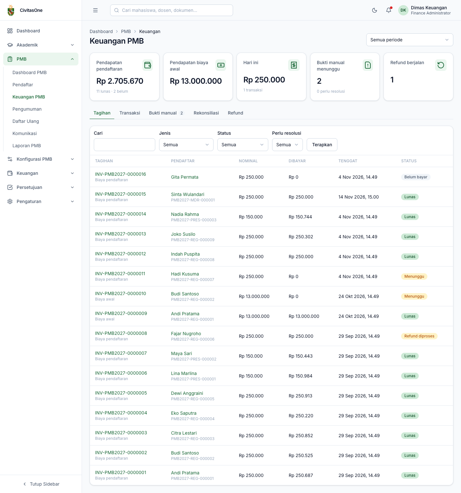
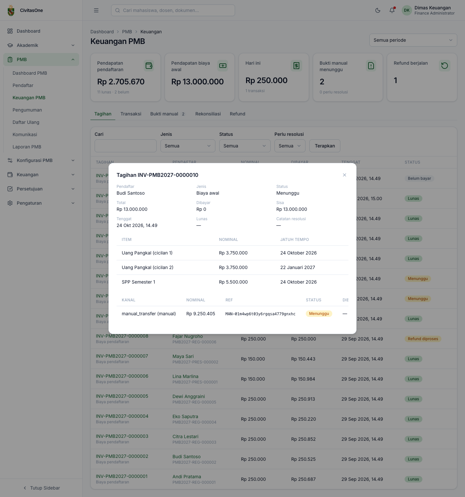
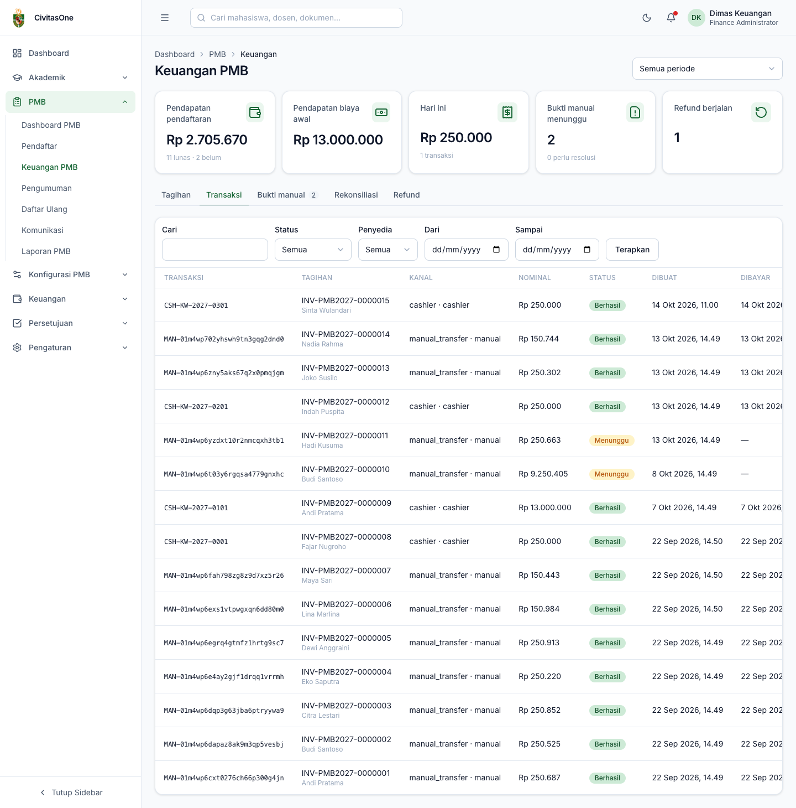
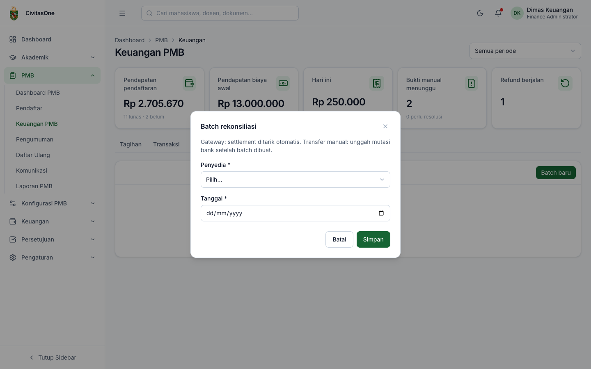
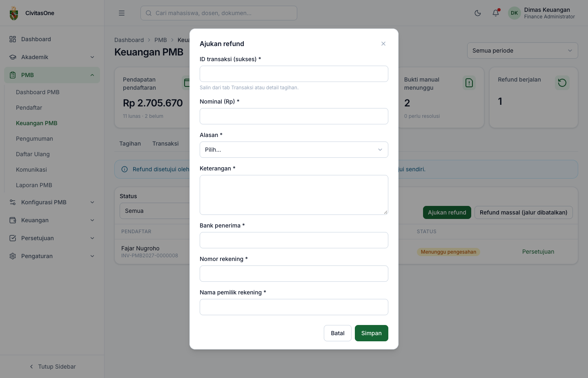
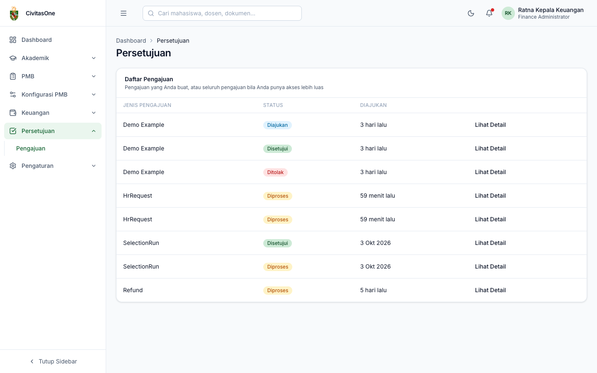

# 33. Keuangan PMB

[← Verifikasi Administrasi](32-verifikasi-administrasi.md) · [Daftar isi](README.md) · [Berikutnya: Ujian Seleksi →](34-ujian-seleksi.md)

**Untuk:** petugas keuangan (`pmb_payments.read`, `pmb_payments.approve`, `pmb_payments.finalize`, `pmb_refunds.create`, `pmb_refunds.approve`). Admin PMB, verifikator, petugas daftar ulang, dan auditor dapat melihat tagihan & transaksi.
**Menu:** **PMB → Keuangan PMB**.

## 1. Ringkasan

*Gambar 33.1 — Halaman Keuangan PMB, tab Tagihan.*

Kartu ringkasan (dapat difilter per periode di kanan atas):

| Kartu | Isi |
|---|---|
| **Pendapatan pendaftaran** | Total biaya pendaftaran diterima; jumlah lunas & belum. |
| **Pendapatan biaya awal** | Total biaya awal kuliah diterima. |
| **Hari ini** | Nominal & jumlah transaksi sukses hari ini. |
| **Bukti manual menunggu** | Bukti transfer yang belum diputuskan; jumlah tagihan yang **perlu resolusi**. |
| **Refund berjalan** | Refund yang belum selesai. |

Tab: **Tagihan**, **Transaksi**, **Bukti manual** (dengan angka antrean), **Rekonsiliasi**, **Refund**. Tiga tab terakhir hanya tampil bagi yang berizin.

## 2. Tagihan

Filter: **Cari** (nomor tagihan, nomor pendaftaran, nama/email), **Jenis** (*Biaya pendaftaran*/*Biaya awal*), **Status** (*Belum bayar, Menunggu, Sebagian, Lunas, Kedaluwarsa, Dibatalkan, Refund diproses, Dikembalikan*), **Perlu resolusi**.

Klik nomor tagihan untuk membuka **detail tagihan**: identitas pendaftar, jenis, status, total/dibayar/sisa, tenggat, waktu lunas, item (dengan jatuh tempo cicilan), daftar transaksi (kanal & penyedia, nominal, referensi, status, waktu bayar), dan refund terkait.

*Gambar 33.2 — Detail tagihan biaya awal dengan transaksi transfer yang menunggu.*

### 2.1 Mencatat pembayaran loket (tunai)

Untuk tagihan berstatus *Belum bayar*, *Sebagian*, atau *Kedaluwarsa*:

1. Buka detail tagihan, klik **Catat pembayaran loket**.
2. Isi **Nominal diterima (Rp)** (default sisa tagihan), **Nomor kuitansi**, dan **Waktu bayar**.
3. Klik **Simpan**. Transaksi tercatat sukses (referensi `CSH-<nomor kuitansi>`) dan status tagihan diperbarui.

*Gambar 33.3 — Dialog pembayaran loket.*

> **Catatan** — Tagihan biaya pendaftaran baru ada setelah pendaftar membuka langkah **Pembayaran** di portal. Bila pendaftar datang ke loket sebelum itu, minta pendaftar membuka langkah tersebut terlebih dahulu.

### 2.2 Resolusi pembayaran terlambat

Bila pembayaran (misalnya dari gateway) diterima setelah tagihan kedaluwarsa, tagihan diberi tanda **Resolusi**. Buka detail, klik **Resolusi pembayaran terlambat**, pilih keputusan, isi **Catatan**:

- **Terima & buka kembali aplikasi**: pembayaran diakui dan pendaftaran dilanjutkan;
- **Kembalikan dana (refund)**: dibuatkan pengajuan refund.

### 2.3 Cek ulang status gateway

Pada transaksi gateway yang masih *Menunggu*, klik **Cek ulang** (izin rekonsiliasi) untuk meminta status terbaru dari penyedia.

## 3. Transaksi

Daftar semua transaksi, dengan filter **Status**, **Penyedia** (`manual`, `cashier`, `midtrans`), dan rentang tanggal. Kolom **Transaksi** menampilkan referensi: `MAN-<id>` untuk transfer manual, `CSH-<kuitansi>` untuk loket, atau referensi gateway. Untuk transaksi gateway, tombol **Callback** menampilkan riwayat notifikasi penyedia (waktu diterima, keabsahan tanda tangan, hasil pemrosesan, jumlah percobaan, galat).

*Gambar 33.4 — Tab Transaksi.*

## 4. Verifikasi bukti transfer manual

*Gambar 33.5 — Antrean bukti transfer manual.*

Kolom: pendaftar & nomor tagihan, pengirim (nama & bank), tanggal transfer, **nominal ditransfer** dibanding **tagihan** dan **kode unik** (nominal berbeda ditandai merah), status, dan label **Mirip bukti lain** bila terindikasi duplikat.

1. Klik **Lihat bukti** untuk membuka berkas bukti.
2. Cocokkan dengan **mutasi rekening** kampus: nominal (termasuk kode unik), tanggal, nama pengirim.
3. Klik **Putuskan**:
   - **Setujui — dana diterima**: transaksi sukses, tagihan lunas/sebagian;
   - **Tolak**: pilih alasan `NOT_FOUND_IN_STATEMENT` (tidak ada di mutasi), `AMOUNT_MISMATCH` (nominal tidak sesuai), `UNREADABLE` (tidak terbaca), `DUPLICATE_PROOF` (bukti ganda), atau `OTHER`.
4. Isi **Catatan** (opsional), **Simpan**.

*Gambar 33.6 — Dialog verifikasi bukti transfer.*

> **Penting** — Petugas yang memverifikasi bukti bayar **biaya awal** suatu pendaftaran tidak dapat menyetujui daftar ulang pendaftaran tersebut, dan tidak dapat menyetujui refund untuk transaksi yang sama (pemisahan tugas).

## 5. Rekonsiliasi

Untuk mencocokkan transaksi sistem dengan mutasi bank/settlement gateway:

1. Tab **Rekonsiliasi** → **Batch baru**: pilih **Penyedia** (*Transfer bank (mutasi)* atau *Midtrans*) dan **Tanggal**, **Simpan**.
2. Pada batch transfer bank, klik **Impor mutasi** dan unggah CSV/XLSX berkolom **tanggal, keterangan, nominal, referensi**. Sistem mencocokkan otomatis. Untuk gateway, settlement ditarik otomatis.
3. Tabel item menampilkan referensi, nominal & tanggal eksternal, transaksi sistem, dan **Hasil** (*matched* atau ketidakcocokan). Untuk item yang tidak cocok, klik **Selesaikan**, pilih resolusi, dan isi catatan.
4. Klik **Tutup batch** setelah semua item terselesaikan.

*Gambar 33.7 — Membuat batch rekonsiliasi.*

> **Perlu konfirmasi** — Format kolom berkas mutasi setiap bank berbeda. Uji impor dengan contoh mutasi bank kampus sebelum dipakai rutin.

## 6. Refund (pengembalian dana)

*Gambar 33.8 — Daftar refund.*

**Mengajukan refund:**

1. Tab **Refund** → **Ajukan refund**.
2. Isi **ID transaksi (sukses)**, **Nominal (Rp)**, **Alasan** (`DUPLICATE_PAYMENT`, `PERIOD_CANCELLED`, `WITHDRAWAL`, `LATE_PAYMENT`, `OVERPAYMENT`, `POLICY`, `OTHER`), **Keterangan**, **Bank penerima**, **Nomor rekening**, **Nama pemilik rekening**.
3. Klik **Simpan**. Refund berstatus *Menunggu pengesahan* dan muncul di menu **Persetujuan** pejabat keuangan (alur default: **Kepala Keuangan**).

*Gambar 33.9 — Form pengajuan refund.*

> **Kendala diketahui** — Kolom **ID transaksi** membutuhkan ID internal transaksi. Untuk transfer manual, ID adalah referensi tanpa awalan `MAN-` (contoh `MAN-01m4…` → `01m4…`). Untuk pembayaran **loket** dan gateway, ID internal belum ditampilkan di layar; mintalah bantuan administrator sistem. Lihat [lampiran 61](61-hal-perlu-konfirmasi.md#2-kendala-yang-diketahui-pada-implementasi).

**Menyetujui refund:** pejabat keuangan lain membuka **Persetujuan**, memilih pengajuan berjenis *Refund*, lalu **Setujui** atau **Tolak**. Pengaju refund dan verifikator bukti bayar transaksi tersebut tidak dapat menyetujui.

*Gambar 33.10 — Menu Persetujuan milik kepala keuangan (pengajuan PMB berjenis Refund dan SelectionRun, bersama pengajuan modul lain).*

**Setelah disetujui:** transfer dana ke rekening penerima di luar sistem, lalu klik **Catat selesai** pada refund, unggah **Bukti transfer** dan isi **Waktu transfer**, **Simpan**. Status menjadi *Selesai* dan tagihan *Dikembalikan*.

**Refund draf** (misalnya dari resolusi pembayaran terlambat) ditandai *Draf*; klik **Lengkapi & ajukan** untuk mengisi rekening dan mengajukannya.

**Refund massal (jalur dibatalkan):** bila kampus membatalkan suatu jalur pada gelombang tertentu, klik **Refund massal (jalur dibatalkan)**, pilih periode → gelombang → jalur, isi **Alasan** (minimal 10 karakter), lalu **Ajukan**. Semua pembayaran biaya pendaftaran sukses pada gelombang-jalur tersebut diajukan refund dalam **satu** persetujuan.

---

[← Verifikasi Administrasi](32-verifikasi-administrasi.md) · [Daftar isi](README.md) · [Berikutnya: Ujian Seleksi →](34-ujian-seleksi.md)
