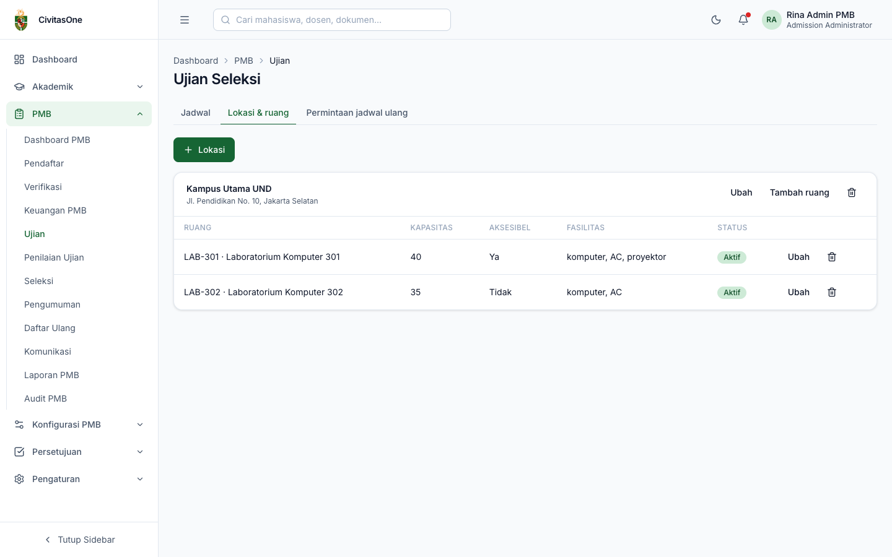
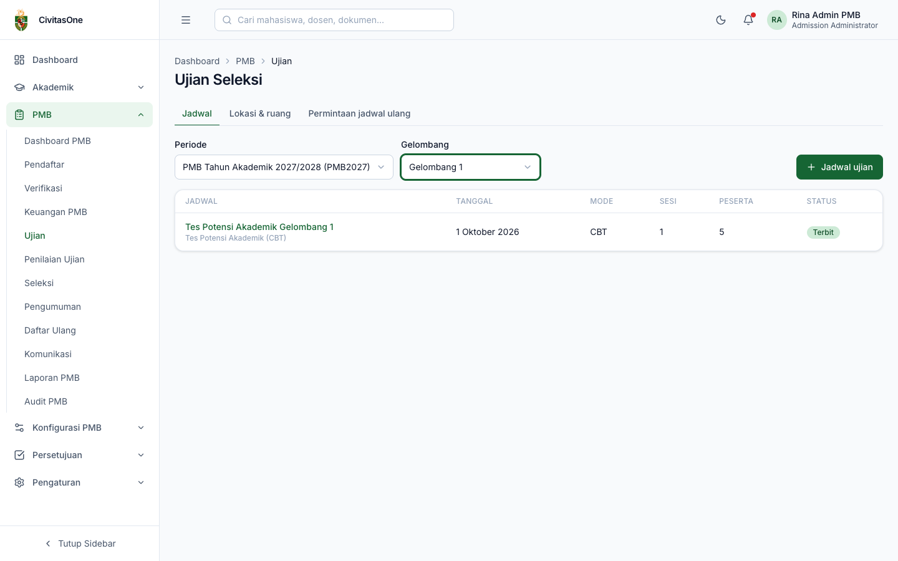
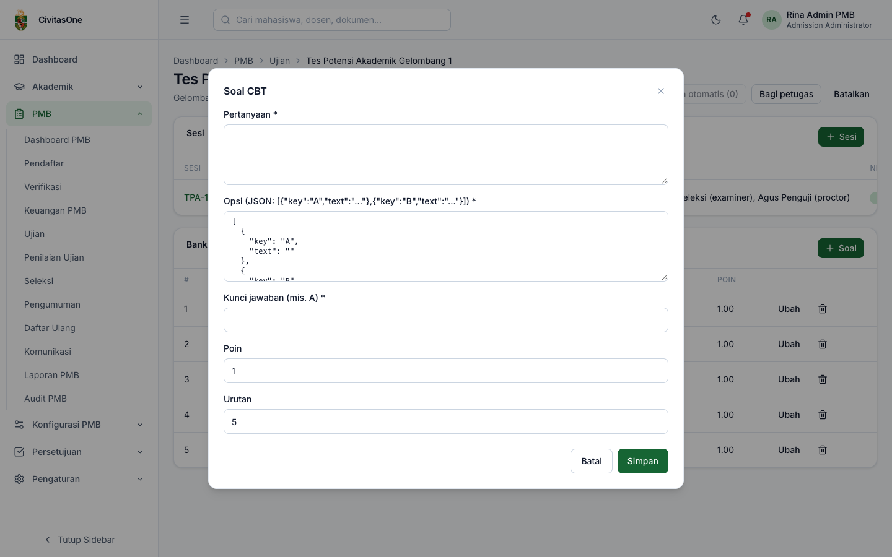
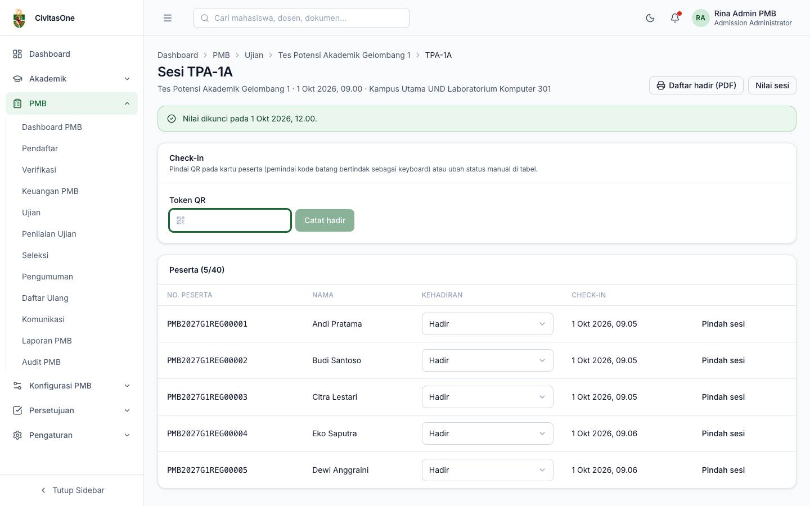
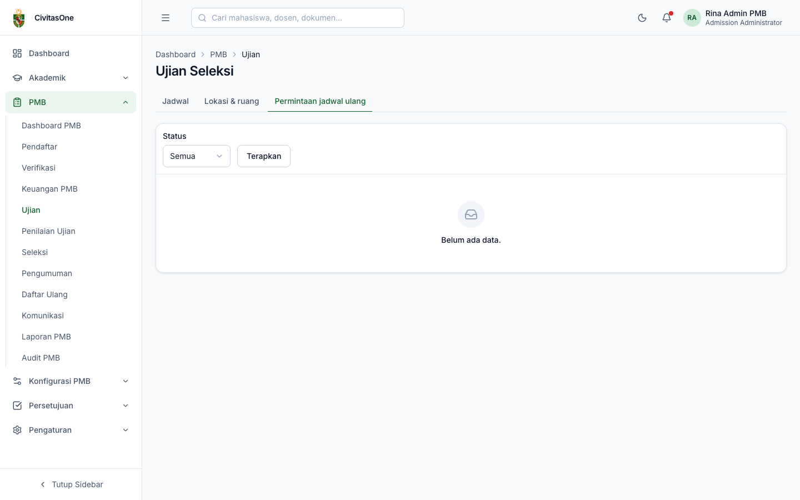

# 34. Ujian Seleksi

[← Keuangan PMB](33-keuangan-pmb.md) · [Daftar isi](README.md) · [Berikutnya: Penilaian Ujian →](35-penilaian-ujian.md)

**Untuk:** Administrator PMB dan Panitia Seleksi (`pmb_exams.update`); pengawas (`pmb_exam_attendance.update`) untuk check-in.
**Menu:** **PMB → Ujian**, dengan tab **Jadwal**, **Lokasi & ruang**, **Permintaan jadwal ulang**.

Alur ujian: **lokasi & ruang** → **jadwal ujian** per gelombang → **sesi** → **penempatan peserta** → **petugas** → (CBT) **bank soal** → **publikasi** (kartu peserta terbit) → **check-in** → **penilaian** → **kunci nilai**.

## 1. Kapan peserta dapat dijadwalkan?

Hanya pendaftar yang **terverifikasi** pada jalur **berujian** yang dapat ditempatkan pada sesi. Karena itu, buat jadwal dan tempatkan peserta setelah verifikasi sebagian besar pendaftar selesai. Penempatan otomatis dapat diulang untuk peserta yang baru terverifikasi.

## 2. Lokasi dan ruang

*Gambar 34.1 — Lokasi ujian beserta ruangnya.*

- **+ Lokasi**: Nama, Alamat, URL peta, Aktif.
- **Tambah ruang** pada kartu lokasi: Kode, Nama, **Kapasitas**, Ramah disabilitas, Fasilitas (JSON, misalnya `["komputer","AC"]`), Aktif.
- **Ubah**/hapus lokasi atau ruang. Hanya ruang aktif yang dapat dipilih untuk sesi.

## 3. Jadwal ujian

Tab **Jadwal**: pilih **Periode** dan **Gelombang**. Daftar jadwal menampilkan judul & komponen seleksi, tanggal, mode, jumlah sesi & peserta, dan status (**Draf**, **Terbit**, **Selesai**, **Dibatalkan**).

*Gambar 34.2 — Daftar jadwal ujian pada Gelombang 1.*

Klik **+ Jadwal ujian**:

*Gambar 34.3 — Form jadwal ujian.*

| Field | Keterangan |
|---|---|
| **Judul** | Contoh *Tes Potensi Akademik Gelombang 1*. |
| **Komponen seleksi** | Komponen skema yang dinilai oleh ujian ini (tulis, CBT, wawancara, portofolio, tes khusus). Komponen administrasi/rapor/prestasi tidak muncul. |
| **Jalur peserta** | Gelombang-jalur yang pesertanya diikutkan. |
| **Mode** | *Luring*, *Daring terawasi*, *CBT*, *Wawancara*, *Penilaian portofolio*. |
| **Tanggal ujian** | Harus di dalam jendela ujian gelombang (kecuali gelombang ODS). |
| Instruksi untuk peserta | Tampil di portal & kartu peserta. |
| Durasi CBT (menit), Jumlah soal ditampilkan, Acak urutan soal, Referensi sistem CBT eksternal | Khusus mode CBT. |

## 4. Detail jadwal: sesi, penempatan, petugas, bank soal

*Gambar 34.4 — Detail jadwal: sesi dan bank soal CBT.*

**Sesi** (**+ Sesi**): Kode sesi, Ruang (kosong untuk daring), **Mulai**, **Selesai** (harus pada tanggal ujian, kecuali gelombang ODS), Check-in dibuka, **Kapasitas**, URL ujian daring. Mengubah sesi pada jadwal yang sudah terbit wajib disertai alasan, dan peserta diberi tahu.

**Penempatan otomatis**: tombol **Tempatkan otomatis (N)** (N = peserta belum mendapat kursi) membagi peserta ke sesi berdasarkan **nomor pendaftaran** sesuai kapasitas. Pesan menyebutkan jumlah yang ditempatkan dan yang belum mendapat kursi (tambah sesi/kapasitas bila ada).

**Petugas**:

- **Petugas** pada baris sesi: pilih **Penguji**, **Pewawancara**, **Pengawas**. Daftar calon hanya berisi staf yang berizin menilai/mencatat kehadiran.
- **Bagi petugas**: membagi daftar petugas ke semua sesi untuk satu peran (**Jumlah per sesi**).

**Bank soal CBT** (mode CBT): **+ Soal**, isi **Pertanyaan**, **Opsi** (JSON, contoh `[{"key":"A","text":"…"},{"key":"B","text":"…"}]`), **Kunci jawaban** (contoh `A`), Poin, Urutan.

*Gambar 34.5 — Form soal CBT.*

> **Catatan** — Demi keamanan, kunci jawaban tidak pernah dikirim ke peramban setelah disimpan. Akibatnya kolom **Kunci** pada bank soal tampak kosong, dan saat **Ubah** soal Anda harus **mengisi ulang Kunci jawaban**.

**Publikasi**: klik **Publikasikan** dan konfirmasi. Kartu peserta (PDF dengan QR check-in) diterbitkan, dan peserta diberi notifikasi. **Batalkan** jadwal (draf/terbit) wajib alasan; peserta diberi tahu.

> **Beda rancangan** — API mendukung strategi penempatan *per prodi* dan *aksesibilitas* (ruang ramah disabilitas), tetapi tombol di layar hanya memakai strategi *nomor pendaftaran*.

## 5. Hari ujian: check-in & daftar hadir

Klik kode sesi untuk membuka **detail sesi**.

*Gambar 34.6 — Detail sesi (setelah ujian; nilai sudah dikunci).*

*Gambar 34.7 — Check-in pada sesi yang sedang berlangsung.*

- **Check-in dengan QR**: arahkan kursor ke **Token QR**, pindai QR pada kartu peserta dengan pemindai kode batang (berfungsi sebagai keyboard), lalu **Catat hadir** (atau Enter). Status peserta menjadi **Hadir**.
- **Ubah status manual** pada kolom **Kehadiran**: Terdaftar, Hadir, Tidak hadir, Izin, Didiskualifikasi.
- **Daftar hadir (PDF)**: mencetak daftar hadir sesi.
- **Pindah sesi**: memindahkan peserta ke sesi lain; isi **ID sesi tujuan** dan alasan.
- **Nilai sesi**: membuka penilaian sesi ([bab 35](35-penilaian-ujian.md)).
- **Kunci nilai**: lihat [bab 35 §3](35-penilaian-ujian.md#3-mengunci-nilai-sesi).

> **Catatan** — Peserta CBT yang mulai mengerjakan otomatis tercatat **Hadir**.

> **Beda rancangan** — Rancangan ADM-52 menyebut pemindaian QR dengan kamera tablet dan foto peserta pada daftar. Versi ini memakai isian token (pemindai sebagai keyboard). Dialog **Pindah sesi** meminta ID sesi tujuan yang belum ditampilkan di layar; gunakan **Permintaan jadwal ulang** (memilih sesi dari daftar) bila memungkinkan.

## 6. Permintaan jadwal ulang

Tab **Permintaan jadwal ulang** menampilkan permintaan peserta: nama & nomor peserta, jadwal & sesi saat ini, alasan & tautan **bukti**, status. Klik **Putuskan**:

- **Setujui & pindahkan**: pilih **Sesi tujuan** (menampilkan kode, waktu, terisi/kapasitas);
- **Tolak**;
- isi **Catatan**, **Simpan**. Peserta diberi tahu.

*Gambar 34.8 — Tab Permintaan jadwal ulang.*

---

[← Keuangan PMB](33-keuangan-pmb.md) · [Daftar isi](README.md) · [Berikutnya: Penilaian Ujian →](35-penilaian-ujian.md)
