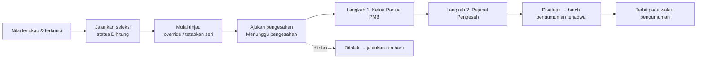
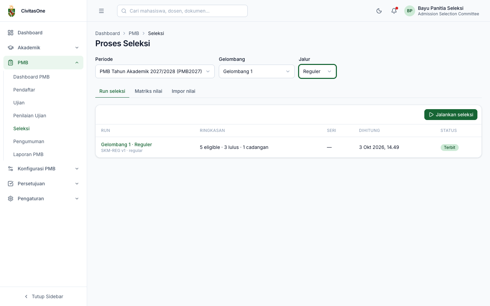
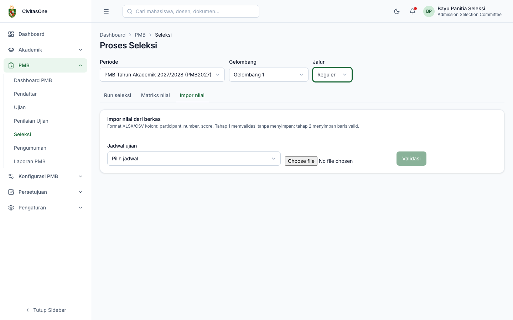
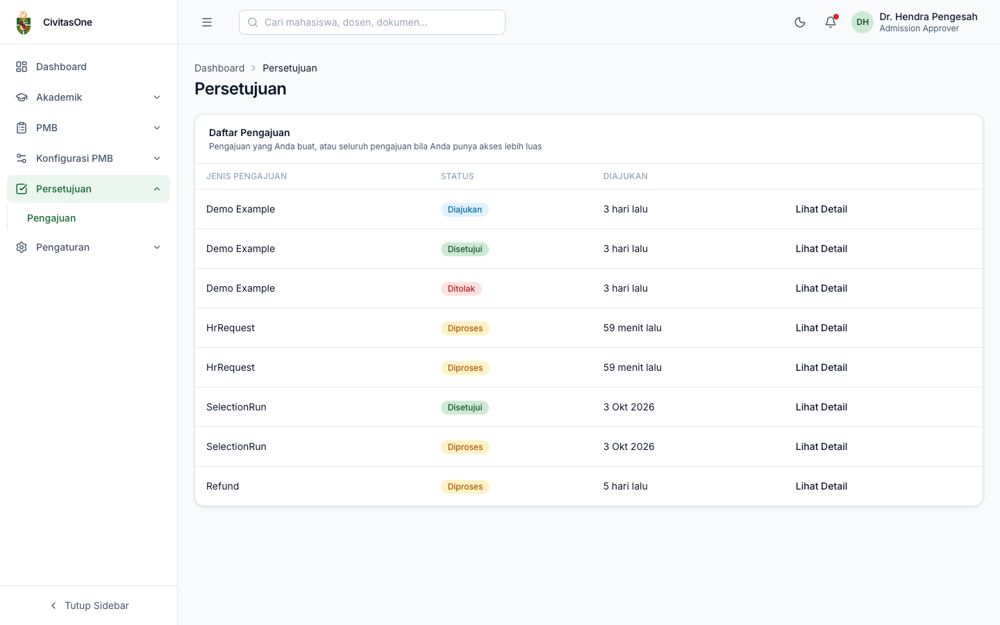
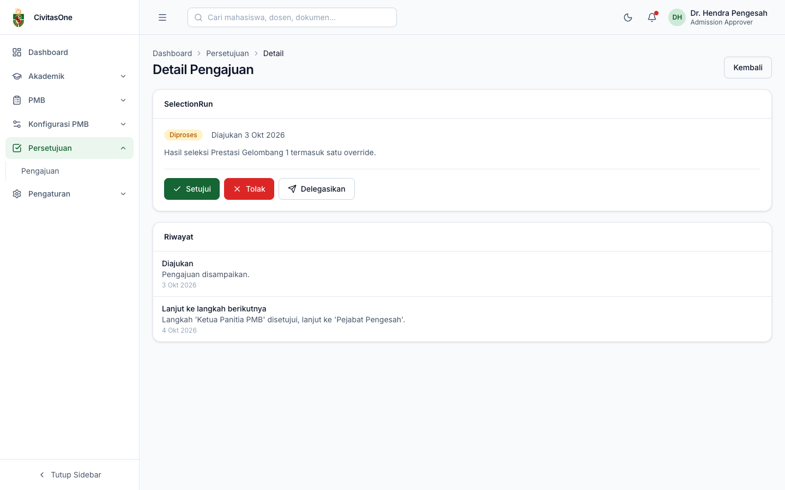

# 36. Proses Seleksi & Pengesahan

[← Penilaian Ujian](35-penilaian-ujian.md) · [Daftar isi](README.md) · [Berikutnya: Pengumuman & Keputusan →](37-pengumuman-dan-keputusan.md)

**Untuk:** Panitia Seleksi (`pmb_selection.update`, `pmb_selection.publish`, `pmb_scores.import`, `pmb_results.update`); Administrator PMB & pejabat pengesah (melihat hasil, mengesahkan lewat **Persetujuan**).
**Menu:** **PMB → Seleksi** (halaman **Proses Seleksi**) dan **Persetujuan**.

## 1. Gambaran alur

Status run: **Draf**, **Dihitung**, **Ditinjau**, **Menunggu pengesahan**, **Disetujui**, **Ditolak**, **Terbit**, **Digantikan** (run lama yang diganti run baru), **Gagal**.

Pada halaman **Proses Seleksi**, pilih **Periode**, **Gelombang**, dan **Jalur** terlebih dahulu. Halaman memiliki tab **Run seleksi**, **Matriks nilai**, **Impor nilai**.

## 2. Run seleksi

*Gambar 36.1 — Daftar run untuk satu gelombang-jalur.*

Kolom: gelombang · jalur (tautan ke detail), skema & jenis run, ringkasan (*eligible · lulus · cadangan*), tanda **Ada seri**, waktu dihitung, status.

## 3. Matriks nilai dan koreksi nilai

Tab **Matriks nilai** menampilkan nilai setiap pendaftar per komponen skema (dengan bobotnya). Ikon 🔒 berarti nilai sudah terkunci.

*Gambar 36.2 — Matriks nilai Gelombang 1 · Reguler.*

Klik sebuah nilai untuk mengoreksinya:

- **Nilai belum terkunci** (`pmb_selection.update`): isi **Nilai baru** (atau Lulus/Tidak) dan **Alasan**. Langsung tersimpan dan tercatat.
- **Nilai terkunci** (`pmb_results.update`): dialog **Ajukan koreksi nilai terkunci**: nilai baru, **Alasan**, **Bukti** (opsional). Koreksi baru berlaku setelah disetujui **Pejabat Pengesah** di menu **Persetujuan**.

## 4. Impor nilai

Untuk nilai dari sistem/berkas lain (misalnya CBT eksternal atau ujian tulis):

1. Tab **Impor nilai**, pilih **Jadwal ujian** pada gelombang terpilih.
2. Pilih berkas **XLSX/CSV** berkolom `participant_number` dan `score`.
3. Klik **Validasi**. Sistem memeriksa tanpa menyimpan, menampilkan jumlah baris valid dan daftar galat per baris (misalnya nomor peserta tidak dikenal, nilai di luar rentang).
4. Klik **Simpan N nilai** untuk menyimpan baris yang valid.

*Gambar 36.3 — Tab Impor nilai.*

## 5. Menjalankan dan meninjau run

1. Pada tab **Run seleksi**, klik **Jalankan seleksi**. Run dibuat dan dihitung (*"Run dibuat; perhitungan selesai dalam beberapa saat."*). Pastikan gelombang-jalur sudah memakai skema **terkunci** dan nilai komponen wajib sudah lengkap.
2. Buka run, klik **Mulai tinjau** (status *Ditinjau*).
3. Periksa **Ringkasan**: jumlah peserta, eligible, lulus, cadangan, tidak lulus, seri belum selesai, ambang, waktu dihitung/disahkan, tabel per kuota (kapasitas, sisa kursi, ditempatkan, cadangan), dan **hash** hasil (sidik jari perhitungan untuk audit).
4. Periksa tabel hasil: peringkat, nilai ternormalisasi per komponen, **Skor akhir**, **Rekomendasi** (*Lulus*, *Cadangan*, *Tidak lulus*), dan prodi tempat ditempatkan. Saring dengan **Rekomendasi** atau **Hanya seri**.

*Gambar 36.4 — Detail run Gelombang 1 · Reguler setelah disahkan dan terbit.*

Pada kolom **Ditempatkan**, pendaftar yang tidak lulus diberi kode penyebab: `below_threshold` (di bawah ambang), `component_minimum` (nilai komponen di bawah minimum), `absent` (tidak hadir ujian), `quota_full_no_waitlist` (kuota & cadangan penuh), `disqualified` (didiskualifikasi), `incomplete_scores` (nilai komponen wajib belum lengkap).

> **Catatan** — Kolom komponen bertipe lulus/tidak (misalnya **ADM**) pada tabel hasil run tampil sebagai `0.00`. Status lulus/tidak yang sebenarnya dapat dilihat di **Matriks nilai** (*Lulus*/*Tidak*).

**Override** (status *Dihitung*/*Ditinjau*): klik **Override** pada baris, pilih **Rekomendasi** baru (*Lulus* + **Kuota tujuan**, *Cadangan*, atau *Tidak lulus*), isi **Alasan**, **Simpan**. Baris diberi label **override** dan hash hasil berubah (*"berubah karena override"*).

**Skor seri pada batas kuota**: bila muncul peringatan *"Ada peserta dengan skor seri pada batas kuota"*, tombol **Ajukan pengesahan** nonaktif. Centang peserta dalam satu kelompok seri **sesuai urutan yang diputuskan panitia**, klik **Tetapkan urutan**, dan isi alasan. Sistem menghitung **run baru** dengan urutan tersebut (run lama menjadi *Digantikan*).

## 6. Mengajukan pengesahan

Klik **Ajukan pengesahan** (`pmb_selection.publish`), isi **Catatan pengajuan**, konfirmasi. Dialog menampilkan hash hasil yang diajukan dan jadwal pengumuman gelombang. Status run menjadi **Menunggu pengesahan**, dan kartu **Pengesahan** menampilkan langkah-langkah persetujuan beserta statusnya.

*Gambar 36.5 — Run menunggu pengesahan: langkah 1 disetujui, langkah 2 diperiksa.*

## 7. Pengesahan oleh pejabat (menu Persetujuan)

Alur persetujuan default yang dibuat sistem:

| Jenis pengajuan | Nama alur | Langkah (peran penyetuju) |
|---|---|---|
| Hasil seleksi (*SelectionRun*) | Pengesahan Hasil Seleksi PMB | 1. Ketua Panitia PMB (`admission_administrator`) → 2. Pejabat Pengesah (`admission_approver`) |
| Koreksi hasil / pembatalan penerimaan | Koreksi Hasil / Pembatalan Penerimaan PMB | Pejabat Pengesah |
| Koreksi nilai terkunci | Koreksi Nilai Terkunci PMB | Pejabat Pengesah |
| Refund | Pengembalian Dana PMB | Kepala Keuangan (`finance_administrator`) |
| Perpanjangan massal daftar ulang | Perpanjangan Massal Daftar Ulang PMB | Pejabat Pengesah |
| Percepatan publikasi hasil | Percepatan Publikasi Hasil PMB | Pejabat Pengesah |

**Menyetujui:**

1. Buka menu **Persetujuan → Pengajuan**. Pengajuan PMB tampil dengan jenis teknis seperti *SelectionRun*, *Refund*, atau *ChangeRequest*.
2. Klik **Lihat Detail**. Halaman **Detail Pengajuan** menampilkan status, tanggal, catatan pengaju, dan **Riwayat** langkah.
3. Sebelum memutuskan, buka detail run di **PMB → Seleksi** (atau tautan **Buka di Persetujuan…** dari detail run) untuk meninjau ringkasan, override, dan hash.
4. Klik **Setujui** (isi **Komentar** opsional) atau **Tolak** (isi **Alasan Penolakan**; sangat disarankan agar pengaju tahu apa yang harus diperbaiki). **Delegasikan** meneruskan langkah kepada pengguna lain (**Cari Pengguna Tujuan**).

| | |
|---|---|
|  |  |

*Gambar 36.6 — Daftar pengajuan, detail pengajuan hasil seleksi, dan dialog Setujui.*

**Setelah semua langkah disetujui:** status run menjadi **Disetujui**, dan sistem membuat **batch pengumuman** terjadwal pada waktu pengumuman gelombang ([bab 37](37-pengumuman-dan-keputusan.md#2-jadwal-publikasi-batch)). Bila **ditolak**, run berstatus **Ditolak**; perbaiki penyebabnya lalu jalankan run baru.

> **Penting** — Pengguna yang mengajukan run **tidak dapat** menyetujui langkah mana pun pada pengajuan tersebut (*SELF_APPROVAL_FORBIDDEN*). Publikasi hasil tidak dapat dilakukan manual: hasil hanya terbit lewat batch setelah disahkan.

> **Beda rancangan** — Rancangan ADM-60 menyebut tampilan persetujuan khusus PMB (ringkasan run, override, hash) dengan aksi *setujui/kembalikan/tolak*. Versi ini memakai halaman **Persetujuan** umum Civitas One (aksi **Setujui**, **Tolak**, **Delegasikan**); ringkasan run dilihat di detail run PMB. Aksi *kembalikan* tersedia di API alur persetujuan, tetapi belum ada tombolnya di halaman tersebut.

---

[← Penilaian Ujian](35-penilaian-ujian.md) · [Daftar isi](README.md) · [Berikutnya: Pengumuman & Keputusan →](37-pengumuman-dan-keputusan.md)
