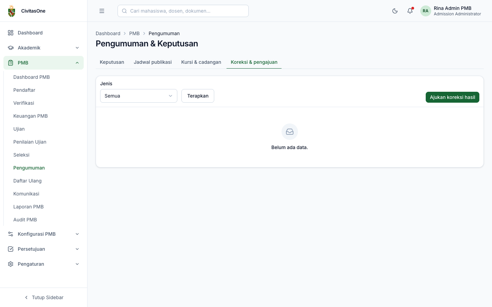
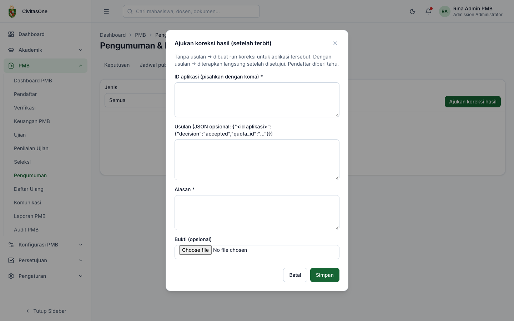

# 37. Pengumuman & Keputusan

[← Proses Seleksi & Pengesahan](36-proses-seleksi-dan-pengesahan.md) · [Daftar isi](README.md) · [Berikutnya: Daftar Ulang & Konversi →](38-daftar-ulang-dan-konversi.md)

**Untuk:** Administrator PMB (jadwal publikasi, kursi & cadangan), Panitia Seleksi (beasiswa jalur masuk, koreksi hasil), pengesah dan peran lain yang berizin melihat hasil.
**Menu:** **PMB → Pengumuman** (halaman **Pengumuman & Keputusan**), dengan tab **Keputusan**, **Jadwal publikasi**, **Kursi & cadangan**, **Koreksi & pengajuan** (tab tampil sesuai izin).

## 1. Keputusan

*Gambar 37.1 — Daftar keputusan beserta status publikasi, LoA, dan daftar ulang.*

Filter: **Cari**, **Periode**, **Keputusan** (*Diterima*, *Cadangan*, *Tidak diterima*, *Dibatalkan*), **Prodi**, dan **Publikasi** (*Belum terbit*/*Terbit*, bagi yang berizin melihat hasil sebelum terbit).

Kolom: pendaftar, keputusan (versi, sumber: `selection_run`, `waitlist_promotion`, `correction`, `offer_withdrawal`; dan nomor urut cadangan), prodi & sistem, status & waktu publikasi, nomor LoA beserta statusnya, status daftar ulang, persentase beasiswa.

**Beasiswa jalur masuk** (Panitia Seleksi, untuk keputusan *Diterima*): klik **Beasiswa**, pilih **Program beasiswa** (dari modul Beasiswa, opsional), isi **Potongan (%)** dan **Catatan**. Potongan diterapkan pada tagihan biaya awal kuliah dan program beasiswa diteruskan ke modul Beasiswa saat konversi.

> **Catatan** — Berikan beasiswa **sebelum** pendaftar membayar biaya awal, agar tagihan sudah memuat potongan.

## 2. Jadwal publikasi (batch)

*Gambar 37.2 — Batch pengumuman.*

Batch dibuat **otomatis** saat hasil seleksi disahkan, dijadwalkan pada **waktu pengumuman** gelombang. Pada waktunya, sistem menerbitkan semua keputusan dalam batch, membuat LoA bagi yang diterima, membuka daftar ulang, dan mengirim notifikasi. Status batch: **Terjadwal**, **Menerbitkan**, **Terbit**, **Gagal** (dengan penyebab), **Dibatalkan**.

Untuk batch *Terjadwal* (izin `pmb_config.update`):

- **Ubah jadwal**: isi **Jadwal baru** dan alasan. **Mempercepat** jadwal memerlukan persetujuan Pejabat Pengesah (*"Percepatan diajukan untuk persetujuan."*); memundurkan berlaku langsung.
- **Batalkan**: membatalkan publikasi (wajib alasan).

> **Catatan** — Hasil juga terbit tepat waktu walaupun penjadwal server terlambat: halaman hasil di portal dan **Cek Status** memicu publikasi batch yang sudah jatuh tempo.

## 3. Kursi & cadangan

Pilih periode untuk melihat setiap kuota: kapasitas, **diterima aktif**, **kursi kosong** (disorot), dan **cadangan tersisa**.

*Gambar 37.3 — Kursi & cadangan per kuota.*

Kursi menjadi kosong bila pendaftar yang diterima **menolak tawaran**, **daftar ulangnya kedaluwarsa**, atau **penerimaannya dibatalkan**.

**Promosi cadangan** (Admin PMB, `pmb_waitlist.update`): pada kuota yang punya kursi kosong **dan** cadangan, klik **Promosikan**, isi **Jumlah** (default sejumlah kursi kosong) dan (opsional) **Batas daftar ulang** (kosong = default 7 hari). Cadangan teratas menjadi *Diterima*, mendapat tagihan biaya awal dan batas daftar ulang individual, serta diberi tahu.

> **Catatan** — Bila pengaturan `pmb.auto_promote_waitlist` diaktifkan, sistem mempromosikan cadangan secara otomatis saat kursi kosong.

## 4. Koreksi hasil & pengajuan perubahan

Tab **Koreksi & pengajuan** (izin `pmb_results.update`) berisi semua pengajuan perubahan yang memerlukan persetujuan: koreksi nilai, koreksi hasil, pembatalan penerimaan, perpanjangan massal daftar ulang, percepatan publikasi, dan refund massal. Kolom: jenis, alasan, pengaju, waktu, status (dengan catatan hasil), dan tautan **Persetujuan**.

*Gambar 37.4 — Daftar pengajuan perubahan.*

**Mengajukan koreksi hasil setelah terbit:**

1. Klik **Ajukan koreksi hasil**.
2. Isi **ID aplikasi** (pisahkan dengan koma), **Alasan**, dan **Bukti** (opsional).
3. (Opsional) **Usulan** dalam format JSON: `{"<id aplikasi>": {"decision":"accepted","quota_id":"<id kuota>"}}`.
   - Tanpa usulan: setelah disetujui, sistem membuat **run koreksi** untuk aplikasi tersebut.
   - Dengan usulan: keputusan diterapkan langsung setelah disetujui.
4. Klik **Simpan**. Pengajuan menunggu persetujuan Pejabat Pengesah; pendaftar diberi tahu setelah koreksi diterapkan dan halaman hasilnya menampilkan *"Hasil telah dikoreksi"*.

*Gambar 37.5 — Form pengajuan koreksi hasil.*

> **Catatan** — ID aplikasi dapat disalin dari alamat halaman detail pendaftar (`/admin/pmb/pendaftar/<id aplikasi>`). ID kuota belum ditampilkan di layar; gunakan koreksi **tanpa usulan** (run koreksi) bila ID kuota tidak tersedia.

---

[← Proses Seleksi & Pengesahan](36-proses-seleksi-dan-pengesahan.md) · [Daftar isi](README.md) · [Berikutnya: Daftar Ulang & Konversi →](38-daftar-ulang-dan-konversi.md)
