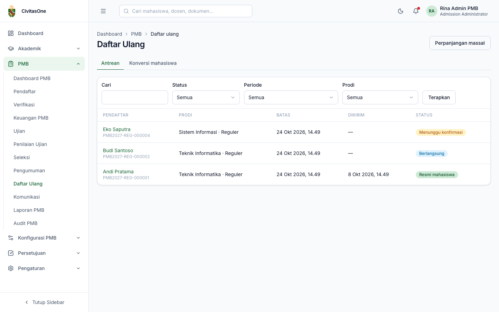
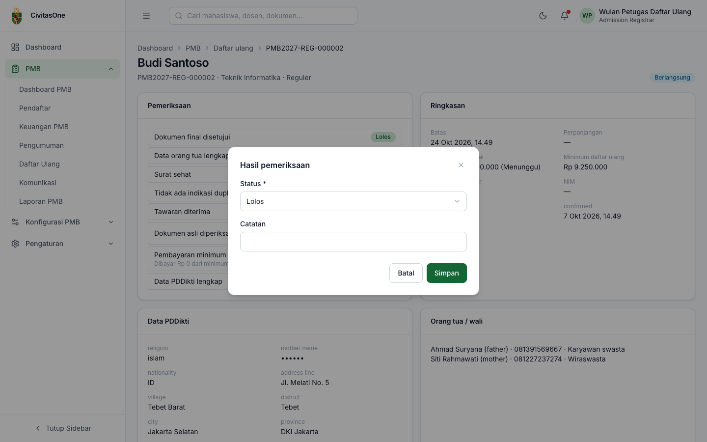

# 38. Daftar Ulang & Konversi Mahasiswa

[← Pengumuman & Keputusan](37-pengumuman-dan-keputusan.md) · [Daftar isi](README.md) · [Berikutnya: Komunikasi →](39-komunikasi.md)

**Untuk:** Petugas Daftar Ulang (`pmb_reregistration.approve`), Administrator PMB (perpanjangan `pmb_reregistration.update`, konversi `pmb_conversion.update`), keuangan/dekan/kaprodi/auditor (melihat).
**Menu:** **PMB → Daftar Ulang**, dengan tab **Antrean** dan **Konversi mahasiswa**.

## 1. Antrean daftar ulang

*Gambar 38.1 — Antrean daftar ulang.*

Filter: **Cari**, **Status**, **Periode**, **Prodi**. Kolom: pendaftar, prodi & sistem, **Batas** (label *diperpanjang* bila ada perpanjangan), waktu kirim, status.

| Status | Arti |
|---|---|
| Menunggu konfirmasi | Diterima, belum menerima/menolak tawaran. |
| Dikonfirmasi / Berlangsung | Tawaran diterima; pendaftar melengkapi data, dokumen, pembayaran. |
| Terkirim | Pendaftar mengirim daftar ulang; **menunggu validasi petugas**. |
| Perlu perbaikan | Petugas meminta perbaikan. |
| Disetujui | Divalidasi; konversi mahasiswa sedang diproses. |
| Resmi mahasiswa | Konversi selesai, NIM terbit. |
| Menolak tawaran / Kedaluwarsa / Dibatalkan | Daftar ulang tidak diselesaikan. |

Prioritaskan pendaftar berstatus **Terkirim**.

## 2. Memeriksa daftar ulang

Klik nama pendaftar untuk membuka detail.

*Gambar 38.2 — Detail daftar ulang yang sedang berjalan (tampilan petugas daftar ulang).*

| Kartu | Isi |
|---|---|
| **Pemeriksaan** | Delapan butir kelengkapan (lihat [bab 15 §5.1](15-hasil-dan-daftar-ulang.md#51-kelengkapan)) beserta status dan catatannya. Butir yang dinilai manual (misalnya **Dokumen asli diperiksa**) memiliki tombol **Tandai**. |
| **Ringkasan** | Batas & perpanjangan, tagihan biaya awal (dibayar/total & status), minimum daftar ulang, ukuran almamater, NIM, penyetuju, dan waktu-waktu penting. |
| **Data PDDikti** | Data lanjutan dari pendaftar (nama ibu tersamar). |
| **Orang tua / wali** | Nama, hubungan, HP, pekerjaan. |
| **Dokumen daftar ulang** | Dokumen tahap daftar ulang; *(cek asli)* bila perlu pemeriksaan dokumen asli. Tombol **Lihat** dan **Tinjau** (Setujui / Minta perbaikan / Tolak dengan kode alasan dan catatan). |

**Menandai pemeriksaan manual** (misalnya saat pendaftar datang membawa ijazah & KTP asli): klik **Tandai**, pilih **Status** (*Lolos*, *Tidak lolos*, *Tidak berlaku*), isi **Catatan**, **Simpan**.

*Gambar 38.3 — Dialog hasil pemeriksaan manual.*

## 3. Menyetujui atau meminta perbaikan

Untuk daftar ulang berstatus **Terkirim**:

- **Setujui**: aktif bila **semua** pemeriksaan *Lolos* atau *Tidak berlaku* (bila belum: *"Semua pemeriksaan harus lolos sebelum disetujui."*). Setelah disetujui, **konversi mahasiswa** berjalan otomatis (*"Disetujui; konversi mahasiswa diproses."*).
- **Minta perbaikan**: pilih **Dokumen** dan/atau **Data** (field PDDikti) yang harus diperbaiki, isi **Catatan**, **Simpan**. Pendaftar hanya dapat mengubah bagian tersebut lalu mengirim ulang.

*Gambar 38.4 — Daftar ulang yang sudah disetujui dan dikonversi (NIM terbit).*

> **Penting** — Petugas yang memverifikasi bukti transfer **biaya awal** pendaftar tersebut tidak dapat menyetujui daftar ulangnya (pemisahan tugas). Mintalah petugas lain.

## 4. Perpanjangan, pemulihan, dan pembatalan

| Tombol | Kapan | Isian | Catatan |
|---|---|---|---|
| **Perpanjang** | Menunggu konfirmasi, Dikonfirmasi, Berlangsung, Perlu perbaikan | **Batas baru**, alasan | Maksimal sesuai pengaturan (default 7 hari). |
| **Pulihkan** | Menolak tawaran, Kedaluwarsa | **Dasar pemulihan**: *Salah tolak (≤ 24 jam)* atau *Pembayaran sah terlambat tercatat*; catatan | Mengembalikan daftar ulang ke status aktif. |
| **Batalkan penerimaan** | Selain Dibatalkan/Menolak/Kedaluwarsa (izin `pmb_results.update`) | **Alasan**, **Bukti** (opsional) | Memerlukan persetujuan Pejabat Pengesah; setelah disetujui kursi dilepas dan LoA dicabut. |

**Perpanjangan massal** (tombol di kanan atas halaman antrean): pilih **Periode**, **Prodi** (opsional), **Batas baru**, dan alasan, misalnya karena gangguan sistem pembayaran. Pengajuan memerlukan persetujuan Pejabat Pengesah.

## 5. Konversi mahasiswa

Setelah daftar ulang disetujui, sistem menjalankan konversi bertahap (tercatat per langkah):

1. **Membuat data mahasiswa** di modul Akademik beserta **NIM** sesuai [format NIM](25-pengaturan-pmb.md#2-tab-format-nim) (`student_created`);
2. **Menautkan akun pengguna** mahasiswa: email institusi bila domain diatur, selain itu email pribadi (`user_linked`);
3. **Memposting tagihan** ke modul Keuangan (`finance_posted`);
4. **Menautkan dokumen** pendaftaran ke data mahasiswa (`documents_linked`);
5. **Meneruskan beasiswa** jalur masuk ke modul Beasiswa (`scholarship_forwarded`).

Bila berhasil, status daftar ulang menjadi **Resmi mahasiswa**, pendaftar melihat NIM dan dapat mengunduh **bukti registrasi**, dan informasi akun SIAKAD dikirim ke email.

Tab **Konversi mahasiswa** memantau prosesnya: pendaftar, NIM, langkah selesai, jumlah percobaan, galat terakhir, status (*Menunggu*, *Diproses*, *Berhasil*, *Gagal*, *Perlu tindakan*).

*Gambar 38.5 — Tab Konversi mahasiswa.*

Untuk konversi **Gagal** atau **Perlu tindakan**, klik **Coba lagi** (izin `pmb_conversion.update`). Langkah yang sudah selesai tidak diulang. Bila galatnya `USER_EMAIL_CONFLICT` (email pendaftar sudah dipakai akun lain), isi **Email akun mahasiswa pengganti**.

> **Catatan** — Kolom **Langkah** memakai pembagi tetap 4, sehingga konversi yang lengkap tampil `5/4`. Yang menentukan keberhasilan adalah kolom **Status**.

---

[← Pengumuman & Keputusan](37-pengumuman-dan-keputusan.md) · [Daftar isi](README.md) · [Berikutnya: Komunikasi →](39-komunikasi.md)
