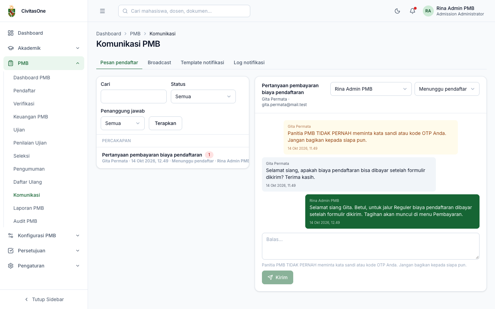
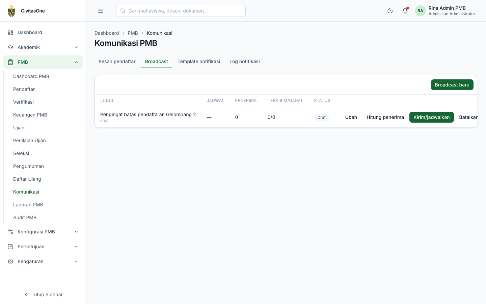
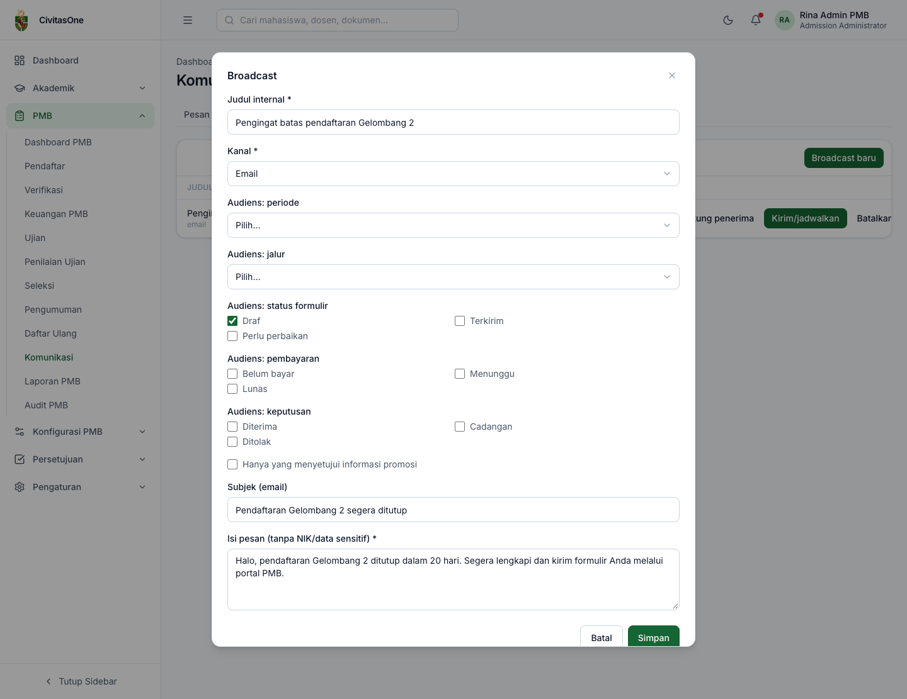
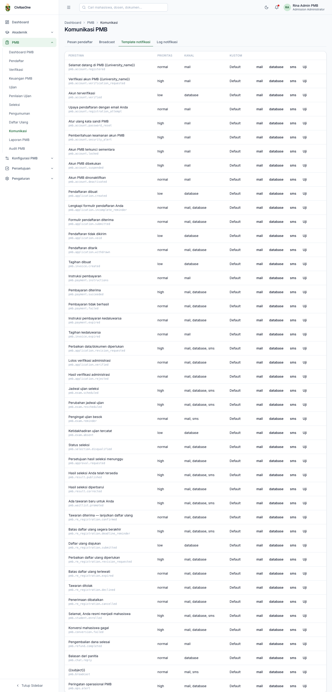
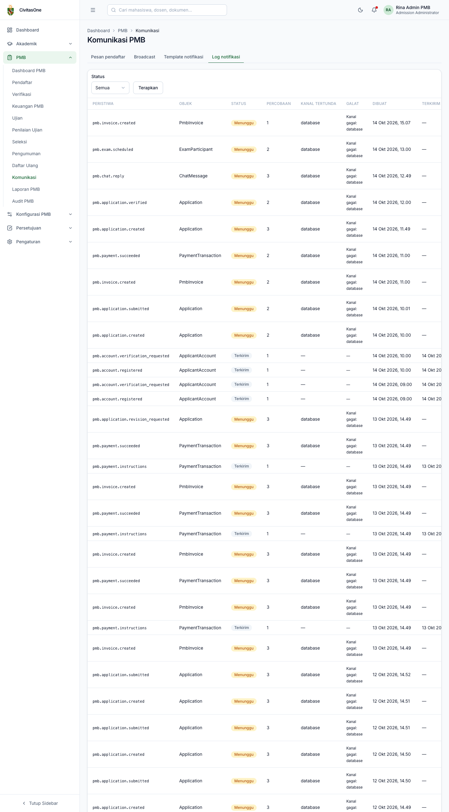

# 39. Komunikasi

[← Daftar Ulang & Konversi](38-daftar-ulang-dan-konversi.md) · [Daftar isi](README.md) · [Berikutnya: Laporan PMB →](40-laporan.md)

**Untuk:** operator yang melayani pertanyaan (`pmb_communication.update`), Admin PMB (broadcast `pmb_communication.publish`, template `pmb_config.update`), auditor (log notifikasi).
**Menu:** **PMB → Komunikasi** (halaman **Komunikasi PMB**), dengan tab **Pesan pendaftar**, **Broadcast**, **Template notifikasi**, **Log notifikasi** (tampil sesuai izin).

## 1. Pesan pendaftar (quick chat)

*Gambar 39.1 — Kotak pesan pendaftar.*

Daftar percakapan di kiri dapat difilter **Status** (*Dibuka*, *Menunggu pendaftar*, *Ditutup*) dan **Penanggung jawab** (*Saya*). Setiap baris menampilkan subjek, jumlah pesan belum dibaca, nama pendaftar, waktu pesan terakhir, status, dan penanggung jawab.

Klik percakapan untuk membuka:

1. Bagian atas menampilkan pendaftar (nama, email, nomor pendaftaran terkait). Pilih **Penanggung jawab** dan ubah **Status** percakapan di kanan atas.
2. Baca riwayat pesan (pendaftar di kiri, staf di kanan, pesan sistem di tengah). Lampiran dapat dibuka lewat tautan **Lampiran**.
3. Tulis balasan di kotak **Balas…**, lalu **Kirim**. Pendaftar diberi tahu.

> **Penting** — Pengingat keamanan di bawah kotak balasan: jangan pernah meminta kata sandi atau kode OTP pendaftar, dan jangan mengirim data sensitif lewat chat. Untuk perubahan data, minta pendaftar memakai fitur portal atau ikuti prosedur koreksi resmi.

> **Beda rancangan** — Rancangan menyebut layanan bantuan (*helpdesk/ticket*). Versi ini memakai percakapan (chat) dengan status & penanggung jawab, ditambah antrean **Pemulihan akun** di menu Verifikasi.

## 2. Broadcast

*Gambar 39.2 — Daftar broadcast.*

Klik **Broadcast baru** (atau **Ubah** pada draf):

*Gambar 39.3 — Form broadcast dengan filter audiens.*

| Field | Keterangan |
|---|---|
| **Judul internal** | Hanya untuk panitia. |
| **Kanal** | *Email* atau *SMS/WA* (maks 160 karakter; membutuhkan penyedia SMS). |
| Audiens: periode, jalur | Batasi penerima. |
| Audiens: status formulir | Draf, Terkirim, Perlu perbaikan (contoh: pengingat bagi yang masih draf). |
| Audiens: pembayaran | Belum bayar, Menunggu, Lunas. |
| Audiens: keputusan | Diterima, Cadangan, Tidak diterima. |
| Hanya yang menyetujui informasi promosi | Wajib dicentang untuk pesan promosi. |
| Subjek (email) | Subjek email. |
| **Isi pesan** | Tanpa NIK/data sensitif. |

Aksi pada broadcast **Draf**:

1. **Hitung penerima**: menampilkan jumlah penerima sesuai filter.
2. **Kirim/jadwalkan**: isi **Jadwal kirim**, atau kosongkan untuk mengirim sekarang.
3. **Batalkan** (draf/terjadwal).

Kolom **Terkirim/gagal** menunjukkan hasil pengiriman.

## 3. Template notifikasi

*Gambar 39.4 — Daftar template notifikasi per peristiwa.*

Setiap peristiwa sistem (misalnya `pmb.application.submitted`, `pmb.payment.succeeded`, `pmb.result.published`) memiliki subjek & isi default, prioritas, dan kanal default. Untuk menyesuaikan:

1. Klik kanal yang ingin diubah: **mail**, **database** (notifikasi dalam aplikasi), atau **sms**.
2. Ubah **Subjek** dan **Isi**, gunakan placeholder yang tercantum (contoh `{{registration_number}}`), centang **Aktif**, lalu **Simpan**. Kolom **Kustom** menunjukkan kanal yang memakai template kustom.
3. Klik **Uji** untuk mengirim email uji ke alamat Anda.

Hapus centang **Aktif** untuk kembali memakai template default.

> **Catatan** — Pesan yang memuat rahasia (kode OTP, tautan atur sandi/verifikasi) disimpan terenkripsi dalam antrean pengiriman dan tidak pernah tampil di log.

## 4. Log notifikasi

*Gambar 39.5 — Log notifikasi. Pada lingkungan pengujian, banyak entri berstatus Menunggu karena kanal `database` gagal (lihat catatan).*

Log menampilkan setiap peristiwa yang memicu notifikasi: kunci peristiwa, objek, **Status** (*Menunggu*, *Terkirim*, *Gagal*), jumlah percobaan, **Kanal tertunda**, galat, waktu dibuat & terkirim. Isi pesan tidak ditampilkan (melindungi data pendaftar). Pengiriman yang gagal dicoba ulang otomatis oleh penjadwal, **hanya pada kanal yang gagal**.

> **Kendala diketahui** — Pada versi yang diuji, kanal **database** (notifikasi dalam aplikasi pendaftar) selalu gagal (*"Kanal gagal: database"*), sedangkan email tetap terkirim. Lihat [lampiran 61](61-hal-perlu-konfirmasi.md#2-kendala-yang-diketahui-pada-implementasi).

---

[← Daftar Ulang & Konversi](38-daftar-ulang-dan-konversi.md) · [Daftar isi](README.md) · [Berikutnya: Laporan PMB →](40-laporan.md)
