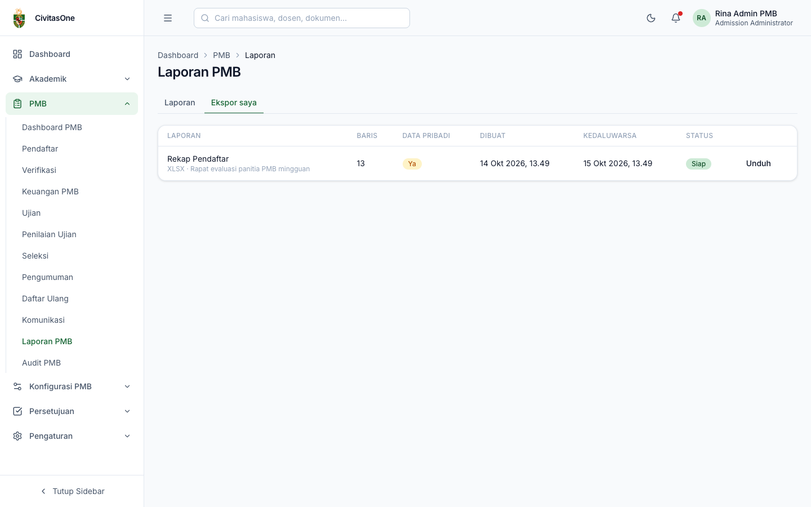

# 40. Laporan PMB

[← Komunikasi](39-komunikasi.md) · [Daftar isi](README.md) · [Berikutnya: Audit PMB →](41-audit.md)

**Untuk:** peran dengan `pmb_reports.read` (lihat) dan `pmb_reports.export` (ekspor).
**Menu:** **PMB → Laporan PMB**, dengan tab **Laporan** dan **Ekspor saya**.

## 1. Melihat laporan

*Gambar 40.1 — Laporan Rekap Pendaftar untuk satu periode.*

1. Pilih **Laporan**.
2. Atur filter: **Periode**, **Jalur**, **Fakultas**, **Prodi**, rentang tanggal **Dari**–**Sampai**.
3. Klik **Terapkan**. Tabel menampilkan hasil per halaman (50 baris).

| Laporan | Isi | Izin tambahan | Memuat data pribadi |
|---|---|---|---|
| Rekap Pendaftar | Data pendaftaran per pendaftar | `pmb_applications.read` | Ya |
| Rekap Pembayaran | Tagihan & pembayaran per pendaftar | `pmb_payments.read` | Ya |
| Sumber Informasi | Jumlah pendaftar & konversi per sumber informasi | — | Tidak |
| Laporan Seleksi | Hasil seleksi per pendaftar | izin melihat hasil sebelum terbit | Ya |
| Daftar Ulang & Konversi | Status daftar ulang & NIM | `pmb_reregistration.read` | Ya |
| Keuangan PMB | Rekap keuangan | `pmb_payments.read` | Tidak |
| Keterisian Kuota | Kapasitas vs diterima vs mahasiswa | — | Tidak |
| Kelengkapan Data PDDikti | Kelengkapan data lanjutan mahasiswa baru | `pmb_reregistration.read` | Tidak |

Laporan yang tidak sesuai izin Anda tidak tampil di pilihan. Pengguna ber-cakupan (dekan/kaprodi) hanya melihat prodi dalam cakupannya.

> **Beda rancangan** — Rancangan menyebut laporan *Funnel* dan *Perbandingan Periode*. Funnel tersedia di [Dashboard PMB](30-dashboard-pmb.md); perbandingan periode belum tersedia di layar.

## 2. Mengekspor laporan

1. Setelah filter diterapkan, klik **Ekspor**.
2. Pilih **Format** (*Excel (XLSX)*, *CSV*, *PDF*), **Kolom** (kosong = semua), dan isi **Alasan ekspor** (wajib).
3. Klik **Simpan**. Anda dibawa ke tab **Ekspor saya**.

*Gambar 40.2 — Dialog ekspor laporan.*

*Gambar 40.3 — Tab Ekspor saya.*

Tab **Ekspor saya** diperbarui otomatis setiap 5 detik dan menampilkan laporan, format & alasan, jumlah baris, penanda **Data pribadi**, waktu dibuat & kedaluwarsa, serta status. Klik **Unduh** bila status **Siap**.

> **Penting**
> - Ekspor yang memuat data pribadi **tercatat** (pengguna, alasan, filter) dan dapat diperiksa auditor.
> - Berkas hanya dapat diunduh **oleh pembuatnya** dan **kedaluwarsa dalam 24 jam**.
> - Untuk keamanan, isi sel CSV/XLSX yang diawali `=`, `+`, `-`, atau `@` dinetralkan agar tidak dieksekusi sebagai rumus.
> - Ekspor dibatasi 10 kali per jam per pengguna.

---

[← Komunikasi](39-komunikasi.md) · [Daftar isi](README.md) · [Berikutnya: Audit PMB →](41-audit.md)
