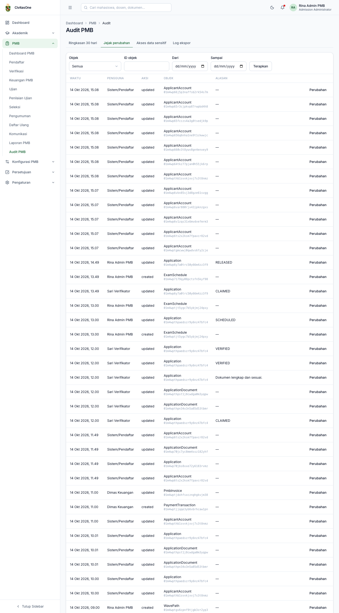
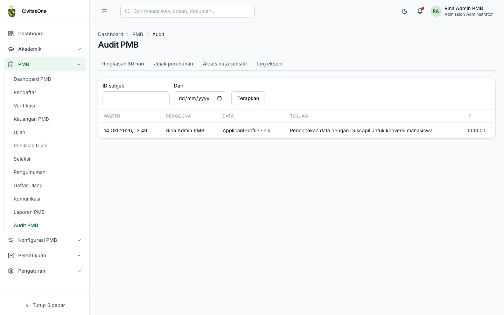
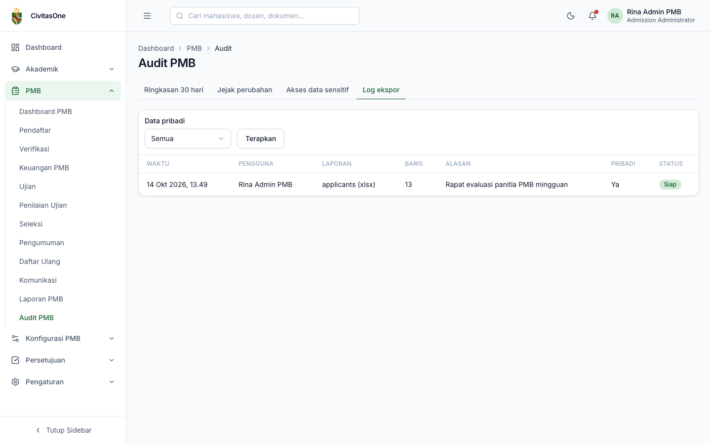

# 41. Audit PMB

[← Laporan PMB](40-laporan.md) · [Daftar isi](README.md) · [Berikutnya: Administrasi Sistem →](50-administrasi-sistem.md)

**Untuk:** Auditor dan Administrator PMB (`pmb_audit.read`). Halaman ini **hanya baca**.
**Menu:** **PMB → Audit PMB**, dengan tab **Ringkasan 30 hari**, **Jejak perubahan**, **Akses data sensitif**, **Log ekspor**.

## 1. Ringkasan 30 hari

Jumlah perubahan tercatat, akses data sensitif, dan ekspor (berapa yang berisi data pribadi), serta daftar **akses sensitif per pengguna**. Gunakan ini untuk mendeteksi pola akses yang tidak wajar.

*Gambar 41.1 — Ringkasan audit 30 hari.*

## 2. Jejak perubahan

Setiap perubahan penting (konfigurasi, koreksi data, keputusan, pengaturan) tercatat dengan waktu, pengguna, aksi, objek (jenis & ID), dan **alasan**. Filter: **Objek**, **ID objek**, rentang tanggal. Klik **Perubahan** untuk melihat nilai **Sebelum** dan **Sesudah**.

*Gambar 41.2 — Jejak perubahan.*

> **Catatan** — Perubahan status pendaftaran per pendaftar juga dapat dilihat pada tab **Linimasa** di detail pendaftar ([bab 31](31-data-pendaftar.md#33-tab-linimasa)).

## 3. Akses data sensitif

Daftar setiap pembukaan data sensitif (NIK, nama ibu, KIP, rekening, dokumen sensitif, foto identitas pemulihan akun): waktu, pengguna, data yang dibuka, **tujuan** yang diisi pengguna, dan alamat IP. Filter: **ID subjek**, tanggal **Dari**.

*Gambar 41.3 — Log akses data sensitif.*

## 4. Log ekspor

Semua ekspor laporan: waktu, pengguna, laporan & format, jumlah baris, alasan, penanda data pribadi, status. Filter **Hanya data pribadi**.

*Gambar 41.4 — Log ekspor.*

---

[← Laporan PMB](40-laporan.md) · [Daftar isi](README.md) · [Berikutnya: Administrasi Sistem →](50-administrasi-sistem.md)
