# Manual Book PMB untuk Calon Mahasiswa

**Penerimaan Mahasiswa Baru (PMB) Online — Civitas One**

| | |
|---|---|
| **Versi dokumen** | 1.0 |
| **Tanggal** | 16 Oktober 2026 |
| **Pembaca** | Calon mahasiswa (pendaftar) serta orang tua/wali yang mendampingi |
| **Video pendamping** | [Video Tutorial PMB untuk Calon Mahasiswa](../../video-tutorial-pmb/tutorial-pmb-calon-mahasiswa.mp4) (17 menit 28 detik) · [naskah video](../../video-tutorial-pmb/naskah-video-pmb-calon-mahasiswa.md) |
| **Panduan untuk panitia** | [Manual Book PMB untuk Penyelenggara](MANUAL-BOOK-PMB-PENYELENGGARA.md) |
| **Acuan** | Rancangan PMB [`docs/pmb/01–16`](../../pmb/) dan manual PMB per bab ([`README`](README.md)), dicocokkan dengan aplikasi Civitas One yang berjalan |

Manual ini menuntun Anda mendaftar kuliah secara online **dari awal sampai akhir**: membuat akun, mengisi formulir, mengunggah dokumen, membayar biaya pendaftaran, mengikuti ujian, melihat hasil seleksi, melakukan daftar ulang, hingga **resmi menjadi mahasiswa dan mendapatkan NIM**. Semua langkah dapat dikerjakan sendiri dari laptop atau ponsel.

> **Tentang gambar** — Semua gambar diambil dari aplikasi yang benar-benar berjalan dengan **data contoh fiktif** (kampus contoh *Universitas Nusantara Digital*). Nama, nomor, tanggal, dan nominal pada gambar hanyalah contoh. Tampilan di kampus Anda dapat sedikit berbeda karena logo, warna, jalur, biaya, dan pengaturan masing-masing kampus.

---

## Daftar Isi

1. [Pengenalan PMB Online](#1-pengenalan-pmb-online)
2. [Persiapan Sebelum Mendaftar](#2-persiapan-sebelum-mendaftar)
3. [Mengenal Website PMB](#3-mengenal-website-pmb)
4. [Membuat dan Mengelola Akun](#4-membuat-dan-mengelola-akun)
5. [Mengenal Portal Pendaftar](#5-mengenal-portal-pendaftar)
6. [Memilih Gelombang dan Jalur](#6-memilih-gelombang-dan-jalur)
7. [Mengisi Formulir Pendaftaran](#7-mengisi-formulir-pendaftaran)
8. [Mengunggah Dokumen](#8-mengunggah-dokumen)
9. [Membayar Biaya Pendaftaran](#9-membayar-biaya-pendaftaran)
10. [Mengirim Formulir](#10-mengirim-formulir)
11. [Verifikasi dan Permintaan Perbaikan](#11-verifikasi-dan-permintaan-perbaikan)
12. [Ujian Seleksi dan CBT](#12-ujian-seleksi-dan-cbt)
13. [Hasil Seleksi dan Surat Penerimaan](#13-hasil-seleksi-dan-surat-penerimaan)
14. [Daftar Ulang](#14-daftar-ulang)
15. [Resmi Menjadi Mahasiswa](#15-resmi-menjadi-mahasiswa)
16. [Pesan, Notifikasi, dan Keamanan Akun](#16-pesan-notifikasi-dan-keamanan-akun)
17. [Kendala Umum dan Solusinya](#17-kendala-umum-dan-solusinya)
18. [Hal yang Perlu Dikonfirmasi dan Keterbatasan Versi Ini](#18-hal-yang-perlu-dikonfirmasi-dan-keterbatasan-versi-ini)
- [Lampiran A — Glosarium](#lampiran-a--glosarium)
- [Lampiran B — Arti Status yang Tampil di Layar](#lampiran-b--arti-status-yang-tampil-di-layar)
- [Lampiran C — Daftar Periksa Pendaftar](#lampiran-c--daftar-periksa-pendaftar)
- [Lampiran D — Peta Bab ke Video Tutorial](#lampiran-d--peta-bab-ke-video-tutorial)

**Cara membaca:** tulisan **tebal** seperti **Daftar Sekarang** adalah nama tombol, menu, atau label yang tampil di layar, ditulis persis seperti di aplikasi. Kotak **Penting** berisi hal yang berdampak pada pendaftaran Anda; kotak **Catatan** berisi informasi tambahan; kotak **Perlu konfirmasi** berisi hal yang bergantung pada kebijakan kampus.

---

## 1. Pengenalan PMB Online

### 1.1 Apa yang bisa dilakukan

PMB online adalah layanan pendaftaran mahasiswa baru yang dapat Anda gunakan sendiri lewat internet. Ada dua bagian yang akan Anda pakai:

| Bagian | Alamat | Untuk apa | Perlu masuk? |
|---|---|---|---|
| **Website PMB** | `https://<website-pmb-kampus>/pmb` | Membaca informasi: gelombang, jalur, program studi, biaya, jadwal, panduan, FAQ, berita, kontak; cek status pendaftaran; memeriksa keaslian surat penerimaan | Tidak |
| **Portal Pendaftar** | `/pmb/portal` | Mengisi formulir, mengunggah dokumen, membayar, melihat jadwal ujian, hasil seleksi, daftar ulang, dan berkirim pesan dengan panitia | Ya, dengan **akun pendaftar** |

> **Catatan** — Akun pendaftar **berbeda** dari akun mahasiswa. Akun mahasiswa (SIAKAD) dan NIM baru Anda terima setelah daftar ulang disetujui.

### 1.2 Tujuh tahap pendaftaran

Setiap pendaftaran Anda akan melalui tahap berikut. Tahap ini tampil sebagai linimasa di Beranda portal.

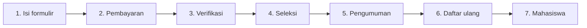

| Tahap | Yang Anda lakukan | Yang dilakukan panitia/sistem |
|---|---|---|
| 1. Isi formulir | Membuat akun, memilih jalur, mengisi data, memilih prodi, mengunggah dokumen | — |
| 2. Pembayaran | Membayar biaya pendaftaran (bila jalur memungut biaya) | Petugas keuangan memverifikasi bukti transfer |
| 3. Verifikasi | Menunggu; memperbaiki data/dokumen bila diminta | Verifikator memeriksa data dan dokumen |
| 4. Seleksi | Mengikuti ujian/wawancara bila jalur Anda mensyaratkan | Penilaian dan perhitungan peringkat |
| 5. Pengumuman | Melihat hasil, mengunduh surat penerimaan | Hasil disahkan pejabat kampus dan terbit sesuai jadwal |
| 6. Daftar ulang | Menerima tawaran, melengkapi data, membayar biaya awal kuliah | Petugas memvalidasi daftar ulang |
| 7. Mahasiswa | Menerima NIM dan akun SIAKAD | Sistem membuat data mahasiswa |

### 1.3 Istilah yang perlu diketahui

| Istilah | Arti |
|---|---|
| **Periode** | Satu siklus penerimaan untuk satu tahun akademik, misalnya *PMB Tahun Akademik 2027/2028*. |
| **Gelombang** | Rentang jadwal pendaftaran dalam satu periode, misalnya *Gelombang 1*, *Gelombang 2*. Setiap gelombang punya tanggal buka-tutup, batas bayar, ujian, pengumuman, dan daftar ulang sendiri. |
| **Jalur masuk** | Cara penerimaan, misalnya *Reguler* (dengan ujian), *Prestasi* (tanpa tes, berdasarkan rapor & prestasi), atau jalur lain yang dibuka kampus. |
| **Sistem kuliah** | Kelas perkuliahan, misalnya *Reguler* atau *Kelas Karyawan*. |
| **Nomor pendaftaran** | Nomor yang terbit setelah formulir dikirim, contoh `PMB2027-REG-000001`. |
| **LoA (surat penerimaan)** | Surat resmi bagi yang diterima, bernomor dan memiliki kode QR verifikasi. |
| **NIM** | Nomor Induk Mahasiswa, terbit setelah daftar ulang disetujui. |

Glosarium lengkap ada di [Lampiran A](#lampiran-a--glosarium).

---

## 2. Persiapan Sebelum Mendaftar

### 2.1 Perangkat dan koneksi

- Laptop/komputer atau ponsel dengan peramban internet terbaru (Chrome, Edge, Firefox, atau Safari).
- Koneksi internet yang stabil, terutama saat mengunggah dokumen dan mengerjakan ujian CBT.
- Aplikasi pemindai atau kamera ponsel untuk memindai dokumen.

### 2.2 Data dan dokumen yang perlu disiapkan

| Yang disiapkan | Keterangan |
|---|---|
| Email dan nomor HP aktif | Email dipakai untuk verifikasi akun, masuk, dan menerima pemberitahuan. Nomor HP (WhatsApp) opsional. |
| Data identitas | NIK 16 digit (WNI) atau nomor paspor & negara penerbit (WNA); tempat & tanggal lahir; alamat sesuai dokumen. |
| Data pendidikan | Nama sekolah, NPSN, NISN, jurusan, tahun lulus; untuk pindahan/lanjutan: NIM asal, IPK, SKS. |
| Nilai rapor | Nilai semester 1–5 (skala 0–100) untuk lulusan SMA/sederajat. |
| Data orang tua/wali | Nama, nomor HP, pendidikan, pekerjaan, penghasilan. |
| Pas foto digital | Berwarna, latar polos, rasio **3 : 4** (potret), minimal **400 × 600 piksel**. |
| Pindaian dokumen | Sesuai persyaratan jalur, misalnya KTP/kartu pelajar dan rapor. Lihat halaman **Jalur** di website. |
| Data tambahan sesuai jalur | Jalur Prestasi: data prestasi & sertifikat; jalur KIP: nomor KIP & nomor pendaftaran KIP Kuliah. |

### 2.3 Ketentuan berkas

Format dan ukuran maksimal **ditentukan kampus untuk setiap jenis dokumen** dan tercantum di halaman detail jalur serta pada langkah **Dokumen** di formulir. Contoh ketentuan bawaan (default) aplikasi:

| Dokumen | Format | Ukuran maks (default) |
|---|---|---|
| Pas foto latar polos | JPG, PNG | 1 MB |
| KTP / Kartu Pelajar / Paspor | JPG, PNG, PDF | 2 MB |
| Rapor semester 1–5 (digabung 1 PDF) | PDF | 5 MB |
| Ijazah / Surat Keterangan Lulus (biasanya saat daftar ulang) | PDF, JPG | 2 MB |
| Sertifikat prestasi (boleh lebih dari satu) | PDF, JPG | 2 MB per berkas |

> **Tips** — Simpan setiap dokumen dengan nama yang jelas (misalnya `pas-foto.jpg`, `ktp.pdf`). Bila berkas terlalu besar, kompres terlebih dahulu (misalnya simpan ulang PDF dengan kualitas lebih rendah atau perkecil resolusi foto).

### 2.4 Perhatikan jadwal

Buka menu **Jadwal** di website dan catat tanggal penting gelombang pilihan Anda: **pendaftaran ditutup**, **batas pembayaran**, **ujian**, **pengumuman**, dan **daftar ulang**. Formulir harus dikirim sebelum pendaftaran gelombang ditutup.

---

## 3. Mengenal Website PMB

Website PMB dapat dibuka siapa saja tanpa login. Menu di bagian atas: **Prodi · Jalur · Biaya · Jadwal · Panduan · FAQ · Berita · Cek Status · Kontak**, serta tombol **Masuk** dan **Daftar** (berubah menjadi **Portal Saya** bila Anda sudah masuk). Di ponsel, menu dibuka lewat ikon ☰.

### 3.1 Beranda

*Gambar 3.1 — Beranda: hitung mundur gelombang yang dibuka, banner, kartu gelombang, jalur masuk, program studi, berita, dan FAQ ringkas.*

| Bagian | Isi |
|---|---|
| Hitung mundur | Sisa waktu sampai gelombang yang sedang **Dibuka** ditutup. Bila belum ada gelombang dibuka, tampil tanggal pembukaan berikutnya atau pesan *"Pendaftaran belum dibuka. Pantau jadwal pada halaman Jadwal."* |
| Tombol | **Daftar Sekarang** (membuat akun) dan **Lihat Program Studi**. |
| Gelombang Pendaftaran | Status (**Dibuka**/**Segera**/**Ditutup**), rentang pendaftaran, tanggal pengumuman, jalur dan biaya pendaftarannya. |
| Jalur Masuk, Program Studi | Ringkasan jalur dan program studi; klik untuk detail. |
| Berita Terbaru, Pertanyaan Umum | Berita dan FAQ singkat; klik pertanyaan untuk membuka jawaban. |

### 3.2 Program studi

Buka **Prodi**, saring dengan **Cari**, **Jenjang**, atau **Fakultas**, lalu klik sebuah prodi.

*Gambar 3.2 — Detail program studi: ringkasan, akreditasi, gelar, lama studi, prospek karier, rincian biaya, dan jalur yang membuka prodi ini.*

Bila kampus mengaktifkannya, setiap jalur pada kotak **Jalur yang membuka** diberi label **Kuota tersedia**, **Kuota terbatas**, atau **Kuota penuh** (angka kuota tidak ditampilkan). Tombol **Daftar ke prodi ini** mengarah ke pembuatan akun.

### 3.3 Jalur masuk dan persyaratannya

Buka **Jalur**, lalu klik jalur yang diminati.

*Gambar 3.3 — Detail jalur Reguler: untuk setiap gelombang tampil biaya pendaftaran, maksimal pilihan prodi, komponen seleksi, catatan panitia, dan persyaratan dokumen.*

Pada **Persyaratan dokumen**, perhatikan untuk setiap dokumen: **wajib** atau **opsional**, kapan diunggah (*saat mendaftar* atau *saat daftar ulang*), format, ukuran maksimal, dan instruksinya.

### 3.4 Biaya kuliah

Buka **Biaya**, pilih **Program studi** dan **Sistem kuliah**.

*Gambar 3.4 — Rincian biaya awal per prodi dan sistem kuliah beserta skema cicilan dan total biaya awal.*

> **Catatan** — Potongan beasiswa jalur masuk atau KIP diterapkan pada tagihan setelah pengumuman, tidak ditampilkan di halaman ini.

### 3.5 Jadwal

*Gambar 3.5 — Linimasa setiap gelombang: pendaftaran, batas pembayaran, ujian, pengumuman, dan daftar ulang.*

Klik **Tambahkan ke kalender** untuk mengunduh berkas `jadwal-pmb.ics` yang dapat diimpor ke Google Calendar atau Outlook. Pada gelombang khusus (ODS), ujian tertulis *Sesuai jadwal ODS*.

### 3.6 Panduan, FAQ, berita, kontak, dan dokumen legal

- **Panduan** dan **Berita**: klik judul untuk membaca.
- **FAQ**: pertanyaan dikelompokkan per kategori; gunakan kotak **Cari…** lalu tekan Enter.
- **Kontak**: alamat, telepon, WhatsApp, email, jam layanan, dan peta panitia.
- **Info Daftar Ulang**: tata cara daftar ulang dari panitia.
- **Kebijakan Privasi** dan **Ketentuan Pendaftaran**: dokumen yang Anda setujui saat membuat akun, beserta nomor versinya.

---

## 4. Membuat dan Mengelola Akun

### 4.1 Membuat akun

1. Klik **Daftar** di kanan atas website (atau buka `/pmb/daftar`).
2. Isi formulir **Daftar Akun PMB**:

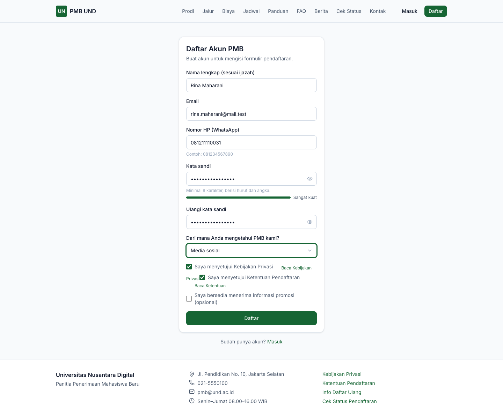
*Gambar 4.1 — Formulir pembuatan akun pendaftar.*

| Isian | Ketentuan | Contoh pengisian |
|---|---|---|
| **Nama lengkap (sesuai ijazah)** | Wajib, minimal 3 karakter, persis seperti di ijazah/rapor | `Rina Maharani` |
| **Email** | Wajib, aktif; dipakai untuk verifikasi dan masuk | `rina.maharani@mail.test` |
| **Nomor HP (WhatsApp)** | Opsional | `081211110031` |
| **Kata sandi** | Wajib, minimal 8 karakter berisi huruf dan angka; indikator menunjukkan kekuatannya | (rahasia) |
| **Ulangi kata sandi** | Harus sama | (rahasia) |
| **Dari mana Anda mengetahui PMB kami?** | Opsional | `Media sosial` |
| **Saya menyetujui Kebijakan Privasi** dan **Ketentuan Pendaftaran** | Wajib dicentang; tautan *Baca…* membuka dokumennya | ✓ |
| **Saya bersedia menerima informasi promosi** | Opsional; dapat diubah kapan saja di menu **Akun** | — |

3. Selesaikan CAPTCHA bila ditampilkan, lalu klik **Daftar**. Tombol baru aktif setelah kedua persetujuan dicentang.
4. Muncul halaman **Cek email Anda**.

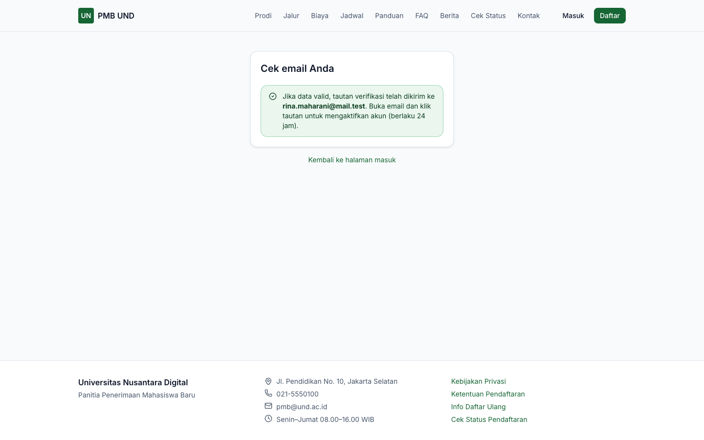
*Gambar 4.2 — Konfirmasi setelah mendaftar.*

> **Catatan** — Demi keamanan, pesan yang sama tampil walaupun email sudah pernah terdaftar. Bila Anda sudah punya akun, gunakan **Masuk** atau **Lupa kata sandi**. Pembuatan akun dibatasi 5 kali per jam dari satu alamat internet.

### 4.2 Verifikasi akun

1. Buka email dari panitia, klik tautan verifikasi. Tautan **berlaku 24 jam**.
2. Halaman **Verifikasi Akun** menampilkan bahwa akun Anda aktif. Klik **Masuk**.

Bila tautan kedaluwarsa atau email tidak masuk, masuk ke portal: Beranda menampilkan peringatan **Akun belum terverifikasi** dengan tombol **Kirim ulang email verifikasi**. Bila kampus mengaktifkan SMS dan Anda mengisi nomor HP, tersedia **Verifikasi lewat SMS**: isi **Kode OTP** 6 digit lalu klik **Verifikasi**.

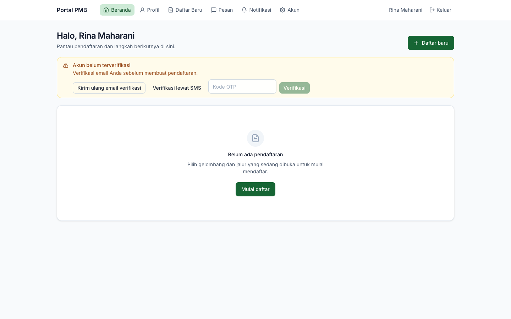
*Gambar 4.3 — Peringatan akun belum terverifikasi di Beranda portal.*

> **Penting** — Akun yang belum terverifikasi **belum bisa membuat pendaftaran**.

### 4.3 Masuk ke portal

1. Klik **Masuk** di website (atau buka `/pmb/masuk`).
2. Isi **Email atau nomor HP** dan **Kata sandi**, klik **Masuk**.

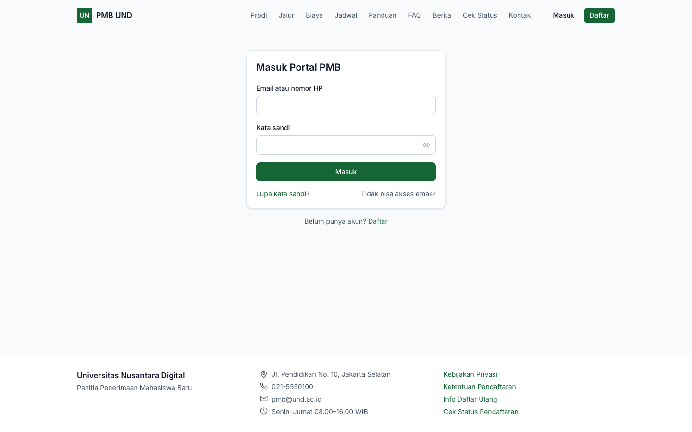
*Gambar 4.4 — Halaman Masuk Portal PMB.*

- Sesi berlaku **12 jam** sejak terakhir dipakai; setelah itu Anda diminta masuk lagi.
- Percobaan masuk dibatasi 10 kali per menit dari satu alamat internet.
- Klik **Keluar** di kanan atas portal setelah selesai, terutama di komputer umum.

### 4.4 Lupa kata sandi

**Lewat email:** di halaman Masuk klik **Lupa kata sandi?** → isi **Email atau nomor HP terdaftar** → **Kirim** → buka tautan di email → isi **Kata sandi baru** dua kali → **Simpan**.

**Lewat kode OTP SMS** (bila kampus mengaktifkan SMS): pada halaman Lupa Kata Sandi klik **Saya menerima kode OTP lewat SMS** → isi **Nomor HP terdaftar**, **Kode OTP (6 digit)**, kata sandi baru dua kali → **Simpan**.

> **Catatan** — Pesan *"Jika akun terdaftar, tautan atau kode pengaturan ulang telah dikirim."* selalu sama, walaupun data tidak terdaftar.

### 4.5 Tidak bisa mengakses email dan HP (pemulihan akun)

1. Di halaman Masuk klik **Tidak bisa akses email?**.
2. Isi **Nama lengkap**, **Tanggal lahir**, **NIK / nomor paspor**, **Email baru**, dan unggah **Foto KTP / identitas** (JPG, PNG, atau PDF).
3. Klik **Ajukan**.

Panitia mencocokkan data Anda (target pemrosesan maksimal 2 hari kerja). Bila disetujui, email akun diganti dan tautan pengaturan kata sandi dikirim ke **email baru**.

### 4.6 Akun yang dibuatkan panitia (pendaftaran loket)

Bila Anda mendaftar dengan bantuan panitia di kampus, panitia membuat akun atas nama Anda. Tautan aktivasi dan pengaturan kata sandi dikirim ke email Anda; setelah mengatur sandi, lanjutkan pengisian formulir sendiri seperti biasa.

---

## 5. Mengenal Portal Pendaftar

### 5.1 Menu portal

Menu di bagian atas: **Beranda · Profil · Daftar Baru · Pesan · Notifikasi · Akun**, nama Anda, dan **Keluar**.

| Menu | Fungsi |
|---|---|
| **Beranda** | Kartu setiap pendaftaran, tahap saat ini, batas waktu, dan tombol langkah berikutnya |
| **Profil** | Data diri yang dipakai ulang oleh semua pendaftaran: tab **Identitas**, **Pendidikan**, **Orang tua / wali**, **Prestasi** |
| **Daftar Baru** | Memilih gelombang & jalur yang sedang dibuka |
| **Pesan** | Bertanya langsung kepada panitia ([bab 16](#16-pesan-notifikasi-dan-keamanan-akun)) |
| **Notifikasi** | Pemberitahuan dalam aplikasi |
| **Akun** | Data akun, kata sandi, email, sesi aktif, unduh data pribadi |

### 5.2 Kartu pendaftaran di Beranda

*Gambar 5.1 — Kartu pendaftaran: jalur & gelombang, label tahap (kanan atas), linimasa tujuh tahap, label status, batas waktu, dan tombol langkah berikutnya.*

- **Linimasa**: *Isi formulir → Pembayaran → Verifikasi → Seleksi → Pengumuman → Daftar ulang → Mahasiswa*. Tahap yang sudah lewat bertanda ✓.
- **Label status**: status formulir, pembayaran (*Bayar: belum/lunas/tidak perlu*), verifikasi, dan pilihan prodi pertama.
- **Batas waktu**: *Kirim formulir sebelum…* atau *Perbaiki data/dokumen sebelum…*.
- **Tombol**: **Lanjutkan formulir** / **Lihat formulir**, **Ujian & kartu peserta**, **Hasil seleksi**, **Daftar ulang** — sesuai tahap Anda.

Arti setiap label tahap ada di [Lampiran B](#lampiran-b--arti-status-yang-tampil-di-layar).

### 5.3 Profil

Data di menu **Profil** (identitas, pendidikan, orang tua/wali, prestasi) dipakai ulang oleh semua pendaftaran Anda, sehingga tidak perlu diisi dua kali. Data yang sama juga dapat diisi langsung dari dalam formulir.

*Gambar 5.2 — Tab Identitas pada Profil.*

---

## 6. Memilih Gelombang dan Jalur

1. Klik **Daftar Baru** di menu portal (atau **Daftar baru** di Beranda).
2. Halaman **Pilih Gelombang & Jalur** hanya menampilkan jalur yang **sedang dibuka**.

*Gambar 6.1 — Pilihan gelombang & jalur yang sedang dibuka.*

3. Baca setiap kartu: deskripsi, **biaya pendaftaran** beserta waktu bayarnya (*dibayar sebelum/setelah kirim formulir*), **pilihan prodi maksimal**, **tanggal tutup**, dan catatan panitia.
4. Klik **Daftar jalur ini**. Draf pendaftaran dibuat dan formulir langsung terbuka.

> **Penting** — Secara default, satu akun hanya boleh memiliki **1 pendaftaran aktif per periode** (kampus dapat mengubahnya). Bila batas tercapai, kartu jalur menampilkan alasannya dan tombol **Daftar jalur ini** nonaktif. Tombol juga nonaktif bila akun belum terverifikasi. Jalur dan gelombang tidak dapat diganti setelah draf dibuat; untuk jalur lain, buat pendaftaran baru (bila diizinkan).

---

## 7. Mengisi Formulir Pendaftaran

### 7.1 Tujuh langkah formulir

Formulir terdiri dari tujuh langkah di sisi kiri: **Data diri · Pendidikan · Pilihan prodi · Data pendukung · Dokumen · Pembayaran · Pernyataan & kirim**. Ikon ✓ hijau berarti langkah sudah lengkap; ikon **!** kuning berarti masih ada yang kurang. Klik nama langkah untuk berpindah. Kotak **Belum lengkap** di atas isian menyebutkan apa yang kurang.

> **Penting** — Setiap langkah memiliki tombol simpan sendiri (**Simpan data diri**, **Simpan pilihan**, **Simpan data pendukung**, dan seterusnya). **Simpan setiap langkah sebelum berpindah**; perubahan yang belum disimpan hilang bila halaman ditutup.

> **Catatan** — Bila formulir yang sama dibuka di dua tab/perangkat dan salah satunya menyimpan lebih dulu, penyimpanan berikutnya ditolak dengan pesan *"Data telah diubah di tab/perangkat lain. Muat ulang."* Muat ulang halaman, lalu ulangi perubahan Anda.

Di kanan atas formulir draf terdapat tombol **Hapus draf** (lihat [§11.4](#114-menghapus-draf-atau-menarik-pendaftaran)).

### 7.2 Data diri

*Gambar 7.1 — Langkah Data diri.*

| Isian | Keterangan | Contoh pengisian |
|---|---|---|
| **Nama lengkap (sesuai ijazah)** * | Persis seperti di ijazah | `Gita Permata` |
| **Kewarganegaraan** * | *Indonesia (WNI)* atau negara lain; menentukan isian NIK atau paspor | `Indonesia (WNI)` |
| **NIK (16 digit)** | Untuk WNI. Tampil tersamar (`************0013`); untuk mengganti, klik kolom lalu ketik NIK lengkap | `3174xxxxxxxx0013` |
| **Nomor paspor**, **Negara penerbit paspor** | Untuk WNA (kode negara 2 huruf) | — |
| **Tempat lahir** *, **Tanggal lahir** * | Sesuai akta/KTP | `Jakarta`, `15/06/2008` |
| **Jenis kelamin**, **Agama** | Sesuai aturan formulir jalur | `Perempuan`, `Islam` |
| **Alamat (jalan, nomor)** *, RT, RW, Kelurahan/Desa, Kecamatan, **Kabupaten/Kota** *, **Provinsi** *, Kode pos | Alamat tinggal | `Jl. Melati No. 5`, `003`, `007`, `Tebet Barat`, `Tebet`, `Jakarta Selatan`, `DKI Jakarta`, `12810` |
| **Kebutuhan khusus** | Opsional, untuk akomodasi saat ujian; diperlakukan sebagai data sensitif | — |

Tanda `*` menunjukkan isian wajib (kampus dapat mengatur isian lain menjadi wajib, opsional, atau disembunyikan). Klik **Simpan data diri**.

- Bila digit tanggal lahir pada NIK tidak cocok dengan **Tanggal lahir** (untuk perempuan, tanggal pada NIK ditambah 40), muncul peringatan *"Tanggal lahir tidak sesuai dengan digit NIK. Periksa kembali."* Peringatan ini tidak menghalangi penyimpanan, tetapi akan diperiksa verifikator.
- Setelah formulir dikirim, identitas **terkunci**. Perubahan hanya bisa dilakukan bila panitia meminta perbaikan atau dikoreksi panitia.

> **Kendala diketahui** — Pada versi ini kolom **Tanggal lahir** dapat tampak kosong (`dd/mm/yyyy`) walaupun tanggal lahir sudah tersimpan. Data tetap aman selama kolom itu tidak diubah. Bila Anda mengisinya ulang, pastikan tanggalnya benar.

### 7.3 Pendidikan dan nilai rapor

1. Klik **Tambah riwayat pendidikan**, isi data sekolah atau perguruan tinggi asal, lalu **Simpan**.

| Isian | Keterangan |
|---|---|
| **Jenjang** | SMA/SMK/MA sederajat, Diploma, Sarjana, Magister |
| **Nama sekolah/perguruan tinggi** | Wajib |
| NPSN (8 digit), Jenis sekolah, Jurusan, Tahun lulus, Kota, Provinsi | Data sekolah |
| **Masih kelas akhir (belum lulus)** | Centang bila belum lulus |
| NISN (10 digit) | Untuk jenjang SMA sederajat |
| NIM asal, IPK, SKS ditempuh | Untuk pendaftar pindahan/lanjutan |

2. Pastikan riwayat yang dipakai untuk pendaftaran ini berlabel **Dipakai untuk pendaftaran**. Bila belum, klik **Pilih** pada riwayat tersebut.

*Gambar 7.2 — Langkah Pendidikan.*

3. Untuk jenjang SMA sederajat, klik **Nilai rapor** dan isi nilai semester 1–5 (skala 0–100). Mata pelajaran awal: Matematika, Bahasa Indonesia, Bahasa Inggris; tambah mapel lain lewat **Tambah mata pelajaran → Tambah**. Klik **Simpan nilai**.

*Gambar 7.3 — Isian nilai rapor semester 1–5.*

> **Catatan** — Nilai rapor dapat dipakai sebagai komponen penilaian seleksi (misalnya rata-rata semester 1–5). Isi selengkap dan sebenar mungkin; nilai akan dicocokkan dengan dokumen rapor.

### 7.4 Pilihan program studi

1. Pada **Pilihan 1**, pilih kombinasi **program studi — sistem kuliah** yang ditawarkan jalur Anda.
2. Bila jalur mengizinkan lebih dari satu pilihan, klik **Tambah pilihan** untuk Pilihan 2, dan seterusnya.
3. Atur urutan prioritas dengan tombol panah ↑ ↓; hapus dengan ikon tempat sampah.
4. Klik **Simpan pilihan**.

*Gambar 7.4 — Langkah Pilihan prodi (contoh: Teknik Informatika sebagai Pilihan 1, Sistem Informasi sebagai Pilihan 2).*

> **Penting** — Urutan pilihan menentukan prioritas penempatan. Bila skor Anda memenuhi syarat Pilihan 1 dan kursinya masih tersedia, Anda ditempatkan di Pilihan 1; bila tidak, sistem mencoba Pilihan 2, dan seterusnya. Pilihan prodi tidak bisa diubah sendiri setelah formulir dikirim.

### 7.5 Data pendukung

*Gambar 7.5 — Langkah Data pendukung.*

| Bagian | Isi |
|---|---|
| **Orang tua / wali / kontak darurat** | Klik **Tambah orang tua/wali**: hubungan (Ayah, Ibu, Wali, Kontak darurat), nama lengkap (wajib), nomor HP, email, NIK (opsional), tanggal lahir, pendidikan terakhir, pekerjaan, penghasilan per bulan, *Sudah meninggal*. Ubah/hapus dengan ikon pensil/tempat sampah. Data ini langsung tersimpan saat dialognya disimpan. |
| **Prestasi** | Hanya untuk jalur prestasi: **Tambah prestasi** (nama prestasi/lomba, kategori, tingkat, peringkat, tahun, penyelenggara). Unggah sertifikatnya pada langkah **Dokumen**. |
| **Data pendukung** | **Sumber informasi PMB** (wajib), detail sumber informasi, **Kode referal** (opsional), **Berminat mengikuti program beasiswa**. Jalur KIP/afirmasi: **Nomor KIP** dan **Nomor pendaftaran KIP Kuliah**. |
| **Isian tambahan** | Pertanyaan tambahan dari kampus untuk jalur Anda, misalnya ukuran jas almamater atau motivasi memilih prodi. Isian bertanda `*` wajib. |

Klik **Simpan data pendukung** untuk menyimpan data pendukung dan isian tambahan.

Contoh pengisian isian tambahan: *Ukuran jas almamater (perkiraan)* = `L`; *Motivasi memilih program studi* = "Saya ingin mengembangkan kemampuan di bidang teknologi dan berkontribusi bagi masyarakat."

Langkah **Dokumen** dijelaskan di [bab 8](#8-mengunggah-dokumen), **Pembayaran** di [bab 9](#9-membayar-biaya-pendaftaran), dan **Pernyataan & kirim** di [bab 10](#10-mengirim-formulir).

---

## 8. Mengunggah Dokumen

Langkah **Dokumen** menampilkan daftar dokumen yang diminta jalur dan gelombang Anda.

*Gambar 8.1 — Daftar dokumen pendaftaran: pas foto sudah diunggah, KTP (wajib) belum diunggah, rapor opsional.*

Setiap baris memuat nama dokumen dengan tanda `*` merah (wajib) atau *(opsional)*, format, ukuran maksimal, instruksi panitia, versi berkas terakhir, status, catatan panitia (bila ada), serta tombol **Lihat** dan **Unggah**/**Ganti**.

**Cara mengunggah:**

1. Klik **Unggah** (atau **Ganti** untuk mengganti berkas).
2. Pilih berkas dari perangkat. Di ponsel, pemilih berkas biasanya juga menawarkan kamera.
3. Tunggu pesan *"Berkas diunggah."*

| Ketentuan | Keterangan |
|---|---|
| Format & ukuran | Sesuai jenis dokumen; berkas yang melebihi ukuran maksimal ditolak sebelum dikirim. |
| Pas foto | Minimal **400 × 600 piksel**, rasio **3 : 4** potret, latar polos. Foto yang tidak memenuhi ditolak saat diunggah. |
| Beberapa berkas | Untuk jenis tertentu (misalnya sertifikat prestasi) muncul tombol **Tambah berkas …** setelah berkas pertama diunggah. |
| Keamanan berkas | Jenis asli berkas diperiksa dan gambar diproses ulang oleh sistem. |

| Status dokumen | Arti | Yang perlu Anda lakukan |
|---|---|---|
| Belum diunggah | Belum ada berkas | Unggah bila wajib |
| Diunggah | Berkas sudah ada, belum diperiksa | Masih bisa diganti |
| Diperiksa | Sedang diperiksa verifikator | Tunggu (tidak dapat diganti) |
| Disetujui | Diterima panitia | Selesai (terkunci) |
| Perlu perbaikan | Ada yang harus diperbaiki | Baca catatan, unggah ulang |
| Ditolak | Dokumen tidak dapat diterima | Baca catatan; unggah dokumen yang benar bila masih dibuka |

> **Catatan** — Dokumen tahap **daftar ulang** (misalnya ijazah/SKL) tidak muncul di sini, melainkan di halaman **Daftar Ulang** ([bab 14](#14-daftar-ulang)).

---

## 9. Membayar Biaya Pendaftaran

### 9.1 Tagihan biaya pendaftaran

Buka langkah **Pembayaran**. Tagihan **Biaya Pendaftaran** dibuat saat langkah ini dibuka, berisi nomor tagihan (`INV-…`), status, total, sudah dibayar, sisa, jatuh tempo (mengikuti batas pembayaran gelombang), dan rincian item.

*Gambar 9.1 — Tagihan biaya pendaftaran beserta panel Bayar sekarang.*

- Bila jalur **tidak memungut biaya**, tampil *"Jalur ini tidak memungut biaya pendaftaran."*
- **Waktu bayar** ditentukan per jalur:

| Waktu bayar jalur | Artinya bagi Anda |
|---|---|
| *Sebelum kirim formulir* | Formulir baru dapat dikirim setelah tagihan **lunas**. |
| *Setelah kirim formulir* | Kirim formulir dulu, lalu bayar. Pendaftaran baru masuk antrean verifikasi setelah lunas. |

### 9.2 Membayar dengan transfer bank (unggah bukti)

1. Pada **Bayar sekarang**, pilih **Metode pembayaran** → **Transfer Bank (unggah bukti)**.
2. (Opsional) Isi **Kode voucher**, klik **Terapkan**. Potongan tampil pada tagihan.
3. Klik **Buat instruksi pembayaran**.
4. Kotak hijau **Menunggu pembayaran** menampilkan nominal yang harus ditransfer **termasuk 3 digit kode unik**, rekening tujuan kampus, dan batas berlaku instruksi (default 24 jam).

*Gambar 9.2 — Instruksi transfer dengan kode unik dan bukti yang menunggu verifikasi keuangan.*

> **Contoh** — Tagihan Rp250.000 dengan kode unik 663 → transfer **tepat Rp250.663**. Jangan dibulatkan; kode unik memudahkan petugas mencocokkan transfer Anda.

5. Lakukan transfer tepat sesuai nominal ke rekening yang tertera.
6. Klik **Unggah bukti transfer**, isi **Foto/PDF bukti transfer**, **Bank pengirim**, **Nama pemilik rekening**, **Tanggal transfer**, **Nominal yang ditransfer**, lalu **Simpan**.
7. Status bukti menjadi *"menunggu verifikasi keuangan"*. Petugas memverifikasi paling lambat 1 hari kerja (target yang ditampilkan aplikasi).

- Sebelum mengunggah bukti, Anda dapat klik **Ganti metode** untuk membatalkan instruksi dan memilih metode lain. Hanya **satu** instruksi pembayaran yang dapat aktif per tagihan.
- Bila bukti ditolak (misalnya tidak ditemukan di mutasi, nominal tidak sesuai, atau tidak terbaca), alasannya tampil di **Riwayat transaksi**. Buat instruksi baru dan unggah bukti yang benar.

### 9.3 Membayar tunai di loket kampus

Datang ke loket kampus dan sebutkan **nomor tagihan** (`INV-…`) atau nomor pendaftaran. Petugas mencatat pembayaran dan tagihan Anda langsung **Lunas**; Anda tidak perlu membuat instruksi pembayaran.

> **Penting** — Buka langkah **Pembayaran** minimal sekali sebelum ke loket agar tagihan sudah terbit.

### 9.4 Membayar daring (Virtual Account / QRIS)

Bila kampus mengaktifkan pembayaran daring, pilihan seperti *Virtual Account* atau *QRIS* muncul di **Metode pembayaran**. Setelah **Buat instruksi pembayaran**, tampil nomor VA (dengan tombol salin) atau tautan **Buka QR / halaman pembayaran**. Status diperbarui otomatis setelah pembayaran; tombol **Cek status** dapat dipakai untuk memeriksa ulang, atau muat ulang halaman.

> **Perlu konfirmasi** — Pembayaran daring membutuhkan aktivasi penyedia pembayaran oleh kampus. Bila pilihan ini tidak muncul, gunakan transfer bank atau loket.

### 9.5 Setelah lunas

Tagihan berstatus **Lunas** dan tombol **Unduh kuitansi** tersedia. **Riwayat transaksi** mencatat semua transaksi Anda.

*Gambar 9.3 — Tagihan lunas dengan tombol Unduh kuitansi.*

> **Catatan** — Bila pembayaran diterima **setelah** tagihan kedaluwarsa, tampil *"Pembayaran diterima setelah tagihan kedaluwarsa dan sedang ditinjau panitia."* Panitia akan menerima pembayaran dan membuka kembali pendaftaran, atau mengembalikan dana.

---

## 10. Mengirim Formulir

1. Buka langkah **Pernyataan & kirim**, baca setiap pernyataan, lalu centang **Saya menyatakan data yang saya isi benar dan menyetujui pernyataan di atas**.
2. Bila masih ada langkah yang belum lengkap, muncul *"Masih ada langkah yang belum lengkap (lihat tanda pada menu langkah)"* dan tombol **Kirim formulir** nonaktif. Lengkapi langkah yang bertanda **!** kuning.
3. Klik **Kirim formulir**. Muncul pesan *"Formulir terkirim. Nomor pendaftaran Anda: PMB2027-REG-000001"* (contoh). Nomor juga dikirim ke email.

*Gambar 10.1 — Langkah Pernyataan & kirim (contoh saat masih ada langkah yang belum lengkap).*

Simpan nomor pendaftaran Anda untuk **Cek Status** dan komunikasi dengan panitia.

> **Penting**
> - Formulir harus dikirim **sebelum pendaftaran gelombang ditutup**. Draf yang belum dikirim saat gelombang ditutup dibatalkan otomatis (status *Tidak dikirim*).
> - Pada jalur *bayar sebelum kirim formulir*, formulir baru dapat dikirim setelah tagihan lunas.
> - Setelah dikirim, data identitas terkunci dan hanya dapat diubah bila panitia meminta perbaikan.

---

## 11. Verifikasi dan Permintaan Perbaikan

### 11.1 Proses verifikasi

Setelah formulir terkirim dan biaya pendaftaran lunas, pendaftaran masuk antrean verifikasi dengan tahap **Sedang diverifikasi**. Verifikator memeriksa data dan setiap dokumen. Hasilnya:

| Hasil | Arti | Langkah Anda |
|---|---|---|
| **Terverifikasi** | Lolos administrasi; tahap menjadi **Proses seleksi** | Tunggu jadwal ujian (bila ada) dan pengumuman |
| **Perlu perbaikan** | Ada data/dokumen yang harus diperbaiki | Perbaiki sebelum batas waktu ([§11.2](#112-memperbaiki-data-atau-dokumen)) |
| **Tidak lolos administrasi** | Tidak memenuhi syarat; alasan tampil di portal | Hubungi panitia bila ada pertanyaan; Anda dapat mencoba gelombang/jalur lain |

### 11.2 Memperbaiki data atau dokumen

Bila panitia meminta perbaikan, Beranda menampilkan *"Perbaiki data/dokumen sebelum …"* dan Anda menerima email.

*Gambar 11.1 — Beranda portal saat panitia meminta perbaikan.*

1. Klik **Lanjutkan formulir**. Kotak **Perbaiki sebelum …** berisi catatan panitia serta dokumen/data yang harus diperbaiki.
2. Perbaiki **hanya** yang disebutkan; isian lain terkunci.
3. Buka langkah **Pernyataan & kirim**, centang pernyataan, klik **Kirim formulir** lagi. Pendaftaran kembali ke antrean verifikasi.

*Gambar 11.2 — Formulir dalam mode perbaikan: hanya pas foto yang diminta yang dapat diganti.*

> **Penting** — Batas perbaikan default **72 jam** sejak diminta dan tidak melewati batas perbaikan formulir gelombang. Lewat batas, pendaftaran dapat ditolak karena tidak lengkap.

> **Catatan** — Pada versi ini daftar dokumen di kotak peringatan ditampilkan dengan kode sistem, misalnya `PHOTO` untuk pas foto dan `ID_CARD` untuk KTP.

### 11.3 Bila dokumen tidak dapat diterima

Untuk alasan tertentu, portal hanya menampilkan pesan umum *"Dokumen tidak dapat diterima, hubungi panitia."* Silakan hubungi panitia lewat menu **Pesan**.

### 11.4 Menghapus draf atau menarik pendaftaran

- **Hapus draf** (kanan atas formulir, hanya untuk draf): konfirmasi, lalu draf dibatalkan.
- **Tarik pendaftaran** (untuk formulir yang sudah dikirim, **sebelum hasil terbit**): isi alasan (opsional), lalu **Tarik pendaftaran**. Pendaftaran yang ditarik tidak dapat diaktifkan kembali, dan biaya pendaftaran tidak dikembalikan kecuali sesuai ketentuan kampus.

---

## 12. Ujian Seleksi dan CBT

Bab ini berlaku untuk jalur yang mensyaratkan ujian, setelah pendaftaran Anda **terverifikasi**.

### 12.1 Halaman Ujian & Kartu Peserta

Klik **Ujian & kartu peserta** pada kartu pendaftaran di Beranda.

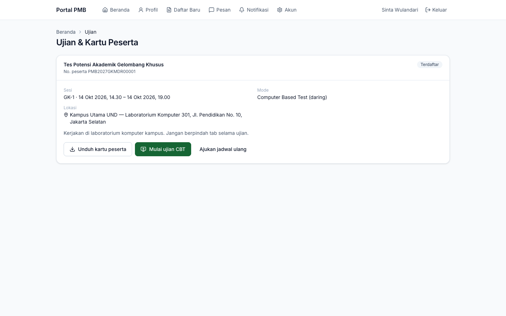
*Gambar 12.1 — Jadwal ujian CBT yang sudah dipublikasikan.*

| Informasi | Keterangan |
|---|---|
| Judul & **No. peserta** | Contoh `PMB2027G1REG00001` |
| Status kehadiran | **Terdaftar**, **Hadir**, **Tidak hadir**, **Izin**, **Didiskualifikasi** |
| **Sesi** | Kode sesi dan waktu mulai–selesai |
| **Mode** | Luring di lokasi, Computer Based Test, Wawancara, Daring terawasi |
| **Lokasi** | Gedung & ruang beserta alamat, atau tautan ujian daring |
| Instruksi | Petunjuk dari panitia |

Tampilan lain yang mungkin muncul: *"Jalur ini tidak memerlukan ujian tulis; seleksi berdasarkan berkas."* (jalur tanpa ujian) atau *"Jadwal ujian belum terbit"* (jadwal belum dipublikasikan panitia).

### 12.2 Kartu peserta

Klik **Unduh kartu peserta** untuk membuka kartu (PDF). Kartu memuat pas foto, nomor peserta, nama, nomor pendaftaran, nama ujian, sesi, lokasi, instruksi, tata tertib, dan **kode QR check-in**. Bila tombol bertuliskan **Kartu sedang disiapkan**, tunggu sebentar lalu muat ulang halaman.

> **Penting** — Bawa kartu peserta (cetak atau di ponsel) dan identitas asli. Jangan bagikan kartu peserta kepada orang lain.

### 12.3 Mengerjakan CBT

Tombol **Mulai ujian CBT** hanya berfungsi **selama waktu sesi**. Di luar waktu itu muncul *"Ujian hanya dapat dikerjakan pada waktu sesi."*

1. Klik **Mulai ujian CBT**. Halaman ujian terbuka tanpa menu portal.
2. Bagian atas menampilkan nomor soal, jumlah soal terjawab, dan **sisa waktu** (dihitung dari jam server).
3. Klik pilihan jawaban (A, B, C, D, …). Jawaban **tersimpan otomatis** (*Menyimpan…* → *Tersimpan*).
4. Pindah soal dengan **Sebelumnya**/**Berikutnya**, atau klik nomor pada **Navigasi soal** (nomor yang sudah dijawab berwarna hijau).
5. Pada soal terakhir klik **Kirim jawaban**. Konfirmasi menyebutkan jumlah soal yang belum dijawab.

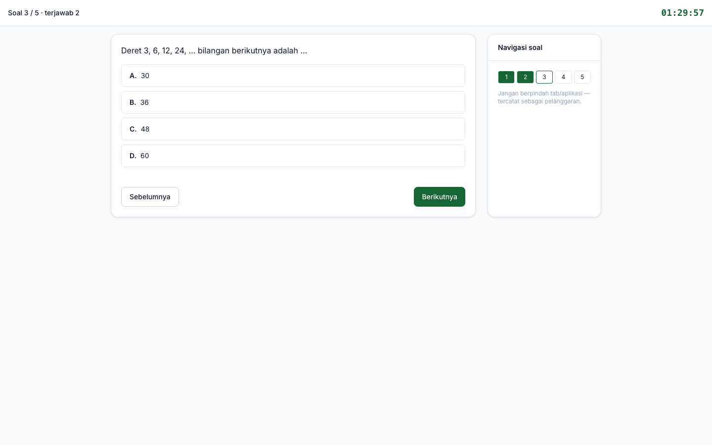
*Gambar 12.2 — Mengerjakan CBT: soal, pilihan jawaban, sisa waktu, dan navigasi soal.*

> **Penting**
> - **Jangan berpindah tab atau aplikasi** selama ujian; setiap perpindahan tercatat sebagai pelanggaran.
> - Bila waktu habis, jawaban **dikirim otomatis**.
> - Bila koneksi terputus, buka kembali halaman ujian dan klik **Lanjutkan ujian**. Jawaban yang tersimpan tidak hilang, dan waktu tetap berjalan.
> - Memulai CBT otomatis mencatat Anda **Hadir**.

Setelah dikirim, kartu ujian menampilkan **Jawaban CBT terkirim**. Nilai CBT dihitung otomatis; hasil seleksi diumumkan sesuai jadwal.

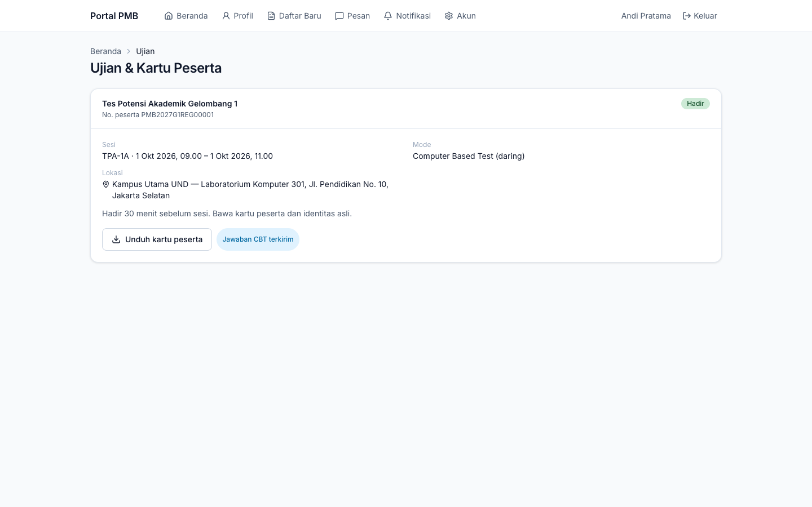
*Gambar 12.3 — Setelah ujian: status Hadir dan Jawaban CBT terkirim.*

Untuk ujian **luring** atau **wawancara**, datanglah ke lokasi sesuai kartu peserta. Pengawas memindai kode QR pada kartu Anda untuk mencatat kehadiran.

### 12.4 Mengajukan jadwal ulang

Bila berhalangan karena alasan kuat (misalnya sakit atau bentrok jadwal resmi):

1. Klik **Ajukan jadwal ulang** (hanya tersedia selama status masih **Terdaftar**).
2. Isi **Alasan** dan (opsional) unggah **Bukti** (JPG, PNG, PDF), lalu **Simpan**.
3. Panitia meninjau permintaan. Bila disetujui, jadwal baru tampil di halaman ini.

Secara default setiap peserta hanya dapat dijadwalkan ulang **satu kali**.

---

## 13. Hasil Seleksi dan Surat Penerimaan

### 13.1 Kapan hasil dapat dilihat

Hasil seleksi **hanya** terbit setelah disahkan pejabat kampus dan **tepat pada waktu pengumuman** gelombang (lihat menu **Jadwal**). Sebelum itu, halaman hasil menampilkan *"Hasil seleksi belum tersedia — Hasil diumumkan sesuai jadwal gelombang."* Setelah terbit, Anda menerima pemberitahuan dan kartu pendaftaran menampilkan tombol **Hasil seleksi**.

### 13.2 Membaca hasil

| Keputusan | Arti | Langkah berikutnya |
|---|---|---|
| **Diterima** | Diterima pada prodi & sistem kuliah yang tertera (bisa pilihan 1 atau pilihan berikutnya) | Unduh surat penerimaan, lakukan **daftar ulang** sebelum batasnya |
| **Cadangan** | Berada di daftar cadangan | Tunggu. Bila kursi tersedia, panitia mempromosikan Anda menjadi *Diterima* dengan batas daftar ulang tersendiri (default 7 hari) dan Anda diberi tahu |
| **Tidak diterima** | Tidak lolos seleksi pada jalur ini | Anda dapat mendaftar pada gelombang/jalur lain yang masih dibuka |

| | |
|---|---|
| 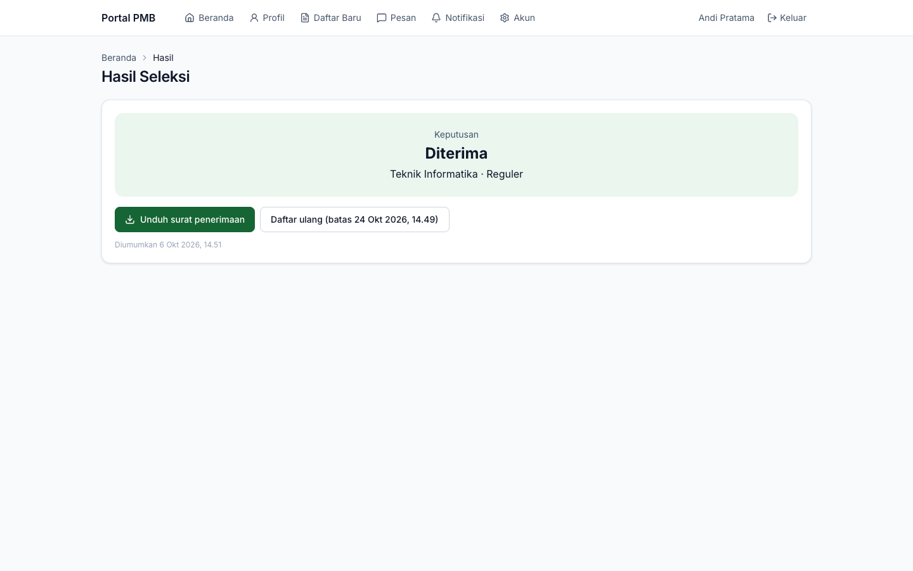 | 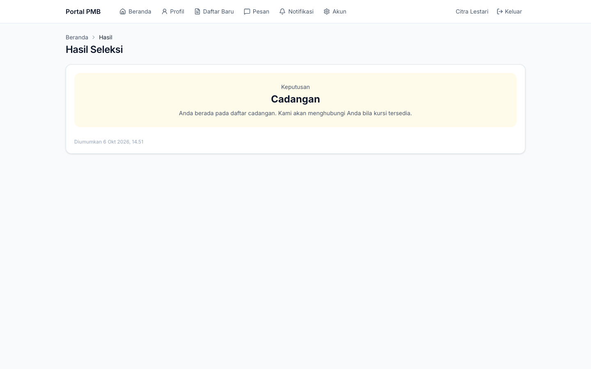 |

*Gambar 13.1 — Hasil **Diterima** (kiri) dan **Cadangan** (kanan).*

Informasi lain yang dapat muncul: **Beasiswa jalur masuk: potongan X%** (diterapkan pada tagihan biaya awal), **Hasil telah dikoreksi** (panitia mengoreksi hasil melalui persetujuan resmi, beserta catatannya), dan waktu **Diumumkan**.

### 13.3 Surat penerimaan (LoA)

Bagi yang diterima, klik **Unduh surat penerimaan**. Surat bernomor (contoh `LOA/PMB2027/00001`) dan memuat **kode QR** verifikasi. Siapa pun (sekolah, instansi) dapat memindai QR tersebut untuk membuka halaman verifikasi yang menampilkan status **asli dan berlaku**, **telah DICABUT**, atau **tidak berlaku**, dengan nama tersamar.

*Gambar 13.2 — Hasil verifikasi surat penerimaan yang asli.*

> **Perlu konfirmasi** — Surat penerimaan belum memakai tanda tangan elektronik tersertifikasi (TTE); keasliannya dibuktikan lewat QR verifikasi.

### 13.4 Cek status tanpa masuk portal

1. Buka **Cek Status** di website.
2. Isi **Nomor pendaftaran** dan **Tanggal lahir** sesuai data pendaftaran.
3. Selesaikan CAPTCHA bila ada, klik **Cek**.

*Gambar 13.3 — Cek status: tahap saat ini, hasil seleksi, dan prodi bila diterima.*

> **Catatan** — Contoh pada kotak isian (`PMB27-G1-REG-00001`) hanyalah contoh tampilan; format nomor sebenarnya seperti `PMB2027-REG-000001`. Pengecekan dibatasi 5 kali per menit dari satu alamat internet.

---

## 14. Daftar Ulang

Daftar ulang wajib bagi yang **diterima**. Status "diterima" belum berarti Anda sudah menjadi mahasiswa; Anda resmi menjadi mahasiswa setelah daftar ulang disetujui.

### 14.1 Menerima atau menolak tawaran

Klik **Daftar ulang (batas …)** di halaman hasil, atau **Daftar ulang** di Beranda.

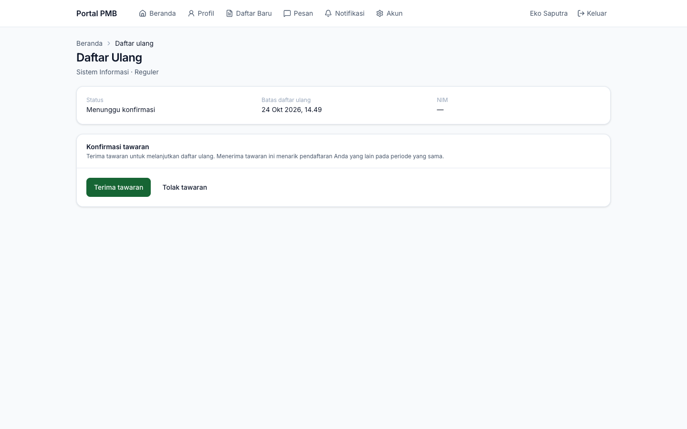
*Gambar 14.1 — Konfirmasi tawaran (status Menunggu konfirmasi).*

**Menerima:** baca dan centang **Saya menyetujui** pada setiap pernyataan (bila ada), lalu klik **Terima tawaran**.

> **Penting** — Menerima tawaran **menarik semua pendaftaran Anda yang lain pada periode yang sama**.

**Menolak:** klik **Tolak tawaran**, isi alasan (opsional), lalu **Tolak tawaran**. Kursi Anda diberikan kepada pendaftar cadangan.

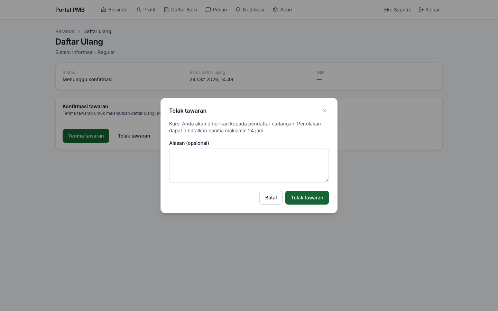
*Gambar 14.2 — Dialog tolak tawaran.*

> **Catatan** — Bila salah menolak, segera hubungi panitia. Penolakan dapat dipulihkan panitia **maksimal 24 jam** setelahnya.

### 14.2 Halaman daftar ulang

Setelah tawaran diterima, halaman **Daftar Ulang** menampilkan status, **batas daftar ulang**, NIM (setelah terbit), dan bagian-bagian berikut.

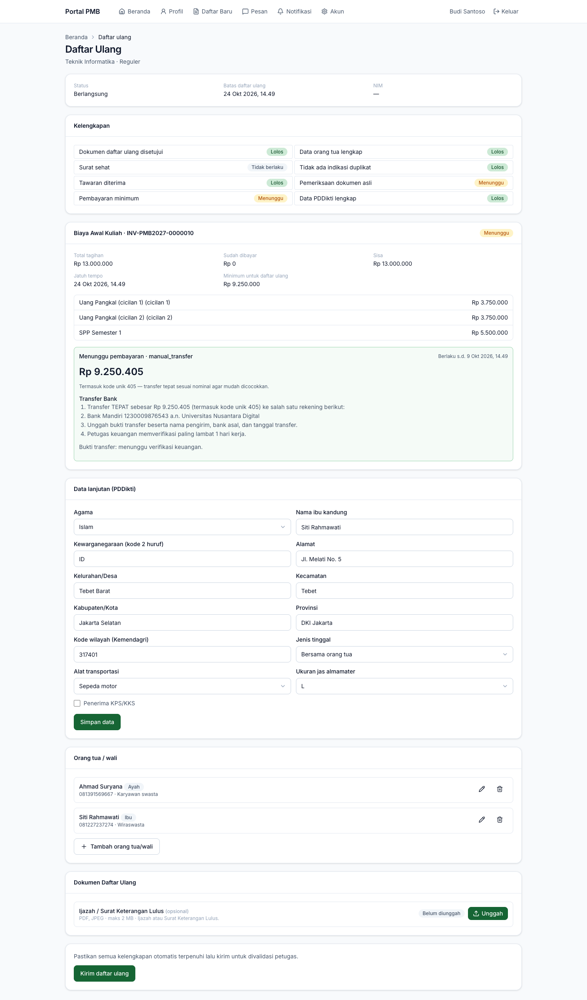
*Gambar 14.3 — Daftar ulang berjalan: kelengkapan, tagihan biaya awal, data PDDikti, orang tua/wali, dokumen, dan tombol kirim.*

**Kelengkapan** — daftar pemeriksaan dengan status **Lolos**, **Menunggu**, **Tidak lolos**, atau **Tidak berlaku**:

| Pemeriksaan | Terpenuhi bila |
|---|---|
| Tawaran diterima | Anda sudah menerima tawaran |
| Data PDDikti lengkap | Seluruh isian *Data lanjutan (PDDikti)* lengkap |
| Data orang tua lengkap | Data orang tua/wali tersedia |
| Dokumen daftar ulang disetujui | Dokumen wajib tahap daftar ulang disetujui petugas |
| Surat sehat | Hanya bila diwajibkan prodi (*Tidak berlaku* bila tidak) |
| Pembayaran minimum | Pembayaran biaya awal mencapai minimum daftar ulang |
| Pemeriksaan dokumen asli | Ditandai petugas saat Anda menunjukkan dokumen asli |
| Tidak ada indikasi duplikat | Tidak ada indikasi akun ganda yang belum diselesaikan |

### 14.3 Membayar biaya awal kuliah

Tagihan **Biaya Awal Kuliah** berisi komponen biaya (misalnya Uang Pangkal dan SPP Semester 1), potongan beasiswa bila ada, jatuh tempo, dan **Minimum untuk daftar ulang**.

- Komponen yang **dapat dicicil** dipecah per cicilan. Minimum daftar ulang (default) = cicilan pertama komponen yang dapat dicicil + seluruh komponen yang tidak dapat dicicil.
- Saat membuat instruksi pembayaran, isi **Nominal (kosongkan untuk melunasi sisa)** untuk membayar sebagian (minimal sebesar minimum daftar ulang), atau kosongkan untuk melunasi.
- Cara bayar sama dengan biaya pendaftaran: transfer + unggah bukti, loket, atau pembayaran daring bila aktif ([bab 9](#9-membayar-biaya-pendaftaran)).

> **Contoh perhitungan** (sesuai Gambar 14.3) — Uang Pangkal Rp7.500.000 dapat dicicil 50% + 50% → cicilan 1 Rp3.750.000 dan cicilan 2 Rp3.750.000; SPP Semester 1 Rp5.500.000 tidak dicicil. Total tagihan Rp13.000.000; **minimum untuk daftar ulang** = Rp3.750.000 + Rp5.500.000 = **Rp9.250.000**.

> **Catatan** — Pada versi ini nama item cicilan dapat tampil berulang, misalnya *"Uang Pangkal (cicilan 1) (cicilan 1)"*. Nominalnya tetap benar.

### 14.4 Data lanjutan (PDDikti)

Isi data yang diwajibkan pelaporan PDDikti, lalu klik **Simpan data**:

| Isian | Keterangan |
|---|---|
| Agama | Pilihan baku PDDikti |
| Nama ibu kandung | Disimpan terenkripsi (data sensitif) |
| Kewarganegaraan (kode 2 huruf) | Contoh `ID` untuk Indonesia |
| Alamat, Kelurahan/Desa, Kecamatan, Kabupaten/Kota, Provinsi | Alamat domisili |
| Kode wilayah (Kemendagri) | Kode kecamatan/kelurahan sesuai Kemendagri, contoh `317401` |
| Jenis tinggal | Bersama orang tua, wali, kos, asrama, panti asuhan, lainnya |
| Alat transportasi | Jalan kaki, sepeda, sepeda motor, mobil, angkutan umum, ojek, lainnya |
| Ukuran jas almamater | S sampai XXXL |
| Penerima KPS/KKS | Centang bila penerima |

### 14.5 Orang tua/wali dan dokumen daftar ulang

- Lengkapi data orang tua/wali (sama seperti di formulir pendaftaran).
- Unggah dokumen tahap daftar ulang (misalnya ijazah atau Surat Keterangan Lulus) pada kartu **Dokumen Daftar Ulang**.

### 14.6 Mengirim daftar ulang

Setelah kelengkapan otomatis terpenuhi, klik **Kirim daftar ulang**. Petugas daftar ulang memvalidasi, termasuk memeriksa **dokumen asli** (ikuti instruksi panitia, misalnya membawa ijazah/SKL dan KTP asli ke loket). Bila ada yang perlu diperbaiki, status menjadi *Perlu perbaikan* dan hanya data/dokumen yang diminta yang dapat diubah; perbaiki lalu kirim kembali.

> **Penting** — Selesaikan daftar ulang sebelum **batas daftar ulang**. Lewat batas, status menjadi *Kedaluwarsa* dan kursi dapat dialihkan ke cadangan. Bila ada kendala (misalnya gangguan pembayaran), hubungi panitia **sebelum** batas waktu; panitia dapat memperpanjang batas.

---

## 15. Resmi Menjadi Mahasiswa

Setelah daftar ulang disetujui dan proses pembentukan data mahasiswa selesai, status menjadi **Resmi mahasiswa** dan tampil kartu **Selamat! Anda resmi menjadi mahasiswa** berisi:

- **NIM** Anda (contoh `27TEK30001`; format mengikuti kampus);
- informasi bahwa akun SIAKAD dikirim ke email Anda;
- tombol **Unduh bukti registrasi** (PDF);
- informasi orientasi mahasiswa baru (bila diisi panitia).

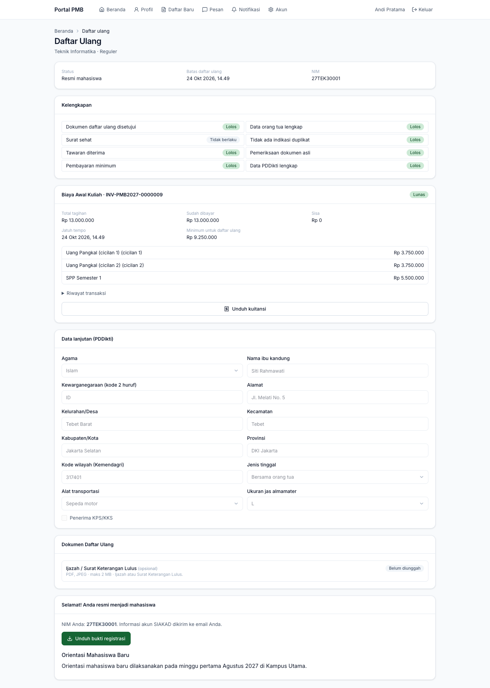
*Gambar 15.1 — Daftar ulang selesai: NIM terbit, bukti registrasi, dan info orientasi.*

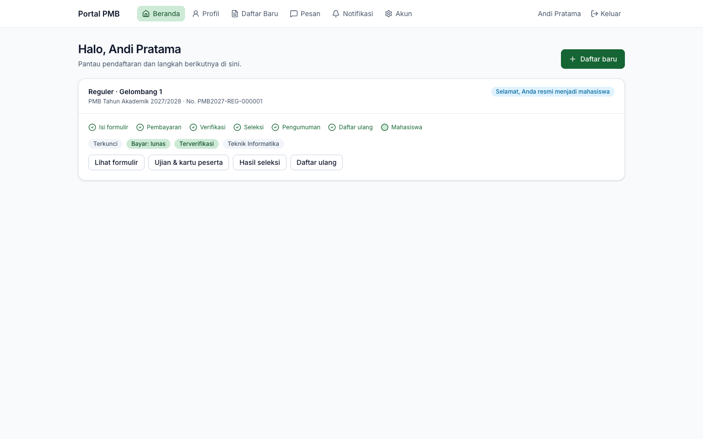
*Gambar 15.2 — Beranda portal setelah resmi menjadi mahasiswa: seluruh linimasa selesai.*

Bila daftar ulang **ditolak tawarannya**, **kedaluwarsa**, atau **dibatalkan**, halaman menampilkan peringatan dan saran menghubungi panitia bila terjadi kekeliruan.

---

## 16. Pesan, Notifikasi, dan Keamanan Akun

### 16.1 Bertanya kepada panitia (Pesan)

1. Buka **Pesan**, klik **Pesan baru**.
2. Isi **Subjek**, pilih **Terkait pendaftaran** (opsional), tulis **Pesan**, lampirkan berkas bila perlu (JPG, PNG, PDF), klik **Simpan**.
3. Balasan panitia muncul di percakapan yang sama. Angka merah menandai pesan yang belum dibaca. Balas lewat kotak **Tulis pesan…** lalu **Kirim**.

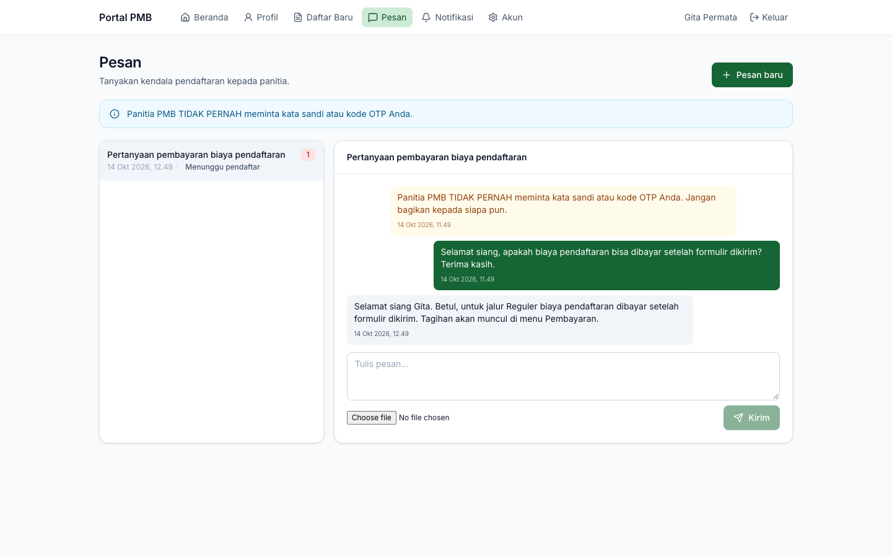
*Gambar 16.1 — Percakapan dengan panitia: pesan Anda (hijau), balasan panitia (abu-abu), pesan sistem (kuning).*

Status percakapan: **Dibuka**, **Menunggu pendaftar** (panitia menunggu jawaban Anda), **Ditutup** (buat pesan baru bila perlu).

> **Penting** — Panitia PMB **tidak pernah** meminta kata sandi atau kode OTP Anda. Jangan kirimkan data tersebut kepada siapa pun.

### 16.2 Notifikasi

Menu **Notifikasi** menampilkan pemberitahuan dalam aplikasi (formulir diterima, pembayaran diverifikasi, perlu perbaikan, jadwal ujian, hasil seleksi). Pemberitahuan penting juga dikirim lewat **email**, dan lewat SMS/WhatsApp bila kampus mengaktifkannya.

> **Kendala diketahui** — Pada versi yang diuji, halaman **Notifikasi** dapat tetap kosong walaupun email terkirim. Pantau status melalui **Beranda** portal dan email Anda.

### 16.3 Akun dan keamanan

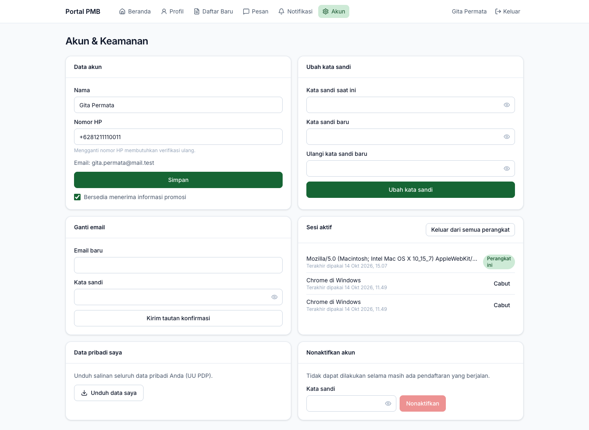
*Gambar 16.2 — Halaman Akun & Keamanan.*

| Kartu | Fungsi |
|---|---|
| **Data akun** | Ubah **Nama** dan **Nomor HP** (mengganti nomor HP memerlukan verifikasi ulang); atur **Bersedia menerima informasi promosi** |
| **Ubah kata sandi** | Isi kata sandi saat ini dan kata sandi baru dua kali |
| **Ganti email** | Isi **Email baru** dan **Kata sandi**, klik **Kirim tautan konfirmasi**; email baru aktif setelah tautannya diklik |
| **Sesi aktif** | Daftar perangkat yang sedang masuk; **Cabut** perangkat lain atau **Keluar dari semua perangkat** |
| **Data pribadi saya** | **Unduh data saya**: salinan seluruh data pribadi Anda (berkas JSON), sesuai hak subjek data UU PDP |
| **Nonaktifkan akun** | Tidak dapat dilakukan selama masih ada pendaftaran yang berjalan; setelah nonaktif Anda tidak dapat masuk lagi |

**Tips keamanan:** gunakan kata sandi yang kuat dan berbeda dari akun lain, keluar dari perangkat umum, dan cabut sesi perangkat yang tidak Anda kenali. Permintaan penghapusan data diproses lewat panitia/pejabat pelindungan data kampus.

---

## 17. Kendala Umum dan Solusinya

| Kendala / pesan | Penyebab | Solusi |
|---|---|---|
| Email verifikasi tidak masuk | Salah ketik email, masuk folder spam, atau tautan kedaluwarsa (24 jam) | Periksa folder spam; masuk portal lalu klik **Kirim ulang email verifikasi**. Bila email salah ketik, buat akun baru dengan email yang benar atau hubungi panitia. |
| *"Kampus tidak dapat ditentukan dari alamat ini…"* | Website dibuka dari alamat yang bukan alamat resmi kampus | Buka website PMB lewat alamat resmi kampus. |
| *"Terlalu banyak percobaan…"* | Batas percobaan (masuk 10/menit, cek status 5/menit, buat akun 5/jam) | Tunggu sebentar lalu coba lagi. |
| Tombol **Daftar jalur ini** tidak bisa diklik | Akun belum terverifikasi, atau sudah mencapai batas pendaftaran aktif per periode | Verifikasi akun, atau lanjutkan pendaftaran yang sudah ada dari Beranda. |
| *"Pendaftaran gelombang ini sedang tidak dibuka."* | Gelombang belum dibuka/sudah ditutup, atau jalur ditutup panitia | Lihat menu **Jadwal**; pilih gelombang yang sedang dibuka. |
| *"Data telah diubah di tab/perangkat lain. Muat ulang."* | Formulir disimpan dari tab/perangkat lain | Muat ulang halaman, lalu ulangi perubahan. |
| Tombol **Kirim formulir** nonaktif | Ada langkah bertanda **!**, pernyataan belum dicentang, atau (jalur bayar sebelum kirim) biaya belum lunas | Buka langkah bertanda **!** dan lengkapi isian di kotak **Belum lengkap**. |
| *"Resolusi gambar minimal 400×600 piksel."* / *"Rasio foto harus 3:4 (toleransi 10%)."* | Pas foto terlalu kecil atau bukan rasio 3:4 potret | Potong foto menjadi 3:4 (misalnya 600 × 800 piksel), unggah ulang. |
| *"Ukuran berkas melebihi … MB."* | Berkas lebih besar dari batas | Kompres/perkecil berkas. |
| Kolom **Tanggal lahir** tampak kosong | Kendala tampilan yang diketahui | Data tetap tersimpan; isi ulang hanya bila ingin mengubah. |
| Bukti transfer belum diverifikasi | Menunggu pengecekan mutasi oleh keuangan | Tunggu maksimal 1 hari kerja; tanyakan lewat **Pesan** bila lebih lama. Pastikan nominal tepat termasuk kode unik. |
| Ingin membayar tunai | — | Datang ke loket kampus dengan nomor tagihan; buka langkah **Pembayaran** minimal sekali agar tagihan terbit. |
| *"Ujian hanya dapat dikerjakan pada waktu sesi."* / *"Ujian belum dibuka."* | Di luar jam sesi atau jadwal belum terbit | Buka tepat pada jam sesi di kartu peserta. |
| *"Anda tidak dapat mengikuti sesi ini."* | Status kehadiran *Tidak hadir*, *Izin*, atau *Didiskualifikasi* | Hubungi pengawas/panitia. |
| *"Hasil seleksi belum tersedia"* | Belum waktu pengumuman atau hasil belum disahkan | Tunggu sesuai jadwal pengumuman. |
| Salah menolak tawaran | — | Segera hubungi panitia; penolakan dapat dipulihkan maksimal 24 jam. |
| *"Akun tidak aktif. Hubungi panitia PMB."* | Akun dibekukan panitia atau dinonaktifkan | Hubungi panitia lewat kontak resmi. |
| Halaman **Notifikasi** kosong | Kendala yang diketahui | Pantau email dan Beranda portal. |

Bila kendala belum teratasi, hubungi panitia lewat menu **Pesan** di portal atau kontak resmi di menu **Kontak** website. Sertakan nomor pendaftaran (bila ada) dan tangkapan layar pesan kesalahan; **jangan** menyertakan kata sandi atau kode OTP.

---

## 18. Hal yang Perlu Dikonfirmasi dan Keterbatasan Versi Ini

### 18.1 Bergantung pada kebijakan atau layanan kampus

| Hal | Keterangan |
|---|---|
| Pembayaran daring (VA/QRIS/e-wallet) | Tersedia hanya bila kampus mengaktifkan penyedia pembayaran. Tanpa itu: transfer bank (unggah bukti) dan loket. |
| SMS/WhatsApp | Verifikasi akun & reset sandi lewat OTP SMS, serta pemberitahuan SMS/WA, hanya berfungsi bila kampus mengaktifkan penyedia SMS. Email tetap menjadi kanal utama. |
| Batas pendaftaran aktif per periode | Default 1; kampus dapat mengubahnya. |
| Batas perbaikan & perpanjangan | Default perbaikan 72 jam; perpanjangan daftar ulang maksimal 7 hari; ditetapkan kampus. |
| Kebijakan pengembalian biaya | Biaya pendaftaran umumnya tidak dikembalikan; ketentuan resmi ditetapkan kampus. |
| Minimum pembayaran daftar ulang | Default cicilan pertama; kampus dapat mewajibkan lunas. |
| Format NIM | Ditetapkan kampus. |
| Tanda tangan elektronik surat penerimaan | Belum tersedia; keaslian dibuktikan lewat kode QR verifikasi. |
| Persetujuan wali bagi pendaftar di bawah 18 tahun | Belum ada isian khusus di formulir; ikuti arahan panitia. |

### 18.2 Perbedaan dengan rancangan yang perlu Anda ketahui

| Rancangan | Yang berlaku di aplikasi saat ini |
|---|---|
| Formulir tersimpan otomatis | Simpan **manual** per langkah dengan tombol simpan. |
| Unduh bukti pendaftaran setelah kirim formulir | Nomor pendaftaran tampil di layar dan dikirim ke email; bukti PDF tersedia setelah daftar ulang (bukti registrasi). |
| Unggah *drag & drop* dan kompresi otomatis | Tombol pilih berkas standar; perkecil berkas sendiri bila terlalu besar. |
| Status pembayaran daring diperbarui otomatis di layar | Muat ulang halaman atau klik **Cek status**. |
| Tolak tawaran dengan konfirmasi dua langkah | Satu dialog **Tolak tawaran**; hubungi panitia bila salah tolak (≤ 24 jam). |
| Riwayat persetujuan & pengajuan hapus akun di menu Akun | Tersedia pengaturan informasi promosi, **Unduh data saya**, dan **Nonaktifkan akun**. |
| Formulir "beri tahu saya" bila pendaftaran belum dibuka | Pantau halaman **Jadwal**. |

---

## Lampiran A — Glosarium

| Istilah | Arti |
|---|---|
| Akun pendaftar | Akun portal PMB calon mahasiswa, terpisah dari akun mahasiswa/staf |
| Cadangan | Pendaftar yang memenuhi syarat tetapi belum mendapat kursi; dapat dipromosikan menjadi diterima |
| CBT | *Computer Based Test*, ujian berbasis komputer |
| Daftar ulang | Proses setelah diterima: terima tawaran, lengkapi data & dokumen, bayar biaya awal, validasi petugas |
| Gelombang | Rentang jadwal pendaftaran dalam satu periode |
| Gelombang ODS | Gelombang dengan jadwal ujian fleksibel (*On Demand Schedule*) |
| Jalur masuk | Cara penerimaan (Reguler, Prestasi, KIP, dll.) |
| Kode unik | Tiga digit tambahan pada nominal transfer untuk memudahkan pencocokan |
| Kuota | Jumlah kursi per program studi, jalur, dan sistem kuliah |
| LoA | *Letter of Acceptance*, surat penerimaan ber-QR verifikasi |
| NIK | Nomor Induk Kependudukan (16 digit) |
| NIM | Nomor Induk Mahasiswa |
| NISN / NPSN | Nomor Induk Siswa Nasional / Nomor Pokok Sekolah Nasional |
| OTP | Kode sekali pakai 6 digit yang dikirim lewat SMS/WA |
| PDDikti | Pangkalan Data Pendidikan Tinggi; data daftar ulang dipakai untuk pelaporan ke PDDikti |
| Periode | Satu siklus PMB untuk satu tahun akademik masuk |
| Portal pendaftar | Bagian aplikasi untuk pendaftar yang sudah masuk (`/pmb/portal`) |
| Sistem kuliah | Kelas perkuliahan (Reguler, Kelas Karyawan, dll.) |
| SKL | Surat Keterangan Lulus |
| Tagihan | Kewajiban bayar (biaya pendaftaran atau biaya awal kuliah) bernomor `INV-…` |
| UU PDP | Undang-Undang Pelindungan Data Pribadi |
| Verifikasi | Pemeriksaan data & dokumen oleh panitia |

## Lampiran B — Arti Status yang Tampil di Layar

**Tahap pendaftaran (label di kartu Beranda):**

| Label | Arti |
|---|---|
| Melengkapi formulir | Formulir masih draf |
| Menunggu pembayaran | Biaya pendaftaran belum lunas |
| Sedang diverifikasi | Formulir terkirim & lunas, atau sedang diperiksa verifikator |
| Perlu perbaikan | Verifikator meminta perbaikan data/dokumen |
| Tidak lolos administrasi | Verifikator menolak |
| Proses seleksi | Lolos verifikasi; mengikuti ujian/penilaian/peringkat |
| Hasil seleksi tersedia | Hasil sudah diumumkan |
| Daftar ulang | Diterima dan sedang daftar ulang |
| Daftar ulang tidak diselesaikan | Menolak tawaran / lewat batas / dibatalkan |
| Selamat, Anda resmi menjadi mahasiswa | NIM terbit |
| Ditarik | Pendaftaran ditarik sebelum hasil terbit |
| Tidak dikirim | Draf dihapus, atau tidak dikirim saat pendaftaran gelombang ditutup |

**Status lain:**

| Objek | Status |
|---|---|
| Formulir | Draf · Terkirim · Perlu perbaikan · Terkunci · Ditarik · Batal |
| Verifikasi | Belum diperiksa · Diperiksa · Perlu perbaikan · Terverifikasi · Ditolak |
| Pembayaran pendaftaran | Tidak perlu · Belum bayar · Menunggu · Lunas · Kedaluwarsa |
| Tagihan | Belum bayar · Menunggu · Sebagian · Lunas · Kedaluwarsa · Dibatalkan · Refund diproses · Dikembalikan |
| Dokumen | Belum diunggah · Diunggah · Diperiksa · Disetujui · Perlu perbaikan · Ditolak |
| Kehadiran ujian | Terdaftar · Hadir · Tidak hadir · Izin · Didiskualifikasi |
| Keputusan | Diterima · Cadangan · Tidak diterima · Dibatalkan |
| Daftar ulang | Menunggu konfirmasi · Dikonfirmasi/Berlangsung · Terkirim · Perlu perbaikan · Disetujui · Resmi mahasiswa · Menolak tawaran · Kedaluwarsa · Dibatalkan |
| Pemeriksaan daftar ulang | Menunggu · Lolos · Tidak lolos · Tidak berlaku |
| Pesan | Dibuka · Menunggu pendaftar · Ditutup |

## Lampiran C — Daftar Periksa Pendaftar

- [ ] Membaca jalur, persyaratan dokumen, biaya, dan jadwal gelombang di website
- [ ] Menyiapkan email aktif, data identitas, data sekolah, nilai rapor, data orang tua, pas foto 3:4, dan pindaian dokumen
- [ ] Membuat akun dan memverifikasi email (tautan berlaku 24 jam)
- [ ] Memilih gelombang & jalur (**Daftar Baru** → **Daftar jalur ini**)
- [ ] Mengisi **Data diri** → **Simpan data diri**
- [ ] Mengisi **Pendidikan** & **Nilai rapor** → memastikan label **Dipakai untuk pendaftaran**
- [ ] Mengisi **Pilihan prodi** sesuai prioritas → **Simpan pilihan**
- [ ] Mengisi **Data pendukung** & isian tambahan → **Simpan data pendukung**
- [ ] Mengunggah semua dokumen wajib
- [ ] Membayar biaya pendaftaran (transfer tepat termasuk kode unik + unggah bukti, atau loket)
- [ ] Mencentang pernyataan dan **Kirim formulir** sebelum gelombang ditutup; mencatat nomor pendaftaran
- [ ] Memantau Beranda & email; memperbaiki data/dokumen bila diminta sebelum batasnya
- [ ] (Jalur berujian) Mengunduh kartu peserta dan mengikuti ujian sesuai sesi
- [ ] Melihat hasil seleksi pada waktu pengumuman; mengunduh surat penerimaan bila diterima
- [ ] **Terima tawaran**, membayar biaya awal (minimal sebesar minimum daftar ulang), mengisi data PDDikti, mengunggah dokumen daftar ulang, **Kirim daftar ulang** sebelum batas
- [ ] Menunjukkan dokumen asli bila diminta petugas
- [ ] Menerima NIM, mengunduh bukti registrasi, dan memeriksa email akun SIAKAD

## Lampiran D — Peta Bab ke Video Tutorial

Video: [`tutorial-pmb-calon-mahasiswa.mp4`](../../video-tutorial-pmb/tutorial-pmb-calon-mahasiswa.mp4). Waktu = posisi awal bagian di video.

| Bab manual | Bagian video | Mulai |
|---|---|---:|
| 1. Pengenalan | Pembuka; Tujuh Tahap Pendaftaran | 0:00 |
| 2. Persiapan | Yang Perlu Disiapkan | 1:26 |
| 3. Website PMB | Website PMB; Prodi, Jalur, Biaya, Jadwal | 2:17 |
| 4. Akun | Membuat Akun; Masuk & Verifikasi | 4:03 |
| 5–6. Portal, gelombang & jalur | Memilih Gelombang & Jalur | 5:21 |
| 7. Formulir | Formulir: Data Diri; Pendidikan; Pilihan Prodi; Data Pendukung | 6:06 |
| 8. Dokumen | Formulir: Dokumen | 8:21 |
| 9. Pembayaran | Membayar Biaya Pendaftaran | 8:54 |
| 10. Mengirim formulir | Mengirim Formulir | 9:56 |
| 11. Verifikasi & perbaikan | Bila Diminta Perbaikan | 10:36 |
| 12. Ujian & CBT | Ujian & Kartu Peserta | 11:07 |
| 13. Hasil & surat penerimaan | Hasil Seleksi & Surat Penerimaan | 12:21 |
| 14. Daftar ulang | Menerima atau Menolak Tawaran; Daftar Ulang | 13:15 |
| 15. Resmi mahasiswa | Resmi Menjadi Mahasiswa | 14:29 |
| 16. Pesan & akun; 13.4 Cek status | Pesan, Akun & Cek Status | 15:00 |
| 17. Kendala umum | Kendala Umum | 15:33 |
| Lampiran C | Ringkasan | 16:48 |
