# Manual Book PMB untuk Penyelenggara

**Panduan Operasional Modul Penerimaan Mahasiswa Baru (PMB) — Civitas One**

| | |
|---|---|
| **Versi dokumen** | 1.0 |
| **Tanggal** | 16 Oktober 2026 |
| **Pembaca** | Administrator PMB (ketua/sekretariat panitia), Petugas Verifikasi, Petugas Keuangan & Kepala Keuangan, Panitia Seleksi, Penguji/Pengawas (dosen), Pejabat Pengesah, Petugas Daftar Ulang, Pimpinan/Dekan/Kaprodi, Auditor, Administrator Sistem |
| **Video pendamping** | [Video Tutorial PMB untuk Penyelenggara](../../video-tutorial-pmb/tutorial-pmb-penyelenggara.mp4) (18 menit 37 detik) · [naskah video](../../video-tutorial-pmb/naskah-video-pmb-penyelenggara.md) |
| **Panduan pendaftar** | [Manual Book PMB untuk Calon Mahasiswa](MANUAL-BOOK-PMB-CALON-MAHASISWA.md) |
| **Acuan** | Rancangan PMB [`docs/pmb/01–16`](../../pmb/) (terutama 03–09, 12, [16 Catatan Implementasi](../../pmb/16-catatan-implementasi.md)), manual PMB per bab ([`README`](README.md)), dan kode aplikasi terkini (`app/Modules/Admission`, `frontend/src/pmb`) |

Manual ini menjelaskan **fungsi setiap fitur, langkah penggunaan, hak akses, dan alur kerja** modul PMB dari sisi penyelenggara, dikelompokkan menurut peran. Setiap bab diawali kotak **Untuk** (peran yang mengerjakan) dan **Menu** (jalur menu di aplikasi).

> **Tentang gambar** — Gambar diambil dari aplikasi yang berjalan dengan **data demo fiktif** (*Universitas Nusantara Digital*, kode `UND`) pada 14 Oktober 2026. Beberapa layar konfigurasi sudah diperbarui sesudahnya (baris filter pada tabel gelombang, jalur, kuota, dan biaya; editor teks kaya pada deskripsi profil prodi); perbedaan itu disebutkan di bab terkait. Pada data demo, nama fakultas beberapa prodi diacak oleh *seeder* contoh; ini bukan perilaku aplikasi.

---

## Daftar Isi

**Bagian I — Umum**
1. [Pengenalan Modul PMB](#1-pengenalan-modul-pmb)
2. [Peran, Akses, dan Hak Akses](#2-peran-akses-dan-hak-akses)
3. [Alur Kerja dan Kalender Panitia](#3-alur-kerja-dan-kalender-panitia)

**Bagian II — Konfigurasi (Administrator PMB & Panitia Seleksi)**
4. [Master Data: Jalur, Sistem Kuliah, Jenis Dokumen](#4-master-data-jalur-sistem-kuliah-jenis-dokumen)
5. [Template Formulir](#5-template-formulir)
6. [Skema Seleksi](#6-skema-seleksi)
7. [Periode, Gelombang, dan Gelombang-Jalur](#7-periode-gelombang-dan-gelombang-jalur)
8. [Persyaratan Dokumen, Kuota, dan Biaya](#8-persyaratan-dokumen-kuota-dan-biaya)
9. [Konten Website dan Profil Prodi](#9-konten-website-dan-profil-prodi)
10. [Pengaturan PMB, Format NIM, dan Voucher](#10-pengaturan-pmb-format-nim-dan-voucher)
11. [Publikasi, Penutupan, dan Arsip Periode](#11-publikasi-penutupan-dan-arsip-periode)

**Bagian III — Operasional per Peran**
12. [Dashboard PMB (semua peran)](#12-dashboard-pmb)
13. [Data Pendaftar dan Pendaftaran Loket](#13-data-pendaftar-dan-pendaftaran-loket)
14. [Verifikasi Administrasi (Petugas Verifikasi)](#14-verifikasi-administrasi)
15. [Keuangan PMB (Petugas Keuangan)](#15-keuangan-pmb)
16. [Ujian Seleksi (Panitia Ujian)](#16-ujian-seleksi)
17. [Penilaian Ujian (Penguji/Pengawas)](#17-penilaian-ujian)
18. [Proses Seleksi (Panitia Seleksi)](#18-proses-seleksi)
19. [Pengesahan lewat Menu Persetujuan (Pejabat Pengesah & Kepala Keuangan)](#19-pengesahan-lewat-menu-persetujuan)
20. [Pengumuman dan Keputusan](#20-pengumuman-dan-keputusan)
21. [Daftar Ulang dan Konversi Mahasiswa (Petugas Daftar Ulang)](#21-daftar-ulang-dan-konversi-mahasiswa)
22. [Komunikasi dengan Pendaftar](#22-komunikasi-dengan-pendaftar)
23. [Laporan PMB (Pimpinan, Dekan/Kaprodi, Panitia)](#23-laporan-pmb)
24. [Audit PMB (Auditor)](#24-audit-pmb)

**Bagian IV — Teknis dan Penanganan Masalah**
25. [Administrasi Sistem](#25-administrasi-sistem)
26. [Penanganan Kendala Umum](#26-penanganan-kendala-umum)
27. [Hal yang Perlu Dikonfirmasi, Perbedaan Rancangan, dan Kendala yang Diketahui](#27-hal-yang-perlu-dikonfirmasi-perbedaan-rancangan-dan-kendala-yang-diketahui)

**Lampiran**
- [A — Glosarium](#lampiran-a--glosarium)
- [B — Daftar Status dan Kode](#lampiran-b--daftar-status-dan-kode)
- [C — Kode Alasan](#lampiran-c--kode-alasan)
- [D — Kartu Tugas Ringkas per Peran](#lampiran-d--kartu-tugas-ringkas-per-peran)
- [E — Peta Bab ke Video Tutorial](#lampiran-e--peta-bab-ke-video-tutorial)

**Konvensi penulisan**

| Penulisan | Arti |
|---|---|
| **Publikasikan** | Nama tombol, menu, tab, atau label, persis seperti di aplikasi |
| **PMB → Verifikasi** | Jalur menu: grup **PMB** di sidebar, lalu **Verifikasi** |
| `PMB2027-REG-000001` | Nilai, kode, atau alamat yang tampil/diketik apa adanya |
| `pmb_verification.approve` | Nama izin (*permission*) sistem, untuk administrator yang mengatur peran |
| > **Penting** | Berdampak pada data atau tidak dapat dibatalkan |
| > **Beda rancangan** | Perilaku aplikasi berbeda dari dokumen rancangan ([bab 27](#27-hal-yang-perlu-dikonfirmasi-perbedaan-rancangan-dan-kendala-yang-diketahui)) |
| > **Perlu konfirmasi** | Kebijakan belum final atau bergantung pada pihak eksternal |

---

# Bagian I — Umum

## 1. Pengenalan Modul PMB

### 1.1 Cakupan

Modul PMB mengelola seluruh siklus penerimaan: informasi pendaftaran di website kampus sampai calon mahasiswa tercatat sebagai **mahasiswa** dengan **NIM** di modul Akademik. Semua langkah tercatat (audit), mengikuti aturan bisnis rancangan, dan dipisahkan per kampus (*multi-tenant*).

| Area | Isi | Bab |
|---|---|---|
| Website & portal pendaftar | Informasi publik, akun pendaftar, formulir, dokumen, pembayaran, ujian, hasil, daftar ulang, pesan | Manual pendaftar |
| Konfigurasi | Master data, template formulir, skema seleksi, periode, gelombang, jalur, kuota, biaya, persyaratan, konten, pengaturan, format NIM, voucher | 4–11 |
| Operasional | Pendaftar, verifikasi, keuangan, ujian & CBT, penilaian, seleksi, pengesahan, pengumuman, daftar ulang & konversi, komunikasi | 12–22 |
| Pengawasan | Dashboard, laporan & ekspor, audit, log akses data sensitif | 12, 23, 24 |

### 1.2 Tiga "wajah" aplikasi

| Wajah | Alamat | Pengguna | Cara masuk |
|---|---|---|---|
| **Website PMB** (publik) | `/pmb` | Siapa saja | Tanpa login |
| **Portal Pendaftar** | `/pmb/portal` | Calon mahasiswa | Akun pendaftar di `/pmb/masuk` |
| **Admin PMB** | `/admin/pmb` (aplikasi staf) | Panitia & staf | Login staf di `/login`, tab **Dosen / Staf / Admin** |

### 1.3 Konsep kunci

| Istilah | Penjelasan | Contoh |
|---|---|---|
| **Periode** | Satu siklus PMB untuk satu tahun akademik masuk; berisi gelombang, kuota, biaya | *PMB Tahun Akademik 2027/2028* (`PMB2027`) |
| **Gelombang** | Rentang jadwal: pendaftaran, batas bayar, batas perbaikan, ujian, pengumuman, daftar ulang | *Gelombang 1* |
| **Gelombang ODS** | Gelombang dengan jadwal ujian fleksibel (*On Demand Schedule*) | *Gelombang Khusus (ODS)* |
| **Jalur masuk** | Kategori penerimaan | *Reguler*, *Prestasi* |
| **Gelombang-jalur** | Jalur yang dibuka pada suatu gelombang, dengan biaya, waktu bayar, maks pilihan, template, skema, persyaratan | *Reguler — Gelombang 2*, Rp250.000 |
| **Sistem kuliah** | Kelas perkuliahan | *Reguler (REG)*, *Kelas Karyawan (KRY)* |
| **Kuota** | Kapasitas per periode × jalur × prodi × sistem kuliah, plus cadangan & ambang | TI–Reguler–REG: 2 kursi, cadangan 2 |
| **Template formulir** | Aturan field inti & field tambahan; berversi; hanya versi **terbit** yang dapat dipakai | `FORM-S1 v1` |
| **Skema seleksi** | Komponen nilai, bobot, ambang, tie-break; berversi; hanya versi **terkunci** yang dapat dipakai | `SKM-REG v1`: Rapor 40% + TPA 60% |
| **Run seleksi** | Satu kali perhitungan peringkat & alokasi kursi untuk satu gelombang-jalur (snapshot + hash) | *Gelombang 1 · Reguler* |
| **Pengesahan** | Persetujuan berjenjang hasil seleksi di menu **Persetujuan** | Ketua Panitia → Pejabat Pengesah |
| **Batch pengumuman** | Jadwal publikasi otomatis setelah hasil disahkan | Terbit 6 Okt 2026, 14.49 |
| **LoA** | Surat penerimaan PDF bernomor dengan QR verifikasi | `LOA/PMB2027/00001` |
| **Konversi** | Pembuatan data mahasiswa, NIM, akun, tagihan Keuangan, dan beasiswa setelah daftar ulang disetujui | NIM `27TEK30001` |

### 1.4 Alur besar PMB

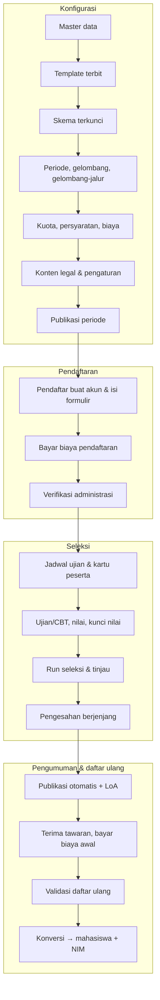

### 1.5 Prinsip yang berlaku di seluruh modul

- **Waktu** tampil menurut zona waktu perangkat pengguna (disimpan UTC). Pastikan jam komputer panitia benar.
- **Perubahan setelah ada pendaftar** pada jadwal, kuota, biaya, atau persyaratan wajib disertai **alasan** dan tercatat di audit. Perubahan yang membahayakan pendaftar yang sudah ada ditolak sistem (lihat [§7.4](#74-aturan-perubahan-setelah-ada-pendaftar)).
- **Data sensitif** (NIK, paspor, nama ibu kandung, catatan kebutuhan khusus, nomor KIP, rekening refund, isian bertanda sensitif) terenkripsi dan tampil **tersamar**; membukanya wajib menyebut tujuan dan tercatat.
- **Pengesahan dan refund** memakai menu **Persetujuan**. Pengaju tidak dapat menyetujui pengajuannya sendiri.
- **Hasil seleksi** tidak dapat dipublikasikan manual; hanya terbit lewat batch setelah disahkan.
- **Notifikasi** (email; SMS/WA bila penyedia aktif; dalam aplikasi) dikirim otomatis.
- **Penjadwal** (cron) menjalankan proses otomatis setiap menit dan harian: status gelombang, publikasi hasil, kedaluwarsa transaksi, notifikasi, konversi. Lihat [bab 25](#25-administrasi-sistem).

---

## 2. Peran, Akses, dan Hak Akses

### 2.1 Login staf

1. Buka `/login`, pilih tab **Dosen / Staf / Admin**.
2. Isi **Email** dan **Kata Sandi**, centang **Ingat saya** bila perlu, klik **Masuk**.
3. Di sidebar, buka grup **PMB** (operasional) atau **Konfigurasi PMB** (pengaturan). Menu yang tampil mengikuti izin peran Anda.

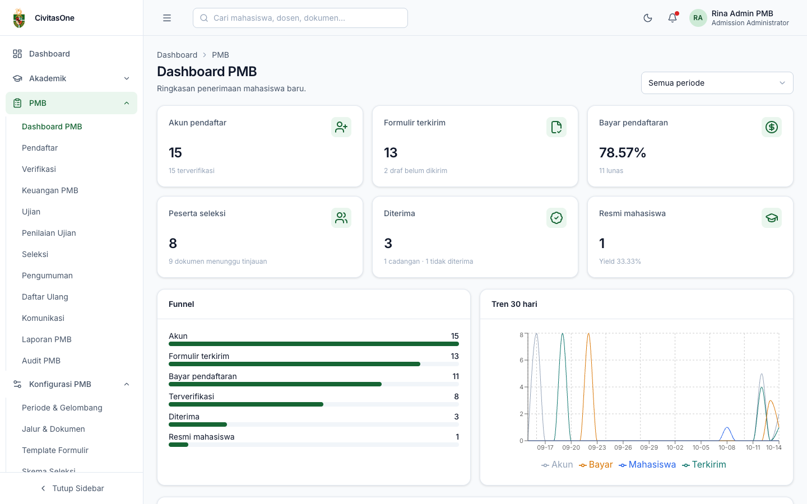
*Gambar 2.1 — Grup menu PMB dan Konfigurasi PMB (contoh: Administrator PMB, yang melihat semua menu).*

### 2.2 Peran PMB

Peran diberikan administrator lewat **Pengaturan → Role Pengguna** (dengan cakupan fakultas/prodi untuk dekan/kaprodi bila perlu).

| Peran (slug) | Nama di aplikasi | Tugas utama | Bab |
|---|---|---|---|
| `admission_administrator` | Administrator PMB | Konfigurasi, konten, pendaftar, ujian, pengumuman, daftar ulang (perpanjangan, konversi), komunikasi, audit; **langkah 1 pengesahan (Ketua Panitia PMB)** | 4–11, 13, 16, 20–22 |
| `admission_verifier` | Petugas Verifikasi PMB | Memeriksa formulir & dokumen; pendaftaran loket | 13, 14 |
| `admission_selection_committee` | Panitia Seleksi PMB | Skema seleksi, ujian, impor & kunci nilai, run seleksi, override, ajukan pengesahan, koreksi hasil | 6, 16–18, 20 |
| `admission_approver` | Pejabat Pengesah PMB | Mengesahkan hasil (langkah 2), menyetujui koreksi, perpanjangan massal, percepatan publikasi | 19 |
| `admission_registrar` | Petugas Daftar Ulang PMB | Memeriksa & menyetujui daftar ulang, memantau konversi | 21 |
| `finance_administrator` | Peran keuangan | Tagihan, bukti transfer, loket, rekonsiliasi, refund; **Kepala Keuangan** menyetujui refund | 15, 19 |
| `lecturer` | Dosen | Sebagai penguji/pengawas: check-in & menilai peserta sesi yang ditugaskan | 17 |
| `dean`, `head_of_study_program` | Dekan, Kaprodi | Melihat pendaftar, dokumen, daftar ulang, laporan **terbatas cakupannya**; mengubah profil prodi | 9, 12, 23 |
| `rector`, `vice_rector` | Rektor, Wakil Rektor | Dashboard & laporan | 12, 23 |
| `auditor` | Auditor | Membaca data, keuangan, hasil, daftar ulang, laporan, dan audit | 24 |

> **Perlu konfirmasi** — Rancangan menyarankan pengesah langkah 2 adalah WR I. Aplikasi memakai peran **Pejabat Pengesah PMB**; kampus menentukan pejabat yang diberi peran ini.

### 2.3 Menu yang tampil per peran

✓ = tampil · (B) = hanya membaca.

| Menu | Admin PMB | Verifikator | Panitia Seleksi | Pengesah | Petugas DU | Keuangan | Dosen | Dekan/Kaprodi | Rektor/WR | Auditor |
|---|---|---|---|---|---|---|---|---|---|---|
| PMB → Dashboard PMB | ✓ | ✓ | ✓ | ✓ | ✓ | ✓ | | ✓ | ✓ | ✓ |
| PMB → Pendaftar | ✓ | ✓ | ✓ | ✓ | ✓ | ✓ | | ✓ | | ✓ |
| PMB → Verifikasi | ✓ | ✓ | | | | | | | | |
| PMB → Keuangan PMB | ✓ (B) | ✓ (B) | | | ✓ (B) | ✓ | | | | ✓ (B) |
| PMB → Ujian | ✓ | | ✓ | | | | | | | |
| PMB → Penilaian Ujian | ✓ | | ✓ | | | | ✓ | | | |
| PMB → Seleksi | ✓ (B) | | ✓ | ✓ (B) | | | | | | ✓ (B) |
| PMB → Pengumuman | ✓ | ✓ (B) | ✓ | ✓ (B) | ✓ (B) | ✓ (B) | | ✓ (B) | | ✓ (B) |
| PMB → Daftar Ulang | ✓ | | | | ✓ | ✓ (B) | | ✓ (B) | | ✓ (B) |
| PMB → Komunikasi | ✓ | ✓ | | | ✓ | ✓ | | | | ✓ (log) |
| PMB → Laporan PMB | ✓ | ✓ | ✓ | ✓ | ✓ | ✓ | | ✓ | ✓ | ✓ |
| PMB → Audit PMB | ✓ | | | | | | | | | ✓ |
| Konfigurasi PMB | ✓ | ✓ (B) | ✓ (B)¹ | ✓ (B) | ✓ (B) | ✓ (B) | | ✓ (B)² | ✓ (B) | ✓ (B) |
| Persetujuan | ✓ | | ✓ | ✓ | | ✓ | | | | |

¹ Panitia Seleksi dapat membuat, mengubah, dan mengunci **Skema Seleksi**. ² Dekan/Kaprodi dapat mengubah **Profil Prodi** dalam cakupannya.

Menu yang tampil belum tentu berisi semua tombol; tombol aksi hanya muncul bila Anda memiliki izinnya. Pembatasan juga ditegakkan di server.

### 2.4 Izin aksi penting

| Aksi | Izin | Default dimiliki |
|---|---|---|
| Ubah konfigurasi / publikasi periode & template | `pmb_config.update` / `pmb_config.publish` | Admin PMB |
| Ubah komponen biaya | `pmb_fees.update` | Admin PMB |
| Buka data sensitif | `pmb_sensitive.read` | Admin PMB, Verifikator, Petugas DU, Auditor |
| Memutuskan verifikasi | `pmb_verification.approve` | Admin PMB, Verifikator |
| Penugasan & verifikasi massal | `pmb_verification.update` | Admin PMB |
| Override verifikasi, duplikat, pemulihan akun | `pmb_verification.finalize` | Admin PMB |
| Verifikasi bukti transfer & pembayaran loket | `pmb_payments.approve` | Keuangan |
| Rekonsiliasi & resolusi pembayaran terlambat | `pmb_payments.finalize` | Keuangan |
| Mengajukan / menyetujui refund | `pmb_refunds.create` / `pmb_refunds.approve` | Keuangan |
| Menjalankan run & override | `pmb_selection.update` | Panitia Seleksi |
| Mengunci skema | `pmb_selection.finalize` | Admin PMB, Panitia Seleksi |
| Mengajukan pengesahan | `pmb_selection.publish` | Panitia Seleksi |
| Mengesahkan hasil | `pmb_results.approve` + peran langkah persetujuan | Pengesah (dan Admin PMB untuk langkah 1) |
| Koreksi hasil/nilai terkunci, pembatalan penerimaan | `pmb_results.update` | Panitia Seleksi, Admin PMB |
| Input & kunci nilai | `pmb_scores.create` / `pmb_scores.finalize` | Penguji / Panitia Seleksi |
| Promosi cadangan | `pmb_waitlist.update` | Admin PMB |
| Menyetujui daftar ulang | `pmb_reregistration.approve` | Petugas DU |
| Perpanjangan daftar ulang / coba lagi konversi | `pmb_reregistration.update` / `pmb_conversion.update` | Admin PMB |
| Format NIM | `pmb_nim.update` | Admin PMB |
| Broadcast | `pmb_communication.publish` | Admin PMB |
| Ekspor laporan | `pmb_reports.export` | Admin PMB, Panitia Seleksi, Keuangan, Dekan/Kaprodi, Auditor |

### 2.5 Pemisahan tugas (*separation of duties*)

Aplikasi menolak tindakan berikut walaupun pengguna memiliki izinnya (pesan *SELF_APPROVAL_FORBIDDEN* atau sejenis):

| Aturan | Penerapan |
|---|---|
| Pengaju pengesahan hasil ≠ pengesah | Pengaju run tidak dapat menyetujui langkah mana pun pada pengajuannya |
| Pengaju refund ≠ penyetuju; verifikator bukti bayar ≠ penyetuju refund transaksi yang sama | Diterapkan pada persetujuan refund |
| Pengaju koreksi hasil/nilai, pembatalan penerimaan, perpanjangan massal, percepatan publikasi ≠ penyetuju | Semua pengajuan perubahan |
| Verifikator bukti bayar **biaya awal** ≠ penyetuju daftar ulang aplikasi yang sama | Tombol **Setujui** daftar ulang ditolak untuk petugas tersebut |

### 2.6 Cakupan data dan data sensitif

- Peran ber-cakupan **fakultas/prodi** (dekan, kaprodi) hanya melihat pendaftar, keputusan, daftar ulang, dan laporan prodi dalam cakupannya. Data di luar cakupan diperlakukan seperti tidak ada.
- Nilai tersamar dibuka dengan ikon mata → isi **Tujuan akses** → **Buka**. Setiap pembukaan tercatat (pengguna, waktu, tujuan, IP) dan dapat dilihat auditor.
- Unduhan dokumen pendaftar memakai tautan bertanda tangan berumur pendek (±5 menit) dan dicatat.
- Ekspor laporan berisi data pribadi wajib disertai alasan dan tercatat.

---

## 3. Alur Kerja dan Kalender Panitia

### Fase 0 — Persiapan sistem (sekali, Administrator Sistem)

- [ ] Migrasi database, *seeder* peran & izin, data awal PMB per kampus (`pmb:install`) → [bab 25](#25-administrasi-sistem)
- [ ] Penjadwal `schedule:run` aktif setiap menit
- [ ] Domain website PMB, email pengirim, (opsional) CAPTCHA, gateway pembayaran, SMS
- [ ] Peran diberikan kepada staf → [§2.2](#22-peran-pmb)

### Fase 1 — Konfigurasi periode (Administrator PMB, Panitia Seleksi)

1. [ ] Jalur masuk, sistem kuliah, jenis dokumen → [bab 4](#4-master-data-jalur-sistem-kuliah-jenis-dokumen)
2. [ ] Template formulir → **Publikasikan** → [bab 5](#5-template-formulir)
3. [ ] Skema seleksi → **Simulasi** → **Kunci skema** (Panitia Seleksi) → [bab 6](#6-skema-seleksi)
4. [ ] Periode → gelombang → buka jalur (gelombang-jalur) → [bab 7](#7-periode-gelombang-dan-gelombang-jalur)
5. [ ] Kuota, persyaratan dokumen, komponen biaya → [bab 8](#8-persyaratan-dokumen-kuota-dan-biaya)
6. [ ] Konten legal (Kebijakan Privasi & Ketentuan Pendaftaran **wajib terbit**), pernyataan pendaftar, FAQ, panduan, berita, banner, info daftar ulang & orientasi; profil prodi → [bab 9](#9-konten-website-dan-profil-prodi)
7. [ ] Pengaturan: kontak panitia, rekening transfer, batas aplikasi, format NIM, voucher → [bab 10](#10-pengaturan-pmb-format-nim-dan-voucher)
8. [ ] **Publikasikan periode** (daftar periksa lengkap) → [bab 11](#11-publikasi-penutupan-dan-arsip-periode)
9. [ ] Lokasi & ruang ujian → [§16.1](#161-lokasi-dan-ruang)

### Fase 2 — Masa pendaftaran

| Siapa | Pekerjaan rutin | Bab |
|---|---|---|
| Keuangan | Verifikasi bukti transfer, catat pembayaran loket, cek tagihan bermasalah | 15 |
| Verifikator | **Ambil berikutnya**, periksa dokumen, verifikasi / minta perbaikan / tolak | 14 |
| Admin PMB | Tugaskan verifikator, galeri pas foto, duplikat & pemulihan akun, pendaftaran loket | 13, 14 |
| Admin/operator | Balas pesan pendaftar, broadcast pengingat | 22 |
| Admin PMB | Pantau dashboard; perpanjang gelombang bila perlu (dengan alasan) | 7, 12 |

### Fase 3 — Ujian (jalur berujian)

1. [ ] Jadwal ujian, sesi & ruang, **Tempatkan otomatis**, **Bagi petugas**, bank soal (CBT) → **Publikasikan** → [bab 16](#16-ujian-seleksi)
2. [ ] Hari-H: check-in; penguji mengisi nilai; **Kunci nilai** → [bab 17](#17-penilaian-ujian)
3. [ ] Proses permintaan jadwal ulang; impor nilai bila perlu → [§18.2](#182-impor-nilai)

### Fase 4 — Seleksi & pengesahan

1. [ ] Periksa **Matriks nilai** → **Jalankan seleksi** → **Mulai tinjau** → override/penetapan seri → **Ajukan pengesahan** → [bab 18](#18-proses-seleksi)
2. [ ] Ketua Panitia lalu Pejabat Pengesah menyetujui di **Persetujuan** → [bab 19](#19-pengesahan-lewat-menu-persetujuan)

### Fase 5 — Pengumuman & daftar ulang

1. [ ] Hasil terbit otomatis; LoA terbit → [bab 20](#20-pengumuman-dan-keputusan)
2. [ ] Beasiswa jalur masuk (sebelum biaya awal dibayar); pantau **Kursi & cadangan**, **Promosikan** cadangan
3. [ ] Keuangan memverifikasi biaya awal; Petugas DU memeriksa, menandai dokumen asli, **Setujui** → konversi; tangani konversi gagal → [bab 21](#21-daftar-ulang-dan-konversi-mahasiswa)

### Fase 6 — Penutupan

1. [ ] **Tutup** lalu **Arsipkan** periode → [bab 11](#11-publikasi-penutupan-dan-arsip-periode)
2. [ ] Ekspor laporan akhir (rekap pendaftar, keuangan, kuota, kelengkapan PDDikti) → [bab 23](#23-laporan-pmb)
3. [ ] Selesaikan refund & rekonsiliasi → [bab 15](#15-keuangan-pmb)
4. [ ] Tinjau audit & akses data sensitif → [bab 24](#24-audit-pmb)

---

# Bagian II — Konfigurasi

## 4. Master Data: Jalur, Sistem Kuliah, Jenis Dokumen

> **Untuk:** Administrator PMB (`pmb_config.update`). **Menu:** **Konfigurasi PMB → Jalur & Dokumen** (halaman **Master Data PMB**), tab **Jalur masuk**, **Sistem kuliah**, **Jenis dokumen**.

Master data dipakai bersama oleh semua periode. Setiap tab memiliki tombol **Tambah**, dan setiap baris **Ubah** serta ikon hapus.


*Gambar 4.1 — Tab Jalur masuk.*

**Data awal** (dibuat `pmb:install`): sistem kuliah *Reguler* (`REG`) dan *Kelas Karyawan* (`KRY`), 15 jenis dokumen default, dan alur persetujuan default PMB. **Jalur masuk tidak dibuat otomatis.**

### 4.1 Jalur masuk

| Field | Keterangan |
|---|---|
| **Kode**, **Nama** | Contoh `REG` *Reguler*. Kode jalur dipakai dalam nomor pendaftaran (`PMB2027-REG-000001`). |
| **Kategori** | `regular`, `achievement` (memunculkan isian prestasi), `kip_affirmation` (memunculkan isian KIP), `transfer`, `postgraduate`, `rpl`, `scholarship`, `partnership`, `international`, `other` |
| Deskripsi | Tampil di website dan portal |
| Jenjang yang dibuka | D3, D4, S1, S2, S3, Profesi |
| Berujian | Menentukan apakah pendaftar mengikuti ujian (halaman ujian di portal) |
| Wajib asal perguruan tinggi | Untuk jalur transfer/lanjutan |
| Aktif | Jalur nonaktif tidak dapat dibuka pada gelombang baru |

### 4.2 Sistem kuliah

Field: **Kode**, **Nama**, Keterangan jadwal (misalnya *Sabtu–Minggu*), Aktif. Dipakai pada kuota, biaya, pilihan prodi, dan keputusan.

### 4.3 Jenis dokumen

| Field | Keterangan |
|---|---|
| **Kode**, **Nama**, Deskripsi | Contoh `PHOTO` *Pas foto latar polos* |
| **Format** | JPG, PNG, dan/atau PDF |
| **Ukuran maks (KB)** | Contoh `2048` untuk 2 MB |
| Boleh beberapa berkas | Pendaftar dapat menambah slot berkas |
| Perlu cek dokumen asli saat daftar ulang | Ditandai *(cek asli)* pada pemeriksaan daftar ulang |
| Dokumen sensitif (akses tercatat) | Setiap pembukaan dicatat di log akses sensitif |
| Kelas retensi | Label kebijakan retensi (opsional) |

Katalog default: `PHOTO` (1 MB), `ID_CARD` (2 MB, cek asli, sensitif), `FAMILY_CARD` (2 MB, cek asli, sensitif), `REPORT_CARD` (PDF 5 MB, cek asli), `DIPLOMA_OR_SKL` (2 MB, cek asli), `TRANSCRIPT` (5 MB, cek asli), `TRANSFER_LETTER`, `ACHIEVEMENT_CERT` (multi, cek asli), `KIP_CARD` (sensitif), `INCOME_STATEMENT` (sensitif), `RECOMMENDATION`, `WORK_EXPERIENCE` (multi, 10 MB), `PARTNERSHIP_LETTER`, `HEALTH_CERT` (sensitif), `STATEMENT_LETTER` (cek asli). Rincian di [bab 21 manual per bab](21-master-data.md#4-jenis-dokumen).

> **Penting** — Data yang sudah dipakai sebaiknya **dinonaktifkan**, bukan dihapus (*"Hapus data ini? Bila sudah dipakai, nonaktifkan saja."*).

---

## 5. Template Formulir

> **Untuk:** Administrator PMB (`pmb_config.update`; publikasi `pmb_config.publish`). **Menu:** **Konfigurasi PMB → Template Formulir**.

Template menentukan **isian yang diminta** dari pendaftar pada jalur tertentu. Template **berversi**: **Draf** (dapat diubah) → **Terbit** (tetap; dapat dipilih pada gelombang-jalur) → **Pensiun** (tidak dipakai untuk gelombang-jalur baru). Setiap pendaftaran menyimpan versi yang dipakainya.


*Gambar 5.1 — Editor template: aturan field inti dan field tambahan.*

**Langkah:**

1. Klik **Template baru**, isi **Kode** dan **Nama**, **Simpan** (versi 1, draf).
2. **Aturan field inti** — untuk setiap field (identitas, pendidikan, pilihan, data pendukung) pilih **Wajib**, **Opsional**, atau **Disembunyikan**, lalu **Simpan aturan**.
3. **Field tambahan** — klik **+ Field**:

| Field | Keterangan |
|---|---|
| **Tahap** | *Pendaftaran* atau *Daftar ulang* |
| **Seksi** | `identity`, `education`, `choices`, `supporting`, atau `custom_<nama>`. Di portal semua field tambahan tampil di langkah **Data pendukung**; seksi menentukan langkah yang ditandai *belum lengkap*. Gunakan `supporting` atau `custom_<nama>`. |
| **Kunci**, **Label** | Kunci huruf kecil & garis bawah, unik (contoh `ukuran_jas`) |
| **Tipe** | `text`, `textarea`, `number`, `date`, `select`, `multiselect`, `radio`, `checkbox`, `email`, `phone`, `url`, `file_ref` |
| Opsi | JSON, contoh `[{"value":"S","label":"S"},{"value":"M","label":"M"}]` |
| Bantuan, Placeholder, Wajib | Teks bantu dan kewajiban |
| Validasi | JSON: `min`, `max`, `min_length`, `max_length`, `regex`, `before`, `after` |
| Aturan tampil | JSON, contoh `{"field":"path_category","op":"eq","value":"kip_affirmation"}` |
| Data sensitif, Muncul di laporan, Urutan | Enkripsi & masking, ketersediaan di laporan, urutan tampil |

4. Klik **Pratinjau skema** untuk melihat struktur formulir (JSON) yang diterima portal.
5. Klik **Publikasikan** (*"Versi terpublikasi tidak dapat diubah lagi."*).
6. Untuk mengubah template terbit: **Buat versi baru** → ubah → **Publikasikan** → pilih versi baru pada gelombang-jalur. **Pensiunkan** template yang tidak dipakai lagi.

> **Beda rancangan** — Urutan field memakai angka (bukan *drag*), opsi/validasi/aturan tampil memakai JSON, dan pratinjau berupa JSON. Aturan tampil dievaluasi server untuk kewajiban isian, tetapi **portal tetap menampilkan semua field tambahan**. Field bertahap *Daftar ulang* belum ditampilkan di halaman daftar ulang portal.

---

## 6. Skema Seleksi

> **Untuk:** Panitia Seleksi (`pmb_selection.update`, kunci `pmb_selection.finalize`); Admin PMB dapat melihat dan mengunci. **Menu:** **Konfigurasi PMB → Skema Seleksi**.

Skema menentukan **cara menghitung skor akhir** dan **cara mengalokasikan kursi**. Berversi: **Draf** → **Terkunci**.


*Gambar 6.1 — Detail skema: komponen, tipe, bobot, minimum, tie-break, wajib.*

### 6.1 Membuat skema dan komponen

1. **Skema baru**: **Kode**, **Nama**, **Ambang skor akhir (0–100)** (opsional), **Simpan**.
2. **+ Komponen**:

| Field | Keterangan |
|---|---|
| **Kode**, **Nama** | Contoh `RAPOR`, `TPA`; kode dipakai di matriks nilai, impor, simulasi |
| **Sumber nilai** | `administrative`, `report_card` (dari nilai rapor), `achievement`, `written_exam`, `cbt`, `interview`, `portfolio`, `special_test`, `scholarship_assessment` |
| **Tipe nilai** | *Angka* atau *Lulus/tidak* (wajib lulus agar eligible; tidak menambah skor) |
| Nilai mentah min/maks | Rentang asli untuk normalisasi |
| **Bobot** | Bobot relatif; persentase tampil di tabel |
| Nilai minimum ternormalisasi | Di bawahnya pendaftar **gugur** |
| Wajib dinilai | Tanpa nilai → tidak eligible |
| Prioritas tie-break | `1` dipakai pertama untuk memecah skor seri |
| Normalisasi | *Min-max (0–100)* atau *Z-score antarsesi* |
| Rubrik, Konfigurasi | JSON; rubrik untuk wawancara/portofolio, konfigurasi mis. `{"semesters":[1,2,3,4,5]}` |

3. **Pengaturan** skema: nama, ambang, **Metode alokasi**, desimal pembulatan, aturan tie-break (JSON, mis. `{"use_verified_at":true}`).

### 6.2 Cara sistem menghitung

1. **Normalisasi** komponen angka: `N = (nilai − min) / (max − min) × 100`.
2. **Skor akhir** = Σ(bobot × N) / Σ bobot, dibulatkan sesuai pengaturan.
3. **Eligible** bila terverifikasi, komponen wajib tersedia, minimum komponen terpenuhi, dan semua komponen lulus/tidak **lulus**.
4. **Alokasi** (*Skor lalu prioritas pilihan*): pendaftar diurutkan skor (seri dipecah tie-break, lalu waktu verifikasi bila diaktifkan), lalu ditempatkan ke **pilihan prioritas tertinggi** yang kursinya masih ada dan ambangnya terpenuhi (ambang kuota bila diisi, selain itu ambang skema). *Pilihan pertama saja* hanya mempertimbangkan pilihan 1.
5. Yang tidak mendapat kursi tetapi memenuhi ambang menjadi **cadangan** (sampai kapasitas cadangan); selebihnya **tidak lulus**.

> **Contoh** — Skema `SKM-REG`: Kelengkapan administrasi (lulus/tidak) + Rapor (bobot 40) + TPA CBT (bobot 60), ambang 60. Rapor 90 dan TPA 100 → skor (40×90 + 60×100)/100 = **96**.

> **Penting** — Atribut usia, jenis kelamin, agama, suku, asal daerah, disabilitas, dan penghasilan orang tua **tidak boleh** dipakai sebagai tie-break.

### 6.3 Simulasi dan penguncian

1. Pada kartu **Simulasi**, ubah JSON contoh (`quotas` dan `applicants` dengan nilai per kode komponen), klik **Jalankan simulasi**. Tidak ada data yang disimpan.


*Gambar 6.2 — Simulasi skema.*

2. Bila kotak **Belum dapat dikunci** muncul, perbaiki masalahnya (belum ada komponen, total bobot 0, maks ≤ min, rubrik tidak valid, ambang di luar 0–100, tie-break merujuk komponen yang tidak ada).
3. Klik **Kunci skema**. Untuk mengubah skema terkunci: **Buat versi baru** → ubah → kunci → pilih versi baru pada gelombang-jalur.

---

## 7. Periode, Gelombang, dan Gelombang-Jalur

> **Untuk:** Administrator PMB (`pmb_config.update`, `pmb_config.publish`, `pmb_fees.update`). **Menu:** **Konfigurasi PMB → Periode & Gelombang**.

> **Sebelum mulai** — Siapkan master data, template **terbit**, dan skema **terkunci**. Semester masuk (tahun akademik, semester **ganjil**) harus sudah ada di modul Akademik.

### 7.1 Membuat periode

Klik **Periode baru**, isi, **Simpan**:

| Field | Keterangan |
|---|---|
| **Kode** | Unik, contoh `PMB2027`; awalan nomor pendaftaran & nomor peserta |
| **Nama** | Contoh *PMB Tahun Akademik 2027/2028* |
| **Tahun akademik masuk** | Semester ganjil |
| **Mulai**, **Selesai** | Selesai harus setelah mulai |

Detail periode memiliki tab **Gelombang & jalur**, **Kuota**, **Biaya**.

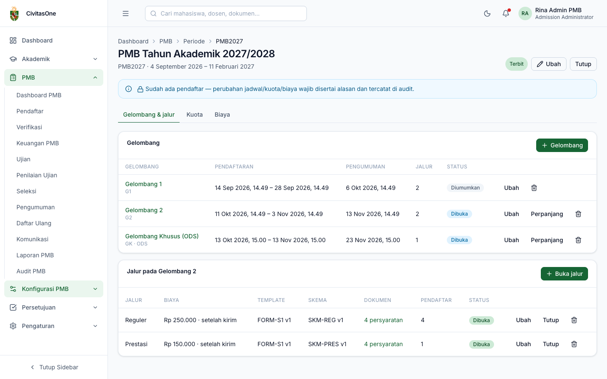
*Gambar 7.1 — Tab Gelombang & jalur: tabel gelombang dan jalur pada gelombang terpilih.*

> **Catatan (versi terbaru)** — Tabel gelombang kini memiliki baris filter **Cari**, **Status**, dan **Jenis** (Reguler/ODS); tabel jalur pada gelombang memiliki filter **Cari jalur**, **Status** (Dibuka/Ditutup), dan **Skema seleksi** (Sudah ada/Belum ada). Gambar diambil sebelum filter ditambahkan.

### 7.2 Gelombang

Klik **+ Gelombang**, isi jadwal, **Simpan**.

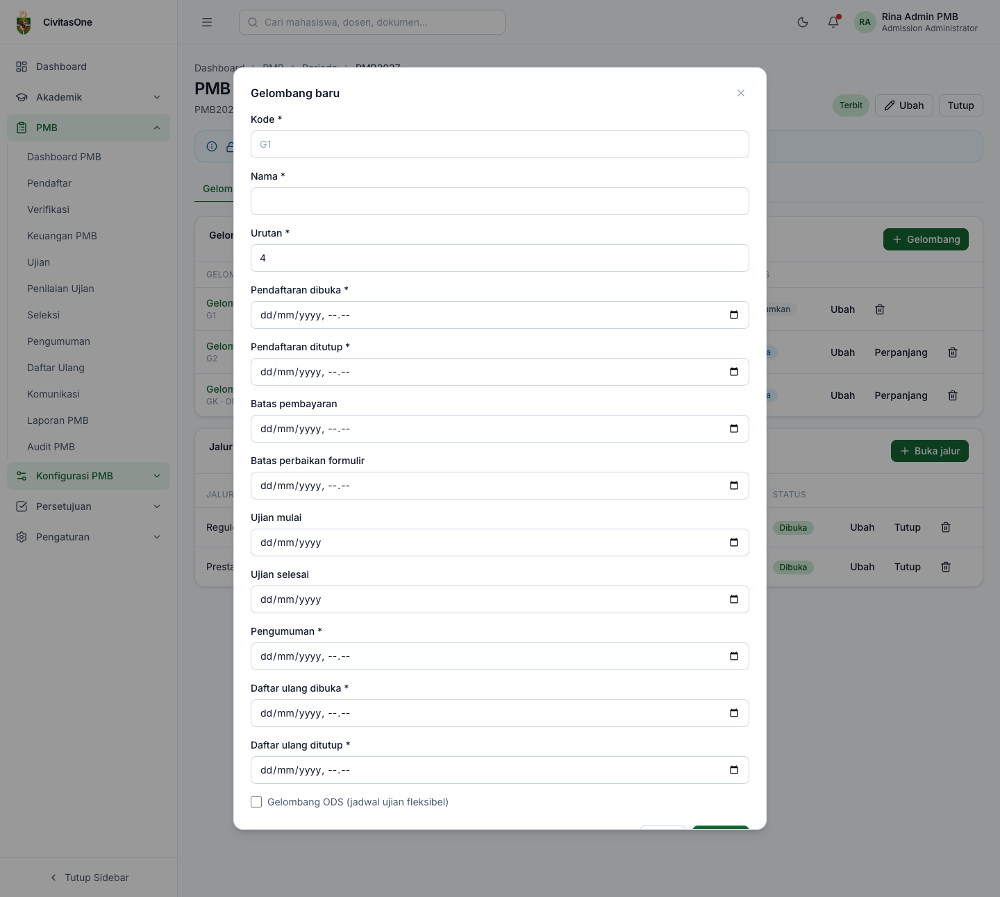
*Gambar 7.2 — Form gelombang.*

| Field | Keterangan |
|---|---|
| **Kode**, **Nama**, **Urutan** | Contoh `G1`, *Gelombang 1*, `1` |
| **Pendaftaran dibuka** / **ditutup** | Tanggal-jam pendaftaran |
| Batas pembayaran | ≥ pendaftaran ditutup; menjadi jatuh tempo tagihan pendaftaran |
| Batas perbaikan formulir | ≥ batas pembayaran; batas akhir perbaikan |
| Ujian mulai / selesai | Jendela ujian; untuk non-ODS ≥ batas perbaikan |
| **Pengumuman** | ≥ ujian selesai; waktu hasil terbit |
| **Daftar ulang dibuka** / **ditutup** | Dibuka ≥ pengumuman |
| Gelombang ODS | Jadwal ujian fleksibel |

**Status gelombang** berubah otomatis: **Draf/Terjadwal → Dibuka → Ditutup → Diumumkan → Selesai**. Aksi per gelombang: **Ubah**, **Perpanjang**, hapus.

**Perpanjang pendaftaran:** klik **Perpanjang**, isi **Tanggal tutup baru** dan **Alasan**, konfirmasi.

### 7.3 Membuka jalur pada gelombang (gelombang-jalur)

Klik nama gelombang → kartu **Jalur pada \<gelombang\>** → **+ Buka jalur**.

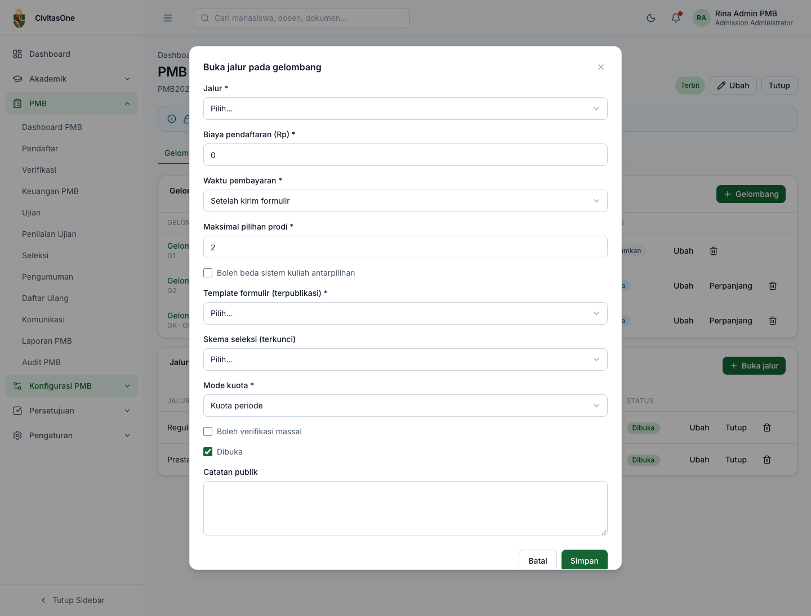
*Gambar 7.3 — Form membuka jalur pada gelombang.*

| Field | Keterangan |
|---|---|
| **Jalur** | Jalur aktif; jalur yang sama tidak boleh dibuka di dua gelombang yang jadwal pendaftarannya **tumpang tindih** |
| **Biaya pendaftaran (Rp)** | `0` = tanpa biaya |
| **Waktu pembayaran** | *Setelah kirim formulir* atau *Sebelum kirim formulir* (formulir baru dapat dikirim setelah lunas) |
| **Maksimal pilihan prodi** | 1–5 |
| Boleh beda sistem kuliah antarpilihan | Pendaftar boleh memilih sistem kuliah berbeda di tiap pilihan |
| **Template formulir (terpublikasi)** | Hanya template *terbit* |
| Skema seleksi (terkunci) | Hanya skema *terkunci*; wajib sebelum run seleksi |
| **Mode kuota** | *Kuota periode* atau *Batas per gelombang* |
| Boleh verifikasi massal | Mengizinkan **Verifikasi massal** untuk jalur ini |
| Dibuka, Catatan publik | Status buka; catatan tampil di website & portal |

Aksi pada tabel jalur: **Ubah**, **Tutup**/**Buka** (saklar darurat, wajib alasan), hapus. Kolom **Dokumen** berisi tautan **N persyaratan** ([§8.1](#81-persyaratan-dokumen)).

> **Perlu konfirmasi** — Mode *Batas per gelombang* memerlukan angka batas per gelombang, tetapi layar **Kuota** belum menyediakan isiannya. Gunakan **Kuota periode**.

### 7.4 Aturan perubahan setelah ada pendaftar

Halaman detail menampilkan pengingat *"Sudah ada pendaftar — perubahan jadwal/kuota/biaya wajib disertai alasan dan tercatat di audit."*

| Perubahan | Sebelum ada formulir terkirim | Setelah ada formulir terkirim |
|---|---|---|
| Perpanjang tutup pendaftaran | Bebas | Boleh, wajib alasan |
| Majukan tutup pendaftaran | Bebas | **Ditolak** |
| Ubah tanggal ujian/pengumuman | Bebas | Boleh dengan alasan; urutan tanggal tetap berlaku |
| Ubah biaya pendaftaran | Bebas | **Ditolak** (tagihan terbit memakai nominal lama) |
| Tambah dokumen wajib tahap pendaftaran | Bebas | **Ditolak** (tahap daftar ulang boleh sampai pengumuman) |
| Ganti template formulir | Bebas | Hanya untuk pendaftaran baru |
| Ganti skema seleksi | Bebas | Boleh sebelum run pertama dihitung |
| Turunkan kuota | Bebas | Ditolak bila di bawah jumlah diterima |
| Tutup darurat gelombang-jalur | Bebas | Boleh; draf tidak dapat dikirim, yang terkirim tetap diproses |

---

## 8. Persyaratan Dokumen, Kuota, dan Biaya

> **Untuk:** Administrator PMB. **Menu:** **Konfigurasi PMB → Periode & Gelombang** → detail periode.

### 8.1 Persyaratan dokumen

Pada tabel jalur, klik tautan **N persyaratan** di kolom **Dokumen**.

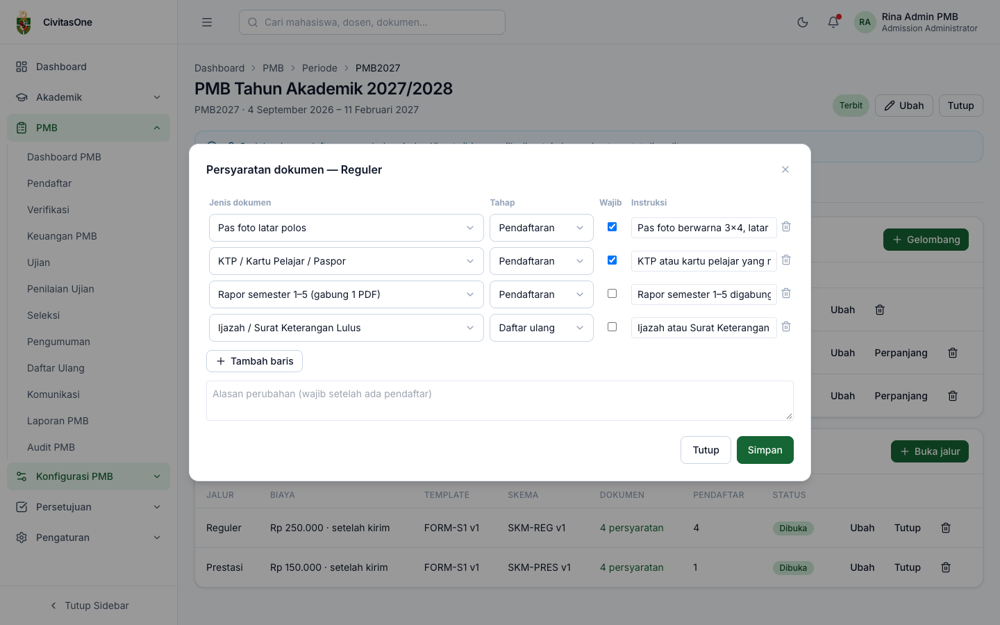
*Gambar 8.1 — Persyaratan dokumen untuk satu gelombang-jalur.*

1. Untuk setiap baris pilih **Jenis dokumen**, **Tahap** (*Pendaftaran*/*Daftar ulang*), centang **Wajib**, tulis **Instruksi**.
2. **Tambah baris** untuk dokumen lain; ikon tempat sampah untuk menghapus.
3. Isi **Alasan perubahan** bila sudah ada pendaftar. Klik **Simpan**. Urutan baris = urutan tampil di portal.

### 8.2 Kuota

Tab **Kuota** berisi tabel per **jalur × program studi × sistem kuliah**.

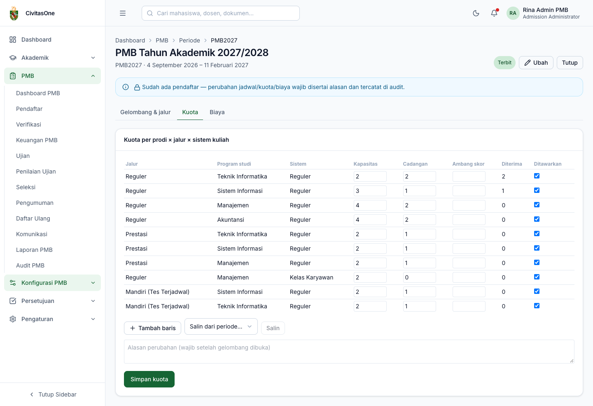
*Gambar 8.2 — Tabel kuota yang dapat diedit langsung.*

| Kolom | Keterangan |
|---|---|
| **Kapasitas** | Kursi diterima; tidak boleh < jumlah yang sudah diterima |
| **Cadangan** | Maksimal cadangan; **`0` = tanpa batas** |
| **Ambang skor** | Skor minimum khusus kuota (opsional, 0–100) |
| **Diterima** | Jumlah diterima aktif (baca saja) |
| **Ditawarkan** | Hanya kombinasi tercentang yang muncul di pilihan prodi pendaftar |

Ubah angka langsung di tabel, **Tambah baris** untuk kombinasi baru, isi alasan bila gelombang sudah dibuka, **Simpan kuota**. Untuk memakai kuota periode lain: **Salin dari periode…** → **Salin**.

> **Catatan (versi terbaru)** — Tabel kuota memiliki filter **Cari prodi**, **Fakultas**, **Jalur**, **Sistem**, dan **Ditawarkan**; baris baru yang belum disimpan selalu tampil di bawah.

> **Beda rancangan** — Rancangan berupa matriks dengan impor/ekspor XLSX; aplikasi memakai tabel baris yang dapat diedit dan fitur salin dari periode lain.

### 8.3 Komponen biaya awal kuliah

Tab **Biaya** → **+ Komponen** (atau **Ubah**).

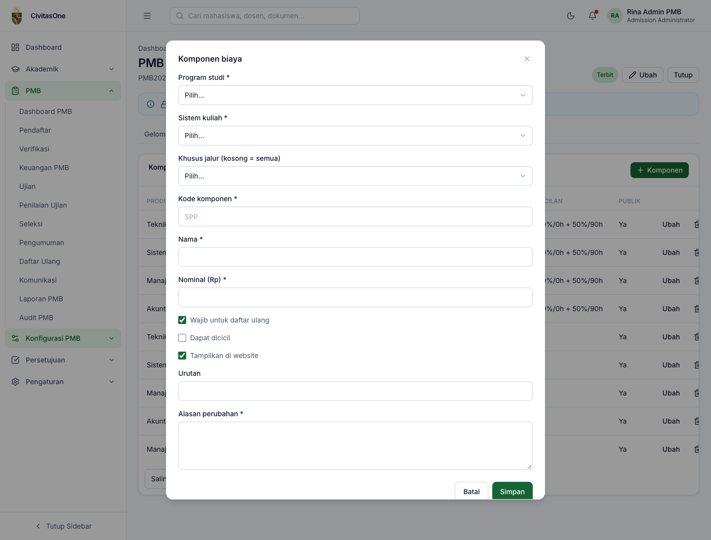
*Gambar 8.3 — Form komponen biaya.*

| Field | Keterangan |
|---|---|
| **Program studi**, **Sistem kuliah** | Kombinasi yang dikenai biaya |
| Khusus jalur (kosong = semua) | Tarif khusus jalur tertentu (menimpa baris umum dengan kode sama) |
| **Kode komponen**, **Nama** | Contoh `PANGKAL` *Uang Pangkal*, `SPP1` *SPP Semester 1* |
| **Nominal (Rp)** | Besar biaya |
| Wajib untuk daftar ulang | Masuk tagihan biaya awal saat diterima |
| Dapat dicicil | Isi **Rencana cicilan** JSON, mis. `[{"percent":50,"due_days":0},{"percent":50,"due_days":90}]` — total persen 100. Cicilan 1 jatuh tempo pada batas daftar ulang; berikutnya `due_days` hari setelahnya |
| Tampilkan di website | Tampil di halaman **Biaya** |
| Urutan, Alasan perubahan | Urutan tampil; alasan wajib setelah ada pendaftar |

**Salin dari periode…** → **Salin** untuk menyalin komponen periode lain.

> **Catatan (versi terbaru)** — Tabel biaya memiliki filter **Cari prodi/komponen**, **Fakultas**, **Jalur** (termasuk *Semua jalur (umum)*), **Sistem**, dan **Publik**.

> **Catatan** — Potongan beasiswa/KIP tidak diatur di sini, tetapi diberikan per keputusan ([§20.1](#201-keputusan-dan-beasiswa-jalur-masuk)) dan diterapkan saat tagihan biaya awal dibuat.

---

## 9. Konten Website dan Profil Prodi

> **Untuk:** Administrator PMB (`pmb_content.update`); Dekan/Kaprodi untuk profil prodi dalam cakupannya. **Menu:** **Konfigurasi PMB → Konten Website**, **Konfigurasi PMB → Profil Prodi**.

### 9.1 Konten website

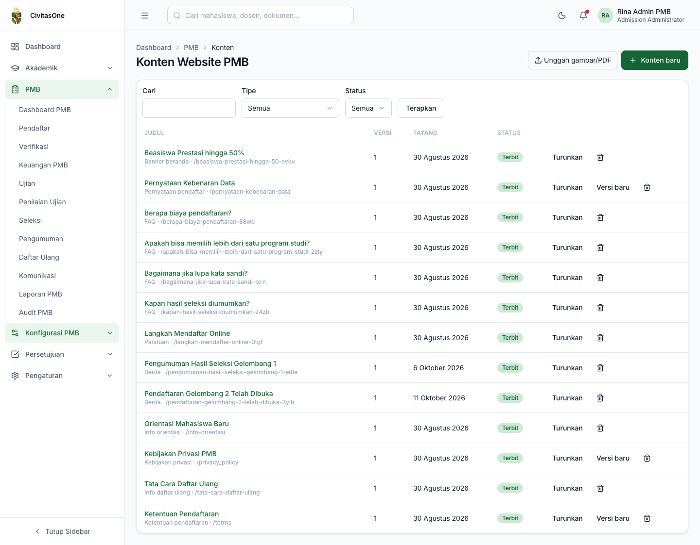
*Gambar 9.1 — Daftar konten website PMB.*

| Tipe | Tampil di | Catatan |
|---|---|---|
| Halaman | `/pmb/halaman/<slug>` | Halaman bebas |
| FAQ | Menu FAQ, Beranda | Isi **Kategori** |
| Berita | Menu Berita, Beranda | Urut tanggal tayang |
| Panduan | Menu Panduan | — |
| Banner beranda | Beranda | Kartu pengumuman singkat |
| Pernyataan pendaftar | Langkah Pernyataan & kirim; konfirmasi tawaran | **Berversi** |
| Kebijakan privasi | Kaki halaman, formulir daftar akun | **Berversi, wajib terbit** sebelum publikasi periode |
| Ketentuan pendaftaran | Kaki halaman, formulir daftar akun | **Berversi, wajib terbit** sebelum publikasi periode |
| Template LoA | Isi surat penerimaan (PDF) | Berversi; placeholder di bawah |
| Info orientasi | Halaman daftar ulang setelah resmi mahasiswa | — |
| Info daftar ulang | Halaman **Info Daftar Ulang** | — |
| Brosur, Template hasil | Belum ditampilkan/dipakai | Brosur prodi diunggah lewat **Profil Prodi** |

**Langkah:** **Konten baru** → pilih **Tipe**, isi **Judul**, Slug (kosong = otomatis), Kategori, **Isi** (HTML; tag berbahaya dibuang otomatis), Khusus periode, Tayang mulai/sampai, Judul & Deskripsi SEO, Urutan → **Simpan** (draf) → **Terbitkan** pada daftar. Gambar/PDF: klik **Unggah gambar/PDF**; URL berkas otomatis disalin, tempelkan ke isi (mis. ``).

> **Penting** — Konten berversi yang sudah terbit **tidak dapat diubah** (*"Versi terpublikasi tidak dapat diubah; buat versi baru."*). Klik **Versi baru**, ubah, **Terbitkan**. Versi lama tetap tercatat beserta persetujuan pendaftar terhadapnya.

**Placeholder template LoA:** `{{applicant_name}}`, `{{registration_number}}`, `{{program_name}}`, `{{study_system}}`, `{{path_name}}`, `{{period_name}}`, `{{deadline}}`, `{{letter_number}}`, `{{issued_date}}`, `{{university_name}}`, `{{verification_url}}`. Tanpa template LoA terbit, surat memakai format baku. QR verifikasi selalu dicantumkan.

### 9.2 Profil program studi

Daftar menampilkan prodi dalam cakupan Anda dan status **Tampil**/**Disembunyikan**. Klik **Ubah**:

| Field | Keterangan |
|---|---|
| Slug URL | Contoh `teknik-informatika` → `/pmb/prodi/teknik-informatika` |
| Ringkasan | Maks 300 karakter; tampil di kartu prodi |
| Deskripsi | **Editor teks kaya** (versi terbaru): gaya paragraf/judul, tebal, miring, daftar, tautan, kutipan — hasilnya sama dengan tampilan publik |
| Akreditasi & masa berlaku, Gelar, Lama studi | Ringkasan prodi |
| Prospek karier | Satu baris per prospek |
| Gambar sampul (JPG/PNG), Brosur (PDF) | Diunggah dan ditautkan otomatis (tombol *Unduh brosur* di website) |

Klik **Simpan**, lalu **Publikasikan** (atau **Sembunyikan**). Nama prodi, fakultas, dan jenjang berasal dari modul Akademik.

---

## 10. Pengaturan PMB, Format NIM, dan Voucher

> **Untuk:** Administrator PMB (`pmb_config.update`; format NIM `pmb_nim.update`). **Menu:** **Konfigurasi PMB → Pengaturan PMB**, tab **Umum**, **Format NIM**, **Voucher**.

### 10.1 Tab Umum

Ubah nilai lalu **Simpan pengaturan** (tercatat di audit). Isian JSON harus valid.

| Kunci | Default | Keterangan |
|---|---|---|
| `pmb.max_active_applications_per_period` | 1 | Maks pendaftaran aktif per akun per periode |
| `pmb.allow_multi_path_per_period` | tidak | Boleh lebih dari satu jalur per periode |
| `pmb.revision_window_hours` | 72 | Batas perbaikan (jam), maks sampai batas perbaikan gelombang |
| `pmb.re_registration_extension_max_days` | 7 | Perpanjangan daftar ulang maksimal (hari) |
| `pmb.enrollment_min_payment` | `first_installment` | Minimum bayar biaya awal: `full` atau `first_installment` |
| `pmb.retention_years_applicant` | 2 | Retensi data pendaftar yang tidak menjadi mahasiswa (tahun) |
| `pmb.verification_requires_payment` | ya | Klaim verifikasi hanya untuk yang sudah membayar |
| `pmb.otp_channel` | `email` | Kanal verifikasi akun: `email`, `sms`, `whatsapp` |
| `pmb.payment.channels` | transfer manual, loket | Kanal pembayaran aktif (JSON) |
| `pmb.payment.bank_accounts` | — | Rekening kampus untuk transfer manual (JSON), contoh `[{"bank":"Bank Mandiri","number":"1230009876543","holder":"Universitas …"}]` |
| `pmb.payment.unique_code_enabled` | ya | Kode unik 3 digit pada transfer manual |
| `pmb.payment.transaction_ttl_hours` | 24 | Masa berlaku instruksi pembayaran (jam) |
| `pmb.collect_gender`, `pmb.min_age`/`pmb.max_age` | ya, 14/70 | Jenis kelamin & rentang usia |
| `pmb.verification_mode`, `pmb.verification_claim_minutes` | `pull`, 30 | Mode penugasan & lama klaim |
| `pmb.tie_break_use_verified_at` | ya | Waktu verifikasi sebagai pemecah seri terakhir |
| `pmb.max_reschedules` | 1 | Maks jadwal ulang ujian per peserta |
| `pmb.show_quota_status` | tidak | Label *Kuota tersedia/terbatas/penuh* di website |
| `pmb.institution_email_domain` | — | Domain email akun mahasiswa baru; kosong = email pribadi |
| `pmb.contact` | — | Kontak panitia (JSON: `address`, `phone`, `email`, `whatsapp`, `hours`, `map_url`) |
| `pmb.auto_promote_waitlist`, `pmb.waitlist_deadline_days` | tidak, 7 | Promosi cadangan otomatis; batas daftar ulang cadangan |
| `pmb.cbt.provider` | `internal` | Sumber CBT |
| `pmb.sms.enabled`, `pmb.quiet_hours` | tidak, 21:00–06:00 | SMS/WA & jam tenang |
| `pmb.status_labels` | — | Ganti label tahap yang dilihat pendaftar (JSON) |

### 10.2 Tab Format NIM


*Gambar 10.1 — Format NIM dengan pratinjau.*

Token: `{YY}`/`{YYYY}` (tahun angkatan), `{PRODI}` (kode prodi dari Akademik), `{JALUR}`, `{SISTEM}`, `{SEQ:n}` (nomor urut *n* digit, **wajib satu**). Ketik format atau klik token → pilih **Contoh prodi/jalur/sistem** → **Pratinjau** → **Simpan**. Nomor urut dihitung per kombinasi token selain `{SEQ}`; contoh `{YY}{PRODI}{SEQ:4}` → `27TEK30001`, `27TEK30002`, … per prodi per angkatan.

> **Perlu konfirmasi** — Tetapkan format resmi sebelum daftar ulang pertama. Mengubah format tidak mengubah NIM yang sudah terbit. Pratinjau memakai tahun berjalan; NIM sebenarnya memakai tahun angkatan periode.

### 10.3 Tab Voucher

**+ Voucher**: **Kode** (diketik pendaftar, huruf kapital), **Nama**, **Berlaku untuk** (*Biaya pendaftaran*/*Biaya awal kuliah*), **Jenis potongan** (*Persen*/*Nominal tetap*) & **Nilai potongan**, potongan maksimum, kuota pemakaian, masa berlaku, batasan (JSON, mis. `{"wave_path_ids":["…"]}`), aktif. Kolom **Pemakaian** = *terpakai/kuota*. Voucher yang pernah dipakai tidak dapat dihapus; nonaktifkan saja.

---

## 11. Publikasi, Penutupan, dan Arsip Periode

> **Untuk:** Administrator PMB (`pmb_config.publish`). **Menu:** detail periode, tombol kanan atas.

| Status periode | Tombol | Keterangan |
|---|---|---|
| Draf | **Ubah**, **Hapus**, **Publikasikan** | Hapus hanya untuk draf |
| Terbit | **Ubah**, **Tutup** | Menutup menghentikan pendaftaran baru; daftar ulang berjalan tetap bisa selesai |
| Ditutup | **Ubah**, **Arsipkan** | Untuk periode yang sudah selesai |

**Publikasikan** membuka **Daftar periksa publikasi**:

- [ ] minimal satu gelombang;
- [ ] ada gelombang-jalur dengan template formulir terbit;
- [ ] ada kuota prodi yang ditawarkan;
- [ ] **Kebijakan Privasi** dan **Ketentuan Pendaftaran** terbit;
- [ ] setiap gelombang-jalur memiliki persyaratan dokumen.

Bila lengkap tampil *"Konfigurasi lengkap. Publikasi membuka jadwal gelombang ke publik."* → **Publikasikan**. Bila belum, kekurangan ditampilkan.

---

# Bagian III — Operasional per Peran

## 12. Dashboard PMB

> **Untuk:** semua peran dengan `pmb_reports.read`. **Menu:** **PMB → Dashboard PMB**.

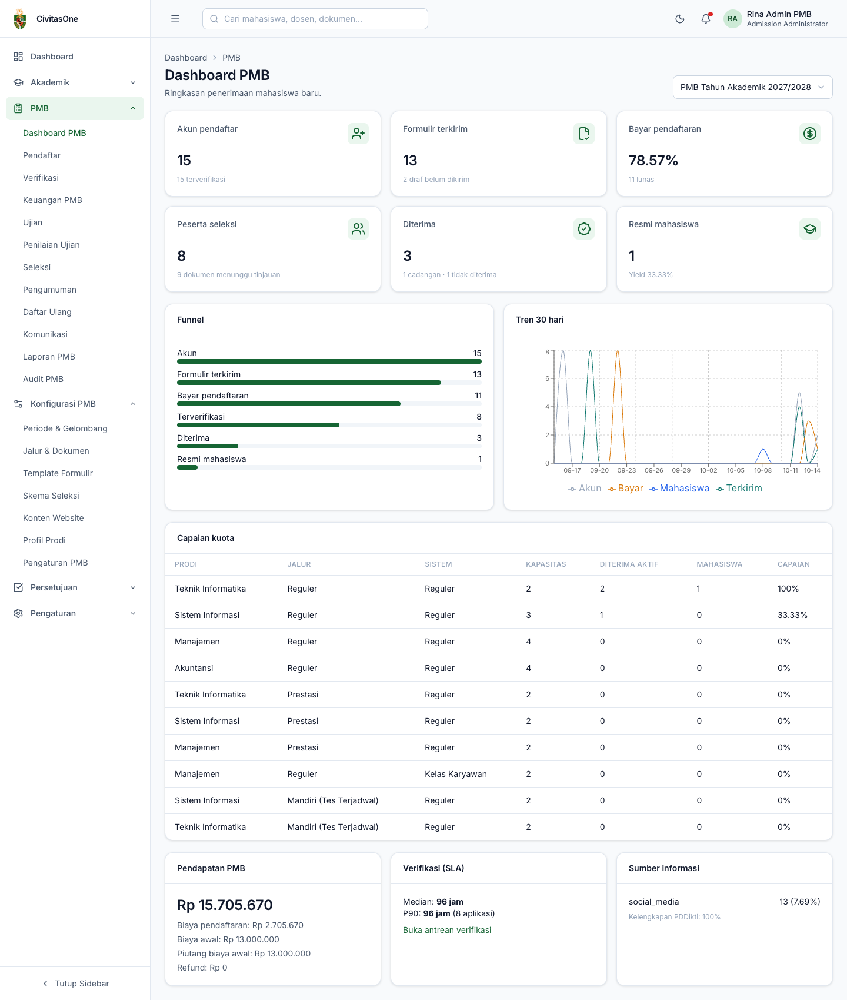
*Gambar 12.1 — Dashboard PMB untuk satu periode.*

Pilih periode di kanan atas (**Semua periode** atau periode tertentu; tabel **Capaian kuota** hanya terisi bila periode tertentu dipilih).

| Bagian | Isi |
|---|---|
| Kartu KPI | **Akun pendaftar** (terverifikasi), **Formulir terkirim** (draf belum dikirim), **Bayar pendaftaran** (% lunas), **Peserta seleksi** (dokumen menunggu tinjauan), **Diterima** (cadangan, tidak diterima), **Resmi mahasiswa** (*yield* = resmi mahasiswa ÷ diterima) |
| **Funnel** | Akun → Formulir terkirim → Bayar → Terverifikasi → Diterima → Resmi mahasiswa |
| **Tren 30 hari** | Akun baru, formulir terkirim, pembayaran, mahasiswa baru per hari |
| **Capaian kuota** | Per prodi × jalur × sistem: kapasitas, diterima aktif, mahasiswa, % capaian |
| **Pendapatan PMB** | Total, biaya pendaftaran & biaya awal, piutang biaya awal, refund (hanya bagi yang berizin melihat pembayaran) |
| **Verifikasi (SLA)** | Median & persentil-90 lama verifikasi (jam); tautan **Buka antrean verifikasi** |
| **Sumber informasi** | Sumber informasi pendaftar & konversinya; kelengkapan data PDDikti |

Dekan/kaprodi dan peran ber-cakupan hanya melihat angka prodi dalam cakupannya.

> **Beda rancangan** — Rancangan menyebut dashboard terpisah per peran dan perbandingan antarperiode. Aplikasi menyediakan satu Dashboard PMB (dibatasi izin & cakupan) plus statistik di halaman Verifikasi dan Keuangan PMB; perbandingan periode belum ada di layar.

---

## 13. Data Pendaftar dan Pendaftaran Loket

> **Untuk:** peran dengan `pmb_applications.read` (Admin PMB, verifikator, panitia, keuangan, petugas DU, pengesah, dekan/kaprodi dalam cakupan, auditor). **Menu:** **PMB → Pendaftar**.

### 13.1 Daftar pendaftar

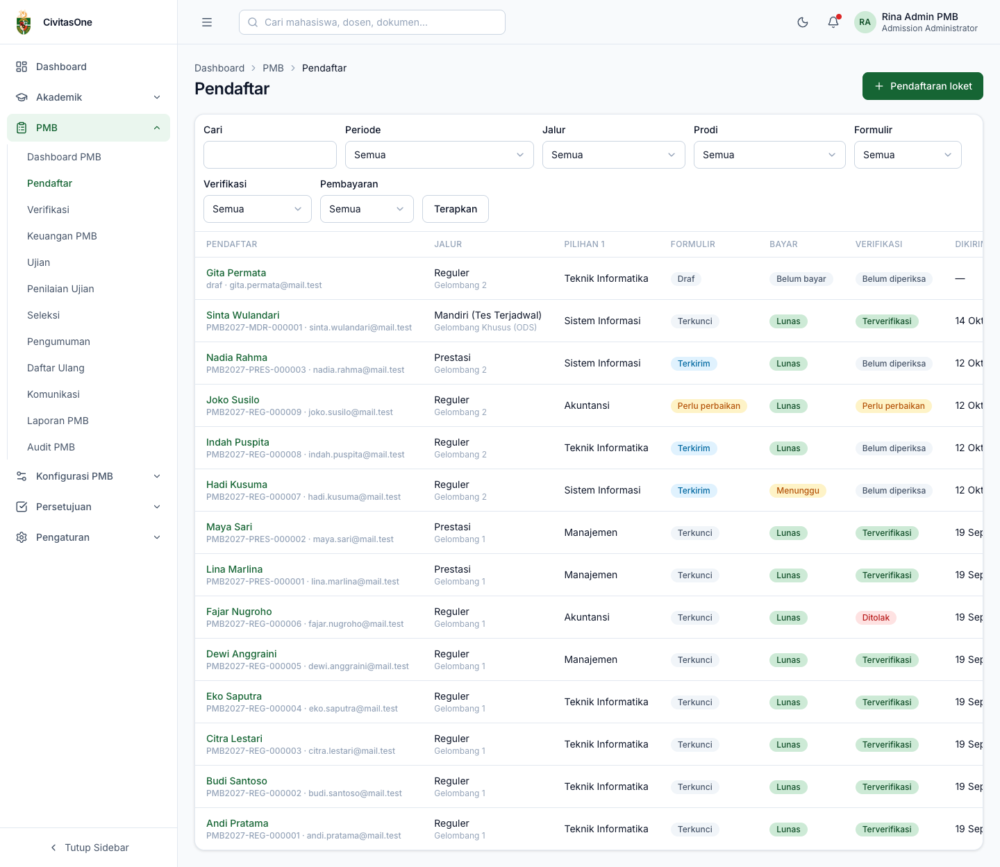
*Gambar 13.1 — Daftar pendaftar dengan filter.*

Filter: **Cari** (nama, nomor pendaftaran, email), **Periode**, **Jalur**, **Prodi**, **Formulir**, **Verifikasi**, **Pembayaran** → **Terapkan**. Klik nama untuk membuka detail. Data lengkap untuk analisis diambil lewat [Laporan](#23-laporan-pmb).

### 13.2 Pendaftaran loket

Untuk calon mahasiswa yang datang langsung (izin `pmb_applications.create`; Admin PMB & verifikator):

1. Klik **Pendaftaran loket**.
2. Isi **Nama lengkap**, **Email**, Nomor HP, (opsional) **Langsung buat draf pada jalur** (hanya gelombang-jalur yang dibuka), dan Sumber informasi.
3. **Simpan**. Akun dibuat atas nama pendaftar; tautan aktivasi & pengaturan sandi dikirim ke emailnya. Pendaftar tetap melengkapi dan mengirim formulirnya sendiri; detail akun mencatat **Dibuat loket: Ya**.

### 13.3 Detail pendaftar

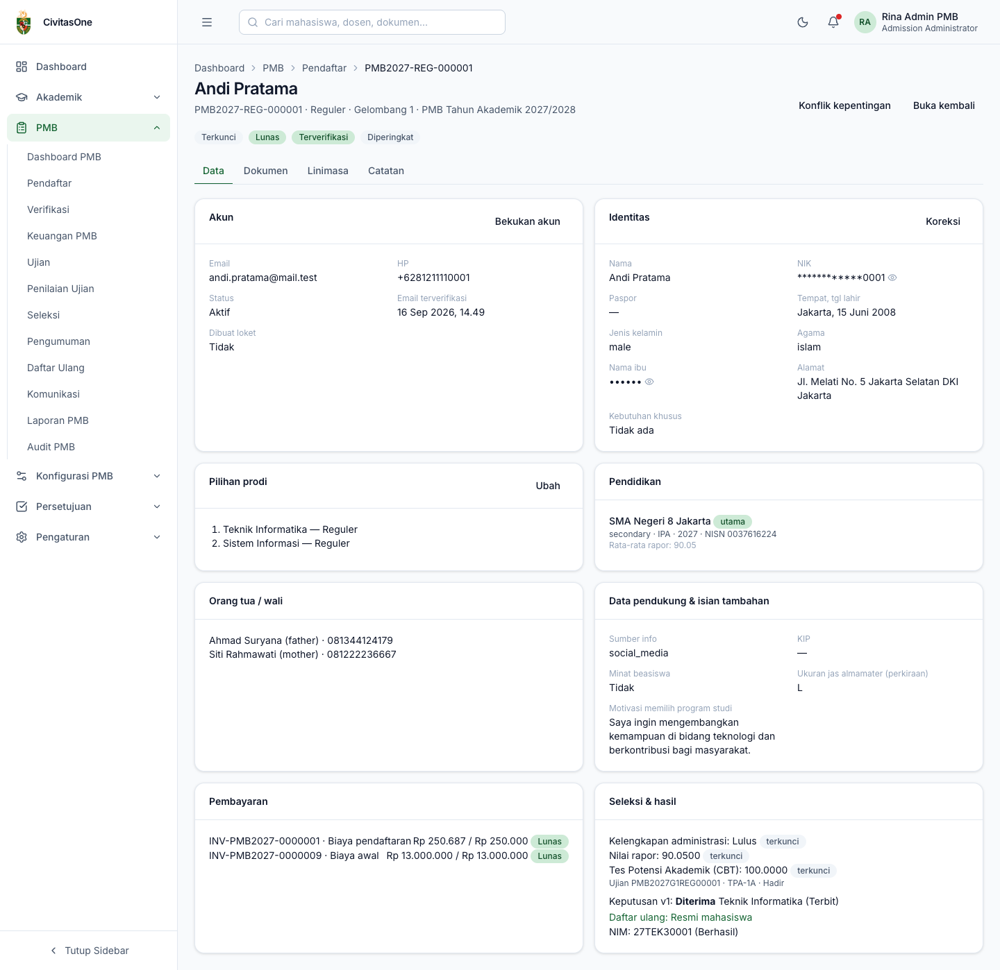
*Gambar 13.2 — Tab Data pada detail pendaftar.*

| Tab | Isi |
|---|---|
| **Data** | Akun (**Bekukan akun**/**Cabut pembekuan**, wajib alasan), Identitas (**Koreksi**), Pilihan prodi (**Ubah**), Pendidikan, Orang tua/wali, Data pendukung & isian tambahan, Pembayaran, Seleksi & hasil (nilai, ujian, keputusan, daftar ulang, NIM & konversi) |
| **Dokumen** | Dokumen per tahap, versi, hasil pemindaian, riwayat tinjauan; **Lihat v1/v2…**, **Tinjau**, **Buka kembali** |
| **Linimasa** | Semua perubahan status: siklus, status asal → baru, waktu, pelaku, alasan |
| **Catatan** | **Catatan baru** dengan visibilitas **Internal (staf)** atau **Terlihat pendaftar** |

**Membuka data sensitif:** klik ikon mata di samping nilai tersamar → isi **Tujuan akses** → **Buka**. Tercatat di **Audit PMB → Akses data sensitif**.

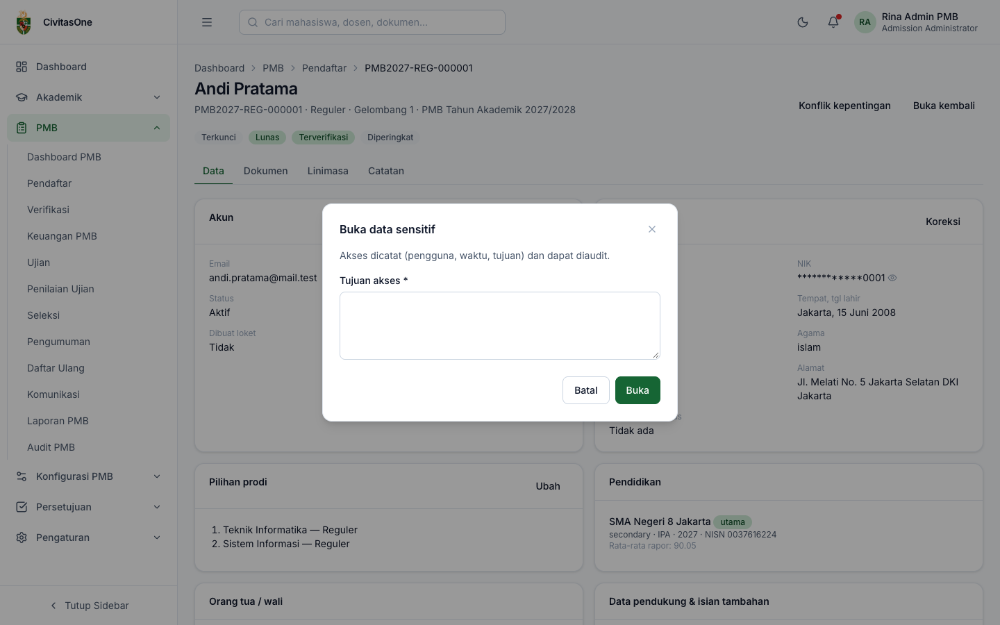
*Gambar 13.3 — Dialog membuka data sensitif.*

### 13.4 Koreksi data oleh panitia

Untuk pengguna dengan `pmb_applications.update` (umumnya Admin PMB):

- **Koreksi identitas**: isi hanya field yang dikoreksi (nama, NIK, tempat/tanggal lahir, jenis kelamin, nama ibu) dan **Alasan**. Koreksi nama/NIK setelah terverifikasi membuka ulang pemeriksaan KTP.
- **Ubah pilihan prodi**: pilih Pilihan 1 dan 2 dan alasan; sistem menolak kombinasi yang tidak ditawarkan dan menolak perubahan setelah hasil seleksi ditetapkan.

Semua koreksi tercatat di audit beserta nilai sebelum dan sesudah.

---

## 14. Verifikasi Administrasi

> **Untuk:** Petugas Verifikasi (`pmb_verification.approve`) dan Administrator PMB (juga penugasan, override, duplikat, pemulihan akun). **Menu:** **PMB → Verifikasi**.

Verifikasi memastikan formulir dan dokumen benar & lengkap sebelum seleksi. Hasil: **Terverifikasi**, **Perlu perbaikan**, atau **Ditolak**.

### 14.1 Halaman Verifikasi

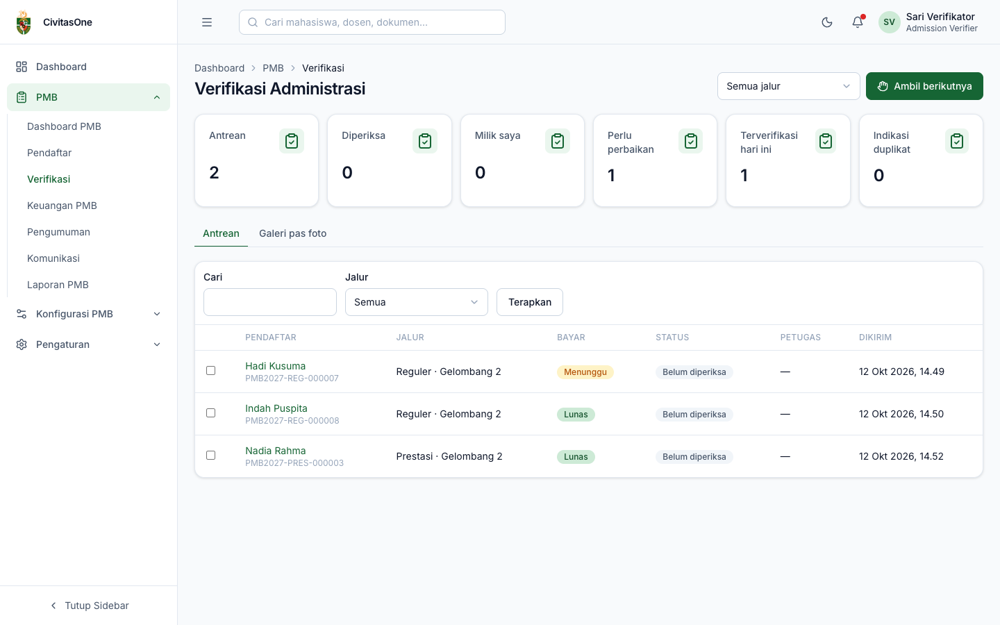
*Gambar 14.1 — Statistik dan antrean verifikasi.*

| Statistik | Arti |
|---|---|
| **Antrean** | Formulir terkirim (dan lunas, bila diwajibkan) yang belum diperiksa |
| **Diperiksa** | Sedang diklaim petugas |
| **Milik saya** | Klaim/tugas Anda (kartu **Klaim saya**) |
| **Perlu perbaikan** | Menunggu perbaikan pendaftar |
| **Terverifikasi hari ini** | Selesai hari ini |
| **Indikasi duplikat** | Indikasi akun ganda yang masih terbuka |

Tab: **Antrean**, **Galeri pas foto**, dan (Admin PMB) **Indikasi duplikat**, **Pemulihan akun**.

> **Catatan** — Antrean juga menampilkan formulir terkirim yang **belum lunas** (lihat kolom **Bayar**); pendaftaran tersebut belum dapat diklaim (*"Biaya pendaftaran belum lunas."*).

### 14.2 Mengambil pekerjaan

- **Cara cepat:** pilih jalur (opsional), klik **Ambil berikutnya** → sistem mengklaim pendaftaran **terlama** yang siap diperiksa dan membuka detailnya (*"Antrean kosong."* bila tidak ada).
- **Cara manual:** klik nama pendaftar → **Klaim untuk diperiksa**.
- Klaim berlaku **30 menit**; label **Diperiksa: \<petugas\> s.d. \<jam\>** menunjukkan pemilik klaim. **Lepas klaim** mengembalikan ke antrean.

### 14.3 Memeriksa dan memutuskan

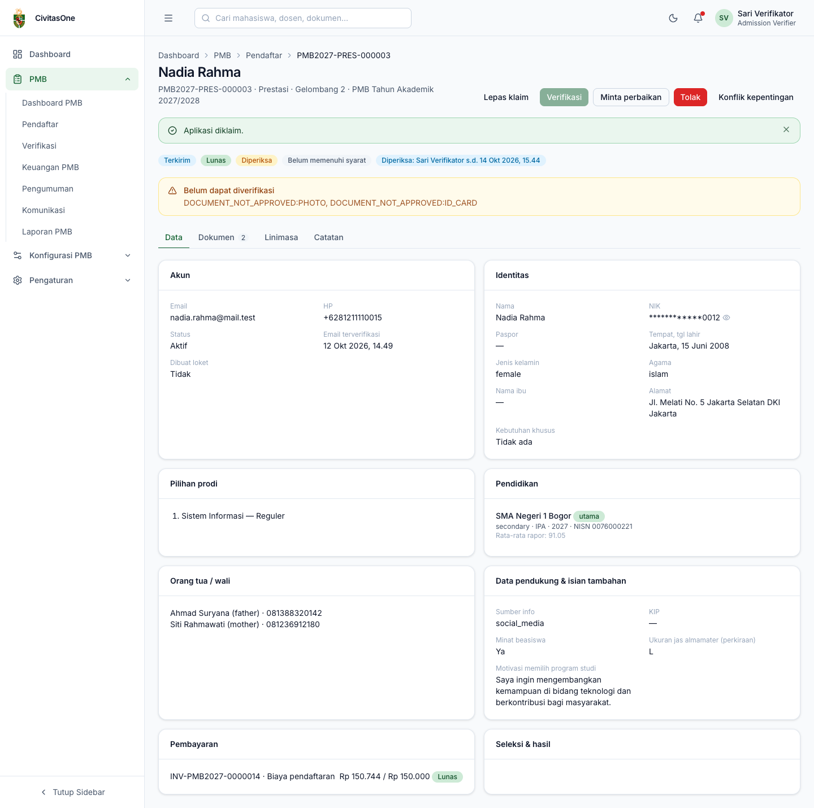
*Gambar 14.2 — Pendaftaran yang diklaim, dengan tombol keputusan dan kotak Belum dapat diverifikasi.*

1. Periksa tab **Data** (buka data sensitif bila perlu, wajib tujuan).
2. Tab **Dokumen**: **Lihat v\<n\>** untuk membuka berkas → **Tinjau** → pilih **Keputusan** (**Setujui**; **Minta perbaikan**/**Tolak** wajib **Kode alasan** & sebaiknya **Catatan untuk pendaftar**) → **Simpan**.

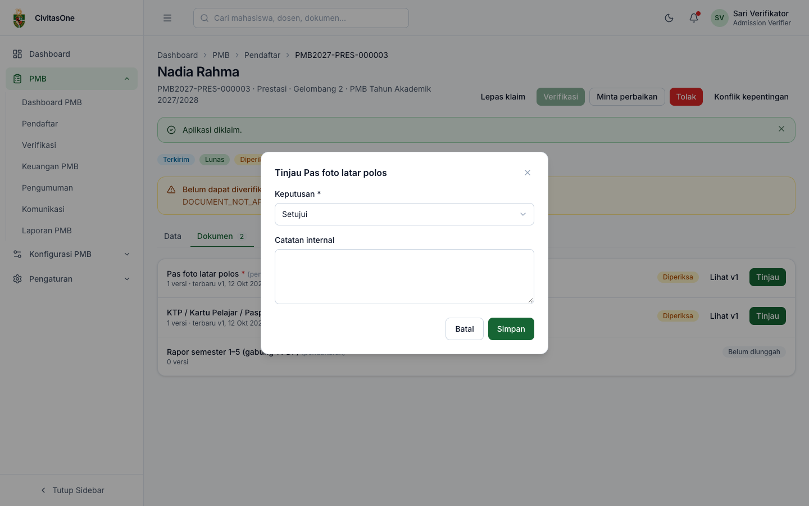
*Gambar 14.3 — Dialog tinjau dokumen.*

3. Ambil keputusan pendaftaran:

| Tombol | Kapan | Isian |
|---|---|---|
| **Verifikasi** | Semua dokumen wajib **disetujui** dan pembayaran terpenuhi | — |
| **Minta perbaikan** | Ada data/dokumen yang dapat diperbaiki | **Dokumen yang perlu diperbaiki**, **Data yang perlu diperbaiki**, **Catatan untuk pendaftar** (wajib), **Batas perbaikan** (kosong = default 72 jam, maks batas perbaikan gelombang) |
| **Tolak** | Tidak memenuhi syarat | **Kode alasan** (wajib), **Catatan untuk pendaftar** (wajib), catatan internal |

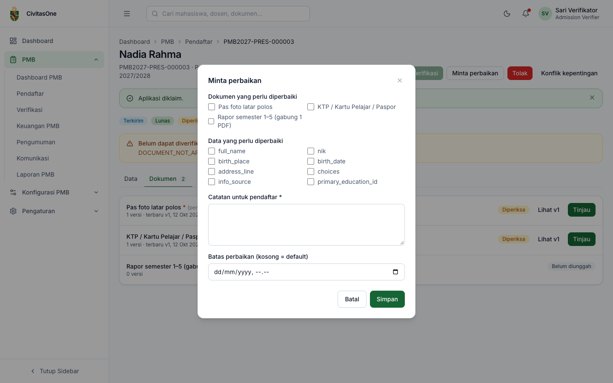
*Gambar 14.4 — Dialog Minta perbaikan.*

Bila **Verifikasi** nonaktif, kotak **Belum dapat diverifikasi** menyebut penyebabnya: `DOCUMENT_NOT_APPROVED:<KODE>` (dokumen wajib belum disetujui, mis. `PHOTO`, `ID_CARD`) atau `PAYMENT_NOT_SATISFIED` (belum lunas).

**Dampak keputusan:** *Terverifikasi* → formulir terkunci, status seleksi *Siap seleksi*, dapat dijadwalkan ujian. *Perlu perbaikan* → pendaftar diberi tahu; setelah kirim ulang kembali ke antrean. *Ditolak* → tahap pendaftar *Tidak lolos administrasi*.

> **Catatan** — Untuk alasan dokumen `SUSPECTED_FORGERY`, pendaftar hanya melihat *"Dokumen tidak dapat diterima, hubungi panitia."* dan panitia terkait diberi tahu.

### 14.4 Galeri pas foto

Tab **Galeri pas foto**: klik foto yang sesuai (bingkai hijau = terpilih) → **Setujui N foto**. Foto yang tidak sesuai ditinjau satu per satu.

> **Perlu konfirmasi** — Galeri juga menampilkan pas foto dari draf yang belum dikirim dan dari pendaftaran yang ditolak. Pilih hanya foto pendaftar yang sedang diproses.

### 14.5 Fitur Administrator PMB

- **Tugaskan ke petugas** (centang pendaftaran di Antrean): pilih petugas & **Strategi** (*Bergiliran*/*Per jalur*). Penugasan tidak kedaluwarsa.
- **Verifikasi massal**: hanya untuk gelombang-jalur yang mengizinkan dan pendaftaran yang memenuhi syarat; yang tidak memenuhi dilewati.
- **Indikasi duplikat** → **Putuskan**: *Bukan duplikat*, *Konfirmasi duplikat* (akun sekunder dinonaktifkan, pendaftarannya ditarik), atau *Gabungkan*; isi **ID akun sekunder**.
- **Pemulihan akun**: bandingkan data pemohon dengan **Akun cocok**, **Lihat identitas** (tercatat), **Putuskan** → centang **Setujui** bila sesuai. Bila disetujui, email akun diganti dan tautan atur sandi dikirim ke email baru.
- **Buka kembali** keputusan *Terverifikasi*/*Ditolak* dengan alasan, selama pendaftaran belum dinilai/diperingkat.
- Setiap petugas dapat menyatakan **Konflik kepentingan** bila mengenal pendaftar.

---

## 15. Keuangan PMB

> **Untuk:** Petugas Keuangan (`pmb_payments.read/approve/finalize`, `pmb_refunds.create`), Kepala Keuangan (`pmb_refunds.approve`). Admin PMB, verifikator, petugas DU, auditor dapat melihat. **Menu:** **PMB → Keuangan PMB**.

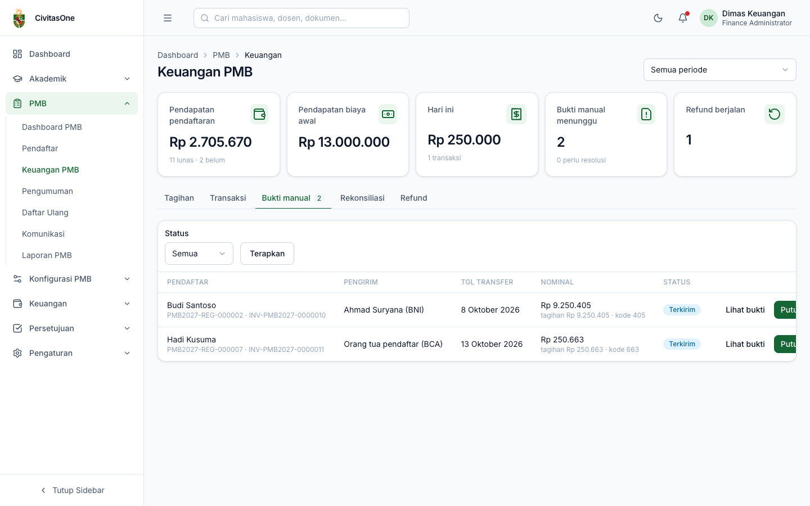
*Gambar 15.1 — Keuangan PMB: kartu ringkasan dan tab Bukti manual.*

Kartu ringkasan (filter periode di kanan atas): **Pendapatan pendaftaran**, **Pendapatan biaya awal**, **Hari ini**, **Bukti manual menunggu** (dan tagihan **perlu resolusi**), **Refund berjalan**. Tab: **Tagihan**, **Transaksi**, **Bukti manual**, **Rekonsiliasi**, **Refund**.

### 15.1 Tagihan

Filter **Cari**, **Jenis** (*Biaya pendaftaran*/*Biaya awal*), **Status**, **Perlu resolusi**. Klik nomor tagihan untuk detail: identitas, total/dibayar/sisa, tenggat, item (dengan jatuh tempo cicilan), transaksi, refund terkait.

**Catat pembayaran loket** (tagihan *Belum bayar*, *Sebagian*, *Kedaluwarsa*): buka detail → **Catat pembayaran loket** → isi **Nominal diterima (Rp)**, **Nomor kuitansi**, **Waktu bayar** → **Simpan**. Transaksi sukses dengan referensi `CSH-<kuitansi>`.

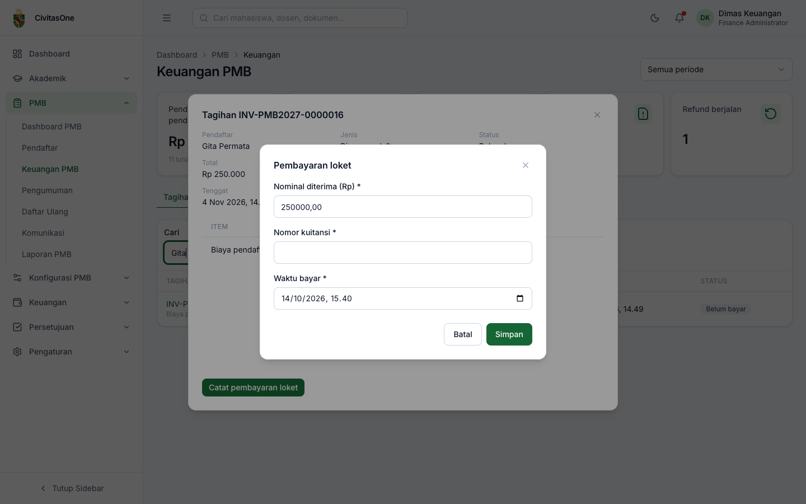
*Gambar 15.2 — Dialog pembayaran loket.*

> **Catatan** — Tagihan biaya pendaftaran baru ada setelah pendaftar membuka langkah **Pembayaran** di portal. Bila belum, minta pendaftar membukanya dulu.

**Resolusi pembayaran terlambat** (tanda **Resolusi**): **Terima & buka kembali aplikasi** atau **Kembalikan dana (refund)**, dengan catatan. **Cek ulang** status transaksi gateway yang masih *Menunggu*.

### 15.2 Verifikasi bukti transfer manual

Kolom tab **Bukti manual**: pendaftar & tagihan, pengirim (nama & bank), tanggal transfer, **nominal ditransfer** vs **tagihan** dan **kode unik** (beda ditandai merah), status, label **Mirip bukti lain**.

1. **Lihat bukti**.
2. Cocokkan dengan **mutasi rekening** kampus: nominal (termasuk kode unik), tanggal, nama pengirim.
3. **Putuskan**: **Setujui — dana diterima** (transaksi sukses, tagihan lunas/sebagian) atau **Tolak** dengan alasan `NOT_FOUND_IN_STATEMENT`, `AMOUNT_MISMATCH`, `UNREADABLE`, `DUPLICATE_PROOF`, `OTHER`; isi **Catatan** → **Simpan**.

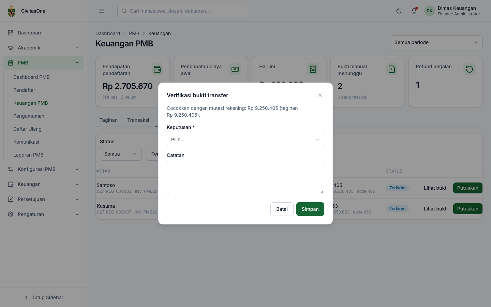
*Gambar 15.3 — Dialog verifikasi bukti transfer.*

> **Penting** — Petugas yang memverifikasi bukti bayar **biaya awal** suatu pendaftaran tidak dapat menyetujui daftar ulang pendaftaran tersebut maupun refund transaksi yang sama.

### 15.3 Transaksi

Filter **Status**, **Penyedia** (`manual`, `cashier`, `xendit`), tanggal. Referensi: `MAN-<id>` (transfer manual), `CSH-<kuitansi>` (loket), atau referensi gateway. Untuk gateway, **Callback** menampilkan riwayat notifikasi penyedia.

### 15.4 Rekonsiliasi

1. Tab **Rekonsiliasi** → **Batch baru**: **Penyedia** (*Transfer bank (mutasi)* atau *Xendit*), **Tanggal** → **Simpan**.
2. Batch transfer bank: **Impor mutasi** (CSV/XLSX berkolom **tanggal, keterangan, nominal, referensi**); sistem mencocokkan otomatis.
3. Item tidak cocok → **Selesaikan** (pilih resolusi + catatan). Hasil: `matched`, `missing_in_system`, `missing_in_provider`, `amount_mismatch`, `duplicate_payment`.
4. **Tutup batch** setelah semua item selesai.

> **Catatan (kode terkini)** — Untuk **Xendit**, settlement **tidak ditarik otomatis**; batch dipakai untuk mendeteksi transaksi ganda dan selisih, dengan impor laporan/mutasi bila diperlukan. (Manual per bab lama masih menyebut penarikan otomatis.)

> **Perlu konfirmasi** — Format kolom mutasi tiap bank berbeda; uji impor dengan contoh mutasi bank kampus sebelum dipakai rutin.

### 15.5 Refund

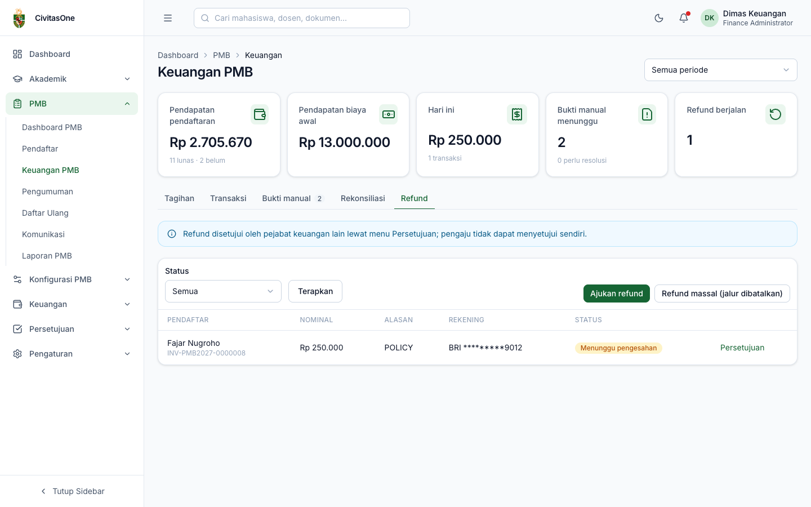
*Gambar 15.4 — Tab Refund.*

**Mengajukan:** **Ajukan refund** → **ID transaksi (sukses)**, **Nominal**, **Alasan** (`DUPLICATE_PAYMENT`, `PERIOD_CANCELLED`, `WITHDRAWAL`, `LATE_PAYMENT`, `OVERPAYMENT`, `POLICY`, `OTHER`), **Keterangan**, **Bank penerima**, **Nomor rekening**, **Nama pemilik rekening** → **Simpan**. Status *Menunggu pengesahan* dan muncul di **Persetujuan** Kepala Keuangan.

**Setelah disetujui:** transfer dana di luar sistem → **Catat selesai** (unggah **Bukti transfer**, isi **Waktu transfer**) → status *Selesai*, tagihan *Dikembalikan*.

**Refund draf** (mis. dari resolusi pembayaran terlambat): **Lengkapi & ajukan**. **Refund massal (jalur dibatalkan)**: pilih periode → gelombang → jalur, **Alasan** (min. 10 karakter) → **Ajukan**; satu persetujuan untuk semua pembayaran biaya pendaftaran sukses pada gelombang-jalur tersebut.

> **Kendala diketahui** — **ID transaksi** adalah ID internal. Untuk transfer manual, gunakan referensi tanpa awalan `MAN-`. Untuk pembayaran loket dan gateway, ID internal belum tampil di layar; minta bantuan administrator sistem.

---

## 16. Ujian Seleksi

> **Untuk:** Administrator PMB & Panitia Seleksi (`pmb_exams.update`); pengawas (`pmb_exam_attendance.update`) untuk check-in. **Menu:** **PMB → Ujian**, tab **Jadwal**, **Lokasi & ruang**, **Permintaan jadwal ulang**.

Alur: **lokasi & ruang → jadwal → sesi → penempatan peserta → petugas → (CBT) bank soal → publikasi → check-in → penilaian → kunci nilai**. Hanya pendaftar **terverifikasi** pada jalur **berujian** yang dapat ditempatkan; penempatan otomatis dapat diulang untuk peserta yang baru terverifikasi.

### 16.1 Lokasi dan ruang

**+ Lokasi** (Nama, Alamat, URL peta, Aktif) → **Tambah ruang** pada kartu lokasi (Kode, Nama, **Kapasitas**, Ramah disabilitas, Fasilitas JSON mis. `["komputer","AC"]`, Aktif). Hanya ruang aktif yang dapat dipilih.

### 16.2 Jadwal ujian

Tab **Jadwal**: pilih **Periode** & **Gelombang** → **+ Jadwal ujian**.

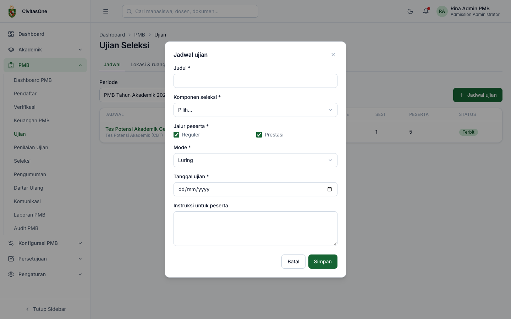
*Gambar 16.1 — Form jadwal ujian.*

| Field | Keterangan |
|---|---|
| **Judul** | Contoh *Tes Potensi Akademik Gelombang 1* |
| **Komponen seleksi** | Komponen skema yang dinilai (tulis, CBT, wawancara, portofolio, tes khusus) |
| **Jalur peserta** | Gelombang-jalur yang pesertanya diikutkan |
| **Mode** | *Luring*, *Daring terawasi*, *CBT*, *Wawancara*, *Penilaian portofolio* |
| **Tanggal ujian** | Di dalam jendela ujian gelombang (kecuali ODS) |
| Instruksi untuk peserta | Tampil di portal & kartu peserta |
| Durasi CBT, jumlah soal ditampilkan, acak urutan soal, referensi CBT eksternal | Khusus CBT |

### 16.3 Sesi, penempatan, petugas, bank soal, publikasi

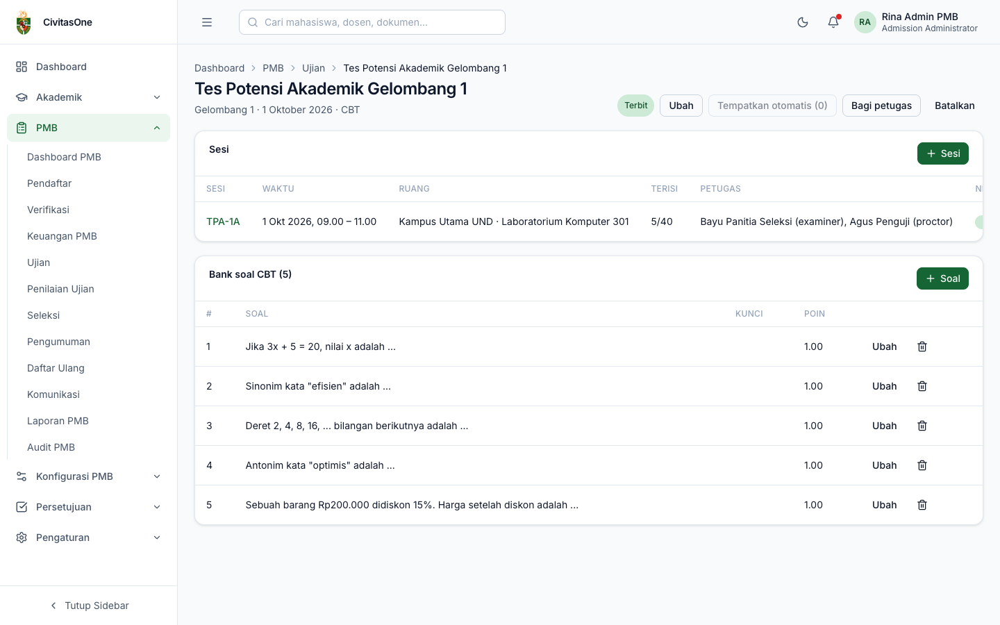
*Gambar 16.2 — Detail jadwal: sesi dan bank soal CBT.*

- **+ Sesi**: kode, ruang (kosong untuk daring), **Mulai**, **Selesai** (pada tanggal ujian, kecuali ODS), check-in dibuka, **Kapasitas**, URL daring. Mengubah sesi pada jadwal terbit wajib alasan dan peserta diberi tahu.
- **Tempatkan otomatis (N)**: membagi N peserta yang belum mendapat kursi ke sesi berdasarkan **nomor pendaftaran** sesuai kapasitas.
- **Petugas** per sesi (Penguji, Pewawancara, Pengawas) atau **Bagi petugas** (jumlah per sesi untuk satu peran).
- **Bank soal CBT**: **+ Soal** → **Pertanyaan**, **Opsi** (JSON `[{"key":"A","text":"…"}]`), **Kunci jawaban**, Poin, Urutan.
- **Publikasikan**: kartu peserta (PDF ber-QR) terbit dan peserta diberi tahu. **Batalkan** jadwal wajib alasan.

> **Kendala diketahui** — Kunci jawaban tidak dikirim ke peramban setelah disimpan; kolom **Kunci** tampak kosong dan saat **Ubah** soal Anda harus **mengisi ulang Kunci jawaban**.

> **Beda rancangan** — Strategi penempatan *per prodi* dan *aksesibilitas* tersedia di API, tetapi tombol layar memakai strategi *nomor pendaftaran*. Atur ruang ramah disabilitas secara manual bila perlu.

### 16.4 Hari ujian: check-in

Klik kode sesi → detail sesi.

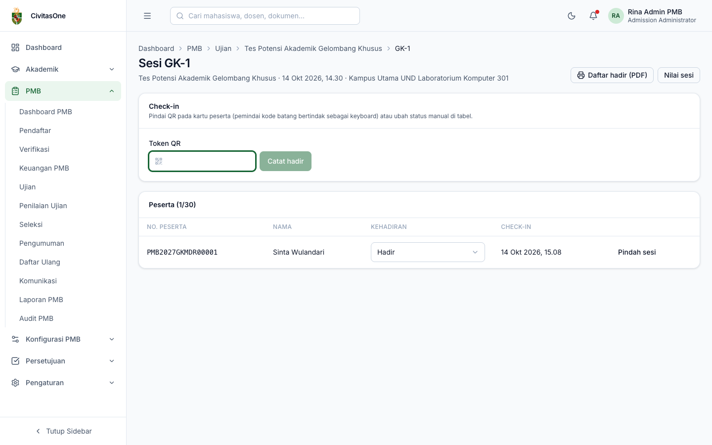
*Gambar 16.3 — Check-in pada sesi yang sedang berlangsung.*

- **Token QR**: pindai QR kartu peserta dengan pemindai kode batang (berfungsi sebagai keyboard) → **Catat hadir** (atau Enter).
- Ubah **Kehadiran** manual: Terdaftar, Hadir, Tidak hadir, Izin, Didiskualifikasi.
- **Daftar hadir (PDF)**, **Pindah sesi** (isi **ID sesi tujuan** dan alasan), **Nilai sesi**, **Kunci nilai**.
- Peserta CBT yang mulai mengerjakan otomatis tercatat **Hadir**.

### 16.5 Permintaan jadwal ulang

Tab **Permintaan jadwal ulang** → **Putuskan**: **Setujui & pindahkan** (pilih **Sesi tujuan**) atau **Tolak**; isi **Catatan** → **Simpan**. Peserta diberi tahu. Default maksimal 1 jadwal ulang per peserta.

---

## 17. Penilaian Ujian

> **Untuk:** penguji/pewawancara/pengawas yang ditugaskan (umumnya dosen; `pmb_scores.create`, `pmb_exam_attendance.update`), Panitia Seleksi, Admin PMB. **Menu:** **PMB → Penilaian Ujian**.

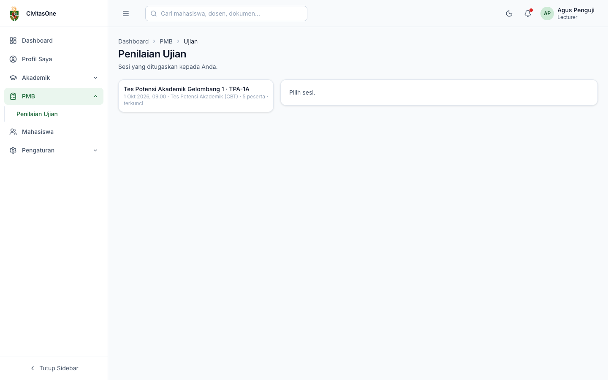
*Gambar 17.1 — Tampilan dosen: hanya menu Penilaian Ujian dan sesi yang ditugaskan.*

1. Klik sesi yang ditugaskan.
2. Isi nilai sesuai tipe komponen: **Nilai** angka (dalam rentang komponen), **Lulus/Tidak**, atau nilai per kriteria **rubrik** (wawancara/portofolio).
3. Isi **Catatan** bila perlu → **Simpan nilai**.

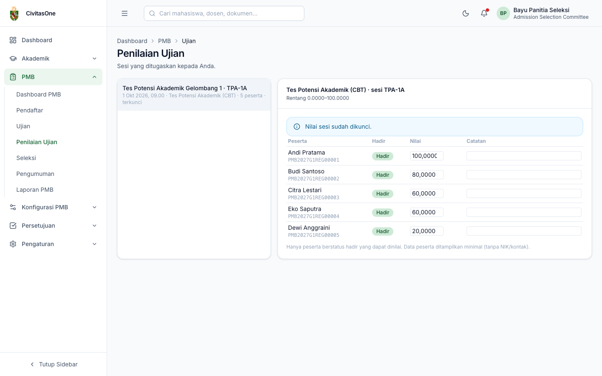
*Gambar 17.2 — Lembar nilai sesi CBT (nilai otomatis, sudah dikunci).*

- **Hanya peserta berstatus Hadir** yang dapat dinilai.
- Data peserta minimal (nama & nomor peserta, tanpa NIK/kontak).
- Nilai **CBT** dihitung otomatis; bila beberapa penguji menilai peserta yang sama, masing-masing mengisi nilainya sendiri.

**Mengunci nilai** (Panitia Seleksi, `pmb_scores.finalize`): **PMB → Ujian** → jadwal → sesi → **Kunci nilai** → konfirmasi. Lembar nilai menjadi baca saja (*"Nilai sesi sudah dikunci."*). Perubahan nilai terkunci hanya lewat **pengajuan koreksi nilai** yang disetujui Pejabat Pengesah ([§18.1](#181-matriks-nilai-dan-koreksi-nilai)).

> **Beda rancangan** — Tidak ada simpan otomatis; simpan berkala dengan **Simpan nilai**.

---

## 18. Proses Seleksi

> **Untuk:** Panitia Seleksi (`pmb_selection.update`, `pmb_selection.publish`, `pmb_scores.import`, `pmb_results.update`); Admin PMB & pengesah melihat. **Menu:** **PMB → Seleksi** (halaman **Proses Seleksi**).

Pilih **Periode**, **Gelombang**, **Jalur** terlebih dahulu. Tab: **Run seleksi**, **Matriks nilai**, **Impor nilai**.

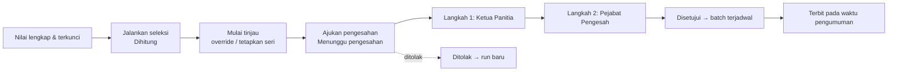

Status run: **Draf**, **Dihitung**, **Ditinjau**, **Menunggu pengesahan**, **Disetujui**, **Ditolak**, **Terbit**, **Digantikan**, **Gagal**.

### 18.1 Matriks nilai dan koreksi nilai

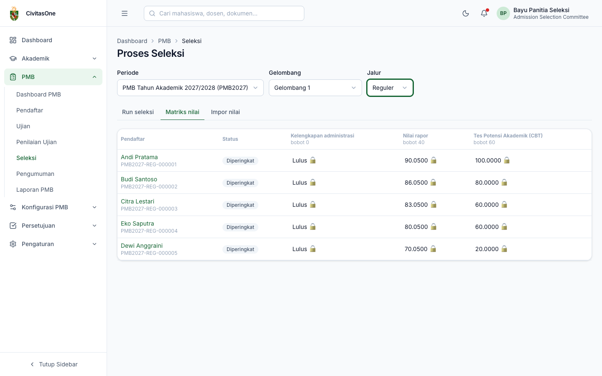
*Gambar 18.1 — Matriks nilai Gelombang 1 · Reguler (ikon gembok = terkunci).*

Klik nilai untuk mengoreksi:
- **Belum terkunci** (`pmb_selection.update`): isi **Nilai baru** dan **Alasan** → langsung tersimpan & tercatat.
- **Terkunci** (`pmb_results.update`): **Ajukan koreksi nilai terkunci** (nilai baru, **Alasan**, **Bukti**) → berlaku setelah disetujui **Pejabat Pengesah**.

### 18.2 Impor nilai

Tab **Impor nilai** → pilih **Jadwal ujian** → berkas **XLSX/CSV** berkolom `participant_number` dan `score` → **Validasi** (tanpa menyimpan; jumlah baris valid & galat per baris) → **Simpan N nilai**.

### 18.3 Menjalankan dan meninjau run

1. Tab **Run seleksi** → **Jalankan seleksi** (*"Run dibuat; perhitungan selesai dalam beberapa saat."*). Pastikan gelombang-jalur memakai skema **terkunci** dan nilai komponen wajib lengkap.
2. Buka run → **Mulai tinjau** (status *Ditinjau*).
3. Periksa **Ringkasan** (peserta, eligible, lulus, cadangan, tidak lulus, seri, ambang, per kuota: kapasitas, sisa kursi, ditempatkan, cadangan) dan **hash** hasil.
4. Periksa tabel hasil (peringkat, nilai ternormalisasi, **Skor akhir**, **Rekomendasi**, **Ditempatkan**); saring dengan **Rekomendasi** atau **Hanya seri**.

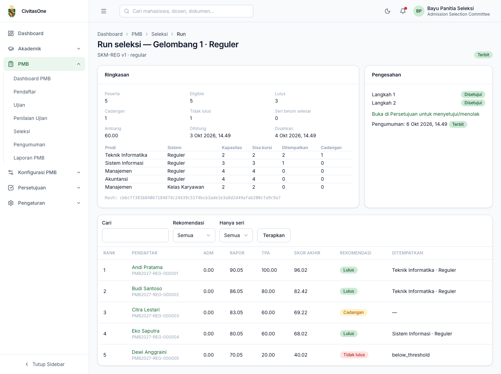
*Gambar 18.2 — Detail run Gelombang 1 · Reguler (sudah disahkan dan terbit).*

Kode penyebab tidak lulus: `below_threshold`, `component_minimum`, `absent`, `quota_full_no_waitlist`, `disqualified`, `incomplete_scores`.

- **Override** (status *Dihitung*/*Ditinjau*): pilih **Rekomendasi** baru (*Lulus* + **Kuota tujuan**, *Cadangan*, *Tidak lulus*), **Alasan** → **Simpan**. Baris berlabel **override**; hash berubah.
- **Skor seri pada batas kuota**: tombol **Ajukan pengesahan** nonaktif. Centang peserta dalam satu kelompok seri sesuai urutan keputusan panitia → **Tetapkan urutan** (alasan). Sistem menghitung run baru; run lama *Digantikan*.

> **Kendala diketahui** — Kolom komponen lulus/tidak (mis. **ADM**) pada tabel hasil tampil `0.00`; status lulus/tidaknya lihat di **Matriks nilai**.

### 18.4 Mengajukan pengesahan

Klik **Ajukan pengesahan** → isi **Catatan pengajuan** → konfirmasi (menampilkan hash dan jadwal pengumuman). Status **Menunggu pengesahan**; kartu **Pengesahan** menampilkan langkah persetujuan.

---

## 19. Pengesahan lewat Menu Persetujuan

> **Untuk:** Administrator PMB (langkah 1, Ketua Panitia PMB), Pejabat Pengesah PMB (langkah 2 & koreksi), Kepala Keuangan (refund). **Menu:** **Persetujuan → Pengajuan**.

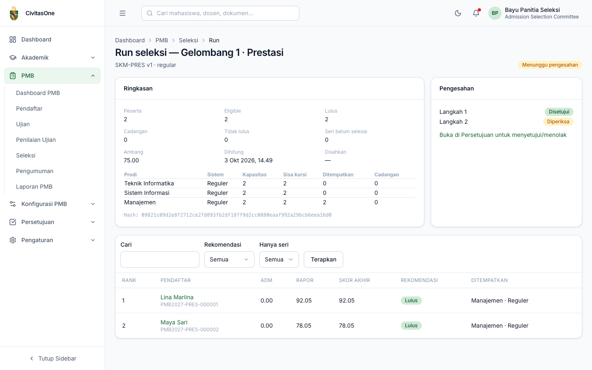
*Gambar 19.1 — Run menunggu pengesahan: langkah 1 disetujui, langkah 2 diperiksa.*

| Jenis pengajuan | Alur | Langkah (penyetuju) |
|---|---|---|
| Hasil seleksi (*SelectionRun*) | Pengesahan Hasil Seleksi PMB | 1. Ketua Panitia PMB (`admission_administrator`) → 2. Pejabat Pengesah (`admission_approver`) |
| Koreksi hasil / pembatalan penerimaan | Koreksi Hasil / Pembatalan Penerimaan PMB | Pejabat Pengesah |
| Koreksi nilai terkunci | Koreksi Nilai Terkunci PMB | Pejabat Pengesah |
| Refund | Pengembalian Dana PMB | Kepala Keuangan (`finance_administrator`) |
| Perpanjangan massal daftar ulang | Perpanjangan Massal Daftar Ulang PMB | Pejabat Pengesah |
| Percepatan publikasi hasil | Percepatan Publikasi Hasil PMB | Pejabat Pengesah |

**Langkah menyetujui:**

1. **Persetujuan → Pengajuan**. Pengajuan PMB tampil dengan jenis teknis *SelectionRun*, *Refund*, atau *ChangeRequest*.
2. **Lihat Detail** → status, tanggal, catatan pengaju, **Riwayat** langkah.
3. Sebelum memutuskan, buka detail run di **PMB → Seleksi** untuk meninjau ringkasan, override, dan hash.
4. **Setujui** (komentar opsional) atau **Tolak** (**Alasan Penolakan**, sangat disarankan). **Delegasikan** meneruskan langkah ke pengguna lain.

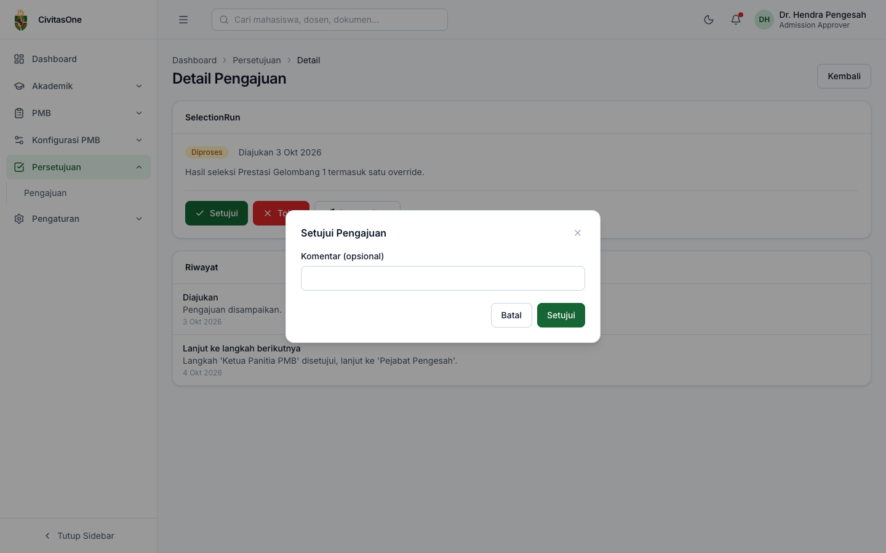
*Gambar 19.2 — Dialog Setujui Pengajuan.*

Setelah semua langkah disetujui: run **Disetujui** dan batch pengumuman dijadwalkan otomatis. Bila **ditolak**: run **Ditolak**; panitia memperbaiki lalu menjalankan run baru.

> **Penting** — Pengaju run **tidak dapat** menyetujui langkah mana pun (*SELF_APPROVAL_FORBIDDEN*). Hasil tidak dapat dipublikasikan manual.

> **Beda rancangan** — Rancangan menyebut tampilan persetujuan khusus PMB dengan aksi *kembalikan*. Aplikasi memakai halaman **Persetujuan** umum (**Setujui**, **Tolak**, **Delegasikan**); untuk "mengembalikan", tolak dengan alasan lalu panitia menjalankan run baru.

---

## 20. Pengumuman dan Keputusan

> **Untuk:** Administrator PMB (jadwal publikasi, kursi & cadangan), Panitia Seleksi (beasiswa, koreksi hasil), peran lain yang berizin melihat. **Menu:** **PMB → Pengumuman** (halaman **Pengumuman & Keputusan**), tab **Keputusan**, **Jadwal publikasi**, **Kursi & cadangan**, **Koreksi & pengajuan**.

### 20.1 Keputusan dan beasiswa jalur masuk

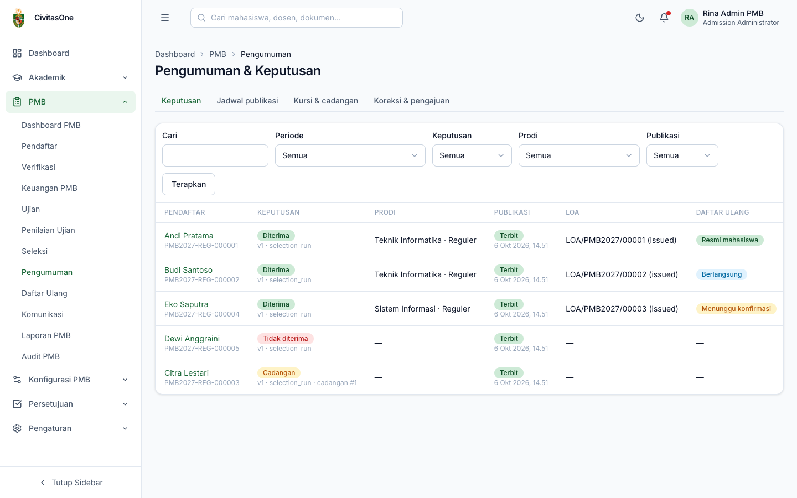
*Gambar 20.1 — Daftar keputusan beserta publikasi, LoA, dan status daftar ulang.*

Filter: **Cari**, **Periode**, **Keputusan** (*Diterima*, *Cadangan*, *Tidak diterima*, *Dibatalkan*), **Prodi**, **Publikasi**. Kolom: keputusan (versi, sumber `selection_run`/`waitlist_promotion`/`correction`/`offer_withdrawal`, nomor urut cadangan), prodi & sistem, publikasi, nomor LoA & statusnya, daftar ulang, beasiswa.

**Beasiswa** (Panitia Seleksi, keputusan *Diterima*): pilih **Program beasiswa** (opsional, dari modul Beasiswa), isi **Potongan (%)** dan **Catatan**. Berikan **sebelum** pendaftar membayar biaya awal.

### 20.2 Jadwal publikasi (batch)

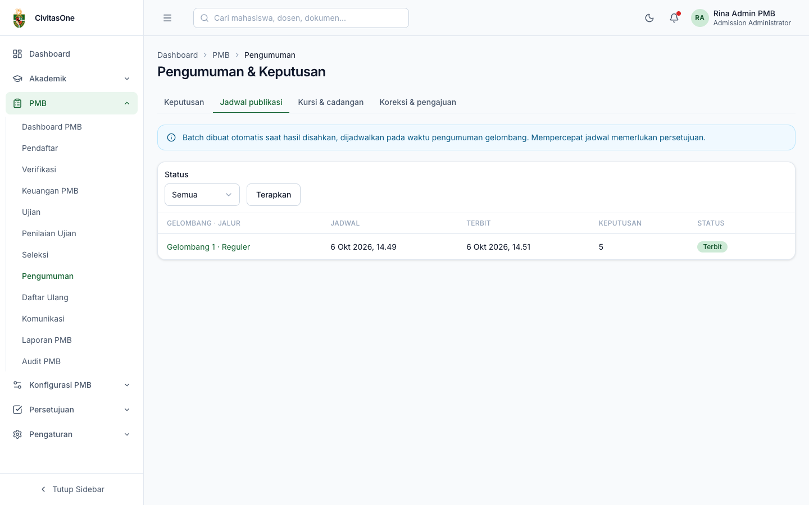
*Gambar 20.2 — Batch pengumuman.*

Batch dibuat **otomatis** saat hasil disahkan dan dijadwalkan pada **waktu pengumuman** gelombang. Pada waktunya sistem menerbitkan keputusan, membuat LoA, membuka daftar ulang, dan mengirim notifikasi. Status: **Terjadwal**, **Menerbitkan**, **Terbit**, **Gagal**, **Dibatalkan**.

Untuk batch *Terjadwal*: **Ubah jadwal** (jadwal baru + alasan; **mempercepat** perlu persetujuan Pejabat Pengesah, memundurkan berlaku langsung) atau **Batalkan** (wajib alasan).

> **Catatan** — Hasil tetap terbit tepat waktu walaupun penjadwal terlambat: halaman hasil portal dan **Cek Status** memicu publikasi batch yang jatuh tempo.

### 20.3 Kursi & cadangan

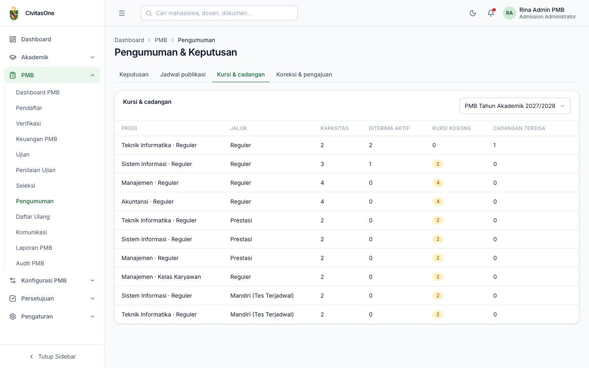
*Gambar 20.3 — Kursi & cadangan per kuota.*

Kursi kosong muncul bila pendaftar diterima **menolak tawaran**, **daftar ulangnya kedaluwarsa**, atau **penerimaannya dibatalkan**. Pada kuota yang punya kursi kosong **dan** cadangan, Admin PMB klik **Promosikan** → **Jumlah** (default jumlah kursi kosong) dan **Batas daftar ulang** (kosong = 7 hari). Cadangan teratas menjadi *Diterima*, mendapat tagihan biaya awal dan batas individual, serta diberi tahu. Promosi otomatis tersedia lewat `pmb.auto_promote_waitlist`.

### 20.4 Koreksi hasil & pengajuan perubahan

Tab **Koreksi & pengajuan** (`pmb_results.update`) memuat semua pengajuan perubahan (koreksi nilai/hasil, pembatalan penerimaan, perpanjangan massal, percepatan publikasi, refund massal) beserta tautan **Persetujuan**.

**Ajukan koreksi hasil:** **ID aplikasi** (pisahkan koma), **Alasan**, **Bukti** (opsional), (opsional) **Usulan** JSON `{"<id aplikasi>": {"decision":"accepted","quota_id":"<id kuota>"}}` → **Simpan**. Tanpa usulan: setelah disetujui sistem membuat **run koreksi**. Pendaftar diberi tahu dan halaman hasilnya menampilkan *"Hasil telah dikoreksi"*.

> **Catatan** — ID aplikasi dapat disalin dari alamat halaman detail pendaftar (`/admin/pmb/pendaftar/<id aplikasi>`). ID kuota belum tampil di layar; gunakan koreksi **tanpa usulan** bila ID kuota tidak tersedia.

---

## 21. Daftar Ulang dan Konversi Mahasiswa

> **Untuk:** Petugas Daftar Ulang (`pmb_reregistration.approve`), Administrator PMB (perpanjangan, konversi), keuangan/dekan/kaprodi/auditor (melihat). **Menu:** **PMB → Daftar Ulang**, tab **Antrean** dan **Konversi mahasiswa**.

### 21.1 Antrean

Filter **Cari**, **Status**, **Periode**, **Prodi**. Prioritaskan status **Terkirim**.

| Status | Arti |
|---|---|
| Menunggu konfirmasi | Diterima, belum menerima/menolak tawaran |
| Dikonfirmasi / Berlangsung | Tawaran diterima; pendaftar melengkapi data, dokumen, pembayaran |
| Terkirim | **Menunggu validasi petugas** |
| Perlu perbaikan | Petugas meminta perbaikan |
| Disetujui | Konversi sedang diproses |
| Resmi mahasiswa | Konversi selesai, NIM terbit |
| Menolak tawaran / Kedaluwarsa / Dibatalkan | Tidak diselesaikan |

### 21.2 Memeriksa daftar ulang

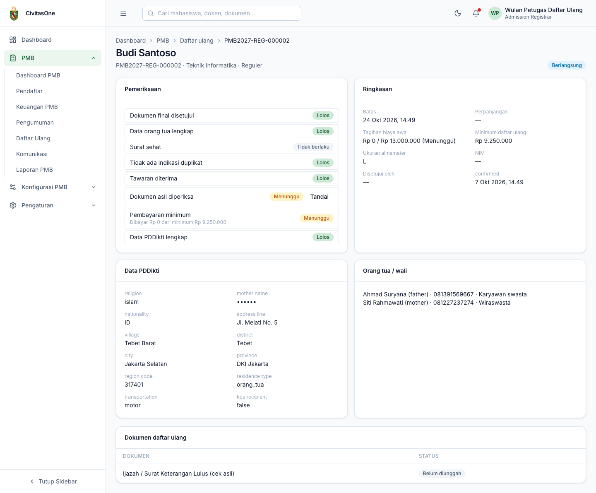
*Gambar 21.1 — Detail daftar ulang yang sedang berjalan.*

| Kartu | Isi |
|---|---|
| **Pemeriksaan** | Delapan butir: tawaran diterima, data PDDikti, data orang tua, dokumen final, surat sehat, pembayaran minimum, **dokumen asli diperiksa**, tidak ada indikasi duplikat. Butir manual memiliki tombol **Tandai** |
| **Ringkasan** | Batas & perpanjangan, tagihan biaya awal, minimum daftar ulang, ukuran almamater, NIM, penyetuju, waktu penting |
| **Data PDDikti**, **Orang tua / wali** | Data lanjutan dari pendaftar (nama ibu tersamar) |
| **Dokumen daftar ulang** | **Lihat** dan **Tinjau** (Setujui / Minta perbaikan / Tolak) |

**Menandai pemeriksaan manual** (misalnya saat pendaftar membawa ijazah & KTP asli): **Tandai** → **Status** (*Lolos*, *Tidak lolos*, *Tidak berlaku*) → **Catatan** → **Simpan**.

### 21.3 Menyetujui atau meminta perbaikan

Untuk status **Terkirim**:
- **Setujui** — aktif bila semua butir *Lolos*/*Tidak berlaku* (*"Semua pemeriksaan harus lolos sebelum disetujui."*). Konversi berjalan otomatis (*"Disetujui; konversi mahasiswa diproses."*).
- **Minta perbaikan** — pilih **Dokumen** dan/atau **Data** (field PDDikti), **Catatan** → **Simpan**.

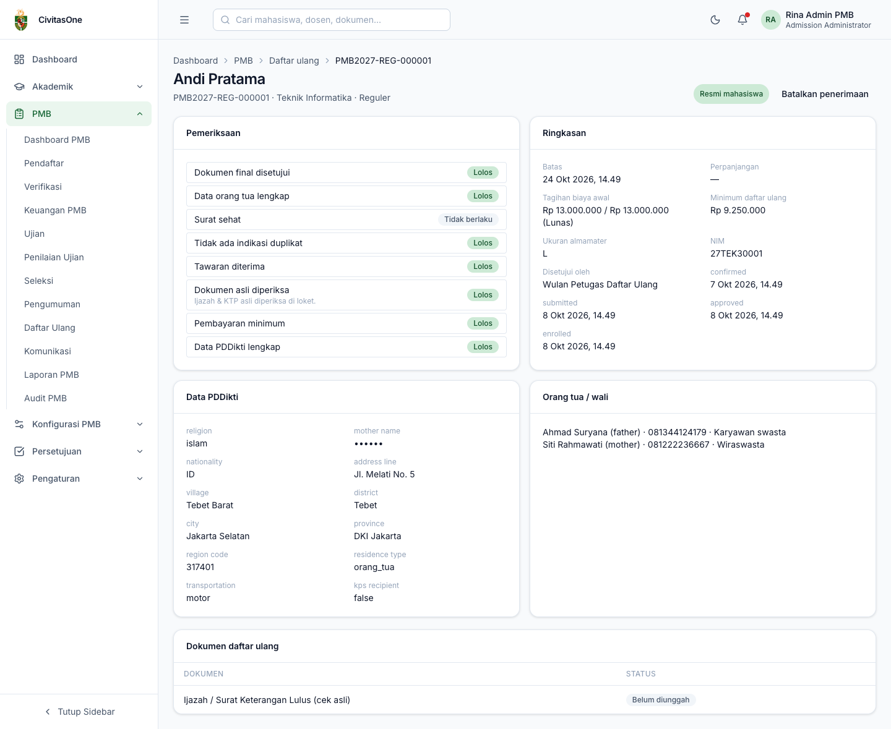
*Gambar 21.2 — Daftar ulang yang sudah disetujui dan dikonversi (NIM terbit).*

> **Penting** — Petugas yang memverifikasi bukti transfer **biaya awal** pendaftar tersebut tidak dapat menyetujui daftar ulangnya.

### 21.4 Perpanjangan, pemulihan, pembatalan

| Tombol | Kapan | Isian | Catatan |
|---|---|---|---|
| **Perpanjang** | Menunggu konfirmasi, Dikonfirmasi, Berlangsung, Perlu perbaikan | **Batas baru**, alasan | Maks sesuai pengaturan (default 7 hari) |
| **Pulihkan** | Menolak tawaran, Kedaluwarsa | **Dasar pemulihan**: *Salah tolak (≤ 24 jam)* atau *Pembayaran sah terlambat tercatat*; catatan | Kembali aktif |
| **Batalkan penerimaan** | Selain Dibatalkan/Menolak/Kedaluwarsa (`pmb_results.update`) | **Alasan**, **Bukti** | Perlu persetujuan Pejabat Pengesah; kursi dilepas, LoA dicabut |

**Perpanjangan massal** (kanan atas antrean): **Periode**, **Prodi** (opsional), **Batas baru**, alasan → persetujuan Pejabat Pengesah.

### 21.5 Konversi mahasiswa

Langkah konversi (tercatat per langkah): membuat data mahasiswa & **NIM** (`student_created`) → menautkan akun pengguna (email institusi bila domain diatur, selain itu email pribadi) (`user_linked`) → memposting tagihan ke modul Keuangan (`finance_posted`) → menautkan dokumen (`documents_linked`) → meneruskan beasiswa (`scholarship_forwarded`).

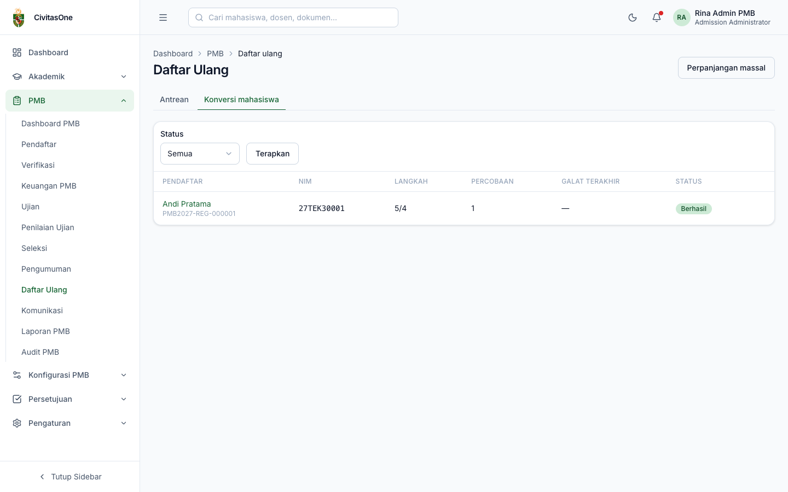
*Gambar 21.3 — Tab Konversi mahasiswa.*

Status: *Menunggu*, *Diproses*, *Berhasil*, *Gagal*, *Perlu tindakan*. Untuk *Gagal*/*Perlu tindakan*: **Coba lagi** (`pmb_conversion.update`); langkah yang sudah selesai tidak diulang. Galat `USER_EMAIL_CONFLICT` → isi **Email akun mahasiswa pengganti**.

> **Kendala diketahui** — Kolom **Langkah** memakai pembagi tetap 4 sehingga konversi lengkap tampil `5/4`. Acuan keberhasilan adalah kolom **Status**.

---

## 22. Komunikasi dengan Pendaftar

> **Untuk:** operator yang melayani pertanyaan (`pmb_communication.update`), Admin PMB (broadcast, template), auditor (log). **Menu:** **PMB → Komunikasi** (halaman **Komunikasi PMB**), tab **Pesan pendaftar**, **Broadcast**, **Template notifikasi**, **Log notifikasi**.

### 22.1 Pesan pendaftar


*Gambar 22.1 — Kotak pesan pendaftar.*

1. Saring percakapan: **Status** (*Dibuka*, *Menunggu pendaftar*, *Ditutup*), **Penanggung jawab** (*Saya*).
2. Klik percakapan; pilih **Penanggung jawab** dan **Status** di kanan atas.
3. Baca riwayat (pendaftar kiri, staf kanan, sistem tengah), buka **Lampiran** bila ada.
4. Tulis di **Balas…** → **Kirim**. Pendaftar diberi tahu.

> **Penting** — Jangan pernah meminta kata sandi atau kode OTP pendaftar, dan jangan mengirim data sensitif lewat chat. Untuk perubahan data, arahkan ke fitur portal atau prosedur koreksi resmi.

### 22.2 Broadcast

**Broadcast baru**: **Judul internal**, **Kanal** (*Email* atau *SMS/WA* maks 160 karakter, perlu penyedia SMS), audiens (periode, jalur, status formulir, pembayaran, keputusan), **Hanya yang menyetujui informasi promosi** (wajib untuk promosi), Subjek, **Isi pesan** (tanpa NIK/data sensitif) → **Simpan** (draf) → **Hitung penerima** → **Kirim/jadwalkan** (isi **Jadwal kirim** atau kosongkan untuk kirim sekarang). **Batalkan** untuk draf/terjadwal. Kolom **Terkirim/gagal** menunjukkan hasil.


*Gambar 22.2 — Form broadcast dengan filter audiens.*

### 22.3 Template dan log notifikasi

- **Template notifikasi**: setiap peristiwa (mis. `pmb.application.submitted`, `pmb.payment.succeeded`, `pmb.result.published`) punya subjek & isi default per kanal (**mail**, **database**, **sms**). Klik kanal → ubah **Subjek**/**Isi** dengan placeholder yang tercantum → centang **Aktif** → **Simpan**; **Uji** mengirim email uji. Hapus centang **Aktif** untuk kembali ke default.
- **Log notifikasi**: peristiwa, objek, **Status** (*Menunggu*, *Terkirim*, *Gagal*), percobaan, kanal tertunda, galat. Isi pesan tidak ditampilkan; pesan berisi rahasia (OTP, tautan atur sandi) disimpan terenkripsi. Pengiriman gagal dicoba ulang otomatis pada kanal yang gagal.

> **Kendala diketahui** — Kanal **database** (notifikasi dalam aplikasi pendaftar) selalu gagal pada versi yang diuji (*"Kanal gagal: database"*); email tetap terkirim. Lihat [§27.3](#273-kendala-yang-diketahui).

---

## 23. Laporan PMB

> **Untuk:** peran dengan `pmb_reports.read` (lihat) dan `pmb_reports.export` (ekspor). **Menu:** **PMB → Laporan PMB**, tab **Laporan** dan **Ekspor saya**.

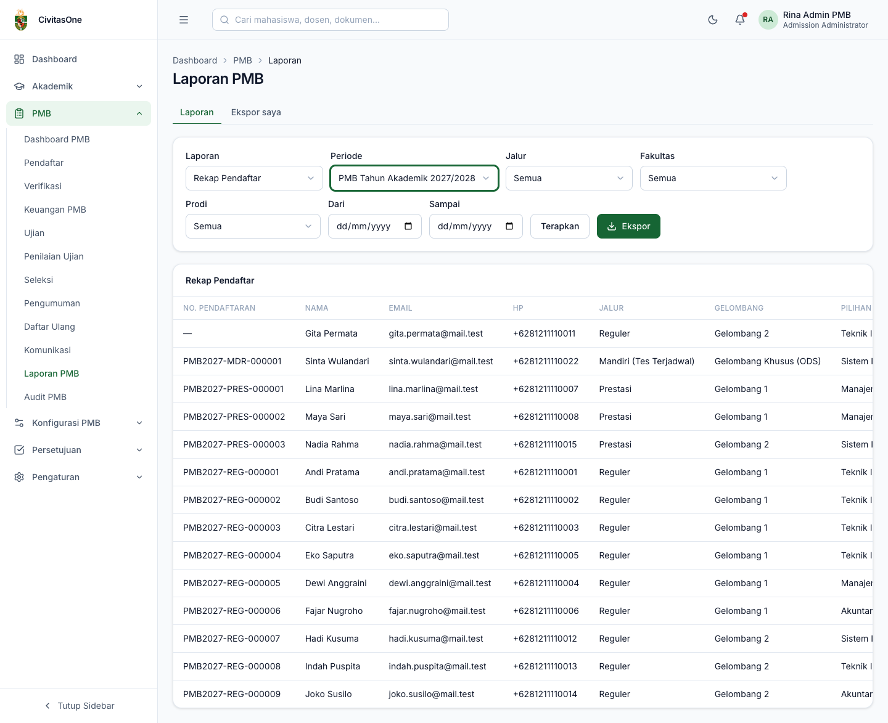
*Gambar 23.1 — Laporan Rekap Pendaftar untuk satu periode.*

1. Pilih **Laporan**, atur **Periode**, **Jalur**, **Fakultas**, **Prodi**, **Dari**–**Sampai** → **Terapkan** (50 baris per halaman).

| Laporan | Isi | Izin tambahan | Data pribadi |
|---|---|---|---|
| Rekap Pendaftar | Data pendaftaran per pendaftar | `pmb_applications.read` | Ya |
| Rekap Pembayaran | Tagihan & pembayaran per pendaftar | `pmb_payments.read` | Ya |
| Sumber Informasi | Pendaftar & konversi per sumber | — | Tidak |
| Laporan Seleksi | Hasil seleksi per pendaftar | lihat hasil sebelum terbit | Ya |
| Daftar Ulang & Konversi | Status daftar ulang & NIM | `pmb_reregistration.read` | Ya |
| Keuangan PMB | Rekap keuangan | `pmb_payments.read` | Tidak |
| Keterisian Kuota | Kapasitas vs diterima vs mahasiswa | — | Tidak |
| Kelengkapan Data PDDikti | Kelengkapan data lanjutan mahasiswa baru | `pmb_reregistration.read` | Tidak |

2. **Ekspor** → **Format** (*XLSX*, *CSV*, *PDF*), **Kolom** (kosong = semua), **Alasan ekspor** (wajib) → **Simpan**. Unduh dari tab **Ekspor saya** (diperbarui otomatis tiap 5 detik) saat status **Siap**.

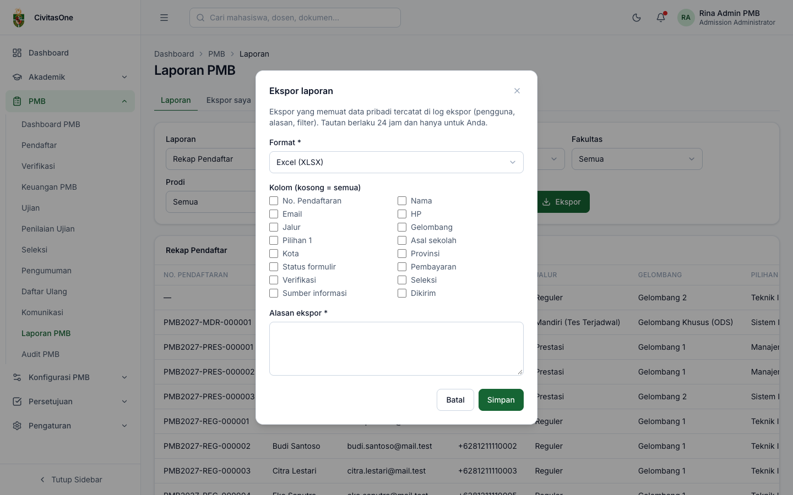
*Gambar 23.2 — Dialog ekspor laporan.*

> **Penting** — Ekspor berisi data pribadi **tercatat**; berkas hanya dapat diunduh pembuatnya dan **kedaluwarsa dalam 24 jam**; isi sel diawali `=`, `+`, `-`, `@` dinetralkan; ekspor dibatasi 10 kali per jam per pengguna. Pengguna ber-cakupan hanya melihat prodi dalam cakupannya.

> **Beda rancangan** — Laporan *Funnel* tersedia di Dashboard; *Perbandingan Periode* belum ada di layar.

---

## 24. Audit PMB

> **Untuk:** Auditor dan Administrator PMB (`pmb_audit.read`); **hanya baca**. **Menu:** **PMB → Audit PMB**.

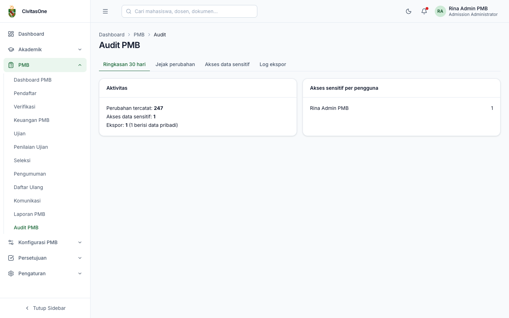
*Gambar 24.1 — Ringkasan audit 30 hari.*

| Tab | Isi | Filter |
|---|---|---|
| **Ringkasan 30 hari** | Jumlah perubahan, akses data sensitif, ekspor (yang berisi data pribadi), akses sensitif per pengguna | — |
| **Jejak perubahan** | Waktu, pengguna, aksi, objek, **alasan**; klik **Perubahan** untuk nilai **Sebelum**/**Sesudah** | Objek, ID objek, tanggal |
| **Akses data sensitif** | Waktu, pengguna, data dibuka, **tujuan**, IP | ID subjek, tanggal |
| **Log ekspor** | Waktu, pengguna, laporan & format, jumlah baris, alasan, data pribadi, status | Hanya data pribadi |

Perubahan status per pendaftar juga terlihat di tab **Linimasa** detail pendaftar. Gunakan ringkasan untuk mendeteksi pola akses tidak wajar (mis. akses sensitif berlebihan, ekspor di luar jam kerja).

---

# Bagian IV — Teknis dan Penanganan Masalah

## 25. Administrasi Sistem

> **Untuk:** administrator sistem/TI. Rincian teknis: [16 — Catatan Implementasi](../../pmb/16-catatan-implementasi.md) dan [bab 50 manual per bab](50-administrasi-sistem.md).

### 25.1 Prasyarat & pemasangan

| Komponen | Keterangan |
|---|---|
| Backend | Laravel (PHP). Kode PMB berjalan di PHP 8.3; `composer.lock` memuat `openspout` yang mensyaratkan PHP ≥ 8.4 — samakan versi PHP server atau perbarui lock |
| Database | MySQL/MariaDB; tabel berawalan `pmb_` |
| Frontend | React (Vite); `frontend/src/pmb` |
| Modul kampus | Modul **admission** harus aktif untuk kampus yang memakai PMB |

```bash
php artisan migrate
php artisan db:seed --class="Modules\\UserManagement\\Database\\Seeders\\RolePermissionSeeder"
php artisan db:seed --class="Modules\\UserManagement\\Database\\Seeders\\OrganizationalRoleSeeder"
php artisan pmb:install            # semua kampus (aman diulang)
php artisan pmb:install UND        # satu kampus (ID atau kode)
```

Lalu berikan peran kepada staf lewat **Pengaturan → Role Pengguna**.

### 25.2 Penjadwal

```cron
* * * * * cd /path/ke/civitasone && php artisan schedule:run >> /dev/null 2>&1
```

| Perintah | Jadwal | Tugas |
|---|---|---|
| `pmb:tick` | Tiap menit | Publikasi hasil, outbox notifikasi & efek samping, konversi, callback, polling gateway, kedaluwarsa transaksi & klaim, status gelombang, kirim otomatis CBT |
| `pmb:daily` | Harian 00:15 | Draf → batal, perbaikan/tagihan/daftar ulang kedaluwarsa, pengingat, heuristik duplikat, rekonsiliasi harian & kuota, snapshot statistik, penutupan periode, retensi, pembersihan OTP/idempotensi (`--only=<langkah>`) |

### 25.3 Variabel lingkungan & domain

| Variabel | Fungsi |
|---|---|
| `PMB_STORAGE_DISK` | Disk berkas PMB (default privat `local`) |
| `PMB_CAPTCHA_DRIVER`, `PMB_TURNSTILE_SITE_KEY`, `PMB_TURNSTILE_SECRET` | CAPTCHA (`none`/`turnstile`) |
| `XENDIT_SECRET_KEY`, `XENDIT_WEBHOOK_TOKEN` | Gateway Xendit (dipakai bersama modul Keuangan). URL callback *Invoices paid*: `<APP_URL>/api/v1/webhooks/xendit` |
| `PMB_SMS_DRIVER`, `PMB_SMS_HTTP_ENDPOINT`, `PMB_SMS_HTTP_TOKEN` | SMS/WA (`log` atau `http`) |
| `PMB_CBT_WEBHOOK_SECRET` | HMAC CBT eksternal |
| `PMB_FRONTEND_URL` | Alamat frontend untuk tautan email |
| `VITE_PMB_UNIVERSITY_CODE` (frontend) | Kode kampus default bila tidak dikenali dari domain |

Website PMB mengenali kampus dari **domain** terdaftar (menu platform **Manajemen Universitas**); alternatif `?kampus=KODE`. Domain yang salah petakan membuat pendaftar tercatat di kampus lain.

### 25.4 Keamanan & perawatan

- Data sensitif terenkripsi; **cadangkan `APP_KEY`** dengan aman (kehilangan kunci = data terenkripsi tidak terbaca).
- Aksi pembayaran & keputusan memakai `Idempotency-Key` (24 jam) sehingga klik ganda tidak menggandakan transaksi.
- Batas laju: halaman publik 60/menit/IP; cek status 5/menit; buat akun 5/jam; login 10/menit; unggah 20/menit; ekspor 10/jam.
- Pemindai antivirus bawaan (`NullVirusScanner`) belum memindai — pasang ClamAV/penyedia sebelum produksi.
- Cadangkan database dan disk berkas PMB secara berkala.

---

## 26. Penanganan Kendala Umum

### 26.1 Konfigurasi

| Pesan / gejala | Penyebab | Solusi |
|---|---|---|
| *"Semester masuk tidak ditemukan…"* / *"Tahun masuk PMB harus semester ganjil."* | Semester masuk belum ada/bukan ganjil | Buat semester ganjil tahun akademik masuk di modul Akademik |
| *"Tanggal tutup harus setelah tanggal buka."*, *"Batas bayar tidak boleh sebelum tanggal tutup pendaftaran."*, dll. | Urutan jadwal tidak konsisten | Ikuti urutan buka < tutup ≤ batas bayar ≤ batas perbaikan ≤ ujian ≤ pengumuman ≤ daftar ulang |
| *"Jalur ini sudah dibuka pada gelombang lain yang jadwalnya tumpang tindih (BR-02)."* | Jalur sama di dua gelombang berimpit | Ubah jadwal atau gunakan jalur lain |
| *"Template formulir harus berstatus published."* / *"Skema seleksi harus berstatus locked."* | Template/skema masih draf | Publikasikan template / kunci skema |
| *"Alasan perubahan wajib diisi karena pendaftaran sudah berjalan."* | Ubah jadwal/kuota/biaya/persyaratan setelah ada pendaftar | Isi alasan perubahan |
| *"Kapasitas tidak boleh di bawah jumlah yang sudah diterima (n)."* | Menurunkan kapasitas | Naikkan kapasitas atau batalkan penerimaan lewat prosedur resmi |
| *"Total persentase rencana cicilan harus 100%."* | JSON cicilan tidak berjumlah 100 | Perbaiki persen cicilan |
| **Publikasikan** periode menampilkan kekurangan | Daftar periksa belum terpenuhi | Lengkapi butir yang disebut ([bab 11](#11-publikasi-penutupan-dan-arsip-periode)) |
| Penyimpanan pengaturan gagal | JSON tidak valid | Periksa tanda kutip ganda, koma, kurung |
| Pendaftar tercatat di kampus lain | Domain dipetakan ke kampus yang salah | Periksa domain kampus ([§25.3](#253-variabel-lingkungan--domain)) |

### 26.2 Operasional

| Pesan / gejala | Penyebab | Solusi |
|---|---|---|
| *"Biaya pendaftaran belum lunas."* saat klaim | Pengaturan mewajibkan lunas | Tunggu pembayaran diverifikasi keuangan |
| Tombol **Verifikasi** nonaktif | `DOCUMENT_NOT_APPROVED:<kode>` / `PAYMENT_NOT_SATISFIED` | Tinjau dokumen yang disebut; pastikan lunas |
| *"Antrean kosong."* | Tidak ada pendaftaran siap untuk filter jalur | Ganti filter jalur atau periksa tab Antrean |
| *"Tanggal ujian harus dalam jendela ujian gelombang (I.2)."* | Tanggal di luar jendela | Sesuaikan tanggal/jendela, atau gunakan gelombang ODS |
| **Tempatkan otomatis** menyisakan peserta | Kapasitas sesi kurang | Tambah sesi/kapasitas, tempatkan lagi |
| Peserta tidak bisa dinilai | Status kehadiran bukan *Hadir* | Catat kehadiran di detail sesi |
| *"Bank soal belum tersedia."* | CBT tanpa soal | Tambah soal pada jadwal CBT |
| **Ajukan pengesahan** nonaktif | Skor seri di batas kuota | **Tetapkan urutan** kelompok seri |
| *"Pengaju tidak boleh memutuskan pengajuannya sendiri."* / *"…(pemisahan tugas)."* | Aturan SoD | Minta pejabat lain menyetujui |
| *"Pilihan prodi tidak dapat diubah setelah hasil seleksi ditetapkan."* | Mengubah pilihan setelah keputusan | Gunakan **Koreksi hasil** |
| *"Program studi/sistem kuliah ini tidak ditawarkan pada jalur ini."* | Kombinasi tidak ada di kuota yang ditawarkan | Pilih kombinasi yang ditawarkan atau tambah kuota |
| Konversi **Gagal** `USER_EMAIL_CONFLICT` | Email pendaftar dipakai akun lain | **Coba lagi** dengan email pengganti |
| Log notifikasi *Menunggu* dengan *"Kanal gagal: database"* | Kendala yang diketahui | Email tetap terkirim; laporkan ke tim pengembang |
| Status gelombang tidak berubah; notifikasi/konversi tidak berjalan | Penjadwal (cron) tidak aktif | Periksa cron `schedule:run` |

### 26.3 Pertanyaan pendaftar yang sering masuk

| Pertanyaan pendaftar | Jawaban/arahan panitia |
|---|---|
| Email verifikasi tidak masuk | Minta cek folder spam dan klik **Kirim ulang email verifikasi** di Beranda portal |
| Bukti transfer belum diverifikasi | Cek tab **Bukti manual**; target maks 1 hari kerja; pastikan nominal termasuk kode unik |
| Ingin bayar tunai | Arahkan ke loket dengan nomor tagihan; tagihan terbit setelah pendaftar membuka langkah Pembayaran |
| Salah menolak tawaran | **Pulihkan** daftar ulang (≤ 24 jam, dasar *Salah tolak*) |
| Kehilangan akses email & HP | Arahkan ke **Tidak bisa akses email?**; proses di **Verifikasi → Pemulihan akun** |
| Tanggal lahir/notifikasi tampak kosong | Jelaskan kendala tampilan yang diketahui; data tetap tersimpan |

---

## 27. Hal yang Perlu Dikonfirmasi, Perbedaan Rancangan, dan Kendala yang Diketahui

### 27.1 Perlu dikonfirmasi — ketergantungan pihak eksternal

| # | Hal | Status di aplikasi | Yang dibutuhkan |
|---|---|---|---|
| E1 | Gateway pembayaran (Xendit: VA/QRIS/e-wallet/ritel) | Adapter & webhook tersedia, diuji dengan respons tiruan; settlement tidak ditarik otomatis | Secret key & webhook token, uji di test mode Xendit. Tanpa itu hanya transfer manual & loket |
| E2 | SMS/WhatsApp | Driver `log` & `http` generik | Kontrak & API penyedia; aktifkan `pmb.sms.enabled` |
| E3 | CAPTCHA Turnstile | Terintegrasi; default nonaktif | Site key & secret |
| E4 | Antivirus berkas | Kontrak pemindai tersedia; bawaan belum memindai | ClamAV atau layanan pemindai |
| E5 | Integrasi CRM (MauKuliah) | Endpoint penerima *lead* | Spesifikasi API untuk sinkron dua arah |
| E6 | Tanda tangan elektronik LoA | PDF + QR verifikasi | Penyedia TTE tersertifikasi |
| E7 | CBT eksternal | Webhook HMAC | Spesifikasi penyedia |
| E8 | Versi PHP server | PHP 8.3 vs `openspout` ≥ 8.4 | Samakan versi atau perbarui lock |
| E9 | Format mutasi bank | Impor CSV/XLSX generik | Contoh mutasi bank kampus |
| E10 | Pelaporan PDDikti | Data lanjutan & laporan kelengkapan | Mekanisme Feeder/Neo Feeder di luar modul PMB |

### 27.2 Perlu dikonfirmasi — kebijakan kampus

| # | Kebijakan | Default aplikasi | Acuan rancangan |
|---|---|---|---|
| K1 | Maks pendaftaran aktif per periode | 1 | Q-CFG-05 (rekomendasi 2) |
| K2 | Pejabat pengesah langkah 2 | Peran *Pejabat Pengesah PMB* | Q-ANN-01 (rekomendasi WR I) |
| K3 | Format NIM | `{YY}{PRODI}{SEQ:4}` | Q-REG-01 |
| K4 | Kebijakan refund | Persetujuan Kepala Keuangan | Q-PAY-04 |
| K5 | Minimum bayar daftar ulang | Cicilan pertama | Q-PAY-05 |
| K6 | Batas perbaikan dokumen | 72 jam | Q-FRM-04 |
| K7 | Perpanjangan daftar ulang maks | 7 hari | Q-REG-04 |
| K8 | Promosi cadangan otomatis | Nonaktif | Q-SEL-05 |
| K9 | Status kuota di website | Tidak ditampilkan | Q-CFG-03 |
| K10 | Domain email institusi mahasiswa | Kosong (email pribadi) | Q-REG-06 |
| K11 | Retensi data pendaftar tidak diterima | 2 tahun | Q-PDP-03 |
| K12 | DPO & isi Kebijakan Privasi | Disediakan kampus | Q-PDP-01 |
| K13 | Persetujuan wali < 18 tahun | Belum ada isian/alur di formulir | Q-PDP-02 |

### 27.3 Kendala yang diketahui

| # | Kendala | Dampak | Penanganan sementara |
|---|---|---|---|
| B1 | Notifikasi dalam aplikasi pendaftar gagal disimpan (*"Kanal gagal: database"*) | Halaman Notifikasi portal kosong; email tetap terkirim | Pantau email & Beranda; usulan perbaikan: ID notifikasi ULID |
| B2 | Kolom **Tanggal lahir** tampak kosong di Profil & formulir | Membingungkan pendaftar; data aman | Jelaskan kepada pendaftar |
| B3 | Kunci jawaban CBT tidak tampil di bank soal | Admin harus isi ulang kunci saat ubah soal | Isi ulang **Kunci jawaban** |
| B4 | ID transaksi untuk refund tidak tampil (loket/gateway) | Refund loket/gateway sulit diajukan | Minta bantuan administrator sistem |
| B5 | Komponen lulus/tidak tampil `0.00` di tabel run | Dapat disalahartikan | Lihat **Matriks nilai** |
| B6 | Nama item cicilan berulang | Kosmetik | — |
| B7 | Penghitung langkah konversi `5/4` | Kosmetik | Acuan kolom **Status** |
| B8 | Beberapa kode sistem tampil apa adanya | Perlu tabel arti kode | [Lampiran B & C](#lampiran-b--daftar-status-dan-kode) |
| B9 | Contoh nomor pada **Cek Status** tidak sesuai format | Membingungkan | Format sebenarnya `PMB2027-REG-000001` |
| B10 | Antrean verifikasi menampilkan pendaftaran belum lunas | Tidak dapat diklaim | Lihat kolom **Bayar** |
| B11 | Beberapa dialog meminta ID teknis (pindah sesi, koreksi hasil, duplikat) | Perlu menyalin ID dari alamat halaman | Utamakan **Permintaan jadwal ulang** dan koreksi tanpa usulan |

### 27.4 Perbedaan rancangan dan implementasi (ringkas)

| Area | Rancangan | Implementasi |
|---|---|---|
| Formulir pendaftar | Simpan otomatis, unduh bukti pendaftaran, unggah *drag & drop* | Simpan per langkah; nomor pendaftaran di layar/email; tombol pilih berkas |
| Verifikasi | Pintasan keyboard, panel data–dokumen berdampingan, penampil dokumen dalam halaman | Tombol & tab; dokumen dibuka di tab baru |
| Tabel admin | Filter tersimpan, pilihan kolom, ekspor dari tabel | Filter dasar (konfigurasi kini punya baris filter); ekspor lewat Laporan |
| Dashboard | Per peran + perbandingan periode | Satu dashboard dibatasi izin; perbandingan belum di layar |
| Kuota | Matriks + impor/ekspor XLSX | Tabel baris + salin dari periode; mode batas per gelombang belum ada isiannya |
| Template & skema | *Drag*, pembuat kondisi visual, pratinjau langsung, simulasi dari unggahan | Angka urutan, JSON, pratinjau JSON, simulasi JSON |
| Ujian | Check-in kamera tablet + foto, beberapa strategi penempatan, simpan nilai otomatis | Token QR (pemindai sebagai keyboard), strategi nomor pendaftaran, tombol **Simpan nilai** |
| Persetujuan | Tampilan khusus PMB dengan aksi *kembalikan* | Halaman Persetujuan umum (**Setujui**, **Tolak**, **Delegasikan**) |
| Layanan bantuan | Tiket helpdesk | Chat dengan status & penanggung jawab + antrean Pemulihan akun |
| Konten | Brosur & template hasil dipakai | Belum ditampilkan/dipakai; brosur via Profil Prodi |
| Voucher | Fase 2 | Sudah tersedia |

Rincian lengkap: [lampiran 60](60-perbedaan-rancangan-implementasi.md) dan [lampiran 61](61-hal-perlu-konfirmasi.md).

---

## Lampiran A — Glosarium

| Istilah | Arti |
|---|---|
| Akun pendaftar | Akun portal PMB calon mahasiswa, terpisah dari akun staf/mahasiswa |
| Batch pengumuman | Jadwal publikasi keputusan suatu run |
| Cadangan | Pendaftar yang memenuhi ambang tetapi belum mendapat kursi |
| Gelombang-jalur | Jalur yang dibuka pada satu gelombang beserta biaya, template, skema, persyaratan |
| Hash hasil | Sidik jari SHA-256 hasil run untuk memastikan hasil yang disahkan sama dengan yang dihitung |
| Klaim | Penguncian sementara satu pendaftaran oleh verifikator (default 30 menit) |
| Kode unik | Tiga digit tambahan pada nominal transfer manual |
| Konversi | Pembentukan data mahasiswa, NIM, akun, tagihan, dokumen, beasiswa setelah daftar ulang disetujui |
| LoA | Surat penerimaan ber-QR verifikasi |
| ODS | *On Demand Schedule*, gelombang dengan jadwal ujian fleksibel |
| Outbox | Antrean efek samping (notifikasi, kartu ujian, LoA, konversi, ekspor) yang diproses penjadwal |
| Override | Perubahan rekomendasi hasil run oleh panitia, wajib alasan |
| Run seleksi | Satu kali perhitungan peringkat & penempatan untuk satu gelombang-jalur |
| SoD | *Separation of duties*, pemisahan tugas pengaju dan penyetuju |
| Data sensitif | Data pribadi terenkripsi & tersamar; membukanya wajib tujuan dan tercatat |
| BR-xx, FR-xx, ADM-xx, POR-xx, Q-xx | Kode aturan bisnis, kebutuhan, halaman, dan pertanyaan pada rancangan `docs/pmb` |

## Lampiran B — Daftar Status dan Kode

| Objek | Status (label → kode) |
|---|---|
| Tahap pendaftar | Melengkapi formulir `draft` · Menunggu pembayaran `awaiting_payment` · Sedang diverifikasi `under_verification` · Perlu perbaikan `revision_needed` · Tidak lolos administrasi `admin_rejected` · Proses seleksi `in_selection` · Hasil seleksi tersedia `result_available` · Daftar ulang `re_registration` · Daftar ulang tidak diselesaikan `re_registration_closed` · Resmi mahasiswa `enrolled` · Ditarik `withdrawn` · Tidak dikirim `void` |
| Formulir | Draf `draft` · Terkirim `submitted` · Perlu perbaikan `revision_requested` · Terkunci `locked` · Ditarik `withdrawn` · Batal `void` |
| Verifikasi | Belum diperiksa `not_started` · Diperiksa `in_review` · Perlu perbaikan `revision_requested` · Terverifikasi `verified` · Ditolak `rejected` |
| Seleksi peserta | Belum memenuhi syarat `not_eligible` · Siap seleksi `eligible` · Terjadwal `scheduled` · Dinilai `assessed` · Tidak hadir `absent` · Didiskualifikasi `disqualified` · Diperingkat `ranked` |
| Dokumen | Belum diunggah `missing` · Diunggah `uploaded` · Diperiksa `in_review` · Disetujui `approved` · Perlu perbaikan `revision_requested` · Ditolak `rejected` |
| Tagihan | Belum bayar `unpaid` · Menunggu `pending` · Sebagian `partially_paid` · Lunas `paid` · Kedaluwarsa `expired` · Dibatalkan `cancelled` · Refund diproses `refund_pending` · Dikembalikan `refunded` |
| Transaksi | Dibuat `created` · Menunggu `pending` · Berhasil `success` · Gagal `failed` · Kedaluwarsa `expired` · Dibatalkan `cancelled` · Dikembalikan `refunded` |
| Bukti transfer | Menunggu `submitted` · Disetujui `approved` · Ditolak `rejected` |
| Refund | Draf `draft` · Menunggu pengesahan `pending_approval` · Disetujui `approved` · Diproses `processing` · Selesai `completed` · Ditolak `rejected` · Gagal `failed` |
| Jadwal ujian | Draf `draft` · Terbit `published` · Selesai `completed` · Dibatalkan `cancelled` |
| Kehadiran | Terdaftar `registered` · Hadir `present` · Tidak hadir `absent` · Izin `excused` · Didiskualifikasi `disqualified` |
| Run seleksi | Draf `draft` · Dihitung `computed` · Ditinjau `under_review` · Menunggu pengesahan `pending_approval` · Disetujui `approved` · Ditolak `rejected` · Terbit `published` · Digantikan `superseded` · Gagal `failed` |
| Rekomendasi | Lulus `pass` · Cadangan `waitlist` · Tidak lulus `fail` |
| Keputusan | Diterima `accepted` · Cadangan `waitlisted` · Tidak diterima `rejected` · Dibatalkan `withdrawn` |
| Batch publikasi | Terjadwal `scheduled` · Menerbitkan `publishing` · Terbit `published` · Gagal `failed` · Dibatalkan `cancelled` |
| LoA | `pending` · Terbit `issued` · Dicabut `revoked` |
| Daftar ulang | Menunggu konfirmasi `awaiting_confirmation` · Dikonfirmasi `confirmed` · Berlangsung `in_progress` · Terkirim `submitted` · Perlu perbaikan `revision_requested` · Disetujui `approved` · Resmi mahasiswa `enrolled` · Menolak tawaran `declined` · Kedaluwarsa `expired` · Dibatalkan `cancelled` |
| Pemeriksaan daftar ulang | Menunggu `pending` · Lolos `passed` · Tidak lolos `failed` · Tidak berlaku `not_applicable` |
| Konversi | Menunggu `pending` · Diproses `processing` · Berhasil `succeeded` · Gagal `failed` · Perlu tindakan `manual_intervention` |
| Periode | Draf `draft` · Terbit `published` · Ditutup `closed` · Diarsipkan `archived` |
| Gelombang | Draf `draft` · Terjadwal `scheduled` · Dibuka `open` · Ditutup `closed` · Diumumkan `announced` · Selesai `completed` |
| Template / skema | Template: Draf · Terbit · Pensiun; Skema: Draf · Terkunci |
| Akun pendaftar | Belum verifikasi `unverified` · Aktif `active` · Terkunci `locked` · Dibekukan `suspended` · Nonaktif `deactivated` |
| Pengajuan perubahan | Menunggu pengesahan `pending_approval` · Disetujui `approved` · Ditolak `rejected` · Dikembalikan `returned` · Diterapkan `applied` · Gagal `failed` |

Kode pemeriksaan daftar ulang: `OFFER_ACCEPTED`, `PDDIKTI_DATA_COMPLETE`, `GUARDIAN_DATA_COMPLETE`, `FINAL_DOCUMENTS_APPROVED`, `HEALTH_CLEARED`, `PAYMENT_MINIMUM_MET`, `ORIGINAL_DOCUMENTS_CHECKED`, `NO_OPEN_DUPLICATE_FLAG`. Hasil rekonsiliasi: `matched`, `missing_in_system`, `missing_in_provider`, `amount_mismatch`, `duplicate_payment`.

## Lampiran C — Kode Alasan

| Konteks | Kode |
|---|---|
| Penolakan administrasi | `INELIGIBLE_EDUCATION` (pendidikan tidak memenuhi), `INELIGIBLE_AGE` (usia), `FALSIFIED_DATA` (data dipalsukan), `DUPLICATE_APPLICATION` (pendaftaran ganda), `INCOMPLETE_AFTER_REVISION` (tidak lengkap setelah perbaikan), `OTHER` |
| Tinjauan dokumen | `UNREADABLE`, `WRONG_DOCUMENT`, `INCOMPLETE_PAGES`, `EXPIRED`, `NAME_MISMATCH`, `DATA_MISMATCH`, `NOT_LEGALIZED`, `SUSPECTED_FORGERY` (pendaftar hanya melihat pesan umum), `PHOTO_NOT_COMPLIANT`, `OTHER` |
| Penolakan bukti transfer | `NOT_FOUND_IN_STATEMENT`, `AMOUNT_MISMATCH`, `UNREADABLE`, `DUPLICATE_PROOF`, `OTHER` |
| Refund | `DUPLICATE_PAYMENT`, `PERIOD_CANCELLED`, `WITHDRAWAL`, `LATE_PAYMENT`, `OVERPAYMENT`, `POLICY`, `OTHER` |
| Tidak lulus seleksi | `below_threshold`, `component_minimum`, `absent`, `quota_full_no_waitlist`, `disqualified`, `incomplete_scores` |
| Belum dapat diverifikasi | `DOCUMENT_NOT_APPROVED:<KODE>`, `PAYMENT_NOT_SATISFIED` |
| Konversi | `USER_EMAIL_CONFLICT` (email dipakai akun lain) |

## Lampiran D — Kartu Tugas Ringkas per Peran

| Peran | Rutinitas utama | Menu | Jangan lupa |
|---|---|---|---|
| **Administrator PMB** | Konfigurasi & publikasi periode; konten legal; pantau dashboard; tugaskan verifikator; pendaftaran loket; langkah 1 pengesahan; promosi cadangan; perpanjangan; konversi gagal; broadcast | Konfigurasi PMB, PMB → (semua), Persetujuan | Alasan perubahan setelah ada pendaftar; Kebijakan Privasi & Ketentuan terbit sebelum publikasi |
| **Petugas Verifikasi** | **Ambil berikutnya** → tinjau dokumen → Verifikasi / Minta perbaikan / Tolak | PMB → Verifikasi, Pendaftar | Klaim 30 menit; kode alasan & catatan untuk pendaftar; konflik kepentingan |
| **Petugas Keuangan** | Putuskan bukti transfer (cocokkan mutasi + kode unik), catat loket, rekonsiliasi, ajukan refund | PMB → Keuangan PMB | Tidak menyetujui refund/daftar ulang yang bukti bayarnya Anda verifikasi |
| **Kepala Keuangan** | Setujui/tolak refund | Persetujuan | Pengaju ≠ penyetuju |
| **Panitia Seleksi** | Skema & kunci; jadwal ujian & publikasi; kunci nilai; impor nilai; run → tinjau → override/seri → ajukan; beasiswa; koreksi hasil | Konfigurasi PMB → Skema Seleksi, PMB → Ujian, Seleksi, Pengumuman | Pengaju tidak dapat mengesahkan; seri di batas kuota harus diputuskan |
| **Penguji/Pengawas** | Check-in peserta; isi & **Simpan nilai** | PMB → Penilaian Ujian (dan detail sesi) | Hanya peserta Hadir yang dapat dinilai |
| **Pejabat Pengesah** | Tinjau run → **Setujui**/**Tolak**; koreksi, perpanjangan massal, percepatan publikasi | Persetujuan, PMB → Seleksi (baca) | Tolak dengan alasan yang jelas |
| **Petugas Daftar Ulang** | Prioritaskan *Terkirim*; **Tandai** dokumen asli; **Setujui** / **Minta perbaikan**; pantau konversi | PMB → Daftar Ulang | Semua butir harus lolos; SoD bukti bayar biaya awal |
| **Pimpinan, Dekan/Kaprodi** | Pantau dashboard & laporan; ubah profil prodi (dekan/kaprodi) | PMB → Dashboard, Laporan; Konfigurasi PMB → Profil Prodi | Ekspor berisi data pribadi tercatat |
| **Auditor** | Tinjau jejak perubahan, akses sensitif, log ekspor | PMB → Audit PMB | Hanya baca |
| **Administrator Sistem** | Migrasi, seeder, `pmb:install`, cron, `.env`, cadangan | Server | Cadangkan `APP_KEY`; pasang antivirus |

## Lampiran E — Peta Bab ke Video Tutorial

Video: [`tutorial-pmb-penyelenggara.mp4`](../../video-tutorial-pmb/tutorial-pmb-penyelenggara.mp4). Waktu = posisi awal bagian di video.

| Bab manual | Bagian video | Mulai |
|---|---|---:|
| 1–2. Pengenalan, peran | Pembuka; Peran & Tugas | 0:00 |
| 3. Alur kerja | Alur Kerja Panitia | 1:38 |
| 2.1 Login & menu | Masuk & Menu PMB | 2:35 |
| 4. Master data | Konfigurasi: Master Data | 3:08 |
| 5. Template formulir | Konfigurasi: Template Formulir | 3:43 |
| 6. Skema seleksi | Konfigurasi: Skema Seleksi | 4:18 |
| 7. Periode & gelombang | Konfigurasi: Periode & Gelombang; Membuka Jalur | 5:05 |
| 8. Persyaratan, kuota, biaya | Konfigurasi: Membuka Jalur; Kuota & Biaya | 5:53 |
| 9–11. Konten, pengaturan, publikasi | Konten, Pengaturan & Publikasi | 7:08 |
| 12. Dashboard | Dashboard PMB | 7:51 |
| 13. Data pendaftar | Data Pendaftar | 8:19 |
| 14. Verifikasi | Verifikasi Administrasi | 9:08 |
| 15. Keuangan | Keuangan PMB | 10:23 |
| 16. Ujian | Ujian Seleksi | 11:19 |
| 17. Penilaian | Penilaian Ujian | 12:07 |
| 18. Proses seleksi | Proses Seleksi | 12:40 |
| 19. Pengesahan | Pengesahan Hasil | 13:26 |
| 20. Pengumuman | Pengumuman & Keputusan | 13:58 |
| 21. Daftar ulang & konversi | Daftar Ulang & Konversi | 14:39 |
| 22. Komunikasi | Komunikasi | 15:28 |
| 23–24. Laporan & audit | Laporan & Audit | 15:57 |
| 26. Kendala umum | Kendala Umum | 16:36 |
| 27. Perlu dikonfirmasi | Perlu Dikonfirmasi Kampus | 17:24 |
| Lampiran D | Ringkasan | 18:00 |
