# Manual Book Modul Penerimaan Mahasiswa Baru (PMB) — Civitas One

| | |
|---|---|
| **Versi dokumen** | 1.0 |
| **Tanggal** | 14 Oktober 2026 |
| **Acuan rancangan** | [`docs/pmb/01`–`16`](../../pmb/), terutama 03–09, 12, dan [16 — Catatan Implementasi](../../pmb/16-catatan-implementasi.md) |
| **Acuan implementasi** | Kode aplikasi Civitas One cabang `feature/pmb-admission` (backend `app/Modules/Admission`, frontend `frontend/src/pmb`) |
| **Pembaca** | Calon mahasiswa (pendaftar), operator/panitia PMB, verifikator, petugas keuangan, panitia seleksi, penguji/pengawas ujian, petugas daftar ulang, pejabat pengesah, pimpinan, auditor, dan administrator sistem |

Manual ini menjelaskan **cara memakai** setiap menu dan fitur Modul PMB Civitas One sesuai peran pengguna: langkah kerja, arti field penting, alur proses, dan status yang akan dijumpai. Isi manual disusun dari dokumen rancangan PMB dan **dicocokkan dengan aplikasi yang sudah berjalan**. Bila rancangan dan aplikasi berbeda, perbedaannya dicatat (lihat [Perbedaan Rancangan dan Implementasi](60-perbedaan-rancangan-implementasi.md)). Bila informasi belum tersedia, ditandai **perlu konfirmasi** (lihat [Hal yang Perlu Dikonfirmasi](61-hal-perlu-konfirmasi.md)).

---

## Mulai dari mana?

| Saya adalah… | Baca bagian |
|---|---|
| **Calon mahasiswa / pendaftar** | [Bagian A — Panduan Pendaftar](#bagian-a--panduan-calon-mahasiswa-pendaftar) (mulai dari [Website PMB](10-website-pmb.md) dan [Akun Pendaftar](11-akun-pendaftar.md)) |
| **Administrator PMB** (mengatur periode, jalur, biaya, konten) | [Pengenalan](01-pengenalan.md), [Akses & Peran](02-akses-dan-peran.md), [Alur Kerja Panitia](03-alur-kerja-panitia.md), lalu [Bagian B — Konfigurasi](#bagian-b--konfigurasi-pmb-administrator-pmb) |
| **Operator / verifikator berkas** | [Data Pendaftar](31-data-pendaftar.md), [Verifikasi Administrasi](32-verifikasi-administrasi.md) |
| **Petugas keuangan** | [Keuangan PMB](33-keuangan-pmb.md) |
| **Panitia ujian, penguji, pengawas** | [Ujian Seleksi](34-ujian-seleksi.md), [Penilaian Ujian](35-penilaian-ujian.md) |
| **Panitia seleksi** | [Skema Seleksi](23-skema-seleksi.md), [Proses Seleksi & Pengesahan](36-proses-seleksi-dan-pengesahan.md), [Pengumuman & Keputusan](37-pengumuman-dan-keputusan.md) |
| **Pejabat pengesah / kepala keuangan** | [Pengesahan (menu Persetujuan)](36-proses-seleksi-dan-pengesahan.md#7-pengesahan-oleh-pejabat-menu-persetujuan) |
| **Petugas daftar ulang** | [Daftar Ulang & Konversi Mahasiswa](38-daftar-ulang-dan-konversi.md) |
| **Pimpinan, dekan, kaprodi** | [Dashboard PMB](30-dashboard-pmb.md), [Laporan](40-laporan.md) |
| **Auditor** | [Audit PMB](41-audit.md) |
| **Administrator sistem / TI** | [Administrasi Sistem](50-administrasi-sistem.md) |

---

## Daftar isi

### Bagian umum

1. [Pengenalan Modul PMB](01-pengenalan.md): cakupan, tiga wajah aplikasi, konsep kunci, alur besar
2. [Akses, Peran, dan Hak Akses](02-akses-dan-peran.md): alamat akses, login, peran & menu, pemisahan tugas, data sensitif
3. [Alur Kerja & Kalender Panitia](03-alur-kerja-panitia.md): urutan pekerjaan dari persiapan sampai penutupan periode

### Bagian A — Panduan Calon Mahasiswa (Pendaftar)

10. [Website PMB](10-website-pmb.md): beranda, prodi, jalur, biaya, jadwal, FAQ, cek status, verifikasi surat penerimaan
11. [Akun Pendaftar](11-akun-pendaftar.md): daftar akun, verifikasi, masuk, lupa sandi, pemulihan akun
12. [Portal & Formulir Pendaftaran](12-formulir-pendaftaran.md): beranda portal, profil, memilih jalur, mengisi formulir, mengirim
13. [Dokumen & Pembayaran](13-dokumen-dan-pembayaran.md): unggah dokumen, tagihan, transfer manual, loket, voucher, perbaikan
14. [Ujian & CBT](14-ujian-dan-cbt.md): kartu peserta, mengerjakan CBT, jadwal ulang
15. [Hasil Seleksi & Daftar Ulang](15-hasil-dan-daftar-ulang.md): melihat hasil, surat penerimaan, menerima/menolak tawaran, daftar ulang, NIM
16. [Pesan, Notifikasi, dan Akun](16-pesan-notifikasi-akun.md): bertanya ke panitia, notifikasi, keamanan akun, unduh data pribadi

### Bagian B — Konfigurasi PMB (Administrator PMB)

20. [Periode, Gelombang, Kuota, dan Biaya](20-periode-gelombang-kuota-biaya.md)
21. [Master Data: Jalur Masuk, Sistem Kuliah, Jenis Dokumen](21-master-data.md)
22. [Template Formulir](22-template-formulir.md)
23. [Skema Seleksi](23-skema-seleksi.md)
24. [Konten Website & Profil Prodi](24-konten-website-profil-prodi.md)
25. [Pengaturan PMB, Format NIM, dan Voucher](25-pengaturan-pmb.md)

### Bagian C — Operasional Panitia

30. [Dashboard PMB](30-dashboard-pmb.md)
31. [Data Pendaftar](31-data-pendaftar.md)
32. [Verifikasi Administrasi](32-verifikasi-administrasi.md)
33. [Keuangan PMB](33-keuangan-pmb.md)
34. [Ujian Seleksi](34-ujian-seleksi.md)
35. [Penilaian Ujian](35-penilaian-ujian.md)
36. [Proses Seleksi & Pengesahan](36-proses-seleksi-dan-pengesahan.md)
37. [Pengumuman & Keputusan](37-pengumuman-dan-keputusan.md)
38. [Daftar Ulang & Konversi Mahasiswa](38-daftar-ulang-dan-konversi.md)
39. [Komunikasi](39-komunikasi.md)
40. [Laporan PMB](40-laporan.md)
41. [Audit PMB](41-audit.md)

### Bagian D — Administrator Sistem

50. [Administrasi Sistem: instalasi, data awal, penjadwal, lingkungan](50-administrasi-sistem.md)

### Lampiran

60. [Perbedaan Rancangan dan Implementasi](60-perbedaan-rancangan-implementasi.md)
61. [Hal yang Perlu Dikonfirmasi & Kendala yang Diketahui](61-hal-perlu-konfirmasi.md)
62. [FAQ & Pemecahan Masalah](62-faq-dan-pemecahan-masalah.md)
63. [Glosarium & Daftar Status](63-glosarium-status.md)

---

## Konvensi penulisan

| Penulisan | Arti |
|---|---|
| **Daftar Sekarang** | Nama tombol, menu, tab, atau label yang tampil di layar, ditulis persis seperti di aplikasi. |
| **PMB → Verifikasi** | Jalur menu: buka grup menu **PMB** di sidebar, lalu klik **Verifikasi**. |
| `PMB2027-REG-000001` | Nilai, kode, atau alamat (URL) yang diketik/ditampilkan apa adanya. |
| `pmb_verification.approve` | Nama izin (*permission*) sistem, dipakai untuk administrator yang mengatur peran. |
| > **Catatan** | Informasi tambahan yang membantu. |
| > **Penting** | Hal yang berdampak pada data atau tidak dapat dibatalkan. |
| > **Beda rancangan** | Perilaku aplikasi berbeda dari dokumen rancangan; rincian di [lampiran 60](60-perbedaan-rancangan-implementasi.md). |
| > **Perlu konfirmasi** | Informasi/kebijakan belum final atau bergantung pada pihak eksternal; rincian di [lampiran 61](61-hal-perlu-konfirmasi.md). |

## Tentang gambar (screenshot)

Semua gambar diambil dari **aplikasi yang benar-benar berjalan** (bukan desain/mockup) pada lingkungan lokal pengujian dengan **data demo fiktif** kampus *Universitas Nusantara Digital* (kode `UND`), pada tanggal 14 Oktober 2026 dengan zona waktu WIB. Nama pendaftar, nilai, dan nominal pada gambar hanyalah contoh. Pada data demo, nama fakultas pada beberapa prodi diacak oleh *seeder* contoh (misalnya "Teknik Informatika · Fakultas Kedokteran"); ini bukan perilaku aplikasi.

Tampilan di kampus Anda dapat sedikit berbeda karena logo, warna, konten, jalur, biaya, dan pengaturan yang dikonfigurasi masing-masing kampus.

## Ringkasan alur PMB

```mermaid
flowchart LR
  A[Konfigurasi<br/>periode, jalur, kuota, biaya] --> B[Publikasi<br/>website PMB]
  B --> C[Pendaftar buat akun<br/>& isi formulir]
  C --> D[Bayar biaya<br/>pendaftaran]
  D --> E[Verifikasi<br/>administrasi]
  E --> F[Ujian / penilaian]
  F --> G[Run seleksi]
  G --> H[Pengesahan<br/>berjenjang]
  H --> I[Pengumuman<br/>terjadwal]
  I --> J[Daftar ulang<br/>& bayar biaya awal]
  J --> K[Konversi menjadi<br/>mahasiswa + NIM]
```

Penjelasan lengkap ada di [Pengenalan Modul PMB](01-pengenalan.md#4-alur-besar-pmb).
