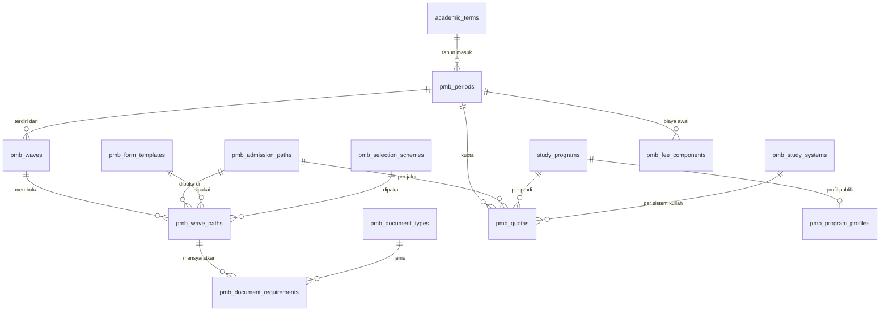

# 03 — Spesifikasi Modul A (Konfigurasi PMB) dan B (Website PMB)

[← Kembali ke dokumen utama](../RANCANGAN_SISTEM_PENERIMAAN_MAHASISWA_BARU_PMB.md)

Label: **[E]** eksplisit · **[I]** inferensi · **[R]** rekomendasi · **[K]** perlu konfirmasi. Business rules (BR-xx) didefinisikan di [dokumen utama §12](../RANCANGAN_SISTEM_PENERIMAAN_MAHASISWA_BARU_PMB.md#12-business-rules).

---

# A. Konfigurasi dan Manajemen PMB

## A.1 Tujuan dan aktor

**Tujuan:** memungkinkan Administrator PMB menyiapkan seluruh parameter penerimaan satu periode tanpa developer, dengan perlindungan agar perubahan tidak merusak pendaftar yang sudah ada.

| Aktor | Peran di modul A |
|---|---|
| `pmb_admin` | Membuat & memublikasikan periode, gelombang, jalur, kuota, biaya, persyaratan, template |
| `selection_committee` | Menyusun & mengunci skema seleksi |
| `program_admin` | Mengelola profil prodi untuk website (deskripsi, akreditasi, prospek) di prodinya |
| `finance_officer` | Mengusulkan/melihat komponen biaya (perubahan biaya disahkan `pmb_admin`) |
| `leadership`, `auditor` | Baca |

## A.2 Hubungan antarentitas konfigurasi

Penjelasan:

* **Periode** = satu siklus PMB untuk satu tahun akademik masuk (mis. "PMB 2027/2028"), mengacu `academic_terms` (semester ganjil tahun masuk).
* **Gelombang** = jendela waktu dalam periode (Gelombang 1, 2, 3, ODS). Membawa seluruh tanggal tahapan.
* **Jalur** = master lintas periode (Reguler, Prestasi, KIP-K, Pindahan, Pascasarjana, RPL, ...).
* **Gelombang-jalur (`pmb_wave_paths`)** = titik konfigurasi operasional: jalur X dibuka di gelombang Y dengan biaya pendaftaran, waktu bayar, jumlah pilihan prodi, template formulir (versi), skema seleksi (versi), dan persyaratan dokumen.
* **Kuota** = per periode × jalur × prodi × sistem kuliah. Sebuah prodi ditawarkan pada jalur bila baris kuota ada dan `is_offered = true`.
* **Komponen biaya awal** = tarif daftar ulang per periode × prodi × sistem kuliah [× jalur].

## A.3 Kebutuhan fungsional

### FR-CFG-01 Tahun akademik dan periode PMB [R]

| Aspek | Spesifikasi |
|---|---|
| Fungsi | CRUD periode: `code` (unik per tenant, mis. `PMB2027`), `name`, `entry_academic_term_id` (FK `academic_terms`), `starts_on`, `ends_on`, `status`, `description`. |
| Status | `draft` → `published` → `closed` → `archived`. Hanya `published` yang tampil di website. |
| Validasi | `ends_on > starts_on`; `entry_academic_term_id` wajib dan semester `odd` (ganjil) kecuali tenant mengizinkan penerimaan semester genap [K]; maksimal satu periode `published` per `entry_academic_term_id`. |
| Tahun akademik | Tidak dibuat tabel baru; memakai `academic_terms` yang sudah ada. Bila term belum ada, Admin PMB diarahkan ke halaman Akademik (permission `academic_terms.manage`) — PMB tidak membuat term sendiri. |
| Efek | Publish memvalidasi kelengkapan: ≥ 1 gelombang, ≥ 1 gelombang-jalur dengan template formulir published, ≥ 1 kuota `is_offered`. |
| Close | Otomatis oleh job saat semua gelombang `closed` dan `ends_on` lewat, atau manual. Setelah `closed`, tidak ada aplikasi baru; proses daftar ulang yang sedang berjalan tetap dapat selesai. |
| Archive | Hanya bila tidak ada `pmb_re_registrations` non-terminal dan tidak ada `pmb_student_conversions` `pending/processing/failed`. |

### FR-CFG-02 Gelombang dan jadwal tahapan [E]

| Field | Tipe | Wajib | Validasi |
|---|---|---|---|
| `code`, `name` | string | Ya | `code` unik per periode |
| `sequence` | smallint | Ya | urutan tampilan |
| `registration_opens_at` | timestampTz | Ya | ≥ `period.starts_on` |
| `registration_closes_at` | timestampTz | Ya | > opens |
| `payment_deadline_at` | timestampTz | Ya | ≥ closes (tagihan pendaftaran kedaluwarsa setelah ini) |
| `form_lock_at` | timestampTz | Ya | ≥ payment_deadline; batas akhir perbaikan dokumen |
| `exam_starts_on`, `exam_ends_on` | date | Bila ada jalur berujian | ≥ form_lock (tanggal) |
| `announcement_at` | timestampTz | Ya | ≥ exam_ends_on |
| `re_registration_opens_at`, `re_registration_closes_at` | timestampTz | Ya | ≥ announcement_at; closes > opens |
| `is_ods` | boolean | Ya, default false | Bila true, semua tanggal boleh di hari yang sama (FR-SPC-07) |
| `status` | string | Ya | `draft`, `scheduled`, `open`, `closed`, `announced`, `completed` |

Aturan: BR-02 (urutan tanggal & tidak tumpang tindih untuk jalur yang sama), BR-03 (perubahan setelah ada pendaftar). Transisi `scheduled → open → closed` otomatis oleh scheduler berdasarkan tanggal; `announced` saat batch pengumuman terbit; `completed` saat `re_registration_closes_at` lewat dan semua daftar ulang terminal.

### FR-CFG-03 Jalur masuk [E]

| Field | Keterangan |
|---|---|
| `code`, `name`, `description` | Master lintas periode |
| `category` | `regular`, `achievement`, `kip_affirmation`, `transfer`, `postgraduate`, `rpl`, `scholarship`, `partnership`, `international`, `other` |
| `eligible_degree_levels` | json array jenjang (`D3`, `S1`, `S2`, `S3`, ...) — memfilter prodi yang dapat dipilih |
| `requires_exam` | boolean default untuk wave path |
| `requires_previous_institution` | true untuk `transfer`, `rpl`, `postgraduate` (memunculkan seksi riwayat PT) |
| `is_active` | Nonaktif = tidak dapat dibuka di gelombang baru; tidak memengaruhi yang sudah dibuka |

Jalur yang dipakai di gelombang manapun tidak dapat dihapus (hanya dinonaktifkan).

### FR-CFG-04 Gelombang-jalur [I]

Membuka jalur pada gelombang. Field: `wave_id`, `admission_path_id`, `registration_fee` (decimal, ≥ 0), `payment_timing` (`before_submit`/`after_submit`, BR-14), `max_choices` (1–5), `allow_cross_system_choice` (bool), `form_template_id` (versi **published**), `selection_scheme_id` (versi **locked**, boleh null sampai sebelum `registration_closes_at`, wajib sebelum seleksi), `quota_mode` (`period` default / `wave_cap`), `is_open` (switch manual darurat), `public_notes`.

Validasi: kombinasi (`wave_id`, `admission_path_id`) unik; template harus `published`; skema harus `locked` saat gelombang `closed` (job memeriksa & memberi peringatan H-3).

### FR-CFG-05 Fakultas, prodi, dan profil prodi publik [E]

* Fakultas & prodi **tidak** dikelola di PMB; memakai `faculties`/`study_programs` (modul Akademik).
* PMB menambah `pmb_program_profiles` (1:1 dengan prodi): `slug`, `summary`, `description` (rich text, disanitasi), `accreditation_label`, `accreditation_valid_until`, `career_prospects`, `degree_title` (gelar), `study_duration`, `cover_file_id`, `brochure_file_id`, `is_published`.
* `program_admin` hanya dapat mengubah profil prodi dalam scope-nya; publikasi oleh `pmb_admin` [R].

### FR-CFG-06 Sistem kuliah [E]

Master `pmb_study_systems`: `code` (`REG`, `KAR`, `DAR`...), `name`, `schedule_note` (mis. "Sabtu–Minggu"), `is_active`. Dipakai di kuota, pilihan prodi, dan tarif.

### FR-CFG-07 Kuota [I]

| Field | Keterangan |
|---|---|
| `period_id`, `admission_path_id`, `study_program_id`, `study_system_id` | Kunci unik |
| `capacity` | Kursi yang dapat diterima (≥ 0) |
| `waitlist_capacity` | Maksimal cadangan (≥ 0, default 0 = tanpa batas di ranking, tetapi cadangan hanya diumumkan sampai batas ini) |
| `min_final_score` | Ambang skor akhir khusus prodi (nullable, menimpa ambang skema) |
| `wave_caps` | json opsional `{wave_id: cap}` bila `quota_mode = wave_cap` |
| `accepted_count` | Denormalisasi: jumlah keputusan `accepted` aktif yang belum `declined/expired` (diperbarui dalam transaksi ber-lock, KD-11) |
| `is_offered` | Prodi ditawarkan pada jalur ini |

Aturan: BR-05; kapasitas tidak boleh diturunkan di bawah `accepted_count` (BR-03). Perubahan kuota setelah gelombang terbuka wajib alasan & tercatat audit.

### FR-CFG-08 Persyaratan dokumen [E]

* `pmb_document_types` (katalog per tenant): `code`, `name`, `description`, `allowed_mime_types` (json), `max_size_kb`, `requires_original_check` (bool, verifikasi fisik saat daftar ulang), `is_sensitive` (mis. KTP/KK), `retention_class` (`applicant`, `student_record`).
* `pmb_document_requirements`: `wave_path_id`, `document_type_id`, `stage` (`application`/`re_registration`), `is_mandatory`, `condition` (json rule — mis. hanya bila `nationality = WNA`, atau `has_achievement = true`), `instructions`, `sort_order`.
* Katalog default: [04 §E.2](04-spesifikasi-akun-formulir-dokumen.md#e2-katalog-dokumen-default).

### FR-CFG-09 Biaya pendaftaran, biaya pendidikan awal, dan brosur [E]

* Biaya pendaftaran: di `pmb_wave_paths.registration_fee`.
* Biaya awal: `pmb_fee_components` — `period_id`, `study_program_id`, `study_system_id`, `admission_path_id` (nullable = berlaku semua jalur), `component_code` (mis. `DPP`, `SPP_SEM1`, `ALMAMATER`, `PKKMB`), `name`, `amount`, `is_mandatory_for_enrollment` (harus lunas sebelum persetujuan final), `installable` (bool), `installment_plan` (json: jumlah termin, persentase, jatuh tempo relatif), `is_published` (tampil di website).
* Prioritas tarif: baris dengan `admission_path_id` spesifik menimpa baris umum untuk `component_code` yang sama.
* Brosur: file PDF di `pmb_contents` tipe `brochure` (per periode/prodi).
* Potongan beasiswa/KIP diterapkan saat tagihan biaya awal dibuat (FR-REG-05), bukan di master tarif.

### FR-CFG-10 Template formulir berversi [R]

* `pmb_form_templates`: `code`, `name`, `version` (int), `status` (`draft`/`published`/`retired`), `published_at`, `based_on_id`.
* `pmb_form_fields`: definisi field tambahan (lihat [04 §D.3](04-spesifikasi-akun-formulir-dokumen.md#d3-mesin-formulir-dinamis)). Field inti (identitas, pendidikan, pilihan) selalu ada dan hanya dapat diatur wajib/opsional/tersembunyi melalui `core_field_rules` (json) — bukan dihapus.
* Template `published` tidak dapat diedit (BR-06); tombol "Buat versi baru" menyalin ke `draft` versi + 1.
* Aplikasi menyimpan `form_template_id` versi yang dipakai saat dibuat; mengganti template di wave path hanya memengaruhi aplikasi **baru** yang belum dibuat (BR-03).

### FR-CFG-11 Skema seleksi berversi [R]

Didefinisikan di [06 §H.3](06-spesifikasi-seleksi-ujian-pengumuman.md#h3-skema-seleksi-dan-komponen). Status: `draft` → `locked` → `retired`. Hanya `selection_committee` dan `pmb_admin` yang dapat mengunci; skema terkunci tidak dapat diedit.

### FR-CFG-12 Template pengumuman/notifikasi dan pengaturan tahapan [R]

* Template notifikasi memakai `notification_templates` (tenant, `event_key`, `channel`) dengan event berawalan `pmb.` (daftar di [13 §A.2](13-notifikasi-keamanan-nonfungsional.md#a2-katalog-event-notifikasi)).
* Template pengumuman hasil & LoA: konten Blade-safe (placeholder terbatas `{{applicant_name}}`, `{{registration_number}}`, `{{program_name}}`, `{{deadline}}`, ...) disimpan di `pmb_contents` tipe `result_template` / `loa_template`, berversi.
* Pengaturan tahapan per tenant (`university_settings` grup `pmb.*`): `pmb.max_active_applications_per_period`, `pmb.allow_multi_path_per_period`, `pmb.revision_window_hours`, `pmb.re_registration_extension_max_days`, `pmb.enrollment_min_payment` (`full`/`first_installment`), `pmb.retention_years_applicant`, `pmb.nim_format`, `pmb.verification_requires_payment`, `pmb.otp_channel`, `pmb.payment.channels`.
* Status & tahapan **tidak** dapat dikustomisasi bebas (state machine adalah kode) — tenant hanya dapat mengubah **label tampilan** status untuk pendaftar [R]. Alasan: transisi status terikat aturan integritas.

## A.4 Dampak perubahan konfigurasi terhadap pendaftar yang sudah ada

| Perubahan | Sebelum ada aplikasi `submitted` | Setelah ada aplikasi `submitted` |
|---|---|---|
| Perpanjang `registration_closes_at` | Bebas | Diizinkan, wajib alasan, notifikasi ke pendaftar draft |
| Majukan `registration_closes_at` | Bebas | **Ditolak** |
| Ubah tanggal ujian/pengumuman | Bebas | Diizinkan dengan alasan; notifikasi ke peserta terdampak; tanggal tetap harus berurutan (BR-02) |
| Ubah biaya pendaftaran | Bebas | **Ditolak**. Tagihan yang sudah terbit tetap memakai nominal lama (nominal disalin ke `pmb_invoices`) |
| Tambah dokumen wajib | Bebas | **Ditolak** untuk tahap `application`; boleh untuk tahap `re_registration` hingga `announcement_at` |
| Ganti template formulir | Bebas | Hanya untuk aplikasi baru; aplikasi lama tetap versi lama |
| Ganti/ubah skema seleksi | Bebas | Ganti versi diizinkan **sebelum** `selection_run` pertama `computed`; setelahnya ditolak |
| Turunkan kuota | Bebas | Ditolak bila < `accepted_count` |
| Nonaktifkan prodi di kuota (`is_offered=false`) | Bebas | Ditolak bila ada pilihan yang mereferensikan; gunakan penutupan pendaftaran |
| Tutup darurat wave path (`is_open=false`) | Bebas | Diizinkan (mis. insiden); draft tidak dapat dikirim, aplikasi submitted tetap diproses |

Semua perubahan konfigurasi dicatat di `audit_logs` (old/new values, reason).

## A.5 Hak akses modul A (ringkas)

| Aksi | pmb_admin | selection_committee | program_admin | finance_officer | leadership/auditor |
|---|:-:|:-:|:-:|:-:|:-:|
| Periode/gelombang/jalur/gelombang-jalur | CRUD + publish | R | R | R | R |
| Kuota | CRUD | R | R (prodi sendiri) | R | R |
| Biaya | CRUD | — | R | R + usul | R |
| Persyaratan dokumen | CRUD | R | R | — | R |
| Template formulir | CRUD + publish | R | — | — | R |
| Skema seleksi | R + lock | CRUD + lock | R (prodi sendiri) | — | R |
| Profil prodi | CRUD + publish | — | CRU (prodi sendiri) | — | R |

## A.6 Hasil yang diharapkan

Periode baru dapat disiapkan dan dipublikasikan oleh Admin PMB; publikasi gagal dengan pesan yang menyebutkan konfigurasi yang belum lengkap; perubahan berbahaya setelah pendaftaran berjalan ditolak dengan pesan yang jelas.

---

# B. Website PMB dan Informasi Publik

## B.1 Tujuan dan prinsip

Website publik ber-branding tenant **[E]** yang menjadi pintu masuk calon mahasiswa. Prinsip: cepat di perangkat seluler kelas bawah, dapat diindeks mesin pencari, konten dikelola panitia, tidak membocorkan data pendaftar.

## B.2 Perbedaan halaman publik dan portal pendaftar

| Aspek | Website publik (`/pmb/...`) | Portal pendaftar (`/pmb/portal/...`) |
|---|---|---|
| Autentikasi | Tidak | Ya (guard `applicant`) |
| Data | Konten & konfigurasi yang dipublikasikan | Data pribadi pendaftar |
| Caching | Cache HTTP + Redis (TTL 5 menit, invalidasi saat konten berubah) | Tanpa cache bersama; `Cache-Control: no-store` |
| SEO | Diindeks, sitemap.xml, meta & Open Graph | `noindex` |
| Render | Prerender/SSR ringan disarankan [R] | SPA |

## B.3 Kebutuhan fungsional

| ID | Fitur | Isi & perilaku | Label |
|---|---|---|---|
| FR-WEB-01 | Branding tenant & domain | Logo, warna primer/sekunder, nama PT dari `universities`; domain dari `university_domains` (A-19). Tenant di-resolve dari host. | E |
| FR-WEB-02 | Beranda & informasi PT | Hero (judul, CTA "Daftar Sekarang"), gelombang yang sedang dibuka + hitung mundur, jalur unggulan, statistik opsional, berita terbaru, kontak. | E |
| FR-WEB-03 | Informasi fakultas & prodi | Daftar prodi dikelompokkan fakultas/jenjang, filter jenjang & sistem kuliah; halaman detail dari `pmb_program_profiles` (deskripsi, akreditasi, gelar, prospek, jalur yang membuka prodi ini, biaya awal ringkas, brosur). | E |
| FR-WEB-04 | Informasi jalur & persyaratan | Per jalur: deskripsi, gelombang yang membuka, persyaratan dokumen (dari `pmb_document_requirements`), metode seleksi (nama komponen, tanpa bobot rinci kecuali dipublikasikan [K]), biaya pendaftaran. | E |
| FR-WEB-05 | Informasi biaya & brosur | Tabel biaya awal per prodi × sistem kuliah dari `pmb_fee_components.is_published`, info cicilan, unduh brosur PDF. | E |
| FR-WEB-06 | Jadwal penerimaan | Linimasa per gelombang (buka, tutup, ujian, pengumuman, daftar ulang) dari `pmb_waves`; jadwal ujian umum. | I |
| FR-WEB-07 | Panduan, FAQ, berita | Konten `pmb_contents` (tipe `page`, `faq`, `news`, `guide`), FAQ berkategori dengan pencarian. | R |
| FR-WEB-08 | Cek status & cek hasil | Form: nomor pendaftaran + tanggal lahir + CAPTCHA (KD-12). Mengembalikan status ringkas (`current_stage`) dan, setelah publikasi, keputusan ringkas (diterima di prodi X / cadangan / tidak diterima) tanpa nilai. Rate limit 5/menit/IP. Respons identik untuk kombinasi salah ("Data tidak ditemukan"). | R |
| FR-WEB-09 | Kontak panitia & quick chat | Alamat, telepon, email, jam layanan, peta; tombol chat (membuka portal bila belum login, FR-COM-01). | R |
| FR-WEB-10 | CMS konten | Panitia mengelola halaman, FAQ, berita, brosur, banner; draft/publish/jadwal tayang; editor rich text dengan sanitasi HTML (allowlist tag), unggah gambar (dipindai), versi & audit. | R |
| — | Informasi kuota | Opsional, default disembunyikan (Q-CFG-03); bila diaktifkan hanya menampilkan "tersedia/terbatas/penuh", bukan angka real-time. | R |
| — | Daftar ulang | Halaman informasi tata cara daftar ulang per gelombang. | R |

## B.4 Struktur halaman publik

| Rute | Halaman | Komponen utama |
|---|---|---|
| `/pmb` | Beranda | Header (logo, menu, tombol Masuk/Daftar), hero + CTA, kartu gelombang aktif, jalur, prodi unggulan, linimasa, berita, FAQ ringkas, footer kontak |
| `/pmb/prodi` | Daftar prodi | Filter jenjang/fakultas/sistem kuliah, pencarian, kartu prodi |
| `/pmb/prodi/{slug}` | Detail prodi | Ringkasan, akreditasi, gelar, prospek, jalur & biaya, brosur, CTA daftar |
| `/pmb/jalur` | Daftar jalur | Kartu jalur dengan gelombang terbuka |
| `/pmb/jalur/{code}` | Detail jalur | Syarat, dokumen, alur seleksi, biaya, jadwal |
| `/pmb/biaya` | Biaya | Tabel biaya, catatan cicilan/beasiswa, unduh brosur |
| `/pmb/jadwal` | Jadwal | Linimasa per gelombang |
| `/pmb/panduan` | Panduan | Langkah bergambar |
| `/pmb/faq` | FAQ | Akordeon, pencarian |
| `/pmb/berita`, `/pmb/berita/{slug}` | Berita | Daftar & detail |
| `/pmb/cek-status` | Cek status/hasil | Form + CAPTCHA, hasil ringkas |
| `/pmb/daftar-ulang` | Info daftar ulang | Tata cara, jadwal |
| `/pmb/kontak` | Kontak | Info kontak, peta, tombol chat |
| `/pmb/kebijakan-privasi`, `/pmb/ketentuan` | Legal | Versi aktif dokumen kebijakan (BR-09) |

## B.5 Navigasi, mobile, aksesibilitas, SEO

| Aspek | Ketentuan |
|---|---|
| Navigasi | Menu utama ≤ 7 item: Prodi, Jalur, Biaya, Jadwal, Panduan, FAQ, Kontak; tombol "Masuk" & "Daftar" selalu terlihat; di mobile menjadi drawer + CTA lengket di bawah. |
| Mobile | Mobile-first; target lebar 360 px; gambar responsif (`srcset`), lazy-load; tabel biaya menjadi kartu di < 640 px. |
| Aksesibilitas | WCAG 2.1 AA: kontras ≥ 4.5:1 (validasi warna tenant — jika warna primer tenant tidak lolos, gunakan varian gelap otomatis), navigasi keyboard, label form, `alt` gambar wajib di CMS, fokus terlihat, tidak mengandalkan warna saja. |
| SEO | Judul & meta deskripsi per halaman (dapat diisi di CMS), URL ramah (`slug`), `sitemap.xml` & `robots.txt` per tenant, data terstruktur `CollegeOrUniversity` & `EducationalOccupationalProgram`, canonical URL per domain. |
| Performa | LCP ≤ 2,5 s pada 4G (target usulan), bundle publik terpisah dari bundle admin. |
| Keamanan | Tidak ada data pribadi di halaman publik; CAPTCHA pada cek status & registrasi; CSP ketat. |

## B.6 Hasil yang diharapkan

Calon mahasiswa dapat menemukan informasi prodi, jalur, biaya, dan jadwal yang selalu sinkron dengan konfigurasi aktif, lalu masuk ke portal untuk mendaftar; panitia dapat memperbarui konten tanpa developer.
