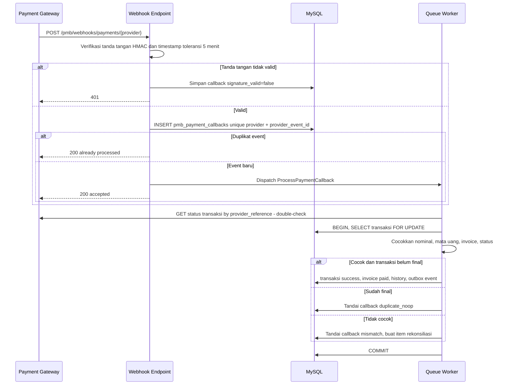

# 05 — Spesifikasi Modul F (Pembayaran Biaya Pendaftaran) dan G (Verifikasi Administrasi)

[← Kembali ke dokumen utama](../RANCANGAN_SISTEM_PENERIMAAN_MAHASISWA_BARU_PMB.md)

Label: **[E]** eksplisit · **[I]** inferensi · **[R]** rekomendasi · **[K]** perlu konfirmasi.

---

# F. Pembayaran Biaya Pendaftaran

> Metode pembayaran bergantung pada kebijakan kampus dan penyedia yang dikontrak. Rancangan memakai **adapter gateway** (`PaymentGatewayContract`) sehingga penyedia dapat diganti tanpa mengubah domain PMB. Mesin tagihan yang sama dipakai untuk biaya pendidikan awal saat daftar ulang ([07 §K](07-spesifikasi-daftar-ulang-jalur-khusus-pelaporan.md#k-daftar-ulang-mahasiswa-baru)).

## F.1 Model data pembayaran (ringkas)

| Entitas | Peran |
|---|---|
| `pmb_invoices` | Tagihan per aplikasi & jenis (`registration_fee`, `initial_tuition`); menyimpan nominal final (disalin dari konfigurasi — tidak berubah bila tarif diubah). |
| `pmb_invoice_items` | Rincian komponen (untuk biaya awal: DPP, SPP, dst; untuk pendaftaran: satu baris) + potongan (nilai negatif, sumber `voucher`/`scholarship`/`kip`). |
| `pmb_payment_transactions` | Upaya pembayaran (satu tagihan dapat punya banyak transaksi: gagal, kedaluwarsa, lalu berhasil). |
| `pmb_payment_callbacks` | Setiap webhook diterima apa adanya (payload, header tanda tangan, hasil validasi) — untuk dedupe & audit. |
| `pmb_manual_payment_proofs` | Bukti transfer manual & keputusan verifikasinya. |
| `pmb_reconciliation_batches/items` | Rekonsiliasi harian dengan laporan settlement gateway/mutasi bank. |
| `pmb_refunds` | Pengajuan & proses pengembalian dana (via approval engine). |
| `pmb_vouchers` | Kode potongan (Phase 2). |

## F.2 Kebutuhan fungsional

| ID | Fitur | Spesifikasi | Label |
|---|---|---|---|
| FR-PAY-01 | Tarif & pembuatan tagihan | Tagihan pendaftaran dibuat saat pendaftar membuka langkah Pembayaran (lazy), nominal = `config_snapshot.registration_fee` − potongan voucher. Nomor tagihan `INV-{PERIODE}-{SEQ:7}` unik per tenant. `due_at = wave.payment_deadline_at`. Satu tagihan `registration_fee` aktif per aplikasi (unique parsial). Biaya 0 → tidak dibuat (BR-14). | E |
| FR-PAY-02 | Pembayaran online via gateway | Pendaftar memilih kanal → `POST .../payments` (header `Idempotency-Key`) → server membuat transaksi `created`, memanggil gateway (VA/QRIS/e-wallet), menyimpan `provider_reference`, `va_number`/`qr_string`/`redirect_url`, `expires_at` → status `pending`. Instruksi pembayaran per kanal ditampilkan. | E |
| FR-PAY-03 | Kanal terkonfigurasi | `pmb.payment.channels`: daftar kanal aktif (mis. `va_bni`, `va_mandiri`, `qris`, `ewallet_x`, `manual_transfer`, `cashier`), masing-masing dengan biaya admin (ditanggung kampus/pendaftar), masa berlaku, urutan tampil. Jumlah kanal online mengikuti paket (BR-17). | I |
| FR-PAY-04 | Transfer manual / loket & unggah bukti | Kanal `manual_transfer`: menampilkan rekening kampus + kode unik nominal opsional (3 digit, untuk mempermudah pencocokan); pendaftar mengunggah bukti (JPG/PNG/PDF ≤ 2 MB) + tanggal & bank asal → transaksi `pending` + `pmb_manual_payment_proofs` `submitted`. Kanal `cashier`: petugas keuangan mencatat pembayaran tunai dengan nomor kuitansi. | I |
| FR-PAY-05 | Voucher potongan | Kode voucher (persentase/nominal, kuota pemakaian, masa berlaku, jalur/gelombang berlaku, `max_uses_per_account = 1`). Diterapkan sebelum transaksi dibuat; pemakaian dikunci dengan lock baris voucher. Phase 2. | I |
| FR-PAY-06 | Callback idempoten & double-check | Lihat F.4. | R |
| FR-PAY-07 | Status, kedaluwarsa, pembatalan | Transaksi `pending` kedaluwarsa pada `expires_at` (dari gateway atau job). Pendaftar dapat membatalkan transaksi `pending` dan memilih kanal lain (BR-16). Tagihan `expired` bila `due_at` lewat tanpa `paid`; aplikasi draft terkait menjadi `void` saat gelombang tutup. | R |
| FR-PAY-08 | Bukti pembayaran & riwayat | Setelah `paid`: kuitansi PDF (nomor kuitansi, tanggal, nominal, kanal, referensi) dapat diunduh; riwayat semua transaksi per tagihan terlihat oleh pendaftar (tanpa payload mentah). | R |
| FR-PAY-09 | Rekonsiliasi | Lihat F.6. | R |
| FR-PAY-10 | Pembatalan & refund | Lihat F.7. Phase 2 (MVP: pencatatan manual oleh `finance_officer` dengan alasan). | R |

## F.3 Hubungan pembayaran dengan hak melanjutkan

| Kondisi | Hak pendaftar |
|---|---|
| `payment_timing = before_submit`, tagihan belum `paid` | Dapat mengisi formulir & mengunggah dokumen; **tidak dapat** mengirim formulir. |
| `payment_timing = after_submit`, tagihan belum `paid` | Formulir terkirim, tetapi **tidak masuk antrean verifikasi** (`verification_status` tetap `not_started`) hingga `paid` (atau `pmb.verification_requires_payment = false`). |
| Tagihan `paid` | Dapat dikirim/masuk antrean verifikasi. |
| Pembayaran masuk setelah `expired` | BR-18: dicatat, ditandai `needs_resolution`; `finance_officer` memutuskan: (a) terima & buka kembali aplikasi (hanya bila gelombang masih menerima atau Admin PMB menyetujui), atau (b) refund. |
| Tagihan biaya awal | Lihat BR-33 di daftar ulang. |

## F.4 Penerimaan callback (webhook) — alur aman

Aturan:

1. Endpoint webhook tidak melakukan logika bisnis selain validasi tanda tangan & penyimpanan; respons cepat (< 1 detik) agar gateway tidak retry berlebihan.
2. **Dedupe** dengan unique (`provider`, `provider_event_id`); bila gateway tidak memberi event id, gunakan hash (`provider_reference` + `status` + `paid_at`).
3. **Double-check** status ke API gateway sebelum menandai `success` (melindungi dari tanda tangan bocor/replay). Bila API status tidak tersedia sementara → retry eksponensial (1, 5, 15, 60 menit), transaksi tetap `pending`.
4. Transisi status hanya maju: `pending → success|failed|expired|cancelled`; `success → refunded` (hanya via refund). Callback "failed" setelah "success" diabaikan & dicatat.
5. Nominal yang dibayar ≠ `amount` transaksi → tidak menandai `paid`; masuk antrean rekonsiliasi (`AMOUNT_MISMATCH`).
6. Polling cadangan: job tiap 10 menit memeriksa transaksi `pending` berumur > 15 menit ke API gateway (menangani callback terlambat/hilang).
7. Status dari front-end (mis. halaman redirect "sukses") **hanya** memicu pengecekan ulang ke server, tidak pernah mengubah status (BR-15).

## F.5 Verifikasi pembayaran manual

| Langkah | Aktor | Aturan |
|---|---|---|
| Unggah bukti | Pendaftar | Satu bukti aktif per transaksi; unggah ulang hanya bila ditolak |
| Antrean | `finance_officer` | Filter: kanal, tanggal transfer, nominal, status; urut tertua |
| Cocokkan | `finance_officer` | Bandingkan dengan mutasi rekening (impor CSV mutasi bank [R] untuk saran pencocokan otomatis berdasarkan nominal unik + tanggal) |
| Putuskan | `finance_officer` | `approved` → transaksi `success`, tagihan `paid`; `rejected` (alasan: `NOT_FOUND_IN_STATEMENT`, `AMOUNT_MISMATCH`, `UNREADABLE`, `DUPLICATE_PROOF`, `OTHER`) → transaksi `failed`, pendaftar dapat mencoba lagi |
| Deteksi duplikat bukti | Sistem | `checksum` file bukti sama dengan bukti lain → peringatan `DUPLICATE_PROOF` |
| SLA | — | Usulan: ≤ 1 hari kerja (indikator dashboard) |

## F.6 Rekonsiliasi

* **Harian (otomatis):** job mengambil laporan settlement gateway (API/SFTP sesuai penyedia) untuk H-1 → `pmb_reconciliation_batches` → setiap baris dicocokkan dengan `pmb_payment_transactions` via `provider_reference`.
* **Hasil per item:** `matched`, `missing_in_system` (dibayar di gateway, tidak ada `success` di sistem → kandidat callback hilang: sistem melakukan double-check & memperbaiki otomatis bila valid), `missing_in_provider` (sukses di sistem, tidak ada di settlement → eskalasi), `amount_mismatch`, `duplicate_payment` (dua transaksi sukses untuk tagihan sama → kandidat refund).
* **Manual:** impor mutasi bank (CSV) untuk transfer manual.
* Batch ditutup oleh `finance_officer` setelah semua item terselesaikan; laporan rekonsiliasi dapat diekspor.

## F.7 Pembatalan dan pengembalian dana

| Kasus | Proses |
|---|---|
| Transaksi `pending` dibatalkan pendaftar | Batalkan di gateway (bila didukung) → `cancelled`. |
| Pembayaran ganda (dua kanal sukses) | Otomatis `pmb_refunds` draft `DUPLICATE_PAYMENT` untuk transaksi kedua → approval. |
| Gelombang/jalur dibatalkan kampus | Refund massal (approval satu kali untuk batch). |
| Pengunduran diri | Sesuai kebijakan (Q-PAY-04). Biaya pendaftaran default tidak dikembalikan (BR-19). |
| Alur refund | `finance_officer` mengajukan (rekening tujuan atas nama pendaftar/wali, alasan, bukti) → approval engine (`pmb_refund` workflow: kepala keuangan) → pelaksanaan transfer di luar sistem atau via API refund gateway → `refunded` dengan bukti. BR-20 (SoD). |
| Status | `pmb_refunds.status`: `draft`, `pending_approval`, `approved`, `rejected`, `processing`, `completed`, `failed`. Tagihan: `refund_pending` → `refunded` (penuh) atau tetap `paid` dengan catatan refund parsial. |

## F.8 Hasil yang diharapkan

Status `paid` selalu didukung bukti transaksi yang tervalidasi; callback berulang atau terlambat tidak menghasilkan efek ganda; seluruh selisih teridentifikasi melalui rekonsiliasi.

---

# G. Verifikasi Administrasi

## G.1 Tujuan dan aktor

Memastikan setiap aplikasi yang masuk seleksi lengkap, valid, dan sah. Aktor: `pmb_verifier` (memeriksa), `pmb_admin` (menugaskan, override, membatalkan penolakan), `program_admin`/`faculty_admin` (baca di scope, opsional memberi catatan), `finance_officer` (status pembayaran), `auditor` (baca).

## G.2 Kebutuhan fungsional

| ID | Fitur | Spesifikasi | Label |
|---|---|---|---|
| FR-VER-01 | Daftar pendaftar & antrean | Tabel server-side paginated: No. pendaftaran, nama, jalur, gelombang, pilihan 1, status formulir, status pembayaran, status verifikasi, jumlah dokumen (disetujui/total), flag duplikat, petugas, waktu kirim, umur antrean. Filter: periode, gelombang, jalur, prodi (pilihan mana pun / pilihan 1), sistem kuliah, status (masing-masing siklus), petugas, "milik saya", rentang tanggal kirim, ada flag. Pencarian: nama, no. pendaftaran, email. Scope otomatis untuk role ber-scope. | R |
| FR-VER-02 | Halaman pemeriksaan | Panel kiri: data formulir per seksi (field sensitif dimasking, tombol "tampilkan" dicatat). Panel kanan: penampil dokumen (zoom, rotasi, halaman PDF). Daftar periksa (checklist) per jalur yang dikonfigurasi. Status pembayaran & riwayat transaksi (readonly). Navigasi "aplikasi berikutnya di antrean". | R |
| FR-VER-03 | Keputusan | Per dokumen: setujui/tolak/minta perbaikan. Per aplikasi: **Verifikasi** (BR-22), **Minta perbaikan** (pilih field/dokumen + catatan, batas waktu BR-24), **Tolak** (kode alasan: `INELIGIBLE_EDUCATION`, `INELIGIBLE_AGE`, `FALSIFIED_DATA`, `DUPLICATE_APPLICATION`, `INCOMPLETE_AFTER_REVISION`, `OTHER`; catatan wajib). Konfirmasi dialog untuk tolak. | R |
| FR-VER-04 | Penugasan pemeriksa | Mode tenant: (a) **pull** — petugas mengambil aplikasi berikutnya (klaim terkunci 30 menit, dilepas otomatis bila tidak ada aktivitas); (b) **push** — `pmb_admin` membagi otomatis round-robin/berdasarkan jalur atau manual. Satu aplikasi hanya diklaim satu petugas (`pmb_verification_assignments` unique aktif). | R |
| FR-VER-05 | Verifikasi massal | Hanya untuk aksi **aman**: (a) menyetujui dokumen `PHOTO` massal di galeri setelah dilihat; (b) memverifikasi aplikasi jalur yang ditandai `bulk_verifiable` dengan syarat semua dokumen sudah `approved` satu per satu dan tidak ada flag. Penolakan massal **tidak** diizinkan. Batas 100 aplikasi per aksi; dicatat sebagai satu `batch_id` dengan detail per aplikasi. Phase 2. | R |
| FR-VER-06 | Catatan, riwayat, ekspor | Catatan internal (tidak terlihat pendaftar) & catatan untuk pendaftar (terlihat). Riwayat keputusan (siapa, kapan, dari→ke, alasan) dari `pmb_application_status_histories`. Ekspor daftar sesuai kolom yang diizinkan role (BR-42), CSV/XLSX, dicatat di `pmb_export_logs`. | R |

## G.3 Aturan perpindahan status verifikasi

| Dari | Ke | Aktor | Syarat |
|---|---|---|---|
| `not_started` | `in_review` | Sistem (klaim/penugasan) | `form_status = submitted`, pembayaran terpenuhi (F.3) |
| `in_review` | `verified` | `pmb_verifier` yang diklaim / `pmb_admin` | BR-22 |
| `in_review` | `revision_requested` | `pmb_verifier` / `pmb_admin` | ≥ 1 target perbaikan + catatan; `now < form_lock_at` |
| `revision_requested` | `in_review` | Sistem | Pendaftar mengirim ulang |
| `revision_requested` | `rejected` | Sistem (job) | Batas waktu lewat (BR-24), alasan `REVISION_EXPIRED` |
| `in_review` | `rejected` | `pmb_verifier` / `pmb_admin` | Kode alasan + catatan (BR-23) |
| `verified` | `in_review` | `pmb_admin` | Alasan wajib; hanya bila `selection_status` ∈ {`eligible`, `scheduled`} (belum dinilai); tercatat |
| `rejected` | `in_review` | `pmb_admin` | Alasan wajib (pembatalan penolakan) |

## G.4 Pencegahan perubahan status tanpa otorisasi

1. Status hanya berubah melalui `ApplicationVerificationService` (tidak ada endpoint generik `PATCH status`).
2. Policy memeriksa: permission (`pmb_verification.decide`), scope (fakultas/prodi bila ber-scope), dan **kepemilikan klaim** (hanya petugas yang mengklaim atau `pmb_admin`).
3. Optimistic locking (`lock_version`) mencegah dua petugas memutuskan aplikasi yang sama (respons 409).
4. Setiap transisi menulis `pmb_application_status_histories` + `audit_logs` dalam transaksi yang sama; transisi yang tidak ada di tabel G.3 dilempar `InvalidTransitionException` (422).
5. Petugas tidak dapat memverifikasi aplikasi milik akun yang terhubung dengannya (mis. keluarga — deklarasi konflik kepentingan opsional [R]).

## G.5 Hasil yang diharapkan

Petugas dapat memproses antrean volume tinggi secara efisien; setiap keputusan memiliki alasan & jejak; hanya aplikasi `verified` yang masuk seleksi.
