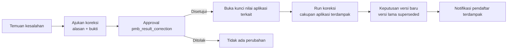

# 06 — Spesifikasi Modul H (Seleksi), I (Ujian), dan J (Pengumuman)

[← Kembali ke dokumen utama](../RANCANGAN_SISTEM_PENERIMAAN_MAHASISWA_BARU_PMB.md)

Label: **[E]** eksplisit · **[I]** inferensi · **[R]** rekomendasi · **[K]** perlu konfirmasi.

---

# H. Seleksi Calon Mahasiswa

## H.1 Tujuan

Menghasilkan **rekomendasi kelulusan [E]** yang objektif, dapat diulang (reproducible), dan dapat diaudit, untuk berbagai metode seleksi yang dapat diaktifkan per jalur. Rekomendasi menjadi keputusan hanya setelah pengesahan (modul J).

## H.2 Metode seleksi yang didukung (modular)

Setiap metode adalah **jenis komponen** (`source`) dalam skema seleksi; jalur cukup memilih komponen yang dipakai.

| `source` | Metode | Cara nilai masuk | Fase |
|---|---|---|---|
| `administrative` | Seleksi administrasi | Lulus/gagal dari `verification_status` (gerbang, bukan skor) | MVP |
| `report_card` | Nilai akademik (rapor/IPK) | Dihitung dari `pmb_report_scores` / IPK di data pendidikan | MVP |
| `achievement` | Prestasi | Dihitung dari `pmb_applicant_achievements` yang dokumennya `approved` × tabel poin | MVP |
| `written_exam` | Ujian tertulis luring | Input/impor nilai oleh panitia | MVP |
| `cbt` | Ujian berbasis komputer | Integrasi CBT (otomatis) | Phase 2 |
| `interview` | Wawancara | Input penguji (rubrik) | MVP |
| `portfolio` | Portofolio | Input penilai (rubrik) | MVP |
| `special_test` | Tes khusus (bakat, kesehatan, praktik) | Input penguji; dapat bertipe lulus/gagal | MVP |
| `scholarship_assessment` | Seleksi beasiswa | Input panitia beasiswa | Phase 2 |

## H.3 Skema seleksi dan komponen

`pmb_selection_schemes`: `code`, `name`, `version`, `status` (`draft`/`locked`/`retired`), `passing_score` (ambang skor akhir global, nullable), `tie_break_rules` (json berurutan), `allocation_method` (`score_priority` default — BR-28 / `first_choice_only`), `rounding_scale` (default 2 desimal), `locked_at`, `locked_by`.

`pmb_selection_components`:

| Kolom | Keterangan |
|---|---|
| `code`, `name`, `source` | Lihat H.2 |
| `score_type` | `numeric` atau `pass_fail` |
| `raw_min`, `raw_max` | Rentang nilai mentah (mis. 0–100, 1–5, 0–80 butir benar) |
| `weight` | Bobot (desimal ≥ 0). Komponen `pass_fail` berbobot 0 |
| `minimum_normalized` | Ambang minimal komponen (0–100, nullable) — di bawahnya = gugur |
| `is_mandatory` | Wajib ada nilai; tidak ada nilai = `absent`/gugur |
| `tie_break_priority` | Urutan dalam tie-break (nullable) |
| `normalization` | `minmax` (default) atau `zscore_session` (lihat H.4.3) |
| `rubric` | json untuk `interview`/`portfolio`: kriteria & bobot sub-kriteria |
| `config` | json khusus source (mis. semester & mapel rapor, tabel poin prestasi) |

Validasi saat **lock**: Σ`weight` > 0; setiap komponen numerik `raw_max > raw_min`; `passing_score` 0–100; aturan tie-break hanya merujuk komponen dalam skema atau atribut yang diizinkan (BR-29).

## H.4 Rumus penilaian

### H.4.1 Normalisasi ke skala 0–100 (min-max)

Untuk komponen $i$ dengan nilai mentah $x_i$, batas $[a_i, b_i]$:

$$
N_i = \frac{x_i - a_i}{b_i - a_i} \times 100, \qquad 0 \le N_i \le 100
$$

Nilai di luar rentang ditolak saat input (bukan dipotong).

### H.4.2 Skor akhir berbobot

Untuk himpunan komponen numerik $C$ pada skema:

$$
S = \frac{\sum_{i \in C} w_i \, N_i}{\sum_{i \in C} w_i}
$$

dibulatkan ke `rounding_scale` desimal dengan *round half up* **hanya pada tahap akhir** (nilai antara disimpan presisi penuh `decimal(9,4)`).

**Kelayakan** pendaftar untuk dinilai:

$$
\text{eligible} \iff \text{verified} \;\wedge\; \forall i \in C_{\text{mandatory}}: x_i \text{ tersedia} \;\wedge\; \forall i: N_i \ge m_i \;\wedge\; \forall j \in C_{\text{pass\_fail}}: \text{lulus}_j
$$

**Lulus ambang** pada pilihan prodi $p$:

$$
S \ge T_p, \quad T_p = \begin{cases} \text{min\_final\_score kuota } p & \text{jika diisi} \\ \text{passing\_score skema} & \text{selain itu} \\ 0 & \text{jika keduanya kosong} \end{cases}
$$

### H.4.3 Normalisasi antarsesi (opsional, `zscore_session`)

Bila ujian tertulis memakai paket soal berbeda per sesi sehingga tingkat kesulitan berbeda, nilai sesi $s$ dapat distandardisasi:

$$
z = \frac{x - \mu_s}{\sigma_s}, \qquad N = \operatorname{clamp}\left(50 + 10z,\; 0,\; 100\right)
$$

**Batasan penggunaan:** hanya bila setiap sesi memiliki ≥ 30 peserta dan $\sigma_s > 0$; jika tidak, sistem menolak lock skema/perhitungan dengan pesan. Metode ini mengasumsikan kemampuan peserta antarsesi setara (asumsi kuat) — wajib persetujuan panitia [K]. Default **tidak** dipakai.

### H.4.4 Komponen turunan

* **Rapor:** $x_{\text{rapor}} = \frac{1}{|M| \cdot |K|}\sum_{k \in K}\sum_{m \in M} r_{k,m}$ dengan $K$ semester terpilih, $M$ mapel terpilih (`config`), $r$ nilai 0–100. Jika ada nilai yang hilang → komponen dianggap tidak tersedia (bukan nol).
* **Prestasi:** $x_{\text{prestasi}} = \min\left(\text{cap}, \sum_{a} \text{poin}(\text{level}_a, \text{rank}_a)\right)$, hanya prestasi dengan dokumen `approved`, maks `config.max_items` prestasi terbaik. Contoh tabel poin (konfigurasi): internasional juara 1 = 100, nasional juara 1 = 80, provinsi juara 1 = 50, kabupaten juara 1 = 25; juara 2/3 = 80%/60% dari juara 1; finalis = 30%. `cap` default 100 → $[a,b] = [0,100]$.
* **Wawancara/portofolio (rubrik):** $x = \sum_{k} v_k \cdot s_k / \sum_k v_k$ dengan sub-kriteria berbobot $v_k$ dan skor $s_k$ pada skala rubrik; bila ada beberapa penguji, $x$ = rata-rata antarpenguji; selisih antarpenguji > `config.max_examiner_gap` (default 20% rentang) → ditandai untuk moderasi sebelum dapat dikunci.

### H.4.5 Contoh perhitungan

Skema "Reguler 2027 v1": Rapor (bobot 40, 0–100, min 60), Ujian tertulis (bobot 40, 0–80 butir benar, min 40), Wawancara (bobot 20, skala 1–5, tanpa minimum). Ambang skema 65. Kuota Informatika Reguler 2 kursi (min_final_score 70), Sistem Informasi Reguler 1 kursi (tanpa ambang khusus).

| Pendaftar | Rapor | Tertulis | Wawancara | $N_\text{rapor}$ | $N_\text{tulis}$ | $N_\text{wwc}$ | $S$ |
|---|---:|---:|---:|---:|---:|---:|---:|
| A | 85,5 | 62 | 4 | 85,50 | 77,50 | 75,00 | **80,20** |
| B | 90,0 | 50 | 5 | 90,00 | 62,50 | 100,00 | **81,00** |
| C | 78,0 | 70 | 3 | 78,00 | 87,50 | 50,00 | **76,20** |
| D | 70,0 | 28 | 5 | 70,00 | 35,00 | 100,00 | gugur ($N_\text{tulis}$ 35 < 40) |
| E | 80,0 | 60 | 4 | 80,00 | 75,00 | 75,00 | **77,00** |

Perhitungan A: $N_\text{tulis} = 62/80 \times 100 = 77{,}5$; $N_\text{wwc} = (4-1)/(5-1) \times 100 = 75$; $S = (40 \cdot 85{,}5 + 40 \cdot 77{,}5 + 20 \cdot 75)/100 = (3420 + 3100 + 1500)/100 = 80{,}20$.

Pilihan: A (1: Informatika, 2: SI), B (1: Informatika), C (1: Informatika, 2: SI), E (1: SI, 2: Informatika).

Alokasi BR-28 (urut skor: B 81,00 → A 80,20 → E 77,00 → C 76,20):

1. B → Informatika (sisa 1). 2. A → Informatika (sisa 0). 3. E → SI pilihan 1 (sisa 0). 4. C → Informatika penuh; SI penuh → **cadangan** (urutan cadangan Informatika #1, SI #1). D → tidak lulus (gugur komponen).

### H.4.6 Algoritma alokasi (BR-28)

```text
input: run R (skema terkunci S, kuota Q snapshot), daftar aplikasi eligible
1. Hitung S_final setiap aplikasi; urutkan desc dengan tie-break (H.5).
2. remaining[q] = capacity(q) - accepted_count_published_lain(q)   // kursi yang sudah terisi run lain (gelombang sebelumnya)
3. untuk setiap aplikasi a dalam urutan:
       untuk setiap pilihan c dari a berdasarkan priority naik:
           jika S_final(a) >= T(c) dan remaining[c.quota] > 0:
               tetapkan a -> c (recommendation = pass); remaining[c.quota] -= 1; lanjut ke aplikasi berikutnya
       jika tidak ada pilihan yang ditetapkan:
           untuk setiap pilihan c dengan S_final(a) >= T(c): catat a sebagai cadangan di c dengan waitlist_rank berikutnya
           (dibatasi waitlist_capacity); jika tidak ada → recommendation = fail (alasan BELOW_THRESHOLD)
4. Simpan semua hasil ke pmb_selection_run_results (immutable) + hash SHA-256 atas hasil terurut.
```

Sifat: deterministik (input & urutan sama → hasil sama), adil terhadap prioritas pilihan, dan pendaftar dengan skor lebih tinggi tidak pernah kalah oleh skor lebih rendah pada prodi yang sama. **Keterbatasan:** pendaftar yang ditempatkan di pilihan 2 tidak otomatis "naik" ke pilihan 1 bila kursi pilihan 1 kosong kemudian (karena penolakan tawaran) — promosi cadangan memakai daftar cadangan per prodi (BR-32).

## H.5 Tie-break

Default (BR-29), dievaluasi berurutan hingga berbeda:

1. $N$ komponen dengan `tie_break_priority = 1` lebih tinggi.
2. $N$ komponen dengan `tie_break_priority = 2` lebih tinggi.
3. `verified_at` lebih awal (aplikasi yang lengkap lebih dulu) — **[K]**: sebagian PT menganggap ini tidak adil; dapat dinonaktifkan.
4. Masih sama → kedua pendaftar ditandai `tie_unresolved`; perhitungan berstatus `computed` dengan peringatan; panitia memutuskan urutan secara manual dengan alasan (disimpan di `tie_break_values.manual_order`) sebelum dapat diajukan pengesahan. Bila kursi tersisa cukup untuk semua yang seri, keduanya diterima.

Atribut yang **dilarang** sebagai tie-break: usia, jenis kelamin, agama, suku, asal daerah, status disabilitas, penghasilan orang tua (kecuali jalur afirmasi yang memang ditetapkan berdasarkan kriteria ekonomi dan dikonfigurasi sebagai komponen, bukan tie-break).

## H.6 Kebutuhan fungsional

| ID | Fitur | Spesifikasi | Label |
|---|---|---|---|
| FR-SEL-01 | Definisi skema & komponen | CRUD skema draft, komponen, rubrik, tie-break; **lock** (BR-06). Pratinjau simulasi dengan data contoh. | R |
| FR-SEL-02 | Input nilai non-ujian | Rapor & prestasi dihitung otomatis setelah verifikasi; panitia dapat meninjau & mengoreksi dengan alasan (H.8). | R |
| FR-SEL-03 | Perhitungan skor | `POST .../selection-runs` untuk (gelombang-jalur) → job menghitung → `computed` dengan ringkasan (jumlah eligible, gugur per komponen, distribusi skor). | R |
| FR-SEL-04 | Rekomendasi kelulusan | Keluaran per aplikasi: `pass` (prodi & sistem kuliah), `waitlist` (per prodi + rank), `fail` (+ alasan: `BELOW_THRESHOLD`, `COMPONENT_MINIMUM`, `ABSENT`, `QUOTA_FULL_NO_WAITLIST`, `DISQUALIFIED`). | E |
| FR-SEL-05 | Alokasi pilihan & kuota | H.4.6; memperhitungkan kursi yang sudah dipakai gelombang sebelumnya. | R |
| FR-SEL-06 | Ranking & tie-break | Ranking per prodi & global, H.5. Tampilan ranking dengan filter prodi/sistem. | R |
| FR-SEL-07 | Peninjauan & pengesahan | Panitia meninjau hasil (dapat menjalankan ulang → run baru, run lama `superseded`), lalu "Ajukan pengesahan" → `pending_approval` → approval engine (J). Pengaju ≠ pengesah (BR-30). | I |
| FR-SEL-08 | Riwayat & audit nilai | H.8. | R |

## H.7 Versi konfigurasi dan penguncian hasil

| Objek | Mekanisme |
|---|---|
| Skema | `locked` sebelum perhitungan pertama; perubahan = versi baru; wave path merujuk versi spesifik. Mengganti versi pada wave path setelah ada run `computed` ditolak (BR-03). |
| Kuota | Run menyimpan snapshot kapasitas & ambang setiap kuota yang dipakai (`pmb_selection_runs.quota_snapshot`). |
| Nilai | Run menyimpan nilai yang dipakai di `pmb_selection_run_results.component_scores` (json); nilai di `pmb_selection_scores` dikunci (`locked_at`, `locked_by_run_id`) saat run `approved`. |
| Hasil | `pmb_selection_run_results` **insert-only** (tidak ada endpoint update; tabel diberi trigger/izin DB yang menolak UPDATE/DELETE pada level aplikasi — model tanpa `save()` setelah dibuat, ditegakkan oleh test). `result_hash` disimpan di run dan diverifikasi ulang sebelum publikasi. |
| Ubah setelah selesai | Mengubah bobot/konfigurasi **tidak pernah** memengaruhi run yang sudah ada. Untuk memakai konfigurasi baru: buat versi skema baru → (hanya bila belum dipublikasikan) jalankan run baru; run lama `superseded`. Setelah publikasi: hanya koreksi berversi (BR-31). |

## H.8 Riwayat perubahan nilai

* Setiap perubahan `pmb_selection_scores` membuat `pmb_score_revisions` (nilai lama, nilai baru, alasan wajib, `changed_by`, waktu, sumber: `manual`/`import`/`cbt_sync`).
* Nilai yang sudah `locked` hanya dapat diubah melalui **permintaan koreksi** (approval engine, workflow `pmb_score_correction`) yang, bila disetujui, membuka kunci untuk aplikasi tersebut dan memicu run koreksi (J.5).
* Penguji hanya melihat & mengubah nilai peserta di sesi yang ditugaskan, hingga sesi ditutup (`pmb_exam_sessions.scores_locked_at`).

---

# I. Jadwal dan Pelaksanaan Ujian

## I.1 Kebutuhan fungsional

| ID | Fitur | Spesifikasi | Label |
|---|---|---|---|
| FR-EXM-01 | Jadwal ujian | `pmb_exam_schedules`: gelombang, komponen seleksi, `mode` (`onsite`, `online_proctored`, `cbt`, `interview`, `portfolio_review`), tanggal, keterangan, status (`draft`/`published`/`completed`/`cancelled`). Hanya jadwal `published` terlihat pendaftar. | E |
| FR-EXM-02 | Sesi & ruang | Master `pmb_exam_venues` (lokasi/gedung) & `pmb_exam_rooms` (kapasitas, fasilitas, aksesibilitas). `pmb_exam_sessions`: jadwal, ruang (nullable untuk online), `starts_at`, `ends_at`, `capacity` (≤ kapasitas ruang), `checkin_opens_at`. | E |
| FR-EXM-03 | Pembagian peserta ke sesi/ruang | Otomatis: peserta `eligible` di wave path yang membutuhkan komponen dibagi ke sesi berurutan menurut no. pendaftaran (atau prodi/ketersediaan akomodasi khusus), dengan memperhatikan kapasitas; manual: pindah peserta antar sesi. `pmb_exam_participants` unik (`application_id`, `schedule_id`). | E |
| FR-EXM-04 | Penugasan penguji/pengawas | `pmb_exam_session_examiners`: `user_id`, `role` (`proctor`, `examiner`, `interviewer`), sesi. Otomatis round-robin atau manual. Penguji tidak boleh ditugaskan pada peserta yang ia deklarasikan konflik kepentingan. | E |
| FR-EXM-05 | Pengumuman jadwal & kartu peserta | Setelah jadwal `published` dan peserta dibagi: notifikasi `pmb.exam.scheduled`; kartu peserta PDF (nama, foto, no. peserta, sesi, ruang, waktu, tata tertib, QR berisi token bertanda tangan untuk check-in). No. peserta `{KODE_GEL}{KODE_JALUR}{SEQ:5}`. | E/I |
| FR-EXM-06 | Daftar hadir & kehadiran | Check-in pemindaian QR atau centang manual oleh pengawas; status `registered`, `present`, `absent`, `excused`, `disqualified` (alasan, mis. kecurangan). Cetak daftar hadir PDF per sesi. | R |
| FR-EXM-07 | Input & impor nilai | Input per peserta (rubrik untuk wawancara) oleh penguji yang ditugaskan; impor XLSX/CSV dengan template (no. peserta, nilai) oleh `selection_committee` — validasi baris (peserta ada di jadwal, nilai dalam rentang), pratinjau, laporan baris gagal, commit atomik. Kunci nilai sesi (`scores_locked_at`) oleh panitia. | R |
| FR-EXM-08 | Penjadwalan ulang & ujian ulang | Permintaan pendaftar (alasan + bukti) atau penetapan panitia → pindah ke sesi lain (`excused` → `registered` di sesi baru), maks `config.max_reschedules` (default 1). Perubahan jadwal massal (mis. force majeure) memicu notifikasi `pmb.exam.rescheduled`. | R |
| FR-EXM-09 | Integrasi CBT | Phase 2: sinkronisasi peserta & token ke mesin CBT (internal tergeneralisasi atau eksternal), terima nilai via webhook/pull; nilai `source = cbt_sync` tidak dapat diubah manual (hanya via koreksi). | E (Business+) |

## I.2 Aturan pencegahan konflik dan kapasitas

| Risiko | Aturan |
|---|---|
| Kapasitas berlebih | Penempatan peserta mengunci baris sesi (`SELECT ... FOR UPDATE`) dan menolak bila `participants_count ≥ capacity`. `capacity` sesi tidak boleh > kapasitas ruang. |
| Konflik ruang | Dua sesi pada ruang yang sama tidak boleh tumpang tindih waktu (validasi interval `[starts_at, ends_at)`). |
| Konflik peserta | Satu peserta tidak boleh memiliki dua sesi yang tumpang tindih (lintas jadwal/komponen). |
| Konflik penguji | Penguji tidak boleh ditugaskan pada dua sesi yang tumpang tindih. |
| Perubahan tanpa otorisasi | Perubahan sesi/peserta setelah kartu peserta terbit wajib alasan & mengirim notifikasi; setelah sesi berlangsung (`starts_at` lewat) hanya `selection_committee` yang dapat mengubah kehadiran; nilai terkunci setelah `scores_locked_at`. |
| Ujian di luar jendela | Tanggal sesi harus dalam `wave.exam_starts_on..exam_ends_on` (kecuali ODS). |

## I.3 Hasil yang diharapkan

Peserta mendapat jadwal & kartu yang konsisten tanpa bentrok; kehadiran tercatat; nilai masuk hanya dari penguji/panitia berwenang dan terkunci sebelum perhitungan.

---

# J. Pengumuman Hasil Seleksi

## J.1 Kebutuhan fungsional

| ID | Fitur | Spesifikasi | Label |
|---|---|---|---|
| FR-ANN-01 | Penetapan hasil akhir | Dari run `computed` yang ditinjau, panitia dapat melakukan **override individual** sebelum pengajuan (mis. diskualifikasi karena temuan) — override disimpan sebagai lapisan terpisah (`pmb_selection_run_results.override_*` diisi saat review, bukan mengubah hasil hitung) dengan alasan wajib; hasil akhir = hasil hitung + override. | R |
| FR-ANN-02 | Pengesahan pejabat berwenang | "Ajukan pengesahan" membuat `approval_requests` (workflow `pmb_result_approval`, mis. Ketua Panitia → WR I, Q-ANN-01). Pengesah melihat ringkasan (jumlah diterima/cadangan/tidak per prodi, keterisian kuota, daftar override, `result_hash`). Disetujui → run `approved`; ditolak/dikembalikan → `under_review` dengan catatan. | R |
| FR-ANN-03 | Penjadwalan publikasi | `pmb_announcement_batches`: run, `scheduled_publish_at` (default `wave.announcement_at`), status. Saat run `approved`, sistem membuat `pmb_admission_decisions` dengan `publication_status = unpublished`. Job publikasi berjalan tiap menit: pada waktunya, memverifikasi `result_hash`, mengubah keputusan menjadi `published`, memperbarui `accepted_count` kuota (lock), membuat `pmb_re_registrations` untuk `accepted`, dan mengantrekan notifikasi. | R |
| FR-ANN-04 | Pengumuman individual & cek hasil | Portal: halaman hasil (keputusan, prodi & sistem kuliah, instruksi & batas daftar ulang, unduh LoA). Publik: cek hasil (FR-WEB-08). Notifikasi email `pmb.result.published` tanpa menyebut hasil di subjek ("Hasil seleksi Anda telah tersedia") [R]. | I |
| FR-ANN-05 | LoA | PDF dibangkitkan untuk `accepted` saat publikasi (antrean): nomor LoA `LOA/{PERIODE}/{SEQ:5}`, identitas, prodi, sistem kuliah, batas daftar ulang, kode verifikasi + QR menuju halaman verifikasi keaslian publik (`/pmb/verifikasi-loa/{code}` menampilkan nama tersamar & status valid/dicabut). Disimpan sebagai `file_uploads` privat. TTE Phase 3. | E |
| FR-ANN-06 | Koreksi & riwayat publikasi | J.5. | R |

## J.2 Status keputusan yang didukung

| `decision` | Arti | Ke daftar ulang? |
|---|---|---|
| `accepted` | Diterima pada prodi & sistem kuliah tertentu | Ya |
| `waitlisted` | Cadangan pada satu/lebih prodi, dengan rank | Hanya bila dipromosikan |
| `rejected` | Tidak diterima | Tidak |
| `withdrawn` | Mengundurkan diri (sebelum/sesudah publikasi) | Tidak |

Label tampilan dapat dikustomisasi tenant (mis. "Lulus", "Cadangan", "Belum Lulus").

## J.3 Pencegahan kebocoran sebelum waktunya

1. Keputusan `unpublished` tidak pernah dikembalikan oleh endpoint pendaftar/publik (filter di query scope `published()` + test).
2. Staf yang dapat melihat hasil sebelum publikasi dibatasi permission `pmb_results.read_unpublished` (panitia seleksi, pengesah, `pmb_admin`, auditor); ekspor hasil sebelum publikasi dicatat & memerlukan alasan.
3. Email/SMS diantrekan **setelah** status `published` ter-commit (tidak dijadwalkan lebih awal di provider).
4. Halaman hasil memakai respons dinamis tanpa cache bersama sebelum publikasi; setelah publikasi, cek hasil publik di-cache singkat (60 detik) per kunci pencarian untuk menahan lonjakan.
5. Jam server disinkronkan NTP; `scheduled_publish_at` disimpan UTC.
6. Tidak ada tombol "publikasikan sekarang" bagi pengaju; percepatan jadwal publikasi adalah perubahan yang memerlukan approval ulang.

## J.4 Promosi cadangan

Saat kursi kosong (tawaran ditolak/kedaluwarsa, BR-35), dashboard menampilkan "kursi tersedia" per kuota. `pmb_admin` memilih "Promosikan cadangan berikutnya" → sistem mengambil `waitlisted` dengan rank terendah pada prodi itu yang masih `waitlisted` (dalam transaksi + lock kuota) → membuat keputusan versi baru `accepted` (`decision_version + 1`, sumber `waitlist_promotion`) → notifikasi & daftar ulang dengan `deadline_at` individual (BR-34). Promosi tidak memerlukan approval ulang karena mengikuti urutan snapshot yang sudah disahkan; melompati urutan **tidak** diizinkan.

## J.5 Koreksi hasil setelah publikasi



Aturan: koreksi tidak boleh mencabut keputusan `accepted` pendaftar lain yang tidak terlibat kesalahan; bila koreksi menambah penerima di prodi penuh, kapasitas ditambah melalui perubahan kuota yang disetujui. Seluruh versi keputusan tetap tersimpan dan terlihat oleh auditor; pendaftar melihat versi terbaru beserta catatan koreksi.

## J.6 Hasil yang diharapkan

Hasil hanya terlihat setelah disahkan & pada waktunya; setiap pendaftar menerima keputusan yang sama dengan snapshot yang disahkan; koreksi terlacak versi demi versi.
