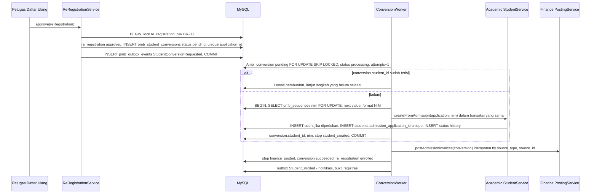

# 07 — Spesifikasi Modul K (Daftar Ulang), L (Jalur Khusus & Beasiswa), dan M (Dashboard & Pelaporan)

[← Kembali ke dokumen utama](../RANCANGAN_SISTEM_PENERIMAAN_MAHASISWA_BARU_PMB.md)

Label: **[E]** eksplisit · **[I]** inferensi · **[R]** rekomendasi · **[K]** perlu konfirmasi.

---

# K. Daftar Ulang Mahasiswa Baru

## K.1 Prinsip

* "Diterima" ≠ mahasiswa (BR-33). Kondisi final = **`pmb_re_registrations.status = enrolled`** dan `pmb_student_conversions.status = succeeded` (record `students` terbentuk).
* Setiap keputusan `accepted` yang dipublikasikan otomatis membuat satu `pmb_re_registrations` (`awaiting_confirmation`) dengan `deadline_at` = `wave.re_registration_closes_at` (atau individual untuk promosi cadangan).

## K.2 Tahapan, persyaratan, dan status

| # | Tahap | Aktor | Persyaratan masuk | Selesai bila | Status daftar ulang |
|---|---|---|---|---|---|
| 1 | Konfirmasi penerimaan | Pendaftar | Keputusan `accepted` `published`, `now ≥ re_registration_opens_at`, `now ≤ deadline` | Klik "Terima tawaran" + centang pernyataan (A-17: tawaran lain di periode yang sama otomatis `withdrawn`) atau "Tolak tawaran" (alasan opsional) | `awaiting_confirmation` → `confirmed` / `declined` |
| 2 | Persetujuan tawaran studi | Pendaftar | Tahap 1 | Persetujuan ketentuan akademik & keuangan (versi dicatat) — digabung dengan tahap 1 di UI | `confirmed` |
| 3 | Data lanjutan | Pendaftar | `confirmed` | Field wajib daftar ulang terisi: data PDDikti (Q-REG-05: nama ibu kandung, agama, NIK (sudah), kewarganegaraan, alamat lengkap + kode wilayah, jenis tinggal, alat transportasi, penerima KPS, dll.), kontak darurat, ukuran almamater (opsional) | `in_progress` |
| 4 | Data orang tua/wali | Pendaftar | `confirmed` | Data ayah/ibu/wali sesuai kebijakan (nama, pendidikan, pekerjaan, rentang penghasilan bila dibutuhkan, HP) | `in_progress` |
| 5 | Dokumen final | Pendaftar → `re_registration_officer` | `confirmed` | Semua dokumen tahap `re_registration` wajib `approved` (ijazah/SKL, KK, surat pernyataan, dsb.) | `in_progress` |
| 6 | Pemeriksaan kesehatan (opsional) | Pendaftar / petugas | Hanya bila prodi mensyaratkan (Q-REG-07) | Dokumen `HEALTH_CERT` `approved` atau hasil `pass` dicatat petugas | `in_progress` |
| 7 | Tagihan biaya awal | Sistem | `confirmed` | Tagihan `initial_tuition` dibuat dari `pmb_fee_components` (prodi, sistem kuliah, jalur) − potongan (KIP/beasiswa/voucher) | `in_progress` |
| 8 | Pembayaran & verifikasinya | Pendaftar / sistem / `finance_officer` | Tagihan ada | Pembayaran memenuhi `pmb.enrollment_min_payment` (lunas atau cicilan pertama) melalui BR-15 | `in_progress` |
| 9 | Kirim untuk validasi | Pendaftar | Tahap 3–8 lengkap | Tombol "Kirim daftar ulang" aktif hanya bila semua checklist hijau | `submitted` |
| 10 | Validasi kelengkapan | `re_registration_officer` | `submitted` | Checklist `pmb_re_registration_checks` semua `passed`; bila ada yang kurang → `revision_requested` | `submitted` / `revision_requested` |
| 11 | Persetujuan final | `re_registration_officer` (≠ verifikator pembayaran manual untuk aplikasi itu) | Checklist lengkap, BR-33 | Klik "Setujui" → status `approved`, outbox `StudentConversionRequested` | `approved` |
| 12 | Penerbitan NIM | Sistem | `approved` | NIM dibangkitkan (BR-36) di dalam proses konversi | — |
| 13 | Pembentukan data mahasiswa | Sistem | NIM | `users` (KD-01, BR-38) + `students` + `student_status_histories` (`null → active`, alasan "Mahasiswa baru PMB {periode}") | — |
| 14 | Penetapan prodi & tahun masuk | Sistem | — | `students.study_program_id` = prodi diterima, `admission_year` = tahun dari `entry_academic_term`, `enrolled_at` = tanggal persetujuan | — |
| 15 | Integrasi akademik & keuangan | Sistem | Konversi sukses | Posting tagihan & pembayaran ke Finance; dokumen mahasiswa ditautkan; data beasiswa diteruskan | `enrolled` |
| 16 | Bukti registrasi | Sistem | `enrolled` | PDF bukti registrasi (NIM, prodi, status pembayaran) di portal & email | `enrolled` |
| 17 | Informasi orientasi | Sistem | `enrolled` | Notifikasi `pmb.student.enrolled` berisi NIM, cara aktivasi akun mahasiswa, tautan info PKKMB (konten `pmb_contents`) | `enrolled` |

Kode checklist (`pmb_re_registration_checks.check_code`): `OFFER_ACCEPTED`, `PDDIKTI_DATA_COMPLETE`, `GUARDIAN_DATA_COMPLETE`, `FINAL_DOCUMENTS_APPROVED`, `HEALTH_CLEARED` (kondisional), `PAYMENT_MINIMUM_MET`, `ORIGINAL_DOCUMENTS_CHECKED` (kondisional bila `requires_original_check`), `NO_OPEN_DUPLICATE_FLAG`. Sebagian dihitung otomatis (sistem), sebagian dicentang petugas.

## K.3 Kebutuhan fungsional

| ID | Fitur | Label |
|---|---|---|
| FR-REG-01 | Konfirmasi/penolakan tawaran (tahap 1–2), penarikan tawaran lain otomatis | R |
| FR-REG-02 | Formulir data lanjutan & orang tua/wali (tahap 3–4) — memakai mesin formulir (template seksi `re_registration`) | R |
| FR-REG-03 | Dokumen final & pemeriksaan kesehatan opsional (tahap 5–6) | R |
| FR-REG-04 | Tagihan biaya pendidikan awal (tahap 7) | I |
| FR-REG-05 | Cicilan, potongan beasiswa/KIP, voucher | I |
| FR-REG-06 | Verifikasi pembayaran biaya awal (tahap 8, mekanisme sama dengan F) | R |
| FR-REG-07 | Validasi kelengkapan & persetujuan final (tahap 9–11) | R |
| FR-REG-08 | Setting format NIM & penerbitan NIM | E |
| FR-REG-09 | Pembentukan `students` & `users` (ekspor menjadi mahasiswa) | E |
| FR-REG-10 | Integrasi akademik & keuangan + pemulihan kegagalan | R |
| FR-REG-11 | Bukti registrasi & informasi orientasi | R |
| FR-REG-12 | Batas waktu, perpanjangan, kedaluwarsa, pembatalan, promosi cadangan | R |

## K.4 Batas waktu dan perpanjangan

| Aturan | Rincian |
|---|---|
| Batas default | `deadline_at = wave.re_registration_closes_at` |
| Pengingat | H-3, H-1, dan 6 jam sebelum batas (`pmb.re_registration.deadline_reminder`) bila belum `submitted` |
| Perpanjangan individual | `pmb_admin`, alasan wajib, maks `pmb.re_registration_extension_max_days` (default 7) dari batas awal; dicatat `extended_until`, `extension_reason`, `extended_by`; notifikasi ke pendaftar |
| Perpanjangan massal | Untuk seluruh gelombang/prodi (mis. gangguan sistem) → approval engine (`pmb_bulk_extension`) |
| Status `submitted` saat batas lewat | **Tidak** kedaluwarsa; petugas tetap memproses. Bila petugas meminta revisi setelah batas, pendaftar diberi waktu `pmb.revision_window_hours` |

## K.5 Kasus khusus

| Kasus | Penanganan |
|---|---|
| Tidak daftar ulang hingga batas | Job harian 00:15 waktu tenant: `awaiting_confirmation`/`confirmed`/`in_progress`/`revision_requested` dengan `deadline` lewat → `expired` (BR-35); keputusan tetap `accepted` tetapi `re_registration.status = expired`; kursi dibebaskan (`accepted_count − 1`, lock) → muncul di dashboard promosi cadangan. Notifikasi `pmb.re_registration.expired`. Pembayaran sebagian yang sudah masuk → antrean refund sesuai kebijakan. |
| Menolak tawaran | `declined` (terminal); kursi dibebaskan; tidak dapat dibatalkan oleh pendaftar (dapat dipulihkan oleh `pmb_admin` dalam 24 jam bila kursi belum dipakai — alasan wajib). |
| Pembatalan penerimaan oleh kampus | Mis. data palsu ditemukan saat daftar ulang: `pmb_admin` mengajukan pembatalan (approval `pmb_result_correction`) → keputusan versi baru `rejected`/dicabut, daftar ulang `cancelled`, LoA ditandai dicabut (halaman verifikasi LoA menunjukkan "dicabut"). Setelah `enrolled`, pembatalan bukan wewenang PMB (BR-39). |
| Pembayaran belum terverifikasi saat batas | Bila transaksi `pending` dibuat sebelum batas dan sukses setelah batas: dianggap tepat waktu bila `paid_at` gateway < batas (cap waktu dari gateway, bukan waktu callback). Transfer manual: tanggal transfer pada bukti + konfirmasi mutasi. Daftar ulang `expired` dapat dipulihkan oleh `finance_officer` + `pmb_admin` dalam kondisi ini (alasan `LATE_CALLBACK`). |
| Ijazah belum terbit | SKL diterima (Q-REG-02); checklist `DIPLOMA_PENDING` menjadi catatan yang diteruskan ke Akademik (bukan penghalang) [K]. |
| Diterima di dua aplikasi | Menerima satu otomatis menarik yang lain (A-17); kursi aplikasi lain dibebaskan. |

## K.6 Pembentukan mahasiswa: idempotensi dan pencegahan NIM ganda

| Lapisan pencegahan duplikat | Mekanisme |
|---|---|
| Satu konversi per aplikasi | `pmb_student_conversions.application_id` UNIQUE |
| Satu mahasiswa per aplikasi | `students.admission_application_id` UNIQUE (kolom baru, nullable) |
| NIM unik | Sequence ber-lock (`pmb_sequences`, scope `nim`, key `{prodi}:{tahun}`) + constraint `students (university_id, nim)` UNIQUE yang sudah ada; bila tetap bentrok (mis. NIM diinput manual di Akademik) → ambil nomor berikutnya, maksimal 5 percobaan, lalu `manual_intervention` |
| NIM tidak terbuang saat rollback | Penomoran & insert `students` dalam **satu transaksi**; rollback mengembalikan sequence |
| Dua worker bersamaan | `FOR UPDATE SKIP LOCKED` + status `processing` dengan `locked_until` (lease 5 menit) |
| Retry | Langkah tercatat (`steps_completed` json: `student_created`, `user_linked`, `finance_posted`, `documents_linked`, `scholarship_forwarded`); retry melanjutkan langkah yang belum selesai |
| Posting Finance ganda | `invoices (source_type, source_id)` UNIQUE |

## K.7 Pemulihan saat integrasi akademik gagal

| Kegagalan | Perilaku | Pemulihan |
|---|---|---|
| Error sementara (deadlock, timeout DB, layanan eksternal) | Retry eksponensial: 1, 5, 15, 60 menit, maks 6 percobaan | Otomatis |
| Error data (mis. prodi nonaktif, field wajib `students` kosong, email konflik BR-38) | `failed` dengan `last_error_code` & pesan; tidak di-retry otomatis | Admin PMB memperbaiki data → tombol "Coba lagi" (retry dari langkah terakhir) |
| Retry habis | `manual_intervention`; alert ke `pmb_admin` & tim IT (log level error, notifikasi) | Diagnosis; "Coba lagi" setelah perbaikan |
| Mahasiswa terbentuk, posting Finance gagal | Status konversi tetap `processing` pada langkah `finance_posted`; mahasiswa sudah ada (NIM tidak berubah) | Retry hanya langkah Finance |
| Pembatalan setelah konversi | Tidak di PMB (BR-39) | Proses Akademik |

Dashboard "Konversi Mahasiswa" menampilkan antrean per status, umur, kesalahan terakhir, dan tombol retry (permission `pmb_conversion.retry`).

---

# L. Manajemen Beasiswa dan Jalur Khusus

## L.1 Matriks perbedaan jalur

| Jalur (`category`) | Label | Persyaratan khas | Dokumen khas | Biaya pendaftaran | Kuota | Metode seleksi default | Alur persetujuan khusus | Fase |
|---|---|---|---|---|---|---|---|---|
| Reguler (`regular`) | [E] (uraian [I]) | Lulusan SMA/sederajat | Standar | Berbayar | Per prodi | Tertulis/CBT + (opsional) wawancara | Standar | MVP |
| Prestasi (`achievement`) | [I] | Prestasi akademik/non-akademik, rapor | Rapor, sertifikat | Berbayar/gratis [K] | Terpisah | Rapor + prestasi (+ wawancara) | Verifikasi sertifikat per prestasi | MVP |
| KIP Kuliah / Afirmasi (`kip_affirmation`) | KIP [E], afirmasi [R] | Terdaftar KIP Kuliah / kriteria ekonomi | KIP, KK, SKTM | Gratis (biaya 0) | Kuota KIP terpisah | Sesuai skema + verifikasi kelayakan ekonomi | Verifikasi KIP oleh petugas khusus; status KIP | Phase 2 |
| Pindahan (`transfer`) | [E] | Mahasiswa aktif/eks PT lain, IPK min | Transkrip, surat pindah | Berbayar | Per prodi, semester masuk dapat > 1 [K] | Administrasi + wawancara | Konversi SKS di SIAKAD setelah konversi | Phase 2 |
| Pascasarjana (`postgraduate`) | [E] | S1/S2 terakreditasi, IPK min, TOEFL [K] | Ijazah & transkrip S1, rekomendasi, proposal riset (S3) | Berbayar | Per prodi | Administrasi + tes/wawancara | Penilaian calon promotor (S3) [R] | Phase 2 |
| RPL (`rpl`) | [E] (modul RPL Professional+) | Pengalaman kerja | Portofolio, surat kerja | Tarif formulir RPL [E] | Per prodi | Asesmen RPL | Asesor & rekognisi di modul RPL | Phase 3 |
| Beasiswa (`scholarship`) | [I] | Kriteria beasiswa | Sesuai beasiswa | Gratis/berbayar | Kuota beasiswa | Komponen `scholarship_assessment` | Panitia beasiswa; diteruskan ke modul Scholarship | Phase 2 |
| Kerja sama (`partnership`) | [R] | Utusan instansi mitra | Surat penugasan | Sesuai MoU | Kuota MoU | Administrasi | Validasi instansi mitra | Phase 3 |
| ODS (gelombang `is_ods`) | [E] | Sama dengan jalur yang dibuka di gelombang ODS | Standar minimal | Berbayar | Mengurangi kuota periode | Ujian di tempat (CBT di Business+ [E]) | Pengesahan cepat (approver hadir di hari yang sama) | Phase 2 |

## L.2 Kebutuhan fungsional

| ID | Fitur | Spesifikasi | Label |
|---|---|---|---|
| FR-SPC-01 | Jalur prestasi | Seksi prestasi wajib, perhitungan poin (H.4.4), verifikasi per sertifikat. | I |
| FR-SPC-02 | KIP Kuliah | Field `kip_number`, `kip_registration_number` (dari SIM KIP Kuliah), status `kip_status` (`claimed`, `verified`, `not_eligible`, `accepted_by_program`); petugas memverifikasi secara manual terhadap portal resmi (B-08: tanpa integrasi otomatis hingga akses resmi tersedia); laporan pendaftar KIP per prodi untuk keperluan pengusulan; potongan 100% di biaya awal bila diterima sebagai penerima KIP (sesuai ketentuan program). | E |
| FR-SPC-03 | Jalur pindahan | Seksi riwayat PT (PT asal, prodi asal, NIM asal, IPK, SKS, akreditasi), dokumen transkrip & surat pindah; data diteruskan ke Akademik untuk proses "Transfer mahasiswa" [E SIAKAD]. | E |
| FR-SPC-04 | Pascasarjana | Prodi jenjang S2/S3 (`eligible_degree_levels`), seksi pendidikan S1/S2, dokumen rekomendasi; komponen tes/wawancara. | E |
| FR-SPC-05 | RPL | Jalur `rpl` di PMB untuk pendaftaran, dokumen, tarif formulir; setelah verifikasi, data diteruskan ke modul RPL (asesor, rekognisi mata kuliah). Hasil RPL kembali sebagai komponen `special_test`/`portfolio` untuk keputusan penerimaan [R]. | E |
| FR-SPC-06 | Beasiswa & afirmasi | Minat beasiswa saat pendaftaran; komponen `scholarship_assessment`; keputusan beasiswa terpisah dari keputusan penerimaan (`pmb_admission_decisions.scholarship_award` json: program, persentase); diteruskan ke `scholarships`/`scholarship_applications` saat konversi. | I |
| FR-SPC-07 | ODS | Gelombang `is_ods`; semua tahap dapat terjadi di hari yang sama; pembayaran di loket (`cashier`) atau online; verifikasi di tempat; ujian di sesi tunggal; run & approval cepat; pengumuman pada hari itu (job publikasi tetap dipakai, `scheduled_publish_at` dapat = segera setelah approval). | E |
| FR-SPC-08 | Kerja sama & jalur lain | Jalur `partnership` dengan daftar instansi mitra (dapat direferensikan dari Manajemen Kerjasama bila ada); kuota & biaya per MoU. | R |

---

# M. Dashboard dan Pelaporan

## M.1 Jenis laporan

| Jenis | Isi | Pengguna utama | Sumber |
|---|---|---|---|
| Statistik operasional | Funnel, antrean verifikasi, dokumen menunggu, tren harian, sumber informasi | Admin PMB, verifikator, pimpinan | Tabel aplikasi, dokumen, akun |
| Laporan keuangan | Rekap biaya pendaftaran & biaya awal, per kanal, per status, rekonsiliasi, refund | Keuangan, pimpinan, auditor | `pmb_invoices`, `pmb_payment_transactions`, rekonsiliasi |
| Laporan seleksi | Peserta, kehadiran, distribusi nilai, kelulusan per prodi/jalur, keterisian kuota, cadangan | Panitia seleksi, pengesah | Run, hasil, keputusan |
| Laporan akademik | Mahasiswa baru per prodi/jalur/asal sekolah/daerah, konversi, kelengkapan data PDDikti | BAAK, pimpinan, prodi | Daftar ulang, konversi, `students` |

## M.2 Definisi indikator

Semua indikator dapat difilter: periode, gelombang, jalur, fakultas, prodi, sistem kuliah, rentang tanggal; dan otomatis dibatasi scope role. "Aplikasi" mengecualikan `void` kecuali disebut.

| ID | Indikator | Definisi & rumus | Sumber data |
|---|---|---|---|
| KPI-01 | Total akun | $\#$ `pmb_applicant_accounts` dibuat dalam rentang (status ≠ `deactivated`) | akun |
| KPI-02 | Akun terverifikasi | $\#$ akun `email_verified_at` atau `phone_verified_at` terisi | akun |
| KPI-03 | Total aplikasi (draft + terkirim) | $\#$ aplikasi dibuat | aplikasi |
| KPI-04 | Total pendaftar (terkirim) | $\#$ aplikasi `submitted_at` terisi | aplikasi |
| KPI-05 | Pendaftar per jalur/prodi/gelombang | KPI-04 dikelompokkan; untuk prodi: berdasarkan **pilihan 1** (default) atau "pilihan mana pun" (toggle, dengan catatan bahwa total dapat > KPI-04) | aplikasi, pilihan |
| KPI-06 | Formulir belum lengkap | $\#$ aplikasi `form_status ∈ {draft, revision_requested}` pada gelombang yang masih terbuka | aplikasi |
| KPI-07 | Dokumen menunggu verifikasi | $\#$ dokumen `status ∈ {uploaded, in_review}` dari aplikasi `submitted` | dokumen |
| KPI-08 | Status pembayaran pendaftaran | $\#$ tagihan `registration_fee` per status; $\%\text{bayar} = \frac{\#\text{paid}}{\#\text{tagihan}}$ | tagihan |
| KPI-09 | Peserta seleksi | $\#$ aplikasi `selection_status ∉ {not_eligible}` | aplikasi |
| KPI-10 | Lulus / cadangan / tidak lulus | $\#$ keputusan `published` versi terbaru per `decision` | keputusan |
| KPI-11 | Daftar ulang | $\#$ `pmb_re_registrations` per status; selesai = `enrolled` | daftar ulang |
| KPI-12 | Rasio konversi | $\text{CR}_{\text{total}} = \frac{\#\text{enrolled}}{\#\text{submitted}}$; turunannya: $\frac{\#\text{paid}}{\#\text{akun}}$, $\frac{\#\text{accepted}}{\#\text{verified}}$, $\frac{\#\text{enrolled}}{\#\text{accepted}}$ (yield) | gabungan |
| KPI-13 | Pencapaian kuota | $\frac{\#\text{enrolled} + \#\text{re-reg aktif}}{\text{capacity}} \times 100\%$ per kuota; tampil juga $\frac{\#\text{accepted}}{\text{capacity}}$ | kuota, keputusan |
| KPI-14 | Rekap biaya | $\sum$ `amount` transaksi `success` (− refund `completed`) per jenis tagihan/kanal/hari; piutang biaya awal = $\sum$ (`amount_net` − dibayar) tagihan `initial_tuition` belum lunas | transaksi, tagihan |
| KPI-15 | Tren harian | Seri waktu KPI-01, KPI-04, KPI-08 (paid), KPI-11 (enrolled) per hari (zona waktu tenant) | gabungan |
| KPI-16 | Perbandingan antarperiode | KPI yang sama pada **hari relatif** terhadap `registration_opens_at` gelombang pertama (H+n) untuk periode berbeda | gabungan, snapshot harian |
| KPI-17 | Sumber informasi | Distribusi `info_source` atas KPI-04 dan konversinya ke enrolled [E] | aplikasi |
| KPI-18 | SLA verifikasi | Median & P90 (`verified_at` − `submitted_at` atau `paid_at`, mana yang lebih akhir) | history status |
| KPI-19 | Kelengkapan data PDDikti | $\frac{\#\text{enrolled dengan semua field wajib PDDikti}}{\#\text{enrolled}}$ | daftar ulang |

Agregasi: dihitung on-demand dengan indeks untuk volume ≤ A-18; snapshot harian `pmb_daily_stats` (job 00:30) untuk KPI-15/16 dan dashboard pimpinan agar ringan [R]. Data dashboard real time tertunda ≤ 5 menit (cache).

## M.3 Kebutuhan fungsional

| ID | Fitur | Label |
|---|---|---|
| FR-RPT-01 | Dashboard monitoring PMB (pimpinan & panitia): funnel KPI-01→KPI-11, kuota, tren | E |
| FR-RPT-02 | Laporan rekap pendaftar (per jalur, gelombang, prodi, asal sekolah, daerah, status) | E |
| FR-RPT-03 | Laporan rekap pembayaran (pendaftaran & biaya awal, per kanal/status/hari) | E |
| FR-RPT-04 | Laporan sumber informasi | E |
| FR-RPT-05 | Laporan seleksi (peserta, kehadiran, distribusi nilai, hasil, cadangan) | R |
| FR-RPT-06 | Laporan daftar ulang & konversi (status, kedaluwarsa, mahasiswa baru per prodi, kelengkapan PDDikti) | R |
| FR-RPT-07 | Laporan keuangan PMB (rekonsiliasi, refund, piutang biaya awal) | I |
| FR-RPT-08 | Ekspor & perbandingan antarperiode (KPI-16) | R |

## M.4 Hak akses dan format ekspor

| Laporan | pmb_admin | leadership | faculty/program_admin | finance_officer | selection_committee | auditor |
|---|:-:|:-:|:-:|:-:|:-:|:-:|
| Operasional (agregat) | ✓ | ✓ | ✓ (scope) | ✓ | ✓ | ✓ |
| Operasional (daftar nama) | ✓ | — | ✓ (scope) | — | ✓ | ✓ |
| Keuangan | ✓ (ringkas) | ✓ (agregat) | — | ✓ | — | ✓ |
| Seleksi (sebelum publikasi) | ✓ | pengesah saja | — | — | ✓ | ✓ |
| Akademik | ✓ | ✓ | ✓ (scope) | — | — | ✓ |

Format: tampilan web (tabel + grafik), **XLSX** dan **CSV** (UTF-8 BOM, pemisah koma), **PDF** untuk laporan resmi (kop tenant, tanggal cetak, pencetak). Ekspor > 5.000 baris diproses asinkron (job) dan tautan unduh berlaku 24 jam. Semua ekspor berisi data pribadi dicatat (BR-42).
