# 09 — Workflow dan State Machine

[← Kembali ke dokumen utama](../RANCANGAN_SISTEM_PENERIMAAN_MAHASISWA_BARU_PMB.md)

Alur utama end-to-end ada di [dokumen utama §10](../RANCANGAN_SISTEM_PENERIMAAN_MAHASISWA_BARU_PMB.md#10-proses-bisnis-end-to-end). Dokumen ini merinci alur per tahap dan mendefinisikan 11 state machine yang **terpisah** (KD-02).

Konvensi implementasi: setiap state machine = PHP backed enum dengan metode `allowedTransitions()`; transisi hanya melalui service domain yang (1) memeriksa transisi, (2) memeriksa policy & syarat, (3) menulis status + `pmb_application_status_histories` (atau history tabel terkait) + `audit_logs` dalam satu transaksi, (4) menulis outbox event untuk efek samping. Transisi ilegal → HTTP 422 `INVALID_TRANSITION`.

---

## 1. Diagram Alur

### 1.1 Registrasi akun

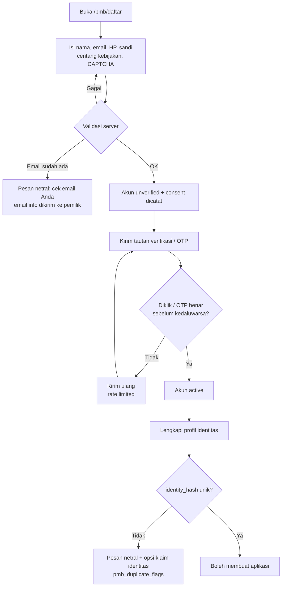

### 1.2 Pengisian formulir

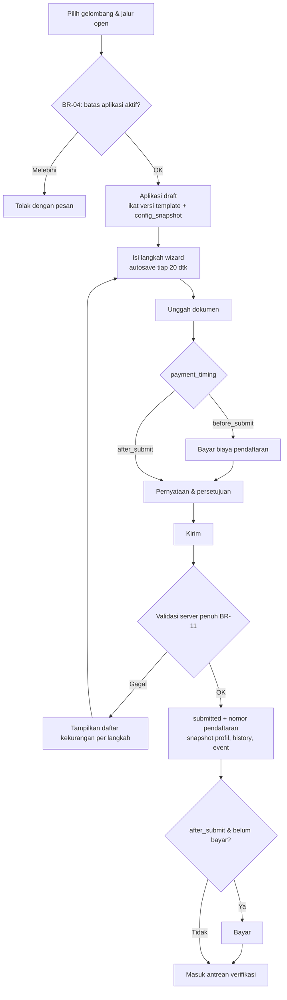

### 1.3 Verifikasi dokumen dan aplikasi

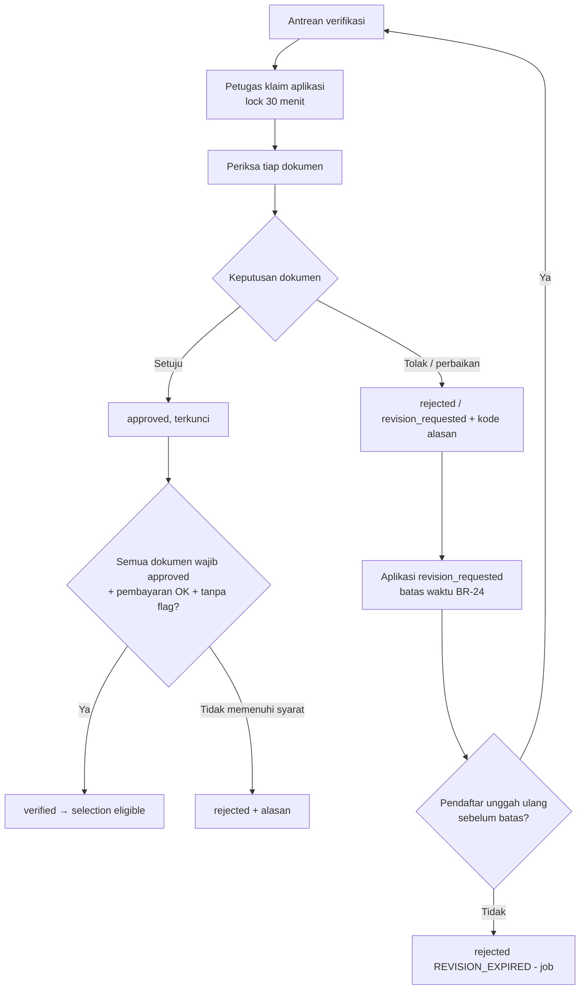

### 1.4 Pembayaran

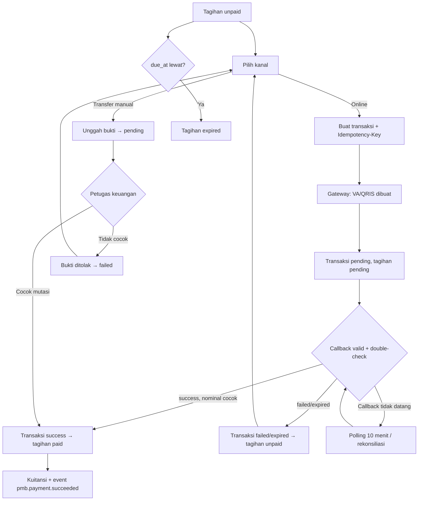

### 1.5 Seleksi

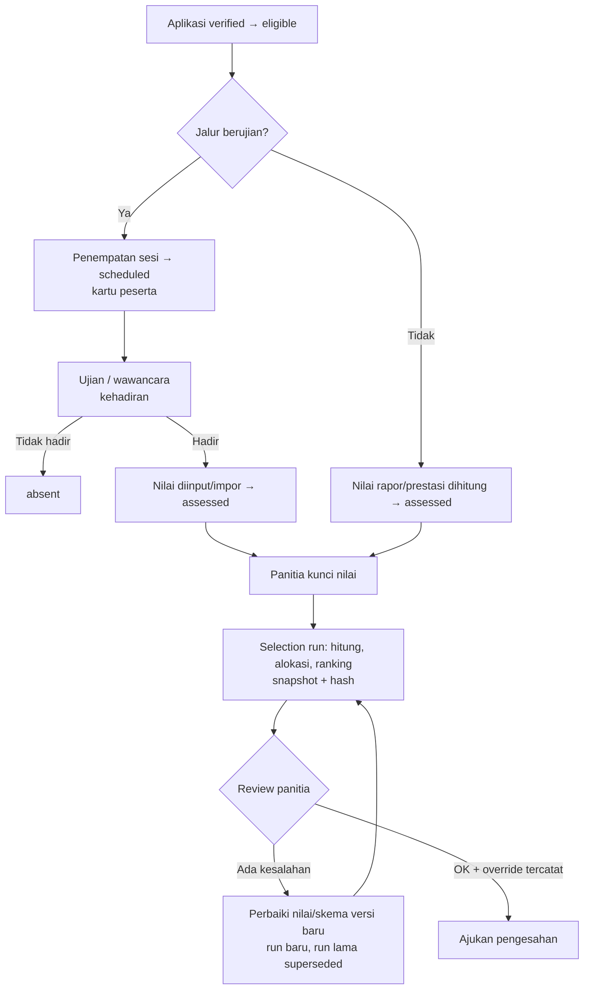

### 1.6 Pengumuman

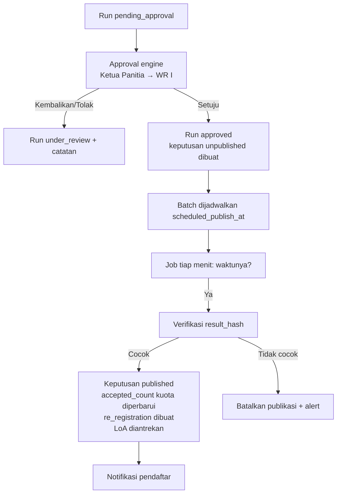

### 1.7 Daftar ulang

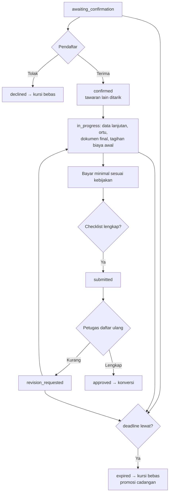

### 1.8 Pembentukan mahasiswa

Lihat diagram sekuens di [07 §K.6](07-spesifikasi-daftar-ulang-jalur-khusus-pelaporan.md#k6-pembentukan-mahasiswa-idempotensi-dan-pencegahan-nim-ganda).

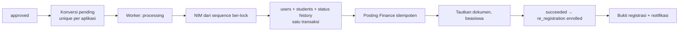

### 1.9 Penanganan kegagalan pembayaran dan integrasi

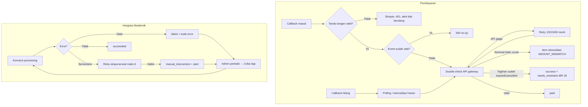

---

## 2. Definisi State Machine

Kolom tabel: **Status** · **Arti** · **Dari** (status sebelumnya yang sah) · **Ke** (status berikutnya yang sah) · **Aktor transisi masuk** · **Syarat** · **Efek samping** · **Notifikasi** (event) · **Dapat dibatalkan/dikembalikan?**

### SM-01 Akun pendaftar

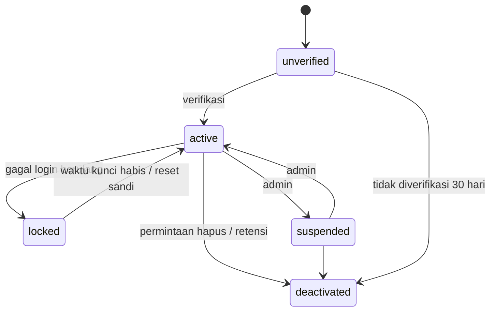

| Status | Arti | Dari | Ke | Aktor | Syarat | Efek samping | Notifikasi | Batal/kembali |
|---|---|---|---|---|---|---|---|---|
| `unverified` | Akun dibuat, belum verifikasi | — | active, deactivated | Pendaftar / petugas loket | Validasi registrasi | Consent dicatat | `pmb.account.registered`, `pmb.account.verification_requested` | — |
| `active` | Dapat memakai portal | unverified, locked, suspended | locked, suspended, deactivated | Pendaftar (verifikasi), sistem, `pmb_admin` | Token/OTP valid | `email_verified_at` diisi | `pmb.account.verified` | Ya |
| `locked` | Terkunci sementara | active | active | Sistem | 5 gagal login/15 menit | Token dicabut | `pmb.account.locked` (email keamanan) | Otomatis setelah durasi |
| `suspended` | Dibekukan admin (penyalahgunaan) | active | active, deactivated | `pmb_admin` | Alasan wajib | Token dicabut; aplikasi tidak dapat diubah | `pmb.account.suspended` | Ya, oleh `pmb_admin` |
| `deactivated` | Nonaktif permanen | unverified, active, suspended | — | Pendaftar (hapus akun), sistem (retensi/tidak terverifikasi) | Tidak ada aplikasi non-terminal (untuk permintaan pendaftar) | Data dianonimkan sesuai retensi | `pmb.account.deactivated` | Tidak |

### SM-02 Formulir (`pmb_applications.form_status`)

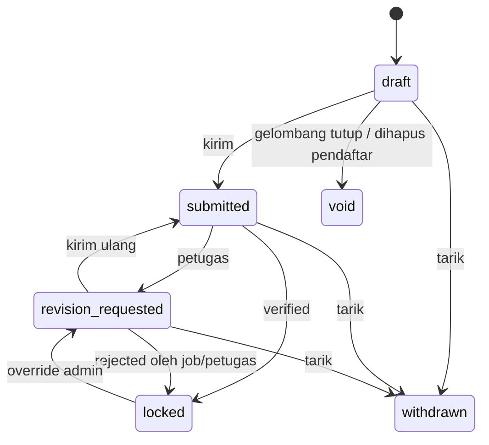

| Status | Arti | Dari | Ke | Aktor | Syarat | Efek samping | Notifikasi | Batal/kembali |
|---|---|---|---|---|---|---|---|---|
| `draft` | Sedang diisi | — | submitted, void, withdrawn | Pendaftar | BR-04 | `config_snapshot` disalin | `pmb.application.created` | — |
| `submitted` | Terkirim, terkunci bagi pendaftar | draft, revision_requested | revision_requested, locked, withdrawn | Pendaftar | BR-11 | Nomor pendaftaran (pertama kali), snapshot profil, consent | `pmb.application.submitted` | Hanya via revision_requested |
| `revision_requested` | Dibuka sebagian untuk perbaikan | submitted, locked | submitted, locked, withdrawn | `pmb_verifier`, `pmb_admin` | Target perbaikan + catatan, sebelum `form_lock_at` | Field/dokumen target dibuka | `pmb.application.revision_requested` | Ya |
| `locked` | Final (verified atau rejected) | submitted, revision_requested | revision_requested (override) | Sistem (mengikuti verifikasi) | `verification_status ∈ {verified, rejected}` | Semua dokumen tahap aplikasi terkunci | — | Hanya `pmb_admin` (override) |
| `withdrawn` | Ditarik pendaftar | draft, submitted, revision_requested | — | Pendaftar | Belum ada keputusan published | Keluar dari antrean/seleksi; refund sesuai BR-19 | `pmb.application.withdrawn` | Tidak |
| `void` | Tidak berlaku (draft tidak dikirim saat tutup) | draft | — | Sistem | `registration_closes_at` lewat | Dikecualikan dari KPI aplikasi | `pmb.application.void` (opsional) | Tidak |

### SM-03 Dokumen

| Status | Arti | Dari | Ke | Aktor | Syarat | Efek samping | Notifikasi | Batal/kembali |
|---|---|---|---|---|---|---|---|---|
| `missing` | Belum diunggah | — | uploaded | Sistem (baris dibuat dari persyaratan) | — | — | — | — |
| `uploaded` | Versi terbaru diunggah, belum diperiksa | missing, rejected, revision_requested, uploaded (ganti saat draft) | in_review | Pendaftar | File lolos validasi; scan `clean` | Versi baru | — | Ganti file selama draft/revisi |
| `in_review` | Sedang diperiksa | uploaded | approved, rejected, revision_requested | Sistem (saat aplikasi diklaim) | Aplikasi `in_review` | — | — | — |
| `approved` | Disetujui, terkunci | in_review | revision_requested (override) | `pmb_verifier`, `re_registration_officer` | — | Kunci | — | Hanya dibuka `pmb_admin` / petugas dengan alasan |
| `rejected` | Ditolak final untuk versi ini | in_review | uploaded | Petugas | Kode alasan | — | `pmb.document.rejected` | Pendaftar unggah versi baru bila aplikasi `revision_requested` |
| `revision_requested` | Perlu diganti | in_review, approved | uploaded | Petugas | Kode alasan + catatan | Dibuka untuk unggah | `pmb.document.revision_requested` (digabung per aplikasi) | Ya |

### SM-04 Tagihan (`pmb_invoices.status`)

| Status | Arti | Dari | Ke | Aktor | Syarat | Efek samping | Notifikasi | Batal/kembali |
|---|---|---|---|---|---|---|---|---|
| `unpaid` | Belum ada pembayaran berhasil | — , pending | pending, paid (loket), expired, cancelled | Sistem | — | — | `pmb.invoice.created` | — |
| `pending` | Ada transaksi pending / bukti menunggu | unpaid | unpaid, paid, partially_paid | Sistem | Transaksi `pending` aktif | — | — | Kembali ke unpaid bila transaksi gagal/expired |
| `partially_paid` | Sebagian terbayar (cicilan biaya awal) | pending, unpaid | paid, refund_pending | Sistem | Σ sukses < amount_net | Cek BR-33 minimum | `pmb.payment.succeeded` | — |
| `paid` | Lunas | pending, unpaid, partially_paid | refund_pending | Sistem (BR-15) | Σ sukses ≥ amount_net | Event pembayaran; buka langkah berikut | `pmb.payment.succeeded` | Hanya via refund |
| `expired` | Lewat `due_at` tanpa lunas | unpaid, pending | — (pembayaran terlambat → BR-18) | Sistem | `due_at` lewat | Aplikasi draft tidak dapat dikirim | `pmb.invoice.expired` | Tidak (resolusi manual BR-18) |
| `cancelled` | Dibatalkan (aplikasi ditarik/void, tagihan diganti) | unpaid, pending | — | Sistem / `finance_officer` | Tidak ada transaksi sukses | Transaksi pending dibatalkan di gateway | — | Tidak |
| `refund_pending` | Refund diajukan | paid, partially_paid | refunded, paid (refund ditolak) | Sistem (dari `pmb_refunds`) | Refund `pending_approval` | — | — | Ya bila refund ditolak |
| `refunded` | Dikembalikan penuh | refund_pending | — | `finance_officer` | Refund `completed` | Hak lanjut dicabut bila terkait | `pmb.refund.completed` | Tidak |

### SM-05 Transaksi pembayaran (`pmb_payment_transactions.status`)

| Status | Arti | Dari | Ke | Aktor | Syarat | Efek samping | Notifikasi | Batal/kembali |
|---|---|---|---|---|---|---|---|---|
| `created` | Dibuat, belum ada respons gateway | — | pending, failed | Sistem | Idempotency-Key unik | — | — | — |
| `pending` | Menunggu pembayaran / verifikasi bukti | created | success, failed, expired, cancelled | Sistem / pendaftar | Gateway OK / bukti diunggah | Tagihan `pending` | `pmb.payment.instructions` | Pendaftar dapat membatalkan |
| `success` | Berhasil tervalidasi | pending | refunded | Sistem (callback + double-check) / `finance_officer` | BR-15, nominal cocok | Perbarui tagihan | (via tagihan) | Hanya via refund |
| `failed` | Gagal / bukti ditolak | created, pending | — | Sistem / `finance_officer` | — | Tagihan kembali `unpaid` | `pmb.payment.failed` | Tidak (buat transaksi baru) |
| `expired` | Kedaluwarsa | pending | — | Sistem | `expires_at` lewat | Tagihan kembali `unpaid` | `pmb.payment.expired` | Tidak |
| `cancelled` | Dibatalkan | pending | — | Pendaftar / sistem | Pembatalan di gateway sukses atau tidak didukung (dicatat) | — | — | Tidak |
| `refunded` | Dana dikembalikan | success | — | `finance_officer` | Refund `completed` | — | — | Tidak |

### SM-06 Verifikasi administrasi

Tabel transisi lengkap: [05 §G.3](05-spesifikasi-pembayaran-dan-verifikasi.md#g3-aturan-perpindahan-status-verifikasi). Ringkas:

| Status | Arti | Notifikasi | Batal/kembali |
|---|---|---|---|
| `not_started` | Belum masuk antrean (belum kirim/bayar) | — | — |
| `in_review` | Diperiksa | — | — |
| `revision_requested` | Menunggu perbaikan pendaftar | `pmb.application.revision_requested` | Ya |
| `verified` | Lolos administrasi | `pmb.application.verified` | `pmb_admin` dengan alasan, sebelum dinilai |
| `rejected` | Gagal administrasi | `pmb.application.rejected` | `pmb_admin` dengan alasan |

Efek samping `verified`: `selection_status → eligible`, form `locked`, dokumen terkunci, tersedia untuk penjadwalan ujian.

### SM-07 Seleksi peserta (`pmb_applications.selection_status`)

| Status | Arti | Dari | Ke | Aktor | Syarat | Efek samping | Notifikasi | Batal/kembali |
|---|---|---|---|---|---|---|---|---|
| `not_eligible` | Belum/ tidak lolos administrasi | — | eligible | Sistem | — | — | — | — |
| `eligible` | Lolos administrasi, siap dinilai | not_eligible | scheduled, assessed, not_eligible (override verifikasi) | Sistem | `verified` | — | — | Ya (override) |
| `scheduled` | Ditempatkan di sesi ujian | eligible | assessed, absent, eligible (dikeluarkan dari sesi) | `selection_committee` / sistem | Kapasitas | Kartu peserta | `pmb.exam.scheduled` | Pindah sesi |
| `assessed` | Semua komponen wajib memiliki nilai | eligible, scheduled | ranked, scheduled (komponen lain) | Sistem | Nilai lengkap | — | — | — |
| `absent` | Tidak hadir komponen wajib | scheduled | scheduled (reschedule), ranked (dinilai gugur) | Pengawas / sistem | — | — | `pmb.exam.absent` (opsional) | Reschedule FR-EXM-08 |
| `disqualified` | Didiskualifikasi | scheduled, assessed | — | `selection_committee` (alasan) | Bukti pelanggaran | Gugur pada run | `pmb.selection.disqualified` | Via koreksi |
| `ranked` | Masuk run yang `approved` | assessed, absent | — | Sistem | Run approved | Nilai terkunci | — | Via koreksi (BR-31) |

### SM-08 Selection run (`pmb_selection_runs.status`)

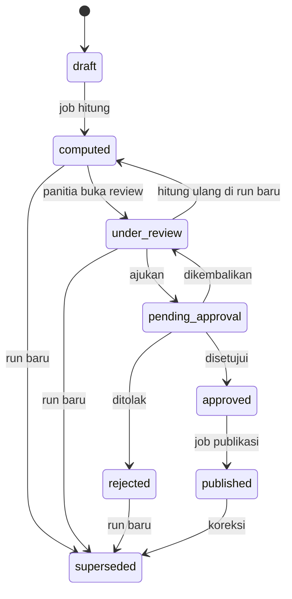

| Status | Arti | Aktor masuk | Syarat | Efek samping | Notifikasi | Batal/kembali |
|---|---|---|---|---|---|---|
| `draft` | Dibuat, menunggu job | `selection_committee` | Skema locked, nilai lengkap/dikunci | Job diantrekan | — | Dibatalkan sebelum dihitung |
| `computed` | Snapshot hasil tersedia | Sistem | — | `result_hash` | Panitia (in-app) | — |
| `under_review` | Ditinjau, override dapat ditambahkan | `selection_committee` | — | — | — | — |
| `pending_approval` | Menunggu pengesahan | `selection_committee` (`pmb_selection.submit`) | Tidak ada `tie_unresolved` | `approval_requests` dibuat | Pengesah: `pmb.approval.requested` | Dikembalikan oleh pengesah |
| `approved` | Disahkan | Approval engine | Pengesah ≠ pengaju | Keputusan `unpublished` dibuat, nilai dikunci, batch dijadwalkan | Panitia | Tidak (hanya koreksi) |
| `rejected` | Ditolak pengesah | Approval engine | Catatan | — | Panitia | Run baru |
| `published` | Keputusan diterbitkan | Job | `result_hash` valid, waktu tiba | Lihat J.1 FR-ANN-03 | Pendaftar `pmb.result.published` | Koreksi berversi |
| `superseded` | Digantikan run lain | Sistem | Run pengganti dibuat/terbit | — | — | Tidak |

### SM-09 Keputusan penerimaan

Dua dimensi pada `pmb_admission_decisions`: `decision` dan `publication_status`. Setiap koreksi/promosi membuat **baris baru** (`decision_version + 1`, `is_current = true`; baris lama `is_current = false`, `publication_status = superseded`).

| Dimensi | Status | Arti | Transisi |
|---|---|---|---|
| decision | `accepted` | Diterima | Dari hasil run atau promosi `waitlisted` (baris baru) |
| decision | `waitlisted` | Cadangan (rank tersimpan) | → `accepted` via promosi (baris baru); tetap waitlisted hingga periode tutup |
| decision | `rejected` | Tidak diterima | → (koreksi) baris baru |
| decision | `withdrawn` | Mengundurkan diri / menerima tawaran lain | Terminal |
| publication | `unpublished` | Dibuat dari run approved, belum terlihat pendaftar | → `published` (job) |
| publication | `published` | Terlihat pendaftar | → `superseded` saat ada versi baru |
| publication | `superseded` | Versi lama | Terminal |

Notifikasi: `pmb.result.published`, `pmb.result.corrected`, `pmb.waitlist.promoted`.

### SM-10 Daftar ulang (`pmb_re_registrations.status`)

| Status | Arti | Dari | Ke | Aktor | Syarat | Efek samping | Notifikasi | Batal/kembali |
|---|---|---|---|---|---|---|---|---|
| `awaiting_confirmation` | Menunggu pendaftar menerima/menolak | — | confirmed, declined, expired, cancelled | Sistem (saat publikasi accepted) | — | `deadline_at` | `pmb.result.published` (berisi instruksi) | — |
| `confirmed` | Tawaran diterima | awaiting_confirmation | in_progress, expired, cancelled | Pendaftar | `now ≤ deadline` | Tawaran lain ditarik (A-17), tagihan biaya awal dibuat | `pmb.re_registration.confirmed` | Tidak oleh pendaftar |
| `in_progress` | Melengkapi data/dokumen/pembayaran | confirmed, revision_requested | submitted, expired, cancelled | Sistem (aktivitas pertama) | — | — | Pengingat batas | — |
| `submitted` | Diajukan untuk validasi | in_progress, revision_requested | approved, revision_requested, cancelled | Pendaftar | Checklist otomatis hijau | Masuk antrean petugas | `pmb.re_registration.submitted` | — |
| `revision_requested` | Perlu perbaikan | submitted | submitted, in_progress, expired | `re_registration_officer` | Catatan | Bagian terkait dibuka | `pmb.re_registration.revision_requested` | Ya |
| `approved` | Disetujui final | submitted | enrolled | `re_registration_officer` | BR-33, SoD | Outbox konversi | — | Tidak (pembatalan → `cancelled` sebelum `enrolled` oleh `pmb_admin` + approval) |
| `enrolled` | Mahasiswa terbentuk | approved | — | Sistem | Konversi `succeeded` | Bukti registrasi | `pmb.student.enrolled` | Tidak (BR-39) |
| `declined` | Menolak tawaran | awaiting_confirmation | — (pemulihan 24 jam oleh admin → awaiting_confirmation) | Pendaftar | — | Kursi bebas | `pmb.re_registration.declined` | Terbatas |
| `expired` | Lewat batas | awaiting_confirmation, confirmed, in_progress, revision_requested | — (pemulihan `LATE_CALLBACK` → in_progress) | Sistem | `deadline` lewat | Kursi bebas | `pmb.re_registration.expired` | Terbatas |
| `cancelled` | Dibatalkan kampus | semua non-terminal kecuali enrolled | — | `pmb_admin` + approval | Alasan | LoA dicabut | `pmb.re_registration.cancelled` | Tidak |

### SM-11 Konversi mahasiswa (`pmb_student_conversions.status`)

| Status | Arti | Dari | Ke | Aktor | Syarat | Efek samping | Notifikasi | Batal/kembali |
|---|---|---|---|---|---|---|---|---|
| `pending` | Menunggu worker | — , failed (retry) | processing | Sistem | Daftar ulang `approved` | — | — | — |
| `processing` | Dikerjakan (lease 5 menit) | pending, manual_intervention (retry) | succeeded, pending (retry sementara), failed, manual_intervention | Worker | Lock | Langkah tercatat | — | — |
| `succeeded` | Semua langkah selesai | processing | — | Worker | — | Daftar ulang `enrolled` | `pmb.student.enrolled` | Tidak |
| `failed` | Error data | processing | pending (retry manual) | Worker | — | `last_error_code` | Admin: `pmb.conversion.failed` | Ya, retry |
| `manual_intervention` | Retry habis / konflik tak terselesaikan | processing | processing (retry manual) | Worker | ≥ 6 percobaan | Alert | Admin & IT | Ya, retry |

---

## 3. Status ringkas untuk pendaftar (`current_stage`, diturunkan)

| Urutan | `current_stage` | Kondisi (dievaluasi berurutan, pertama yang cocok) | Label default |
|---|---|---|---|
| 1 | `enrolled` | re_registration `enrolled` | "Selamat, Anda resmi menjadi mahasiswa" |
| 2 | `re_registration` | re_registration non-terminal | "Daftar ulang" |
| 3 | `re_registration_closed` | re_registration `declined/expired/cancelled` | "Daftar ulang tidak diselesaikan" |
| 4 | `result_available` | keputusan current `published` | "Hasil seleksi tersedia" |
| 5 | `withdrawn` / `void` | form_status | "Ditarik" / "Tidak dikirim" |
| 6 | `admin_rejected` | verification `rejected` | "Tidak lolos administrasi" |
| 7 | `in_selection` | selection_status ∈ {eligible, scheduled, assessed, absent, ranked} | "Proses seleksi" |
| 8 | `revision_needed` | verification `revision_requested` | "Perlu perbaikan" |
| 9 | `under_verification` | verification `in_review` atau (`submitted` & sudah bayar) | "Sedang diverifikasi" |
| 10 | `awaiting_payment` | tagihan pendaftaran belum `paid` & diperlukan | "Menunggu pembayaran" |
| 11 | `draft` | form `draft` | "Melengkapi formulir" |
