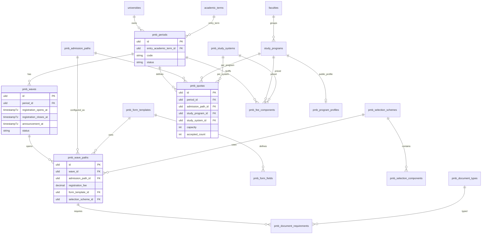
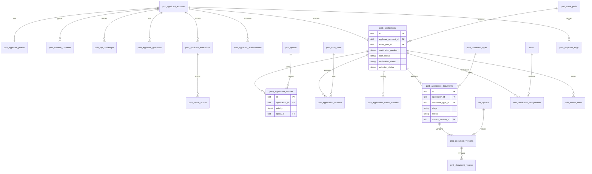
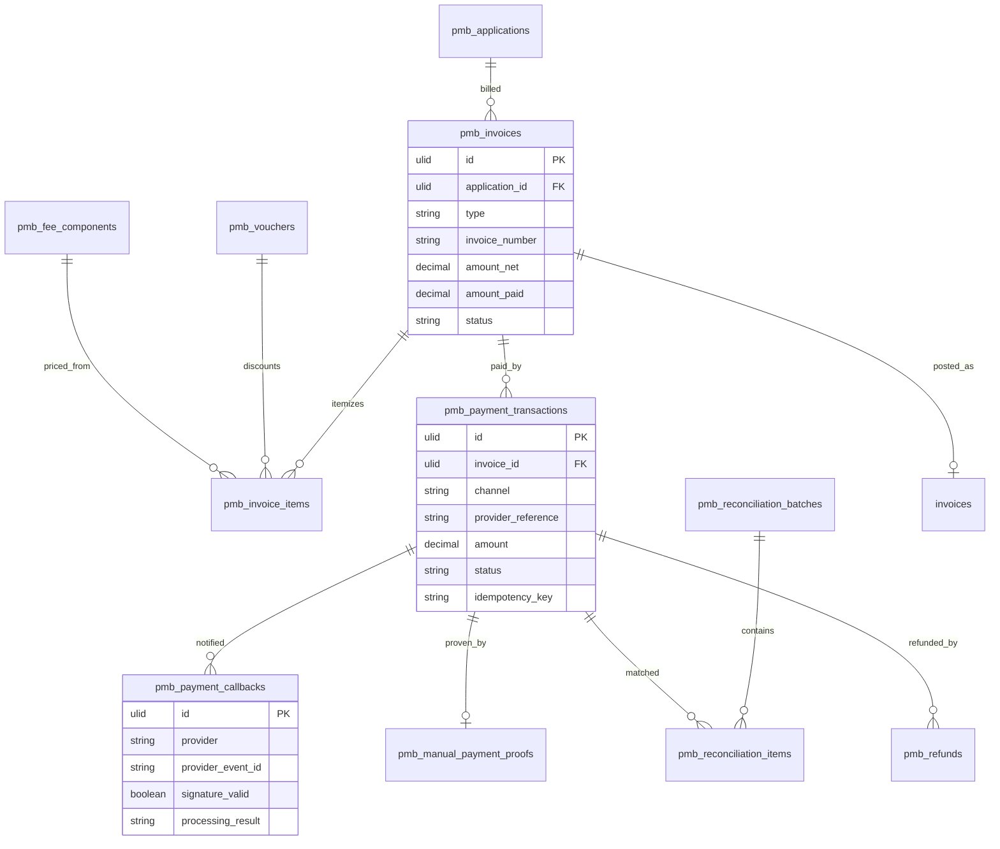
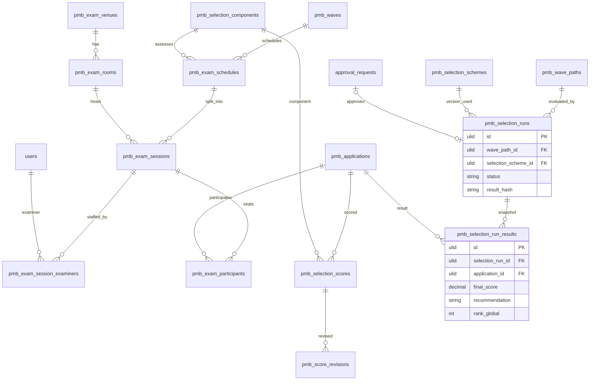
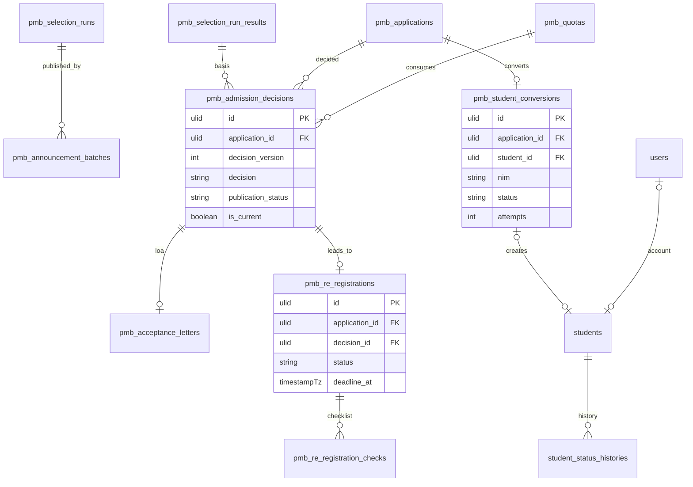

# 10 — Rancangan Database, ERD, dan Data Dictionary

[← Kembali ke dokumen utama](../RANCANGAN_SISTEM_PENERIMAAN_MAHASISWA_BARU_PMB.md)

Database: MySQL 8 (InnoDB, `utf8mb4_unicode_ci`), mengikuti konvensi CivitasOne. Seluruh tabel baru berada di `app/Modules/Admission/Database/Migrations`.

---

## 1. Evaluasi Entitas Kandidat

Daftar kandidat di brief dievaluasi terhadap kode yang ada dan kebutuhan rancangan.

| Kandidat brief | Keputusan | Tabel final | Alasan |
|---|---|---|---|
| academic_years | **Tidak dibuat** — pakai yang ada | `academic_terms` | Sudah ada (academic_year + semester) |
| admission_periods | Dipakai | `pmb_periods` | — |
| admission_waves | Dipakai | `pmb_waves` | — |
| admission_paths | Dipakai | `pmb_admission_paths` + `pmb_wave_paths` | Jalur adalah master; konfigurasi per gelombang dipisah |
| faculties, study_programs | **Tidak dibuat** — pakai yang ada | `faculties`, `study_programs` + `pmb_program_profiles` | Profil publik PMB dipisah agar tidak mengotori master akademik |
| admission_quotas | Dipakai | `pmb_quotas` | Ditambah dimensi sistem kuliah |
| admission_requirements | Dipecah | `pmb_document_types` + `pmb_document_requirements` | Katalog jenis vs persyaratan per wave path |
| applicant_accounts | Dipakai | `pmb_applicant_accounts` (+ `pmb_account_consents`, `pmb_otp_challenges`) | KD-01 |
| applicant_profiles | Dipakai, dipecah | `pmb_applicant_profiles`, `pmb_applicant_guardians`, `pmb_applicant_educations`, `pmb_report_scores`, `pmb_applicant_achievements` | Normalisasi 1:n |
| applications | Dipakai | `pmb_applications` | — |
| application_choices | Dipakai | `pmb_application_choices` | — |
| application_form_fields | Dipakai | `pmb_form_templates` + `pmb_form_fields` | Berversi |
| application_answers | Dipakai | `pmb_application_answers` | Hanya field tambahan (KD-08) |
| application_documents | Dipakai | `pmb_application_documents` + `pmb_document_versions` | Versi dokumen |
| document_verifications | Diganti nama | `pmb_document_reviews` | Satu baris per keputusan per versi |
| registration_fees | **Digabung** | `pmb_wave_paths.registration_fee` | Satu nilai per wave path; tidak perlu tabel |
| payment_transactions | Dipakai | `pmb_payment_transactions` (+ `pmb_invoices`, `pmb_invoice_items`, `pmb_payment_callbacks`, `pmb_manual_payment_proofs`) | Tagihan ≠ transaksi |
| payment_reconciliations | Dipecah | `pmb_reconciliation_batches` + `pmb_reconciliation_items` | — |
| selection_stages | **Tidak dibuat** | — | Tahapan diwakili state machine + komponen skema; tabel tahap generik menduplikasi |
| selection_criteria | Diganti nama | `pmb_selection_schemes` + `pmb_selection_components` | Berversi |
| selection_scores | Dipakai | `pmb_selection_scores` + `pmb_score_revisions` | — |
| examination_schedules / sessions / participants | Dipakai | `pmb_exam_schedules`, `pmb_exam_sessions`, `pmb_exam_participants` (+ `pmb_exam_venues`, `pmb_exam_rooms`, `pmb_exam_session_examiners`) | GAP-08 |
| admission_results | Diganti | `pmb_selection_runs` + `pmb_selection_run_results` (rekomendasi) dan `pmb_admission_decisions` (keputusan) | Memisahkan hasil hitung dari keputusan berversi |
| result_approvals | **Tidak dibuat** — pakai yang ada | `approval_requests` (morph ke `pmb_selection_runs`) | Approval engine sudah ada |
| re_registration_records | Dipakai | `pmb_re_registrations` + `pmb_re_registration_checks` | — |
| tuition_invoices / tuition_payments | **Digabung** | `pmb_invoices` (`type = initial_tuition`) / `pmb_payment_transactions` | Mesin tagihan yang sama |
| student_records | **Tidak dibuat** — pakai yang ada | `students` + `pmb_student_conversions` | — |
| notifications | **Tidak dibuat** — pakai yang ada | `notifications`, `notification_templates`, `notification_logs` | — |
| audit_logs | **Tidak dibuat** — pakai yang ada | `audit_logs` (+ `pmb_sensitive_access_logs`, `pmb_export_logs`) | Log khusus volume tinggi dipisah |
| system_settings | **Tidak dibuat** — pakai yang ada | `university_settings` grup `pmb.*` | Pengaturan per tenant |
| (tambahan) | Baru | `pmb_study_systems`, `pmb_fee_components`, `pmb_contents`, `pmb_duplicate_flags`, `pmb_application_status_histories`, `pmb_verification_assignments`, `pmb_review_notes`, `pmb_vouchers`, `pmb_refunds`, `pmb_announcement_batches`, `pmb_acceptance_letters`, `pmb_sequences`, `pmb_broadcasts`, `pmb_chat_threads`, `pmb_chat_messages`, `pmb_outbox_events`, `pmb_daily_stats` | Kebutuhan dari spesifikasi 03–07 |

**Total tabel baru: 66.**

---

## 2. Konvensi

| Aspek | Konvensi |
|---|---|
| Primary key | `id` ULID (`$table->ulid('id')->primary()`), kecuali disebut |
| Tenant | `university_id` ULID NOT NULL FK `universities` cascade on delete; model memakai `TenantScoped`. **Kolom standar** = `id`, `university_id`, `created_at`, `updated_at` (`timestampsTz`) — tidak diulang di data dictionary |
| Enum | `string(30)` + PHP backed enum (KD-10) |
| Uang | `decimal(14,2)`; mata uang `char(3)` default `IDR` hanya di tabel transaksi |
| Waktu | `timestampTz` (UTC); tanggal murni `date` |
| Audit field | Tabel konfigurasi & keputusan: `created_by`, `updated_by` (ULID nullable FK `users` null on delete). Perubahan rinci di `audit_logs` |
| Soft delete | Hanya tabel master yang dapat "dihapus" pengguna: `pmb_admission_paths`, `pmb_study_systems`, `pmb_document_types`, `pmb_contents`, `pmb_exam_venues`, `pmb_exam_rooms`, `pmb_vouchers`. Data transaksi & pendaftar **tidak** soft delete — memakai status terminal + anonimisasi retensi |
| Data sensitif | Kolom `text` dengan cast `encrypted` (APP_KEY dirotasi via `APP_PREVIOUS_KEYS`); pencarian via kolom hash HMAC terpisah |
| Optimistic lock | `lock_version unsignedInteger default 0` pada tabel yang diedit bersamaan (`pmb_applications`, `pmb_re_registrations`, `pmb_quotas`, `pmb_exam_sessions`) |
| Penamaan index | Default Laravel; unique komposit diberi nama eksplisit bila > 64 karakter |
| JSON | Hanya untuk data semi-terstruktur yang tidak dipakai join/filter berat (snapshot, rule, rubrik, payload) |

---

## 3. ERD

### 3.1 Konfigurasi



### 3.2 Akun, aplikasi, dan dokumen



### 3.3 Keuangan



### 3.4 Ujian dan seleksi



### 3.5 Keputusan, daftar ulang, dan konversi



### 3.6 Jenis relasi

| Jenis | Contoh |
|---|---|
| One-to-one | `pmb_applicant_accounts` ↔ `pmb_applicant_profiles`; `study_programs` ↔ `pmb_program_profiles`; `pmb_applications` ↔ `pmb_student_conversions`; `pmb_admission_decisions` (accepted, current) ↔ `pmb_re_registrations`; `pmb_payment_transactions` ↔ `pmb_manual_payment_proofs` |
| One-to-many | Periode → gelombang; gelombang → wave path; akun → aplikasi; aplikasi → pilihan, dokumen, tagihan, nilai, keputusan (versi); tagihan → transaksi; dokumen → versi; run → hasil; sesi → peserta |
| Many-to-many (via tabel penghubung) | Gelombang ↔ jalur (`pmb_wave_paths`, membawa atribut); aplikasi ↔ kuota (`pmb_application_choices`, membawa prioritas); sesi ↔ penguji (`pmb_exam_session_examiners`); aplikasi ↔ jadwal (`pmb_exam_participants`); wave path ↔ jenis dokumen (`pmb_document_requirements`) |

---

## 4. Data Dictionary

Kolom standar (`id`, `university_id`, `created_at`, `updated_at`) ada di setiap tabel kecuali disebut. Kolom: **Tipe** (Laravel) · **Null** · **Default** · **Keterangan / aturan**.

### 4.1 Konfigurasi

#### `pmb_periods` — siklus PMB per tahun masuk

| Kolom | Tipe | Null | Default | Keterangan |
|---|---|:-:|---|---|
| entry_academic_term_id | ulid FK `academic_terms` restrict | T | — | Term masuk |
| code | string(30) | T | — | Unik per tenant |
| name | string(150) | T | — | |
| starts_on, ends_on | date | T | — | ends_on > starts_on |
| status | string(30) | T | `draft` | draft, published, closed, archived |
| description | text | Y | null | |
| published_at, closed_at | timestampTz | Y | null | |
| created_by, updated_by | ulid FK users | Y | null | |

Index: unique (`university_id`, `code`); index (`university_id`, `status`); unique parsial "satu published per term" ditegakkan di service (MySQL tanpa partial index) dengan lock.

#### `pmb_waves` — gelombang

| Kolom | Tipe | Null | Default | Keterangan |
|---|---|:-:|---|---|
| period_id | ulid FK `pmb_periods` cascade | T | — | |
| code | string(30) | T | — | Unik per periode |
| name | string(150) | T | — | |
| sequence | unsignedSmallInteger | T | 1 | |
| registration_opens_at, registration_closes_at | timestampTz | T | — | |
| payment_deadline_at, form_lock_at | timestampTz | T | — | |
| exam_starts_on, exam_ends_on | date | Y | null | |
| announcement_at | timestampTz | T | — | |
| re_registration_opens_at, re_registration_closes_at | timestampTz | T | — | |
| is_ods | boolean | T | false | |
| status | string(30) | T | `draft` | draft, scheduled, open, closed, announced, completed |
| created_by, updated_by | ulid | Y | null | |

Index: unique (`period_id`, `code`); index (`university_id`, `status`); index (`registration_closes_at`). Integritas: urutan tanggal (BR-02) di FormRequest + service.

#### `pmb_admission_paths` — master jalur (soft delete)

| Kolom | Tipe | Null | Default | Keterangan |
|---|---|:-:|---|---|
| code | string(30) | T | — | Unik per tenant |
| name | string(150) | T | — | |
| category | string(30) | T | — | regular, achievement, kip_affirmation, transfer, postgraduate, rpl, scholarship, partnership, international, other |
| description | text | Y | null | |
| eligible_degree_levels | json | T | `[]` | |
| requires_exam | boolean | T | false | |
| requires_previous_institution | boolean | T | false | |
| is_active | boolean | T | true | |
| deleted_at | timestampTz | Y | null | Ditolak bila dipakai wave path |

Index: unique (`university_id`, `code`).

#### `pmb_study_systems` — sistem kuliah (soft delete)

| Kolom | Tipe | Null | Default | Keterangan |
|---|---|:-:|---|---|
| code | string(20) | T | — | Unik per tenant |
| name | string(100) | T | — | |
| schedule_note | string(255) | Y | null | |
| is_active | boolean | T | true | |
| deleted_at | timestampTz | Y | null | |

#### `pmb_wave_paths` — jalur dibuka per gelombang

| Kolom | Tipe | Null | Default | Keterangan |
|---|---|:-:|---|---|
| wave_id | ulid FK `pmb_waves` cascade | T | — | |
| admission_path_id | ulid FK `pmb_admission_paths` restrict | T | — | |
| registration_fee | decimal(14,2) | T | 0 | ≥ 0 |
| payment_timing | string(20) | T | `before_submit` | |
| max_choices | unsignedTinyInteger | T | 2 | 1–5 |
| allow_cross_system_choice | boolean | T | false | |
| form_template_id | ulid FK `pmb_form_templates` restrict | T | — | Harus published |
| selection_scheme_id | ulid FK `pmb_selection_schemes` restrict | Y | null | Harus locked sebelum seleksi |
| quota_mode | string(20) | T | `period` | period, wave_cap |
| bulk_verifiable | boolean | T | false | FR-VER-05 |
| is_open | boolean | T | true | Saklar darurat |
| public_notes | text | Y | null | |
| created_by, updated_by | ulid | Y | null | |

Index: unique (`wave_id`, `admission_path_id`).

#### `pmb_quotas`

| Kolom | Tipe | Null | Default | Keterangan |
|---|---|:-:|---|---|
| period_id | ulid FK cascade | T | — | |
| admission_path_id | ulid FK restrict | T | — | |
| study_program_id | ulid FK `study_programs` restrict | T | — | |
| study_system_id | ulid FK restrict | T | — | |
| capacity | unsignedInteger | T | 0 | ≥ accepted_count |
| waitlist_capacity | unsignedInteger | T | 0 | |
| min_final_score | decimal(5,2) | Y | null | 0–100 |
| wave_caps | json | Y | null | |
| accepted_count | unsignedInteger | T | 0 | Denormalisasi, diubah hanya oleh service ber-lock |
| is_offered | boolean | T | true | |
| lock_version | unsignedInteger | T | 0 | |
| created_by, updated_by | ulid | Y | null | |

Index: unique `pmb_quotas_unique_dim` (`period_id`, `admission_path_id`, `study_program_id`, `study_system_id`); index (`university_id`, `study_program_id`).

#### `pmb_document_types` (soft delete)

| Kolom | Tipe | Null | Default | Keterangan |
|---|---|:-:|---|---|
| code | string(40) | T | — | Unik per tenant |
| name | string(150) | T | — | |
| description | text | Y | null | |
| allowed_mime_types | json | T | — | mis. `["application/pdf","image/jpeg"]` |
| max_size_kb | unsignedInteger | T | 2048 | ≤ 20480 |
| allows_multiple | boolean | T | false | |
| requires_original_check | boolean | T | false | |
| is_sensitive | boolean | T | false | |
| retention_class | string(30) | T | `applicant` | applicant, student_record |
| deleted_at | timestampTz | Y | null | |

#### `pmb_document_requirements`

| Kolom | Tipe | Null | Default | Keterangan |
|---|---|:-:|---|---|
| wave_path_id | ulid FK cascade | T | — | |
| document_type_id | ulid FK restrict | T | — | |
| stage | string(20) | T | `application` | application, re_registration |
| is_mandatory | boolean | T | true | |
| condition | json | Y | null | Rule visibilitas |
| instructions | text | Y | null | |
| sort_order | unsignedSmallInteger | T | 0 | |

Index: unique (`wave_path_id`, `document_type_id`, `stage`).

#### `pmb_form_templates`

| Kolom | Tipe | Null | Default | Keterangan |
|---|---|:-:|---|---|
| code | string(40) | T | — | |
| name | string(150) | T | — | |
| version | unsignedInteger | T | 1 | |
| status | string(20) | T | `draft` | draft, published, retired |
| core_field_rules | json | T | `{}` | wajib/opsional/tersembunyi untuk field inti |
| based_on_id | ulid FK self | Y | null | |
| published_at | timestampTz | Y | null | |
| created_by, updated_by | ulid | Y | null | |

Index: unique (`university_id`, `code`, `version`).

#### `pmb_form_fields`

| Kolom | Tipe | Null | Default | Keterangan |
|---|---|:-:|---|---|
| form_template_id | ulid FK cascade | T | — | Tidak dapat diubah bila template published |
| section | string(40) | T | — | |
| key | string(60) | T | — | snake_case |
| label | string(200) | T | — | |
| help_text, placeholder | string(500) | Y | null | |
| type | string(20) | T | — | text, textarea, number, date, select, multiselect, radio, checkbox, email, phone, url, file_ref |
| options | json | Y | null | |
| is_required | boolean | T | false | |
| validation | json | Y | null | allowlist |
| visibility_rule | json | Y | null | |
| is_sensitive | boolean | T | false | |
| is_reportable | boolean | T | false | |
| stage | string(20) | T | `application` | application, re_registration |
| sort_order | unsignedSmallInteger | T | 0 | |

Index: unique (`form_template_id`, `key`).

#### `pmb_fee_components`

| Kolom | Tipe | Null | Default | Keterangan |
|---|---|:-:|---|---|
| period_id | ulid FK cascade | T | — | |
| study_program_id | ulid FK restrict | T | — | |
| study_system_id | ulid FK restrict | T | — | |
| admission_path_id | ulid FK restrict | Y | null | null = semua jalur |
| component_code | string(30) | T | — | |
| name | string(150) | T | — | |
| amount | decimal(14,2) | T | — | ≥ 0 |
| is_mandatory_for_enrollment | boolean | T | true | |
| installable | boolean | T | false | |
| installment_plan | json | Y | null | `[{"seq":1,"percent":40,"due_days":0},...]` Σ=100 |
| is_published | boolean | T | true | |
| sort_order | unsignedSmallInteger | T | 0 | |
| created_by, updated_by | ulid | Y | null | |

Index: unique `pmb_fee_unique` (`period_id`, `study_program_id`, `study_system_id`, `admission_path_id`, `component_code`) — catatan: NULL pada `admission_path_id` membuat unique tidak menahan duplikat baris "semua jalur"; ditegakkan di service.

#### `pmb_selection_schemes`

| Kolom | Tipe | Null | Default | Keterangan |
|---|---|:-:|---|---|
| code | string(40) | T | — | |
| name | string(150) | T | — | |
| version | unsignedInteger | T | 1 | |
| status | string(20) | T | `draft` | draft, locked, retired |
| passing_score | decimal(5,2) | Y | null | |
| allocation_method | string(30) | T | `score_priority` | |
| tie_break_rules | json | T | — | |
| rounding_scale | unsignedTinyInteger | T | 2 | |
| based_on_id | ulid FK self | Y | null | |
| locked_at | timestampTz | Y | null | |
| locked_by, created_by, updated_by | ulid FK users | Y | null | |

Index: unique (`university_id`, `code`, `version`).

#### `pmb_selection_components`

| Kolom | Tipe | Null | Default | Keterangan |
|---|---|:-:|---|---|
| selection_scheme_id | ulid FK cascade | T | — | Immutable bila skema locked |
| code | string(40) | T | — | |
| name | string(150) | T | — | |
| source | string(30) | T | — | Lihat 06 §H.2 |
| score_type | string(20) | T | `numeric` | numeric, pass_fail |
| raw_min, raw_max | decimal(9,4) | Y | null | Wajib bila numeric |
| weight | decimal(7,4) | T | 0 | |
| minimum_normalized | decimal(5,2) | Y | null | |
| is_mandatory | boolean | T | true | |
| tie_break_priority | unsignedTinyInteger | Y | null | |
| normalization | string(20) | T | `minmax` | |
| rubric | json | Y | null | |
| config | json | Y | null | |
| sort_order | unsignedSmallInteger | T | 0 | |

Index: unique (`selection_scheme_id`, `code`).

#### `pmb_program_profiles`

| Kolom | Tipe | Null | Default | Keterangan |
|---|---|:-:|---|---|
| study_program_id | ulid FK cascade | T | — | Unique |
| slug | string(120) | T | — | Unik per tenant |
| summary | string(500) | Y | null | |
| description | longText | Y | null | HTML tersanitasi |
| accreditation_label | string(50) | Y | null | |
| accreditation_valid_until | date | Y | null | |
| degree_title | string(50) | Y | null | |
| study_duration | string(50) | Y | null | |
| career_prospects | text | Y | null | |
| cover_file_id, brochure_file_id | ulid FK `file_uploads` null on delete | Y | null | |
| is_published | boolean | T | false | |
| updated_by | ulid | Y | null | |

#### `pmb_contents` — CMS & template teks (soft delete)

| Kolom | Tipe | Null | Default | Keterangan |
|---|---|:-:|---|---|
| type | string(30) | T | — | page, faq, news, guide, brochure, banner, declaration, privacy_policy, terms, result_template, loa_template, orientation_info |
| period_id | ulid FK | Y | null | Bila spesifik periode |
| slug | string(150) | Y | null | Unik per (tenant, type) |
| title | string(250) | T | — | |
| body | longText | Y | null | HTML tersanitasi / template |
| category | string(60) | Y | null | Kategori FAQ |
| file_id | ulid FK `file_uploads` | Y | null | Brosur/banner |
| version | unsignedInteger | T | 1 | Untuk declaration/policy/template |
| status | string(20) | T | `draft` | draft, published, archived |
| publish_at, unpublish_at | timestampTz | Y | null | Jadwal tayang |
| seo_title, seo_description | string | Y | null | |
| sort_order | unsignedSmallInteger | T | 0 | |
| created_by, updated_by | ulid | Y | null | |
| deleted_at | timestampTz | Y | null | |

Index: index (`university_id`, `type`, `status`); unique (`university_id`, `type`, `slug`, `version`).

### 4.2 Akun dan profil

#### `pmb_applicant_accounts`

| Kolom | Tipe | Null | Default | Keterangan |
|---|---|:-:|---|---|
| name | string(150) | T | — | Nama tampilan |
| email | string(191) | T | — | Lowercase; unik per tenant |
| phone | string(20) | Y | null | E.164; unik per tenant bila terisi |
| password | string | T | — | Bcrypt/Argon2id (driver hashing Laravel) |
| email_verified_at, phone_verified_at | timestampTz | Y | null | |
| status | string(20) | T | `unverified` | SM-01 |
| failed_login_count | unsignedSmallInteger | T | 0 | |
| locked_until | timestampTz | Y | null | |
| last_login_at | timestampTz | Y | null | |
| info_source | string(30) | Y | null | Saat registrasi |
| created_by_user_id | ulid FK users | Y | null | Assisted registration |
| crm_lead_reference | string(100) | Y | null | Phase 3 |
| deactivated_at | timestampTz | Y | null | |
| anonymized_at | timestampTz | Y | null | Retensi |
| remember_token | string(100) | Y | null | |

Index: unique (`university_id`, `email`); unique (`university_id`, `phone`); index (`university_id`, `status`).

#### `pmb_account_consents`

| Kolom | Tipe | Null | Default | Keterangan |
|---|---|:-:|---|---|
| applicant_account_id | ulid FK cascade | T | — | |
| application_id | ulid FK | Y | null | Untuk consent per aplikasi |
| consent_type | string(40) | T | — | |
| content_id | ulid FK `pmb_contents` | T | — | Versi dokumen |
| granted_at | timestampTz | T | — | |
| revoked_at | timestampTz | Y | null | |
| ip_address | string(45) | Y | null | |
| user_agent | string(500) | Y | null | |

Tanpa `updated_at` (insert-only kecuali `revoked_at`). Index: (`applicant_account_id`, `consent_type`).

#### `pmb_otp_challenges`

| Kolom | Tipe | Null | Default | Keterangan |
|---|---|:-:|---|---|
| applicant_account_id | ulid FK cascade | Y | null | Null untuk reset via HP sebelum login |
| channel | string(10) | T | — | email, sms, whatsapp |
| destination_hash | string(64) | T | — | HMAC tujuan |
| purpose | string(30) | T | — | verify_email, verify_phone, reset_password, change_email |
| code_hash | string(255) | T | — | Hash OTP / token |
| expires_at | timestampTz | T | — | |
| attempts | unsignedTinyInteger | T | 0 | Maks 5 |
| consumed_at | timestampTz | Y | null | |

Index: (`destination_hash`, `purpose`, `created_at`). Dibersihkan harian (> 7 hari).

#### `pmb_applicant_profiles`

| Kolom | Tipe | Null | Default | Keterangan |
|---|---|:-:|---|---|
| applicant_account_id | ulid FK cascade | T | — | Unique (1:1) |
| full_name | string(150) | Y | null | Null selama belum diisi |
| nationality | char(2) | Y | `ID` | |
| nik | text (encrypted) | Y | null | Sensitif |
| passport_number | text (encrypted) | Y | null | |
| passport_country | char(2) | Y | null | |
| identity_hash | char(64) | Y | null | HMAC(kunci tenant, normalized identity); unik per tenant |
| birth_place | string(100) | Y | null | |
| birth_date | date | Y | null | |
| gender | string(10) | Y | null | |
| religion | string(20) | Y | null | Dikumpulkan di daftar ulang (PDDikti) |
| mother_name | text (encrypted) | Y | null | Daftar ulang (PDDikti) |
| address_line | string(255) | Y | null | |
| rt, rw | string(5) | Y | null | |
| village, district, city, province | string(100) | Y | null | |
| region_code | string(20) | Y | null | Kode wilayah (Phase 2) |
| postal_code | string(10) | Y | null | |
| special_needs | text (encrypted json) | Y | null | Sensitif |
| special_needs_note | text (encrypted) | Y | null | |
| pddikti_extra | text (encrypted json) | Y | null | Jenis tinggal, transportasi, KPS, dll. |
| lock_version | unsignedInteger | T | 0 | |

Index: unique (`applicant_account_id`); unique (`university_id`, `identity_hash`).

#### `pmb_applicant_guardians`

| Kolom | Tipe | Null | Default | Keterangan |
|---|---|:-:|---|---|
| applicant_account_id | ulid FK cascade | T | — | |
| relationship | string(20) | T | — | father, mother, guardian, emergency_contact |
| full_name | string(150) | T | — | |
| phone | string(20) | Y | null | |
| email | string(191) | Y | null | |
| nik | text (encrypted) | Y | null | Opsional (PDDikti) |
| birth_date | date | Y | null | |
| education_level | string(30) | Y | null | |
| occupation | string(100) | Y | null | |
| income_range | string(30) | Y | null | Sensitif kondisional |
| is_deceased | boolean | T | false | |

Index: (`applicant_account_id`, `relationship`).

#### `pmb_applicant_educations`

| Kolom | Tipe | Null | Default | Keterangan |
|---|---|:-:|---|---|
| applicant_account_id | ulid FK cascade | T | — | |
| level | string(20) | T | — | secondary, diploma, bachelor, master |
| institution_name | string(200) | T | — | |
| institution_npsn | string(8) | Y | null | |
| school_type | string(20) | Y | null | |
| major | string(100) | Y | null | |
| graduation_year | year | Y | null | |
| is_graduating | boolean | T | false | |
| nisn | string(10) | Y | null | |
| previous_student_id | string(30) | Y | null | |
| gpa | decimal(3,2) | Y | null | 0–4 |
| credits_earned | unsignedSmallInteger | Y | null | |
| previous_accreditation | string(30) | Y | null | |
| city, province, country | string(100) | Y | null | |

#### `pmb_report_scores` — nilai rapor (dinormalisasi agar dapat dihitung & dilaporkan)

| Kolom | Tipe | Null | Default | Keterangan |
|---|---|:-:|---|---|
| applicant_education_id | ulid FK cascade | T | — | |
| semester | unsignedTinyInteger | T | — | 1–6 |
| subject_code | string(30) | T | — | Dari daftar mapel konfigurasi |
| subject_name | string(100) | T | — | |
| score | decimal(5,2) | T | — | 0–100 |

Index: unique (`applicant_education_id`, `semester`, `subject_code`).

#### `pmb_applicant_achievements`

| Kolom | Tipe | Null | Default | Keterangan |
|---|---|:-:|---|---|
| applicant_account_id | ulid FK cascade | T | — | |
| name | string(200) | T | — | |
| category | string(20) | T | — | academic, non_academic |
| level | string(20) | T | — | school, district, province, national, international |
| rank | string(20) | T | — | 1, 2, 3, finalist, participant |
| year | year | T | — | |
| organizer | string(200) | Y | null | |
| application_document_id | ulid FK `pmb_application_documents` | Y | null | Bukti |

### 4.3 Aplikasi

#### `pmb_applications`

| Kolom | Tipe | Null | Default | Keterangan |
|---|---|:-:|---|---|
| applicant_account_id | ulid FK restrict | T | — | |
| period_id | ulid FK restrict | T | — | Denormalisasi untuk filter |
| wave_id | ulid FK restrict | T | — | Denormalisasi |
| wave_path_id | ulid FK restrict | T | — | |
| admission_path_id | ulid FK restrict | T | — | Denormalisasi |
| form_template_id | ulid FK restrict | T | — | Versi yang dipakai |
| registration_number | string(40) | Y | null | Terbit saat submit; unik per tenant |
| form_status | string(30) | T | `draft` | SM-02 |
| verification_status | string(30) | T | `not_started` | SM-06 |
| selection_status | string(30) | T | `not_eligible` | SM-07 |
| registration_payment_status | string(30) | T | `not_required` | Cermin status tagihan pendaftaran (not_required, unpaid, pending, paid, expired) — denormalisasi untuk filter, sumber kebenaran tetap `pmb_invoices` |
| primary_education_id | ulid FK `pmb_applicant_educations` | Y | null | |
| config_snapshot | json | T | — | Biaya, jadwal, max_choices, payment_timing saat dibuat |
| profile_snapshot | text (encrypted json) | Y | null | Saat submit |
| declarations | json | Y | null | Daftar consent id |
| info_source | string(30) | Y | null | [E] laporan sumber informasi |
| info_source_detail | string(255) | Y | null | |
| referral_code | string(50) | Y | null | |
| kip_number | text (encrypted) | Y | null | Jalur KIP |
| kip_registration_number | string(50) | Y | null | |
| kip_status | string(30) | Y | null | |
| scholarship_interest | boolean | T | false | |
| submitted_at, first_submitted_at | timestampTz | Y | null | |
| verified_at | timestampTz | Y | null | Untuk tie-break & SLA |
| withdrawn_at | timestampTz | Y | null | |
| withdraw_reason | string(255) | Y | null | |
| active_key | string(80) | Y | null | Generated: `wave_path_id` bila form_status ∉ {void, withdrawn}, selain itu NULL (lihat §5) |
| lock_version | unsignedInteger | T | 0 | |
| created_by_user_id | ulid FK users | Y | null | Assisted |

Index: unique (`university_id`, `registration_number`); unique (`applicant_account_id`, `active_key`); index (`university_id`, `wave_path_id`, `verification_status`); index (`university_id`, `period_id`, `form_status`); index (`university_id`, `selection_status`); index (`submitted_at`).

#### `pmb_application_choices`

| Kolom | Tipe | Null | Default | Keterangan |
|---|---|:-:|---|---|
| application_id | ulid FK cascade | T | — | |
| priority | unsignedTinyInteger | T | — | 1..max_choices |
| quota_id | ulid FK `pmb_quotas` restrict | T | — | |
| study_program_id | ulid FK restrict | T | — | Denormalisasi dari kuota (untuk scope & laporan) |
| study_system_id | ulid FK restrict | T | — | Denormalisasi |

Index: unique (`application_id`, `priority`); unique (`application_id`, `quota_id`); index (`university_id`, `study_program_id`).

#### `pmb_application_answers`

| Kolom | Tipe | Null | Default | Keterangan |
|---|---|:-:|---|---|
| application_id | ulid FK cascade | T | — | |
| form_field_id | ulid FK restrict | T | — | |
| value_text | text | Y | null | Terenkripsi bila field sensitif (dienkripsi di service) |
| value_json | json | Y | null | Untuk multiselect |

Index: unique (`application_id`, `form_field_id`).

#### `pmb_application_status_histories` (insert-only, tanpa `updated_at`)

| Kolom | Tipe | Null | Default | Keterangan |
|---|---|:-:|---|---|
| application_id | ulid FK cascade | T | — | |
| lifecycle | string(30) | T | — | form, verification, selection, decision, re_registration, conversion, registration_payment |
| from_status | string(30) | Y | null | |
| to_status | string(30) | T | — | |
| actor_type | string(20) | T | — | applicant, user, system |
| actor_id | ulid | Y | null | |
| reason_code | string(50) | Y | null | |
| reason_note | text | Y | null | |
| metadata | json | Y | null | batch_id, run_id, dll. |
| created_at | timestampTz | T | current | |

Index: (`application_id`, `lifecycle`, `created_at`); (`university_id`, `lifecycle`, `to_status`, `created_at`).

#### `pmb_duplicate_flags`

| Kolom | Tipe | Null | Default | Keterangan |
|---|---|:-:|---|---|
| applicant_account_id | ulid FK cascade | T | — | |
| related_account_id | ulid FK | Y | null | |
| application_id | ulid FK | Y | null | |
| type | string(30) | T | — | identity_conflict, heuristic_match, identity_claim |
| similarity_score | decimal(5,2) | Y | null | |
| status | string(20) | T | `open` | open, confirmed_duplicate, not_duplicate, merged |
| resolution_note | text | Y | null | |
| resolved_by | ulid FK users | Y | null | |
| resolved_at | timestampTz | Y | null | |

### 4.4 Dokumen dan verifikasi

#### `pmb_application_documents`

| Kolom | Tipe | Null | Default | Keterangan |
|---|---|:-:|---|---|
| application_id | ulid FK cascade | T | — | |
| document_type_id | ulid FK restrict | T | — | |
| stage | string(20) | T | — | application, re_registration |
| slot | unsignedTinyInteger | T | 1 | Untuk tipe multi |
| is_mandatory | boolean | T | — | Disalin dari persyaratan |
| status | string(30) | T | `missing` | SM-03 |
| current_version_id | ulid FK `pmb_document_versions` | Y | null | FK ditambahkan setelah tabel versi dibuat |
| locked_at | timestampTz | Y | null | |

Index: unique (`application_id`, `document_type_id`, `stage`, `slot`); index (`university_id`, `status`).

#### `pmb_document_versions` (insert-only)

| Kolom | Tipe | Null | Default | Keterangan |
|---|---|:-:|---|---|
| application_document_id | ulid FK cascade | T | — | |
| version_no | unsignedSmallInteger | T | — | |
| file_upload_id | ulid FK `file_uploads` restrict | T | — | |
| uploaded_by_type | string(20) | T | — | applicant, user |
| uploaded_by_id | ulid | T | — | |
| checksum | char(64) | T | — | SHA-256 |
| created_at | timestampTz | T | current | |

Index: unique (`application_document_id`, `version_no`); index (`checksum`).

#### `pmb_document_reviews` (insert-only)

| Kolom | Tipe | Null | Default | Keterangan |
|---|---|:-:|---|---|
| document_version_id | ulid FK cascade | T | — | |
| decision | string(30) | T | — | approved, rejected, revision_requested, reopened |
| reason_code | string(40) | Y | null | Wajib bila bukan approved |
| note_for_applicant | text | Y | null | |
| internal_note | text | Y | null | |
| reviewed_by | ulid FK users restrict | T | — | |
| created_at | timestampTz | T | current | |

#### `pmb_verification_assignments`

| Kolom | Tipe | Null | Default | Keterangan |
|---|---|:-:|---|---|
| application_id | ulid FK cascade | T | — | |
| reviewer_user_id | ulid FK users restrict | T | — | |
| assigned_by | ulid FK users | Y | null | null = klaim mandiri |
| mode | string(10) | T | — | pull, push |
| status | string(20) | T | `active` | active, released, completed, expired |
| claimed_until | timestampTz | Y | null | Pull mode |
| active_key | ulid | Y | null | = application_id bila status active, selain itu NULL |

Index: unique (`active_key`) → satu penugasan aktif per aplikasi; index (`reviewer_user_id`, `status`).

#### `pmb_review_notes`

| Kolom | Tipe | Null | Default | Keterangan |
|---|---|:-:|---|---|
| application_id | ulid FK cascade | T | — | |
| context | string(30) | T | — | verification, re_registration, selection |
| visibility | string(20) | T | — | internal, applicant |
| body | text | T | — | |
| target_fields | json | Y | null | Field/dokumen yang dibuka untuk revisi |
| due_at | timestampTz | Y | null | Batas revisi |
| author_id | ulid FK users | T | — | |

### 4.5 Keuangan

#### `pmb_invoices`

| Kolom | Tipe | Null | Default | Keterangan |
|---|---|:-:|---|---|
| application_id | ulid FK restrict | T | — | |
| type | string(30) | T | — | registration_fee, initial_tuition |
| invoice_number | string(40) | T | — | Unik per tenant |
| currency | char(3) | T | `IDR` | |
| amount_gross | decimal(14,2) | T | — | Σ item positif |
| amount_discount | decimal(14,2) | T | 0 | Σ |potongan| |
| amount_net | decimal(14,2) | T | — | gross − discount ≥ 0 |
| amount_paid | decimal(14,2) | T | 0 | Σ transaksi success − refund |
| minimum_for_enrollment | decimal(14,2) | Y | null | Biaya awal: nominal minimum (BR-33) |
| status | string(30) | T | `unpaid` | SM-04 |
| due_at | timestampTz | T | — | |
| paid_at | timestampTz | Y | null | |
| needs_resolution | boolean | T | false | BR-18 |
| finance_invoice_id | ulid FK `invoices` | Y | null | Setelah posting |
| active_key | string(80) | Y | null | `application_id:type` bila status ∉ {cancelled, refunded}, selain itu NULL |
| lock_version | unsignedInteger | T | 0 | |

Index: unique (`university_id`, `invoice_number`); unique (`active_key`); index (`university_id`, `type`, `status`); index (`due_at`).

#### `pmb_invoice_items`

| Kolom | Tipe | Null | Default | Keterangan |
|---|---|:-:|---|---|
| invoice_id | ulid FK cascade | T | — | |
| item_type | string(20) | T | — | charge, discount |
| source_type | string(30) | T | — | registration_fee, fee_component, voucher, scholarship, kip, manual_adjustment |
| source_id | ulid | Y | null | |
| code | string(30) | T | — | |
| description | string(255) | T | — | |
| amount | decimal(14,2) | T | — | Positif untuk charge, negatif untuk discount |
| installment_seq | unsignedTinyInteger | Y | null | |
| due_at | timestampTz | Y | null | Jatuh tempo cicilan |

#### `pmb_vouchers` (soft delete) — Phase 2

| Kolom | Tipe | Null | Default | Keterangan |
|---|---|:-:|---|---|
| code | string(30) | T | — | Unik per tenant, uppercase |
| name | string(150) | T | — | |
| applies_to | string(30) | T | — | registration_fee, initial_tuition |
| discount_type | string(10) | T | — | percent, fixed |
| discount_value | decimal(14,2) | T | — | |
| max_discount | decimal(14,2) | Y | null | |
| scope | json | Y | null | wave_path_ids, admission_path_ids |
| max_uses | unsignedInteger | Y | null | |
| used_count | unsignedInteger | T | 0 | Lock saat dipakai |
| valid_from, valid_until | timestampTz | T | — | |
| is_active | boolean | T | true | |
| deleted_at | timestampTz | Y | null | |

#### `pmb_payment_transactions`

| Kolom | Tipe | Null | Default | Keterangan |
|---|---|:-:|---|---|
| invoice_id | ulid FK restrict | T | — | |
| channel | string(30) | T | — | Kode kanal |
| provider | string(30) | T | — | Nama adapter, `manual`, `cashier` |
| amount | decimal(14,2) | T | — | = sisa tagihan atau nominal cicilan |
| currency | char(3) | T | `IDR` | |
| status | string(20) | T | `created` | SM-05 |
| idempotency_key | string(100) | T | — | Unik per (tenant, invoice) |
| provider_reference | string(100) | Y | null | Unik per provider |
| va_number | string(40) | Y | null | |
| qr_string | text | Y | null | |
| redirect_url | string(500) | Y | null | |
| expires_at | timestampTz | Y | null | |
| paid_at | timestampTz | Y | null | Dari gateway (bukan waktu callback) |
| provider_status_raw | string(50) | Y | null | |
| receipt_number | string(40) | Y | null | Kuitansi |
| recorded_by | ulid FK users | Y | null | Kasir/verifikator |
| failure_reason | string(255) | Y | null | |

Index: unique (`invoice_id`, `idempotency_key`); unique (`provider`, `provider_reference`); index (`university_id`, `status`, `created_at`); index (`status`, `expires_at`).

#### `pmb_payment_callbacks` (insert-only; `university_id` nullable karena tenant diketahui setelah parsing)

| Kolom | Tipe | Null | Default | Keterangan |
|---|---|:-:|---|---|
| university_id | ulid FK | **Y** | null | Diisi setelah transaksi ditemukan |
| provider | string(30) | T | — | |
| provider_event_id | string(150) | T | — | |
| transaction_id | ulid FK | Y | null | |
| signature_valid | boolean | T | — | |
| headers | json | Y | null | Header relevan (tanpa secret) |
| payload | json | T | — | |
| received_at | timestampTz | T | current | |
| processed_at | timestampTz | Y | null | |
| processing_result | string(30) | Y | null | applied, duplicate_noop, mismatch, invalid_signature, verify_failed, late_payment |
| error_message | text | Y | null | |

Index: unique (`provider`, `provider_event_id`); index (`transaction_id`).

#### `pmb_manual_payment_proofs`

| Kolom | Tipe | Null | Default | Keterangan |
|---|---|:-:|---|---|
| transaction_id | ulid FK cascade | T | — | Unique |
| file_upload_id | ulid FK restrict | T | — | |
| sender_bank | string(60) | T | — | |
| sender_name | string(150) | T | — | |
| transfer_date | date | T | — | |
| transferred_amount | decimal(14,2) | T | — | |
| status | string(20) | T | `submitted` | submitted, approved, rejected |
| reason_code | string(40) | Y | null | |
| reviewed_by | ulid FK users | Y | null | |
| reviewed_at | timestampTz | Y | null | |

#### `pmb_reconciliation_batches`

| Kolom | Tipe | Null | Default | Keterangan |
|---|---|:-:|---|---|
| provider | string(30) | T | — | Atau `bank_statement` |
| statement_date | date | T | — | |
| source_file_id | ulid FK `file_uploads` | Y | null | |
| status | string(20) | T | `open` | open, closed |
| total_items, matched_items | unsignedInteger | T | 0 | |
| closed_by | ulid FK users | Y | null | |
| closed_at | timestampTz | Y | null | |

Index: unique (`university_id`, `provider`, `statement_date`).

#### `pmb_reconciliation_items`

| Kolom | Tipe | Null | Default | Keterangan |
|---|---|:-:|---|---|
| batch_id | ulid FK cascade | T | — | |
| transaction_id | ulid FK | Y | null | |
| external_reference | string(100) | Y | null | |
| external_amount | decimal(14,2) | Y | null | |
| result | string(30) | T | — | matched, missing_in_system, missing_in_provider, amount_mismatch, duplicate_payment |
| resolution | string(30) | Y | null | auto_fixed, refund_created, written_off, investigated |
| resolution_note | text | Y | null | |
| resolved_by | ulid FK users | Y | null | |

#### `pmb_refunds`

| Kolom | Tipe | Null | Default | Keterangan |
|---|---|:-:|---|---|
| transaction_id | ulid FK restrict | T | — | |
| amount | decimal(14,2) | T | — | ≤ amount transaksi − refund sebelumnya |
| reason_code | string(40) | T | — | |
| reason_note | text | T | — | |
| beneficiary_bank, beneficiary_account, beneficiary_name | text (encrypted) | T | — | Sensitif |
| status | string(20) | T | `draft` | Lihat 05 §F.7 |
| approval_request_id | ulid FK `approval_requests` | Y | null | |
| requested_by | ulid FK users | T | — | |
| completed_at | timestampTz | Y | null | |
| proof_file_id | ulid FK `file_uploads` | Y | null | |

### 4.6 Ujian

#### `pmb_exam_venues` / `pmb_exam_rooms` (soft delete)

| Tabel | Kolom utama |
|---|---|
| `pmb_exam_venues` | `name` string(150), `address` text, `map_url` string nullable, `is_active` bool, `deleted_at` |
| `pmb_exam_rooms` | `venue_id` FK cascade, `code` string(30) (unik per venue), `name`, `capacity` unsignedInteger, `is_accessible` bool, `facilities` json, `is_active`, `deleted_at` |

#### `pmb_exam_schedules`

| Kolom | Tipe | Null | Default | Keterangan |
|---|---|:-:|---|---|
| wave_id | ulid FK cascade | T | — | |
| selection_component_id | ulid FK restrict | T | — | |
| wave_path_ids | json | T | — | Wave path yang memakai jadwal ini |
| mode | string(30) | T | — | onsite, online_proctored, cbt, interview, portfolio_review |
| title | string(200) | T | — | |
| exam_date | date | T | — | Dalam jendela ujian gelombang |
| instructions | text | Y | null | |
| status | string(20) | T | `draft` | draft, published, completed, cancelled |
| external_reference | string(100) | Y | null | ID di sistem CBT |

#### `pmb_exam_sessions`

| Kolom | Tipe | Null | Default | Keterangan |
|---|---|:-:|---|---|
| schedule_id | ulid FK cascade | T | — | |
| room_id | ulid FK restrict | Y | null | Null untuk online |
| code | string(30) | T | — | |
| starts_at, ends_at | timestampTz | T | — | ends > starts |
| checkin_opens_at | timestampTz | Y | null | |
| capacity | unsignedInteger | T | — | ≤ room.capacity |
| participants_count | unsignedInteger | T | 0 | Denormalisasi ber-lock |
| scores_locked_at | timestampTz | Y | null | |
| scores_locked_by | ulid FK users | Y | null | |
| lock_version | unsignedInteger | T | 0 | |

Index: unique (`schedule_id`, `code`); index (`room_id`, `starts_at`). Integritas: tidak tumpang tindih per ruang (service).

#### `pmb_exam_session_examiners`

| Kolom | Tipe | Null | Default | Keterangan |
|---|---|:-:|---|---|
| session_id | ulid FK cascade | T | — | |
| user_id | ulid FK users restrict | T | — | |
| role | string(20) | T | — | proctor, examiner, interviewer |

Index: unique (`session_id`, `user_id`, `role`).

#### `pmb_exam_participants`

| Kolom | Tipe | Null | Default | Keterangan |
|---|---|:-:|---|---|
| schedule_id | ulid FK cascade | T | — | |
| session_id | ulid FK restrict | T | — | |
| application_id | ulid FK cascade | T | — | |
| participant_number | string(30) | T | — | Unik per tenant |
| attendance_status | string(20) | T | `registered` | registered, present, absent, excused, disqualified |
| checked_in_at | timestampTz | Y | null | |
| checked_in_by | ulid FK users | Y | null | |
| reschedule_count | unsignedTinyInteger | T | 0 | |
| card_file_id | ulid FK `file_uploads` | Y | null | Kartu peserta |
| note | string(255) | Y | null | |

Index: unique (`schedule_id`, `application_id`); unique (`university_id`, `participant_number`); index (`session_id`).

### 4.7 Seleksi

#### `pmb_selection_scores`

| Kolom | Tipe | Null | Default | Keterangan |
|---|---|:-:|---|---|
| application_id | ulid FK cascade | T | — | |
| selection_component_id | ulid FK restrict | T | — | |
| examiner_user_id | ulid FK users | Y | null | Untuk multi-penguji |
| raw_score | decimal(9,4) | Y | null | Null bila pass_fail |
| passed | boolean | Y | null | Untuk pass_fail |
| rubric_scores | json | Y | null | |
| source | string(20) | T | — | manual, import, computed, cbt_sync |
| exam_session_id | ulid FK | Y | null | |
| locked_at | timestampTz | Y | null | |
| locked_by_run_id | ulid FK `pmb_selection_runs` | Y | null | |
| entered_by | ulid FK users | Y | null | |

Index: unique `pmb_scores_unique` (`application_id`, `selection_component_id`, `examiner_user_id`) — catatan: `examiner_user_id` NULL untuk komponen non-penguji; unik ditegakkan di service untuk kasus NULL. Index (`university_id`, `selection_component_id`).

#### `pmb_score_revisions` (insert-only)

| Kolom | Tipe | Null | Default | Keterangan |
|---|---|:-:|---|---|
| selection_score_id | ulid FK cascade | T | — | |
| old_raw_score, new_raw_score | decimal(9,4) | Y | null | |
| old_passed, new_passed | boolean | Y | null | |
| reason | text | T | — | |
| source | string(20) | T | — | |
| approval_request_id | ulid FK | Y | null | Bila nilai terkunci |
| changed_by | ulid FK users | Y | null | Null = sistem |
| created_at | timestampTz | T | current | |

#### `pmb_selection_runs`

| Kolom | Tipe | Null | Default | Keterangan |
|---|---|:-:|---|---|
| wave_path_id | ulid FK restrict | T | — | |
| selection_scheme_id | ulid FK restrict | T | — | Versi locked |
| run_type | string(20) | T | `regular` | regular, correction |
| scope_application_ids | json | Y | null | Untuk correction |
| status | string(30) | T | `draft` | SM-08 |
| quota_snapshot | json | Y | null | |
| summary | json | Y | null | Jumlah per rekomendasi, distribusi |
| result_hash | char(64) | Y | null | |
| has_unresolved_ties | boolean | T | false | |
| computed_at | timestampTz | Y | null | |
| approval_request_id | ulid FK | Y | null | |
| approved_at | timestampTz | Y | null | |
| superseded_by_id | ulid FK self | Y | null | |
| created_by | ulid FK users | T | — | |

Index: (`university_id`, `wave_path_id`, `status`).

#### `pmb_selection_run_results` (insert-only; override diisi selama `under_review` saja)

| Kolom | Tipe | Null | Default | Keterangan |
|---|---|:-:|---|---|
| selection_run_id | ulid FK cascade | T | — | |
| application_id | ulid FK restrict | T | — | |
| eligible | boolean | T | — | |
| ineligible_reason | string(40) | Y | null | |
| component_scores | json | T | — | `{code: {raw, normalized}}` |
| final_score | decimal(9,4) | Y | null | |
| final_score_rounded | decimal(6,2) | Y | null | |
| rank_global | unsignedInteger | Y | null | |
| recommendation | string(20) | T | — | pass, waitlist, fail |
| assigned_choice_id | ulid FK `pmb_application_choices` | Y | null | |
| assigned_quota_id | ulid FK | Y | null | |
| waitlist_entries | json | Y | null | `[{quota_id, rank}]` |
| tie_break_values | json | Y | null | |
| override_recommendation | string(20) | Y | null | |
| override_quota_id | ulid | Y | null | |
| override_reason | text | Y | null | |
| override_by | ulid FK users | Y | null | |
| created_at | timestampTz | T | current | |

Index: unique (`selection_run_id`, `application_id`); index (`selection_run_id`, `assigned_quota_id`).

### 4.8 Keputusan

#### `pmb_admission_decisions`

| Kolom | Tipe | Null | Default | Keterangan |
|---|---|:-:|---|---|
| application_id | ulid FK restrict | T | — | |
| decision_version | unsignedSmallInteger | T | 1 | |
| is_current | boolean | T | true | |
| decision | string(20) | T | — | accepted, waitlisted, rejected, withdrawn |
| source | string(30) | T | — | selection_run, waitlist_promotion, correction, offer_withdrawal |
| selection_run_id | ulid FK | Y | null | |
| run_result_id | ulid FK | Y | null | |
| quota_id | ulid FK | Y | null | Untuk accepted |
| study_program_id, study_system_id | ulid FK | Y | null | |
| waitlist_rank | unsignedInteger | Y | null | |
| publication_status | string(20) | T | `unpublished` | SM-09 |
| published_at | timestampTz | Y | null | |
| announcement_batch_id | ulid FK | Y | null | |
| correction_note | text | Y | null | |
| scholarship_award | json | Y | null | |
| previous_decision_id | ulid FK self | Y | null | |
| current_key | ulid | Y | null | = application_id bila is_current, selain itu NULL |
| created_by | ulid FK users | Y | null | |

Index: unique (`application_id`, `decision_version`); unique (`current_key`); index (`university_id`, `decision`, `publication_status`); index (`quota_id`, `decision`).

#### `pmb_announcement_batches`

| Kolom | Tipe | Null | Default | Keterangan |
|---|---|:-:|---|---|
| selection_run_id | ulid FK restrict | T | — | |
| scheduled_publish_at | timestampTz | T | — | |
| status | string(20) | T | `scheduled` | scheduled, publishing, published, failed, cancelled |
| published_at | timestampTz | Y | null | |
| decisions_count | unsignedInteger | T | 0 | |
| failure_reason | text | Y | null | |

#### `pmb_acceptance_letters`

| Kolom | Tipe | Null | Default | Keterangan |
|---|---|:-:|---|---|
| decision_id | ulid FK restrict | T | — | Unique |
| letter_number | string(50) | T | — | Unik per tenant |
| verification_code | string(32) | T | — | Acak, unik global |
| file_upload_id | ulid FK | Y | null | Setelah PDF jadi |
| status | string(20) | T | `pending` | pending, issued, revoked |
| issued_at, revoked_at | timestampTz | Y | null | |
| revoke_reason | string(255) | Y | null | |
| signature_reference | string(100) | Y | null | TTE Phase 3 |

### 4.9 Daftar ulang dan konversi

#### `pmb_re_registrations`

| Kolom | Tipe | Null | Default | Keterangan |
|---|---|:-:|---|---|
| application_id | ulid FK restrict | T | — | Unique (satu daftar ulang aktif per aplikasi; versi keputusan baru memakai baris yang sama bila masih non-terminal) |
| decision_id | ulid FK restrict | T | — | |
| status | string(30) | T | `awaiting_confirmation` | SM-10 |
| deadline_at | timestampTz | T | — | |
| extended_until | timestampTz | Y | null | |
| extension_reason | string(255) | Y | null | |
| extended_by | ulid FK users | Y | null | |
| confirmed_at, submitted_at, approved_at, enrolled_at | timestampTz | Y | null | |
| declined_at, expired_at, cancelled_at | timestampTz | Y | null | |
| decline_reason | string(255) | Y | null | |
| approved_by | ulid FK users | Y | null | |
| lock_version | unsignedInteger | T | 0 | |

Index: unique (`application_id`); index (`university_id`, `status`, `deadline_at`).

#### `pmb_re_registration_checks`

| Kolom | Tipe | Null | Default | Keterangan |
|---|---|:-:|---|---|
| re_registration_id | ulid FK cascade | T | — | |
| check_code | string(40) | T | — | |
| evaluation | string(10) | T | — | auto, manual |
| status | string(20) | T | `pending` | pending, passed, failed, not_applicable |
| note | string(255) | Y | null | |
| checked_by | ulid FK users | Y | null | |
| checked_at | timestampTz | Y | null | |

Index: unique (`re_registration_id`, `check_code`).

#### `pmb_sequences` — penomoran ber-lock

| Kolom | Tipe | Null | Default | Keterangan |
|---|---|:-:|---|---|
| scope | string(30) | T | — | registration_number, invoice_number, participant_number, loa_number, receipt_number, nim |
| key | string(100) | T | — | mis. `PMB2027:REG`, `nim:{study_program_id}:2027` |
| last_value | unsignedBigInteger | T | 0 | |

Index: unique (`university_id`, `scope`, `key`). Akses selalu `SELECT ... FOR UPDATE` dalam transaksi pemakai.

#### `pmb_student_conversions`

| Kolom | Tipe | Null | Default | Keterangan |
|---|---|:-:|---|---|
| application_id | ulid FK restrict | T | — | **Unique** |
| re_registration_id | ulid FK restrict | T | — | |
| status | string(30) | T | `pending` | SM-11 |
| nim | string(30) | Y | null | |
| student_id | ulid FK `students` restrict | Y | null | Unique |
| user_id | ulid FK users | Y | null | |
| steps_completed | json | T | `[]` | |
| attempts | unsignedSmallInteger | T | 0 | |
| locked_until | timestampTz | Y | null | Lease |
| next_attempt_at | timestampTz | Y | null | |
| last_error_code | string(50) | Y | null | |
| last_error_message | text | Y | null | |
| succeeded_at | timestampTz | Y | null | |

Index: unique (`application_id`); unique (`student_id`); index (`status`, `next_attempt_at`).

### 4.10 Komunikasi dan lintas

| Tabel | Kolom utama | Index |
|---|---|---|
| `pmb_broadcasts` | `title`, `channel` (email/sms/whatsapp), `audience_filter` json, `content_subject`, `content_body`, `status` (draft, scheduled, sending, sent, cancelled), `scheduled_at`, `recipients_count`, `sent_count`, `failed_count`, `created_by` | (`university_id`, `status`) |
| `pmb_chat_threads` | `applicant_account_id` FK, `application_id` FK nullable, `subject`, `status` (open, pending_applicant, closed), `assigned_user_id`, `last_message_at` | (`university_id`, `status`, `last_message_at`) |
| `pmb_chat_messages` | `thread_id` FK cascade, `sender_type` (applicant/user/system), `sender_id`, `body` text, `attachment_file_id` nullable, `read_at` | (`thread_id`, `created_at`) |
| `pmb_export_logs` | `user_id`, `report_code`, `filters` json, `columns` json, `row_count`, `reason`, `file_upload_id`, `contains_personal_data` bool, `created_at` | (`university_id`, `user_id`, `created_at`) |
| `pmb_sensitive_access_logs` | `user_id`, `subject_type`, `subject_id`, `field_or_document`, `purpose`, `ip_address`, `created_at` (insert-only) | (`university_id`, `subject_id`), (`user_id`, `created_at`) |
| `pmb_outbox_events` | `event_type`, `aggregate_type`, `aggregate_id`, `payload` json, `status` (pending, dispatched, failed), `attempts`, `available_at`, `dispatched_at`, `last_error` | (`status`, `available_at`) |
| `pmb_daily_stats` | `stat_date` date, `period_id`, `wave_id` nullable, `admission_path_id` nullable, `study_program_id` nullable, `metric` string(40), `value` decimal(14,2) | unique (`university_id`, `stat_date`, `period_id`, `wave_id`, `admission_path_id`, `study_program_id`, `metric`) |

### 4.11 Aturan integritas lintas tabel (ditegakkan di service + test)

| Aturan | Penegakan |
|---|---|
| `pmb_applications.period_id/wave_id/admission_path_id` konsisten dengan `wave_path_id` | Diisi server dari wave path; tidak diterima dari klien |
| Pilihan prodi hanya kuota pada periode & jalur aplikasi | Validasi service |
| `pmb_invoices.amount_net = Σ items` | Dihitung server; test |
| `amount_paid` = Σ transaksi success − refund completed | Diperbarui dalam transaksi yang sama dengan perubahan status transaksi |
| `pmb_quotas.accepted_count` = # keputusan accepted current published dengan re_registration non-terminal-gagal | Job rekonsiliasi kuota harian membandingkan & memberi alert bila berbeda |
| Run results immutable kecuali kolom override saat `under_review` | Model guard + test |
| Semua FK lintas tabel PMB berada di tenant yang sama | `TenantScoped` + validasi `exists` ber-scope; test isolasi tenant |

---

## 5. Strategi Penanganan Data Duplikat

| Duplikat | Pencegahan | Deteksi | Penyelesaian |
|---|---|---|---|
| Akun ganda (email sama) | Unique (`university_id`, `email`) | — | — |
| Orang sama, akun berbeda | Unique `identity_hash` | Job heuristik (nama ternormalisasi + tanggal lahir + sekolah) → `pmb_duplicate_flags` | Petugas: `not_duplicate` atau `confirmed_duplicate` → nonaktifkan akun sekunder, aplikasi sekunder `withdrawn` (alasan `DUPLICATE_APPLICATION`) |
| Aplikasi ganda pada wave path sama | Kolom `active_key` (diisi `wave_path_id` saat aktif, NULL saat `void`/`withdrawn`) + unique (`applicant_account_id`, `active_key`) — memanfaatkan perilaku MySQL bahwa NULL tidak bentrok | — | — |
| Kirim formulir dua kali (double click) | `lock_version` + idempotency pada endpoint submit; transisi `draft → submitted` hanya sekali | — | Request kedua mengembalikan hasil pertama (200, idempoten) |
| Callback ganda | Unique (`provider`, `provider_event_id`) | — | No-op |
| Transaksi ganda | Unique (`invoice_id`, `idempotency_key`); satu `pending` per kanal | Rekonsiliasi `duplicate_payment` | Refund |
| Tagihan ganda | `active_key` pada `pmb_invoices` | — | — |
| Konversi/mahasiswa ganda | Unique `application_id` & `student_id` di konversi; unique `students.admission_application_id` | — | — |
| NIM ganda | Sequence ber-lock + unique `students (university_id, nim)` | — | Retry nomor berikutnya / manual |

---

## 6. Perubahan pada Tabel yang Sudah Ada

Semua migrasi **additive** (kolom nullable, tanpa menghapus data), mengikuti pola MULTI-TENANT §4.

| Tabel | Perubahan | Alasan |
|---|---|---|
| `students` | + `admission_application_id` ulid nullable **unique** (tanpa FK keras ke `pmb_applications` agar modul Academic tidak bergantung pada modul Admission; konsistensi via service) | BR-37, jejak asal |
| `students` | + `admission_path_code` string(30) nullable, + `study_system_code` string(20) nullable | Laporan akademik per jalur/sistem kuliah |
| `students` atau tabel baru `student_profiles` [K] | NIK (encrypted), kewarganegaraan, agama, nama ibu kandung (encrypted), asal sekolah, NISN, kode wilayah, field PDDikti lain | GAP-04, Q-REG-05. Rekomendasi: tabel `student_profiles` 1:1 agar `students` tetap ramping |
| `invoices` | + `source_type` string(30) nullable, + `source_id` ulid nullable, unique (`source_type`, `source_id`) | KD-03, idempotensi posting |
| `payments` | + `reference` string(100) nullable, + `channel` string(30) nullable | Jejak transaksi gateway saat posting |
| `audit_logs` | Tambah nilai `AuditAction` (mis. `status_changed`, `published`, `exported`, `revealed`) — kolom `action` sudah `string` pasca-migrasi 2026_10_07 | GAP-07 |
| `modules` (katalog) | Seed modul `pmb` | Aktivasi per tenant |
| `notification_templates` | Seed template `pmb.*` per tenant | GAP-06 |
| `approval_workflows` | Seed workflow `pmb_result_approval`, `pmb_result_correction`, `pmb_score_correction`, `pmb_refund`, `pmb_bulk_extension` per tenant | KD-05 |

---

## 7. Aturan Normalisasi

* **3NF** untuk data master & transaksi: tidak ada atribut non-kunci yang bergantung pada atribut non-kunci lain, kecuali **denormalisasi yang disengaja & terdokumentasi**:
  * `pmb_applications.period_id/wave_id/admission_path_id` (turunan `wave_path_id`) — untuk filter & scope cepat; diisi server, tidak dapat diubah.
  * `pmb_application_choices.study_program_id/study_system_id` (turunan `quota_id`) — untuk scope fakultas/prodi.
  * `pmb_applications.registration_payment_status` (cermin tagihan) — untuk filter antrean; diperbarui di transaksi yang sama.
  * Counter `accepted_count`, `participants_count`, `used_count` — untuk kontrol kapasitas ber-lock; direkonsiliasi oleh job.
* **Snapshot** (bukan pelanggaran normalisasi, tetapi kebutuhan audit): `config_snapshot`, `profile_snapshot`, `quota_snapshot`, `component_scores`, nominal di `pmb_invoices`/`pmb_invoice_items`.
* **JSON** hanya untuk struktur yang tidak dipakai join/filter berat; data yang dilaporkan (nilai rapor, prestasi, jawaban `is_reportable`) dinormalisasi ke tabel.

---

## 8. Contoh SQL

Struktur referensi (yang otoritatif tetap migrasi Laravel).

```sql
CREATE TABLE pmb_applications (
  id                         CHAR(26)     NOT NULL,
  university_id              CHAR(26)     NOT NULL,
  applicant_account_id       CHAR(26)     NOT NULL,
  period_id                  CHAR(26)     NOT NULL,
  wave_id                    CHAR(26)     NOT NULL,
  wave_path_id               CHAR(26)     NOT NULL,
  admission_path_id          CHAR(26)     NOT NULL,
  form_template_id           CHAR(26)     NOT NULL,
  registration_number        VARCHAR(40)  NULL,
  form_status                VARCHAR(30)  NOT NULL DEFAULT 'draft',
  verification_status        VARCHAR(30)  NOT NULL DEFAULT 'not_started',
  selection_status           VARCHAR(30)  NOT NULL DEFAULT 'not_eligible',
  registration_payment_status VARCHAR(30) NOT NULL DEFAULT 'not_required',
  config_snapshot            JSON         NOT NULL,
  profile_snapshot           TEXT         NULL,
  info_source                VARCHAR(30)  NULL,
  submitted_at               TIMESTAMP    NULL,
  verified_at                TIMESTAMP    NULL,
  active_key                 VARCHAR(80)  GENERATED ALWAYS AS (
                               CASE WHEN form_status IN ('void','withdrawn') THEN NULL ELSE wave_path_id END
                             ) STORED,
  lock_version               INT UNSIGNED NOT NULL DEFAULT 0,
  created_at                 TIMESTAMP    NULL,
  updated_at                 TIMESTAMP    NULL,
  PRIMARY KEY (id),
  UNIQUE KEY pmb_app_regno_unique (university_id, registration_number),
  UNIQUE KEY pmb_app_active_unique (applicant_account_id, active_key),
  KEY pmb_app_queue_idx (university_id, wave_path_id, verification_status),
  KEY pmb_app_period_idx (university_id, period_id, form_status),
  CONSTRAINT fk_pmb_app_univ FOREIGN KEY (university_id) REFERENCES universities(id) ON DELETE CASCADE,
  CONSTRAINT fk_pmb_app_account FOREIGN KEY (applicant_account_id) REFERENCES pmb_applicant_accounts(id),
  CONSTRAINT fk_pmb_app_wave_path FOREIGN KEY (wave_path_id) REFERENCES pmb_wave_paths(id)
) ENGINE=InnoDB DEFAULT CHARSET=utf8mb4 COLLATE=utf8mb4_unicode_ci;
```

Alokasi nomor (dalam transaksi pemakai):

```sql
START TRANSACTION;
INSERT INTO pmb_sequences (id, university_id, scope, `key`, last_value, created_at, updated_at)
VALUES (:ulid, :tenant, 'nim', :key, 0, NOW(), NOW())
ON DUPLICATE KEY UPDATE id = id;              -- pastikan baris ada
SELECT last_value FROM pmb_sequences
 WHERE university_id = :tenant AND scope = 'nim' AND `key` = :key
 FOR UPDATE;                                   -- kunci baris
UPDATE pmb_sequences SET last_value = last_value + 1, updated_at = NOW()
 WHERE university_id = :tenant AND scope = 'nim' AND `key` = :key;
INSERT INTO students (..., nim, admission_application_id, ...) VALUES (..., :formatted_nim, :application_id, ...);
COMMIT;
```

Promosi cadangan dengan lock kuota:

```sql
START TRANSACTION;
SELECT capacity, accepted_count FROM pmb_quotas WHERE id = :quota_id FOR UPDATE;
-- service memeriksa accepted_count < capacity
SELECT d.id, d.application_id FROM pmb_admission_decisions d
 WHERE d.quota_id = :quota_id AND d.decision = 'waitlisted' AND d.is_current = 1
 ORDER BY d.waitlist_rank ASC LIMIT 1 FOR UPDATE;
-- service: buat versi keputusan baru accepted, set is_current lama = 0, buat/aktifkan re_registration
UPDATE pmb_quotas SET accepted_count = accepted_count + 1, lock_version = lock_version + 1 WHERE id = :quota_id;
COMMIT;
```

Catatan: pada kode Laravel, `active_key` dapat dibuat dengan `$table->string('active_key', 80)->storedAs("CASE WHEN form_status IN ('void','withdrawn') THEN NULL ELSE wave_path_id END")`.

---

## 9. Strategi Migrasi Database

| Langkah | Rincian |
|---|---|
| Urutan | (1) master konfigurasi tanpa FK silang (paths, study systems, document types, contents, venues/rooms) → (2) periods, waves, form templates/fields, selection schemes/components → (3) wave paths, quotas, requirements, fee components, program profiles → (4) akun & profil → (5) aplikasi & turunannya → (6) dokumen (FK `current_version_id` ditambahkan setelah `pmb_document_versions`) → (7) keuangan → (8) ujian & seleksi → (9) keputusan, daftar ulang, konversi → (10) komunikasi & lintas → (11) perubahan tabel yang ada. |
| Konvensi file | `app/Modules/Admission/Database/Migrations/2026_MM_DD_HHMMSS_create_pmb_*.php`; setiap migrasi memiliki `down()` yang diuji (pola yang ada). |
| Zero-downtime | Semua perubahan pada tabel yang ada additive & nullable; index pada tabel besar (`students`, `invoices`) dibuat dengan `ALGORITHM=INPLACE, LOCK=NONE` bila didukung. |
| Seeder | `AdmissionModuleSeeder` (dipanggil saat modul `pmb` diaktifkan untuk tenant): role & permission, notification templates, approval workflows, katalog dokumen default, sistem kuliah default, konten legal kosong (wajib diisi sebelum publish). Idempoten (`updateOrCreate`). |
| Data demo | `AdmissionDemoSeeder` untuk tenant demo (periode, gelombang, pendaftar contoh dalam berbagai status) — hanya environment non-produksi. |
| Migrasi data historis | Impor PMB periode sebelumnya (Excel) ke tabel `pmb_daily_stats` agregat saja (untuk KPI-16), **bukan** data pribadi, kecuali diputuskan lain [K]. |
| Rollback | Migrasi tabel baru dapat di-rollback penuh; perubahan pada `students`/`invoices` hanya di-rollback bila kolom masih kosong (migrasi `down()` memeriksa). |

---

## 10. Strategi Backup dan Pemulihan

Target usulan (validasi dengan tim infrastruktur, lihat [13 §C](13-notifikasi-keamanan-nonfungsional.md#c-kebutuhan-nonfungsional)).

| Komponen | Strategi | Target |
|---|---|---|
| MySQL | Backup penuh harian (snapshot/`xtrabackup`) + binlog berkelanjutan (point-in-time recovery); replika baca untuk laporan berat | RPO ≤ 15 menit; RTO ≤ 4 jam |
| Periode kritis (hari terakhir pendaftaran, pengumuman, batas daftar ulang) | Snapshot tambahan sebelum & sesudah publikasi hasil; freeze deploy | — |
| Object storage dokumen | Versioning bucket + replikasi lintas zona; lifecycle rule untuk retensi | RPO ≤ 1 jam |
| Redis | Tidak menjadi sumber kebenaran (queue durable via outbox & tabel jobs bila perlu); AOF untuk queue | Kehilangan cache dapat diterima |
| Enkripsi backup | AES-256, kunci terpisah dari kunci aplikasi; akses backup terbatas & tercatat | — |
| Uji pemulihan | Restore drill per kuartal & sebelum periode PMB dibuka; verifikasi checksum dokumen sampel | Drill terdokumentasi |
| Retensi backup | Harian 35 hari, bulanan 12 bulan; data yang telah dianonimkan tidak dipulihkan ke produksi kecuali insiden (proses penghapusan diulang setelah restore) | Sesuai BR-41 |
