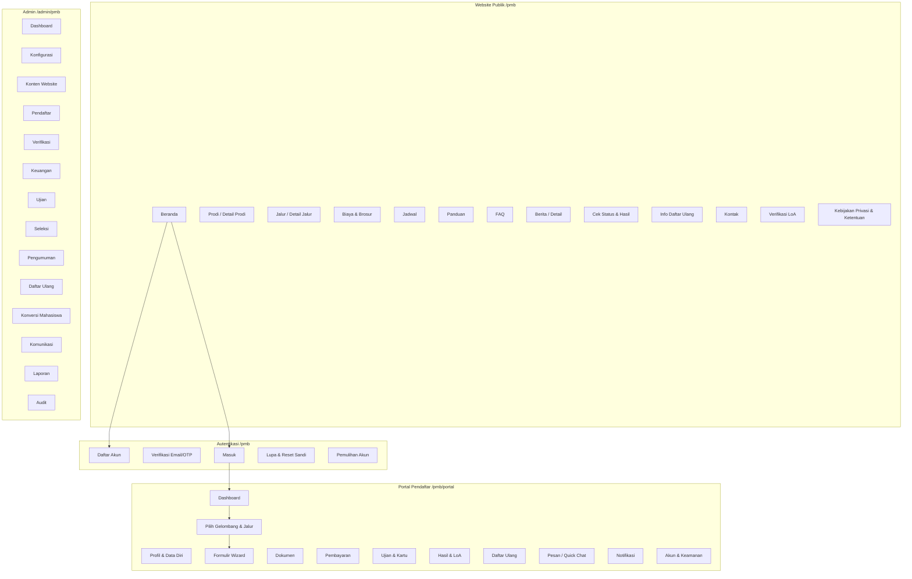
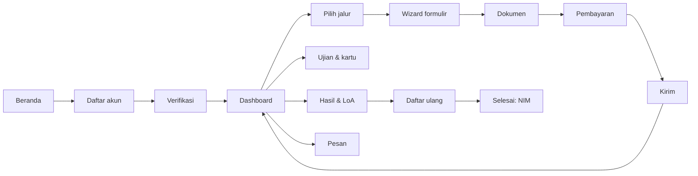
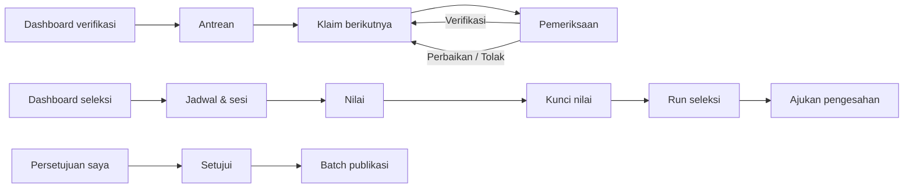

# 12 — Sitemap dan Rancangan UI/UX

[← Kembali ke dokumen utama](../RANCANGAN_SISTEM_PENERIMAAN_MAHASISWA_BARU_PMB.md)

Front-end: `frontend/` (React 19, react-router 7, Tailwind 3, zustand, axios) — mengikuti struktur `frontend/src/pages/<area>`. Area baru: `pages/pmb/public`, `pages/pmb/portal`, `pages/pmb/admin`.

---

## 1. Prinsip UI/UX

| Prinsip | Penerapan |
|---|---|
| Calon mahasiswa awam & seluler | Bahasa sederhana, satu tugas per layar, wizard bertahap dengan indikator progres, CTA tunggal yang jelas, target sentuh ≥ 44 px, dapat dipakai pada lebar 360 px & koneksi lambat |
| Petugas volume tinggi | Tabel padat server-side, filter tersimpan, pintasan keyboard (`J/K` aplikasi berikutnya/sebelumnya, `A` setujui dokumen, `R` tolak), panel berdampingan (data ↔ dokumen), aksi tanpa pindah halaman |
| Konsistensi | Satu komponen badge status per state machine dengan warna & ikon tetap (lihat §6); istilah sama dengan glosarium |
| Transparansi | Pendaftar selalu melihat "apa langkah berikutnya" dan batas waktunya; alasan penolakan ditampilkan apa adanya (kecuali kode sensitif) |
| Aman secara default | Data sensitif dimasking; aksi destruktif/irreversible memakai dialog konfirmasi berisi ringkasan dampak; aksi kritis meminta alasan |
| Aksesibilitas | WCAG 2.1 AA (lihat [03 §B.5](03-spesifikasi-konfigurasi-dan-website.md#b5-navigasi-mobile-aksesibilitas-seo)) |

### 1.1 Konvensi state (berlaku untuk semua halaman kecuali disebut lain)

| State | Perilaku standar |
|---|---|
| Loading | Skeleton sesuai tata letak (bukan spinner layar penuh); tombol aksi menampilkan spinner & dinonaktifkan selama request |
| Empty | Ilustrasi kecil + kalimat penyebab + aksi utama (mis. "Belum ada gelombang. [Buat gelombang]"); untuk hasil filter kosong: "Tidak ada data sesuai filter. [Reset filter]" |
| Error | Toast untuk error aksi; banner di halaman untuk gagal memuat dengan tombol "Coba lagi"; error validasi ditampilkan per field (dari `errors`) dan ringkasan di atas form; 403 → halaman "Tidak berizin"; 409 `VERSION_CONFLICT` → dialog "Data telah diubah pengguna lain. [Muat ulang]" |
| Success | Toast singkat; untuk tonggak penting (kirim formulir, bayar, terima tawaran, enrolled) halaman/kartu sukses dengan langkah berikutnya |
| Offline (portal) | Banner "Anda sedang offline. Perubahan akan disimpan saat koneksi kembali." — autosave antre lokal (draft) |

### 1.2 Responsivitas

| Breakpoint | Publik & portal | Admin |
|---|---|---|
| < 640 px | Satu kolom, menu drawer, tabel → kartu, stepper ringkas (Langkah 3/7) | Dukungan terbatas: dashboard, antrean (kartu), keputusan sederhana; verifikasi dokumen disarankan desktop (banner info) |
| 640–1024 px | Dua kolom pada halaman info | Sidebar ringkas (ikon), tabel dengan kolom prioritas |
| ≥ 1024 px | Lebar konten maks 1200 px | Sidebar penuh, panel berdampingan |

---

## 2. Sitemap

### 2.1 Peta keseluruhan



### 2.2 Struktur menu admin (dibatasi permission)

| Menu | Submenu | Dashboard per role |
|---|---|---|
| Dashboard | Ringkasan | Semua role staf (konten berbeda) |
| Konfigurasi | Periode & Gelombang · Jalur · Sistem Kuliah · Kuota · Persyaratan Dokumen · Biaya · Template Formulir · Skema Seleksi · Profil Prodi · Template Notifikasi · Pengaturan · Pengaturan NIM | Administrator |
| Konten Website | Halaman · FAQ · Berita · Brosur · Banner · Dokumen Legal | Administrator |
| Pendaftar | Daftar Pendaftar · Flag Duplikat · Pendaftaran Loket | Administrator, fakultas, prodi |
| Verifikasi | Antrean Saya · Semua Antrean · Penugasan | **Dashboard verifikasi** |
| Keuangan | Tagihan · Transaksi · Bukti Manual · Pembayaran Loket · Rekonsiliasi · Refund · Perlu Resolusi | **Dashboard keuangan** |
| Ujian | Lokasi & Ruang · Jadwal & Sesi · Penguji · Kehadiran · Nilai Saya (penguji) · Impor Nilai | **Dashboard seleksi** |
| Seleksi | Matriks Nilai · Proses Seleksi (run) · Koreksi Nilai | **Dashboard seleksi** |
| Pengumuman | Persetujuan Saya · Batch Publikasi · Keputusan · Promosi Cadangan · Koreksi Hasil | Pimpinan/pengesah |
| Daftar Ulang | Antrean · Semua · Kedaluwarsa | **Dashboard daftar ulang** |
| Konversi Mahasiswa | Antrean Konversi | Administrator |
| Komunikasi | Quick Chat · Broadcast · Log Notifikasi | Administrator, verifikator |
| Laporan | Funnel · Pendaftar · Pembayaran · Sumber Informasi · Seleksi · Daftar Ulang · Keuangan · Kuota · Kelengkapan PDDikti · Perbandingan Periode | **Dashboard pimpinan** |
| Audit | Audit Log · Akses Data Sensitif · Log Ekspor | **Dashboard auditor** |

### 2.3 SEO dan performa halaman publik

Halaman publik dirender sebagai HTML yang dapat diindeks (prerender statis per tenant saat konten dipublikasikan, atau SSR ringan) dengan bundle terpisah dari portal/admin. Portal & admin `noindex`.

---

## 3. Inventaris Halaman — Website Publik & Autentikasi

| ID | Halaman | Tujuan | Komponen utama | Form / validasi | Aksi | Catatan state |
|---|---|---|---|---|---|---|
| PUB-01 | Beranda `/pmb` | Pintu masuk, CTA daftar | Header (logo tenant, menu, Masuk/Daftar), hero + hitung mundur gelombang aktif, kartu gelombang, jalur unggulan, prodi unggulan, linimasa, berita, FAQ ringkas, footer kontak | — | Daftar Sekarang, Lihat Prodi | Empty: tidak ada periode terbuka → banner "Pendaftaran belum dibuka, cek jadwal" + form "beri tahu saya" (opsional, consent) |
| PUB-02 | Daftar prodi | Jelajah prodi | Filter jenjang/fakultas/sistem kuliah, pencarian, grid kartu (nama, jenjang, akreditasi, sistem kuliah) | — | Lihat detail | Mobile: filter di bottom sheet |
| PUB-03 | Detail prodi | Info prodi lengkap | Ringkasan, akreditasi + masa berlaku, gelar, durasi, prospek, jalur yang membuka, tabel biaya ringkas, unduh brosur | — | Daftar ke prodi ini (membawa preselect) | 404 slug tidak ada / tidak dipublikasikan |
| PUB-04 | Daftar & detail jalur | Syarat & alur seleksi | Kartu jalur, gelombang terbuka, persyaratan dokumen, komponen seleksi, biaya pendaftaran, jadwal | — | Daftar | — |
| PUB-05 | Biaya & brosur | Transparansi biaya | Pilih prodi & sistem kuliah → rincian komponen, info cicilan & beasiswa, unduh brosur | — | Unduh | Tabel → kartu di mobile |
| PUB-06 | Jadwal | Linimasa | Tab per gelombang, garis waktu tahapan | — | Tambahkan ke kalender (.ics) [R] | — |
| PUB-07 | Panduan | Langkah mendaftar | Langkah bergambar, video opsional | — | — | — |
| PUB-08 | FAQ | Jawaban mandiri | Pencarian, kategori, akordeon | — | Hubungi panitia | — |
| PUB-09 | Berita | Informasi | Daftar paginated, detail | — | — | — |
| PUB-10 | Cek status & hasil | Cek tanpa login | Form no. pendaftaran, tanggal lahir, CAPTCHA; kartu hasil | Format nomor, tanggal valid | Cek, Masuk portal | Error generik "Data tidak ditemukan"; 429 → "Coba lagi dalam 1 menit" |
| PUB-11 | Info daftar ulang | Tata cara | Konten + jadwal | — | Masuk portal | — |
| PUB-12 | Kontak | Hubungi panitia | Info kontak, jam layanan, peta, tombol chat | — | Chat (ke portal) | — |
| PUB-13 | Verifikasi LoA | Keaslian surat | Hasil: valid/dicabut, nama tersamar, prodi, tanggal | — | — | 404 kode tidak dikenal |
| PUB-14 | Legal | Kebijakan privasi & ketentuan | Konten versi aktif + tanggal berlaku | — | — | — |
| AUT-01 | Daftar akun | Membuat akun | Form + indikator kekuatan sandi + checkbox kebijakan (tautan) + checkbox pemasaran opsional + CAPTCHA | Nama ≥ 3 karakter; email valid; HP E.164; sandi ≥ 8, huruf & angka, tidak ada di daftar sandi umum; konfirmasi sama; kebijakan wajib | Daftar | Success: "Cek email Anda untuk verifikasi" (sama walau email sudah terdaftar) |
| AUT-02 | Verifikasi | Verifikasi email/OTP | Status token / input OTP 6 kotak, hitung mundur kirim ulang | 6 digit | Verifikasi, Kirim ulang | Expired → tombol kirim ulang |
| AUT-03 | Masuk | Login | Email/HP, sandi, tampilkan sandi, "ingat perangkat ini" | Wajib | Masuk, Lupa sandi, Daftar | Locked → pesan + waktu tunggu |
| AUT-04 | Lupa & reset | Reset sandi | Form email; form sandi baru | Seperti AUT-01 | Kirim, Simpan | Success generik |
| AUT-05 | Pemulihan akun | Kehilangan akses email/HP | Form identitas + unggah KTP + email baru + CAPTCHA | Wajib | Ajukan | Success: "Permintaan diproses maks 2 hari kerja" |

---

## 4. Inventaris Halaman — Portal Pendaftar

### POR-01 Dashboard pendaftar

* **Tujuan:** menunjukkan status setiap aplikasi dan langkah berikutnya.
* **Komponen:** salam + status verifikasi akun; kartu per aplikasi (gelombang, jalur, no. pendaftaran, badge `current_stage`, progres tahapan horizontal, tenggat terdekat, CTA kontekstual: "Lanjutkan formulir" / "Bayar" / "Perbaiki dokumen" / "Lihat jadwal ujian" / "Lihat hasil" / "Daftar ulang"); pengumuman; tombol "Daftar jalur lain" (bila BR-04 mengizinkan).
* **Empty:** "Anda belum memiliki pendaftaran. [Mulai mendaftar]".
* **Mobile:** kartu ditumpuk; progres menjadi "Tahap 3 dari 7".

### POR-02 Profil & data diri

* **Komponen:** tab Identitas · Pendidikan · Orang Tua/Wali · Prestasi.
* **Form/validasi:** sesuai [04 §D.2](04-spesifikasi-akun-formulir-dokumen.md#d2-spesifikasi-field-inti); field terkunci diberi ikon gembok + tooltip "Hubungi panitia untuk koreksi".
* **Aksi:** Simpan (per tab), Tambah riwayat/prestasi.
* **Modal:** konflik identitas (pesan netral + "Klaim identitas").

### POR-03 Pilih gelombang & jalur

* **Komponen:** daftar kartu wave path terbuka (jalur, gelombang, biaya, tenggat, ringkasan persyaratan, status kelayakan).
* **Aksi:** "Pilih" → dialog konfirmasi (jalur & gelombang tidak dapat diganti setelah aplikasi dibuat; untuk jalur lain buat aplikasi baru).
* **Error:** `APPLICATION_LIMIT_REACHED` → penjelasan batas.

### POR-04 Formulir wizard

```text
┌───────────────────────────────────────────────────────────────┐
│ PMB 2027 · Reguler · Gelombang 1        Tenggat: 31 Mar 23:59  │
│ ● Identitas ─ ● Pendidikan ─ ◐ Pilihan Prodi ─ ○ Pendukung ─   │
│ ○ Dokumen ─ ○ Pembayaran ─ ○ Kirim                             │
├───────────────────────────────────────────────────────────────┤
│ Pilihan Program Studi                                          │
│  Pilihan 1  [ S1 Informatika ▾ ]  [ Reguler ▾ ]                │
│  Pilihan 2  [ S1 Sistem Informasi ▾ ] [ Reguler ▾ ]  [Hapus]   │
│  (i) Anda dapat memilih hingga 2 program studi.                │
│                                                                │
│  Tersimpan otomatis 10:42                                      │
├───────────────────────────────────────────────────────────────┤
│ [ ← Sebelumnya ]                        [ Simpan & Lanjut → ]  │
└───────────────────────────────────────────────────────────────┘
```

* **Komponen:** stepper (status per langkah: lengkap/belum/error), formulir langkah, indikator autosave, ringkasan kesalahan.
* **Validasi:** klien (UX) + server (otoritatif) saat simpan langkah & saat kirim.
* **Langkah Kirim:** ringkasan seluruh data (read-only, dapat kembali ke langkah), daftar pernyataan (checkbox per pernyataan, tautan teks lengkap), tombol "Kirim Formulir".
* **Modal:** konfirmasi kirim ("Data tidak dapat diubah setelah dikirim kecuali diminta panitia"); konflik versi.
* **Success:** halaman sukses dengan nomor pendaftaran besar, tombol salin, unduh bukti pendaftaran, langkah berikutnya.
* **Error:** `INCOMPLETE_APPLICATION` → kembali ke langkah pertama yang bermasalah dan menyorot field.
* **Mode revisi:** banner kuning berisi catatan petugas & tenggat; hanya field/dokumen target yang aktif.

### POR-05 Dokumen

* **Komponen:** daftar persyaratan (nama, keterangan, format & ukuran maks, badge status, alasan penolakan), area unggah (drag & drop / kamera di mobile), pratinjau, riwayat versi (ringkas).
* **Validasi klien:** ekstensi & ukuran sebelum unggah; server tetap memvalidasi.
* **State khusus:** "Sedang dipindai" (polling ringan) → "Siap"; "Ditolak: Dokumen buram — unggah ulang".
* **Mobile:** tombol "Ambil foto" memakai kamera; kompresi gambar sisi klien ≤ batas ukuran.

### POR-06 Pembayaran

* **Komponen:** kartu tagihan (nomor, rincian, potongan, total, tenggat), pilihan kanal (ikon bank/QRIS/e-wallet, biaya admin), panel instruksi (nomor VA dengan tombol salin, QR, hitung mundur kedaluwarsa, langkah per kanal), riwayat transaksi, unduh kuitansi.
* **Form:** kode voucher (Phase 2); transfer manual: unggah bukti + bank asal + nama pengirim + tanggal + nominal.
* **Aksi:** Bayar, Ganti metode (membatalkan pending), Saya sudah bayar (memicu cek status, bukan mengubah status).
* **State:** pending → polling 15 detik selama halaman terbuka (berhenti setelah 10 menit, tombol "Cek status"); success → konfeti ringan + langkah berikutnya; expired → "Instruksi kedaluwarsa, buat yang baru".

### POR-07 Ujian & kartu peserta

* **Komponen:** daftar jadwal (komponen, tanggal, sesi, lokasi + peta / tautan online, tata tertib), unduh kartu peserta, status kehadiran setelah ujian, ajukan jadwal ulang.
* **Empty:** "Jalur Anda tidak memerlukan ujian" atau "Jadwal akan diumumkan pada {tanggal}".

### POR-08 Hasil & LoA

* **Komponen:** sebelum publikasi: "Hasil akan diumumkan pada {tanggal, jam}" (tanpa indikasi hasil). Setelah: kartu keputusan (diterima → prodi, sistem kuliah, batas daftar ulang, tombol "Daftar Ulang", unduh LoA; cadangan → posisi tidak ditampilkan angka pasti [K], penjelasan proses; tidak diterima → pesan empatik + info gelombang/jalur lain yang masih terbuka).
* **Koreksi:** banner "Hasil Anda telah diperbarui pada {tanggal}" dengan catatan.

### POR-09 Daftar ulang

```text
┌──────────────────────────────────────────────┐
│ Daftar Ulang · S1 Informatika (Reguler)       │
│ Batas: 20 Jun 2027 23:59 (5 hari lagi)        │
├──────────────────────────────────────────────┤
│ ✔ Terima tawaran                              │
│ ◐ Data lanjutan (PDDikti)        [Lengkapi]   │
│ ○ Data orang tua/wali            [Lengkapi]   │
│ ○ Dokumen final (2/3)            [Unggah]     │
│ ○ Pembayaran biaya awal          [Bayar]      │
│   Total Rp 12.500.000 · Min. Rp 5.000.000     │
├──────────────────────────────────────────────┤
│        [ Kirim untuk divalidasi ] (nonaktif)  │
└──────────────────────────────────────────────┘
```

* **Modal:** terima tawaran (pernyataan + peringatan bahwa tawaran lain akan ditarik); tolak tawaran (konfirmasi dua langkah, ketik "TOLAK").
* **Success (enrolled):** kartu "Selamat! NIM Anda: 2710xxxx", unduh bukti registrasi, cara aktivasi akun mahasiswa, info orientasi.
* **State `approved` sebelum `enrolled`:** "Data mahasiswa sedang dibuat" (biasanya < 5 menit).

### POR-10 s.d. POR-12

| ID | Halaman | Komponen & aksi | State |
|---|---|---|---|
| POR-10 | Pesan (quick chat) | Daftar percakapan, utas pesan, lampiran (dipindai), status dibaca, jam layanan | Empty: "Ada pertanyaan? Mulai percakapan" |
| POR-11 | Notifikasi | Daftar notifikasi in-app, tandai dibaca | — |
| POR-12 | Akun & keamanan | Ubah sandi, ubah email/HP, sesi aktif (cabut), riwayat consent, unduh data saya [R UU PDP], ajukan hapus akun | Hapus akun ditolak bila ada aplikasi non-terminal |

---

## 5. Inventaris Halaman — Admin

Format: **Tujuan · Role · Komponen · Kolom tabel · Filter · Form/validasi · Aksi · Modal · State khusus · Mobile/desktop**.

### 5.1 Dashboard

| ID | Halaman | Spesifikasi |
|---|---|---|
| ADM-01 | Dashboard admin PMB | **Role:** `pmb_admin`. **Komponen:** pemilih periode/gelombang; kartu KPI (akun, pendaftar, bayar, verified, lulus, daftar ulang, enrolled); funnel; tren harian; tabel kuota (kapasitas, diterima, enrolled, %); peringatan operasional (antrean verifikasi > SLA, konversi gagal, item rekonsiliasi terbuka, skema belum terkunci H-3, batch publikasi terjadwal). **Aksi:** klik KPI → daftar terfilter. **Mobile:** KPI & peringatan saja. |
| ADM-02 | Dashboard verifikasi | **Role:** `pmb_verifier`. Antrean saya, jumlah menunggu per jalur, rata-rata waktu proses, tombol besar "Ambil berikutnya", dokumen ditolak terbanyak (alasan). |
| ADM-03 | Dashboard keuangan | **Role:** `finance_officer`. Penerimaan hari ini/periode per jenis & kanal, bukti manual menunggu, rekonsiliasi terbuka, perlu resolusi, refund menunggu, piutang biaya awal. |
| ADM-04 | Dashboard seleksi | **Role:** `selection_committee`. Peserta per jadwal, kehadiran, kelengkapan nilai per komponen, sesi belum dikunci, status run per wave path, seri belum terselesaikan. |
| ADM-05 | Dashboard daftar ulang | **Role:** `re_registration_officer`. Antrean submitted, mendekati batas, kedaluwarsa hari ini, konversi gagal. |
| ADM-06 | Dashboard pimpinan | **Role:** `leadership`. Funnel agregat, pencapaian kuota per fakultas/prodi, tren & perbandingan periode, sumber informasi, pendapatan PMB (agregat), persetujuan menunggu. Tanpa daftar nama. |
| ADM-07 | Dashboard auditor | **Role:** `auditor`. Ringkasan perubahan kritis (override, koreksi, perubahan konfigurasi setelah buka), akses data sensitif per pengguna, ekspor data pribadi, transisi manual di luar jam kerja. |

### 5.2 Konfigurasi

| ID | Halaman | Spesifikasi |
|---|---|---|
| ADM-10 | Periode & gelombang | **Kolom:** kode, nama, term masuk, rentang, status, jumlah gelombang, pendaftar. **Filter:** status, term. **Form periode:** kode, nama, term (dropdown `academic_terms`), tanggal (validasi urutan). **Detail periode:** tab Gelombang (tabel + form tanggal tahapan dengan validasi BR-02 inline & linimasa visual), tab Gelombang-Jalur, tab Kuota, tab Biaya. **Aksi:** Publikasikan (dialog daftar periksa kelengkapan), Tutup, Arsipkan, Perpanjang tanggal (modal alasan). **State:** konfigurasi terkunci → field readonly + ikon gembok + tooltip alasan (BR-03). |
| ADM-11 | Jalur & sistem kuliah | CRUD tabel; kolom kode, nama, kategori, jenjang, berujian, aktif; nonaktifkan (bukan hapus) bila dipakai. |
| ADM-12 | Gelombang-jalur | **Kolom:** jalur, biaya, waktu bayar, maks pilihan, template (versi), skema (versi + status), terbuka. **Form:** sesuai FR-CFG-04; dropdown template hanya `published`, skema hanya `locked`. **Aksi:** saklar darurat buka/tutup (modal alasan). |
| ADM-13 | Kuota | **Tampilan matriks:** baris prodi, kolom jalur × sistem kuliah; sel = kapasitas (edit inline), cadangan, ambang; indikator diterima/kapasitas. **Aksi:** simpan massal, salin dari periode lain, impor/ekspor XLSX. **Validasi:** kapasitas ≥ diterima. |
| ADM-14 | Persyaratan dokumen | Katalog jenis dokumen (CRUD) + matriks wave path × jenis dokumen (wajib/opsional/tahap/kondisi). |
| ADM-15 | Biaya | Tabel komponen per prodi × sistem × jalur; editor rencana cicilan (validasi Σ 100%); pratinjau tagihan untuk kombinasi. |
| ADM-16 | Template formulir | Daftar template & versi; **editor:** daftar field per seksi (drag untuk urutan), panel properti field (tipe, label, wajib, validasi, aturan tampil dengan pembuat kondisi visual, sensitif, dapat dilaporkan), pratinjau langsung (mobile/desktop). **Aksi:** Publikasikan (modal "versi tidak dapat diubah"), Buat versi baru. |
| ADM-17 | Skema seleksi | Editor komponen (sumber, rentang, bobot dengan total & persentase, minimum, wajib, rubrik), ambang, aturan tie-break (urutan drag), **simulasi** (unggah/isi contoh nilai → hasil hitung dan alokasi, menampilkan contoh perhitungan seperti 06 §H.4.5). **Aksi:** Kunci (modal konfirmasi + ringkasan). |
| ADM-18 | Profil prodi | Editor rich text, unggah sampul & brosur, akreditasi; pratinjau halaman publik; Publikasikan. Scope prodi/fakultas. |
| ADM-19 | Template notifikasi | Daftar event × kanal; editor subjek/badan dengan placeholder yang diizinkan (autocomplete), pratinjau dengan data contoh, kirim uji. |
| ADM-20 | Pengaturan & NIM | Form pengaturan `pmb.*` (dikelompokkan); pengaturan NIM: pembuat format berbasis token (`{YY}`, `{YYYY}`, `{PRODI}`, `{JALUR}`, `{SEQ:n}`) + pratinjau. |
| ADM-21 | Konten website | Daftar per tipe; editor (judul, slug, isi, SEO, jadwal tayang, kategori FAQ); versi untuk dokumen legal & pernyataan. |

### 5.3 Pendaftar & verifikasi

**ADM-30 Daftar pendaftar**
* **Role:** `pmb_admin`, fakultas/prodi (scope), verifikator, auditor.
* **Kolom:** no. pendaftaran, nama, jalur, gelombang, pilihan 1 (& 2), badge form/bayar/verifikasi/seleksi/keputusan, dokumen ✓/total, flag, petugas, dikirim.
* **Filter:** periode, gelombang, jalur, prodi (pilihan mana pun/pilihan 1), sistem kuliah, setiap status, rentang tanggal, ada flag, sumber informasi; pencarian nama/nomor/email; filter tersimpan.
* **Aksi:** buka detail, ekspor (modal alasan + pilihan kolom sesuai izin), tugaskan (massal), buat pendaftaran loket.
* **Desktop:** tabel dengan kolom dapat diatur; **mobile:** kartu ringkas.

**ADM-31 Detail aplikasi** — tab: Ringkasan · Data · Dokumen · Pembayaran · Ujian & Nilai · Keputusan · Daftar Ulang · Linimasa (history + audit) · Catatan. Tombol "Tampilkan" untuk field sensitif (modal tujuan; dicatat).

**ADM-32 Pemeriksaan verifikasi**

```text
┌────────────────────────────┬───────────────────────────────────┐
│ PMB2027-REG-000123 · Andi  │  [ KTP ▾ ]  v2  ⟲ ⤢  1/1          │
│ Reguler · Gel. 1 · Klaim:  │ ┌───────────────────────────────┐ │
│ Anda (sisa 24 mnt)         │ │                               │ │
│ ─ Identitas ─────────────  │ │      (penampil dokumen)        │ │
│ Nama   Andi Pratama        │ │                               │ │
│ NIK    3201********0003 👁 │ └───────────────────────────────┘ │
│ Lahir  Bogor, 17-05-2008   │ [✔ Setujui] [↺ Minta perbaikan]   │
│ ─ Pendidikan ────────────  │ [✖ Tolak]  Alasan: [ ▾ ]          │
│ SMAN 1 Bogor · IPA · 2027  │ ───────────────────────────────── │
│ ─ Checklist ─────────────  │ Dokumen: ✔Foto ✔KTP ◐Rapor ○SKL   │
│ ☑ Usia memenuhi            │ Pembayaran: ✔ Lunas (VA BNI)      │
│ ☑ Lulusan SMA/sederajat    │ Flag duplikat: tidak ada          │
├────────────────────────────┴───────────────────────────────────┤
│ [Lepas klaim]      [Minta perbaikan aplikasi] [Tolak] [Verifikasi]│
│                                         [Berikutnya ▸ (J)]       │
└────────────────────────────────────────────────────────────────┘
```

* **Validasi:** tombol "Verifikasi" aktif hanya bila BR-22 terpenuhi (tooltip daftar kekurangan).
* **Modal:** tolak (kode alasan wajib, catatan untuk pendaftar wajib, catatan internal opsional, ringkasan dampak); minta perbaikan (pilih field & dokumen target, catatan, tenggat default terisi).
* **State:** klaim kedaluwarsa → banner + tombol klaim ulang; 409 klaim orang lain → kembali ke antrean.

| ID | Halaman | Spesifikasi |
|---|---|---|
| ADM-33 | Penugasan verifikasi | Pilih aplikasi (filter) & petugas, strategi (round-robin/per jalur), pratinjau distribusi, terapkan. |
| ADM-34 | Flag duplikat | Kolom: akun, akun terkait, tipe, skor, status; tampilan berdampingan dua profil (sensitif dimasking); aksi: bukan duplikat / konfirmasi duplikat (modal dampak). |
| ADM-35 | Pendaftaran loket | Form registrasi akun + pilih wave path; peringatan bahwa pendaftar menerima email verifikasi. |

### 5.4 Keuangan

| ID | Halaman | Kolom & filter | Aksi & modal |
|---|---|---|---|
| ADM-40 | Tagihan | No. tagihan, no. pendaftaran, nama, jenis, nominal, dibayar, status, tenggat, perlu resolusi · filter jenis/status/gelombang/jalur | Detail (item, transaksi), resolusi (modal: terima & buka / refund) |
| ADM-41 | Transaksi | ID, tagihan, kanal, penyedia, referensi, nominal, status, dibuat, dibayar · filter status/kanal/tanggal | Cek ulang ke gateway, lihat callback terkait |
| ADM-42 | Bukti manual | Pratinjau bukti, pengirim, bank, tanggal, nominal, nominal tagihan (selisih disorot), saran pencocokan mutasi | Setujui / tolak (alasan); peringatan duplikat bukti |
| ADM-43 | Pembayaran loket | Cari tagihan, form nominal & no. kuitansi | Catat (konfirmasi), cetak kuitansi |
| ADM-44 | Rekonsiliasi | Batch per tanggal/penyedia (total, cocok, terbuka); detail item per hasil | Tarik settlement, impor mutasi, resolusi item, tutup batch |
| ADM-45 | Refund | Daftar & status approval; form pengajuan (rekening dimasking setelah simpan) | Ajukan, catat selesai (unggah bukti) |

### 5.5 Ujian & seleksi

| ID | Halaman | Spesifikasi |
|---|---|---|
| ADM-50 | Lokasi & ruang | CRUD; kolom kapasitas, aksesibel, fasilitas. |
| ADM-51 | Jadwal & sesi | Kalender/linimasa per gelombang; daftar sesi (ruang, waktu, kapasitas, terisi, penguji); aksi bagi otomatis (modal strategi + pratinjau), publikasi; deteksi bentrok inline. |
| ADM-52 | Detail sesi | Daftar peserta (no. peserta, nama, foto, kehadiran), check-in QR (kamera, mode layar penuh untuk tablet di pintu ruang), cetak daftar hadir, pindah peserta, kunci nilai. |
| ADM-53 | Nilai saya (penguji) | Daftar sesi ditugaskan; form rubrik per peserta (kriteria, skor, catatan), navigasi cepat antarpeserta, simpan otomatis, indikator kelengkapan; nilai terkunci → readonly. **Data peserta minimal** (tanpa NIK/kontak). Mobile/tablet didukung penuh (wawancara). |
| ADM-54 | Impor nilai | Unduh template, unggah, tabel validasi (baris valid/galat), commit. |
| ADM-55 | Matriks nilai | Baris aplikasi, kolom komponen (mentah & normalisasi), kelengkapan; filter wave path/kelengkapan; koreksi (alasan) bila belum terkunci; ajukan koreksi bila terkunci. |
| ADM-56 | Proses seleksi (run) | Daftar run per wave path (status, dibuat, hash); detail: ringkasan (eligible, gugur per alasan, distribusi skor histogram), tabel ranking per prodi (rank, skor, komponen, rekomendasi, pilihan ditempatkan, cadangan), panel seri, override (modal alasan), ajukan pengesahan (modal ringkasan). |

### 5.6 Pengumuman, daftar ulang, konversi, komunikasi, laporan, audit

| ID | Halaman | Spesifikasi |
|---|---|---|
| ADM-60 | Persetujuan saya | Memakai halaman approval yang ada (`pages/approvals`) dengan tampilan khusus PMB: ringkasan run (per prodi: kapasitas, diterima, cadangan, tidak), override, hash, pengaju; aksi setujui/kembalikan/tolak (catatan). |
| ADM-61 | Batch publikasi | Jadwal, status, jumlah keputusan; undur jadwal (alasan), batalkan. |
| ADM-62 | Keputusan & promosi cadangan | Per kuota: kapasitas, diterima aktif, kursi kosong, cadangan tersisa; tombol "Promosikan berikutnya" (modal: siapa yang akan dipromosikan, tenggat). |
| ADM-63 | Koreksi hasil | Form pengajuan (aplikasi, alasan, bukti, usulan); riwayat koreksi & versi keputusan. |
| ADM-64 | Antrean daftar ulang | Kolom: nama, prodi, status, checklist (ikon), pembayaran (dibayar/minimum), batas; filter status/prodi/batas. |
| ADM-65 | Pemeriksaan daftar ulang | Mirip ADM-32: data lanjutan, dokumen final, pembayaran, checklist manual (centang + catatan), aksi minta perbaikan / setujui (dinonaktifkan dengan alasan bila SoD). |
| ADM-66 | Antrean konversi | Kolom: aplikasi, NIM, status, langkah selesai, percobaan, error terakhir, berikutnya; aksi coba lagi (modal). |
| ADM-67 | Quick chat | Kotak masuk (filter status/penanggung jawab), utas, templat balasan cepat, tugaskan, tutup. SLA ditampilkan. |
| ADM-68 | Broadcast | Form (kanal, audiens dengan pembuat filter, subjek, isi, pratinjau), hitung penerima, jadwal; riwayat & statistik kirim. Peringatan konten tidak boleh memuat data sensitif. |
| ADM-69 | Laporan | Pemilih laporan, filter, tabel + grafik, ekspor (modal alasan & kolom), daftar ekspor saya. |
| ADM-70 | Audit | Tabel audit (waktu, pengguna, aksi, objek, ringkasan perubahan diff), filter; log akses sensitif; log ekspor. Hanya baca. |

---

## 6. Komponen bersama

| Komponen | Spesifikasi |
|---|---|
| `StatusBadge` | Props `machine` (SM-xx) + `status`; peta warna: netral (draft/not_started), biru (in_review/pending/scheduled), kuning (revision_requested/waitlisted/awaiting), hijau (verified/paid/approved/accepted/enrolled/succeeded), merah (rejected/failed/expired/cancelled), abu (void/withdrawn/superseded). Selalu dengan teks + ikon (tidak hanya warna). |
| `StageProgress` | Progres tahapan pendaftar dari `current_stage`. |
| `Deadline` | Tanggal absolut + relatif ("3 hari lagi"), merah bila < 24 jam, zona waktu tenant. |
| `MaskedField` | Menampilkan nilai tersamar + tombol "Tampilkan" (memanggil endpoint reveal dengan tujuan). |
| `DocumentViewer` | PDF/gambar, zoom, rotasi, navigasi halaman, unduh (jika diizinkan). |
| `ReasonDialog` | Dialog aksi kritis: kode alasan (opsional), catatan wajib, ringkasan dampak, konfirmasi. |
| `DataTable` | Server-side pagination/sort/filter (`ListQuery`), pilihan kolom, filter tersimpan, ekspor. |
| `FormRenderer` | Merender field dinamis dari `pmb_form_fields` + aturan tampil, berbagi validator sisi klien. |

---

## 7. Alur navigasi utama




